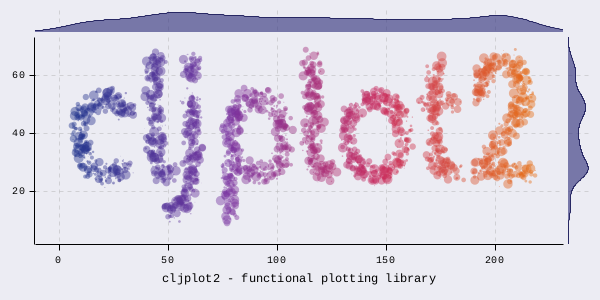

<p align="center">
  
</p>

# cljplot2

A plotting library for Clojure: plots are plain maps of data, mappings and charts, built and rendered by functions.
No DSL, no grammar of graphics - a chart is a value, a plot is a map you can build, merge and edit with
`clojure.core`.

- Pure JVM: renders `BufferedImage`s and image files, no browser or JavaScript.
- Built on [fastmath](https://github.com/generateme/fastmath) (statistics, distributions, layouts),
  [wadogo](https://github.com/scicloj/wadogo) (scales), [clojure2d](https://github.com/Clojure2D/clojure2d)
  (drawing, colours) and [malli](https://github.com/metosin/malli) (validated options with readable errors).
- Charts: scatter, line, bar, histogram, density, box, violin, ribbon, smooth, heatmaps, 2D fields and contours,
  Q-Q / P-P, treemap, sunburst, circle packing, waffle, Venn, networks, dendrograms, chord, arc and sankey diagrams,
  and more; facets, polar coordinates, margins, multiplots.

## Install

There's no release yet. Use a git coordinate in `deps.edn`:

```clojure
io.github.generateme/cljplot2 {:git/sha "322c81a664db2c33ccd6022ab5835c7316576efc"}
```

cljplot2 depends on SNAPSHOT versions: fastmath `3.0.0-alpha10-SNAPSHOT` is on Clojars; clojure2d
`1.5.0-alpha3-SNAPSHOT` and wadogo `1.1.0-alpha2-SNAPSHOT` aren't yet - install them locally from their repositories.

## Example

```clojure
(require '[cljplot2.core :as plot]
         '[cljplot2.chart :as chart]
         '[clojure2d.core :as c2d])

(def data
  (for [series ["sin" "cos"]
        x (range 0 6.3 0.1)]
    {:x x :y ((if (= series "sin") Math/sin Math/cos) x) :series series}))

(-> {:data data
     :mapping {:x :x :y :y :color :series}
     :charts [(chart/line) (chart/scatter)]
     :labels {:title "Hello, cljplot2"}}
    (plot/render-image {:width 600 :height 350})
    (c2d/save "example.png"))
```

<p align="center">
  
</p>

## Documentation

The book: <https://generateme.github.io/cljplot2/> - use cases after the
[R Graph Gallery](https://r-graph-gallery.com/) and [data-to-viz](https://www.data-to-viz.com/):

- [Distribution](https://generateme.github.io/cljplot2/use_cases.distribution.html)
- [Colors](https://generateme.github.io/cljplot2/use_cases.colors.html)
- [Evolution](https://generateme.github.io/cljplot2/use_cases.evolution.html)
- [Ranking](https://generateme.github.io/cljplot2/use_cases.ranking.html)
- [Part of a whole](https://generateme.github.io/cljplot2/use_cases.part_of_a_whole.html)
- [Correlation](https://generateme.github.io/cljplot2/use_cases.correlation.html)
- [Flow](https://generateme.github.io/cljplot2/use_cases.flow.html)

Galleries (in progress): cljplot extras - the examples of the original
[cljplot](https://github.com/generateme/cljplot) (Q-Q / P-P, ACF, vector fields, complex functions, ...); lattice
and Vega galleries are planned.

Every public function has a docstring; namespaces: `cljplot2.core` (build, render, builders), `cljplot2.chart`
(charts), `cljplot2.data.*` (row and layout functions).

## Development

```shell
clojure -M:test     # tests
clojure -M:check    # reflection and boxed-math warnings
clojure -M:demo     # demo images to results/ (and the logo to img/)
clojure -M:clay     # the book into docs/
```

## License

Copyright © GenerateMe and contributors.

Distributed under the [Eclipse Public License 2.0](LICENSE).
