---
format:
  html: {toc: true, toc-location: right, toc-depth: 4, theme: cosmo}
code-block-background: true

---
<style></style><style>.printedClojure .sourceCode {
  background-color: transparent;
  border-style: none;
}
</style><style>.clay-limit-image-width .clay-image {max-width: 100%}
.clay-side-by-side .sourceCode {margin: 0}
.clay-side-by-side {margin: 1em 0}
</style>
<script src="https://code.jquery.com/jquery-3.6.0.min.js" type="text/javascript"></script><script src="https://code.jquery.com/ui/1.13.1/jquery-ui.min.js" type="text/javascript"></script>

# Lattice

The figures of Deepayan Sarkar's *Lattice: Multivariate Data Visualization with R* (Springer 2008), rebuilt with
cljplot2 - a section per chapter, a block per figure. The R code of every figure is on the book's
[figures page](http://lmdvr.r-forge.r-project.org/figures/figures.html); each block links its figure there.

The figures show the same information as the originals; styling differs, and the code is cljplot2's own (plain
plot maps, data prepared in Clojure). Lattice's banking (`aspect = "xy"`) is replaced by the image size, its
strips by cljplot2 facet strips. Data are the book's, exported from R (see the dataset notes under each figure).

Not here: chapter 12 (interactive displays) and a few figures outside the medium - each is listed in its chapter.


::: {.sourceClojure}
```clojure
(ns galleries.lattice
  (:require [clojure.string :as str]
            [fastmath.core :as m]
            [fastmath.ml.regression :as regression]
            [fastmath.random :as r]
            [fastmath.stats :as stats]
            [cljplot2.chart :as chart]
            [cljplot2.core :as plot]
            [cljplot2.data.levels :as levels]
            [cljplot2.data.shingle :as shingle]
            [notebook-utils :as nu]))
```
:::


::: {.sourceClojure}
```clojure
(defn- figure-url
  "Permalink of LMDVR figure `chapter`.`figure` on the book's figures page."
  [chapter figure]
  (format "http://lmdvr.r-forge.r-project.org/figures/figures.html?chapter=%02d;figure=%02d_%02d;theme=stdColor;code=right"
          chapter chapter figure))
```
:::


::: {.printedClojure}
```clojure
#'galleries.lattice/figure-url

```
:::


::: {.sourceClojure}
```clojure
(def chem97 (nu/dataset :chem97))
```
:::


::: {.sourceClojure}
```clojure
(def oats (nu/dataset :oats))
```
:::


::: {.sourceClojure}
```clojure
(def barley (nu/dataset :barley))
```
:::


::: {.sourceClojure}
```clojure
(def titanic (nu/dataset :titanic))
```
:::


::: {.sourceClojure}
```clojure
(def faithful (nu/dataset :faithful))
```
:::


::: {.sourceClojure}
```clojure
(def gvhd10 (nu/dataset :gvhd10))
```
:::


::: {.sourceClojure}
```clojure
(def quakes (nu/dataset :quakes))
```
:::


::: {.sourceClojure}
```clojure
(def va-deaths (nu/dataset :va-deaths))
```
:::


::: {.sourceClojure}
```clojure
(def postdoc (nu/dataset :postdoc))
```
:::


::: {.sourceClojure}
```clojure
(def earthquake (nu/dataset :earthquake))
```
:::


::: {.sourceClojure}
```clojure
(def seatac (nu/dataset :seatac-weather))
```
:::


::: {.sourceClojure}
```clojure
(def us-arrests (nu/dataset :us-arrests))
```
:::


::: {.sourceClojure}
```clojure
(def states (nu/dataset :states))
```
:::


::: {.sourceClojure}
```clojure
(def mtcars (nu/dataset :mtcars))
```
:::


## Chapter 1 - Introduction


### Fig 1.1 Histograms

GCSE scores of the A-level chemistry candidates, a panel per A-level score.

Source: [Lattice Fig 1.1](http://lmdvr.r-forge.r-project.org/figures/figures.html?chapter=01;figure=01_01;theme=stdColor;code=right). Data: A-level chemistry scores, England 1997, R mlmRev package `Chem97` (Yang et al. 2002); licence: GPL (>= 2) (mlmRev).


::: {.sourceClojure}
```clojure
(plot/render-image
 {:data chem97
  :mapping {:x :gcsescore :facet :score}
  :charts [(chart/histogram)]
  :facets {:columns 3}
  :labels {:x "gcsescore" :y "Percent of Total"}}
 {:width 800 :height 500})
```
:::


::: {.clay-image}

:::


### Fig 1.2 Densities

Source: [Lattice Fig 1.2](http://lmdvr.r-forge.r-project.org/figures/figures.html?chapter=01;figure=01_02;theme=stdColor;code=right). Data: A-level chemistry scores, England 1997, R mlmRev package `Chem97` (Yang et al. 2002); licence: GPL (>= 2) (mlmRev).


::: {.sourceClojure}
```clojure
(plot/render-image
 {:data chem97
  :mapping {:x :gcsescore :facet :score}
  :charts [(chart/density)]
  :facets {:columns 3}
  :labels {:x "gcsescore" :y "Density"}}
 {:width 800 :height 500})
```
:::


::: {.clay-image}

:::


### Fig 1.3 Grouped densities

The six densities in one panel, coloured by score; the score is a number, declared categorical for the colours.

Source: [Lattice Fig 1.3](http://lmdvr.r-forge.r-project.org/figures/figures.html?chapter=01;figure=01_03;theme=stdColor;code=right). Data: A-level chemistry scores, England 1997, R mlmRev package `Chem97` (Yang et al. 2002); licence: GPL (>= 2) (mlmRev).


::: {.sourceClojure}
```clojure
(plot/render-image
 {:data chem97
  :mapping {:x :gcsescore :color :score}
  :scales {:color {:type :categorical}}
  :charts [(chart/density)]
  :labels {:x "gcsescore" :y "Density"}}
 {:width 700 :height 450})
```
:::


::: {.clay-image}
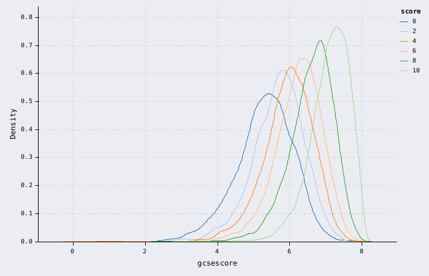
:::


### Fig 1.4 Two plots on a page

Source: [Lattice Fig 1.4](http://lmdvr.r-forge.r-project.org/figures/figures.html?chapter=01;figure=01_04;theme=stdColor;code=right). Data: A-level chemistry scores, England 1997, R mlmRev package `Chem97` (Yang et al. 2002); licence: GPL (>= 2) (mlmRev).


::: {.sourceClojure}
```clojure
(plot/render-image
 (plot/arrange [{:data chem97
                 :mapping {:x :gcsescore :facet :score}
                 :charts [(chart/histogram)]
                 :facets {:columns 2}
                 :labels {:x "gcsescore" :y "Percent of Total"}}
                {:data chem97
                 :mapping {:x :gcsescore :color :score}
                 :scales {:color {:type :categorical :title "score"}}
                 :charts [(chart/density)]
                 :labels {:x "gcsescore" :y "Density"}}]
               {:columns 1})
 {:width 600 :height 800})
```
:::


::: {.clay-image}
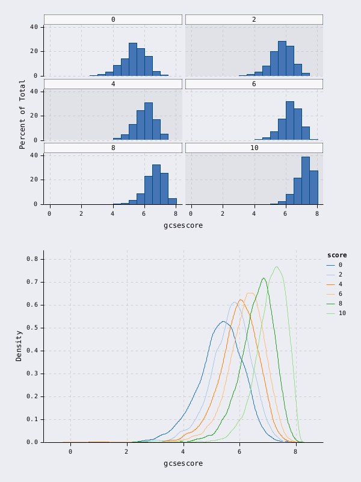
:::


## Chapter 2 - A Technical Overview of lattice


### Fig 2.1 Two conditioning variables

Oat yield by nitrogen, a panel per variety (columns) and block (rows): points joined by lines.

Source: [Lattice Fig 2.1](http://lmdvr.r-forge.r-project.org/figures/figures.html?chapter=02;figure=02_01;theme=stdColor;code=right). Data: Oats yields: split-plot field trial, R MEMSS package `Oats` (Yates 1935; Pinheiro & Bates 2000); licence: GPL (>= 2) (MEMSS).


::: {.sourceClojure}
```clojure
(plot/render-image
 {:data oats
  :mapping {:x :nitro :y :yield :facet-col :variety :facet-row :block}
  :charts [(chart/line) (chart/scatter)]
  :labels {:x "nitro" :y "yield"}}
 {:width 700 :height 800})
```
:::


::: {.clay-image}
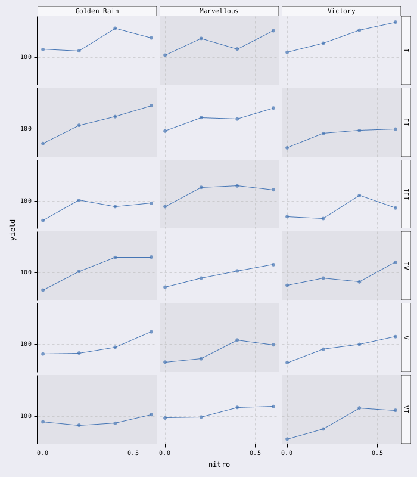
:::


### Fig 2.2 One block

Source: [Lattice Fig 2.2](http://lmdvr.r-forge.r-project.org/figures/figures.html?chapter=02;figure=02_02;theme=stdColor;code=right). Data: Oats yields: split-plot field trial, R MEMSS package `Oats` (Yates 1935; Pinheiro & Bates 2000); licence: GPL (>= 2) (MEMSS).


::: {.sourceClojure}
```clojure
(plot/render-image
 {:data (filterv #(= "I" (:block %)) oats)
  :mapping {:x :nitro :y :yield :facet :variety}
  :charts [(chart/line) (chart/scatter)]
  :facets {:columns 3}
  :labels {:x "nitro" :y "yield"}}
 {:width 800 :height 450})
```
:::


::: {.clay-image}

:::


### Fig 2.3 Banked to 45 degrees

Lattice's `aspect = "xy"` chooses the panel shape from the slopes of the lines; here the image is narrow instead.

Source: [Lattice Fig 2.3](http://lmdvr.r-forge.r-project.org/figures/figures.html?chapter=02;figure=02_03;theme=stdColor;code=right). Data: Oats yields: split-plot field trial, R MEMSS package `Oats` (Yates 1935; Pinheiro & Bates 2000); licence: GPL (>= 2) (MEMSS).


::: {.sourceClojure}
```clojure
(plot/render-image
 {:data oats
  :mapping {:x :nitro :y :yield :facet-col :variety :facet-row :block}
  :charts [(chart/line) (chart/scatter {:size 3})]
  :labels {:x "nitro" :y "yield"}}
 {:width 380 :height 800})
```
:::


::: {.clay-image}

:::


### Fig 2.4 Eighteen panels in three rows

Source: [Lattice Fig 2.4](http://lmdvr.r-forge.r-project.org/figures/figures.html?chapter=02;figure=02_04;theme=stdColor;code=right). Data: Oats yields: split-plot field trial, R MEMSS package `Oats` (Yates 1935; Pinheiro & Bates 2000); licence: GPL (>= 2) (MEMSS).


::: {.sourceClojure}
```clojure
(plot/render-image
 {:data oats
  :mapping {:x :nitro :y :yield :facet #(str (:block %) " " (:variety %))}
  :charts [(chart/line) (chart/scatter {:size 3})]
  :facets {:columns 6}
  :labels {:x "nitro" :y "yield"}}
 {:width 1000 :height 550})
```
:::


::: {.clay-image}

:::


### Fig 2.5 Gaps between blocks

Lattice widens chosen gaps between panels (`between`); here each block is its own plot, arranged.

Source: [Lattice Fig 2.5](http://lmdvr.r-forge.r-project.org/figures/figures.html?chapter=02;figure=02_05;theme=stdColor;code=right). Data: Oats yields: split-plot field trial, R MEMSS package `Oats` (Yates 1935; Pinheiro & Bates 2000); licence: GPL (>= 2) (MEMSS).


::: {.sourceClojure}
```clojure
(plot/render-image
 (plot/arrange (for [block ["I" "II" "III" "IV" "V" "VI"]]
                 {:data (filterv #(= block (:block %)) oats)
                  :mapping {:x :nitro :y :yield :facet :variety}
                  :charts [(chart/line) (chart/scatter {:size 3})]
                  :scales {:y {:domain [50 180]}}
                  :facets {:columns 3}
                  :labels {:title (str "Block " block) :x nil :y nil}})
               {:columns 2})
 {:width 1000 :height 700})
```
:::


::: {.clay-image}

:::


### Fig 2.6 Dot plot

Barley yield of each variety at six sites, the two years in two colours and shapes. Sites, varieties and years
keep R's factor order (`nu/levels`); lattice fills panels from the bottom, so the sites run top-down reversed.

Source: [Lattice Fig 2.6](http://lmdvr.r-forge.r-project.org/figures/figures.html?chapter=02;figure=02_06;theme=stdColor;code=right). Data: Barley yields, Minnesota 1931-1932, R lattice package `barley` (Immer et al. 1934; Fisher 1971; Cleveland 1993); licence: GPL (>= 2) (lattice).


::: {.sourceClojure}
```clojure
(plot/render-image
 {:data barley
  :mapping {:x :yield :y :variety :color :year :shape :year :facet :site}
  :scales {:y {:domain (nu/levels :barley :variety)}
           :facet {:domain (vec (rseq (nu/levels :barley :site)))}
           :color {:type :categorical :domain (nu/levels :barley :year)}
           :shape {:domain (nu/levels :barley :year)}}
  :charts [(chart/scatter)]
  :facets {:columns 1}
  :theme {:text {:tick-label {:size 8}}}
  :labels {:x "yield" :y nil}}
 {:width 600 :height 800})
```
:::


::: {.clay-image}

:::


### Fig 2.7 Groups within panels

Source: [Lattice Fig 2.7](http://lmdvr.r-forge.r-project.org/figures/figures.html?chapter=02;figure=02_07;theme=stdColor;code=right). Data: Oats yields: split-plot field trial, R MEMSS package `Oats` (Yates 1935; Pinheiro & Bates 2000); licence: GPL (>= 2) (MEMSS).


::: {.sourceClojure}
```clojure
(plot/render-image
 {:data oats
  :mapping {:x :nitro :y :yield :shape :variety :group :variety :facet :block}
  :charts [(chart/line {:color :darkgrey}) (chart/scatter {:color :black :size 6})]
  :facets {:columns 6}
  :labels {:title "Yield of three varieties of oats - a 3 x 4 split plot experiment with 6 blocks"
           :x "Nitrogen concentration (cwt/acre)" :y "Yield (bushels/acre)"}}
 {:width 1000 :height 400})
```
:::


::: {.clay-image}
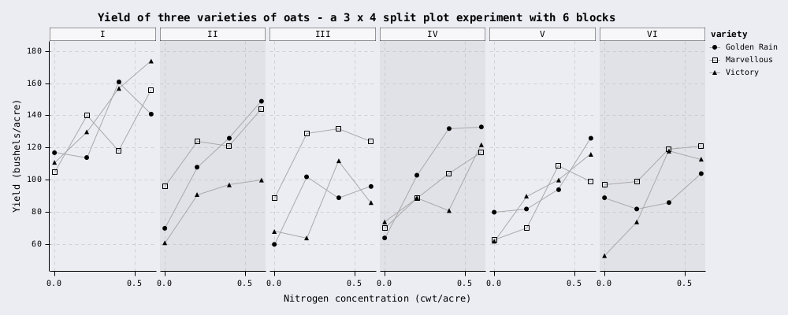
:::


### Fig 2.8 Stacked bars

Titanic passengers by class, stacked by survival, a panel per age and sex.

Source: [Lattice Fig 2.8](http://lmdvr.r-forge.r-project.org/figures/figures.html?chapter=02;figure=02_08;theme=stdColor;code=right). Data: Titanic passengers and crew by class, sex, age and survival, R datasets package `Titanic` (Dawson 1995); licence: Part of R (GPL-2 | GPL-3).


::: {.sourceClojure}
```clojure
(def titanic-panels ["Child Male" "Child Female" "Adult Male" "Adult Female"])
```
:::


::: {.sourceClojure}
```clojure
(plot/render-image
 {:data titanic
  :mapping {:x :n :y :class :color :survived :facet #(str (:age %) " " (:sex %))}
  :scales {:facet {:domain titanic-panels}}
  :charts [(chart/bar {:position :stack})]
  :facets {:columns 4}
  :theme {:panel {:grid {:x :none :y :none}}}
  :labels {:x "Freq" :y nil}}
 {:width 900 :height 350})
```
:::


::: {.clay-image}
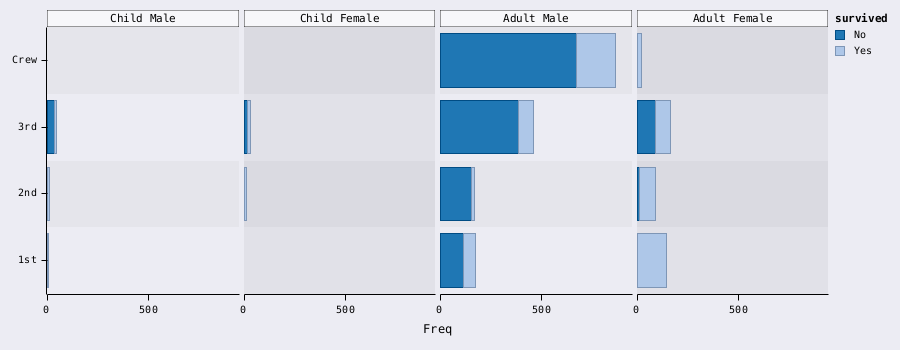
:::


### Fig 2.9 Free scales

Each panel its own count axis, so the small groups are readable.

Source: [Lattice Fig 2.9](http://lmdvr.r-forge.r-project.org/figures/figures.html?chapter=02;figure=02_09;theme=stdColor;code=right). Data: Titanic passengers and crew by class, sex, age and survival, R datasets package `Titanic` (Dawson 1995); licence: Part of R (GPL-2 | GPL-3).


::: {.sourceClojure}
```clojure
(plot/render-image
 {:data titanic
  :mapping {:x :n :y :class :color :survived :facet #(str (:age %) " " (:sex %))}
  :scales {:facet {:domain titanic-panels}}
  :charts [(chart/bar {:position :stack})]
  :facets {:columns 4 :scales {:x :free}}
  :theme {:panel {:grid {:x :none :y :none}}}
  :labels {:x "Freq" :y nil}}
 {:width 900 :height 350})
```
:::


::: {.clay-image}

:::


### Fig 2.10 Vertical grid lines

Source: [Lattice Fig 2.10](http://lmdvr.r-forge.r-project.org/figures/figures.html?chapter=02;figure=02_10;theme=stdColor;code=right). Data: Titanic passengers and crew by class, sex, age and survival, R datasets package `Titanic` (Dawson 1995); licence: Part of R (GPL-2 | GPL-3).


::: {.sourceClojure}
```clojure
(plot/render-image
 {:data titanic
  :mapping {:x :n :y :class :color :survived :facet #(str (:age %) " " (:sex %))}
  :scales {:facet {:domain titanic-panels}}
  :charts [(chart/bar {:position :stack})]
  :facets {:columns 4 :scales {:x :free}}
  :theme {:panel {:grid {:y :none}}}
  :labels {:x "Freq" :y nil}}
 {:width 900 :height 350})
```
:::


::: {.clay-image}

:::


### Fig 2.11 Bars without borders

Source: [Lattice Fig 2.11](http://lmdvr.r-forge.r-project.org/figures/figures.html?chapter=02;figure=02_11;theme=stdColor;code=right). Data: Titanic passengers and crew by class, sex, age and survival, R datasets package `Titanic` (Dawson 1995); licence: Part of R (GPL-2 | GPL-3).


::: {.sourceClojure}
```clojure
(plot/render-image
 {:data titanic
  :mapping {:x :n :y :class :color :survived :facet #(str (:age %) " " (:sex %))}
  :scales {:facet {:domain titanic-panels}}
  :charts [(chart/bar {:position :stack :stroke-color :none})]
  :facets {:columns 4 :scales {:x :free}}
  :theme {:panel {:grid {:x :none :y :none}}}
  :labels {:x "Freq" :y nil}}
 {:width 900 :height 350})
```
:::


::: {.clay-image}

:::


## Chapter 3 - Visualizing Univariate Distributions


### Fig 3.1 Kernel density

Old Faithful eruption times: a Gaussian kernel density, the values as jittered points under it.

Source: [Lattice Fig 3.1](http://lmdvr.r-forge.r-project.org/figures/figures.html?chapter=03;figure=03_01;theme=stdColor;code=right). Data: Old Faithful geyser eruptions, R datasets package `faithful` (Härdle 1991; Azzalini & Bowman 1990); licence: Part of R (GPL-2 | GPL-3).


::: {.sourceClojure}
```clojure
(plot/render-image
 {:data faithful
  :mapping {:x :eruptions}
  :charts [(chart/density) (chart/stripplot {:place :bottom :rng (r/rng :mersenne 31)})]
  :labels {:x "eruptions" :y "Density"}}
 {:width 600 :height 450})
```
:::


::: {.clay-image}

:::


### Fig 3.2 Rectangular kernel

A rectangular kernel of standard deviation 0.2 (R's `bw`) - half-width 0.2 √3 - at 200 points.

Source: [Lattice Fig 3.2](http://lmdvr.r-forge.r-project.org/figures/figures.html?chapter=03;figure=03_02;theme=stdColor;code=right). Data: Old Faithful geyser eruptions, R datasets package `faithful` (Härdle 1991; Azzalini & Bowman 1990); licence: Part of R (GPL-2 | GPL-3).


::: {.sourceClojure}
```clojure
(plot/render-image
 {:data faithful
  :mapping {:x :eruptions}
  :charts [(chart/density {:kernel :uniform :bandwidth (* 0.2 (m/sqrt 3.0)) :n 200}) (chart/rug {:thickness 16})]
  :labels {:x "eruptions" :y "Density"}}
 {:width 600 :height 450})
```
:::


::: {.clay-image}

:::


### Fig 3.3 Densities by day

Flow cytometry of a graft-versus-host-disease patient: log forward scatter, a panel per day after transplant.

Source: [Lattice Fig 3.3](http://lmdvr.r-forge.r-project.org/figures/figures.html?chapter=03;figure=03_03;theme=stdColor;code=right). Data: Flow cytometry of a GvHD patient, 10 days, R latticeExtra package `gvhd10` (Brinkman et al. 2007); licence: GPL (>= 2) (latticeExtra).


::: {.sourceClojure}
```clojure
(def gvhd10-log
  "gvhd10 with log and log2 forward scatter."
  (mapv (fn [{:keys [fsc-h] :as row}] (assoc row :log-fsc (m/log fsc-h) :log2-fsc (m/log2 fsc-h))) gvhd10))
```
:::


::: {.sourceClojure}
```clojure
(plot/render-image
 {:data gvhd10-log
  :mapping {:x :log-fsc :facet :days}
  :charts [(chart/density)]
  :facets {:columns 2}
  :labels {:x "log(FSC.H)" :y "Density"}}
 {:width 700 :height 750})
```
:::


::: {.clay-image}
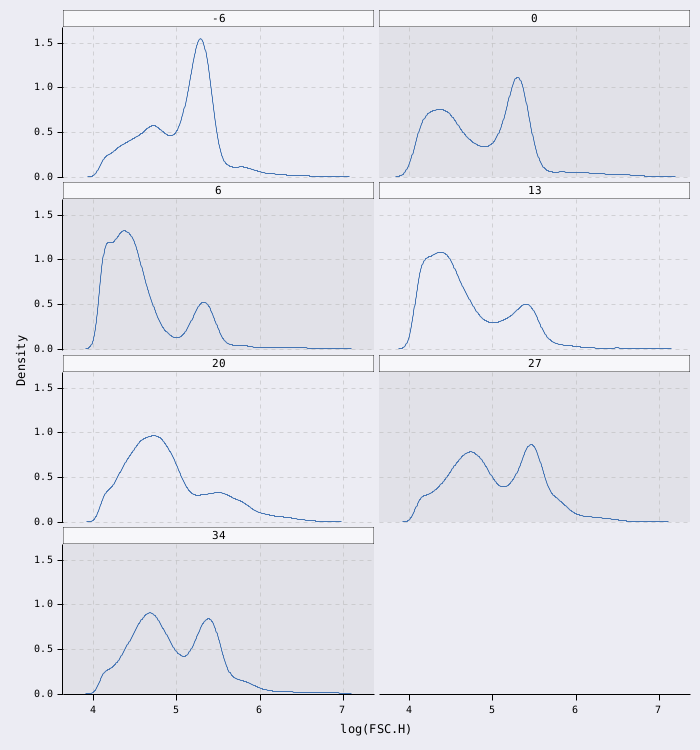
:::


### Fig 3.4 Histograms on the density scale

Source: [Lattice Fig 3.4](http://lmdvr.r-forge.r-project.org/figures/figures.html?chapter=03;figure=03_04;theme=stdColor;code=right). Data: Flow cytometry of a GvHD patient, 10 days, R latticeExtra package `gvhd10` (Brinkman et al. 2007); licence: GPL (>= 2) (latticeExtra).


::: {.sourceClojure}
```clojure
(plot/render-image
 {:data gvhd10-log
  :mapping {:x :log2-fsc :facet :days}
  :charts [(chart/histogram {:bins 50 :y :density})]
  :facets {:columns 2}
  :labels {:x "log Forward Scatter" :y "Density"}}
 {:width 700 :height 750})
```
:::


::: {.clay-image}

:::


### Fig 3.5 Normal Q-Q plots

GCSE score quantiles against the standard normal, a panel per A-level score.

Source: [Lattice Fig 3.5](http://lmdvr.r-forge.r-project.org/figures/figures.html?chapter=03;figure=03_05;theme=stdColor;code=right). Data: A-level chemistry scores, England 1997, R mlmRev package `Chem97` (Yang et al. 2002); licence: GPL (>= 2) (mlmRev).


::: {.sourceClojure}
```clojure
(plot/render-image
 {:data chem97
  :mapping {:y :gcsescore :facet :score}
  :charts [(chart/qq {:x-distribution [:normal] :size 2 :line false})]
  :facets {:columns 3}
  :labels {:x "qnorm" :y "gcsescore"}}
 {:width 800 :height 500})
```
:::


::: {.clay-image}
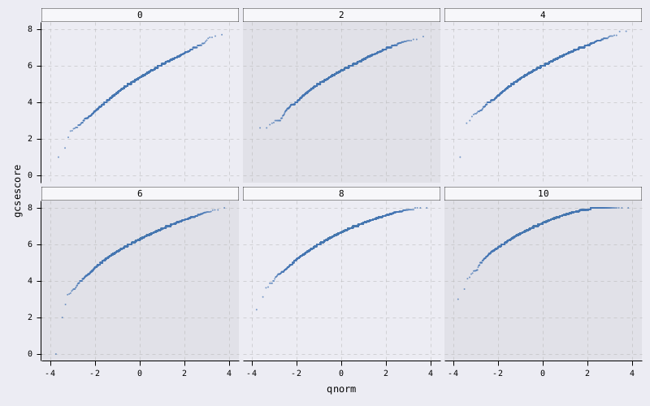
:::


### Fig 3.6 Grouped Q-Q plots

Source: [Lattice Fig 3.6](http://lmdvr.r-forge.r-project.org/figures/figures.html?chapter=03;figure=03_06;theme=stdColor;code=right). Data: A-level chemistry scores, England 1997, R mlmRev package `Chem97` (Yang et al. 2002); licence: GPL (>= 2) (mlmRev).


::: {.sourceClojure}
```clojure
(plot/render-image
 {:data chem97
  :mapping {:y :gcsescore :color :score :facet :gender}
  :scales {:color {:type :categorical}}
  :charts [(chart/qq {:x-distribution [:normal] :size 3 :line false})]
  :facets {:columns 2}
  :labels {:x "Standard Normal Quantiles" :y "Average GCSE Score"}}
 {:width 800 :height 450})
```
:::


::: {.clay-image}

:::


### Fig 3.7 A power transformation

GCSE score to the power 2.34 makes the score groups' quantile curves nearly straight and parallel.

Source: [Lattice Fig 3.7](http://lmdvr.r-forge.r-project.org/figures/figures.html?chapter=03;figure=03_07;theme=stdColor;code=right). Data: A-level chemistry scores, England 1997, R mlmRev package `Chem97` (Yang et al. 2002); licence: GPL (>= 2) (mlmRev).


::: {.sourceClojure}
```clojure
(def chem97-trans
  "chem97 with the transformed GCSE score `gcsescore^2.34`."
  (mapv #(assoc % :gcsescore-trans (m/pow (:gcsescore %) 2.34)) chem97))
```
:::


::: {.sourceClojure}
```clojure
(plot/render-image
 {:data chem97-trans
  :mapping {:y :gcsescore-trans :color :score :facet :gender}
  :scales {:color {:type :categorical :title "score"}}
  :charts [(chart/qq {:x-distribution [:normal] :size 3 :line false})]
  :facets {:columns 2}
  :labels {:x "Standard Normal Quantiles" :y "Transformed GCSE Score"}}
 {:width 800 :height 450})
```
:::


::: {.clay-image}
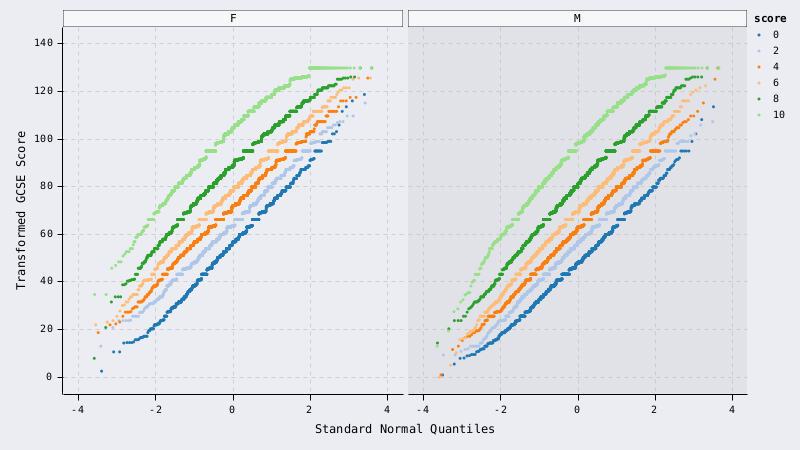
:::


### Fig 3.8 Empirical CDFs

Source: [Lattice Fig 3.8](http://lmdvr.r-forge.r-project.org/figures/figures.html?chapter=03;figure=03_08;theme=stdColor;code=right). Data: A-level chemistry scores, England 1997, R mlmRev package `Chem97` (Yang et al. 2002); licence: GPL (>= 2) (mlmRev).


::: {.sourceClojure}
```clojure
(def chem97-positive (filterv #(pos? (:gcsescore %)) chem97))
```
:::


::: {.sourceClojure}
```clojure
(plot/render-image
 {:data chem97-positive
  :mapping {:x :gcsescore :color :gender :facet :score}
  :charts [(chart/ecdf)]
  :facets {:columns 3}
  :labels {:x "Average GCSE Score" :y "Empirical CDF"}}
 {:width 800 :height 500})
```
:::


::: {.clay-image}

:::


### Fig 3.9 Uniform Q-Q plots

Quantiles against the uniform distribution: the empirical CDF with the axes swapped.

Source: [Lattice Fig 3.9](http://lmdvr.r-forge.r-project.org/figures/figures.html?chapter=03;figure=03_09;theme=stdColor;code=right). Data: A-level chemistry scores, England 1997, R mlmRev package `Chem97` (Yang et al. 2002); licence: GPL (>= 2) (mlmRev).


::: {.sourceClojure}
```clojure
(plot/render-image
 {:data chem97-positive
  :mapping {:y :gcsescore :color :gender :facet :score}
  :charts [(chart/qq {:x-distribution [:uniform-real] :size 3 :line false})]
  :facets {:columns 6}
  :labels {:x "Uniform quantiles" :y "Average GCSE Score"}}
 {:width 1000 :height 400})
```
:::


::: {.clay-image}

:::


### Fig 3.10 Two-sample Q-Q plots

100 quantiles of the boys' scores against the girls', per A-level score (`ppoints(100)` probabilities), and the
line y = x.

Source: [Lattice Fig 3.10](http://lmdvr.r-forge.r-project.org/figures/figures.html?chapter=03;figure=03_10;theme=stdColor;code=right). Data: A-level chemistry scores, England 1997, R mlmRev package `Chem97` (Yang et al. 2002); licence: GPL (>= 2) (mlmRev).


::: {.sourceClojure}
```clojure
(let [ps (mapv #(/ (- % 0.5) 100.0) (range 1 101))
      quantiles (fn [rows] (stats/quantiles (map :gcsescore rows) ps))]
  (plot/render-image
   {:data (for [[score rows] (group-by :score chem97)
                :let [by-gender (group-by :gender rows)]
                [f m] (map vector (quantiles (by-gender "F")) (quantiles (by-gender "M")))]
            {:score score :f f :m m})
    :mapping {:x :m :y :f :facet :score}
    :charts [(chart/scatter) (chart/rule {:slope 1 :intercept 0 :color :grey})]
    :facets {:columns 3}
    :aspect :iso
    :labels {:x "M" :y "F"}}
   {:width 800 :height 600}))
```
:::


::: {.clay-image}

:::


### Fig 3.11 Box plots

Source: [Lattice Fig 3.11](http://lmdvr.r-forge.r-project.org/figures/figures.html?chapter=03;figure=03_11;theme=stdColor;code=right). Data: A-level chemistry scores, England 1997, R mlmRev package `Chem97` (Yang et al. 2002); licence: GPL (>= 2) (mlmRev).


::: {.sourceClojure}
```clojure
(plot/render-image
 {:data chem97
  :mapping {:x :gcsescore :y (levels/categorical :score) :facet :gender}
  :scales {:facet {:domain ["M" "F"]}}
  :charts [(chart/box)]
  :facets {:columns 2}
  :labels {:x "Average GCSE Score" :y "score"}}
 {:width 800 :height 450})
```
:::


::: {.clay-image}

:::


### Fig 3.12 Box widths by group size

Source: [Lattice Fig 3.12](http://lmdvr.r-forge.r-project.org/figures/figures.html?chapter=03;figure=03_12;theme=stdColor;code=right). Data: A-level chemistry scores, England 1997, R mlmRev package `Chem97` (Yang et al. 2002); licence: GPL (>= 2) (mlmRev).


::: {.sourceClojure}
```clojure
(plot/render-image
 {:data chem97-trans
  :mapping {:x :gender :y :gcsescore-trans :facet :score}
  :scales {:x {:domain ["M" "F"]}}
  :charts [(chart/box {:varwidth true})]
  :facets {:columns 6}
  :labels {:x nil :y "Transformed GCSE score"}}
 {:width 900 :height 400})
```
:::


::: {.clay-image}
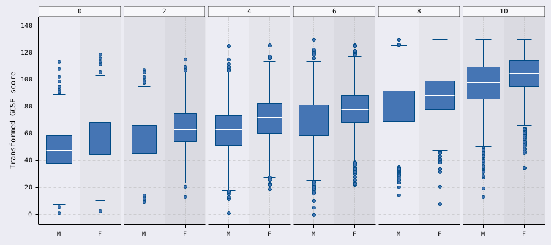
:::


### Fig 3.13 Box plots of many values

Source: [Lattice Fig 3.13](http://lmdvr.r-forge.r-project.org/figures/figures.html?chapter=03;figure=03_13;theme=stdColor;code=right). Data: Flow cytometry of a GvHD patient, 10 days, R latticeExtra package `gvhd10` (Brinkman et al. 2007); licence: GPL (>= 2) (latticeExtra).


::: {.sourceClojure}
```clojure
(plot/render-image
 {:data gvhd10-log
  :mapping {:x :log-fsc :y (levels/categorical :days)}
  :charts [(chart/box)]
  :labels {:x "log(Forward Scatter)" :y "Days Past Transplant"}}
 {:width 700 :height 500})
```
:::


::: {.clay-image}

:::


### Fig 3.14 Violins

Tails 3 bandwidths past the data (`:cut 3`, R's `density` default as lattice uses it).

Source: [Lattice Fig 3.14](http://lmdvr.r-forge.r-project.org/figures/figures.html?chapter=03;figure=03_14;theme=stdColor;code=right). Data: Flow cytometry of a GvHD patient, 10 days, R latticeExtra package `gvhd10` (Brinkman et al. 2007); licence: GPL (>= 2) (latticeExtra).


::: {.sourceClojure}
```clojure
(plot/render-image
 {:data gvhd10-log
  :mapping {:x :log-fsc :y (levels/categorical :days)}
  :charts [(chart/violin {:inner :none :cut 3})]
  :labels {:x "log(Forward Scatter)" :y "Days Past Transplant"}}
 {:width 700 :height 500})
```
:::


::: {.clay-image}
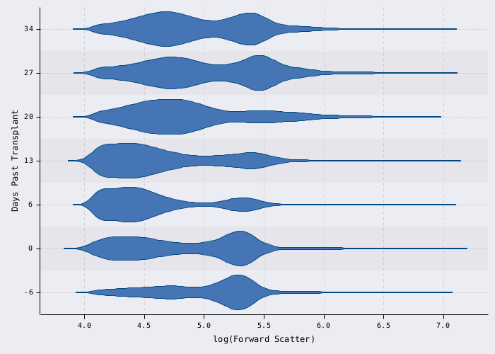
:::


### Fig 3.15 Strip plot

Earthquake depth by magnitude, one strip per magnitude value.

Source: [Lattice Fig 3.15](http://lmdvr.r-forge.r-project.org/figures/figures.html?chapter=03;figure=03_15;theme=stdColor;code=right). Data: Earthquakes off Fiji since 1964, R datasets package `quakes` (Harvard PRIM-H project); licence: Part of R (GPL-2 | GPL-3).


::: {.sourceClojure}
```clojure
(plot/render-image
 {:data quakes
  :mapping {:x :depth :y (levels/categorical :mag)}
  :charts [(chart/stripplot {:jitter 0})]
  :labels {:x "depth" :y "mag"}}
 {:width 600 :height 700})
```
:::


::: {.clay-image}

:::


### Fig 3.16 Jittered strips

Source: [Lattice Fig 3.16](http://lmdvr.r-forge.r-project.org/figures/figures.html?chapter=03;figure=03_16;theme=stdColor;code=right). Data: Earthquakes off Fiji since 1964, R datasets package `quakes` (Harvard PRIM-H project); licence: Part of R (GPL-2 | GPL-3).


::: {.sourceClojure}
```clojure
(plot/render-image
 {:data quakes
  :mapping {:x (levels/categorical :mag) :y :depth}
  :charts [(chart/stripplot {:rng (r/rng :mersenne 316) :jitter 0.3})]
  :labels {:x "Magnitude (Richter)" :y "Depth (km)"}}
 {:width 800 :height 450})
```
:::


::: {.clay-image}
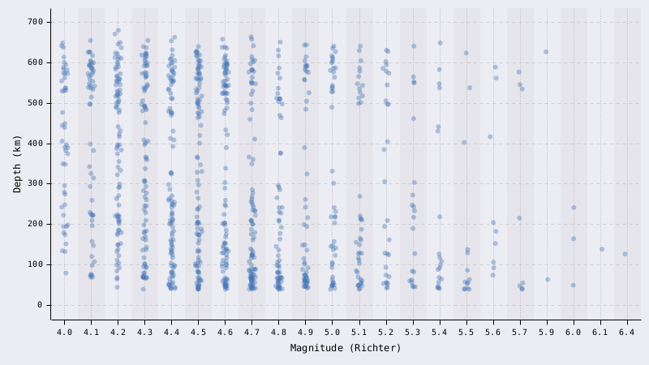
:::


### Fig 3.17 Residuals and their medians

Square roots of the absolute residuals of an additive model of barley yield (variety + year + site, least
squares on dummy-coded factors), jittered by site (in R's order), a line through each year's medians; two
contrasting colours for the years.

Source: [Lattice Fig 3.17](http://lmdvr.r-forge.r-project.org/figures/figures.html?chapter=03;figure=03_17;theme=stdColor;code=right). Data: Barley yields, Minnesota 1931-1932, R lattice package `barley` (Immer et al. 1934; Fisher 1971; Cleveland 1993); licence: GPL (>= 2) (lattice).


::: {.sourceClojure}
```clojure
(let [factors [:variety :year :site]
      dummies (vec (for [k factors, level (rest (sort (distinct (map k barley))))] [k level]))
      model (regression/lm (mapv :yield barley)
                           (mapv (fn [row] (mapv (fn [[k level]] (if (= level (k row)) 1.0 0.0)) dummies)) barley))
      rows (mapv (fn [row residual] (assoc row :root-residual (m/sqrt (m/abs residual))))
                 barley (get-in model [:residuals :raw]))
      by-site-year (group-by (juxt :site :year) rows)
      ;; in the axis's site order, so each year's line runs left to right
      sites (nu/levels :barley :site)
      medians (for [site sites year [1931 1932]]
                {:site site :year year :median (stats/median (map :root-residual (by-site-year [site year])))})]
  (plot/render-image
   {:data rows
    :mapping {:x :site :y :root-residual :color :year}
    :scales {:x {:domain sites} :color {:type :categorical :range [[31 119 180] [214 39 40]]}}
    :charts [(chart/stripplot {:rng (r/rng :mersenne 317)})
             (chart/line {:data medians :mapping {:y :median}})]
    :labels {:x nil :y "√|Residual Barley Yield|"}}
   {:width 800 :height 450}))
```
:::


::: {.clay-image}

:::


## Chapter 4 - Displaying Multiway Tables


### Fig 4.1 Dot plot of a table

Virginia death rates (1940) per 1000 by age group, a panel per population group.

Source: [Lattice Fig 4.1](http://lmdvr.r-forge.r-project.org/figures/figures.html?chapter=04;figure=04_01;theme=stdColor;code=right). Data: Death rates in Virginia (1940), R datasets package `VADeaths` (Molyneaux et al. 1947); licence: Part of R (GPL-2 | GPL-3).


::: {.sourceClojure}
```clojure
(plot/render-image
 {:data va-deaths
  :mapping {:x :rate :y :age :facet :group}
  :charts [(chart/scatter)]
  :facets {:columns 2}
  :labels {:x "Freq" :y nil}}
 {:width 700 :height 450})
```
:::


::: {.clay-image}

:::


### Fig 4.2 Stems from zero

Source: [Lattice Fig 4.2](http://lmdvr.r-forge.r-project.org/figures/figures.html?chapter=04;figure=04_02;theme=stdColor;code=right). Data: Death rates in Virginia (1940), R datasets package `VADeaths` (Molyneaux et al. 1947); licence: Part of R (GPL-2 | GPL-3).


::: {.sourceClojure}
```clojure
(plot/render-image
 {:data va-deaths
  :mapping {:x :rate :y :age :facet :group}
  :charts [(chart/segment {:xend 0}) (chart/scatter)]
  :facets {:columns 1}
  :labels {:title "Death Rates in Virginia - 1940" :x "Rate (per 1000)" :y nil}}
 {:width 450 :height 750})
```
:::


::: {.clay-image}

:::


### Fig 4.3 Groups joined

One line per population group across the age groups (the rows in age order, unsorted by rate).

Source: [Lattice Fig 4.3](http://lmdvr.r-forge.r-project.org/figures/figures.html?chapter=04;figure=04_03;theme=stdColor;code=right). Data: Death rates in Virginia (1940), R datasets package `VADeaths` (Molyneaux et al. 1947); licence: Part of R (GPL-2 | GPL-3).


::: {.sourceClojure}
```clojure
(plot/render-image
 {:data (sort-by :age va-deaths)
  :mapping {:x :rate :y :age :color :group}
  :charts [(chart/line {:sort false}) (chart/scatter)]
  :labels {:title "Death Rates in Virginia - 1940" :x "Rate (per 1000)" :y nil}}
 {:width 700 :height 450})
```
:::


::: {.clay-image}
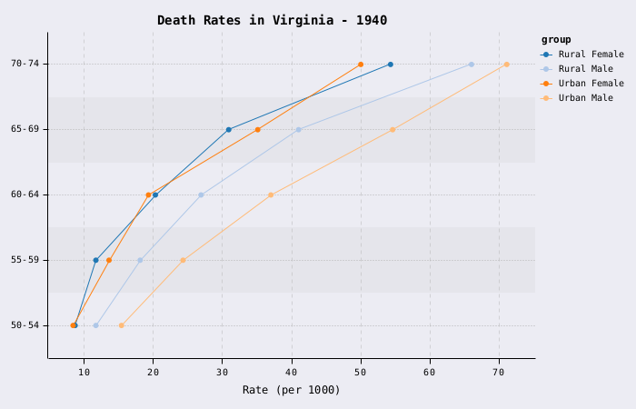
:::


### Fig 4.4 Bar charts

Source: [Lattice Fig 4.4](http://lmdvr.r-forge.r-project.org/figures/figures.html?chapter=04;figure=04_04;theme=stdColor;code=right). Data: Death rates in Virginia (1940), R datasets package `VADeaths` (Molyneaux et al. 1947); licence: Part of R (GPL-2 | GPL-3).


::: {.sourceClojure}
```clojure
(plot/render-image
 {:data va-deaths
  :mapping {:x :rate :y :age :facet :group}
  :charts [(chart/bar)]
  :facets {:columns 1}
  :labels {:title "Death Rates in Virginia - 1940" :x "Rate (per 1000)" :y nil}}
 {:width 450 :height 750})
```
:::


::: {.clay-image}

:::


### Fig 4.5 Proportions as stacked bars

Reasons for taking a postdoctoral position, as proportions of each field (`:position :normalize`), in R's
order.

Source: [Lattice Fig 4.5](http://lmdvr.r-forge.r-project.org/figures/figures.html?chapter=04;figure=04_05;theme=stdColor;code=right). Data: Reasons for taking a postdoc, by field, R latticeExtra package `postdoc` (NSF Survey of Doctorate Recipients 1999); licence: GPL (>= 2) (latticeExtra).


::: {.sourceClojure}
```clojure
(plot/render-image
 {:data postdoc
  :mapping {:x :count :y :field :color :reason}
  :scales {:color {:domain (nu/levels :postdoc :reason)}}
  :charts [(chart/bar {:position :normalize})]
  :labels {:x "Proportion" :y nil}}
 {:width 900 :height 450})
```
:::


::: {.clay-image}

:::


### Fig 4.6 Proportions as dot plots

Source: [Lattice Fig 4.6](http://lmdvr.r-forge.r-project.org/figures/figures.html?chapter=04;figure=04_06;theme=stdColor;code=right). Data: Reasons for taking a postdoc, by field, R latticeExtra package `postdoc` (NSF Survey of Doctorate Recipients 1999); licence: GPL (>= 2) (latticeExtra).


::: {.sourceClojure}
```clojure
(def postdoc-proportions
  "postdoc counts as proportions of each field's total."
  (let [totals (update-vals (group-by :field postdoc) #(reduce + (map :count %)))]
    (mapv #(assoc % :proportion (/ (double (:count %)) (double (totals (:field %))))) postdoc)))
```
:::


::: {.sourceClojure}
```clojure
(plot/render-image
 {:data postdoc-proportions
  :mapping {:x :proportion :y :field :facet :reason}
  :charts [(chart/scatter)]
  :facets {:columns 3}
  :labels {:x "Proportion" :y nil}}
 {:width 1000 :height 550})
```
:::


::: {.clay-image}

:::


### Fig 4.7 Ordered panels and levels

Panels ordered by their median proportion, the fields within each panel by their proportion (free y scales).

Source: [Lattice Fig 4.7](http://lmdvr.r-forge.r-project.org/figures/figures.html?chapter=04;figure=04_07;theme=stdColor;code=right). Data: Reasons for taking a postdoc, by field, R latticeExtra package `postdoc` (NSF Survey of Doctorate Recipients 1999); licence: GPL (>= 2) (latticeExtra).


::: {.sourceClojure}
```clojure
(plot/render-image
 {:data postdoc-proportions
  :mapping {:x :proportion :y :field :facet :reason}
  :scales {:facet {:order-by #(stats/median (map :proportion %)) :descending true}
           :y {:order-by #(stats/mean (map :proportion %))}}
  :charts [(chart/scatter)]
  :facets {:columns 1 :scales {:y :free}}
  :labels {:x "Proportion" :y nil}}
 {:width 600 :height 800})
```
:::


::: {.clay-image}
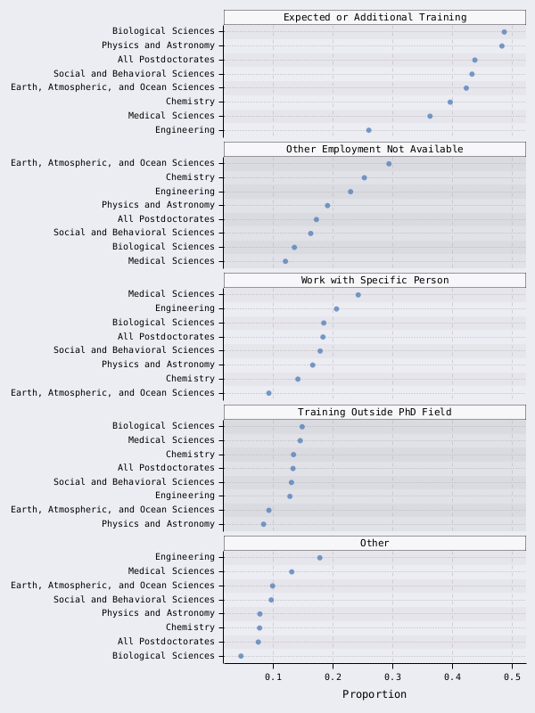
:::


### Fig 4.8 Frequencies as spikes

How many candidates have each average GCSE score, by gender.

Source: [Lattice Fig 4.8](http://lmdvr.r-forge.r-project.org/figures/figures.html?chapter=04;figure=04_08;theme=stdColor;code=right). Data: A-level chemistry scores, England 1997, R mlmRev package `Chem97` (Yang et al. 2002); licence: GPL (>= 2) (mlmRev).


::: {.sourceClojure}
```clojure
(plot/render-image
 {:data (for [[[score gender] n] (frequencies (map (juxt :gcsescore :gender) chem97))]
          {:gcsescore score :gender gender :freq n})
  :mapping {:x :gcsescore :y :freq :facet :gender}
  :charts [(chart/segment {:yend 0})]
  :facets {:columns 1}
  :labels {:x "Average GCSE Score" :y "Freq"}}
 {:width 800 :height 500})
```
:::


::: {.clay-image}
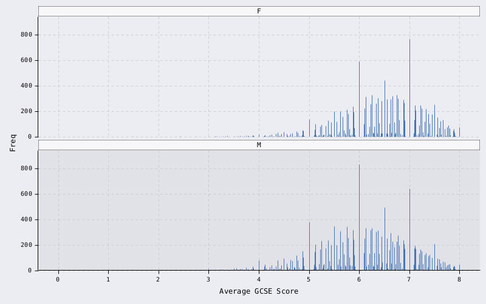
:::


### Fig 4.9 Bar chart of counts

Source: [Lattice Fig 4.9](http://lmdvr.r-forge.r-project.org/figures/figures.html?chapter=04;figure=04_09;theme=stdColor;code=right). Data: A-level chemistry scores, England 1997, R mlmRev package `Chem97` (Yang et al. 2002); licence: GPL (>= 2) (mlmRev).


::: {.sourceClojure}
```clojure
(plot/render-image
 {:data chem97
  :mapping {:y (levels/categorical :score) :facet :gender}
  :scales {:facet {:domain ["M" "F"]}}
  :charts [(chart/bar {:stat :count})]
  :flip true
  :facets {:columns 2}
  :labels {:x "Freq" :y "score"}}
 {:width 800 :height 400})
```
:::


::: {.clay-image}

:::


## Chapter 5 - Scatter Plots and Extensions


### Fig 5.1 Conditioning on a cut numeric variable

Earthquake epicentres off Fiji, a panel per depth interval (two equal-width intervals, `levels/bin`).

Source: [Lattice Fig 5.1](http://lmdvr.r-forge.r-project.org/figures/figures.html?chapter=05;figure=05_01;theme=stdColor;code=right). Data: Earthquakes off Fiji since 1964, R datasets package `quakes` (Harvard PRIM-H project); licence: Part of R (GPL-2 | GPL-3).


::: {.sourceClojure}
```clojure
(plot/render-image
 {:data (levels/bin quakes :depth {:as :depth-cut :bins 2})
  :mapping {:x :long :y :lat :facet :depth-cut}
  :charts [(chart/scatter {:shape \o :size 5})]
  :facets {:columns 2}
  :labels {:x "long" :y "lat"}}
 {:width 800 :height 450})
```
:::


::: {.clay-image}

:::


### Fig 5.2 Three depth intervals, isometric

Source: [Lattice Fig 5.2](http://lmdvr.r-forge.r-project.org/figures/figures.html?chapter=05;figure=05_02;theme=stdColor;code=right). Data: Earthquakes off Fiji since 1964, R datasets package `quakes` (Harvard PRIM-H project); licence: Part of R (GPL-2 | GPL-3).


::: {.sourceClojure}
```clojure
(plot/render-image
 {:data (levels/bin quakes :depth {:as :depth-cut :bins 3 :label "Depth"})
  :mapping {:x :long :y :lat :facet :depth-cut}
  :charts [(chart/scatter {:size 4})]
  :facets {:columns 3}
  :aspect :iso
  :labels {:x "Longitude" :y "Latitude"}}
 {:width 900 :height 450})
```
:::


::: {.clay-image}
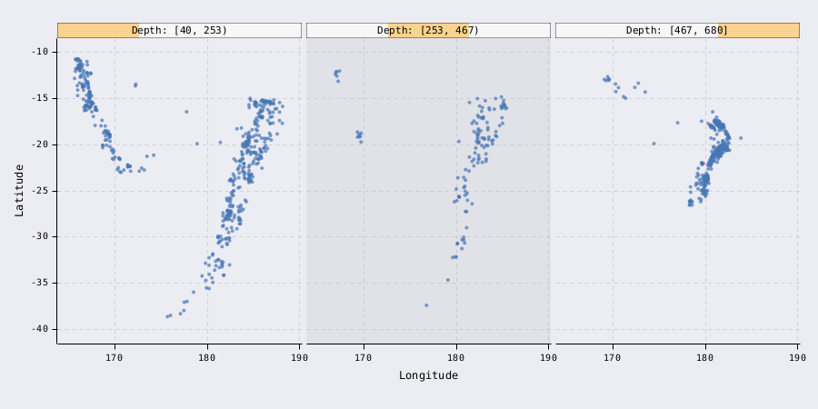
:::


### Fig 5.3 Depth as groups

Depth cut at its terciles: three groups of equal size, coloured.

Source: [Lattice Fig 5.3](http://lmdvr.r-forge.r-project.org/figures/figures.html?chapter=05;figure=05_03;theme=stdColor;code=right). Data: Earthquakes off Fiji since 1964, R datasets package `quakes` (Harvard PRIM-H project); licence: Part of R (GPL-2 | GPL-3).


::: {.sourceClojure}
```clojure
(plot/render-image
 {:data (levels/bin quakes :depth {:as :depth-cut :bins {:quantiles 3}})
  :mapping {:x :long :y :lat :color :depth-cut}
  :scales {:color {:title "Depth"}}
  :charts [(chart/scatter {:size 4})]
  :aspect :iso
  :labels {:x "Longitude" :y "Latitude"}}
 {:width 650 :height 650})
```
:::


::: {.clay-image}
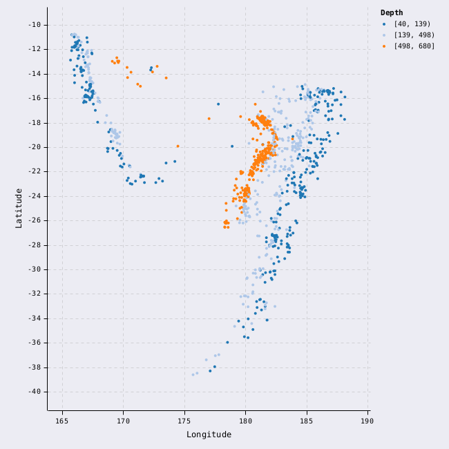
:::


### Fig 5.4 Depth as grey levels

Filled circles from dark (shallow) to light (deep); the deepest drawn first, so shallow ones stay on top.

Source: [Lattice Fig 5.4](http://lmdvr.r-forge.r-project.org/figures/figures.html?chapter=05;figure=05_04;theme=stdColor;code=right). Data: Earthquakes off Fiji since 1964, R datasets package `quakes` (Harvard PRIM-H project); licence: Part of R (GPL-2 | GPL-3).


::: {.sourceClojure}
```clojure
(def quakes-by-depth
  "quakes, deepest first."
  (vec (sort-by :depth > quakes)))
```
:::


::: {.sourceClojure}
```clojure
(def grey-depth
  "Colour scale of depth: grey levels as R's `gray.colors`, dark for shallow."
  {:color {:range [[77 77 77] [230 230 230]] :title "depth"}})
```
:::


::: {.sourceClojure}
```clojure
(plot/render-image
 {:data quakes-by-depth
  :mapping {:x :long :y :lat :color :depth}
  :scales grey-depth
  :charts [(chart/scatter {:size 8 :stroke-color :black :stroke-width 0.5})]
  :aspect :iso
  :legend false
  :labels {:x "Longitude" :y "Latitude"}}
 {:width 600 :height 650})
```
:::


::: {.clay-image}
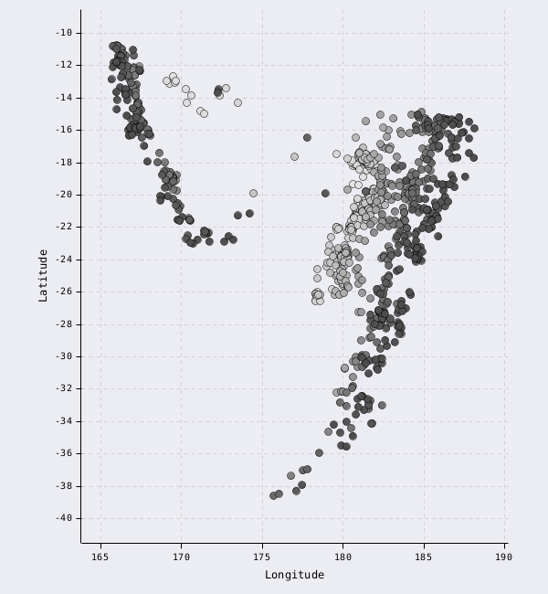
:::


### Fig 5.5 Grey levels by magnitude

A panel per magnitude interval: a shingle of four equal-count, half-overlapping intervals.

Source: [Lattice Fig 5.5](http://lmdvr.r-forge.r-project.org/figures/figures.html?chapter=05;figure=05_05;theme=stdColor;code=right). Data: Earthquakes off Fiji since 1964, R datasets package `quakes` (Harvard PRIM-H project); licence: Part of R (GPL-2 | GPL-3).


::: {.sourceClojure}
```clojure
(def quakes-magnitude
  (shingle/shingle quakes-by-depth :mag {:count 4 :overlap 0.5 :as :magnitude :label "Magnitude"}))
```
:::


::: {.sourceClojure}
```clojure
(plot/render-image
 {:data quakes-magnitude
  :mapping {:x :long :y :lat :color :depth :facet :magnitude}
  :scales grey-depth
  :charts [(chart/scatter {:size 7 :stroke-color :black :stroke-width 0.5})]
  :facets {:columns 2}
  :aspect :iso
  :legend false
  :labels {:x "Longitude" :y "Latitude"}}
 {:width 700 :height 800})
```
:::


::: {.clay-image}
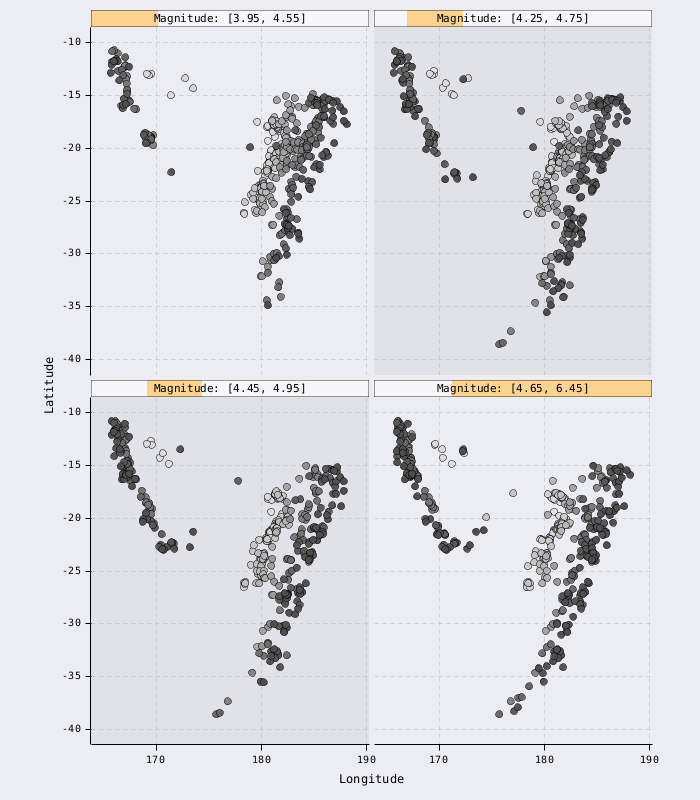
:::


### Fig 5.6 With a colour key

Source: [Lattice Fig 5.6](http://lmdvr.r-forge.r-project.org/figures/figures.html?chapter=05;figure=05_06;theme=stdColor;code=right). Data: Earthquakes off Fiji since 1964, R datasets package `quakes` (Harvard PRIM-H project); licence: Part of R (GPL-2 | GPL-3).


::: {.sourceClojure}
```clojure
(plot/render-image
 {:data quakes-magnitude
  :mapping {:x :long :y :lat :color :depth :facet :magnitude}
  :scales grey-depth
  :charts [(chart/scatter {:size 7 :stroke-color :black :stroke-width 0.5})]
  :facets {:columns 2}
  :aspect :iso
  :labels {:x "Longitude" :y "Latitude"}}
 {:width 750 :height 800})
```
:::


::: {.clay-image}

:::


### Fig 5.7 Plot types

Lattice's `type` argument drawn with cljplot2 charts on one seeded data set: points, lines in data order, both,
a regression line, the grid alone, steps (two kinds), stems, averages per x, a loess curve. The bottom row
repeats the last five with x and y exchanged (lattice's `horizontal = TRUE`): the same charts of the swapped
columns in a `:flip` plot.

Source: [Lattice Fig 5.7](http://lmdvr.r-forge.r-project.org/figures/figures.html?chapter=05;figure=05_07;theme=stdColor;code=right).


::: {.sourceClojure}
```clojure
(let [rng (r/rng :mersenne 2007041)
      grid-xs (mapv #(+ -10.0 (* 20.0 (/ % 14.0))) (range 15))
      xy (vec (for [_ (range 30)
                    :let [x (grid-xs (r/irandom rng 15))]]
                {:x x :y (+ x (* 0.25 (m/sq (+ x 1.0))) (r/grandom rng 0.0 5.0))}))
      sorted (sort-by :x xy)
      steps (fn [corner] (concat (mapcat (fn [a b] [a (corner a b)]) sorted (rest sorted)) [(last sorted)]))
      averages (for [[x rs] (sort-by key (group-by :x xy))] {:x x :y (stats/mean (map :y rs))})
      types [["p" xy [(chart/scatter)]]
             ["l" xy [(chart/line {:sort false})]]
             ["o" xy [(chart/line {:sort false}) (chart/scatter)]]
             ["r" xy [(chart/smooth {:method :lm :band :none})]]
             ["g" xy [(chart/scatter {:color [0 0 0 0]})]]
             ["s" (steps (fn [a b] {:x (:x b) :y (:y a)})) [(chart/line {:sort false})]]
             ["S" (steps (fn [a b] {:x (:x a) :y (:y b)})) [(chart/line {:sort false})]]
             ["h" xy [(chart/segment {:yend 0})]]
             ["a" averages [(chart/line)]]
             ["smooth" xy [(chart/smooth {:band :none})]]]
      panel (fn [[title data charts]]
              {:data data :mapping {:x :x :y :y} :charts charts
               :labels {:title (str "\"" title "\"") :x nil :y nil}})
      swapped (mapv (fn [{:keys [x y]}] {:x y :y x}) xy)]
  (plot/render-image
   (plot/arrange (concat (map panel types)
                         ;; horizontal: the same charts of the swapped columns, drawn flipped
                         (for [[title _ charts] (drop 5 types)
                               :let [sorted (sort-by :x swapped)
                                     data (case title
                                            "s" (concat (mapcat (fn [a b] [a {:x (:x b) :y (:y a)}]) sorted (rest sorted)) [(last sorted)])
                                            "S" (concat (mapcat (fn [a b] [a {:x (:x a) :y (:y b)}]) sorted (rest sorted)) [(last sorted)])
                                            "a" (for [[x rs] (sort-by key (group-by :x swapped))] {:x x :y (stats/mean (map :y rs))})
                                            swapped)]]
                           (assoc (panel [(str title ", horizontal") data charts]) :flip true)))
                 {:columns 5})
   {:width 1000 :height 650}))
```
:::


::: {.clay-image}
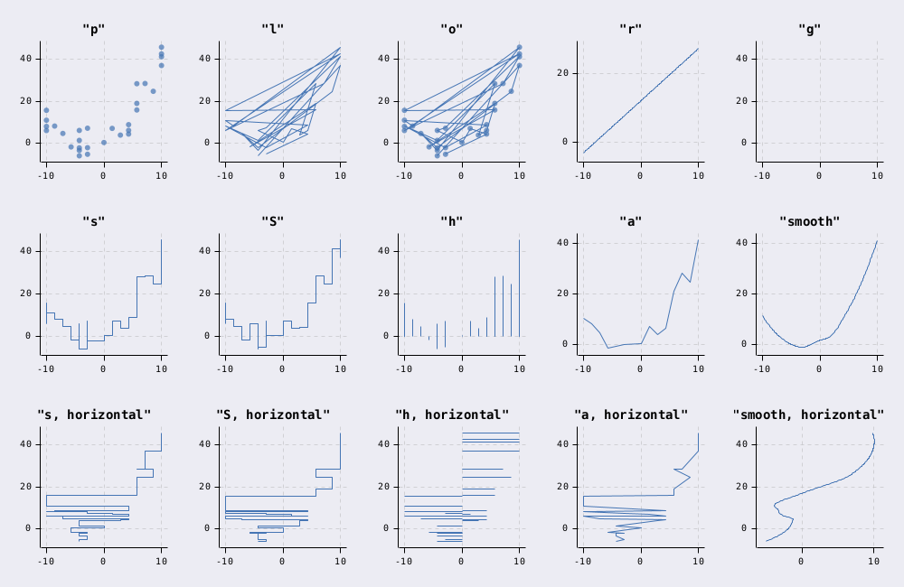
:::


### Fig 5.8 Scatter plot with a loess curve

Peak ground acceleration against distance from the epicentre, for 23 Californian earthquakes.

Source: [Lattice Fig 5.8](http://lmdvr.r-forge.r-project.org/figures/figures.html?chapter=05;figure=05_08;theme=stdColor;code=right). Data: Western US earthquakes: ground acceleration, R MEMSS package `Earthquake` (Joyner & Boore 1981); licence: GPL (>= 2) (MEMSS).


::: {.sourceClojure}
```clojure
(def earthquake-labels {:x "Distance From Epicenter (km)" :y "Maximum Horizontal Acceleration (g)"})
```
:::


::: {.sourceClojure}
```clojure
(plot/render-image
 {:data earthquake
  :mapping {:x :distance :y :accel}
  :charts [(chart/scatter) (chart/smooth {:band :none})]
  :labels earthquake-labels}
 {:width 650 :height 500})
```
:::


::: {.clay-image}
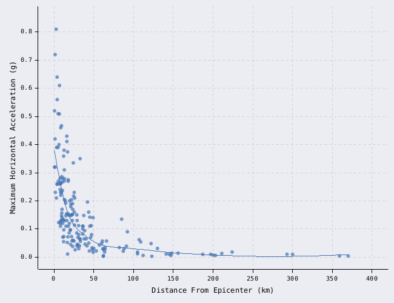
:::


### Fig 5.9 Logarithmic axes

Source: [Lattice Fig 5.9](http://lmdvr.r-forge.r-project.org/figures/figures.html?chapter=05;figure=05_09;theme=stdColor;code=right). Data: Western US earthquakes: ground acceleration, R MEMSS package `Earthquake` (Joyner & Boore 1981); licence: GPL (>= 2) (MEMSS).


::: {.sourceClojure}
```clojure
(def log2-axes
  "Base-2 logarithmic x and y scales labelled as powers of two."
  {:x {:kind :log :base 2 :formatter :power} :y {:kind :log :base 2 :formatter :power}})
```
:::


::: {.sourceClojure}
```clojure
(plot/render-image
 {:data earthquake
  :mapping {:x :distance :y :accel}
  :scales log2-axes
  :charts [(chart/scatter) (chart/smooth {:band :none})]
  :labels earthquake-labels}
 {:width 650 :height 500})
```
:::


::: {.clay-image}

:::


### Fig 5.10 Local fits by magnitude

A panel per magnitude interval (three equal-count intervals overlapping by 10 %): a loess curve per panel (the
book uses locfit) and the least-squares line of all quakes on the log-log scale, the same in every panel.

Source: [Lattice Fig 5.10](http://lmdvr.r-forge.r-project.org/figures/figures.html?chapter=05;figure=05_10;theme=stdColor;code=right). Data: Western US earthquakes: ground acceleration, R MEMSS package `Earthquake` (Joyner & Boore 1981); licence: GPL (>= 2) (MEMSS).


::: {.sourceClojure}
```clojure
(let [model (regression/lm (mapv #(m/log2 (:accel %)) earthquake) (mapv (fn [row] [(m/log2 (:distance row))]) earthquake))
      intercept (:intercept model)
      slope (first (:beta model))]
  (plot/render-image
   {:data (shingle/shingle earthquake :richter {:count 3 :overlap 0.1 :as :magnitude :label "Magnitude"})
    :mapping {:x :distance :y :accel :facet :magnitude}
    :scales log2-axes
    :charts [(chart/scatter)
             (chart/smooth {:band :none :color :grey :width 2})
             (chart/function {:f (fn [d] (m/pow 2.0 (+ intercept (* slope (m/log2 d))))) :color :black})]
    :facets {:columns 3}
    :labels earthquake-labels}
   {:width 900 :height 400}))
```
:::


::: {.clay-image}
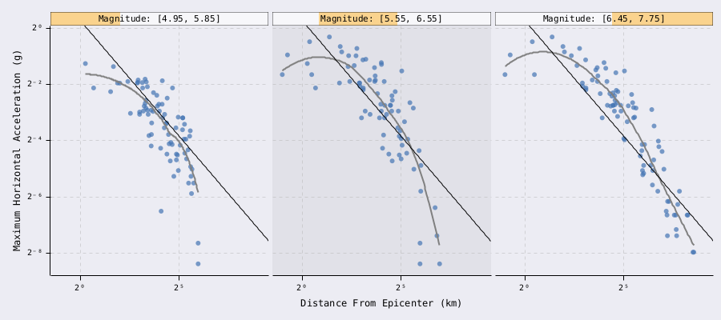
:::


### Fig 5.11 Several variables against one

Seattle-Tacoma weather, January to March 2007: minimum and maximum temperature and rainfall by day.

Source: [Lattice Fig 5.11](http://lmdvr.r-forge.r-project.org/figures/figures.html?chapter=05;figure=05_11;theme=stdColor;code=right). Data: Seattle-Tacoma airport weather, Jan-Mar 2007, R latticeExtra package `SeatacWeather` (NOAA); licence: GPL (>= 2) (latticeExtra).


::: {.sourceClojure}
```clojure
(def months {:facet {:domain ["January" "February" "March"]}})
```
:::


::: {.sourceClojure}
```clojure
(def seatac-long
  "SeaTac weather, one row per day and variable."
  (for [row seatac, k [:min-temp :max-temp :precip]]
    {:month (:month row) :day (:day row) :variable (name k) :value (k row)}))
```
:::


::: {.sourceClojure}
```clojure
(plot/render-image
 {:data seatac-long
  :mapping {:x :day :y :value :group :variable :facet :month}
  :scales months
  :charts [(chart/line {:color :black})]
  :facets {:columns 3}
  :labels {:x "day" :y "Temperature and Rainfall"}}
 {:width 900 :height 400})
```
:::


::: {.clay-image}

:::


### Fig 5.12 Lines and stems

Rainfall scaled to the temperature range (× 80 / its maximum) and drawn as stems.

Source: [Lattice Fig 5.12](http://lmdvr.r-forge.r-project.org/figures/figures.html?chapter=05;figure=05_12;theme=stdColor;code=right). Data: Seattle-Tacoma airport weather, Jan-Mar 2007, R latticeExtra package `SeatacWeather` (NOAA); licence: GPL (>= 2) (latticeExtra).


::: {.sourceClojure}
```clojure
(def max-precip (reduce max (keep :precip seatac)))
```
:::


::: {.sourceClojure}
```clojure
(plot/render-image
 {:data seatac
  :mapping {:x :day :facet :month}
  :scales months
  :charts [(chart/line {:mapping {:y :min-temp} :color :black})
           (chart/line {:mapping {:y :max-temp} :color :black})
           (chart/segment {:data (map #(update % :precip (fn [p] (some-> p (* 80.0) (/ max-precip)))) seatac)
                           :mapping {:y :precip} :yend 0 :color :black})]
  :facets {:columns 3}
  :labels {:x "day" :y "Temperature and Rainfall"}}
 {:width 900 :height 400})
```
:::


::: {.clay-image}

:::


### Fig 5.13 Temperature and rainfall, each on its own axis

The book adds a rainfall axis on the right of one panel; cljplot2 has no secondary axes, so the two measures are
two plots - each with its own axis.

Source: [Lattice Fig 5.13](http://lmdvr.r-forge.r-project.org/figures/figures.html?chapter=05;figure=05_13;theme=stdColor;code=right). Data: Seattle-Tacoma airport weather, Jan-Mar 2007, R latticeExtra package `SeatacWeather` (NOAA); licence: GPL (>= 2) (latticeExtra).


::: {.sourceClojure}
```clojure
(plot/render-image
 (plot/arrange [{:data (filter #(not= "precip" (:variable %)) seatac-long)
                 :mapping {:x :day :y :value :group :variable :facet :month}
                 :scales months
                 :charts [(chart/line {:color :black})]
                 :facets {:columns 3}
                 :labels {:x nil :y "Temperature (Fahrenheit)"}}
                {:data seatac
                 :mapping {:x :day :y :precip :facet :month}
                 :scales months
                 :charts [(chart/segment {:yend 0 :color :black})]
                 :facets {:columns 3}
                 :labels {:x "day" :y "Rainfall (inches)"}}]
               {:columns 1})
 {:width 900 :height 600})
```
:::


::: {.clay-image}
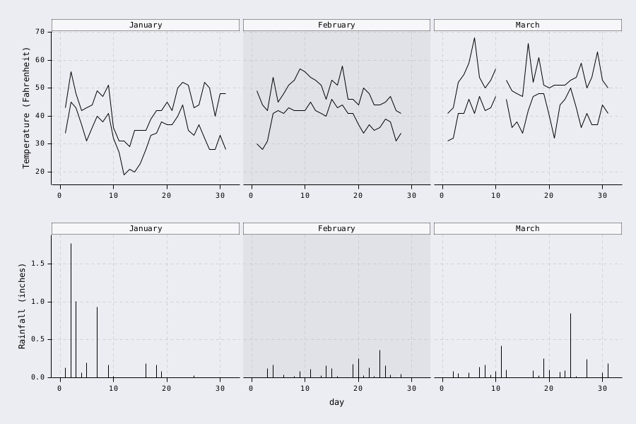
:::


### Fig 5.14 Hexagonal binning

Two fluorescence channels of the GvHD cells (asinh-transformed), counted in hexagons, a panel per day; grey
levels by the square root of the count (`:transform :sqrt`, lattice's `trans = sqrt`).

Source: [Lattice Fig 5.14](http://lmdvr.r-forge.r-project.org/figures/figures.html?chapter=05;figure=05_14;theme=stdColor;code=right). Data: Flow cytometry of a GvHD patient, 10 days, R latticeExtra package `gvhd10` (Brinkman et al. 2007); licence: GPL (>= 2) (latticeExtra).


::: {.sourceClojure}
```clojure
(plot/render-image
 {:data (mapv (fn [row] {:days (:days row) :ssc (m/asinh (:ssc-h row)) :fl2 (m/asinh (:fl2-h row))}) gvhd10)
  :mapping {:x :fl2 :y :ssc :facet :days}
  :scales {:x {:domain [0 10.5]} :color {:range [[235 235 235] [0 0 0]] :transform :sqrt}}
  :charts [(chart/bin2d {:bins 30})]
  :facets {:columns 4}
  :aspect :iso
  :labels {:x "asinh(FL2.H)" :y "asinh(SSC.H)"}}
 {:width 900 :height 550})
```
:::


::: {.clay-image}
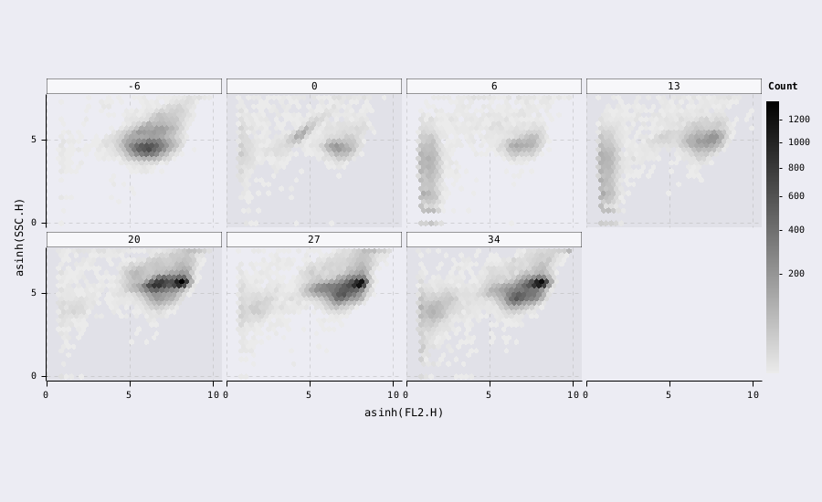
:::


### Fig 5.15 Scatter-plot matrix

Source: [Lattice Fig 5.15](http://lmdvr.r-forge.r-project.org/figures/figures.html?chapter=05;figure=05_15;theme=stdColor;code=right). Data: Violent crime rates by US state (1973), R datasets package `USArrests` (McNeil 1977); licence: Part of R (GPL-2 | GPL-3).


::: {.sourceClojure}
```clojure
(plot/render-image
 (plot/pairs us-arrests {:variables [:murder :assault :urban-pop :rape]
                         :upper (chart/scatter) :diagonal :names})
 {:width 700 :height 700})
```
:::


::: {.clay-image}
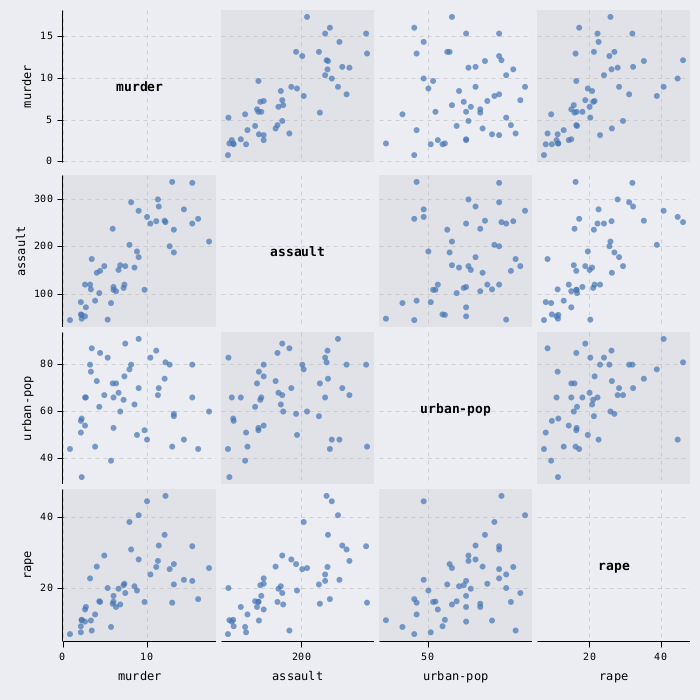
:::


### Fig 5.16 A matrix per region

Arrest rates of the states of each census region (joined from the state facts): points and a loess curve with
lattice's `panel.loess` settings (span 2/3, degree 1) - with a dozen states per region, ggplot2's degree 2 bends.

Source: [Lattice Fig 5.16](http://lmdvr.r-forge.r-project.org/figures/figures.html?chapter=05;figure=05_16;theme=stdColor;code=right). Data: Violent crime rates by US state (1973), R datasets package `USArrests` (McNeil 1977); licence: Part of R (GPL-2 | GPL-3).


::: {.sourceClojure}
```clojure
(let [region (into {} (map (juxt :name :region) states))
      rows (map #(assoc % :region (region (:state %))) us-arrests)
      cell [(chart/scatter {:size 3}) (chart/smooth {:band :none :method-params {:bandwidth (/ 2.0 3.0) :degree 1}})]]
  (plot/render-image
   (plot/arrange (for [r ["Northeast" "South" "North Central" "West"]]
                   (plot/pairs (filterv #(= r (:region %)) rows)
                               {:variables [:urban-pop :murder :assault :rape]
                                :lower cell :upper cell :diagonal :names :title r}))
                 {:columns 2})
   {:width 900 :height 800}))
```
:::


::: {.clay-image}
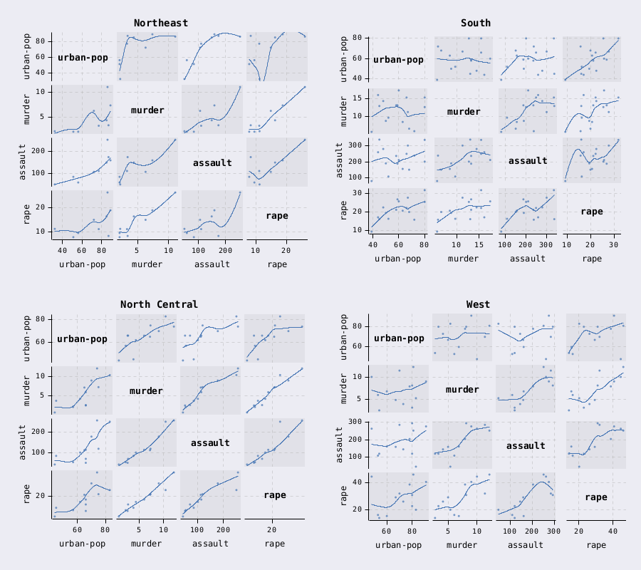
:::


### Fig 5.17 Groups in a scatter-plot matrix

Source: [Lattice Fig 5.17](http://lmdvr.r-forge.r-project.org/figures/figures.html?chapter=05;figure=05_17;theme=stdColor;code=right). Data: Motor Trend car road tests (1974), R datasets package `mtcars` (Henderson & Velleman 1981); licence: Part of R (GPL-2 | GPL-3).


::: {.sourceClojure}
```clojure
(plot/render-image
 (plot/pairs mtcars {:variables [:mpg :disp :hp :drat :wt :qsec]
                     :mapping {:color (levels/categorical :cyl)}
                     :upper (chart/scatter) :diagonal :names
                     :labels {:mpg "Miles/gallon" :disp "Displacement" :hp "Horsepower"
                              :drat "Axle ratio" :wt "Weight" :qsec "1/4 mile time"}})
 {:width 900 :height 800})
```
:::


::: {.clay-image}

:::


### Fig 5.18 Parallel coordinates

Six car variables, a panel per cylinder count, coloured by the number of carburettors.

Source: [Lattice Fig 5.18](http://lmdvr.r-forge.r-project.org/figures/figures.html?chapter=05;figure=05_18;theme=stdColor;code=right). Data: Motor Trend car road tests (1974), R datasets package `mtcars` (Henderson & Velleman 1981); licence: Part of R (GPL-2 | GPL-3).


::: {.sourceClojure}
```clojure
(plot/render-image
 {:data mtcars
  :mapping {:color (levels/categorical :carb) :facet :cyl}
  :charts [(chart/parallel {:variables [:mpg :disp :hp :drat :wt :qsec]})]
  :facets {:columns 3}
  :flip true
  :labels {:x nil :y nil}}
 {:width 900 :height 500})
```
:::


::: {.clay-image}
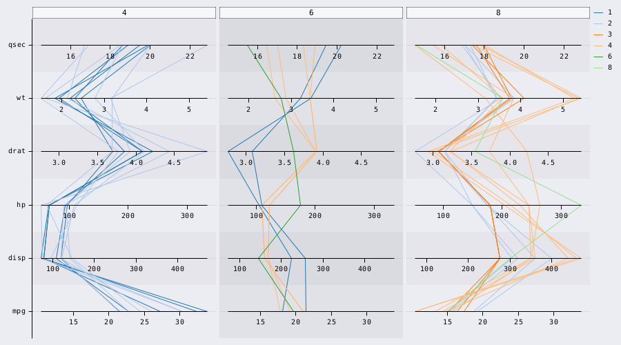
:::


### Fig 5.19 Many translucent lines

The cells of day 13 (asinh-transformed channels), each a nearly transparent line (colour alpha 3 of 255).

Source: [Lattice Fig 5.19](http://lmdvr.r-forge.r-project.org/figures/figures.html?chapter=05;figure=05_19;theme=stdColor;code=right). Data: Flow cytometry of a GvHD patient, 10 days, R latticeExtra package `gvhd10` (Brinkman et al. 2007); licence: GPL (>= 2) (latticeExtra).


::: {.sourceClojure}
```clojure
(plot/render-image
 {:data (for [row gvhd10 :when (= 13 (:days row))]
          (update-vals (select-keys row [:fl1-h :ssc-h :fl2-h :fsc-h :fl3-h]) m/asinh))
  :charts [(chart/parallel {:variables [:fl1-h :ssc-h :fl2-h :fsc-h :fl3-h] :color [140 40 40 3]})]
  :flip true
  :labels {:x nil :y nil}}
 {:width 700 :height 600})
```
:::


::: {.clay-image}
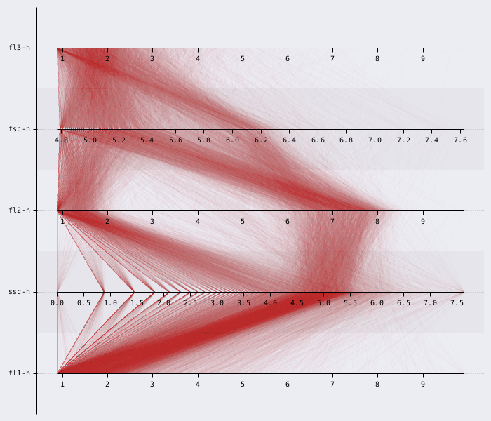
:::


## Chapter 6 - Trivariate Displays

Not reproduced: Fig 6.5 (a 3D map), Figs 6.16 and 6.17 (copula densities - not in fastmath).


## Chapter 7 - Graphical Parameters and Other Settings

Not reproduced: Fig 7.4 (lattice's own graphical settings).


## Chapter 8 - Plot Coordinates and Axis Annotation


## Chapter 9 - Labels and Legends


## Chapter 10 - Data Manipulation and Related Topics


## Chapter 11 - Manipulating the trellis Object


## Chapter 13 - Advanced Panel Functions

Not reproduced: Figs 13.8 - 13.10 (maps).


## Chapter 14 - New Trellis Displays


```{=html}
<div style="background-color:grey;height:2px;width:100%;"></div>
```


```{=html}
<div><pre><small><small>source: notebooks/galleries/lattice.clj</small></small></pre></div>
```