---
format:
  html:
    toc: true
    toc-location: right
    toc-depth: 4
    theme: cosmo
    include-in-header:
      text: |-
        <style>
        .data-table { width: fit-content; max-width: 100%; max-height: 15rem; overflow: auto; margin: 0 0 1rem 0; }
        .data-table .table-responsive { overflow: visible; }
        .data-table table { font-size: 0.75rem; width: auto; margin: 0; }
        .data-table th, .data-table td { padding: 0.1rem 0.45rem !important; white-space: nowrap; }
        .data-table thead th { position: sticky; top: 0; background: var(--bs-body-bg, #fff); }
        </style>
code-block-background: true

---
<style></style><style>.printedClojure .sourceCode {
  background-color: transparent;
  border-style: none;
}
</style><style>.clay-limit-image-width .clay-image {max-width: 100%}
.clay-side-by-side .sourceCode {margin: 0}
.clay-side-by-side {margin: 1em 0}
</style>
<script src="https://code.jquery.com/jquery-3.6.0.min.js" type="text/javascript"></script><script src="https://code.jquery.com/ui/1.13.1/jquery-ui.min.js" type="text/javascript"></script>

# Lattice

The figures of Deepayan Sarkar's *Lattice: Multivariate Data Visualization with R* (Springer 2008), rebuilt with
cljplot2 - a section per chapter, a block per figure. The R code of every figure is on the book's
[figures page](http://lmdvr.r-forge.r-project.org/figures/figures.html); each block links its figure there.

The figures show the same information as the originals; styling differs, and the code is cljplot2's own (plain
plot maps, data prepared in Clojure). Lattice's banking (`aspect = "xy"`) is replaced by the image size, its
strips by cljplot2 facet strips. Lattice fills panels from the bottom row up; figures whose panel order matters do
the same with `:facets {:order :bottom-up}` (the first panel at the bottom left), the others keep cljplot2's
top-down order. 3D boxes are drawn in
perspective at lattice's `distance` of 0.2 (`:view {:distance 0.2}`; cljplot2's default is orthographic), from
lattice's views: `screen = list(z = θ, x = φ)` is `:view {:azimuth -θ :elevation (90 + φ)}` (the default z = 40,
x = -60 - azimuth -40, elevation 30). Data
are the book's, exported from R (see the dataset notes under each figure).

Not here: chapter 12 (interactive displays) and a few figures outside the medium - each is listed in its chapter.


::: {.sourceClojure}
```clojure
(ns galleries.lattice
  (:require [clojure.string :as str]
            [fastmath.core :as m]
            [fastmath.interpolation :as interp]
            [fastmath.kernel :as k]
            [fastmath.ml.clustering :as cl]
            [fastmath.ml.regression :as regression]
            [fastmath.random :as r]
            [fastmath.stats :as stats]
            [cljplot2.chart :as chart]
            [cljplot2.core :as plot]
            [cljplot2.data.contour :as contour]
            [cljplot2.data.levels :as levels]
            [cljplot2.data.shingle :as shingle]
            [cljplot2.data.tree :as tree]
            [notebook-utils :as nu]))
```
:::


::: {.sourceClojure}
```clojure
(def two-colors
  "Two contrasting colours for two groups (the default palette's first two are both blue)."
  [[31 119 180] [214 39 40]])
```
:::


::: {.sourceClojure}
```clojure
(defn- figure-url
  "Permalink of LMDVR figure `chapter`.`figure` on the book's figures page."
  [chapter figure]
  (format "http://lmdvr.r-forge.r-project.org/figures/figures.html?chapter=%02d;figure=%02d_%02d;theme=stdColor;code=right"
          chapter chapter figure))
```
:::


::: {.printedClojure}
```clojure
#'galleries.lattice/figure-url

```
:::


::: {.sourceClojure}
```clojure
(def chem97 (nu/dataset :chem97))
```
:::


```{=html}
<div class="data-table"><table class="table table-hover table-responsive clay-table"><thead><tr><th>lea</th><th>school</th><th>student</th><th>score</th><th>gender</th><th>age</th><th>gcsescore</th><th>gcsecnt</th></tr></thead><tbody><tr><td>1</td><td>1</td><td>1</td><td>4</td><td>F</td><td>3</td><td>6.625</td><td>0.33931571143033</td></tr><tr><td>1</td><td>1</td><td>2</td><td>10</td><td>F</td><td>-3</td><td>7.625</td><td>1.33931571143033</td></tr><tr><td>1</td><td>1</td><td>3</td><td>10</td><td>F</td><td>-4</td><td>7.25</td><td>0.96431571143033</td></tr><tr><td>1</td><td>1</td><td>4</td><td>10</td><td>F</td><td>-2</td><td>7.5</td><td>1.21431571143033</td></tr><tr><td>1</td><td>1</td><td>5</td><td>8</td><td>F</td><td>-1</td><td>6.444</td><td>0.15831571143033</td></tr><tr><td>1</td><td>1</td><td>6</td><td>10</td><td>F</td><td>4</td><td>7.75</td><td>1.46431571143033</td></tr><tr><td>1</td><td>1</td><td>7</td><td>6</td><td>F</td><td>1</td><td>6.75</td><td>0.46431571143033</td></tr><tr><td>1</td><td>1</td><td>8</td><td>8</td><td>F</td><td>4</td><td>6.909</td><td>0.62331571143033</td></tr><tr><td>1</td><td>1</td><td>9</td><td>4</td><td>F</td><td>3</td><td>6.375</td><td>0.0893157114303298</td></tr><tr><td>1</td><td>1</td><td>10</td><td>10</td><td>F</td><td>0</td><td>7.75</td><td>1.46431571143033</td></tr><tr><td>1</td><td>1</td><td>11</td><td>10</td><td>F</td><td>-1</td><td>7.857</td><td>1.57131571143033</td></tr><tr><td>1</td><td>1</td><td>12</td><td>8</td><td>F</td><td>1</td><td>7.333</td><td>1.04731571143033</td></tr><tr><td>1</td><td>1</td><td>13</td><td>10</td><td>F</td><td>1</td><td>7.75</td><td>1.46431571143033</td></tr><tr><td>1</td><td>2</td><td>14</td><td>10</td><td>M</td><td>0</td><td>7.7</td><td>1.41431571143033</td></tr><tr><td>1</td><td>2</td><td>15</td><td>10</td><td>M</td><td>-4</td><td>6.3</td><td>0.0143157114303296</td></tr><tr><td>1</td><td>2</td><td>16</td><td>10</td><td>M</td><td>5</td><td>7.3</td><td>1.01431571143033</td></tr><tr><td>1</td><td>2</td><td>17</td><td>8</td><td>M</td><td>-3</td><td>6.636</td><td>0.35031571143033</td></tr><tr><td>1</td><td>2</td><td>18</td><td>10</td><td>M</td><td>4</td><td>7.272</td><td>0.98631571143033</td></tr><tr><td>1</td><td>2</td><td>19</td><td>10</td><td>M</td><td>0</td><td>7.2</td><td>0.91431571143033</td></tr><tr><td>1</td><td>2</td><td>20</td><td>4</td><td>M</td><td>-3</td><td>6.454</td><td>0.16831571143033</td></tr><tr><td>1</td><td>2</td><td>21</td><td>6</td><td>M</td><td>4</td><td>6.818</td><td>0.532315711430329</td></tr><tr><td>1</td><td>2</td><td>22</td><td>10</td><td>M</td><td>-5</td><td>7.3</td><td>1.01431571143033</td></tr><tr><td>1</td><td>2</td><td>23</td><td>2</td><td>M</td><td>-1</td><td>6.2</td><td>-0.08568428856967</td></tr><tr><td>1</td><td>2</td><td>24</td><td>10</td><td>M</td><td>-2</td><td>7.111</td><td>0.82531571143033</td></tr><tr><td>1</td><td>2</td><td>25</td><td>10</td><td>M</td><td>2</td><td>6.8</td><td>0.51431571143033</td></tr><tr><td>1</td><td>2</td><td>26</td><td>8</td><td>M</td><td>-4</td><td>6.5</td><td>0.21431571143033</td></tr><tr><td>1</td><td>2</td><td>27</td><td>10</td><td>M</td><td>-5</td><td>6.727</td><td>0.44131571143033</td></tr><tr><td>1</td><td>2</td><td>28</td><td>6</td><td>M</td><td>-6</td><td>7</td><td>0.71431571143033</td></tr><tr><td>1</td><td>2</td><td>29</td><td>10</td><td>M</td><td>-2</td><td>7.7</td><td>1.41431571143033</td></tr><tr><td>1</td><td>2</td><td>30</td><td>10</td><td>M</td><td>3</td><td>7.3</td><td>1.01431571143033</td></tr><tr><td>1</td><td>2</td><td>31</td><td>8</td><td>M</td><td>3</td><td>6.4</td><td>0.11431571143033</td></tr><tr><td>1</td><td>2</td><td>32</td><td>10</td><td>M</td><td>2</td><td>6.833</td><td>0.54731571143033</td></tr><tr><td>1</td><td>2</td><td>33</td><td>10</td><td>M</td><td>2</td><td>7.363</td><td>1.07731571143033</td></tr><tr><td>1</td><td>2</td><td>34</td><td>4</td><td>M</td><td>5</td><td>6.6</td><td>0.314315711430329</td></tr><tr><td>1</td><td>2</td><td>35</td><td>10</td><td>M</td><td>-1</td><td>7.6</td><td>1.31431571143033</td></tr><tr><td>1</td><td>2</td><td>36</td><td>10</td><td>M</td><td>-2</td><td>7.555</td><td>1.26931571143033</td></tr><tr><td>1</td><td>2</td><td>37</td><td>10</td><td>M</td><td>0</td><td>7.7</td><td>1.41431571143033</td></tr><tr><td>1</td><td>2</td><td>38</td><td>10</td><td>M</td><td>-5</td><td>7.7</td><td>1.41431571143033</td></tr><tr><td>1</td><td>2</td><td>39</td><td>8</td><td>M</td><td>-5</td><td>6</td><td>-0.28568428856967</td></tr><tr><td>1</td><td>2</td><td>40</td><td>10</td><td>M</td><td>3</td><td>8</td><td>1.71431571143033</td></tr><tr><td>1</td><td>2</td><td>41</td><td>10</td><td>M</td><td>-6</td><td>6.6</td><td>0.314315711430329</td></tr><tr><td>2</td><td>3</td><td>42</td><td>8</td><td>F</td><td>3</td><td>6.555</td><td>0.26931571143033</td></tr><tr><td>2</td><td>3</td><td>43</td><td>0</td><td>F</td><td>-1</td><td>4.75</td><td>-1.53568428856967</td></tr><tr><td>2</td><td>3</td><td>44</td><td>6</td><td>M</td><td>0</td><td>4.625</td><td>-1.66068428856967</td></tr><tr><td>2</td><td>4</td><td>45</td><td>6</td><td>M</td><td>0</td><td>5.25</td><td>-1.03568428856967</td></tr><tr><td>2</td><td>4</td><td>46</td><td>10</td><td>M</td><td>5</td><td>6</td><td>-0.28568428856967</td></tr><tr><td>2</td><td>4</td><td>47</td><td>10</td><td>M</td><td>-3</td><td>6.375</td><td>0.0893157114303298</td></tr><tr><td>2</td><td>4</td><td>48</td><td>10</td><td>M</td><td>1</td><td>6.75</td><td>0.46431571143033</td></tr><tr><td>2</td><td>4</td><td>49</td><td>2</td><td>M</td><td>3</td><td>6</td><td>-0.28568428856967</td></tr><tr><td>2</td><td>4</td><td>50</td><td>10</td><td>M</td><td>3</td><td>6.25</td><td>-0.0356842885696702</td></tr><tr><td>2</td><td>4</td><td>51</td><td>10</td><td>F</td><td>3</td><td>7</td><td>0.71431571143033</td></tr><tr><td>2</td><td>5</td><td>52</td><td>8</td><td>M</td><td>5</td><td>6.25</td><td>-0.0356842885696702</td></tr><tr><td>2</td><td>5</td><td>53</td><td>0</td><td>F</td><td>3</td><td>4.285</td><td>-2.00068428856967</td></tr><tr><td>2</td><td>5</td><td>54</td><td>6</td><td>M</td><td>-2</td><td>6.75</td><td>0.46431571143033</td></tr><tr><td>2</td><td>5</td><td>55</td><td>4</td><td>M</td><td>4</td><td>6.375</td><td>0.0893157114303298</td></tr><tr><td>2</td><td>5</td><td>56</td><td>6</td><td>M</td><td>-2</td><td>6.777</td><td>0.49131571143033</td></tr><tr><td>2</td><td>5</td><td>57</td><td>8</td><td>F</td><td>0</td><td>7.125</td><td>0.83931571143033</td></tr><tr><td>2</td><td>5</td><td>58</td><td>6</td><td>F</td><td>-3</td><td>6.285</td><td>-6.84288569670066E-4</td></tr><tr><td>2</td><td>5</td><td>59</td><td>8</td><td>M</td><td>-4</td><td>7.25</td><td>0.96431571143033</td></tr><tr><td>2</td><td>5</td><td>60</td><td>2</td><td>M</td><td>-5</td><td>5.25</td><td>-1.03568428856967</td></tr><tr><td>2</td><td>5</td><td>61</td><td>8</td><td>F</td><td>4</td><td>5.8</td><td>-0.48568428856967</td></tr><tr><td>2</td><td>5</td><td>62</td><td>6</td><td>F</td><td>5</td><td>6</td><td>-0.28568428856967</td></tr><tr><td>2</td><td>5</td><td>63</td><td>4</td><td>F</td><td>-1</td><td>5.75</td><td>-0.53568428856967</td></tr><tr><td>2</td><td>5</td><td>64</td><td>8</td><td>M</td><td>4</td><td>6.875</td><td>0.58931571143033</td></tr><tr><td>2</td><td>5</td><td>65</td><td>6</td><td>M</td><td>5</td><td>5.75</td><td>-0.53568428856967</td></tr><tr><td>2</td><td>5</td><td>66</td><td>2</td><td>M</td><td>-3</td><td>5.142</td><td>-1.14368428856967</td></tr><tr><td>2</td><td>5</td><td>67</td><td>6</td><td>F</td><td>2</td><td>7.125</td><td>0.83931571143033</td></tr><tr><td>2</td><td>6</td><td>68</td><td>10</td><td>F</td><td>2</td><td>8</td><td>1.71431571143033</td></tr><tr><td>2</td><td>6</td><td>69</td><td>4</td><td>F</td><td>0</td><td>7</td><td>0.71431571143033</td></tr><tr><td>2</td><td>6</td><td>70</td><td>4</td><td>F</td><td>3</td><td>5.777</td><td>-0.50868428856967</td></tr><tr><td>2</td><td>6</td><td>71</td><td>2</td><td>F</td><td>-2</td><td>7</td><td>0.71431571143033</td></tr><tr><td>2</td><td>6</td><td>72</td><td>2</td><td>F</td><td>-1</td><td>5.666</td><td>-0.61968428856967</td></tr><tr><td>2</td><td>6</td><td>73</td><td>2</td><td>M</td><td>0</td><td>6.5</td><td>0.21431571143033</td></tr><tr><td>2</td><td>6</td><td>74</td><td>10</td><td>F</td><td>1</td><td>7.875</td><td>1.58931571143033</td></tr><tr><td>2</td><td>6</td><td>75</td><td>10</td><td>F</td><td>-5</td><td>7.666</td><td>1.38031571143033</td></tr><tr><td>2</td><td>6</td><td>76</td><td>0</td><td>M</td><td>1</td><td>6.888</td><td>0.60231571143033</td></tr><tr><td>2</td><td>6</td><td>77</td><td>8</td><td>F</td><td>0</td><td>6.555</td><td>0.26931571143033</td></tr><tr><td>2</td><td>6</td><td>78</td><td>0</td><td>F</td><td>2</td><td>5.666</td><td>-0.61968428856967</td></tr><tr><td>2</td><td>6</td><td>79</td><td>8</td><td>M</td><td>0</td><td>6.5</td><td>0.21431571143033</td></tr><tr><td>2</td><td>6</td><td>80</td><td>2</td><td>F</td><td>-4</td><td>5.777</td><td>-0.50868428856967</td></tr><tr><td>2</td><td>6</td><td>81</td><td>4</td><td>F</td><td>4</td><td>7</td><td>0.71431571143033</td></tr><tr><td>2</td><td>7</td><td>82</td><td>4</td><td>F</td><td>-5</td><td>5.2</td><td>-1.08568428856967</td></tr><tr><td>2</td><td>7</td><td>83</td><td>0</td><td>F</td><td>-3</td><td>5</td><td>-1.28568428856967</td></tr><tr><td>2</td><td>7</td><td>84</td><td>4</td><td>F</td><td>5</td><td>6.777</td><td>0.49131571143033</td></tr><tr><td>2</td><td>7</td><td>85</td><td>0</td><td>F</td><td>1</td><td>4.555</td><td>-1.73068428856967</td></tr><tr><td>2</td><td>8</td><td>86</td><td>10</td><td>F</td><td>0</td><td>7.111</td><td>0.82531571143033</td></tr><tr><td>2</td><td>8</td><td>87</td><td>4</td><td>M</td><td>-1</td><td>5.285</td><td>-1.00068428856967</td></tr><tr><td>2</td><td>8</td><td>88</td><td>8</td><td>F</td><td>-6</td><td>7</td><td>0.71431571143033</td></tr><tr><td>2</td><td>8</td><td>89</td><td>6</td><td>M</td><td>0</td><td>5.8</td><td>-0.48568428856967</td></tr><tr><td>2</td><td>8</td><td>90</td><td>10</td><td>F</td><td>2</td><td>7.111</td><td>0.82531571143033</td></tr><tr><td>2</td><td>8</td><td>91</td><td>8</td><td>F</td><td>-3</td><td>5.555</td><td>-0.73068428856967</td></tr><tr><td>2</td><td>8</td><td>92</td><td>6</td><td>F</td><td>-2</td><td>5.6</td><td>-0.685684288569671</td></tr><tr><td>2</td><td>8</td><td>93</td><td>4</td><td>M</td><td>5</td><td>5.714</td><td>-0.57168428856967</td></tr><tr><td>2</td><td>8</td><td>94</td><td>8</td><td>F</td><td>-3</td><td>6.875</td><td>0.58931571143033</td></tr><tr><td>2</td><td>8</td><td>95</td><td>8</td><td>M</td><td>5</td><td>5</td><td>-1.28568428856967</td></tr><tr><td>2</td><td>8</td><td>96</td><td>6</td><td>F</td><td>-1</td><td>6.375</td><td>0.0893157114303298</td></tr><tr><td>2</td><td>9</td><td>97</td><td>10</td><td>M</td><td>-2</td><td>6.875</td><td>0.58931571143033</td></tr><tr><td>2</td><td>9</td><td>98</td><td>6</td><td>M</td><td>-1</td><td>5.875</td><td>-0.41068428856967</td></tr><tr><td>2</td><td>9</td><td>99</td><td>10</td><td>M</td><td>-5</td><td>8</td><td>1.71431571143033</td></tr><tr><td>2</td><td>9</td><td>100</td><td>10</td><td>F</td><td>2</td><td>6.625</td><td>0.33931571143033</td></tr><tr><td>…</td><td>…</td><td>…</td><td>…</td><td>…</td><td>…</td><td>…</td><td>…</td></tr></tbody></table></div>
```


::: {.sourceClojure}
```clojure
(def oats (nu/dataset :oats))
```
:::


```{=html}
<div class="data-table"><table class="table table-hover table-responsive clay-table"><thead><tr><th>block</th><th>variety</th><th>nitro</th><th>yield</th></tr></thead><tbody><tr><td>I</td><td>Victory</td><td>0</td><td>111</td></tr><tr><td>I</td><td>Victory</td><td>0.2</td><td>130</td></tr><tr><td>I</td><td>Victory</td><td>0.4</td><td>157</td></tr><tr><td>I</td><td>Victory</td><td>0.6</td><td>174</td></tr><tr><td>I</td><td>Golden Rain</td><td>0</td><td>117</td></tr><tr><td>I</td><td>Golden Rain</td><td>0.2</td><td>114</td></tr><tr><td>I</td><td>Golden Rain</td><td>0.4</td><td>161</td></tr><tr><td>I</td><td>Golden Rain</td><td>0.6</td><td>141</td></tr><tr><td>I</td><td>Marvellous</td><td>0</td><td>105</td></tr><tr><td>I</td><td>Marvellous</td><td>0.2</td><td>140</td></tr><tr><td>I</td><td>Marvellous</td><td>0.4</td><td>118</td></tr><tr><td>I</td><td>Marvellous</td><td>0.6</td><td>156</td></tr><tr><td>II</td><td>Victory</td><td>0</td><td>61</td></tr><tr><td>II</td><td>Victory</td><td>0.2</td><td>91</td></tr><tr><td>II</td><td>Victory</td><td>0.4</td><td>97</td></tr><tr><td>II</td><td>Victory</td><td>0.6</td><td>100</td></tr><tr><td>II</td><td>Golden Rain</td><td>0</td><td>70</td></tr><tr><td>II</td><td>Golden Rain</td><td>0.2</td><td>108</td></tr><tr><td>II</td><td>Golden Rain</td><td>0.4</td><td>126</td></tr><tr><td>II</td><td>Golden Rain</td><td>0.6</td><td>149</td></tr><tr><td>II</td><td>Marvellous</td><td>0</td><td>96</td></tr><tr><td>II</td><td>Marvellous</td><td>0.2</td><td>124</td></tr><tr><td>II</td><td>Marvellous</td><td>0.4</td><td>121</td></tr><tr><td>II</td><td>Marvellous</td><td>0.6</td><td>144</td></tr><tr><td>III</td><td>Victory</td><td>0</td><td>68</td></tr><tr><td>III</td><td>Victory</td><td>0.2</td><td>64</td></tr><tr><td>III</td><td>Victory</td><td>0.4</td><td>112</td></tr><tr><td>III</td><td>Victory</td><td>0.6</td><td>86</td></tr><tr><td>III</td><td>Golden Rain</td><td>0</td><td>60</td></tr><tr><td>III</td><td>Golden Rain</td><td>0.2</td><td>102</td></tr><tr><td>III</td><td>Golden Rain</td><td>0.4</td><td>89</td></tr><tr><td>III</td><td>Golden Rain</td><td>0.6</td><td>96</td></tr><tr><td>III</td><td>Marvellous</td><td>0</td><td>89</td></tr><tr><td>III</td><td>Marvellous</td><td>0.2</td><td>129</td></tr><tr><td>III</td><td>Marvellous</td><td>0.4</td><td>132</td></tr><tr><td>III</td><td>Marvellous</td><td>0.6</td><td>124</td></tr><tr><td>IV</td><td>Victory</td><td>0</td><td>74</td></tr><tr><td>IV</td><td>Victory</td><td>0.2</td><td>89</td></tr><tr><td>IV</td><td>Victory</td><td>0.4</td><td>81</td></tr><tr><td>IV</td><td>Victory</td><td>0.6</td><td>122</td></tr><tr><td>IV</td><td>Golden Rain</td><td>0</td><td>64</td></tr><tr><td>IV</td><td>Golden Rain</td><td>0.2</td><td>103</td></tr><tr><td>IV</td><td>Golden Rain</td><td>0.4</td><td>132</td></tr><tr><td>IV</td><td>Golden Rain</td><td>0.6</td><td>133</td></tr><tr><td>IV</td><td>Marvellous</td><td>0</td><td>70</td></tr><tr><td>IV</td><td>Marvellous</td><td>0.2</td><td>89</td></tr><tr><td>IV</td><td>Marvellous</td><td>0.4</td><td>104</td></tr><tr><td>IV</td><td>Marvellous</td><td>0.6</td><td>117</td></tr><tr><td>V</td><td>Victory</td><td>0</td><td>62</td></tr><tr><td>V</td><td>Victory</td><td>0.2</td><td>90</td></tr><tr><td>V</td><td>Victory</td><td>0.4</td><td>100</td></tr><tr><td>V</td><td>Victory</td><td>0.6</td><td>116</td></tr><tr><td>V</td><td>Golden Rain</td><td>0</td><td>80</td></tr><tr><td>V</td><td>Golden Rain</td><td>0.2</td><td>82</td></tr><tr><td>V</td><td>Golden Rain</td><td>0.4</td><td>94</td></tr><tr><td>V</td><td>Golden Rain</td><td>0.6</td><td>126</td></tr><tr><td>V</td><td>Marvellous</td><td>0</td><td>63</td></tr><tr><td>V</td><td>Marvellous</td><td>0.2</td><td>70</td></tr><tr><td>V</td><td>Marvellous</td><td>0.4</td><td>109</td></tr><tr><td>V</td><td>Marvellous</td><td>0.6</td><td>99</td></tr><tr><td>VI</td><td>Victory</td><td>0</td><td>53</td></tr><tr><td>VI</td><td>Victory</td><td>0.2</td><td>74</td></tr><tr><td>VI</td><td>Victory</td><td>0.4</td><td>118</td></tr><tr><td>VI</td><td>Victory</td><td>0.6</td><td>113</td></tr><tr><td>VI</td><td>Golden Rain</td><td>0</td><td>89</td></tr><tr><td>VI</td><td>Golden Rain</td><td>0.2</td><td>82</td></tr><tr><td>VI</td><td>Golden Rain</td><td>0.4</td><td>86</td></tr><tr><td>VI</td><td>Golden Rain</td><td>0.6</td><td>104</td></tr><tr><td>VI</td><td>Marvellous</td><td>0</td><td>97</td></tr><tr><td>VI</td><td>Marvellous</td><td>0.2</td><td>99</td></tr><tr><td>VI</td><td>Marvellous</td><td>0.4</td><td>119</td></tr><tr><td>VI</td><td>Marvellous</td><td>0.6</td><td>121</td></tr></tbody></table></div>
```


::: {.sourceClojure}
```clojure
(def barley (nu/dataset :barley))
```
:::


```{=html}
<div class="data-table"><table class="table table-hover table-responsive clay-table"><thead><tr><th>yield</th><th>variety</th><th>year</th><th>site</th></tr></thead><tbody><tr><td>27</td><td>Manchuria</td><td>1931</td><td>University Farm</td></tr><tr><td>48.86667</td><td>Manchuria</td><td>1931</td><td>Waseca</td></tr><tr><td>27.43334</td><td>Manchuria</td><td>1931</td><td>Morris</td></tr><tr><td>39.93333</td><td>Manchuria</td><td>1931</td><td>Crookston</td></tr><tr><td>32.96667</td><td>Manchuria</td><td>1931</td><td>Grand Rapids</td></tr><tr><td>28.96667</td><td>Manchuria</td><td>1931</td><td>Duluth</td></tr><tr><td>43.06666</td><td>Glabron</td><td>1931</td><td>University Farm</td></tr><tr><td>55.2</td><td>Glabron</td><td>1931</td><td>Waseca</td></tr><tr><td>28.76667</td><td>Glabron</td><td>1931</td><td>Morris</td></tr><tr><td>38.13333</td><td>Glabron</td><td>1931</td><td>Crookston</td></tr><tr><td>29.13333</td><td>Glabron</td><td>1931</td><td>Grand Rapids</td></tr><tr><td>29.66667</td><td>Glabron</td><td>1931</td><td>Duluth</td></tr><tr><td>35.13333</td><td>Svansota</td><td>1931</td><td>University Farm</td></tr><tr><td>47.33333</td><td>Svansota</td><td>1931</td><td>Waseca</td></tr><tr><td>25.76667</td><td>Svansota</td><td>1931</td><td>Morris</td></tr><tr><td>40.46667</td><td>Svansota</td><td>1931</td><td>Crookston</td></tr><tr><td>29.66667</td><td>Svansota</td><td>1931</td><td>Grand Rapids</td></tr><tr><td>25.7</td><td>Svansota</td><td>1931</td><td>Duluth</td></tr><tr><td>39.9</td><td>Velvet</td><td>1931</td><td>University Farm</td></tr><tr><td>50.23333</td><td>Velvet</td><td>1931</td><td>Waseca</td></tr><tr><td>26.13333</td><td>Velvet</td><td>1931</td><td>Morris</td></tr><tr><td>41.33333</td><td>Velvet</td><td>1931</td><td>Crookston</td></tr><tr><td>23.03333</td><td>Velvet</td><td>1931</td><td>Grand Rapids</td></tr><tr><td>26.3</td><td>Velvet</td><td>1931</td><td>Duluth</td></tr><tr><td>36.56666</td><td>Trebi</td><td>1931</td><td>University Farm</td></tr><tr><td>63.8333</td><td>Trebi</td><td>1931</td><td>Waseca</td></tr><tr><td>43.76667</td><td>Trebi</td><td>1931</td><td>Morris</td></tr><tr><td>46.93333</td><td>Trebi</td><td>1931</td><td>Crookston</td></tr><tr><td>29.76667</td><td>Trebi</td><td>1931</td><td>Grand Rapids</td></tr><tr><td>33.93333</td><td>Trebi</td><td>1931</td><td>Duluth</td></tr><tr><td>43.26667</td><td>No. 457</td><td>1931</td><td>University Farm</td></tr><tr><td>58.1</td><td>No. 457</td><td>1931</td><td>Waseca</td></tr><tr><td>28.7</td><td>No. 457</td><td>1931</td><td>Morris</td></tr><tr><td>45.66667</td><td>No. 457</td><td>1931</td><td>Crookston</td></tr><tr><td>32.16667</td><td>No. 457</td><td>1931</td><td>Grand Rapids</td></tr><tr><td>33.6</td><td>No. 457</td><td>1931</td><td>Duluth</td></tr><tr><td>36.6</td><td>No. 462</td><td>1931</td><td>University Farm</td></tr><tr><td>65.7667</td><td>No. 462</td><td>1931</td><td>Waseca</td></tr><tr><td>30.36667</td><td>No. 462</td><td>1931</td><td>Morris</td></tr><tr><td>48.56666</td><td>No. 462</td><td>1931</td><td>Crookston</td></tr><tr><td>24.93334</td><td>No. 462</td><td>1931</td><td>Grand Rapids</td></tr><tr><td>28.1</td><td>No. 462</td><td>1931</td><td>Duluth</td></tr><tr><td>32.76667</td><td>Peatland</td><td>1931</td><td>University Farm</td></tr><tr><td>48.56666</td><td>Peatland</td><td>1931</td><td>Waseca</td></tr><tr><td>29.86667</td><td>Peatland</td><td>1931</td><td>Morris</td></tr><tr><td>41.6</td><td>Peatland</td><td>1931</td><td>Crookston</td></tr><tr><td>34.7</td><td>Peatland</td><td>1931</td><td>Grand Rapids</td></tr><tr><td>32</td><td>Peatland</td><td>1931</td><td>Duluth</td></tr><tr><td>24.66667</td><td>No. 475</td><td>1931</td><td>University Farm</td></tr><tr><td>46.76667</td><td>No. 475</td><td>1931</td><td>Waseca</td></tr><tr><td>22.6</td><td>No. 475</td><td>1931</td><td>Morris</td></tr><tr><td>44.1</td><td>No. 475</td><td>1931</td><td>Crookston</td></tr><tr><td>19.7</td><td>No. 475</td><td>1931</td><td>Grand Rapids</td></tr><tr><td>33.06666</td><td>No. 475</td><td>1931</td><td>Duluth</td></tr><tr><td>39.3</td><td>Wisconsin No. 38</td><td>1931</td><td>University Farm</td></tr><tr><td>58.8</td><td>Wisconsin No. 38</td><td>1931</td><td>Waseca</td></tr><tr><td>29.46667</td><td>Wisconsin No. 38</td><td>1931</td><td>Morris</td></tr><tr><td>49.86667</td><td>Wisconsin No. 38</td><td>1931</td><td>Crookston</td></tr><tr><td>34.46667</td><td>Wisconsin No. 38</td><td>1931</td><td>Grand Rapids</td></tr><tr><td>31.6</td><td>Wisconsin No. 38</td><td>1931</td><td>Duluth</td></tr><tr><td>26.9</td><td>Manchuria</td><td>1932</td><td>University Farm</td></tr><tr><td>33.46667</td><td>Manchuria</td><td>1932</td><td>Waseca</td></tr><tr><td>34.36666</td><td>Manchuria</td><td>1932</td><td>Morris</td></tr><tr><td>32.96667</td><td>Manchuria</td><td>1932</td><td>Crookston</td></tr><tr><td>22.13333</td><td>Manchuria</td><td>1932</td><td>Grand Rapids</td></tr><tr><td>22.56667</td><td>Manchuria</td><td>1932</td><td>Duluth</td></tr><tr><td>36.8</td><td>Glabron</td><td>1932</td><td>University Farm</td></tr><tr><td>37.73333</td><td>Glabron</td><td>1932</td><td>Waseca</td></tr><tr><td>35.13333</td><td>Glabron</td><td>1932</td><td>Morris</td></tr><tr><td>26.16667</td><td>Glabron</td><td>1932</td><td>Crookston</td></tr><tr><td>14.43333</td><td>Glabron</td><td>1932</td><td>Grand Rapids</td></tr><tr><td>25.86667</td><td>Glabron</td><td>1932</td><td>Duluth</td></tr><tr><td>27.43334</td><td>Svansota</td><td>1932</td><td>University Farm</td></tr><tr><td>38.5</td><td>Svansota</td><td>1932</td><td>Waseca</td></tr><tr><td>35.03333</td><td>Svansota</td><td>1932</td><td>Morris</td></tr><tr><td>20.63333</td><td>Svansota</td><td>1932</td><td>Crookston</td></tr><tr><td>16.63333</td><td>Svansota</td><td>1932</td><td>Grand Rapids</td></tr><tr><td>22.23333</td><td>Svansota</td><td>1932</td><td>Duluth</td></tr><tr><td>26.8</td><td>Velvet</td><td>1932</td><td>University Farm</td></tr><tr><td>37.4</td><td>Velvet</td><td>1932</td><td>Waseca</td></tr><tr><td>38.83333</td><td>Velvet</td><td>1932</td><td>Morris</td></tr><tr><td>32.06666</td><td>Velvet</td><td>1932</td><td>Crookston</td></tr><tr><td>32.23333</td><td>Velvet</td><td>1932</td><td>Grand Rapids</td></tr><tr><td>22.46667</td><td>Velvet</td><td>1932</td><td>Duluth</td></tr><tr><td>29.06667</td><td>Trebi</td><td>1932</td><td>University Farm</td></tr><tr><td>49.2333</td><td>Trebi</td><td>1932</td><td>Waseca</td></tr><tr><td>46.63333</td><td>Trebi</td><td>1932</td><td>Morris</td></tr><tr><td>41.83333</td><td>Trebi</td><td>1932</td><td>Crookston</td></tr><tr><td>20.63333</td><td>Trebi</td><td>1932</td><td>Grand Rapids</td></tr><tr><td>30.6</td><td>Trebi</td><td>1932</td><td>Duluth</td></tr><tr><td>26.43334</td><td>No. 457</td><td>1932</td><td>University Farm</td></tr><tr><td>42.2</td><td>No. 457</td><td>1932</td><td>Waseca</td></tr><tr><td>43.53334</td><td>No. 457</td><td>1932</td><td>Morris</td></tr><tr><td>34.33333</td><td>No. 457</td><td>1932</td><td>Crookston</td></tr><tr><td>19.46667</td><td>No. 457</td><td>1932</td><td>Grand Rapids</td></tr><tr><td>22.7</td><td>No. 457</td><td>1932</td><td>Duluth</td></tr><tr><td>25.56667</td><td>No. 462</td><td>1932</td><td>University Farm</td></tr><tr><td>44.7</td><td>No. 462</td><td>1932</td><td>Waseca</td></tr><tr><td>47</td><td>No. 462</td><td>1932</td><td>Morris</td></tr><tr><td>30.53333</td><td>No. 462</td><td>1932</td><td>Crookston</td></tr><tr><td>…</td><td>…</td><td>…</td><td>…</td></tr></tbody></table></div>
```


::: {.sourceClojure}
```clojure
(def titanic (nu/dataset :titanic))
```
:::


```{=html}
<div class="data-table"><table class="table table-hover table-responsive clay-table"><thead><tr><th>class</th><th>sex</th><th>age</th><th>survived</th><th>n</th></tr></thead><tbody><tr><td>1st</td><td>Male</td><td>Child</td><td>No</td><td>0</td></tr><tr><td>2nd</td><td>Male</td><td>Child</td><td>No</td><td>0</td></tr><tr><td>3rd</td><td>Male</td><td>Child</td><td>No</td><td>35</td></tr><tr><td>Crew</td><td>Male</td><td>Child</td><td>No</td><td>0</td></tr><tr><td>1st</td><td>Female</td><td>Child</td><td>No</td><td>0</td></tr><tr><td>2nd</td><td>Female</td><td>Child</td><td>No</td><td>0</td></tr><tr><td>3rd</td><td>Female</td><td>Child</td><td>No</td><td>17</td></tr><tr><td>Crew</td><td>Female</td><td>Child</td><td>No</td><td>0</td></tr><tr><td>1st</td><td>Male</td><td>Adult</td><td>No</td><td>118</td></tr><tr><td>2nd</td><td>Male</td><td>Adult</td><td>No</td><td>154</td></tr><tr><td>3rd</td><td>Male</td><td>Adult</td><td>No</td><td>387</td></tr><tr><td>Crew</td><td>Male</td><td>Adult</td><td>No</td><td>670</td></tr><tr><td>1st</td><td>Female</td><td>Adult</td><td>No</td><td>4</td></tr><tr><td>2nd</td><td>Female</td><td>Adult</td><td>No</td><td>13</td></tr><tr><td>3rd</td><td>Female</td><td>Adult</td><td>No</td><td>89</td></tr><tr><td>Crew</td><td>Female</td><td>Adult</td><td>No</td><td>3</td></tr><tr><td>1st</td><td>Male</td><td>Child</td><td>Yes</td><td>5</td></tr><tr><td>2nd</td><td>Male</td><td>Child</td><td>Yes</td><td>11</td></tr><tr><td>3rd</td><td>Male</td><td>Child</td><td>Yes</td><td>13</td></tr><tr><td>Crew</td><td>Male</td><td>Child</td><td>Yes</td><td>0</td></tr><tr><td>1st</td><td>Female</td><td>Child</td><td>Yes</td><td>1</td></tr><tr><td>2nd</td><td>Female</td><td>Child</td><td>Yes</td><td>13</td></tr><tr><td>3rd</td><td>Female</td><td>Child</td><td>Yes</td><td>14</td></tr><tr><td>Crew</td><td>Female</td><td>Child</td><td>Yes</td><td>0</td></tr><tr><td>1st</td><td>Male</td><td>Adult</td><td>Yes</td><td>57</td></tr><tr><td>2nd</td><td>Male</td><td>Adult</td><td>Yes</td><td>14</td></tr><tr><td>3rd</td><td>Male</td><td>Adult</td><td>Yes</td><td>75</td></tr><tr><td>Crew</td><td>Male</td><td>Adult</td><td>Yes</td><td>192</td></tr><tr><td>1st</td><td>Female</td><td>Adult</td><td>Yes</td><td>140</td></tr><tr><td>2nd</td><td>Female</td><td>Adult</td><td>Yes</td><td>80</td></tr><tr><td>3rd</td><td>Female</td><td>Adult</td><td>Yes</td><td>76</td></tr><tr><td>Crew</td><td>Female</td><td>Adult</td><td>Yes</td><td>20</td></tr></tbody></table></div>
```


::: {.sourceClojure}
```clojure
(def faithful (nu/dataset :faithful))
```
:::


```{=html}
<div class="data-table"><table class="table table-hover table-responsive clay-table"><thead><tr><th>eruptions</th><th>waiting</th></tr></thead><tbody><tr><td>3.6</td><td>79</td></tr><tr><td>1.8</td><td>54</td></tr><tr><td>3.333</td><td>74</td></tr><tr><td>2.283</td><td>62</td></tr><tr><td>4.533</td><td>85</td></tr><tr><td>2.883</td><td>55</td></tr><tr><td>4.7</td><td>88</td></tr><tr><td>3.6</td><td>85</td></tr><tr><td>1.95</td><td>51</td></tr><tr><td>4.35</td><td>85</td></tr><tr><td>1.833</td><td>54</td></tr><tr><td>3.917</td><td>84</td></tr><tr><td>4.2</td><td>78</td></tr><tr><td>1.75</td><td>47</td></tr><tr><td>4.7</td><td>83</td></tr><tr><td>2.167</td><td>52</td></tr><tr><td>1.75</td><td>62</td></tr><tr><td>4.8</td><td>84</td></tr><tr><td>1.6</td><td>52</td></tr><tr><td>4.25</td><td>79</td></tr><tr><td>1.8</td><td>51</td></tr><tr><td>1.75</td><td>47</td></tr><tr><td>3.45</td><td>78</td></tr><tr><td>3.067</td><td>69</td></tr><tr><td>4.533</td><td>74</td></tr><tr><td>3.6</td><td>83</td></tr><tr><td>1.967</td><td>55</td></tr><tr><td>4.083</td><td>76</td></tr><tr><td>3.85</td><td>78</td></tr><tr><td>4.433</td><td>79</td></tr><tr><td>4.3</td><td>73</td></tr><tr><td>4.467</td><td>77</td></tr><tr><td>3.367</td><td>66</td></tr><tr><td>4.033</td><td>80</td></tr><tr><td>3.833</td><td>74</td></tr><tr><td>2.017</td><td>52</td></tr><tr><td>1.867</td><td>48</td></tr><tr><td>4.833</td><td>80</td></tr><tr><td>1.833</td><td>59</td></tr><tr><td>4.783</td><td>90</td></tr><tr><td>4.35</td><td>80</td></tr><tr><td>1.883</td><td>58</td></tr><tr><td>4.567</td><td>84</td></tr><tr><td>1.75</td><td>58</td></tr><tr><td>4.533</td><td>73</td></tr><tr><td>3.317</td><td>83</td></tr><tr><td>3.833</td><td>64</td></tr><tr><td>2.1</td><td>53</td></tr><tr><td>4.633</td><td>82</td></tr><tr><td>2</td><td>59</td></tr><tr><td>4.8</td><td>75</td></tr><tr><td>4.716</td><td>90</td></tr><tr><td>1.833</td><td>54</td></tr><tr><td>4.833</td><td>80</td></tr><tr><td>1.733</td><td>54</td></tr><tr><td>4.883</td><td>83</td></tr><tr><td>3.717</td><td>71</td></tr><tr><td>1.667</td><td>64</td></tr><tr><td>4.567</td><td>77</td></tr><tr><td>4.317</td><td>81</td></tr><tr><td>2.233</td><td>59</td></tr><tr><td>4.5</td><td>84</td></tr><tr><td>1.75</td><td>48</td></tr><tr><td>4.8</td><td>82</td></tr><tr><td>1.817</td><td>60</td></tr><tr><td>4.4</td><td>92</td></tr><tr><td>4.167</td><td>78</td></tr><tr><td>4.7</td><td>78</td></tr><tr><td>2.067</td><td>65</td></tr><tr><td>4.7</td><td>73</td></tr><tr><td>4.033</td><td>82</td></tr><tr><td>1.967</td><td>56</td></tr><tr><td>4.5</td><td>79</td></tr><tr><td>4</td><td>71</td></tr><tr><td>1.983</td><td>62</td></tr><tr><td>5.067</td><td>76</td></tr><tr><td>2.017</td><td>60</td></tr><tr><td>4.567</td><td>78</td></tr><tr><td>3.883</td><td>76</td></tr><tr><td>3.6</td><td>83</td></tr><tr><td>4.133</td><td>75</td></tr><tr><td>4.333</td><td>82</td></tr><tr><td>4.1</td><td>70</td></tr><tr><td>2.633</td><td>65</td></tr><tr><td>4.067</td><td>73</td></tr><tr><td>4.933</td><td>88</td></tr><tr><td>3.95</td><td>76</td></tr><tr><td>4.517</td><td>80</td></tr><tr><td>2.167</td><td>48</td></tr><tr><td>4</td><td>86</td></tr><tr><td>2.2</td><td>60</td></tr><tr><td>4.333</td><td>90</td></tr><tr><td>1.867</td><td>50</td></tr><tr><td>4.817</td><td>78</td></tr><tr><td>1.833</td><td>63</td></tr><tr><td>4.3</td><td>72</td></tr><tr><td>4.667</td><td>84</td></tr><tr><td>3.75</td><td>75</td></tr><tr><td>1.867</td><td>51</td></tr><tr><td>4.9</td><td>82</td></tr><tr><td>…</td><td>…</td></tr></tbody></table></div>
```


::: {.sourceClojure}
```clojure
(def gvhd10 (nu/dataset :gvhd10))
```
:::


```{=html}
<div class="data-table"><table class="table table-hover table-responsive clay-table"><thead><tr><th>fsc-h</th><th>ssc-h</th><th>fl1-h</th><th>fl2-h</th><th>fl3-h</th><th>fl2-a</th><th>fl4-h</th><th>days</th></tr></thead><tbody><tr><td>548</td><td>536</td><td>1</td><td>20.0471567388252</td><td>1</td><td>8</td><td>2.09230797761688</td><td>-6</td></tr><tr><td>213</td><td>33</td><td>2.13032443014118</td><td>104.134661084393</td><td>7.93077699270318</td><td>23</td><td>1</td><td>-6</td></tr><tr><td>205</td><td>38</td><td>4.11036835059307</td><td>141.428727684403</td><td>5.94557070854439</td><td>30</td><td>1</td><td>-6</td></tr><tr><td>119</td><td>45</td><td>1.55450940125585</td><td>630.389532491958</td><td>4.79018080525539</td><td>148</td><td>1.2637517764381</td><td>-6</td></tr><tr><td>474</td><td>904</td><td>170.863410719865</td><td>2203.47691230698</td><td>84.6571676104789</td><td>812</td><td>37.9898557212078</td><td>-6</td></tr><tr><td>198</td><td>45</td><td>1.48608281057475</td><td>136.4260674966</td><td>1</td><td>28</td><td>1.94690635864944</td><td>-6</td></tr><tr><td>267</td><td>177</td><td>64.6192155154038</td><td>132.790545637149</td><td>17.8328968037465</td><td>29</td><td>7.05480231071864</td><td>-6</td></tr><tr><td>60</td><td>82</td><td>3.10934291996487</td><td>320.888284294226</td><td>1</td><td>105</td><td>1.65563207635131</td><td>-6</td></tr><tr><td>69</td><td>8</td><td>1</td><td>30.8841796746407</td><td>1</td><td>12</td><td>2.14959090655457</td><td>-6</td></tr><tr><td>552</td><td>544</td><td>1.05550528101563</td><td>18.6540114290992</td><td>1</td><td>5</td><td>1.96451401732681</td><td>-6</td></tr><tr><td>619</td><td>466</td><td>2.62045871358794</td><td>12.6659945315439</td><td>1</td><td>65</td><td>1.00904391657007</td><td>-6</td></tr><tr><td>143</td><td>388</td><td>1</td><td>108.929535084032</td><td>1</td><td>54</td><td>1.38280984651361</td><td>-6</td></tr><tr><td>250</td><td>719</td><td>1.45956309563553</td><td>20.4114060704541</td><td>1</td><td>10</td><td>1</td><td>-6</td></tr><tr><td>453</td><td>645</td><td>1</td><td>14.1110755578985</td><td>1.70095975066655</td><td>4</td><td>1.73186555244082</td><td>-6</td></tr><tr><td>93</td><td>68</td><td>1.76333290106119</td><td>11.6801569979431</td><td>1.91216307161501</td><td>65</td><td>1</td><td>-6</td></tr><tr><td>423</td><td>476</td><td>251.641354213874</td><td>1942.52915803364</td><td>46.7303698178921</td><td>469</td><td>84.6571676104789</td><td>-6</td></tr><tr><td>314</td><td>447</td><td>280.351468174132</td><td>1072.26722201032</td><td>44.6733865115693</td><td>246</td><td>62.8972237079901</td><td>-6</td></tr><tr><td>149</td><td>190</td><td>33.4908898004629</td><td>188.65130945543</td><td>12.6659945315439</td><td>42</td><td>7.4463810954848</td><td>-6</td></tr><tr><td>192</td><td>46</td><td>2.43835409826883</td><td>288.026893303126</td><td>1.98228091820025</td><td>65</td><td>2.57369562770885</td><td>-6</td></tr><tr><td>221</td><td>82</td><td>1.87803979179797</td><td>125.807561577878</td><td>1.29835060413413</td><td>26</td><td>1.37041591927341</td><td>-6</td></tr><tr><td>111</td><td>94</td><td>7.18298542715413</td><td>90.9796541404939</td><td>2.24856868629063</td><td>20</td><td>3.08147432327237</td><td>-6</td></tr><tr><td>73</td><td>119</td><td>44.2729853259731</td><td>197.33774727821</td><td>6.74426313375284</td><td>48</td><td>7.71943532136078</td><td>-6</td></tr><tr><td>150</td><td>183</td><td>30.0611689965592</td><td>229.9753716788</td><td>8.37097699835546</td><td>52</td><td>6.27558128152045</td><td>-6</td></tr><tr><td>223</td><td>340</td><td>2263.80340952145</td><td>1111.58660312765</td><td>22.134185158215</td><td>278</td><td>23.5740400812209</td><td>-6</td></tr><tr><td>107</td><td>147</td><td>236.271606752329</td><td>728.064889525607</td><td>17.2021061268172</td><td>185</td><td>70.7069925872126</td><td>-6</td></tr><tr><td>303</td><td>212</td><td>715.072293695766</td><td>526.511212920003</td><td>88.5552016332685</td><td>122</td><td>60.1286057902297</td><td>-6</td></tr><tr><td>183</td><td>31</td><td>1.79537199962357</td><td>363.994498073774</td><td>2.94583359826773</td><td>83</td><td>1.14459284406143</td><td>-6</td></tr><tr><td>126</td><td>156</td><td>166.310192437971</td><td>1025.06802833418</td><td>51.5952796467086</td><td>241</td><td>41.5688804861519</td><td>-6</td></tr><tr><td>92</td><td>215</td><td>35.6695117922078</td><td>117.064764949724</td><td>16.5936279705333</td><td>39</td><td>7.31349758281927</td><td>-6</td></tr><tr><td>120</td><td>177</td><td>192.079033110973</td><td>1238.40907295655</td><td>20.0471567388252</td><td>293</td><td>37.3119122464974</td><td>-6</td></tr><tr><td>100</td><td>180</td><td>22.3343648821325</td><td>472.592476475583</td><td>11.7857913633579</td><td>142</td><td>21.1598798071781</td><td>-6</td></tr><tr><td>174</td><td>1023</td><td>9.15960684216839</td><td>6.05359950210121</td><td>5.63291422173031</td><td>0</td><td>3.52703345957657</td><td>-6</td></tr><tr><td>284</td><td>98</td><td>17.8328968037465</td><td>142.707797298193</td><td>1</td><td>31</td><td>49.3241521265985</td><td>-6</td></tr><tr><td>149</td><td>42</td><td>1</td><td>270.434790343611</td><td>1.96451401732681</td><td>62</td><td>1</td><td>-6</td></tr><tr><td>684</td><td>781</td><td>199.12245340072</td><td>2106.48398795936</td><td>401.888493311026</td><td>520</td><td>119.191787895958</td><td>-6</td></tr><tr><td>201</td><td>274</td><td>59.5896816806725</td><td>754.762582303841</td><td>14.8943147721724</td><td>178</td><td>5.68385782799802</td><td>-6</td></tr><tr><td>166</td><td>73</td><td>3.55893165592484</td><td>277.838717988706</td><td>1</td><td>62</td><td>1.40793498365523</td><td>-6</td></tr><tr><td>147</td><td>178</td><td>32.3062398088944</td><td>124.679966364121</td><td>10.3900536674351</td><td>28</td><td>6.21933414241503</td><td>-6</td></tr><tr><td>263</td><td>68</td><td>5.24146379659874</td><td>106.02674888485</td><td>1</td><td>22</td><td>1</td><td>-6</td></tr><tr><td>109</td><td>220</td><td>39.3829204209698</td><td>256.213583397131</td><td>9.93270297603253</td><td>60</td><td>8.75641811414753</td><td>-6</td></tr><tr><td>89</td><td>147</td><td>30.333039700963</td><td>185.284754836759</td><td>6.80525768686113</td><td>41</td><td>7.4463810954848</td><td>-6</td></tr><tr><td>184</td><td>56</td><td>3.49542116220829</td><td>69.4451993181706</td><td>1.37041591927341</td><td>12</td><td>1.64079288241399</td><td>-6</td></tr><tr><td>424</td><td>479</td><td>60.1286057902297</td><td>818.466630350764</td><td>34.0994067280454</td><td>202</td><td>13.1304487795084</td><td>-6</td></tr><tr><td>176</td><td>327</td><td>26.2636352765333</td><td>290.631784496097</td><td>12.4399650249727</td><td>67</td><td>4.33851550097049</td><td>-6</td></tr><tr><td>166</td><td>210</td><td>56.9666555645962</td><td>428.031815121024</td><td>12.3284673944207</td><td>102</td><td>7.24794774808137</td><td>-6</td></tr><tr><td>117</td><td>36</td><td>3.43304403749179</td><td>133.991492253186</td><td>1</td><td>28</td><td>1.40793498365523</td><td>-6</td></tr><tr><td>69</td><td>144</td><td>19.8674769349675</td><td>129.251904230482</td><td>8.91551895259033</td><td>41</td><td>3.59111833689962</td><td>-6</td></tr><tr><td>149</td><td>320</td><td>2809.83198521168</td><td>536.077724515626</td><td>19.6894075755402</td><td>137</td><td>40.8270679485257</td><td>-6</td></tr><tr><td>752</td><td>610</td><td>251.641354213874</td><td>1840.37843578054</td><td>447.740513454224</td><td>466</td><td>149.278768958209</td><td>-6</td></tr><tr><td>442</td><td>499</td><td>373.95989092699</td><td>531.27293640286</td><td>146.614832351797</td><td>145</td><td>43.8761728790409</td><td>-6</td></tr><tr><td>96</td><td>168</td><td>21.739192176242</td><td>173.967934915758</td><td>10.2046391942289</td><td>43</td><td>5.19448530487696</td><td>-6</td></tr><tr><td>209</td><td>46</td><td>1.79537199962357</td><td>424.195427069203</td><td>2.20844211988575</td><td>98</td><td>1.37041591927341</td><td>-6</td></tr><tr><td>214</td><td>50</td><td>3.59111833689962</td><td>130.420847668866</td><td>3.52703345957657</td><td>27</td><td>1.15494444624982</td><td>-6</td></tr><tr><td>733</td><td>407</td><td>1283.82077380798</td><td>1034.33865806109</td><td>223.846920524153</td><td>247</td><td>167.814287943133</td><td>-6</td></tr><tr><td>201</td><td>34</td><td>1.79537199962357</td><td>304.013906955975</td><td>4.00083404924448</td><td>68</td><td>1.35813307703366</td><td>-6</td></tr><tr><td>97</td><td>125</td><td>11.0659389469887</td><td>108.929535084032</td><td>6.50570299658905</td><td>25</td><td>2.79092265216635</td><td>-6</td></tr><tr><td>376</td><td>332</td><td>136.4260674966</td><td>734.649447644077</td><td>229.9753716788</td><td>173</td><td>62.8972237079901</td><td>-6</td></tr><tr><td>214</td><td>72</td><td>2.66807146722781</td><td>48.4439438066395</td><td>3.13746355792078</td><td>8</td><td>1.98228091820025</td><td>-6</td></tr><tr><td>135</td><td>175</td><td>73.2997746215121</td><td>260.868888272656</td><td>14.1110755578985</td><td>66</td><td>9.75545010046874</td><td>-6</td></tr><tr><td>391</td><td>226</td><td>70.7069925872126</td><td>489.922152618146</td><td>14.1110755578985</td><td>145</td><td>22.5363550147721</td><td>-6</td></tr><tr><td>74</td><td>113</td><td>26.7408356955381</td><td>145.300744540603</td><td>3.16583851658026</td><td>36</td><td>4.87721659688546</td><td>-6</td></tr><tr><td>298</td><td>72</td><td>8.52307451604617</td><td>439.750413105138</td><td>1.17592935438895</td><td>104</td><td>2.18864816844905</td><td>-6</td></tr><tr><td>227</td><td>63</td><td>4.2610930359999</td><td>87.7614940034364</td><td>1.79537199962357</td><td>17</td><td>1.10410595610039</td><td>-6</td></tr><tr><td>193</td><td>79</td><td>12.3284673944207</td><td>48.4439438066395</td><td>8.22159371891811</td><td>11</td><td>1.86120718925869</td><td>-6</td></tr><tr><td>109</td><td>197</td><td>265.608778294669</td><td>1238.40907295655</td><td>22.9458321470371</td><td>303</td><td>58.5262810678365</td><td>-6</td></tr><tr><td>90</td><td>51</td><td>1.3338966739233</td><td>163.34232357928</td><td>1.09421001204135</td><td>38</td><td>1</td><td>-6</td></tr><tr><td>379</td><td>288</td><td>60.6724038844714</td><td>555.735365751008</td><td>227.914135254419</td><td>130</td><td>63.4660609516945</td><td>-6</td></tr><tr><td>66</td><td>167</td><td>12.6659945315439</td><td>142.707797298193</td><td>10.2046391942289</td><td>80</td><td>3.37178005637296</td><td>-6</td></tr><tr><td>250</td><td>482</td><td>7842.02373630883</td><td>526.511212920003</td><td>1.59706855245047</td><td>115</td><td>12.3284673944207</td><td>-6</td></tr><tr><td>105</td><td>127</td><td>20.4114060704541</td><td>151.991108295293</td><td>8.4466834159386</td><td>34</td><td>3.40227415389544</td><td>-6</td></tr><tr><td>116</td><td>199</td><td>145.300744540603</td><td>111.911793376878</td><td>10.7710505603677</td><td>26</td><td>11.0659389469887</td><td>-6</td></tr><tr><td>95</td><td>109</td><td>12.6659945315439</td><td>138.904878060602</td><td>9.24244556226364</td><td>32</td><td>4.49760620239682</td><td>-6</td></tr><tr><td>190</td><td>380</td><td>3394.6248715068</td><td>1823.88338659859</td><td>21.1598798071781</td><td>484</td><td>64.6192155154038</td><td>-6</td></tr><tr><td>206</td><td>52</td><td>2.35210389174505</td><td>238.408427451674</td><td>1.19729555045153</td><td>53</td><td>1.05550528101563</td><td>-6</td></tr><tr><td>221</td><td>416</td><td>6609.01674756612</td><td>945.283489164419</td><td>24.4384856666141</td><td>228</td><td>60.1286057902297</td><td>-6</td></tr><tr><td>273</td><td>145</td><td>60.6724038844714</td><td>221.840612532554</td><td>92.6327203904486</td><td>50</td><td>65.2036263093488</td><td>-6</td></tr><tr><td>122</td><td>192</td><td>82.4011985786459</td><td>443.727479152916</td><td>8.91551895259033</td><td>111</td><td>46.3115321845825</td><td>-6</td></tr><tr><td>101</td><td>184</td><td>1152.34780182525</td><td>1111.58660312765</td><td>26.2636352765333</td><td>275</td><td>26.2636352765333</td><td>-6</td></tr><tr><td>249</td><td>89</td><td>2.16903162737324</td><td>586.581613397342</td><td>1.13433402180562</td><td>138</td><td>1.65563207635131</td><td>-6</td></tr><tr><td>215</td><td>57</td><td>2.69220128298041</td><td>124.679966364121</td><td>3.40227415389544</td><td>26</td><td>1</td><td>-6</td></tr><tr><td>429</td><td>400</td><td>84.6571676104789</td><td>526.511212920003</td><td>217.881782133305</td><td>152</td><td>46.7303698178921</td><td>-6</td></tr><tr><td>375</td><td>392</td><td>351.119173421513</td><td>503.335176013196</td><td>151.991108295293</td><td>119</td><td>68.8227719108873</td><td>-6</td></tr><tr><td>132</td><td>326</td><td>3187.28801638324</td><td>143.998434710856</td><td>1.32194114846603</td><td>28</td><td>10.2046391942289</td><td>-6</td></tr><tr><td>202</td><td>39</td><td>3.43304403749179</td><td>158.98952943339</td><td>4.49760620239682</td><td>34</td><td>1</td><td>-6</td></tr><tr><td>236</td><td>286</td><td>167.814287943133</td><td>1205.40758476377</td><td>47.5794431400941</td><td>304</td><td>30.8841796746407</td><td>-6</td></tr><tr><td>396</td><td>208</td><td>27.9721158137042</td><td>920.093297500199</td><td>247.150718205448</td><td>225</td><td>70.7069925872126</td><td>-6</td></tr><tr><td>213</td><td>53</td><td>2.94583359826773</td><td>135.203300130224</td><td>1</td><td>28</td><td>1.37041591927341</td><td>-6</td></tr><tr><td>212</td><td>347</td><td>65.7933224657568</td><td>351.119173421513</td><td>13.9846000022126</td><td>84</td><td>4.83350280081368</td><td>-6</td></tr><tr><td>181</td><td>354</td><td>2346.81569154085</td><td>734.649447644077</td><td>8.00250227816105</td><td>188</td><td>84.6571676104789</td><td>-6</td></tr><tr><td>187</td><td>66</td><td>5.68385782799802</td><td>424.195427069203</td><td>1.28671367302571</td><td>99</td><td>1</td><td>-6</td></tr><tr><td>587</td><td>494</td><td>268.010921925845</td><td>1593.47788697228</td><td>238.408427451674</td><td>373</td><td>86.9749002617783</td><td>-6</td></tr><tr><td>84</td><td>136</td><td>33.7937786136758</td><td>130.420847668866</td><td>8.99615016217647</td><td>31</td><td>5.43366505800142</td><td>-6</td></tr><tr><td>133</td><td>75</td><td>2.09230797761688</td><td>1430.29368099655</td><td>6.33233711505923</td><td>343</td><td>1.12416714790911</td><td>-6</td></tr><tr><td>339</td><td>251</td><td>122.455004778482</td><td>928.414544519474</td><td>219.852286793058</td><td>213</td><td>71.9917121674961</td><td>-6</td></tr><tr><td>212</td><td>61</td><td>3.75647115760237</td><td>36.64606693184</td><td>2.22841508616783</td><td>5</td><td>1.28671367302571</td><td>-6</td></tr><tr><td>358</td><td>371</td><td>104.134661084393</td><td>833.337862563382</td><td>208.291034395878</td><td>198</td><td>57.4818572447986</td><td>-6</td></tr><tr><td>68</td><td>153</td><td>111.911793376878</td><td>160.427417473101</td><td>13.9846000022126</td><td>40</td><td>16.1514361055807</td><td>-6</td></tr><tr><td>195</td><td>155</td><td>39.0299369276608</td><td>192.079033110973</td><td>99.5508484525876</td><td>41</td><td>47.5794431400941</td><td>-6</td></tr><tr><td>356</td><td>172</td><td>183.624074030966</td><td>576.113840629102</td><td>158.98952943339</td><td>133</td><td>56.9666555645962</td><td>-6</td></tr><tr><td>240</td><td>384</td><td>56.4560715635018</td><td>394.716639761467</td><td>23.1533523386059</td><td>100</td><td>9.41037733745403</td><td>-6</td></tr><tr><td>…</td><td>…</td><td>…</td><td>…</td><td>…</td><td>…</td><td>…</td><td>…</td></tr></tbody></table></div>
```


::: {.sourceClojure}
```clojure
(def quakes (nu/dataset :quakes))
```
:::


```{=html}
<div class="data-table"><table class="table table-hover table-responsive clay-table"><thead><tr><th>lat</th><th>long</th><th>depth</th><th>mag</th><th>stations</th></tr></thead><tbody><tr><td>-20.42</td><td>181.62</td><td>562</td><td>4.8</td><td>41</td></tr><tr><td>-20.62</td><td>181.03</td><td>650</td><td>4.2</td><td>15</td></tr><tr><td>-26</td><td>184.1</td><td>42</td><td>5.4</td><td>43</td></tr><tr><td>-17.97</td><td>181.66</td><td>626</td><td>4.1</td><td>19</td></tr><tr><td>-20.42</td><td>181.96</td><td>649</td><td>4</td><td>11</td></tr><tr><td>-19.68</td><td>184.31</td><td>195</td><td>4</td><td>12</td></tr><tr><td>-11.7</td><td>166.1</td><td>82</td><td>4.8</td><td>43</td></tr><tr><td>-28.11</td><td>181.93</td><td>194</td><td>4.4</td><td>15</td></tr><tr><td>-28.74</td><td>181.74</td><td>211</td><td>4.7</td><td>35</td></tr><tr><td>-17.47</td><td>179.59</td><td>622</td><td>4.3</td><td>19</td></tr><tr><td>-21.44</td><td>180.69</td><td>583</td><td>4.4</td><td>13</td></tr><tr><td>-12.26</td><td>167</td><td>249</td><td>4.6</td><td>16</td></tr><tr><td>-18.54</td><td>182.11</td><td>554</td><td>4.4</td><td>19</td></tr><tr><td>-21</td><td>181.66</td><td>600</td><td>4.4</td><td>10</td></tr><tr><td>-20.7</td><td>169.92</td><td>139</td><td>6.1</td><td>94</td></tr><tr><td>-15.94</td><td>184.95</td><td>306</td><td>4.3</td><td>11</td></tr><tr><td>-13.64</td><td>165.96</td><td>50</td><td>6</td><td>83</td></tr><tr><td>-17.83</td><td>181.5</td><td>590</td><td>4.5</td><td>21</td></tr><tr><td>-23.5</td><td>179.78</td><td>570</td><td>4.4</td><td>13</td></tr><tr><td>-22.63</td><td>180.31</td><td>598</td><td>4.4</td><td>18</td></tr><tr><td>-20.84</td><td>181.16</td><td>576</td><td>4.5</td><td>17</td></tr><tr><td>-10.98</td><td>166.32</td><td>211</td><td>4.2</td><td>12</td></tr><tr><td>-23.3</td><td>180.16</td><td>512</td><td>4.4</td><td>18</td></tr><tr><td>-30.2</td><td>182</td><td>125</td><td>4.7</td><td>22</td></tr><tr><td>-19.66</td><td>180.28</td><td>431</td><td>5.4</td><td>57</td></tr><tr><td>-17.94</td><td>181.49</td><td>537</td><td>4</td><td>15</td></tr><tr><td>-14.72</td><td>167.51</td><td>155</td><td>4.6</td><td>18</td></tr><tr><td>-16.46</td><td>180.79</td><td>498</td><td>5.2</td><td>79</td></tr><tr><td>-20.97</td><td>181.47</td><td>582</td><td>4.5</td><td>25</td></tr><tr><td>-19.84</td><td>182.37</td><td>328</td><td>4.4</td><td>17</td></tr><tr><td>-22.58</td><td>179.24</td><td>553</td><td>4.6</td><td>21</td></tr><tr><td>-16.32</td><td>166.74</td><td>50</td><td>4.7</td><td>30</td></tr><tr><td>-15.55</td><td>185.05</td><td>292</td><td>4.8</td><td>42</td></tr><tr><td>-23.55</td><td>180.8</td><td>349</td><td>4</td><td>10</td></tr><tr><td>-16.3</td><td>186</td><td>48</td><td>4.5</td><td>10</td></tr><tr><td>-25.82</td><td>179.33</td><td>600</td><td>4.3</td><td>13</td></tr><tr><td>-18.73</td><td>169.23</td><td>206</td><td>4.5</td><td>17</td></tr><tr><td>-17.64</td><td>181.28</td><td>574</td><td>4.6</td><td>17</td></tr><tr><td>-17.66</td><td>181.4</td><td>585</td><td>4.1</td><td>17</td></tr><tr><td>-18.82</td><td>169.33</td><td>230</td><td>4.4</td><td>11</td></tr><tr><td>-37.37</td><td>176.78</td><td>263</td><td>4.7</td><td>34</td></tr><tr><td>-15.31</td><td>186.1</td><td>96</td><td>4.6</td><td>32</td></tr><tr><td>-24.97</td><td>179.82</td><td>511</td><td>4.4</td><td>23</td></tr><tr><td>-15.49</td><td>186.04</td><td>94</td><td>4.3</td><td>26</td></tr><tr><td>-19.23</td><td>169.41</td><td>246</td><td>4.6</td><td>27</td></tr><tr><td>-30.1</td><td>182.3</td><td>56</td><td>4.9</td><td>34</td></tr><tr><td>-26.4</td><td>181.7</td><td>329</td><td>4.5</td><td>24</td></tr><tr><td>-11.77</td><td>166.32</td><td>70</td><td>4.4</td><td>18</td></tr><tr><td>-24.12</td><td>180.08</td><td>493</td><td>4.3</td><td>21</td></tr><tr><td>-18.97</td><td>185.25</td><td>129</td><td>5.1</td><td>73</td></tr><tr><td>-18.75</td><td>182.35</td><td>554</td><td>4.2</td><td>13</td></tr><tr><td>-19.26</td><td>184.42</td><td>223</td><td>4</td><td>15</td></tr><tr><td>-22.75</td><td>173.2</td><td>46</td><td>4.6</td><td>26</td></tr><tr><td>-21.37</td><td>180.67</td><td>593</td><td>4.3</td><td>13</td></tr><tr><td>-20.1</td><td>182.16</td><td>489</td><td>4.2</td><td>16</td></tr><tr><td>-19.85</td><td>182.13</td><td>562</td><td>4.4</td><td>31</td></tr><tr><td>-22.7</td><td>181</td><td>445</td><td>4.5</td><td>17</td></tr><tr><td>-22.06</td><td>180.6</td><td>584</td><td>4</td><td>11</td></tr><tr><td>-17.8</td><td>181.35</td><td>535</td><td>4.4</td><td>23</td></tr><tr><td>-24.2</td><td>179.2</td><td>530</td><td>4.3</td><td>12</td></tr><tr><td>-20.69</td><td>181.55</td><td>582</td><td>4.7</td><td>35</td></tr><tr><td>-21.16</td><td>182.4</td><td>260</td><td>4.1</td><td>12</td></tr><tr><td>-13.82</td><td>172.38</td><td>613</td><td>5</td><td>61</td></tr><tr><td>-11.49</td><td>166.22</td><td>84</td><td>4.6</td><td>32</td></tr><tr><td>-20.68</td><td>181.41</td><td>593</td><td>4.9</td><td>40</td></tr><tr><td>-17.1</td><td>184.93</td><td>286</td><td>4.7</td><td>25</td></tr><tr><td>-20.14</td><td>181.6</td><td>587</td><td>4.1</td><td>13</td></tr><tr><td>-21.96</td><td>179.62</td><td>627</td><td>5</td><td>45</td></tr><tr><td>-20.42</td><td>181.86</td><td>530</td><td>4.5</td><td>27</td></tr><tr><td>-15.46</td><td>187.81</td><td>40</td><td>5.5</td><td>91</td></tr><tr><td>-15.31</td><td>185.8</td><td>152</td><td>4</td><td>11</td></tr><tr><td>-19.86</td><td>184.35</td><td>201</td><td>4.5</td><td>30</td></tr><tr><td>-11.55</td><td>166.2</td><td>96</td><td>4.3</td><td>14</td></tr><tr><td>-23.74</td><td>179.99</td><td>506</td><td>5.2</td><td>75</td></tr><tr><td>-17.7</td><td>181.23</td><td>546</td><td>4.4</td><td>35</td></tr><tr><td>-23.54</td><td>180.04</td><td>564</td><td>4.3</td><td>15</td></tr><tr><td>-19.21</td><td>184.7</td><td>197</td><td>4.1</td><td>11</td></tr><tr><td>-12.11</td><td>167.06</td><td>265</td><td>4.5</td><td>23</td></tr><tr><td>-21.81</td><td>181.71</td><td>323</td><td>4.2</td><td>15</td></tr><tr><td>-28.98</td><td>181.11</td><td>304</td><td>5.3</td><td>60</td></tr><tr><td>-34.02</td><td>180.21</td><td>75</td><td>5.2</td><td>65</td></tr><tr><td>-23.84</td><td>180.99</td><td>367</td><td>4.5</td><td>27</td></tr><tr><td>-19.57</td><td>182.38</td><td>579</td><td>4.6</td><td>38</td></tr><tr><td>-20.12</td><td>183.4</td><td>284</td><td>4.3</td><td>15</td></tr><tr><td>-17.7</td><td>181.7</td><td>450</td><td>4</td><td>11</td></tr><tr><td>-19.66</td><td>184.31</td><td>170</td><td>4.3</td><td>15</td></tr><tr><td>-21.5</td><td>170.5</td><td>117</td><td>4.7</td><td>32</td></tr><tr><td>-23.64</td><td>179.96</td><td>538</td><td>4.5</td><td>26</td></tr><tr><td>-15.43</td><td>186.3</td><td>123</td><td>4.2</td><td>16</td></tr><tr><td>-15.41</td><td>186.44</td><td>69</td><td>4.3</td><td>42</td></tr><tr><td>-15.48</td><td>167.53</td><td>128</td><td>5.1</td><td>61</td></tr><tr><td>-13.36</td><td>167.06</td><td>236</td><td>4.7</td><td>22</td></tr><tr><td>-20.64</td><td>182.02</td><td>497</td><td>5.2</td><td>64</td></tr><tr><td>-19.72</td><td>169.71</td><td>271</td><td>4.2</td><td>14</td></tr><tr><td>-15.44</td><td>185.26</td><td>224</td><td>4.2</td><td>21</td></tr><tr><td>-19.73</td><td>182.4</td><td>375</td><td>4</td><td>18</td></tr><tr><td>-27.24</td><td>181.11</td><td>365</td><td>4.5</td><td>21</td></tr><tr><td>-18.16</td><td>183.41</td><td>306</td><td>5.2</td><td>54</td></tr><tr><td>-13.66</td><td>166.54</td><td>50</td><td>5.1</td><td>45</td></tr><tr><td>-24.57</td><td>179.92</td><td>484</td><td>4.7</td><td>33</td></tr><tr><td>…</td><td>…</td><td>…</td><td>…</td><td>…</td></tr></tbody></table></div>
```


::: {.sourceClojure}
```clojure
(def va-deaths (nu/dataset :va-deaths))
```
:::


```{=html}
<div class="data-table"><table class="table table-hover table-responsive clay-table"><thead><tr><th>age</th><th>group</th><th>rate</th></tr></thead><tbody><tr><td>50-54</td><td>Rural Male</td><td>11.7</td></tr><tr><td>55-59</td><td>Rural Male</td><td>18.1</td></tr><tr><td>60-64</td><td>Rural Male</td><td>26.9</td></tr><tr><td>65-69</td><td>Rural Male</td><td>41</td></tr><tr><td>70-74</td><td>Rural Male</td><td>66</td></tr><tr><td>50-54</td><td>Rural Female</td><td>8.7</td></tr><tr><td>55-59</td><td>Rural Female</td><td>11.7</td></tr><tr><td>60-64</td><td>Rural Female</td><td>20.3</td></tr><tr><td>65-69</td><td>Rural Female</td><td>30.9</td></tr><tr><td>70-74</td><td>Rural Female</td><td>54.3</td></tr><tr><td>50-54</td><td>Urban Male</td><td>15.4</td></tr><tr><td>55-59</td><td>Urban Male</td><td>24.3</td></tr><tr><td>60-64</td><td>Urban Male</td><td>37</td></tr><tr><td>65-69</td><td>Urban Male</td><td>54.6</td></tr><tr><td>70-74</td><td>Urban Male</td><td>71.1</td></tr><tr><td>50-54</td><td>Urban Female</td><td>8.4</td></tr><tr><td>55-59</td><td>Urban Female</td><td>13.6</td></tr><tr><td>60-64</td><td>Urban Female</td><td>19.3</td></tr><tr><td>65-69</td><td>Urban Female</td><td>35.1</td></tr><tr><td>70-74</td><td>Urban Female</td><td>50</td></tr></tbody></table></div>
```


::: {.sourceClojure}
```clojure
(def postdoc (nu/dataset :postdoc))
```
:::


```{=html}
<div class="data-table"><table class="table table-hover table-responsive clay-table"><thead><tr><th>field</th><th>reason</th><th>count</th></tr></thead><tbody><tr><td>Biological Sciences</td><td>Expected or Additional Training</td><td>6404</td></tr><tr><td>Chemistry</td><td>Expected or Additional Training</td><td>865</td></tr><tr><td>Earth, Atmospheric, and Ocean Sciences</td><td>Expected or Additional Training</td><td>343</td></tr><tr><td>Engineering</td><td>Expected or Additional Training</td><td>586</td></tr><tr><td>Medical Sciences</td><td>Expected or Additional Training</td><td>205</td></tr><tr><td>Physics and Astronomy</td><td>Expected or Additional Training</td><td>1010</td></tr><tr><td>Social and Behavioral Sciences</td><td>Expected or Additional Training</td><td>1368</td></tr><tr><td>All Postdoctorates</td><td>Expected or Additional Training</td><td>11197</td></tr><tr><td>Biological Sciences</td><td>Work with Specific Person</td><td>2427</td></tr><tr><td>Chemistry</td><td>Work with Specific Person</td><td>308</td></tr><tr><td>Earth, Atmospheric, and Ocean Sciences</td><td>Work with Specific Person</td><td>75</td></tr><tr><td>Engineering</td><td>Work with Specific Person</td><td>464</td></tr><tr><td>Medical Sciences</td><td>Work with Specific Person</td><td>137</td></tr><tr><td>Physics and Astronomy</td><td>Work with Specific Person</td><td>347</td></tr><tr><td>Social and Behavioral Sciences</td><td>Work with Specific Person</td><td>564</td></tr><tr><td>All Postdoctorates</td><td>Work with Specific Person</td><td>4687</td></tr><tr><td>Biological Sciences</td><td>Training Outside PhD Field</td><td>1950</td></tr><tr><td>Chemistry</td><td>Training Outside PhD Field</td><td>292</td></tr><tr><td>Earth, Atmospheric, and Ocean Sciences</td><td>Training Outside PhD Field</td><td>75</td></tr><tr><td>Engineering</td><td>Training Outside PhD Field</td><td>288</td></tr><tr><td>Medical Sciences</td><td>Training Outside PhD Field</td><td>82</td></tr><tr><td>Physics and Astronomy</td><td>Training Outside PhD Field</td><td>175</td></tr><tr><td>Social and Behavioral Sciences</td><td>Training Outside PhD Field</td><td>412</td></tr><tr><td>All Postdoctorates</td><td>Training Outside PhD Field</td><td>3403</td></tr><tr><td>Biological Sciences</td><td>Other Employment Not Available</td><td>1779</td></tr><tr><td>Chemistry</td><td>Other Employment Not Available</td><td>551</td></tr><tr><td>Earth, Atmospheric, and Ocean Sciences</td><td>Other Employment Not Available</td><td>238</td></tr><tr><td>Engineering</td><td>Other Employment Not Available</td><td>517</td></tr><tr><td>Medical Sciences</td><td>Other Employment Not Available</td><td>68</td></tr><tr><td>Physics and Astronomy</td><td>Other Employment Not Available</td><td>399</td></tr><tr><td>Social and Behavioral Sciences</td><td>Other Employment Not Available</td><td>514</td></tr><tr><td>All Postdoctorates</td><td>Other Employment Not Available</td><td>4406</td></tr><tr><td>Biological Sciences</td><td>Other</td><td>602</td></tr><tr><td>Chemistry</td><td>Other</td><td>168</td></tr><tr><td>Earth, Atmospheric, and Ocean Sciences</td><td>Other</td><td>80</td></tr><tr><td>Engineering</td><td>Other</td><td>401</td></tr><tr><td>Medical Sciences</td><td>Other</td><td>74</td></tr><tr><td>Physics and Astronomy</td><td>Other</td><td>162</td></tr><tr><td>Social and Behavioral Sciences</td><td>Other</td><td>305</td></tr><tr><td>All Postdoctorates</td><td>Other</td><td>1914</td></tr></tbody></table></div>
```


::: {.sourceClojure}
```clojure
(def earthquake (nu/dataset :earthquake))
```
:::


```{=html}
<div class="data-table"><table class="table table-hover table-responsive clay-table"><thead><tr><th>quake</th><th>richter</th><th>distance</th><th>soil</th><th>accel</th></tr></thead><tbody><tr><td>T</td><td>5</td><td>7.5</td><td>R</td><td>0.264</td></tr><tr><td>T</td><td>5</td><td>8.8</td><td>R</td><td>0.263</td></tr><tr><td>T</td><td>5</td><td>8.9</td><td>R</td><td>0.23</td></tr><tr><td>T</td><td>5</td><td>9.4</td><td>R</td><td>0.147</td></tr><tr><td>T</td><td>5</td><td>9.7</td><td>R</td><td>0.286</td></tr><tr><td>T</td><td>5</td><td>9.7</td><td>R</td><td>0.157</td></tr><tr><td>T</td><td>5</td><td>10.5</td><td>R</td><td>0.237</td></tr><tr><td>T</td><td>5</td><td>10.5</td><td>R</td><td>0.133</td></tr><tr><td>T</td><td>5</td><td>12</td><td>R</td><td>0.055</td></tr><tr><td>T</td><td>5</td><td>12.2</td><td>R</td><td>0.097</td></tr><tr><td>T</td><td>5</td><td>12.8</td><td>R</td><td>0.129</td></tr><tr><td>T</td><td>5</td><td>14.6</td><td>R</td><td>0.192</td></tr><tr><td>T</td><td>5</td><td>14.9</td><td>R</td><td>0.147</td></tr><tr><td>T</td><td>5</td><td>17.6</td><td>R</td><td>0.154</td></tr><tr><td>T</td><td>5</td><td>23.9</td><td>R</td><td>0.06</td></tr><tr><td>T</td><td>5</td><td>25</td><td>R</td><td>0.057</td></tr><tr><td>P</td><td>5.1</td><td>2.9</td><td>R</td><td>0.21</td></tr><tr><td>P</td><td>5.1</td><td>3.2</td><td>R</td><td>0.39</td></tr><tr><td>P</td><td>5.1</td><td>7.6</td><td>R</td><td>0.28</td></tr><tr><td>N</td><td>5.2</td><td>17</td><td>S</td><td>0.011</td></tr><tr><td>N</td><td>5.2</td><td>8</td><td>R</td><td>0.12</td></tr><tr><td>N</td><td>5.2</td><td>10</td><td>R</td><td>0.17</td></tr><tr><td>N</td><td>5.2</td><td>10</td><td>R</td><td>0.14</td></tr><tr><td>C</td><td>5.3</td><td>8</td><td>S</td><td>0.127</td></tr><tr><td>H</td><td>5.3</td><td>19</td><td>S</td><td>0.086</td></tr><tr><td>H</td><td>5.3</td><td>21</td><td>S</td><td>0.179</td></tr><tr><td>H</td><td>5.3</td><td>13</td><td>R</td><td>0.205</td></tr><tr><td>H</td><td>5.3</td><td>22</td><td>R</td><td>0.073</td></tr><tr><td>H</td><td>5.3</td><td>29</td><td>R</td><td>0.045</td></tr><tr><td>J</td><td>5.3</td><td>31</td><td>R</td><td>0.03</td></tr><tr><td>W</td><td>5.3</td><td>5.8</td><td>R</td><td>0.123</td></tr><tr><td>W</td><td>5.3</td><td>12</td><td>R</td><td>0.133</td></tr><tr><td>W</td><td>5.3</td><td>12.1</td><td>R</td><td>0.073</td></tr><tr><td>W</td><td>5.3</td><td>20.5</td><td>R</td><td>0.097</td></tr><tr><td>W</td><td>5.3</td><td>20.5</td><td>R</td><td>0.096</td></tr><tr><td>W</td><td>5.3</td><td>25.3</td><td>R</td><td>0.23</td></tr><tr><td>W</td><td>5.3</td><td>35.9</td><td>R</td><td>0.082</td></tr><tr><td>W</td><td>5.3</td><td>36.1</td><td>R</td><td>0.11</td></tr><tr><td>W</td><td>5.3</td><td>36.3</td><td>R</td><td>0.11</td></tr><tr><td>W</td><td>5.3</td><td>38.5</td><td>R</td><td>0.094</td></tr><tr><td>W</td><td>5.3</td><td>41.4</td><td>R</td><td>0.04</td></tr><tr><td>W</td><td>5.3</td><td>43.6</td><td>R</td><td>0.05</td></tr><tr><td>W</td><td>5.3</td><td>44.4</td><td>R</td><td>0.022</td></tr><tr><td>W</td><td>5.3</td><td>46.1</td><td>R</td><td>0.07</td></tr><tr><td>W</td><td>5.3</td><td>47.1</td><td>R</td><td>0.08</td></tr><tr><td>W</td><td>5.3</td><td>47.7</td><td>R</td><td>0.033</td></tr><tr><td>W</td><td>5.3</td><td>49.2</td><td>R</td><td>0.017</td></tr><tr><td>W</td><td>5.3</td><td>53.1</td><td>R</td><td>0.022</td></tr><tr><td>V</td><td>5.5</td><td>4</td><td>R</td><td>0.259</td></tr><tr><td>V</td><td>5.5</td><td>10.1</td><td>R</td><td>0.267</td></tr><tr><td>V</td><td>5.5</td><td>11.1</td><td>R</td><td>0.071</td></tr><tr><td>V</td><td>5.5</td><td>17.7</td><td>R</td><td>0.275</td></tr><tr><td>V</td><td>5.5</td><td>22.5</td><td>R</td><td>0.058</td></tr><tr><td>V</td><td>5.5</td><td>26.5</td><td>R</td><td>0.026</td></tr><tr><td>V</td><td>5.5</td><td>29</td><td>R</td><td>0.039</td></tr><tr><td>V</td><td>5.5</td><td>30.9</td><td>R</td><td>0.112</td></tr><tr><td>V</td><td>5.5</td><td>37.8</td><td>R</td><td>0.065</td></tr><tr><td>V</td><td>5.5</td><td>48.3</td><td>R</td><td>0.026</td></tr><tr><td>F</td><td>5.6</td><td>62</td><td>R</td><td>0.005</td></tr><tr><td>M</td><td>5.6</td><td>50</td><td>S</td><td>0.031</td></tr><tr><td>M</td><td>5.6</td><td>16</td><td>R</td><td>0.13</td></tr><tr><td>G</td><td>5.7</td><td>62</td><td>R</td><td>0.003</td></tr><tr><td>R</td><td>5.8</td><td>1.2</td><td>S</td><td>0.42</td></tr><tr><td>R</td><td>5.8</td><td>1.6</td><td>S</td><td>0.23</td></tr><tr><td>R</td><td>5.8</td><td>9.1</td><td>S</td><td>0.13</td></tr><tr><td>R</td><td>5.8</td><td>3.7</td><td>R</td><td>0.26</td></tr><tr><td>R</td><td>5.8</td><td>5.3</td><td>R</td><td>0.27</td></tr><tr><td>R</td><td>5.8</td><td>7.4</td><td>R</td><td>0.26</td></tr><tr><td>R</td><td>5.8</td><td>17.9</td><td>R</td><td>0.11</td></tr><tr><td>R</td><td>5.8</td><td>19.2</td><td>R</td><td>0.12</td></tr><tr><td>R</td><td>5.8</td><td>23.4</td><td>R</td><td>0.038</td></tr><tr><td>R</td><td>5.8</td><td>30</td><td>R</td><td>0.044</td></tr><tr><td>R</td><td>5.8</td><td>38.9</td><td>R</td><td>0.046</td></tr><tr><td>U</td><td>5.8</td><td>10.8</td><td>R</td><td>0.12</td></tr><tr><td>U</td><td>5.8</td><td>15.7</td><td>R</td><td>0.154</td></tr><tr><td>U</td><td>5.8</td><td>16.7</td><td>R</td><td>0.052</td></tr><tr><td>U</td><td>5.8</td><td>20.8</td><td>R</td><td>0.045</td></tr><tr><td>U</td><td>5.8</td><td>28.5</td><td>R</td><td>0.086</td></tr><tr><td>U</td><td>5.8</td><td>33.1</td><td>R</td><td>0.056</td></tr><tr><td>U</td><td>5.8</td><td>40.3</td><td>R</td><td>0.065</td></tr><tr><td>O</td><td>6</td><td>8</td><td>S</td><td>0.11</td></tr><tr><td>O</td><td>6</td><td>32</td><td>S</td><td>0.04</td></tr><tr><td>O</td><td>6</td><td>30</td><td>R</td><td>0.07</td></tr><tr><td>O</td><td>6</td><td>31</td><td>R</td><td>0.08</td></tr><tr><td>D</td><td>6.1</td><td>16.1</td><td>S</td><td>0.411</td></tr><tr><td>D</td><td>6.1</td><td>63.6</td><td>S</td><td>0.018</td></tr><tr><td>D</td><td>6.1</td><td>6.6</td><td>R</td><td>0.509</td></tr><tr><td>D</td><td>6.1</td><td>9.3</td><td>R</td><td>0.467</td></tr><tr><td>D</td><td>6.1</td><td>13</td><td>R</td><td>0.279</td></tr><tr><td>D</td><td>6.1</td><td>17.3</td><td>R</td><td>0.072</td></tr><tr><td>D</td><td>6.1</td><td>105</td><td>R</td><td>0.012</td></tr><tr><td>D</td><td>6.1</td><td>112</td><td>R</td><td>0.006</td></tr><tr><td>D</td><td>6.1</td><td>123</td><td>R</td><td>0.003</td></tr><tr><td>L</td><td>6.2</td><td>5</td><td>R</td><td>0.39</td></tr><tr><td>S</td><td>6.5</td><td>23.5</td><td>S</td><td>0.17</td></tr><tr><td>S</td><td>6.5</td><td>26</td><td>S</td><td>0.21</td></tr><tr><td>S</td><td>6.5</td><td>0.5</td><td>R</td><td>0.32</td></tr><tr><td>S</td><td>6.5</td><td>0.6</td><td>R</td><td>0.52</td></tr><tr><td>S</td><td>6.5</td><td>1.3</td><td>R</td><td>0.72</td></tr><tr><td>S</td><td>6.5</td><td>1.4</td><td>R</td><td>0.32</td></tr><tr><td>…</td><td>…</td><td>…</td><td>…</td><td>…</td></tr></tbody></table></div>
```


::: {.sourceClojure}
```clojure
(def seatac (nu/dataset :seatac-weather))
```
:::


```{=html}
<div class="data-table"><table class="table table-hover table-responsive clay-table"><thead><tr><th>month</th><th>day</th><th>year</th><th>max-temp</th><th>record-max</th><th>normal-max</th><th>min-temp</th><th>record-min</th><th>normal-min</th><th>precip</th><th>record-precip</th><th>normal-precip</th><th>time-max</th><th>time-min</th></tr></thead><tbody><tr><td>January</td><td>1</td><td>2007</td><td>43</td><td>58</td><td>45</td><td>34</td><td>10</td><td>35</td><td>0.13</td><td>1.37</td><td>0.17</td><td>1509</td><td>13</td></tr><tr><td>January</td><td>2</td><td>2007</td><td>56</td><td>56</td><td>45</td><td>45</td><td>6</td><td>35</td><td>1.77</td><td>1.51</td><td>0.17</td><td>1000</td><td>135</td></tr><tr><td>January</td><td>3</td><td>2007</td><td>48</td><td>58</td><td>45</td><td>43</td><td>6</td><td>35</td><td>1.01</td><td>1.01</td><td>0.17</td><td>1411</td><td>713</td></tr><tr><td>January</td><td>4</td><td>2007</td><td>42</td><td>61</td><td>45</td><td>37</td><td>14</td><td>36</td><td>0.06</td><td>1.56</td><td>0.17</td><td>1535</td><td>1732</td></tr><tr><td>January</td><td>5</td><td>2007</td><td>43</td><td>55</td><td>45</td><td>31</td><td>15</td><td>36</td><td>0.19</td><td>1.33</td><td>0.17</td><td>1312</td><td>55</td></tr><tr><td>January</td><td>6</td><td>2007</td><td>44</td><td>57</td><td>45</td><td>36</td><td>14</td><td>36</td><td></td><td>1.22</td><td>0.17</td><td>23</td><td>809</td></tr><tr><td>January</td><td>7</td><td>2007</td><td>49</td><td>59</td><td>45</td><td>40</td><td>19</td><td>36</td><td>0.93</td><td>1.33</td><td>0.17</td><td>1544</td><td>127</td></tr><tr><td>January</td><td>8</td><td>2007</td><td>47</td><td>54</td><td>45</td><td>38</td><td>18</td><td>36</td><td>0</td><td>1.13</td><td>0.17</td><td>1659</td><td>659</td></tr><tr><td>January</td><td>9</td><td>2007</td><td>51</td><td>56</td><td>45</td><td>41</td><td>13</td><td>36</td><td>0.16</td><td>2.83</td><td>0.17</td><td>1415</td><td>1659</td></tr><tr><td>January</td><td>10</td><td>2007</td><td>36</td><td>59</td><td>45</td><td>32</td><td>12</td><td>36</td><td>0.01</td><td>0.94</td><td>0.17</td><td>1558</td><td>607</td></tr><tr><td>January</td><td>11</td><td>2007</td><td>31</td><td>59</td><td>45</td><td>27</td><td>12</td><td>36</td><td>0</td><td>1.26</td><td>0.17</td><td>1401</td><td>724</td></tr><tr><td>January</td><td>12</td><td>2007</td><td>31</td><td>59</td><td>45</td><td>19</td><td>13</td><td>36</td><td></td><td>1.3</td><td>0.17</td><td>1523</td><td>842</td></tr><tr><td>January</td><td>13</td><td>2007</td><td>29</td><td>56</td><td>45</td><td>21</td><td>11</td><td>36</td><td>0</td><td>1.63</td><td>0.17</td><td>1658</td><td>605</td></tr><tr><td>January</td><td>14</td><td>2007</td><td>35</td><td>59</td><td>45</td><td>20</td><td>8</td><td>36</td><td></td><td>1.61</td><td>0.17</td><td>1453</td><td>803</td></tr><tr><td>January</td><td>15</td><td>2007</td><td>35</td><td>58</td><td>46</td><td>23</td><td>15</td><td>36</td><td></td><td>1.68</td><td>0.17</td><td>1443</td><td>934</td></tr><tr><td>January</td><td>16</td><td>2007</td><td>35</td><td>54</td><td>46</td><td>28</td><td>13</td><td>36</td><td>0.18</td><td>1.78</td><td>0.17</td><td>1632</td><td>619</td></tr><tr><td>January</td><td>17</td><td>2007</td><td>39</td><td>55</td><td>46</td><td>33</td><td>15</td><td>36</td><td></td><td>2.39</td><td>0.17</td><td>1349</td><td>850</td></tr><tr><td>January</td><td>18</td><td>2007</td><td>42</td><td>60</td><td>46</td><td>34</td><td>9</td><td>36</td><td>0.16</td><td>2.98</td><td>0.16</td><td>1659</td><td>434</td></tr><tr><td>January</td><td>19</td><td>2007</td><td>42</td><td>62</td><td>46</td><td>38</td><td>18</td><td>36</td><td>0.08</td><td>2.26</td><td>0.16</td><td>1659</td><td>936</td></tr><tr><td>January</td><td>20</td><td>2007</td><td>45</td><td>64</td><td>46</td><td>37</td><td>16</td><td>36</td><td></td><td>1.66</td><td>0.16</td><td>1549</td><td>703</td></tr><tr><td>January</td><td>21</td><td>2007</td><td>42</td><td>62</td><td>46</td><td>37</td><td>13</td><td>36</td><td></td><td>1.64</td><td>0.16</td><td>1659</td><td>827</td></tr><tr><td>January</td><td>22</td><td>2007</td><td>50</td><td>60</td><td>46</td><td>40</td><td>19</td><td>36</td><td>0</td><td>1.29</td><td>0.16</td><td>1617</td><td>147</td></tr><tr><td>January</td><td>23</td><td>2007</td><td>52</td><td>56</td><td>46</td><td>44</td><td>16</td><td>36</td><td>0</td><td>1.36</td><td>0.16</td><td>1553</td><td>559</td></tr><tr><td>January</td><td>24</td><td>2007</td><td>51</td><td>58</td><td>47</td><td>35</td><td>10</td><td>36</td><td></td><td>1.36</td><td>0.16</td><td>1328</td><td>752</td></tr><tr><td>January</td><td>25</td><td>2007</td><td>43</td><td>58</td><td>47</td><td>33</td><td>7</td><td>36</td><td>0.02</td><td>0.93</td><td>0.16</td><td>1602</td><td>744</td></tr><tr><td>January</td><td>26</td><td>2007</td><td>44</td><td>58</td><td>47</td><td>37</td><td>9</td><td>36</td><td></td><td>1.03</td><td>0.16</td><td>1558</td><td>1058</td></tr><tr><td>January</td><td>27</td><td>2007</td><td>52</td><td>58</td><td>47</td><td>32</td><td>11</td><td>36</td><td></td><td>1.61</td><td>0.16</td><td>1419</td><td>840</td></tr><tr><td>January</td><td>28</td><td>2007</td><td>50</td><td>57</td><td>47</td><td>28</td><td>7</td><td>36</td><td></td><td>1.23</td><td>0.16</td><td>1436</td><td>711</td></tr><tr><td>January</td><td>29</td><td>2007</td><td>40</td><td>60</td><td>47</td><td>28</td><td>6</td><td>36</td><td></td><td>1.63</td><td>0.16</td><td>1618</td><td>542</td></tr><tr><td>January</td><td>30</td><td>2007</td><td>48</td><td>59</td><td>47</td><td>33</td><td>7</td><td>36</td><td></td><td>1</td><td>0.16</td><td>1618</td><td>715</td></tr><tr><td>January</td><td>31</td><td>2007</td><td>48</td><td>61</td><td>47</td><td>28</td><td>0</td><td>36</td><td></td><td>1.93</td><td>0.16</td><td>1529</td><td>638</td></tr><tr><td>February</td><td>1</td><td>2007</td><td>49</td><td>63</td><td>48</td><td>30</td><td>1</td><td>36</td><td></td><td>1.34</td><td>0.16</td><td>1619</td><td>523</td></tr><tr><td>February</td><td>2</td><td>2007</td><td>44</td><td>64</td><td>48</td><td>28</td><td>8</td><td>37</td><td></td><td>1.32</td><td>0.16</td><td>1325</td><td>529</td></tr><tr><td>February</td><td>3</td><td>2007</td><td>42</td><td>63</td><td>48</td><td>31</td><td>8</td><td>37</td><td>0.12</td><td>1.29</td><td>0.16</td><td>1056</td><td>301</td></tr><tr><td>February</td><td>4</td><td>2007</td><td>54</td><td>63</td><td>48</td><td>41</td><td>7</td><td>37</td><td>0.16</td><td>0.91</td><td>0.16</td><td>1456</td><td>601</td></tr><tr><td>February</td><td>5</td><td>2007</td><td>45</td><td>62</td><td>48</td><td>42</td><td>14</td><td>37</td><td></td><td>0.96</td><td>0.16</td><td>1434</td><td>1013</td></tr><tr><td>February</td><td>6</td><td>2007</td><td>48</td><td>64</td><td>48</td><td>41</td><td>18</td><td>37</td><td>0.03</td><td>1.54</td><td>0.16</td><td>1646</td><td>939</td></tr><tr><td>February</td><td>7</td><td>2007</td><td>51</td><td>66</td><td>49</td><td>43</td><td>20</td><td>37</td><td>0</td><td>2.58</td><td>0.15</td><td>1659</td><td>525</td></tr><tr><td>February</td><td>8</td><td>2007</td><td>53</td><td>68</td><td>49</td><td>42</td><td>22</td><td>37</td><td>0.01</td><td>3.06</td><td>0.15</td><td>1349</td><td>701</td></tr><tr><td>February</td><td>9</td><td>2007</td><td>57</td><td>62</td><td>49</td><td>42</td><td>26</td><td>37</td><td>0.08</td><td>2.98</td><td>0.15</td><td>1553</td><td>639</td></tr><tr><td>February</td><td>10</td><td>2007</td><td>56</td><td>65</td><td>49</td><td>42</td><td>24</td><td>37</td><td></td><td>0.96</td><td>0.15</td><td>1424</td><td>607</td></tr><tr><td>February</td><td>11</td><td>2007</td><td>54</td><td>62</td><td>49</td><td>45</td><td>27</td><td>37</td><td>0.11</td><td>0.81</td><td>0.15</td><td>1434</td><td>851</td></tr><tr><td>February</td><td>12</td><td>2007</td><td>53</td><td>66</td><td>49</td><td>42</td><td>21</td><td>37</td><td>0</td><td>1.23</td><td>0.15</td><td>1356</td><td>727</td></tr><tr><td>February</td><td>13</td><td>2007</td><td>51</td><td>59</td><td>49</td><td>41</td><td>18</td><td>37</td><td>0.02</td><td>1.4</td><td>0.15</td><td>1617</td><td>711</td></tr><tr><td>February</td><td>14</td><td>2007</td><td>46</td><td>63</td><td>49</td><td>40</td><td>22</td><td>37</td><td>0.15</td><td>0.74</td><td>0.15</td><td>1122</td><td>128</td></tr><tr><td>February</td><td>15</td><td>2007</td><td>53</td><td>65</td><td>50</td><td>46</td><td>13</td><td>37</td><td>0.12</td><td>0.94</td><td>0.15</td><td>1501</td><td>600</td></tr><tr><td>February</td><td>16</td><td>2007</td><td>51</td><td>58</td><td>50</td><td>43</td><td>13</td><td>37</td><td>0.01</td><td>1.83</td><td>0.15</td><td>1520</td><td>725</td></tr><tr><td>February</td><td>17</td><td>2007</td><td>58</td><td>58</td><td>50</td><td>44</td><td>23</td><td>37</td><td></td><td>0.65</td><td>0.15</td><td>1436</td><td>732</td></tr><tr><td>February</td><td>18</td><td>2007</td><td>46</td><td>62</td><td>50</td><td>41</td><td>20</td><td>37</td><td></td><td>1.63</td><td>0.15</td><td>1357</td><td>740</td></tr><tr><td>February</td><td>19</td><td>2007</td><td>46</td><td>67</td><td>50</td><td>41</td><td>22</td><td>37</td><td>0.17</td><td>1.76</td><td>0.15</td><td>1553</td><td>237</td></tr><tr><td>February</td><td>20</td><td>2007</td><td>44</td><td>62</td><td>50</td><td>37</td><td>25</td><td>37</td><td>0.25</td><td>0.74</td><td>0.15</td><td>41</td><td>1412</td></tr><tr><td>February</td><td>21</td><td>2007</td><td>50</td><td>67</td><td>50</td><td>34</td><td>25</td><td>37</td><td>0.02</td><td>0.97</td><td>0.14</td><td>1528</td><td>610</td></tr><tr><td>February</td><td>22</td><td>2007</td><td>48</td><td>64</td><td>50</td><td>37</td><td>30</td><td>38</td><td>0.13</td><td>0.71</td><td>0.14</td><td>1513</td><td>718</td></tr><tr><td>February</td><td>23</td><td>2007</td><td>44</td><td>61</td><td>51</td><td>35</td><td>28</td><td>38</td><td>0.01</td><td>1.16</td><td>0.14</td><td>1552</td><td>809</td></tr><tr><td>February</td><td>24</td><td>2007</td><td>44</td><td>62</td><td>51</td><td>36</td><td>25</td><td>38</td><td>0.36</td><td>1.55</td><td>0.14</td><td>1510</td><td>633</td></tr><tr><td>February</td><td>25</td><td>2007</td><td>45</td><td>64</td><td>51</td><td>39</td><td>22</td><td>38</td><td>0.15</td><td>0.8</td><td>0.14</td><td>1659</td><td>231</td></tr><tr><td>February</td><td>26</td><td>2007</td><td>47</td><td>67</td><td>51</td><td>38</td><td>18</td><td>38</td><td>0.03</td><td>1.19</td><td>0.14</td><td>1410</td><td>839</td></tr><tr><td>February</td><td>27</td><td>2007</td><td>42</td><td>70</td><td>51</td><td>31</td><td>20</td><td>38</td><td>0</td><td>2.23</td><td>0.14</td><td>1619</td><td>709</td></tr><tr><td>February</td><td>28</td><td>2007</td><td>41</td><td>68</td><td>51</td><td>34</td><td>24</td><td>38</td><td>0.04</td><td>1.46</td><td>0.14</td><td>1445</td><td>839</td></tr><tr><td>March</td><td>1</td><td>2007</td><td>41</td><td>62</td><td>51</td><td>31</td><td>23</td><td>38</td><td>0</td><td>0.84</td><td>0.14</td><td>1238</td><td>733</td></tr><tr><td>March</td><td>2</td><td>2007</td><td>43</td><td>64</td><td>51</td><td>32</td><td>22</td><td>38</td><td>0.08</td><td>1.16</td><td>0.14</td><td>1630</td><td>256</td></tr><tr><td>March</td><td>3</td><td>2007</td><td>52</td><td>69</td><td>52</td><td>41</td><td>20</td><td>38</td><td>0.05</td><td>2.08</td><td>0.13</td><td>1659</td><td>252</td></tr><tr><td>March</td><td>4</td><td>2007</td><td>55</td><td>68</td><td>52</td><td>41</td><td>11</td><td>38</td><td></td><td>0.92</td><td>0.13</td><td>1633</td><td>636</td></tr><tr><td>March</td><td>5</td><td>2007</td><td>59</td><td>66</td><td>52</td><td>46</td><td>13</td><td>38</td><td>0.06</td><td>2.7</td><td>0.13</td><td>1659</td><td>708</td></tr><tr><td>March</td><td>6</td><td>2007</td><td>68</td><td>64</td><td>52</td><td>41</td><td>26</td><td>38</td><td></td><td>1.18</td><td>0.13</td><td>1412</td><td>654</td></tr><tr><td>March</td><td>7</td><td>2007</td><td>54</td><td>66</td><td>52</td><td>47</td><td>26</td><td>38</td><td>0.14</td><td>0.67</td><td>0.13</td><td>0</td><td>1251</td></tr><tr><td>March</td><td>8</td><td>2007</td><td>50</td><td>67</td><td>52</td><td>42</td><td>28</td><td>39</td><td>0.16</td><td>1.01</td><td>0.13</td><td>1232</td><td>750</td></tr><tr><td>March</td><td>9</td><td>2007</td><td>53</td><td>67</td><td>52</td><td>43</td><td>28</td><td>39</td><td>0.03</td><td>0.83</td><td>0.13</td><td>1259</td><td>601</td></tr><tr><td>March</td><td>10</td><td>2007</td><td>57</td><td>68</td><td>52</td><td>47</td><td>20</td><td>39</td><td>0.08</td><td>0.87</td><td>0.13</td><td>1311</td><td>736</td></tr><tr><td>March</td><td>11</td><td>2007</td><td></td><td>65</td><td>52</td><td></td><td>23</td><td>39</td><td>0.42</td><td>1.01</td><td>0.13</td><td></td><td></td></tr><tr><td>March</td><td>12</td><td>2007</td><td>53</td><td>68</td><td>53</td><td>46</td><td>25</td><td>39</td><td>0.1</td><td>0.99</td><td>0.13</td><td>30</td><td>709</td></tr><tr><td>March</td><td>13</td><td>2007</td><td>49</td><td>70</td><td>53</td><td>36</td><td>28</td><td>39</td><td>0</td><td>0.7</td><td>0.12</td><td>1336</td><td>653</td></tr><tr><td>March</td><td>14</td><td>2007</td><td>48</td><td>64</td><td>53</td><td>38</td><td>26</td><td>39</td><td></td><td>0.76</td><td>0.12</td><td>1547</td><td>708</td></tr><tr><td>March</td><td>15</td><td>2007</td><td>47</td><td>61</td><td>53</td><td>34</td><td>30</td><td>39</td><td>0</td><td>1.2</td><td>0.12</td><td>1410</td><td>457</td></tr><tr><td>March</td><td>16</td><td>2007</td><td>66</td><td>66</td><td>53</td><td>42</td><td>29</td><td>39</td><td>0</td><td>0.98</td><td>0.12</td><td>1545</td><td>107</td></tr><tr><td>March</td><td>17</td><td>2007</td><td>52</td><td>65</td><td>53</td><td>47</td><td>27</td><td>39</td><td>0.09</td><td>1.05</td><td>0.12</td><td>1542</td><td>740</td></tr><tr><td>March</td><td>18</td><td>2007</td><td>61</td><td>70</td><td>53</td><td>48</td><td>29</td><td>39</td><td>0.02</td><td>1.86</td><td>0.12</td><td>1603</td><td>729</td></tr><tr><td>March</td><td>19</td><td>2007</td><td>51</td><td>63</td><td>54</td><td>48</td><td>27</td><td>39</td><td>0.25</td><td>1.27</td><td>0.12</td><td>1311</td><td>1659</td></tr><tr><td>March</td><td>20</td><td>2007</td><td>50</td><td>69</td><td>54</td><td>40</td><td>26</td><td>39</td><td>0.1</td><td>0.76</td><td>0.12</td><td>1256</td><td>1449</td></tr><tr><td>March</td><td>21</td><td>2007</td><td>51</td><td>69</td><td>54</td><td>32</td><td>29</td><td>39</td><td></td><td>0.82</td><td>0.12</td><td>1437</td><td>542</td></tr><tr><td>March</td><td>22</td><td>2007</td><td>51</td><td>68</td><td>54</td><td>44</td><td>28</td><td>40</td><td>0.07</td><td>1.81</td><td>0.11</td><td>1105</td><td>111</td></tr><tr><td>March</td><td>23</td><td>2007</td><td>51</td><td>68</td><td>54</td><td>46</td><td>28</td><td>40</td><td>0.09</td><td>0.94</td><td>0.11</td><td>1659</td><td>638</td></tr><tr><td>March</td><td>24</td><td>2007</td><td>53</td><td>66</td><td>54</td><td>50</td><td>30</td><td>40</td><td>0.85</td><td>0.98</td><td>0.11</td><td>114</td><td>1659</td></tr><tr><td>March</td><td>25</td><td>2007</td><td>54</td><td>64</td><td>54</td><td>43</td><td>31</td><td>40</td><td>0.01</td><td>0.51</td><td>0.11</td><td>1608</td><td>752</td></tr><tr><td>March</td><td>26</td><td>2007</td><td>59</td><td>70</td><td>55</td><td>36</td><td>32</td><td>40</td><td></td><td>1.51</td><td>0.11</td><td>1419</td><td>535</td></tr><tr><td>March</td><td>27</td><td>2007</td><td>50</td><td>71</td><td>55</td><td>41</td><td>26</td><td>40</td><td>0.24</td><td>0.64</td><td>0.11</td><td>1456</td><td>643</td></tr><tr><td>March</td><td>28</td><td>2007</td><td>54</td><td>73</td><td>55</td><td>37</td><td>26</td><td>40</td><td></td><td>0.53</td><td>0.11</td><td>1421</td><td>633</td></tr><tr><td>March</td><td>29</td><td>2007</td><td>63</td><td>78</td><td>55</td><td>37</td><td>24</td><td>40</td><td></td><td>0.7</td><td>0.11</td><td>1410</td><td>553</td></tr><tr><td>March</td><td>30</td><td>2007</td><td>53</td><td>72</td><td>55</td><td>44</td><td>27</td><td>40</td><td>0.06</td><td>0.65</td><td>0.11</td><td>1121</td><td>232</td></tr><tr><td>March</td><td>31</td><td>2007</td><td>50</td><td>75</td><td>55</td><td>41</td><td>30</td><td>40</td><td>0.18</td><td>0.57</td><td>0.1</td><td>1348</td><td>806</td></tr></tbody></table></div>
```


::: {.sourceClojure}
```clojure
(def us-arrests (nu/dataset :us-arrests))
```
:::


```{=html}
<div class="data-table"><table class="table table-hover table-responsive clay-table"><thead><tr><th>state</th><th>murder</th><th>assault</th><th>urban-pop</th><th>rape</th></tr></thead><tbody><tr><td>Alabama</td><td>13.2</td><td>236</td><td>58</td><td>21.2</td></tr><tr><td>Alaska</td><td>10</td><td>263</td><td>48</td><td>44.5</td></tr><tr><td>Arizona</td><td>8.1</td><td>294</td><td>80</td><td>31</td></tr><tr><td>Arkansas</td><td>8.8</td><td>190</td><td>50</td><td>19.5</td></tr><tr><td>California</td><td>9</td><td>276</td><td>91</td><td>40.6</td></tr><tr><td>Colorado</td><td>7.9</td><td>204</td><td>78</td><td>38.7</td></tr><tr><td>Connecticut</td><td>3.3</td><td>110</td><td>77</td><td>11.1</td></tr><tr><td>Delaware</td><td>5.9</td><td>238</td><td>72</td><td>15.8</td></tr><tr><td>Florida</td><td>15.4</td><td>335</td><td>80</td><td>31.9</td></tr><tr><td>Georgia</td><td>17.4</td><td>211</td><td>60</td><td>25.8</td></tr><tr><td>Hawaii</td><td>5.3</td><td>46</td><td>83</td><td>20.2</td></tr><tr><td>Idaho</td><td>2.6</td><td>120</td><td>54</td><td>14.2</td></tr><tr><td>Illinois</td><td>10.4</td><td>249</td><td>83</td><td>24</td></tr><tr><td>Indiana</td><td>7.2</td><td>113</td><td>65</td><td>21</td></tr><tr><td>Iowa</td><td>2.2</td><td>56</td><td>57</td><td>11.3</td></tr><tr><td>Kansas</td><td>6</td><td>115</td><td>66</td><td>18</td></tr><tr><td>Kentucky</td><td>9.7</td><td>109</td><td>52</td><td>16.3</td></tr><tr><td>Louisiana</td><td>15.4</td><td>249</td><td>66</td><td>22.2</td></tr><tr><td>Maine</td><td>2.1</td><td>83</td><td>51</td><td>7.8</td></tr><tr><td>Maryland</td><td>11.3</td><td>300</td><td>67</td><td>27.8</td></tr><tr><td>Massachusetts</td><td>4.4</td><td>149</td><td>85</td><td>16.3</td></tr><tr><td>Michigan</td><td>12.1</td><td>255</td><td>74</td><td>35.1</td></tr><tr><td>Minnesota</td><td>2.7</td><td>72</td><td>66</td><td>14.9</td></tr><tr><td>Mississippi</td><td>16.1</td><td>259</td><td>44</td><td>17.1</td></tr><tr><td>Missouri</td><td>9</td><td>178</td><td>70</td><td>28.2</td></tr><tr><td>Montana</td><td>6</td><td>109</td><td>53</td><td>16.4</td></tr><tr><td>Nebraska</td><td>4.3</td><td>102</td><td>62</td><td>16.5</td></tr><tr><td>Nevada</td><td>12.2</td><td>252</td><td>81</td><td>46</td></tr><tr><td>New Hampshire</td><td>2.1</td><td>57</td><td>56</td><td>9.5</td></tr><tr><td>New Jersey</td><td>7.4</td><td>159</td><td>89</td><td>18.8</td></tr><tr><td>New Mexico</td><td>11.4</td><td>285</td><td>70</td><td>32.1</td></tr><tr><td>New York</td><td>11.1</td><td>254</td><td>86</td><td>26.1</td></tr><tr><td>North Carolina</td><td>13</td><td>337</td><td>45</td><td>16.1</td></tr><tr><td>North Dakota</td><td>0.8</td><td>45</td><td>44</td><td>7.3</td></tr><tr><td>Ohio</td><td>7.3</td><td>120</td><td>75</td><td>21.4</td></tr><tr><td>Oklahoma</td><td>6.6</td><td>151</td><td>68</td><td>20</td></tr><tr><td>Oregon</td><td>4.9</td><td>159</td><td>67</td><td>29.3</td></tr><tr><td>Pennsylvania</td><td>6.3</td><td>106</td><td>72</td><td>14.9</td></tr><tr><td>Rhode Island</td><td>3.4</td><td>174</td><td>87</td><td>8.3</td></tr><tr><td>South Carolina</td><td>14.4</td><td>279</td><td>48</td><td>22.5</td></tr><tr><td>South Dakota</td><td>3.8</td><td>86</td><td>45</td><td>12.8</td></tr><tr><td>Tennessee</td><td>13.2</td><td>188</td><td>59</td><td>26.9</td></tr><tr><td>Texas</td><td>12.7</td><td>201</td><td>80</td><td>25.5</td></tr><tr><td>Utah</td><td>3.2</td><td>120</td><td>80</td><td>22.9</td></tr><tr><td>Vermont</td><td>2.2</td><td>48</td><td>32</td><td>11.2</td></tr><tr><td>Virginia</td><td>8.5</td><td>156</td><td>63</td><td>20.7</td></tr><tr><td>Washington</td><td>4</td><td>145</td><td>73</td><td>26.2</td></tr><tr><td>West Virginia</td><td>5.7</td><td>81</td><td>39</td><td>9.3</td></tr><tr><td>Wisconsin</td><td>2.6</td><td>53</td><td>66</td><td>10.8</td></tr><tr><td>Wyoming</td><td>6.8</td><td>161</td><td>60</td><td>15.6</td></tr></tbody></table></div>
```


::: {.sourceClojure}
```clojure
(def states (nu/dataset :states))
```
:::


```{=html}
<div class="data-table"><table class="table table-hover table-responsive clay-table"><thead><tr><th>name</th><th>abb</th><th>region</th><th>division</th><th>long</th><th>lat</th><th>population</th><th>income</th><th>illiteracy</th><th>life-exp</th><th>murder</th><th>hs-grad</th><th>frost</th><th>area</th></tr></thead><tbody><tr><td>Alabama</td><td>AL</td><td>South</td><td>East South Central</td><td>-86.7509</td><td>32.5901</td><td>3615</td><td>3624</td><td>2.1</td><td>69.05</td><td>15.1</td><td>41.3</td><td>20</td><td>50708</td></tr><tr><td>Alaska</td><td>AK</td><td>West</td><td>Pacific</td><td>-127.25</td><td>49.25</td><td>365</td><td>6315</td><td>1.5</td><td>69.31</td><td>11.3</td><td>66.7</td><td>152</td><td>566432</td></tr><tr><td>Arizona</td><td>AZ</td><td>West</td><td>Mountain</td><td>-111.625</td><td>34.2192</td><td>2212</td><td>4530</td><td>1.8</td><td>70.55</td><td>7.8</td><td>58.1</td><td>15</td><td>113417</td></tr><tr><td>Arkansas</td><td>AR</td><td>South</td><td>West South Central</td><td>-92.2992</td><td>34.7336</td><td>2110</td><td>3378</td><td>1.9</td><td>70.66</td><td>10.1</td><td>39.9</td><td>65</td><td>51945</td></tr><tr><td>California</td><td>CA</td><td>West</td><td>Pacific</td><td>-119.773</td><td>36.5341</td><td>21198</td><td>5114</td><td>1.1</td><td>71.71</td><td>10.3</td><td>62.6</td><td>20</td><td>156361</td></tr><tr><td>Colorado</td><td>CO</td><td>West</td><td>Mountain</td><td>-105.513</td><td>38.6777</td><td>2541</td><td>4884</td><td>0.7</td><td>72.06</td><td>6.8</td><td>63.9</td><td>166</td><td>103766</td></tr><tr><td>Connecticut</td><td>CT</td><td>Northeast</td><td>New England</td><td>-72.3573</td><td>41.5928</td><td>3100</td><td>5348</td><td>1.1</td><td>72.48</td><td>3.1</td><td>56</td><td>139</td><td>4862</td></tr><tr><td>Delaware</td><td>DE</td><td>South</td><td>South Atlantic</td><td>-74.9841</td><td>38.6777</td><td>579</td><td>4809</td><td>0.9</td><td>70.06</td><td>6.2</td><td>54.6</td><td>103</td><td>1982</td></tr><tr><td>Florida</td><td>FL</td><td>South</td><td>South Atlantic</td><td>-81.685</td><td>27.8744</td><td>8277</td><td>4815</td><td>1.3</td><td>70.66</td><td>10.7</td><td>52.6</td><td>11</td><td>54090</td></tr><tr><td>Georgia</td><td>GA</td><td>South</td><td>South Atlantic</td><td>-83.3736</td><td>32.3329</td><td>4931</td><td>4091</td><td>2</td><td>68.54</td><td>13.9</td><td>40.6</td><td>60</td><td>58073</td></tr><tr><td>Hawaii</td><td>HI</td><td>West</td><td>Pacific</td><td>-126.25</td><td>31.75</td><td>868</td><td>4963</td><td>1.9</td><td>73.6</td><td>6.2</td><td>61.9</td><td>0</td><td>6425</td></tr><tr><td>Idaho</td><td>ID</td><td>West</td><td>Mountain</td><td>-113.93</td><td>43.5648</td><td>813</td><td>4119</td><td>0.6</td><td>71.87</td><td>5.3</td><td>59.5</td><td>126</td><td>82677</td></tr><tr><td>Illinois</td><td>IL</td><td>North Central</td><td>East North Central</td><td>-89.3776</td><td>40.0495</td><td>11197</td><td>5107</td><td>0.9</td><td>70.14</td><td>10.3</td><td>52.6</td><td>127</td><td>55748</td></tr><tr><td>Indiana</td><td>IN</td><td>North Central</td><td>East North Central</td><td>-86.0808</td><td>40.0495</td><td>5313</td><td>4458</td><td>0.7</td><td>70.88</td><td>7.1</td><td>52.9</td><td>122</td><td>36097</td></tr><tr><td>Iowa</td><td>IA</td><td>North Central</td><td>West North Central</td><td>-93.3714</td><td>41.9358</td><td>2861</td><td>4628</td><td>0.5</td><td>72.56</td><td>2.3</td><td>59</td><td>140</td><td>55941</td></tr><tr><td>Kansas</td><td>KS</td><td>North Central</td><td>West North Central</td><td>-98.1156</td><td>38.4204</td><td>2280</td><td>4669</td><td>0.6</td><td>72.58</td><td>4.5</td><td>59.9</td><td>114</td><td>81787</td></tr><tr><td>Kentucky</td><td>KY</td><td>South</td><td>East South Central</td><td>-84.7674</td><td>37.3915</td><td>3387</td><td>3712</td><td>1.6</td><td>70.1</td><td>10.6</td><td>38.5</td><td>95</td><td>39650</td></tr><tr><td>Louisiana</td><td>LA</td><td>South</td><td>West South Central</td><td>-92.2724</td><td>30.6181</td><td>3806</td><td>3545</td><td>2.8</td><td>68.76</td><td>13.2</td><td>42.2</td><td>12</td><td>44930</td></tr><tr><td>Maine</td><td>ME</td><td>Northeast</td><td>New England</td><td>-68.9801</td><td>45.6226</td><td>1058</td><td>3694</td><td>0.7</td><td>70.39</td><td>2.7</td><td>54.7</td><td>161</td><td>30920</td></tr><tr><td>Maryland</td><td>MD</td><td>South</td><td>South Atlantic</td><td>-76.6459</td><td>39.2778</td><td>4122</td><td>5299</td><td>0.9</td><td>70.22</td><td>8.5</td><td>52.3</td><td>101</td><td>9891</td></tr><tr><td>Massachusetts</td><td>MA</td><td>Northeast</td><td>New England</td><td>-71.58</td><td>42.3645</td><td>5814</td><td>4755</td><td>1.1</td><td>71.83</td><td>3.3</td><td>58.5</td><td>103</td><td>7826</td></tr><tr><td>Michigan</td><td>MI</td><td>North Central</td><td>East North Central</td><td>-84.687</td><td>43.1361</td><td>9111</td><td>4751</td><td>0.9</td><td>70.63</td><td>11.1</td><td>52.8</td><td>125</td><td>56817</td></tr><tr><td>Minnesota</td><td>MN</td><td>North Central</td><td>West North Central</td><td>-94.6043</td><td>46.3943</td><td>3921</td><td>4675</td><td>0.6</td><td>72.96</td><td>2.3</td><td>57.6</td><td>160</td><td>79289</td></tr><tr><td>Mississippi</td><td>MS</td><td>South</td><td>East South Central</td><td>-89.8065</td><td>32.6758</td><td>2341</td><td>3098</td><td>2.4</td><td>68.09</td><td>12.5</td><td>41</td><td>50</td><td>47296</td></tr><tr><td>Missouri</td><td>MO</td><td>North Central</td><td>West North Central</td><td>-92.5137</td><td>38.3347</td><td>4767</td><td>4254</td><td>0.8</td><td>70.69</td><td>9.3</td><td>48.8</td><td>108</td><td>68995</td></tr><tr><td>Montana</td><td>MT</td><td>West</td><td>Mountain</td><td>-109.32</td><td>46.823</td><td>746</td><td>4347</td><td>0.6</td><td>70.56</td><td>5</td><td>59.2</td><td>155</td><td>145587</td></tr><tr><td>Nebraska</td><td>NE</td><td>North Central</td><td>West North Central</td><td>-99.5898</td><td>41.3356</td><td>1544</td><td>4508</td><td>0.6</td><td>72.6</td><td>2.9</td><td>59.3</td><td>139</td><td>76483</td></tr><tr><td>Nevada</td><td>NV</td><td>West</td><td>Mountain</td><td>-116.851</td><td>39.1063</td><td>590</td><td>5149</td><td>0.5</td><td>69.03</td><td>11.5</td><td>65.2</td><td>188</td><td>109889</td></tr><tr><td>New Hampshire</td><td>NH</td><td>Northeast</td><td>New England</td><td>-71.3924</td><td>43.3934</td><td>812</td><td>4281</td><td>0.7</td><td>71.23</td><td>3.3</td><td>57.6</td><td>174</td><td>9027</td></tr><tr><td>New Jersey</td><td>NJ</td><td>Northeast</td><td>Middle Atlantic</td><td>-74.2336</td><td>39.9637</td><td>7333</td><td>5237</td><td>1.1</td><td>70.93</td><td>5.2</td><td>52.5</td><td>115</td><td>7521</td></tr><tr><td>New Mexico</td><td>NM</td><td>West</td><td>Mountain</td><td>-105.942</td><td>34.4764</td><td>1144</td><td>3601</td><td>2.2</td><td>70.32</td><td>9.7</td><td>55.2</td><td>120</td><td>121412</td></tr><tr><td>New York</td><td>NY</td><td>Northeast</td><td>Middle Atlantic</td><td>-75.1449</td><td>43.1361</td><td>18076</td><td>4903</td><td>1.4</td><td>70.55</td><td>10.9</td><td>52.7</td><td>82</td><td>47831</td></tr><tr><td>North Carolina</td><td>NC</td><td>South</td><td>South Atlantic</td><td>-78.4686</td><td>35.4195</td><td>5441</td><td>3875</td><td>1.8</td><td>69.21</td><td>11.1</td><td>38.5</td><td>80</td><td>48798</td></tr><tr><td>North Dakota</td><td>ND</td><td>North Central</td><td>West North Central</td><td>-100.099</td><td>47.2517</td><td>637</td><td>5087</td><td>0.8</td><td>72.78</td><td>1.4</td><td>50.3</td><td>186</td><td>69273</td></tr><tr><td>Ohio</td><td>OH</td><td>North Central</td><td>East North Central</td><td>-82.5963</td><td>40.221</td><td>10735</td><td>4561</td><td>0.8</td><td>70.82</td><td>7.4</td><td>53.2</td><td>124</td><td>40975</td></tr><tr><td>Oklahoma</td><td>OK</td><td>South</td><td>West South Central</td><td>-97.1239</td><td>35.5053</td><td>2715</td><td>3983</td><td>1.1</td><td>71.42</td><td>6.4</td><td>51.6</td><td>82</td><td>68782</td></tr><tr><td>Oregon</td><td>OR</td><td>West</td><td>Pacific</td><td>-120.068</td><td>43.9078</td><td>2284</td><td>4660</td><td>0.6</td><td>72.13</td><td>4.2</td><td>60</td><td>44</td><td>96184</td></tr><tr><td>Pennsylvania</td><td>PA</td><td>Northeast</td><td>Middle Atlantic</td><td>-77.45</td><td>40.9069</td><td>11860</td><td>4449</td><td>1</td><td>70.43</td><td>6.1</td><td>50.2</td><td>126</td><td>44966</td></tr><tr><td>Rhode Island</td><td>RI</td><td>Northeast</td><td>New England</td><td>-71.1244</td><td>41.5928</td><td>931</td><td>4558</td><td>1.3</td><td>71.9</td><td>2.4</td><td>46.4</td><td>127</td><td>1049</td></tr><tr><td>South Carolina</td><td>SC</td><td>South</td><td>South Atlantic</td><td>-80.5056</td><td>33.619</td><td>2816</td><td>3635</td><td>2.3</td><td>67.96</td><td>11.6</td><td>37.8</td><td>65</td><td>30225</td></tr><tr><td>South Dakota</td><td>SD</td><td>North Central</td><td>West North Central</td><td>-99.7238</td><td>44.3365</td><td>681</td><td>4167</td><td>0.5</td><td>72.08</td><td>1.7</td><td>53.3</td><td>172</td><td>75955</td></tr><tr><td>Tennessee</td><td>TN</td><td>South</td><td>East South Central</td><td>-86.456</td><td>35.6767</td><td>4173</td><td>3821</td><td>1.7</td><td>70.11</td><td>11</td><td>41.8</td><td>70</td><td>41328</td></tr><tr><td>Texas</td><td>TX</td><td>South</td><td>West South Central</td><td>-98.7857</td><td>31.3897</td><td>12237</td><td>4188</td><td>2.2</td><td>70.9</td><td>12.2</td><td>47.4</td><td>35</td><td>262134</td></tr><tr><td>Utah</td><td>UT</td><td>West</td><td>Mountain</td><td>-111.33</td><td>39.1063</td><td>1203</td><td>4022</td><td>0.6</td><td>72.9</td><td>4.5</td><td>67.3</td><td>137</td><td>82096</td></tr><tr><td>Vermont</td><td>VT</td><td>Northeast</td><td>New England</td><td>-72.545</td><td>44.2508</td><td>472</td><td>3907</td><td>0.6</td><td>71.64</td><td>5.5</td><td>57.1</td><td>168</td><td>9267</td></tr><tr><td>Virginia</td><td>VA</td><td>South</td><td>South Atlantic</td><td>-78.2005</td><td>37.563</td><td>4981</td><td>4701</td><td>1.4</td><td>70.08</td><td>9.5</td><td>47.8</td><td>85</td><td>39780</td></tr><tr><td>Washington</td><td>WA</td><td>West</td><td>Pacific</td><td>-119.746</td><td>47.4231</td><td>3559</td><td>4864</td><td>0.6</td><td>71.72</td><td>4.3</td><td>63.5</td><td>32</td><td>66570</td></tr><tr><td>West Virginia</td><td>WV</td><td>South</td><td>South Atlantic</td><td>-80.6665</td><td>38.4204</td><td>1799</td><td>3617</td><td>1.4</td><td>69.48</td><td>6.7</td><td>41.6</td><td>100</td><td>24070</td></tr><tr><td>Wisconsin</td><td>WI</td><td>North Central</td><td>East North Central</td><td>-89.9941</td><td>44.5937</td><td>4589</td><td>4468</td><td>0.7</td><td>72.48</td><td>3</td><td>54.5</td><td>149</td><td>54464</td></tr><tr><td>Wyoming</td><td>WY</td><td>West</td><td>Mountain</td><td>-107.256</td><td>43.0504</td><td>376</td><td>4566</td><td>0.6</td><td>70.29</td><td>6.9</td><td>62.9</td><td>173</td><td>97203</td></tr></tbody></table></div>
```


::: {.sourceClojure}
```clojure
(def mtcars (nu/dataset :mtcars))
```
:::


```{=html}
<div class="data-table"><table class="table table-hover table-responsive clay-table"><thead><tr><th>model</th><th>mpg</th><th>cyl</th><th>disp</th><th>hp</th><th>drat</th><th>wt</th><th>qsec</th><th>vs</th><th>am</th><th>gear</th><th>carb</th></tr></thead><tbody><tr><td>Mazda RX4</td><td>21</td><td>6</td><td>160</td><td>110</td><td>3.9</td><td>2.62</td><td>16.46</td><td>0</td><td>1</td><td>4</td><td>4</td></tr><tr><td>Mazda RX4 Wag</td><td>21</td><td>6</td><td>160</td><td>110</td><td>3.9</td><td>2.875</td><td>17.02</td><td>0</td><td>1</td><td>4</td><td>4</td></tr><tr><td>Datsun 710</td><td>22.8</td><td>4</td><td>108</td><td>93</td><td>3.85</td><td>2.32</td><td>18.61</td><td>1</td><td>1</td><td>4</td><td>1</td></tr><tr><td>Hornet 4 Drive</td><td>21.4</td><td>6</td><td>258</td><td>110</td><td>3.08</td><td>3.215</td><td>19.44</td><td>1</td><td>0</td><td>3</td><td>1</td></tr><tr><td>Hornet Sportabout</td><td>18.7</td><td>8</td><td>360</td><td>175</td><td>3.15</td><td>3.44</td><td>17.02</td><td>0</td><td>0</td><td>3</td><td>2</td></tr><tr><td>Valiant</td><td>18.1</td><td>6</td><td>225</td><td>105</td><td>2.76</td><td>3.46</td><td>20.22</td><td>1</td><td>0</td><td>3</td><td>1</td></tr><tr><td>Duster 360</td><td>14.3</td><td>8</td><td>360</td><td>245</td><td>3.21</td><td>3.57</td><td>15.84</td><td>0</td><td>0</td><td>3</td><td>4</td></tr><tr><td>Merc 240D</td><td>24.4</td><td>4</td><td>146.7</td><td>62</td><td>3.69</td><td>3.19</td><td>20</td><td>1</td><td>0</td><td>4</td><td>2</td></tr><tr><td>Merc 230</td><td>22.8</td><td>4</td><td>140.8</td><td>95</td><td>3.92</td><td>3.15</td><td>22.9</td><td>1</td><td>0</td><td>4</td><td>2</td></tr><tr><td>Merc 280</td><td>19.2</td><td>6</td><td>167.6</td><td>123</td><td>3.92</td><td>3.44</td><td>18.3</td><td>1</td><td>0</td><td>4</td><td>4</td></tr><tr><td>Merc 280C</td><td>17.8</td><td>6</td><td>167.6</td><td>123</td><td>3.92</td><td>3.44</td><td>18.9</td><td>1</td><td>0</td><td>4</td><td>4</td></tr><tr><td>Merc 450SE</td><td>16.4</td><td>8</td><td>275.8</td><td>180</td><td>3.07</td><td>4.07</td><td>17.4</td><td>0</td><td>0</td><td>3</td><td>3</td></tr><tr><td>Merc 450SL</td><td>17.3</td><td>8</td><td>275.8</td><td>180</td><td>3.07</td><td>3.73</td><td>17.6</td><td>0</td><td>0</td><td>3</td><td>3</td></tr><tr><td>Merc 450SLC</td><td>15.2</td><td>8</td><td>275.8</td><td>180</td><td>3.07</td><td>3.78</td><td>18</td><td>0</td><td>0</td><td>3</td><td>3</td></tr><tr><td>Cadillac Fleetwood</td><td>10.4</td><td>8</td><td>472</td><td>205</td><td>2.93</td><td>5.25</td><td>17.98</td><td>0</td><td>0</td><td>3</td><td>4</td></tr><tr><td>Lincoln Continental</td><td>10.4</td><td>8</td><td>460</td><td>215</td><td>3</td><td>5.424</td><td>17.82</td><td>0</td><td>0</td><td>3</td><td>4</td></tr><tr><td>Chrysler Imperial</td><td>14.7</td><td>8</td><td>440</td><td>230</td><td>3.23</td><td>5.345</td><td>17.42</td><td>0</td><td>0</td><td>3</td><td>4</td></tr><tr><td>Fiat 128</td><td>32.4</td><td>4</td><td>78.7</td><td>66</td><td>4.08</td><td>2.2</td><td>19.47</td><td>1</td><td>1</td><td>4</td><td>1</td></tr><tr><td>Honda Civic</td><td>30.4</td><td>4</td><td>75.7</td><td>52</td><td>4.93</td><td>1.615</td><td>18.52</td><td>1</td><td>1</td><td>4</td><td>2</td></tr><tr><td>Toyota Corolla</td><td>33.9</td><td>4</td><td>71.1</td><td>65</td><td>4.22</td><td>1.835</td><td>19.9</td><td>1</td><td>1</td><td>4</td><td>1</td></tr><tr><td>Toyota Corona</td><td>21.5</td><td>4</td><td>120.1</td><td>97</td><td>3.7</td><td>2.465</td><td>20.01</td><td>1</td><td>0</td><td>3</td><td>1</td></tr><tr><td>Dodge Challenger</td><td>15.5</td><td>8</td><td>318</td><td>150</td><td>2.76</td><td>3.52</td><td>16.87</td><td>0</td><td>0</td><td>3</td><td>2</td></tr><tr><td>AMC Javelin</td><td>15.2</td><td>8</td><td>304</td><td>150</td><td>3.15</td><td>3.435</td><td>17.3</td><td>0</td><td>0</td><td>3</td><td>2</td></tr><tr><td>Camaro Z28</td><td>13.3</td><td>8</td><td>350</td><td>245</td><td>3.73</td><td>3.84</td><td>15.41</td><td>0</td><td>0</td><td>3</td><td>4</td></tr><tr><td>Pontiac Firebird</td><td>19.2</td><td>8</td><td>400</td><td>175</td><td>3.08</td><td>3.845</td><td>17.05</td><td>0</td><td>0</td><td>3</td><td>2</td></tr><tr><td>Fiat X1-9</td><td>27.3</td><td>4</td><td>79</td><td>66</td><td>4.08</td><td>1.935</td><td>18.9</td><td>1</td><td>1</td><td>4</td><td>1</td></tr><tr><td>Porsche 914-2</td><td>26</td><td>4</td><td>120.3</td><td>91</td><td>4.43</td><td>2.14</td><td>16.7</td><td>0</td><td>1</td><td>5</td><td>2</td></tr><tr><td>Lotus Europa</td><td>30.4</td><td>4</td><td>95.1</td><td>113</td><td>3.77</td><td>1.513</td><td>16.9</td><td>1</td><td>1</td><td>5</td><td>2</td></tr><tr><td>Ford Pantera L</td><td>15.8</td><td>8</td><td>351</td><td>264</td><td>4.22</td><td>3.17</td><td>14.5</td><td>0</td><td>1</td><td>5</td><td>4</td></tr><tr><td>Ferrari Dino</td><td>19.7</td><td>6</td><td>145</td><td>175</td><td>3.62</td><td>2.77</td><td>15.5</td><td>0</td><td>1</td><td>5</td><td>6</td></tr><tr><td>Maserati Bora</td><td>15</td><td>8</td><td>301</td><td>335</td><td>3.54</td><td>3.57</td><td>14.6</td><td>0</td><td>1</td><td>5</td><td>8</td></tr><tr><td>Volvo 142E</td><td>21.4</td><td>4</td><td>121</td><td>109</td><td>4.11</td><td>2.78</td><td>18.6</td><td>1</td><td>1</td><td>4</td><td>2</td></tr></tbody></table></div>
```


## Chapter 1 - Introduction


### Fig 1.1 Histograms

GCSE scores of the A-level chemistry candidates, a panel per A-level score.

Source: [Lattice Fig 1.1](http://lmdvr.r-forge.r-project.org/figures/figures.html?chapter=01;figure=01_01;theme=stdColor;code=right). Data: A-level chemistry scores, England 1997, R mlmRev package `Chem97` (Yang et al. 2002); licence: GPL (>= 2) (mlmRev).


::: {.sourceClojure}
```clojure
(plot/render-image
 {:data chem97
  :mapping {:x :gcsescore :facet :score}
  :charts [(chart/histogram)]
  :facets {:columns 3}
  :labels {:x "gcsescore" :y "Percent of Total"}}
 {:width 800 :height 500})
```
:::


::: {.clay-image}
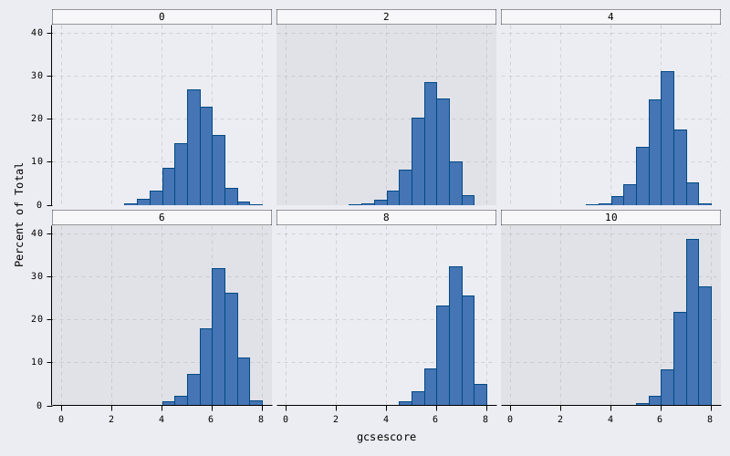
:::


### Fig 1.2 Densities

Source: [Lattice Fig 1.2](http://lmdvr.r-forge.r-project.org/figures/figures.html?chapter=01;figure=01_02;theme=stdColor;code=right). Data: A-level chemistry scores, England 1997, R mlmRev package `Chem97` (Yang et al. 2002); licence: GPL (>= 2) (mlmRev).


::: {.sourceClojure}
```clojure
(plot/render-image
 {:data chem97
  :mapping {:x :gcsescore :facet :score}
  :charts [(chart/density)]
  :facets {:columns 3}
  :labels {:x "gcsescore" :y "Density"}}
 {:width 800 :height 500})
```
:::


::: {.clay-image}
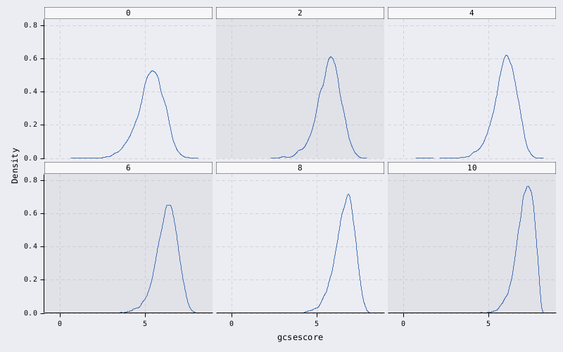
:::


### Fig 1.3 Grouped densities

The six densities in one panel, coloured by score; the score is a number, declared categorical for the colours.

Source: [Lattice Fig 1.3](http://lmdvr.r-forge.r-project.org/figures/figures.html?chapter=01;figure=01_03;theme=stdColor;code=right). Data: A-level chemistry scores, England 1997, R mlmRev package `Chem97` (Yang et al. 2002); licence: GPL (>= 2) (mlmRev).


::: {.sourceClojure}
```clojure
(plot/render-image
 {:data chem97
  :mapping {:x :gcsescore :color :score}
  :scales {:color {:type :categorical}}
  :charts [(chart/density)]
  :labels {:x "gcsescore" :y "Density"}}
 {:width 700 :height 450})
```
:::


::: {.clay-image}

:::


### Fig 1.4 Two plots on a page

Source: [Lattice Fig 1.4](http://lmdvr.r-forge.r-project.org/figures/figures.html?chapter=01;figure=01_04;theme=stdColor;code=right). Data: A-level chemistry scores, England 1997, R mlmRev package `Chem97` (Yang et al. 2002); licence: GPL (>= 2) (mlmRev).


::: {.sourceClojure}
```clojure
(plot/render-image
 (plot/arrange [{:data chem97
                 :mapping {:x :gcsescore :facet :score}
                 :charts [(chart/histogram)]
                 :facets {:columns 2}
                 :labels {:x "gcsescore" :y "Percent of Total"}}
                {:data chem97
                 :mapping {:x :gcsescore :color :score}
                 :scales {:color {:type :categorical :title "score"}}
                 :charts [(chart/density)]
                 :labels {:x "gcsescore" :y "Density"}}]
               {:columns 1})
 {:width 600 :height 800})
```
:::


::: {.clay-image}

:::


## Chapter 2 - A Technical Overview of lattice


### Fig 2.1 Two conditioning variables

Oat yield by nitrogen, a panel per variety (columns) and block (rows): points joined by lines.

Source: [Lattice Fig 2.1](http://lmdvr.r-forge.r-project.org/figures/figures.html?chapter=02;figure=02_01;theme=stdColor;code=right). Data: Oats yields: split-plot field trial, R MEMSS package `Oats` (Yates 1935; Pinheiro & Bates 2000); licence: GPL (>= 2) (MEMSS).


::: {.sourceClojure}
```clojure
(plot/render-image
 {:data oats
  :mapping {:x :nitro :y :yield :facet-col :variety :facet-row :block}
  :charts [(chart/line) (chart/scatter)]
  :labels {:x "nitro" :y "yield"}}
 {:width 700 :height 800})
```
:::


::: {.clay-image}

:::


### Fig 2.2 One block

Source: [Lattice Fig 2.2](http://lmdvr.r-forge.r-project.org/figures/figures.html?chapter=02;figure=02_02;theme=stdColor;code=right). Data: Oats yields: split-plot field trial, R MEMSS package `Oats` (Yates 1935; Pinheiro & Bates 2000); licence: GPL (>= 2) (MEMSS).


::: {.sourceClojure}
```clojure
(plot/render-image
 {:data (filterv #(= "I" (:block %)) oats)
  :mapping {:x :nitro :y :yield :facet :variety}
  :charts [(chart/line) (chart/scatter)]
  :facets {:columns 3}
  :labels {:x "nitro" :y "yield"}}
 {:width 800 :height 450})
```
:::


::: {.clay-image}
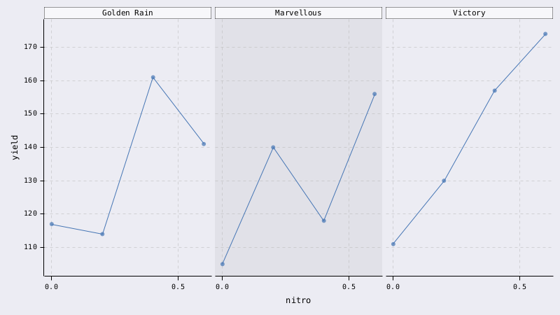
:::


### Fig 2.3 Banked to 45 degrees

Lattice's `aspect = "xy"` chooses the panel shape from the slopes of the lines; here the image is narrow instead.

Source: [Lattice Fig 2.3](http://lmdvr.r-forge.r-project.org/figures/figures.html?chapter=02;figure=02_03;theme=stdColor;code=right). Data: Oats yields: split-plot field trial, R MEMSS package `Oats` (Yates 1935; Pinheiro & Bates 2000); licence: GPL (>= 2) (MEMSS).


::: {.sourceClojure}
```clojure
(plot/render-image
 {:data oats
  :mapping {:x :nitro :y :yield :facet-col :variety :facet-row :block}
  :charts [(chart/line) (chart/scatter {:size 3})]
  :labels {:x "nitro" :y "yield"}}
 {:width 380 :height 800})
```
:::


::: {.clay-image}
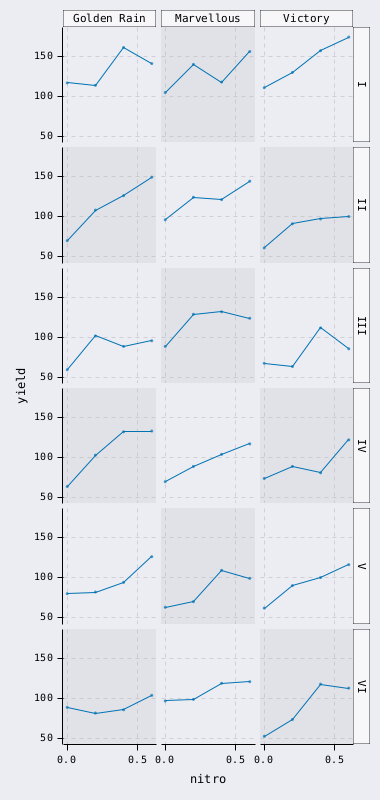
:::


### Fig 2.4 Eighteen panels in three rows

Source: [Lattice Fig 2.4](http://lmdvr.r-forge.r-project.org/figures/figures.html?chapter=02;figure=02_04;theme=stdColor;code=right). Data: Oats yields: split-plot field trial, R MEMSS package `Oats` (Yates 1935; Pinheiro & Bates 2000); licence: GPL (>= 2) (MEMSS).


::: {.sourceClojure}
```clojure
(plot/render-image
 {:data oats
  :mapping {:x :nitro :y :yield :facet #(str (:block %) " " (:variety %))}
  :charts [(chart/line) (chart/scatter {:size 3})]
  :facets {:columns 6}
  :labels {:x "nitro" :y "yield"}}
 {:width 1000 :height 550})
```
:::


::: {.clay-image}
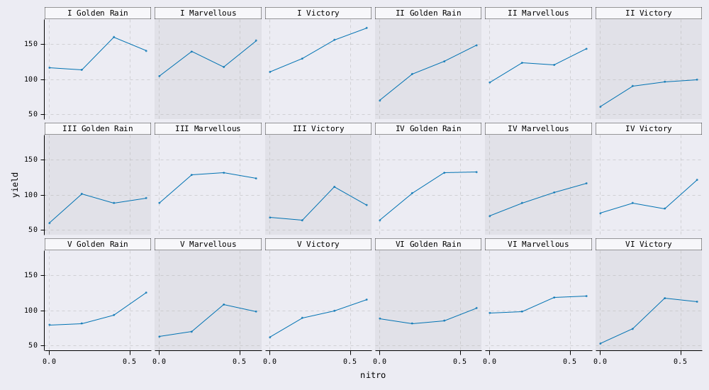
:::


### Fig 2.5 Gaps between blocks

Lattice widens chosen gaps between panels (`between`); here each block is its own plot, arranged.

Source: [Lattice Fig 2.5](http://lmdvr.r-forge.r-project.org/figures/figures.html?chapter=02;figure=02_05;theme=stdColor;code=right). Data: Oats yields: split-plot field trial, R MEMSS package `Oats` (Yates 1935; Pinheiro & Bates 2000); licence: GPL (>= 2) (MEMSS).


::: {.sourceClojure}
```clojure
(plot/render-image
 (plot/arrange (for [block ["I" "II" "III" "IV" "V" "VI"]]
                 {:data (filterv #(= block (:block %)) oats)
                  :mapping {:x :nitro :y :yield :facet :variety}
                  :charts [(chart/line) (chart/scatter {:size 3})]
                  :scales {:y {:domain [50 180]}}
                  :facets {:columns 3}
                  :labels {:title (str "Block " block) :x nil :y nil}})
               {:columns 2})
 {:width 1000 :height 700})
```
:::


::: {.clay-image}
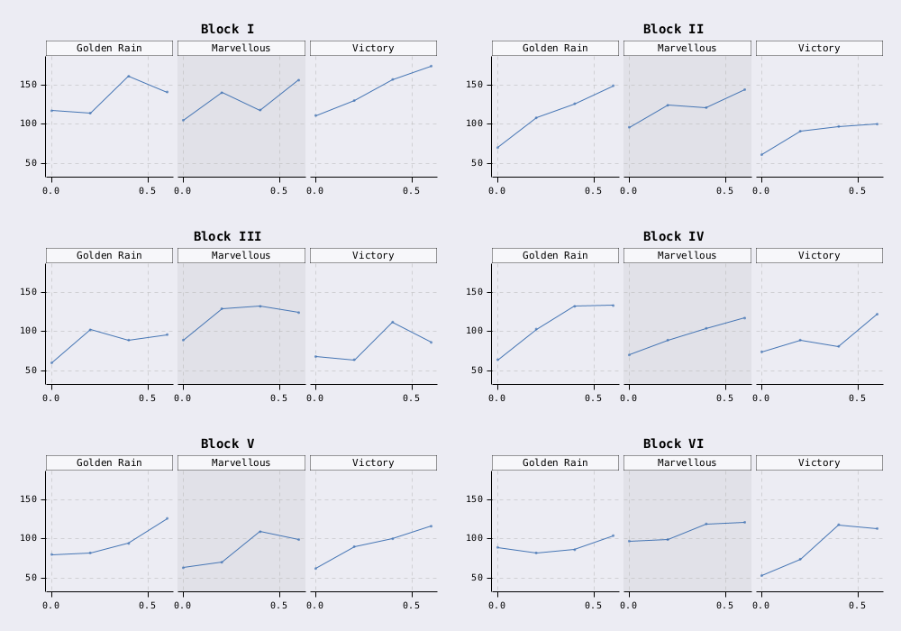
:::


### Fig 2.6 Dot plot

Barley yield of each variety at six sites, the two years in two shapes. Sites, varieties and years
keep R's factor order (`nu/levels`), the sites from the bottom up as lattice's (`:facets {:order :bottom-up}`).

Source: [Lattice Fig 2.6](http://lmdvr.r-forge.r-project.org/figures/figures.html?chapter=02;figure=02_06;theme=stdColor;code=right). Data: Barley yields, Minnesota 1931-1932, R lattice package `barley` (Immer et al. 1934; Fisher 1971; Cleveland 1993); licence: GPL (>= 2) (lattice).


::: {.sourceClojure}
```clojure
(plot/render-image
 {:data barley
  :mapping {:x :yield :y :variety :shape :year :facet :site}
  :scales {:y {:domain (nu/levels :barley :variety)}
           :facet {:domain (nu/levels :barley :site)}
           :shape {:domain (nu/levels :barley :year)}}
  :charts [(chart/scatter)]
  :facets {:columns 1 :order :bottom-up}
  :theme {:text {:tick-label {:size 8}}}
  :labels {:x "yield" :y nil}}
 {:width 600 :height 800})
```
:::


::: {.clay-image}
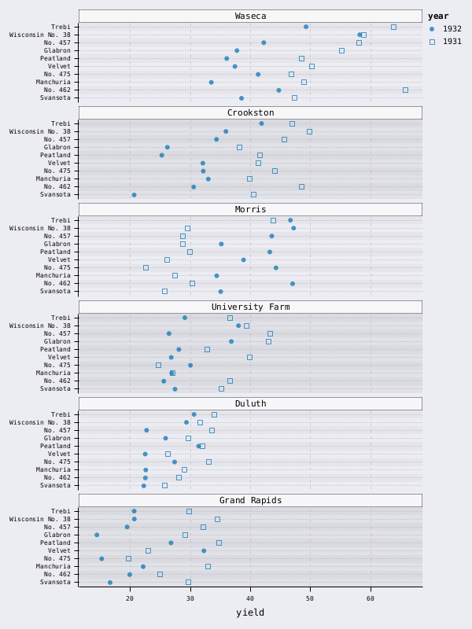
:::


### Fig 2.7 Groups within panels

Source: [Lattice Fig 2.7](http://lmdvr.r-forge.r-project.org/figures/figures.html?chapter=02;figure=02_07;theme=stdColor;code=right). Data: Oats yields: split-plot field trial, R MEMSS package `Oats` (Yates 1935; Pinheiro & Bates 2000); licence: GPL (>= 2) (MEMSS).


::: {.sourceClojure}
```clojure
(plot/render-image
 {:data oats
  :mapping {:x :nitro :y :yield :shape :variety :group :variety :facet :block}
  :charts [(chart/line {:color :darkgrey}) (chart/scatter {:color :black :size 6})]
  :facets {:columns 6}
  :labels {:title "Yield of three varieties of oats - a 3 x 4 split plot experiment with 6 blocks"
           :x "Nitrogen concentration (cwt/acre)" :y "Yield (bushels/acre)"}}
 {:width 1000 :height 400})
```
:::


::: {.clay-image}

:::


### Fig 2.8 Stacked bars

Titanic passengers by class, stacked by survival, a panel per age and sex.

Source: [Lattice Fig 2.8](http://lmdvr.r-forge.r-project.org/figures/figures.html?chapter=02;figure=02_08;theme=stdColor;code=right). Data: Titanic passengers and crew by class, sex, age and survival, R datasets package `Titanic` (Dawson 1995); licence: Part of R (GPL-2 | GPL-3).


::: {.sourceClojure}
```clojure
(def titanic-panels ["Child Male" "Child Female" "Adult Male" "Adult Female"])
```
:::


::: {.sourceClojure}
```clojure
(plot/render-image
 {:data titanic
  :mapping {:x :n :y :class :color :survived :facet #(str (:age %) " " (:sex %))}
  :scales {:facet {:domain titanic-panels}}
  :charts [(chart/bar {:position :stack})]
  :facets {:columns 4}
  :theme {:panel {:grid {:x :none :y :none}}}
  :labels {:x "Freq" :y nil}}
 {:width 900 :height 350})
```
:::


::: {.clay-image}

:::


### Fig 2.9 Free scales

Each panel its own count axis, so the small groups are readable.

Source: [Lattice Fig 2.9](http://lmdvr.r-forge.r-project.org/figures/figures.html?chapter=02;figure=02_09;theme=stdColor;code=right). Data: Titanic passengers and crew by class, sex, age and survival, R datasets package `Titanic` (Dawson 1995); licence: Part of R (GPL-2 | GPL-3).


::: {.sourceClojure}
```clojure
(plot/render-image
 {:data titanic
  :mapping {:x :n :y :class :color :survived :facet #(str (:age %) " " (:sex %))}
  :scales {:facet {:domain titanic-panels}}
  :charts [(chart/bar {:position :stack})]
  :facets {:columns 4 :scales {:x :free}}
  :theme {:panel {:grid {:x :none :y :none}}}
  :labels {:x "Freq" :y nil}}
 {:width 900 :height 350})
```
:::


::: {.clay-image}

:::


### Fig 2.10 Vertical grid lines

Source: [Lattice Fig 2.10](http://lmdvr.r-forge.r-project.org/figures/figures.html?chapter=02;figure=02_10;theme=stdColor;code=right). Data: Titanic passengers and crew by class, sex, age and survival, R datasets package `Titanic` (Dawson 1995); licence: Part of R (GPL-2 | GPL-3).


::: {.sourceClojure}
```clojure
(plot/render-image
 {:data titanic
  :mapping {:x :n :y :class :color :survived :facet #(str (:age %) " " (:sex %))}
  :scales {:facet {:domain titanic-panels}}
  :charts [(chart/bar {:position :stack})]
  :facets {:columns 4 :scales {:x :free}}
  :theme {:panel {:grid {:y :none}}}
  :labels {:x "Freq" :y nil}}
 {:width 900 :height 350})
```
:::


::: {.clay-image}

:::


### Fig 2.11 Bars without borders

Source: [Lattice Fig 2.11](http://lmdvr.r-forge.r-project.org/figures/figures.html?chapter=02;figure=02_11;theme=stdColor;code=right). Data: Titanic passengers and crew by class, sex, age and survival, R datasets package `Titanic` (Dawson 1995); licence: Part of R (GPL-2 | GPL-3).


::: {.sourceClojure}
```clojure
(plot/render-image
 {:data titanic
  :mapping {:x :n :y :class :color :survived :facet #(str (:age %) " " (:sex %))}
  :scales {:facet {:domain titanic-panels}}
  :charts [(chart/bar {:position :stack :stroke-color :none})]
  :facets {:columns 4 :scales {:x :free}}
  :theme {:panel {:grid {:x :none :y :none}}}
  :labels {:x "Freq" :y nil}}
 {:width 900 :height 350})
```
:::


::: {.clay-image}
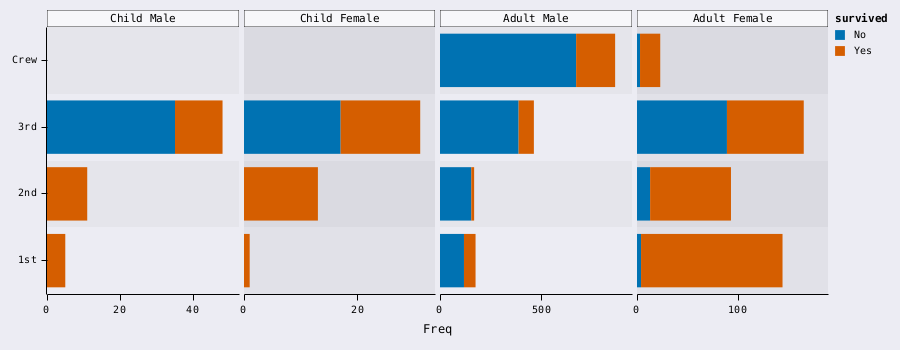
:::


## Chapter 3 - Visualizing Univariate Distributions


### Fig 3.1 Kernel density

Old Faithful eruption times: a Gaussian kernel density, the values as jittered points along the bottom edge.

Source: [Lattice Fig 3.1](http://lmdvr.r-forge.r-project.org/figures/figures.html?chapter=03;figure=03_01;theme=stdColor;code=right). Data: Old Faithful geyser eruptions, R datasets package `faithful` (Härdle 1991; Azzalini & Bowman 1990); licence: Part of R (GPL-2 | GPL-3).


::: {.sourceClojure}
```clojure
(plot/render-image
 {:data faithful
  :mapping {:x :eruptions}
  :charts [(chart/density) (chart/stripplot {:place :edge :thickness 16 :rng (r/rng :mersenne 31)})]
  :labels {:x "eruptions" :y "Density"}}
 {:width 600 :height 450})
```
:::


::: {.clay-image}
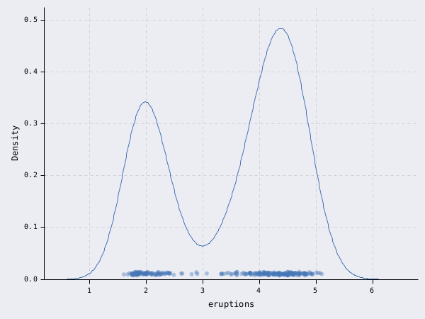
:::


### Fig 3.2 Rectangular kernel

A rectangular kernel of standard deviation 0.2 (R's `bw`) - half-width 0.2 √3 - at 200 points.

Source: [Lattice Fig 3.2](http://lmdvr.r-forge.r-project.org/figures/figures.html?chapter=03;figure=03_02;theme=stdColor;code=right). Data: Old Faithful geyser eruptions, R datasets package `faithful` (Härdle 1991; Azzalini & Bowman 1990); licence: Part of R (GPL-2 | GPL-3).


::: {.sourceClojure}
```clojure
(plot/render-image
 {:data faithful
  :mapping {:x :eruptions}
  :charts [(chart/density {:kernel :uniform :bandwidth (* 0.2 (m/sqrt 3.0)) :n 200}) (chart/rug {:thickness 16})]
  :labels {:x "eruptions" :y "Density"}}
 {:width 600 :height 450})
```
:::


::: {.clay-image}
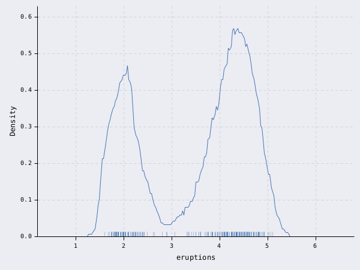
:::


### Fig 3.3 Densities by day

Flow cytometry of a graft-versus-host-disease patient: log forward scatter, a panel per day after transplant.

Source: [Lattice Fig 3.3](http://lmdvr.r-forge.r-project.org/figures/figures.html?chapter=03;figure=03_03;theme=stdColor;code=right). Data: Flow cytometry of a GvHD patient, 10 days, R latticeExtra package `gvhd10` (Brinkman et al. 2007); licence: GPL (>= 2) (latticeExtra).


::: {.sourceClojure}
```clojure
(def gvhd10-log
  "gvhd10 with log and log2 forward scatter."
  (mapv (fn [{:keys [fsc-h] :as row}] (assoc row :log-fsc (m/log fsc-h) :log2-fsc (m/log2 fsc-h))) gvhd10))
```
:::


```{=html}
<div class="data-table"><table class="table table-hover table-responsive clay-table"><thead><tr><th>fsc-h</th><th>log-fsc</th><th>fl2-a</th><th>log2-fsc</th><th>days</th><th>ssc-h</th><th>fl4-h</th><th>fl2-h</th><th>fl3-h</th><th>fl1-h</th></tr></thead><tbody><tr><td>548</td><td>6.306275286948016</td><td>8</td><td>9.098032082960527</td><td>-6</td><td>536</td><td>2.09230797761688</td><td>20.0471567388252</td><td>1</td><td>1</td></tr><tr><td>213</td><td>5.3612921657094255</td><td>23</td><td>7.734709620225838</td><td>-6</td><td>33</td><td>1</td><td>104.134661084393</td><td>7.93077699270318</td><td>2.13032443014118</td></tr><tr><td>205</td><td>5.3230099791384085</td><td>30</td><td>7.679480099505446</td><td>-6</td><td>38</td><td>1</td><td>141.428727684403</td><td>5.94557070854439</td><td>4.11036835059307</td></tr><tr><td>119</td><td>4.77912349311153</td><td>148</td><td>6.894817763307944</td><td>-6</td><td>45</td><td>1.2637517764381</td><td>630.389532491958</td><td>4.79018080525539</td><td>1.55450940125585</td></tr><tr><td>474</td><td>6.161207321695077</td><td>812</td><td>8.888743248898258</td><td>-6</td><td>904</td><td>37.9898557212078</td><td>2203.47691230698</td><td>84.6571676104789</td><td>170.863410719865</td></tr><tr><td>198</td><td>5.288267030694535</td><td>28</td><td>7.6293566200796095</td><td>-6</td><td>45</td><td>1.94690635864944</td><td>136.4260674966</td><td>1</td><td>1.48608281057475</td></tr><tr><td>267</td><td>5.58724865840025</td><td>29</td><td>8.060695931687555</td><td>-6</td><td>177</td><td>7.05480231071864</td><td>132.790545637149</td><td>17.8328968037465</td><td>64.6192155154038</td></tr><tr><td>60</td><td>4.0943445622221</td><td>105</td><td>5.906890595608519</td><td>-6</td><td>82</td><td>1.65563207635131</td><td>320.888284294226</td><td>1</td><td>3.10934291996487</td></tr><tr><td>69</td><td>4.23410650459726</td><td>12</td><td>6.108524456778169</td><td>-6</td><td>8</td><td>2.14959090655457</td><td>30.8841796746407</td><td>1</td><td>1</td></tr><tr><td>552</td><td>6.313548046277095</td><td>5</td><td>9.108524456778168</td><td>-6</td><td>544</td><td>1.96451401732681</td><td>18.6540114290992</td><td>1</td><td>1.05550528101563</td></tr><tr><td>619</td><td>6.428105272684596</td><td>65</td><td>9.273795599214264</td><td>-6</td><td>466</td><td>1.00904391657007</td><td>12.6659945315439</td><td>1</td><td>2.62045871358794</td></tr><tr><td>143</td><td>4.962844630259907</td><td>54</td><td>7.159871336778389</td><td>-6</td><td>388</td><td>1.38280984651361</td><td>108.929535084032</td><td>1</td><td>1</td></tr><tr><td>250</td><td>5.521460917862246</td><td>10</td><td>7.965784284662087</td><td>-6</td><td>719</td><td>1</td><td>20.4114060704541</td><td>1</td><td>1.45956309563553</td></tr><tr><td>453</td><td>6.115892125483034</td><td>4</td><td>8.823367240046235</td><td>-6</td><td>645</td><td>1.73186555244082</td><td>14.1110755578985</td><td>1.70095975066655</td><td>1</td></tr><tr><td>93</td><td>4.532599493153256</td><td>65</td><td>6.539158811108031</td><td>-6</td><td>68</td><td>1</td><td>11.6801569979431</td><td>1.91216307161501</td><td>1.76333290106119</td></tr><tr><td>423</td><td>6.0473721790462776</td><td>469</td><td>8.72451385311995</td><td>-6</td><td>476</td><td>84.6571676104789</td><td>1942.52915803364</td><td>46.7303698178921</td><td>251.641354213874</td></tr><tr><td>314</td><td>5.749392985908253</td><td>246</td><td>8.294620748891626</td><td>-6</td><td>447</td><td>62.8972237079901</td><td>1072.26722201032</td><td>44.6733865115693</td><td>280.351468174132</td></tr><tr><td>149</td><td>5.003946305945459</td><td>42</td><td>7.219168520462161</td><td>-6</td><td>190</td><td>7.4463810954848</td><td>188.65130945543</td><td>12.6659945315439</td><td>33.4908898004629</td></tr><tr><td>192</td><td>5.2574953720277815</td><td>65</td><td>7.584962500721156</td><td>-6</td><td>46</td><td>2.57369562770885</td><td>288.026893303126</td><td>1.98228091820025</td><td>2.43835409826883</td></tr><tr><td>221</td><td>5.3981627015177525</td><td>26</td><td>7.787902559391432</td><td>-6</td><td>82</td><td>1.37041591927341</td><td>125.807561577878</td><td>1.29835060413413</td><td>1.87803979179797</td></tr><tr><td>111</td><td>4.709530201312334</td><td>20</td><td>6.794415866350106</td><td>-6</td><td>94</td><td>3.08147432327237</td><td>90.9796541404939</td><td>2.24856868629063</td><td>7.18298542715413</td></tr><tr><td>73</td><td>4.290459441148391</td><td>48</td><td>6.189824558880018</td><td>-6</td><td>119</td><td>7.71943532136078</td><td>197.33774727821</td><td>6.74426313375284</td><td>44.2729853259731</td></tr><tr><td>150</td><td>5.0106352940962555</td><td>52</td><td>7.22881869049588</td><td>-6</td><td>183</td><td>6.27558128152045</td><td>229.9753716788</td><td>8.37097699835546</td><td>30.0611689965592</td></tr><tr><td>223</td><td>5.407171771460119</td><td>278</td><td>7.800899899920305</td><td>-6</td><td>340</td><td>23.5740400812209</td><td>1111.58660312765</td><td>22.134185158215</td><td>2263.80340952145</td></tr><tr><td>107</td><td>4.672828834461906</td><td>185</td><td>6.741466986401147</td><td>-6</td><td>147</td><td>70.7069925872126</td><td>728.064889525607</td><td>17.2021061268172</td><td>236.271606752329</td></tr><tr><td>303</td><td>5.713732805509369</td><td>122</td><td>8.243173983472952</td><td>-6</td><td>212</td><td>60.1286057902297</td><td>526.511212920003</td><td>88.5552016332685</td><td>715.072293695766</td></tr><tr><td>183</td><td>5.209486152841421</td><td>83</td><td>7.515699838284043</td><td>-6</td><td>31</td><td>1.14459284406143</td><td>363.994498073774</td><td>2.94583359826773</td><td>1.79537199962357</td></tr><tr><td>126</td><td>4.836281906951478</td><td>241</td><td>6.977279923499917</td><td>-6</td><td>156</td><td>41.5688804861519</td><td>1025.06802833418</td><td>51.5952796467086</td><td>166.310192437971</td></tr><tr><td>92</td><td>4.5217885770490405</td><td>39</td><td>6.523561956057013</td><td>-6</td><td>215</td><td>7.31349758281927</td><td>117.064764949724</td><td>16.5936279705333</td><td>35.6695117922078</td></tr><tr><td>120</td><td>4.787491742782046</td><td>293</td><td>6.906890595608519</td><td>-6</td><td>177</td><td>37.3119122464974</td><td>1238.40907295655</td><td>20.0471567388252</td><td>192.079033110973</td></tr><tr><td>100</td><td>4.605170185988092</td><td>142</td><td>6.643856189774724</td><td>-6</td><td>180</td><td>21.1598798071781</td><td>472.592476475583</td><td>11.7857913633579</td><td>22.3343648821325</td></tr><tr><td>174</td><td>5.159055299214529</td><td>0</td><td>7.442943495848728</td><td>-6</td><td>1023</td><td>3.52703345957657</td><td>6.05359950210121</td><td>5.63291422173031</td><td>9.15960684216839</td></tr><tr><td>284</td><td>5.648974238161206</td><td>31</td><td>8.149747119504681</td><td>-6</td><td>98</td><td>49.3241521265985</td><td>142.707797298193</td><td>1</td><td>17.8328968037465</td></tr><tr><td>149</td><td>5.003946305945459</td><td>62</td><td>7.219168520462161</td><td>-6</td><td>42</td><td>1</td><td>270.434790343611</td><td>1.96451401732681</td><td>1</td></tr><tr><td>684</td><td>6.52795791762255</td><td>520</td><td>9.417852514885897</td><td>-6</td><td>781</td><td>119.191787895958</td><td>2106.48398795936</td><td>401.888493311026</td><td>199.12245340072</td></tr><tr><td>201</td><td>5.303304908059076</td><td>178</td><td>7.651051691178929</td><td>-6</td><td>274</td><td>5.68385782799802</td><td>754.762582303841</td><td>14.8943147721724</td><td>59.5896816806725</td></tr><tr><td>166</td><td>5.111987788356544</td><td>62</td><td>7.3750394313469245</td><td>-6</td><td>73</td><td>1.40793498365523</td><td>277.838717988706</td><td>1</td><td>3.55893165592484</td></tr><tr><td>147</td><td>4.990432586778736</td><td>28</td><td>7.199672344836364</td><td>-6</td><td>178</td><td>6.21933414241503</td><td>124.679966364121</td><td>10.3900536674351</td><td>32.3062398088944</td></tr><tr><td>263</td><td>5.572154032177765</td><td>22</td><td>8.038918989292302</td><td>-6</td><td>68</td><td>1</td><td>106.02674888485</td><td>1</td><td>5.24146379659874</td></tr><tr><td>109</td><td>4.6913478822291435</td><td>60</td><td>6.768184324776926</td><td>-6</td><td>220</td><td>8.75641811414753</td><td>256.213583397131</td><td>9.93270297603253</td><td>39.3829204209698</td></tr><tr><td>89</td><td>4.48863636973214</td><td>41</td><td>6.475733430966398</td><td>-6</td><td>147</td><td>7.4463810954848</td><td>185.284754836759</td><td>6.80525768686113</td><td>30.333039700963</td></tr><tr><td>184</td><td>5.214935757608986</td><td>12</td><td>7.523561956057013</td><td>-6</td><td>56</td><td>1.64079288241399</td><td>69.4451993181706</td><td>1.37041591927341</td><td>3.49542116220829</td></tr><tr><td>424</td><td>6.049733455231958</td><td>202</td><td>8.727920454563199</td><td>-6</td><td>479</td><td>13.1304487795084</td><td>818.466630350764</td><td>34.0994067280454</td><td>60.1286057902297</td></tr><tr><td>176</td><td>5.170483995038151</td><td>67</td><td>7.459431618637297</td><td>-6</td><td>327</td><td>4.33851550097049</td><td>290.631784496097</td><td>12.4399650249727</td><td>26.2636352765333</td></tr><tr><td>166</td><td>5.111987788356544</td><td>102</td><td>7.3750394313469245</td><td>-6</td><td>210</td><td>7.24794774808137</td><td>428.031815121024</td><td>12.3284673944207</td><td>56.9666555645962</td></tr><tr><td>117</td><td>4.762173934797756</td><td>28</td><td>6.870364719583405</td><td>-6</td><td>36</td><td>1.40793498365523</td><td>133.991492253186</td><td>1</td><td>3.43304403749179</td></tr><tr><td>69</td><td>4.23410650459726</td><td>41</td><td>6.108524456778169</td><td>-6</td><td>144</td><td>3.59111833689962</td><td>129.251904230482</td><td>8.91551895259033</td><td>19.8674769349675</td></tr><tr><td>149</td><td>5.003946305945459</td><td>137</td><td>7.219168520462161</td><td>-6</td><td>320</td><td>40.8270679485257</td><td>536.077724515626</td><td>19.6894075755402</td><td>2809.83198521168</td></tr><tr><td>752</td><td>6.62273632394984</td><td>466</td><td>9.554588851677638</td><td>-6</td><td>610</td><td>149.278768958209</td><td>1840.37843578054</td><td>447.740513454224</td><td>251.641354213874</td></tr><tr><td>442</td><td>6.091309882077698</td><td>145</td><td>8.787902559391432</td><td>-6</td><td>499</td><td>43.8761728790409</td><td>531.27293640286</td><td>146.614832351797</td><td>373.95989092699</td></tr><tr><td>96</td><td>4.564348191467836</td><td>43</td><td>6.584962500721156</td><td>-6</td><td>168</td><td>5.19448530487696</td><td>173.967934915758</td><td>10.2046391942289</td><td>21.739192176242</td></tr><tr><td>209</td><td>5.342334251964811</td><td>98</td><td>7.7073591320808825</td><td>-6</td><td>46</td><td>1.37041591927341</td><td>424.195427069203</td><td>2.20844211988575</td><td>1.79537199962357</td></tr><tr><td>214</td><td>5.365976015021851</td><td>27</td><td>7.741466986401147</td><td>-6</td><td>50</td><td>1.15494444624982</td><td>130.420847668866</td><td>3.52703345957657</td><td>3.59111833689962</td></tr><tr><td>733</td><td>6.597145701886651</td><td>247</td><td>9.517669388133811</td><td>-6</td><td>407</td><td>167.814287943133</td><td>1034.33865806109</td><td>223.846920524153</td><td>1283.82077380798</td></tr><tr><td>201</td><td>5.303304908059076</td><td>68</td><td>7.651051691178929</td><td>-6</td><td>34</td><td>1.35813307703366</td><td>304.013906955975</td><td>4.00083404924448</td><td>1.79537199962357</td></tr><tr><td>97</td><td>4.574710978503383</td><td>25</td><td>6.599912842187128</td><td>-6</td><td>125</td><td>2.79092265216635</td><td>108.929535084032</td><td>6.50570299658905</td><td>11.0659389469887</td></tr><tr><td>376</td><td>5.929589143389895</td><td>173</td><td>8.554588851677638</td><td>-6</td><td>332</td><td>62.8972237079901</td><td>734.649447644077</td><td>229.9753716788</td><td>136.4260674966</td></tr><tr><td>214</td><td>5.365976015021851</td><td>8</td><td>7.741466986401147</td><td>-6</td><td>72</td><td>1.98228091820025</td><td>48.4439438066395</td><td>3.13746355792078</td><td>2.66807146722781</td></tr><tr><td>135</td><td>4.90527477843843</td><td>66</td><td>7.076815597050831</td><td>-6</td><td>175</td><td>9.75545010046874</td><td>260.868888272656</td><td>14.1110755578985</td><td>73.2997746215121</td></tr><tr><td>391</td><td>5.968707559985366</td><td>145</td><td>8.611024797307353</td><td>-6</td><td>226</td><td>22.5363550147721</td><td>489.922152618146</td><td>14.1110755578985</td><td>70.7069925872126</td></tr><tr><td>74</td><td>4.30406509320417</td><td>36</td><td>6.20945336562895</td><td>-6</td><td>113</td><td>4.87721659688546</td><td>145.300744540603</td><td>3.16583851658026</td><td>26.7408356955381</td></tr><tr><td>298</td><td>5.697093486505405</td><td>104</td><td>8.219168520462162</td><td>-6</td><td>72</td><td>2.18864816844905</td><td>439.750413105138</td><td>1.17592935438895</td><td>8.52307451604617</td></tr><tr><td>227</td><td>5.424950017481403</td><td>17</td><td>7.826548487290915</td><td>-6</td><td>63</td><td>1.10410595610039</td><td>87.7614940034364</td><td>1.79537199962357</td><td>4.2610930359999</td></tr><tr><td>193</td><td>5.262690188904886</td><td>11</td><td>7.592457037268081</td><td>-6</td><td>79</td><td>1.86120718925869</td><td>48.4439438066395</td><td>8.22159371891811</td><td>12.3284673944207</td></tr><tr><td>109</td><td>4.6913478822291435</td><td>303</td><td>6.768184324776926</td><td>-6</td><td>197</td><td>58.5262810678365</td><td>1238.40907295655</td><td>22.9458321470371</td><td>265.608778294669</td></tr><tr><td>90</td><td>4.499809670330265</td><td>38</td><td>6.491853096329675</td><td>-6</td><td>51</td><td>1</td><td>163.34232357928</td><td>1.09421001204135</td><td>1.3338966739233</td></tr><tr><td>379</td><td>5.937536205082426</td><td>130</td><td>8.566054038171092</td><td>-6</td><td>288</td><td>63.4660609516945</td><td>555.735365751008</td><td>227.914135254419</td><td>60.6724038844714</td></tr><tr><td>66</td><td>4.189654742026425</td><td>80</td><td>6.044394119358453</td><td>-6</td><td>167</td><td>3.37178005637296</td><td>142.707797298193</td><td>10.2046391942289</td><td>12.6659945315439</td></tr><tr><td>250</td><td>5.521460917862246</td><td>115</td><td>7.965784284662087</td><td>-6</td><td>482</td><td>12.3284673944207</td><td>526.511212920003</td><td>1.59706855245047</td><td>7842.02373630883</td></tr><tr><td>105</td><td>4.653960350157523</td><td>34</td><td>6.714245517666122</td><td>-6</td><td>127</td><td>3.40227415389544</td><td>151.991108295293</td><td>8.4466834159386</td><td>20.4114060704541</td></tr><tr><td>116</td><td>4.7535901911063645</td><td>26</td><td>6.857980995127572</td><td>-6</td><td>199</td><td>11.0659389469887</td><td>111.911793376878</td><td>10.7710505603677</td><td>145.300744540603</td></tr><tr><td>95</td><td>4.553876891600541</td><td>32</td><td>6.569855608330948</td><td>-6</td><td>109</td><td>4.49760620239682</td><td>138.904878060602</td><td>9.24244556226364</td><td>12.6659945315439</td></tr><tr><td>190</td><td>5.247024072160486</td><td>484</td><td>7.569855608330948</td><td>-6</td><td>380</td><td>64.6192155154038</td><td>1823.88338659859</td><td>21.1598798071781</td><td>3394.6248715068</td></tr><tr><td>206</td><td>5.327876168789581</td><td>53</td><td>7.6865005271832185</td><td>-6</td><td>52</td><td>1.05550528101563</td><td>238.408427451674</td><td>1.19729555045153</td><td>2.35210389174505</td></tr><tr><td>221</td><td>5.3981627015177525</td><td>228</td><td>7.787902559391432</td><td>-6</td><td>416</td><td>60.1286057902297</td><td>945.283489164419</td><td>24.4384856666141</td><td>6609.01674756612</td></tr><tr><td>273</td><td>5.60947179518496</td><td>50</td><td>8.092757140919852</td><td>-6</td><td>145</td><td>65.2036263093488</td><td>221.840612532554</td><td>92.6327203904486</td><td>60.6724038844714</td></tr><tr><td>122</td><td>4.804021044733257</td><td>111</td><td>6.930737337562887</td><td>-6</td><td>192</td><td>46.3115321845825</td><td>443.727479152916</td><td>8.91551895259033</td><td>82.4011985786459</td></tr><tr><td>101</td><td>4.61512051684126</td><td>275</td><td>6.658211482751795</td><td>-6</td><td>184</td><td>26.2636352765333</td><td>1111.58660312765</td><td>26.2636352765333</td><td>1152.34780182525</td></tr><tr><td>249</td><td>5.517452896464707</td><td>138</td><td>7.960001932068081</td><td>-6</td><td>89</td><td>1.65563207635131</td><td>586.581613397342</td><td>1.13433402180562</td><td>2.16903162737324</td></tr><tr><td>215</td><td>5.3706380281276624</td><td>26</td><td>7.7481928495894605</td><td>-6</td><td>57</td><td>1</td><td>124.679966364121</td><td>3.40227415389544</td><td>2.69220128298041</td></tr><tr><td>429</td><td>6.061456918928017</td><td>152</td><td>8.744833837499545</td><td>-6</td><td>400</td><td>46.7303698178921</td><td>526.511212920003</td><td>217.881782133305</td><td>84.6571676104789</td></tr><tr><td>375</td><td>5.926926025970411</td><td>119</td><td>8.550746785383243</td><td>-6</td><td>392</td><td>68.8227719108873</td><td>503.335176013196</td><td>151.991108295293</td><td>351.119173421513</td></tr><tr><td>132</td><td>4.882801922586371</td><td>28</td><td>7.044394119358453</td><td>-6</td><td>326</td><td>10.2046391942289</td><td>143.998434710856</td><td>1.32194114846603</td><td>3187.28801638324</td></tr><tr><td>202</td><td>5.308267697401205</td><td>34</td><td>7.658211482751795</td><td>-6</td><td>39</td><td>1</td><td>158.98952943339</td><td>4.49760620239682</td><td>3.43304403749179</td></tr><tr><td>236</td><td>5.4638318050256105</td><td>304</td><td>7.882643049361842</td><td>-6</td><td>286</td><td>30.8841796746407</td><td>1205.40758476377</td><td>47.5794431400941</td><td>167.814287943133</td></tr><tr><td>396</td><td>5.981414211254481</td><td>225</td><td>8.62935662007961</td><td>-6</td><td>208</td><td>70.7069925872126</td><td>920.093297500199</td><td>247.150718205448</td><td>27.9721158137042</td></tr><tr><td>213</td><td>5.3612921657094255</td><td>28</td><td>7.734709620225838</td><td>-6</td><td>53</td><td>1.37041591927341</td><td>135.203300130224</td><td>1</td><td>2.94583359826773</td></tr><tr><td>212</td><td>5.356586274672012</td><td>84</td><td>7.727920454563199</td><td>-6</td><td>347</td><td>4.83350280081368</td><td>351.119173421513</td><td>13.9846000022126</td><td>65.7933224657568</td></tr><tr><td>181</td><td>5.198497031265826</td><td>188</td><td>7.499845887083206</td><td>-6</td><td>354</td><td>84.6571676104789</td><td>734.649447644077</td><td>8.00250227816105</td><td>2346.81569154085</td></tr><tr><td>187</td><td>5.231108616854587</td><td>99</td><td>7.546894459887636</td><td>-6</td><td>66</td><td>1</td><td>424.195427069203</td><td>1.28671367302571</td><td>5.68385782799802</td></tr><tr><td>587</td><td>6.375024819828097</td><td>373</td><td>9.197216693110052</td><td>-6</td><td>494</td><td>86.9749002617783</td><td>1593.47788697228</td><td>238.408427451674</td><td>268.010921925845</td></tr><tr><td>84</td><td>4.430816798843313</td><td>31</td><td>6.392317422778761</td><td>-6</td><td>136</td><td>5.43366505800142</td><td>130.420847668866</td><td>8.99615016217647</td><td>33.7937786136758</td></tr><tr><td>133</td><td>4.890349128221754</td><td>343</td><td>7.05528243550119</td><td>-6</td><td>75</td><td>1.12416714790911</td><td>1430.29368099655</td><td>6.33233711505923</td><td>2.09230797761688</td></tr><tr><td>339</td><td>5.82600010738045</td><td>213</td><td>8.405141463136344</td><td>-6</td><td>251</td><td>71.9917121674961</td><td>928.414544519474</td><td>219.852286793058</td><td>122.455004778482</td></tr><tr><td>212</td><td>5.356586274672012</td><td>5</td><td>7.727920454563199</td><td>-6</td><td>61</td><td>1.28671367302571</td><td>36.64606693184</td><td>2.22841508616783</td><td>3.75647115760237</td></tr><tr><td>358</td><td>5.8805329864007</td><td>198</td><td>8.483815777264256</td><td>-6</td><td>371</td><td>57.4818572447986</td><td>833.337862563382</td><td>208.291034395878</td><td>104.134661084393</td></tr><tr><td>68</td><td>4.219507705176107</td><td>40</td><td>6.087462841250339</td><td>-6</td><td>153</td><td>16.1514361055807</td><td>160.427417473101</td><td>13.9846000022126</td><td>111.911793376878</td></tr><tr><td>195</td><td>5.272999558563747</td><td>41</td><td>7.60733031374961</td><td>-6</td><td>155</td><td>47.5794431400941</td><td>192.079033110973</td><td>99.5508484525876</td><td>39.0299369276608</td></tr><tr><td>356</td><td>5.87493073085203</td><td>133</td><td>8.475733430966399</td><td>-6</td><td>172</td><td>56.9666555645962</td><td>576.113840629102</td><td>158.98952943339</td><td>183.624074030966</td></tr><tr><td>240</td><td>5.480638923341991</td><td>100</td><td>7.906890595608519</td><td>-6</td><td>384</td><td>9.41037733745403</td><td>394.716639761467</td><td>23.1533523386059</td><td>56.4560715635018</td></tr><tr><td>…</td><td>…</td><td>…</td><td>…</td><td>…</td><td>…</td><td>…</td><td>…</td><td>…</td><td>…</td></tr></tbody></table></div>
```


::: {.sourceClojure}
```clojure
(plot/render-image
 {:data gvhd10-log
  :mapping {:x :log-fsc :facet :days}
  :charts [(chart/density)]
  :facets {:columns 2}
  :labels {:x "log(FSC.H)" :y "Density"}}
 {:width 700 :height 750})
```
:::


::: {.clay-image}

:::


### Fig 3.4 Histograms on the density scale

Source: [Lattice Fig 3.4](http://lmdvr.r-forge.r-project.org/figures/figures.html?chapter=03;figure=03_04;theme=stdColor;code=right). Data: Flow cytometry of a GvHD patient, 10 days, R latticeExtra package `gvhd10` (Brinkman et al. 2007); licence: GPL (>= 2) (latticeExtra).


::: {.sourceClojure}
```clojure
(plot/render-image
 {:data gvhd10-log
  :mapping {:x :log2-fsc :facet :days}
  :charts [(chart/histogram {:bins 50 :y :density})]
  :facets {:columns 2}
  :labels {:x "log Forward Scatter" :y "Density"}}
 {:width 700 :height 750})
```
:::


::: {.clay-image}
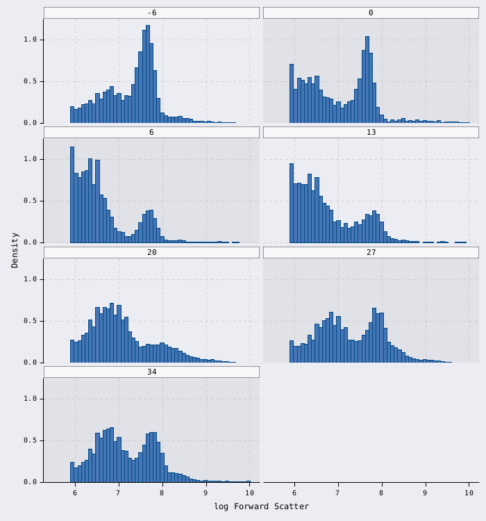
:::


### Fig 3.5 Normal Q-Q plots

GCSE score quantiles against the standard normal, a panel per A-level score.

Source: [Lattice Fig 3.5](http://lmdvr.r-forge.r-project.org/figures/figures.html?chapter=03;figure=03_05;theme=stdColor;code=right). Data: A-level chemistry scores, England 1997, R mlmRev package `Chem97` (Yang et al. 2002); licence: GPL (>= 2) (mlmRev).


::: {.sourceClojure}
```clojure
(plot/render-image
 {:data chem97
  :mapping {:y :gcsescore :facet :score}
  :charts [(chart/qq {:x-distribution [:normal] :size 2 :line false})]
  :facets {:columns 3}
  :labels {:x "qnorm" :y "gcsescore"}}
 {:width 800 :height 500})
```
:::


::: {.clay-image}

:::


### Fig 3.6 Grouped Q-Q plots

Source: [Lattice Fig 3.6](http://lmdvr.r-forge.r-project.org/figures/figures.html?chapter=03;figure=03_06;theme=stdColor;code=right). Data: A-level chemistry scores, England 1997, R mlmRev package `Chem97` (Yang et al. 2002); licence: GPL (>= 2) (mlmRev).


::: {.sourceClojure}
```clojure
(plot/render-image
 {:data chem97
  :mapping {:y :gcsescore :color :score :facet :gender}
  :scales {:color {:type :categorical}}
  :charts [(chart/qq {:x-distribution [:normal] :size 3 :line false})]
  :facets {:columns 2}
  :labels {:x "Standard Normal Quantiles" :y "Average GCSE Score"}}
 {:width 800 :height 450})
```
:::


::: {.clay-image}
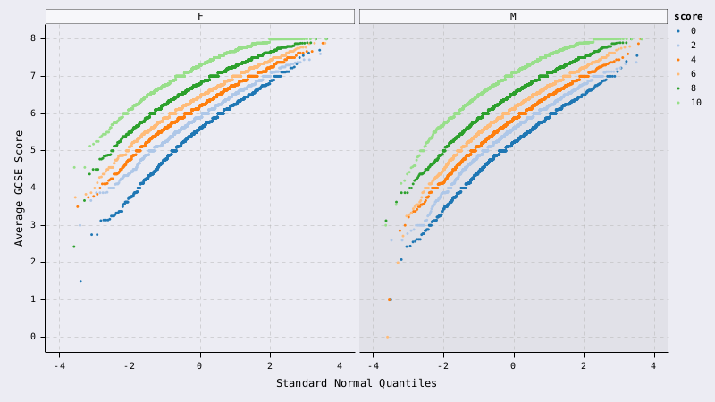
:::


### Fig 3.7 A power transformation

GCSE score to the power 2.34 makes the score groups' quantile curves nearly straight and parallel.

Source: [Lattice Fig 3.7](http://lmdvr.r-forge.r-project.org/figures/figures.html?chapter=03;figure=03_07;theme=stdColor;code=right). Data: A-level chemistry scores, England 1997, R mlmRev package `Chem97` (Yang et al. 2002); licence: GPL (>= 2) (mlmRev).


::: {.sourceClojure}
```clojure
(def chem97-trans
  "chem97 with the transformed GCSE score `gcsescore^2.34`."
  (mapv #(assoc % :gcsescore-trans (m/pow (:gcsescore %) 2.34)) chem97))
```
:::


```{=html}
<div class="data-table"><table class="table table-hover table-responsive clay-table"><thead><tr><th>lea</th><th>age</th><th>school</th><th>gcsescore</th><th>score</th><th>gcsecnt</th><th>gender</th><th>student</th><th>gcsescore-trans</th></tr></thead><tbody><tr><td>1</td><td>3</td><td>1</td><td>6.625</td><td>4</td><td>0.33931571143033</td><td>F</td><td>1</td><td>83.47856315228054</td></tr><tr><td>1</td><td>-3</td><td>1</td><td>7.625</td><td>10</td><td>1.33931571143033</td><td>F</td><td>2</td><td>115.9955275355124</td></tr><tr><td>1</td><td>-4</td><td>1</td><td>7.25</td><td>10</td><td>0.96431571143033</td><td>F</td><td>3</td><td>103.08392240919011</td></tr><tr><td>1</td><td>-2</td><td>1</td><td>7.5</td><td>10</td><td>1.21431571143033</td><td>F</td><td>4</td><td>111.59464535084454</td></tr><tr><td>1</td><td>-1</td><td>1</td><td>6.444</td><td>8</td><td>0.15831571143033</td><td>F</td><td>5</td><td>78.23911770109348</td></tr><tr><td>1</td><td>4</td><td>1</td><td>7.75</td><td>10</td><td>1.46431571143033</td><td>F</td><td>6</td><td>120.49415595726816</td></tr><tr><td>1</td><td>1</td><td>1</td><td>6.75</td><td>6</td><td>0.46431571143033</td><td>F</td><td>7</td><td>87.21091206357946</td></tr><tr><td>1</td><td>4</td><td>1</td><td>6.909</td><td>8</td><td>0.62331571143033</td><td>F</td><td>8</td><td>92.09404546555301</td></tr><tr><td>1</td><td>3</td><td>1</td><td>6.375</td><td>4</td><td>0.0893157114303298</td><td>F</td><td>9</td><td>76.29281552997591</td></tr><tr><td>1</td><td>0</td><td>1</td><td>7.75</td><td>10</td><td>1.46431571143033</td><td>F</td><td>10</td><td>120.49415595726816</td></tr><tr><td>1</td><td>-1</td><td>1</td><td>7.857</td><td>10</td><td>1.57131571143033</td><td>F</td><td>11</td><td>124.42303833944976</td></tr><tr><td>1</td><td>1</td><td>1</td><td>7.333</td><td>8</td><td>1.04731571143033</td><td>F</td><td>12</td><td>105.86664322952748</td></tr><tr><td>1</td><td>1</td><td>1</td><td>7.75</td><td>10</td><td>1.46431571143033</td><td>F</td><td>13</td><td>120.49415595726816</td></tr><tr><td>1</td><td>0</td><td>2</td><td>7.7</td><td>10</td><td>1.41431571143033</td><td>M</td><td>14</td><td>118.68294022766867</td></tr><tr><td>1</td><td>-4</td><td>2</td><td>6.3</td><td>10</td><td>0.0143157114303296</td><td>M</td><td>15</td><td>74.20905235682363</td></tr><tr><td>1</td><td>5</td><td>2</td><td>7.3</td><td>10</td><td>1.01431571143033</td><td>M</td><td>16</td><td>104.75517644121511</td></tr><tr><td>1</td><td>-3</td><td>2</td><td>6.636</td><td>8</td><td>0.35031571143033</td><td>M</td><td>17</td><td>83.80326187456527</td></tr><tr><td>1</td><td>4</td><td>2</td><td>7.272</td><td>10</td><td>0.98631571143033</td><td>M</td><td>18</td><td>103.81737802670412</td></tr><tr><td>1</td><td>0</td><td>2</td><td>7.2</td><td>10</td><td>0.91431571143033</td><td>M</td><td>19</td><td>101.42804196382946</td></tr><tr><td>1</td><td>-3</td><td>2</td><td>6.454</td><td>4</td><td>0.16831571143033</td><td>M</td><td>20</td><td>78.52352167627016</td></tr><tr><td>1</td><td>4</td><td>2</td><td>6.818</td><td>6</td><td>0.532315711430329</td><td>M</td><td>21</td><td>89.2806560195084</td></tr><tr><td>1</td><td>-5</td><td>2</td><td>7.3</td><td>10</td><td>1.01431571143033</td><td>M</td><td>22</td><td>104.75517644121511</td></tr><tr><td>1</td><td>-1</td><td>2</td><td>6.2</td><td>2</td><td>-0.08568428856967</td><td>M</td><td>23</td><td>71.48197667150599</td></tr><tr><td>1</td><td>-2</td><td>2</td><td>7.111</td><td>10</td><td>0.82531571143033</td><td>M</td><td>24</td><td>98.51849936039403</td></tr><tr><td>1</td><td>2</td><td>2</td><td>6.8</td><td>10</td><td>0.51431571143033</td><td>M</td><td>25</td><td>88.73007645501613</td></tr><tr><td>1</td><td>-4</td><td>2</td><td>6.5</td><td>8</td><td>0.21431571143033</td><td>M</td><td>26</td><td>79.8393981640781</td></tr><tr><td>1</td><td>-5</td><td>2</td><td>6.727</td><td>10</td><td>0.44131571143033</td><td>M</td><td>27</td><td>86.51713726294737</td></tr><tr><td>1</td><td>-6</td><td>2</td><td>7</td><td>6</td><td>0.71431571143033</td><td>M</td><td>28</td><td>94.95753092852235</td></tr><tr><td>1</td><td>-2</td><td>2</td><td>7.7</td><td>10</td><td>1.41431571143033</td><td>M</td><td>29</td><td>118.68294022766867</td></tr><tr><td>1</td><td>3</td><td>2</td><td>7.3</td><td>10</td><td>1.01431571143033</td><td>M</td><td>30</td><td>104.75517644121511</td></tr><tr><td>1</td><td>3</td><td>2</td><td>6.4</td><td>8</td><td>0.11431571143033</td><td>M</td><td>31</td><td>76.99475460001675</td></tr><tr><td>1</td><td>2</td><td>2</td><td>6.833</td><td>10</td><td>0.54731571143033</td><td>M</td><td>32</td><td>89.74096277366353</td></tr><tr><td>1</td><td>2</td><td>2</td><td>7.363</td><td>10</td><td>1.07731571143033</td><td>M</td><td>33</td><td>106.88290106571097</td></tr><tr><td>1</td><td>5</td><td>2</td><td>6.6</td><td>4</td><td>0.314315711430329</td><td>M</td><td>34</td><td>82.74329458229602</td></tr><tr><td>1</td><td>-1</td><td>2</td><td>7.6</td><td>10</td><td>1.31431571143033</td><td>M</td><td>35</td><td>115.10754884348127</td></tr><tr><td>1</td><td>-2</td><td>2</td><td>7.555</td><td>10</td><td>1.26931571143033</td><td>M</td><td>36</td><td>113.51902613244617</td></tr><tr><td>1</td><td>0</td><td>2</td><td>7.7</td><td>10</td><td>1.41431571143033</td><td>M</td><td>37</td><td>118.68294022766867</td></tr><tr><td>1</td><td>-5</td><td>2</td><td>7.7</td><td>10</td><td>1.41431571143033</td><td>M</td><td>38</td><td>118.68294022766867</td></tr><tr><td>1</td><td>-5</td><td>2</td><td>6</td><td>8</td><td>-0.28568428856967</td><td>M</td><td>39</td><td>66.20242925692598</td></tr><tr><td>1</td><td>3</td><td>2</td><td>8</td><td>10</td><td>1.71431571143033</td><td>M</td><td>40</td><td>129.7868134131237</td></tr><tr><td>1</td><td>-6</td><td>2</td><td>6.6</td><td>10</td><td>0.314315711430329</td><td>M</td><td>41</td><td>82.74329458229602</td></tr><tr><td>2</td><td>3</td><td>3</td><td>6.555</td><td>8</td><td>0.26931571143033</td><td>F</td><td>42</td><td>81.4291888639809</td></tr><tr><td>2</td><td>-1</td><td>3</td><td>4.75</td><td>0</td><td>-1.53568428856967</td><td>F</td><td>43</td><td>38.323313027007245</td></tr><tr><td>2</td><td>0</td><td>3</td><td>4.625</td><td>6</td><td>-1.66068428856967</td><td>M</td><td>44</td><td>36.00488803743606</td></tr><tr><td>2</td><td>0</td><td>4</td><td>5.25</td><td>6</td><td>-1.03568428856967</td><td>M</td><td>45</td><td>48.43650181700352</td></tr><tr><td>2</td><td>5</td><td>4</td><td>6</td><td>10</td><td>-0.28568428856967</td><td>M</td><td>46</td><td>66.20242925692598</td></tr><tr><td>2</td><td>-3</td><td>4</td><td>6.375</td><td>10</td><td>0.0893157114303298</td><td>M</td><td>47</td><td>76.29281552997591</td></tr><tr><td>2</td><td>1</td><td>4</td><td>6.75</td><td>10</td><td>0.46431571143033</td><td>M</td><td>48</td><td>87.21091206357946</td></tr><tr><td>2</td><td>3</td><td>4</td><td>6</td><td>2</td><td>-0.28568428856967</td><td>M</td><td>49</td><td>66.20242925692598</td></tr><tr><td>2</td><td>3</td><td>4</td><td>6.25</td><td>10</td><td>-0.0356842885696702</td><td>M</td><td>50</td><td>72.8382059955927</td></tr><tr><td>2</td><td>3</td><td>4</td><td>7</td><td>10</td><td>0.71431571143033</td><td>F</td><td>51</td><td>94.95753092852235</td></tr><tr><td>2</td><td>5</td><td>5</td><td>6.25</td><td>8</td><td>-0.0356842885696702</td><td>M</td><td>52</td><td>72.8382059955927</td></tr><tr><td>2</td><td>3</td><td>5</td><td>4.285</td><td>0</td><td>-2.00068428856967</td><td>F</td><td>53</td><td>30.113756435807495</td></tr><tr><td>2</td><td>-2</td><td>5</td><td>6.75</td><td>6</td><td>0.46431571143033</td><td>M</td><td>54</td><td>87.21091206357946</td></tr><tr><td>2</td><td>4</td><td>5</td><td>6.375</td><td>4</td><td>0.0893157114303298</td><td>M</td><td>55</td><td>76.29281552997591</td></tr><tr><td>2</td><td>-2</td><td>5</td><td>6.777</td><td>6</td><td>0.49131571143033</td><td>M</td><td>56</td><td>88.02939485987078</td></tr><tr><td>2</td><td>0</td><td>5</td><td>7.125</td><td>8</td><td>0.83931571143033</td><td>F</td><td>57</td><td>98.97296768898418</td></tr><tr><td>2</td><td>-3</td><td>5</td><td>6.285</td><td>6</td><td>-6.84288569670066E-4</td><td>F</td><td>58</td><td>73.79626129610361</td></tr><tr><td>2</td><td>-4</td><td>5</td><td>7.25</td><td>8</td><td>0.96431571143033</td><td>M</td><td>59</td><td>103.08392240919011</td></tr><tr><td>2</td><td>-5</td><td>5</td><td>5.25</td><td>2</td><td>-1.03568428856967</td><td>M</td><td>60</td><td>48.43650181700352</td></tr><tr><td>2</td><td>4</td><td>5</td><td>5.8</td><td>8</td><td>-0.48568428856967</td><td>F</td><td>61</td><td>61.153526312713964</td></tr><tr><td>2</td><td>5</td><td>5</td><td>6</td><td>6</td><td>-0.28568428856967</td><td>F</td><td>62</td><td>66.20242925692598</td></tr><tr><td>2</td><td>-1</td><td>5</td><td>5.75</td><td>4</td><td>-0.53568428856967</td><td>F</td><td>63</td><td>59.92703028939093</td></tr><tr><td>2</td><td>4</td><td>5</td><td>6.875</td><td>8</td><td>0.58931571143033</td><td>M</td><td>64</td><td>91.03703902087197</td></tr><tr><td>2</td><td>5</td><td>5</td><td>5.75</td><td>6</td><td>-0.53568428856967</td><td>M</td><td>65</td><td>59.92703028939093</td></tr><tr><td>2</td><td>-3</td><td>5</td><td>5.142</td><td>2</td><td>-1.14368428856967</td><td>M</td><td>66</td><td>46.13696786874445</td></tr><tr><td>2</td><td>2</td><td>5</td><td>7.125</td><td>6</td><td>0.83931571143033</td><td>F</td><td>67</td><td>98.97296768898418</td></tr><tr><td>2</td><td>2</td><td>6</td><td>8</td><td>10</td><td>1.71431571143033</td><td>F</td><td>68</td><td>129.7868134131237</td></tr><tr><td>2</td><td>0</td><td>6</td><td>7</td><td>4</td><td>0.71431571143033</td><td>F</td><td>69</td><td>94.95753092852235</td></tr><tr><td>2</td><td>3</td><td>6</td><td>5.777</td><td>4</td><td>-0.50868428856967</td><td>F</td><td>70</td><td>60.58757077463065</td></tr><tr><td>2</td><td>-2</td><td>6</td><td>7</td><td>2</td><td>0.71431571143033</td><td>F</td><td>71</td><td>94.95753092852235</td></tr><tr><td>2</td><td>-1</td><td>6</td><td>5.666</td><td>2</td><td>-0.61968428856967</td><td>F</td><td>72</td><td>57.89848157599775</td></tr><tr><td>2</td><td>0</td><td>6</td><td>6.5</td><td>2</td><td>0.21431571143033</td><td>M</td><td>73</td><td>79.8393981640781</td></tr><tr><td>2</td><td>1</td><td>6</td><td>7.875</td><td>10</td><td>1.58931571143033</td><td>F</td><td>74</td><td>125.09107252609782</td></tr><tr><td>2</td><td>-5</td><td>6</td><td>7.666</td><td>10</td><td>1.38031571143033</td><td>F</td><td>75</td><td>117.46027868454017</td></tr><tr><td>2</td><td>1</td><td>6</td><td>6.888</td><td>0</td><td>0.60231571143033</td><td>M</td><td>76</td><td>91.44036352839332</td></tr><tr><td>2</td><td>0</td><td>6</td><td>6.555</td><td>8</td><td>0.26931571143033</td><td>F</td><td>77</td><td>81.4291888639809</td></tr><tr><td>2</td><td>2</td><td>6</td><td>5.666</td><td>0</td><td>-0.61968428856967</td><td>F</td><td>78</td><td>57.89848157599775</td></tr><tr><td>2</td><td>0</td><td>6</td><td>6.5</td><td>8</td><td>0.21431571143033</td><td>M</td><td>79</td><td>79.8393981640781</td></tr><tr><td>2</td><td>-4</td><td>6</td><td>5.777</td><td>2</td><td>-0.50868428856967</td><td>F</td><td>80</td><td>60.58757077463065</td></tr><tr><td>2</td><td>4</td><td>6</td><td>7</td><td>4</td><td>0.71431571143033</td><td>F</td><td>81</td><td>94.95753092852235</td></tr><tr><td>2</td><td>-5</td><td>7</td><td>5.2</td><td>4</td><td>-1.08568428856967</td><td>F</td><td>82</td><td>47.36394019852429</td></tr><tr><td>2</td><td>-3</td><td>7</td><td>5</td><td>0</td><td>-1.28568428856967</td><td>F</td><td>83</td><td>43.21055158573641</td></tr><tr><td>2</td><td>5</td><td>7</td><td>6.777</td><td>4</td><td>0.49131571143033</td><td>F</td><td>84</td><td>88.02939485987078</td></tr><tr><td>2</td><td>1</td><td>7</td><td>4.555</td><td>0</td><td>-1.73068428856967</td><td>F</td><td>85</td><td>34.742639682060684</td></tr><tr><td>2</td><td>0</td><td>8</td><td>7.111</td><td>10</td><td>0.82531571143033</td><td>F</td><td>86</td><td>98.51849936039403</td></tr><tr><td>2</td><td>-1</td><td>8</td><td>5.285</td><td>4</td><td>-1.00068428856967</td><td>M</td><td>87</td><td>49.195488848038416</td></tr><tr><td>2</td><td>-6</td><td>8</td><td>7</td><td>8</td><td>0.71431571143033</td><td>F</td><td>88</td><td>94.95753092852235</td></tr><tr><td>2</td><td>0</td><td>8</td><td>5.8</td><td>6</td><td>-0.48568428856967</td><td>M</td><td>89</td><td>61.153526312713964</td></tr><tr><td>2</td><td>2</td><td>8</td><td>7.111</td><td>10</td><td>0.82531571143033</td><td>F</td><td>90</td><td>98.51849936039403</td></tr><tr><td>2</td><td>-3</td><td>8</td><td>5.555</td><td>8</td><td>-0.73068428856967</td><td>F</td><td>91</td><td>55.2790674660469</td></tr><tr><td>2</td><td>-2</td><td>8</td><td>5.6</td><td>6</td><td>-0.685684288569671</td><td>F</td><td>92</td><td>56.332624239665506</td></tr><tr><td>2</td><td>5</td><td>8</td><td>5.714</td><td>4</td><td>-0.57168428856967</td><td>M</td><td>93</td><td>59.05275346346138</td></tr><tr><td>2</td><td>-3</td><td>8</td><td>6.875</td><td>8</td><td>0.58931571143033</td><td>F</td><td>94</td><td>91.03703902087197</td></tr><tr><td>2</td><td>5</td><td>8</td><td>5</td><td>8</td><td>-1.28568428856967</td><td>M</td><td>95</td><td>43.21055158573641</td></tr><tr><td>2</td><td>-1</td><td>8</td><td>6.375</td><td>6</td><td>0.0893157114303298</td><td>F</td><td>96</td><td>76.29281552997591</td></tr><tr><td>2</td><td>-2</td><td>9</td><td>6.875</td><td>10</td><td>0.58931571143033</td><td>M</td><td>97</td><td>91.03703902087197</td></tr><tr><td>2</td><td>-1</td><td>9</td><td>5.875</td><td>6</td><td>-0.41068428856967</td><td>M</td><td>98</td><td>63.0200027818032</td></tr><tr><td>2</td><td>-5</td><td>9</td><td>8</td><td>10</td><td>1.71431571143033</td><td>M</td><td>99</td><td>129.7868134131237</td></tr><tr><td>2</td><td>2</td><td>9</td><td>6.625</td><td>10</td><td>0.33931571143033</td><td>F</td><td>100</td><td>83.47856315228054</td></tr><tr><td>…</td><td>…</td><td>…</td><td>…</td><td>…</td><td>…</td><td>…</td><td>…</td><td>…</td></tr></tbody></table></div>
```


::: {.sourceClojure}
```clojure
(plot/render-image
 {:data chem97-trans
  :mapping {:y :gcsescore-trans :color :score :facet :gender}
  :scales {:color {:type :categorical :title "score"}}
  :charts [(chart/qq {:x-distribution [:normal] :size 3 :line false})]
  :facets {:columns 2}
  :labels {:x "Standard Normal Quantiles" :y "Transformed GCSE Score"}}
 {:width 800 :height 450})
```
:::


::: {.clay-image}

:::


### Fig 3.8 Empirical CDFs

Source: [Lattice Fig 3.8](http://lmdvr.r-forge.r-project.org/figures/figures.html?chapter=03;figure=03_08;theme=stdColor;code=right). Data: A-level chemistry scores, England 1997, R mlmRev package `Chem97` (Yang et al. 2002); licence: GPL (>= 2) (mlmRev).


::: {.sourceClojure}
```clojure
(def chem97-positive (filterv #(pos? (:gcsescore %)) chem97))
```
:::


```{=html}
<div class="data-table"><table class="table table-hover table-responsive clay-table"><thead><tr><th>lea</th><th>school</th><th>student</th><th>score</th><th>gender</th><th>age</th><th>gcsescore</th><th>gcsecnt</th></tr></thead><tbody><tr><td>1</td><td>1</td><td>1</td><td>4</td><td>F</td><td>3</td><td>6.625</td><td>0.33931571143033</td></tr><tr><td>1</td><td>1</td><td>2</td><td>10</td><td>F</td><td>-3</td><td>7.625</td><td>1.33931571143033</td></tr><tr><td>1</td><td>1</td><td>3</td><td>10</td><td>F</td><td>-4</td><td>7.25</td><td>0.96431571143033</td></tr><tr><td>1</td><td>1</td><td>4</td><td>10</td><td>F</td><td>-2</td><td>7.5</td><td>1.21431571143033</td></tr><tr><td>1</td><td>1</td><td>5</td><td>8</td><td>F</td><td>-1</td><td>6.444</td><td>0.15831571143033</td></tr><tr><td>1</td><td>1</td><td>6</td><td>10</td><td>F</td><td>4</td><td>7.75</td><td>1.46431571143033</td></tr><tr><td>1</td><td>1</td><td>7</td><td>6</td><td>F</td><td>1</td><td>6.75</td><td>0.46431571143033</td></tr><tr><td>1</td><td>1</td><td>8</td><td>8</td><td>F</td><td>4</td><td>6.909</td><td>0.62331571143033</td></tr><tr><td>1</td><td>1</td><td>9</td><td>4</td><td>F</td><td>3</td><td>6.375</td><td>0.0893157114303298</td></tr><tr><td>1</td><td>1</td><td>10</td><td>10</td><td>F</td><td>0</td><td>7.75</td><td>1.46431571143033</td></tr><tr><td>1</td><td>1</td><td>11</td><td>10</td><td>F</td><td>-1</td><td>7.857</td><td>1.57131571143033</td></tr><tr><td>1</td><td>1</td><td>12</td><td>8</td><td>F</td><td>1</td><td>7.333</td><td>1.04731571143033</td></tr><tr><td>1</td><td>1</td><td>13</td><td>10</td><td>F</td><td>1</td><td>7.75</td><td>1.46431571143033</td></tr><tr><td>1</td><td>2</td><td>14</td><td>10</td><td>M</td><td>0</td><td>7.7</td><td>1.41431571143033</td></tr><tr><td>1</td><td>2</td><td>15</td><td>10</td><td>M</td><td>-4</td><td>6.3</td><td>0.0143157114303296</td></tr><tr><td>1</td><td>2</td><td>16</td><td>10</td><td>M</td><td>5</td><td>7.3</td><td>1.01431571143033</td></tr><tr><td>1</td><td>2</td><td>17</td><td>8</td><td>M</td><td>-3</td><td>6.636</td><td>0.35031571143033</td></tr><tr><td>1</td><td>2</td><td>18</td><td>10</td><td>M</td><td>4</td><td>7.272</td><td>0.98631571143033</td></tr><tr><td>1</td><td>2</td><td>19</td><td>10</td><td>M</td><td>0</td><td>7.2</td><td>0.91431571143033</td></tr><tr><td>1</td><td>2</td><td>20</td><td>4</td><td>M</td><td>-3</td><td>6.454</td><td>0.16831571143033</td></tr><tr><td>1</td><td>2</td><td>21</td><td>6</td><td>M</td><td>4</td><td>6.818</td><td>0.532315711430329</td></tr><tr><td>1</td><td>2</td><td>22</td><td>10</td><td>M</td><td>-5</td><td>7.3</td><td>1.01431571143033</td></tr><tr><td>1</td><td>2</td><td>23</td><td>2</td><td>M</td><td>-1</td><td>6.2</td><td>-0.08568428856967</td></tr><tr><td>1</td><td>2</td><td>24</td><td>10</td><td>M</td><td>-2</td><td>7.111</td><td>0.82531571143033</td></tr><tr><td>1</td><td>2</td><td>25</td><td>10</td><td>M</td><td>2</td><td>6.8</td><td>0.51431571143033</td></tr><tr><td>1</td><td>2</td><td>26</td><td>8</td><td>M</td><td>-4</td><td>6.5</td><td>0.21431571143033</td></tr><tr><td>1</td><td>2</td><td>27</td><td>10</td><td>M</td><td>-5</td><td>6.727</td><td>0.44131571143033</td></tr><tr><td>1</td><td>2</td><td>28</td><td>6</td><td>M</td><td>-6</td><td>7</td><td>0.71431571143033</td></tr><tr><td>1</td><td>2</td><td>29</td><td>10</td><td>M</td><td>-2</td><td>7.7</td><td>1.41431571143033</td></tr><tr><td>1</td><td>2</td><td>30</td><td>10</td><td>M</td><td>3</td><td>7.3</td><td>1.01431571143033</td></tr><tr><td>1</td><td>2</td><td>31</td><td>8</td><td>M</td><td>3</td><td>6.4</td><td>0.11431571143033</td></tr><tr><td>1</td><td>2</td><td>32</td><td>10</td><td>M</td><td>2</td><td>6.833</td><td>0.54731571143033</td></tr><tr><td>1</td><td>2</td><td>33</td><td>10</td><td>M</td><td>2</td><td>7.363</td><td>1.07731571143033</td></tr><tr><td>1</td><td>2</td><td>34</td><td>4</td><td>M</td><td>5</td><td>6.6</td><td>0.314315711430329</td></tr><tr><td>1</td><td>2</td><td>35</td><td>10</td><td>M</td><td>-1</td><td>7.6</td><td>1.31431571143033</td></tr><tr><td>1</td><td>2</td><td>36</td><td>10</td><td>M</td><td>-2</td><td>7.555</td><td>1.26931571143033</td></tr><tr><td>1</td><td>2</td><td>37</td><td>10</td><td>M</td><td>0</td><td>7.7</td><td>1.41431571143033</td></tr><tr><td>1</td><td>2</td><td>38</td><td>10</td><td>M</td><td>-5</td><td>7.7</td><td>1.41431571143033</td></tr><tr><td>1</td><td>2</td><td>39</td><td>8</td><td>M</td><td>-5</td><td>6</td><td>-0.28568428856967</td></tr><tr><td>1</td><td>2</td><td>40</td><td>10</td><td>M</td><td>3</td><td>8</td><td>1.71431571143033</td></tr><tr><td>1</td><td>2</td><td>41</td><td>10</td><td>M</td><td>-6</td><td>6.6</td><td>0.314315711430329</td></tr><tr><td>2</td><td>3</td><td>42</td><td>8</td><td>F</td><td>3</td><td>6.555</td><td>0.26931571143033</td></tr><tr><td>2</td><td>3</td><td>43</td><td>0</td><td>F</td><td>-1</td><td>4.75</td><td>-1.53568428856967</td></tr><tr><td>2</td><td>3</td><td>44</td><td>6</td><td>M</td><td>0</td><td>4.625</td><td>-1.66068428856967</td></tr><tr><td>2</td><td>4</td><td>45</td><td>6</td><td>M</td><td>0</td><td>5.25</td><td>-1.03568428856967</td></tr><tr><td>2</td><td>4</td><td>46</td><td>10</td><td>M</td><td>5</td><td>6</td><td>-0.28568428856967</td></tr><tr><td>2</td><td>4</td><td>47</td><td>10</td><td>M</td><td>-3</td><td>6.375</td><td>0.0893157114303298</td></tr><tr><td>2</td><td>4</td><td>48</td><td>10</td><td>M</td><td>1</td><td>6.75</td><td>0.46431571143033</td></tr><tr><td>2</td><td>4</td><td>49</td><td>2</td><td>M</td><td>3</td><td>6</td><td>-0.28568428856967</td></tr><tr><td>2</td><td>4</td><td>50</td><td>10</td><td>M</td><td>3</td><td>6.25</td><td>-0.0356842885696702</td></tr><tr><td>2</td><td>4</td><td>51</td><td>10</td><td>F</td><td>3</td><td>7</td><td>0.71431571143033</td></tr><tr><td>2</td><td>5</td><td>52</td><td>8</td><td>M</td><td>5</td><td>6.25</td><td>-0.0356842885696702</td></tr><tr><td>2</td><td>5</td><td>53</td><td>0</td><td>F</td><td>3</td><td>4.285</td><td>-2.00068428856967</td></tr><tr><td>2</td><td>5</td><td>54</td><td>6</td><td>M</td><td>-2</td><td>6.75</td><td>0.46431571143033</td></tr><tr><td>2</td><td>5</td><td>55</td><td>4</td><td>M</td><td>4</td><td>6.375</td><td>0.0893157114303298</td></tr><tr><td>2</td><td>5</td><td>56</td><td>6</td><td>M</td><td>-2</td><td>6.777</td><td>0.49131571143033</td></tr><tr><td>2</td><td>5</td><td>57</td><td>8</td><td>F</td><td>0</td><td>7.125</td><td>0.83931571143033</td></tr><tr><td>2</td><td>5</td><td>58</td><td>6</td><td>F</td><td>-3</td><td>6.285</td><td>-6.84288569670066E-4</td></tr><tr><td>2</td><td>5</td><td>59</td><td>8</td><td>M</td><td>-4</td><td>7.25</td><td>0.96431571143033</td></tr><tr><td>2</td><td>5</td><td>60</td><td>2</td><td>M</td><td>-5</td><td>5.25</td><td>-1.03568428856967</td></tr><tr><td>2</td><td>5</td><td>61</td><td>8</td><td>F</td><td>4</td><td>5.8</td><td>-0.48568428856967</td></tr><tr><td>2</td><td>5</td><td>62</td><td>6</td><td>F</td><td>5</td><td>6</td><td>-0.28568428856967</td></tr><tr><td>2</td><td>5</td><td>63</td><td>4</td><td>F</td><td>-1</td><td>5.75</td><td>-0.53568428856967</td></tr><tr><td>2</td><td>5</td><td>64</td><td>8</td><td>M</td><td>4</td><td>6.875</td><td>0.58931571143033</td></tr><tr><td>2</td><td>5</td><td>65</td><td>6</td><td>M</td><td>5</td><td>5.75</td><td>-0.53568428856967</td></tr><tr><td>2</td><td>5</td><td>66</td><td>2</td><td>M</td><td>-3</td><td>5.142</td><td>-1.14368428856967</td></tr><tr><td>2</td><td>5</td><td>67</td><td>6</td><td>F</td><td>2</td><td>7.125</td><td>0.83931571143033</td></tr><tr><td>2</td><td>6</td><td>68</td><td>10</td><td>F</td><td>2</td><td>8</td><td>1.71431571143033</td></tr><tr><td>2</td><td>6</td><td>69</td><td>4</td><td>F</td><td>0</td><td>7</td><td>0.71431571143033</td></tr><tr><td>2</td><td>6</td><td>70</td><td>4</td><td>F</td><td>3</td><td>5.777</td><td>-0.50868428856967</td></tr><tr><td>2</td><td>6</td><td>71</td><td>2</td><td>F</td><td>-2</td><td>7</td><td>0.71431571143033</td></tr><tr><td>2</td><td>6</td><td>72</td><td>2</td><td>F</td><td>-1</td><td>5.666</td><td>-0.61968428856967</td></tr><tr><td>2</td><td>6</td><td>73</td><td>2</td><td>M</td><td>0</td><td>6.5</td><td>0.21431571143033</td></tr><tr><td>2</td><td>6</td><td>74</td><td>10</td><td>F</td><td>1</td><td>7.875</td><td>1.58931571143033</td></tr><tr><td>2</td><td>6</td><td>75</td><td>10</td><td>F</td><td>-5</td><td>7.666</td><td>1.38031571143033</td></tr><tr><td>2</td><td>6</td><td>76</td><td>0</td><td>M</td><td>1</td><td>6.888</td><td>0.60231571143033</td></tr><tr><td>2</td><td>6</td><td>77</td><td>8</td><td>F</td><td>0</td><td>6.555</td><td>0.26931571143033</td></tr><tr><td>2</td><td>6</td><td>78</td><td>0</td><td>F</td><td>2</td><td>5.666</td><td>-0.61968428856967</td></tr><tr><td>2</td><td>6</td><td>79</td><td>8</td><td>M</td><td>0</td><td>6.5</td><td>0.21431571143033</td></tr><tr><td>2</td><td>6</td><td>80</td><td>2</td><td>F</td><td>-4</td><td>5.777</td><td>-0.50868428856967</td></tr><tr><td>2</td><td>6</td><td>81</td><td>4</td><td>F</td><td>4</td><td>7</td><td>0.71431571143033</td></tr><tr><td>2</td><td>7</td><td>82</td><td>4</td><td>F</td><td>-5</td><td>5.2</td><td>-1.08568428856967</td></tr><tr><td>2</td><td>7</td><td>83</td><td>0</td><td>F</td><td>-3</td><td>5</td><td>-1.28568428856967</td></tr><tr><td>2</td><td>7</td><td>84</td><td>4</td><td>F</td><td>5</td><td>6.777</td><td>0.49131571143033</td></tr><tr><td>2</td><td>7</td><td>85</td><td>0</td><td>F</td><td>1</td><td>4.555</td><td>-1.73068428856967</td></tr><tr><td>2</td><td>8</td><td>86</td><td>10</td><td>F</td><td>0</td><td>7.111</td><td>0.82531571143033</td></tr><tr><td>2</td><td>8</td><td>87</td><td>4</td><td>M</td><td>-1</td><td>5.285</td><td>-1.00068428856967</td></tr><tr><td>2</td><td>8</td><td>88</td><td>8</td><td>F</td><td>-6</td><td>7</td><td>0.71431571143033</td></tr><tr><td>2</td><td>8</td><td>89</td><td>6</td><td>M</td><td>0</td><td>5.8</td><td>-0.48568428856967</td></tr><tr><td>2</td><td>8</td><td>90</td><td>10</td><td>F</td><td>2</td><td>7.111</td><td>0.82531571143033</td></tr><tr><td>2</td><td>8</td><td>91</td><td>8</td><td>F</td><td>-3</td><td>5.555</td><td>-0.73068428856967</td></tr><tr><td>2</td><td>8</td><td>92</td><td>6</td><td>F</td><td>-2</td><td>5.6</td><td>-0.685684288569671</td></tr><tr><td>2</td><td>8</td><td>93</td><td>4</td><td>M</td><td>5</td><td>5.714</td><td>-0.57168428856967</td></tr><tr><td>2</td><td>8</td><td>94</td><td>8</td><td>F</td><td>-3</td><td>6.875</td><td>0.58931571143033</td></tr><tr><td>2</td><td>8</td><td>95</td><td>8</td><td>M</td><td>5</td><td>5</td><td>-1.28568428856967</td></tr><tr><td>2</td><td>8</td><td>96</td><td>6</td><td>F</td><td>-1</td><td>6.375</td><td>0.0893157114303298</td></tr><tr><td>2</td><td>9</td><td>97</td><td>10</td><td>M</td><td>-2</td><td>6.875</td><td>0.58931571143033</td></tr><tr><td>2</td><td>9</td><td>98</td><td>6</td><td>M</td><td>-1</td><td>5.875</td><td>-0.41068428856967</td></tr><tr><td>2</td><td>9</td><td>99</td><td>10</td><td>M</td><td>-5</td><td>8</td><td>1.71431571143033</td></tr><tr><td>2</td><td>9</td><td>100</td><td>10</td><td>F</td><td>2</td><td>6.625</td><td>0.33931571143033</td></tr><tr><td>…</td><td>…</td><td>…</td><td>…</td><td>…</td><td>…</td><td>…</td><td>…</td></tr></tbody></table></div>
```


::: {.sourceClojure}
```clojure
(plot/render-image
 {:data chem97-positive
  :mapping {:x :gcsescore :color :gender :facet :score}
  :charts [(chart/ecdf)]
  :facets {:columns 3}
  :labels {:x "Average GCSE Score" :y "Empirical CDF"}}
 {:width 800 :height 500})
```
:::


::: {.clay-image}
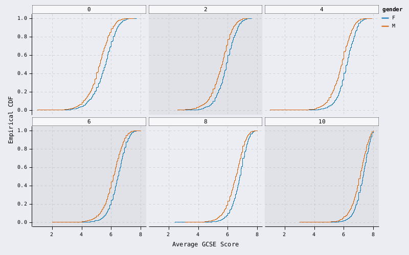
:::


### Fig 3.9 Uniform Q-Q plots

Quantiles against the uniform distribution: the empirical CDF with the axes swapped.

Source: [Lattice Fig 3.9](http://lmdvr.r-forge.r-project.org/figures/figures.html?chapter=03;figure=03_09;theme=stdColor;code=right). Data: A-level chemistry scores, England 1997, R mlmRev package `Chem97` (Yang et al. 2002); licence: GPL (>= 2) (mlmRev).


::: {.sourceClojure}
```clojure
(plot/render-image
 {:data chem97-positive
  :mapping {:y :gcsescore :color :gender :facet :score}
  :charts [(chart/qq {:x-distribution [:uniform-real] :size 3 :line false})]
  :facets {:columns 6}
  :labels {:x "Uniform quantiles" :y "Average GCSE Score"}}
 {:width 1000 :height 400})
```
:::


::: {.clay-image}
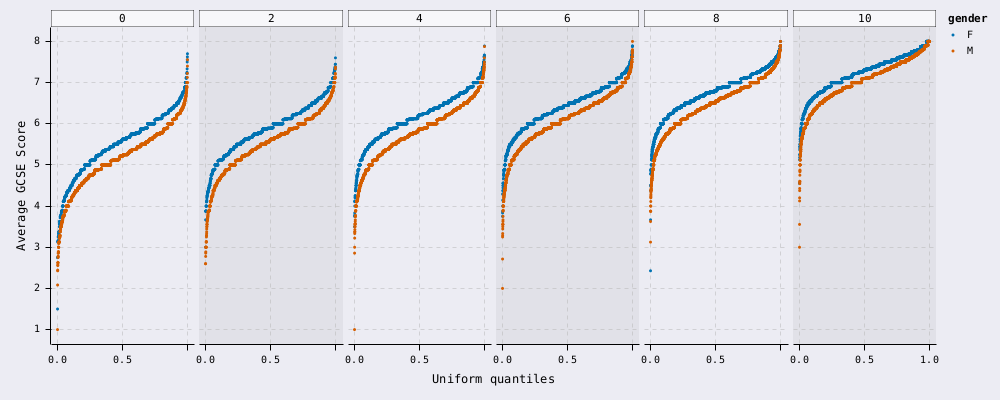
:::


### Fig 3.10 Two-sample Q-Q plots

100 quantiles of the boys' scores against the girls', per A-level score (`ppoints(100)` probabilities), and the
line y = x.

Source: [Lattice Fig 3.10](http://lmdvr.r-forge.r-project.org/figures/figures.html?chapter=03;figure=03_10;theme=stdColor;code=right). Data: A-level chemistry scores, England 1997, R mlmRev package `Chem97` (Yang et al. 2002); licence: GPL (>= 2) (mlmRev).


::: {.sourceClojure}
```clojure
(let [ps (mapv #(/ (- % 0.5) 100.0) (range 1 101))
      quantiles (fn [rows] (stats/quantiles (map :gcsescore rows) ps))]
  (plot/render-image
   {:data (for [[score rows] (group-by :score chem97)
                :let [by-gender (group-by :gender rows)]
                [f m] (map vector (quantiles (by-gender "F")) (quantiles (by-gender "M")))]
            {:score score :f f :m m})
    :mapping {:x :m :y :f :facet :score}
    :charts [(chart/scatter) (chart/rule {:slope 1 :intercept 0 :color :grey})]
    :facets {:columns 3}
    :aspect :iso
    :labels {:x "M" :y "F"}}
   {:width 800 :height 600}))
```
:::


::: {.clay-image}
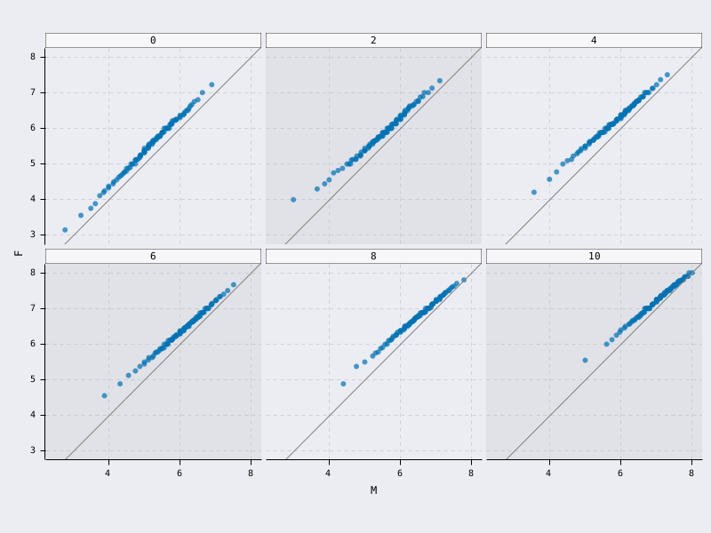
:::


### Fig 3.11 Box plots

Source: [Lattice Fig 3.11](http://lmdvr.r-forge.r-project.org/figures/figures.html?chapter=03;figure=03_11;theme=stdColor;code=right). Data: A-level chemistry scores, England 1997, R mlmRev package `Chem97` (Yang et al. 2002); licence: GPL (>= 2) (mlmRev).


::: {.sourceClojure}
```clojure
(plot/render-image
 {:data chem97
  :mapping {:x :gcsescore :y (levels/categorical :score) :facet :gender}
  :scales {:facet {:domain ["M" "F"]}}
  :charts [(chart/box)]
  :facets {:columns 2}
  :labels {:x "Average GCSE Score" :y "score"}}
 {:width 800 :height 450})
```
:::


::: {.clay-image}
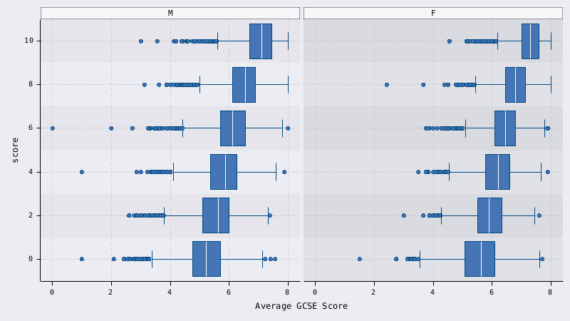
:::


### Fig 3.12 Box widths by group size

Source: [Lattice Fig 3.12](http://lmdvr.r-forge.r-project.org/figures/figures.html?chapter=03;figure=03_12;theme=stdColor;code=right). Data: A-level chemistry scores, England 1997, R mlmRev package `Chem97` (Yang et al. 2002); licence: GPL (>= 2) (mlmRev).


::: {.sourceClojure}
```clojure
(plot/render-image
 {:data chem97-trans
  :mapping {:x :gender :y :gcsescore-trans :facet :score}
  :scales {:x {:domain ["M" "F"]}}
  :charts [(chart/box {:varwidth true})]
  :facets {:columns 6}
  :labels {:x nil :y "Transformed GCSE score"}}
 {:width 900 :height 400})
```
:::


::: {.clay-image}

:::


### Fig 3.13 Box plots of many values

Source: [Lattice Fig 3.13](http://lmdvr.r-forge.r-project.org/figures/figures.html?chapter=03;figure=03_13;theme=stdColor;code=right). Data: Flow cytometry of a GvHD patient, 10 days, R latticeExtra package `gvhd10` (Brinkman et al. 2007); licence: GPL (>= 2) (latticeExtra).


::: {.sourceClojure}
```clojure
(plot/render-image
 {:data gvhd10-log
  :mapping {:x :log-fsc :y (levels/categorical :days)}
  :charts [(chart/box)]
  :labels {:x "log(Forward Scatter)" :y "Days Past Transplant"}}
 {:width 700 :height 500})
```
:::


::: {.clay-image}
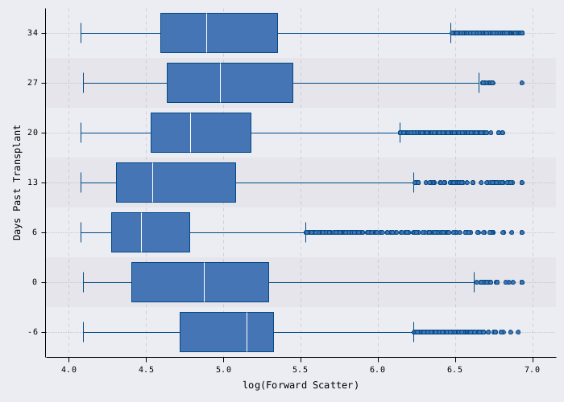
:::


### Fig 3.14 Violins

Tails 3 bandwidths past the data (`:cut 3`, R's `density` default as lattice uses it).

Source: [Lattice Fig 3.14](http://lmdvr.r-forge.r-project.org/figures/figures.html?chapter=03;figure=03_14;theme=stdColor;code=right). Data: Flow cytometry of a GvHD patient, 10 days, R latticeExtra package `gvhd10` (Brinkman et al. 2007); licence: GPL (>= 2) (latticeExtra).


::: {.sourceClojure}
```clojure
(plot/render-image
 {:data gvhd10-log
  :mapping {:x :log-fsc :y (levels/categorical :days)}
  :charts [(chart/violin {:inner :none :cut 3})]
  :labels {:x "log(Forward Scatter)" :y "Days Past Transplant"}}
 {:width 700 :height 500})
```
:::


::: {.clay-image}

:::


### Fig 3.15 Strip plot

Earthquake depth by magnitude, one strip per magnitude value.

Source: [Lattice Fig 3.15](http://lmdvr.r-forge.r-project.org/figures/figures.html?chapter=03;figure=03_15;theme=stdColor;code=right). Data: Earthquakes off Fiji since 1964, R datasets package `quakes` (Harvard PRIM-H project); licence: Part of R (GPL-2 | GPL-3).


::: {.sourceClojure}
```clojure
(plot/render-image
 {:data quakes
  :mapping {:x :depth :y (levels/categorical :mag)}
  :charts [(chart/stripplot {:jitter 0})]
  :labels {:x "depth" :y "mag"}}
 {:width 600 :height 700})
```
:::


::: {.clay-image}
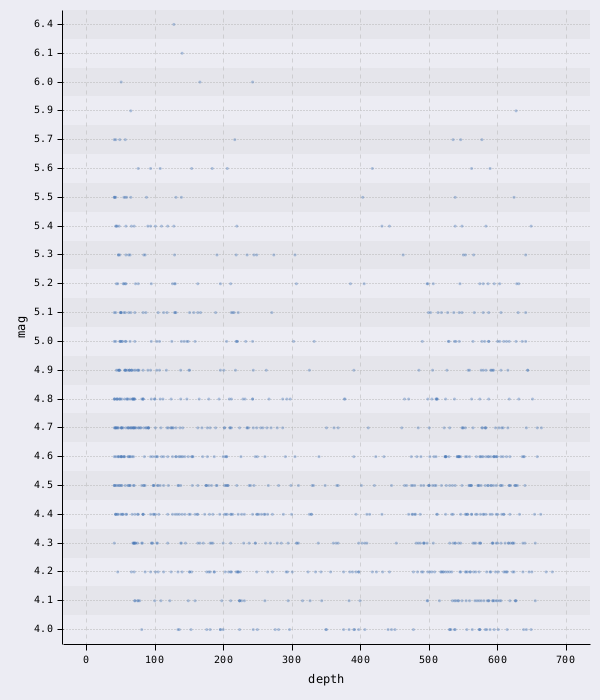
:::


### Fig 3.16 Jittered strips

Source: [Lattice Fig 3.16](http://lmdvr.r-forge.r-project.org/figures/figures.html?chapter=03;figure=03_16;theme=stdColor;code=right). Data: Earthquakes off Fiji since 1964, R datasets package `quakes` (Harvard PRIM-H project); licence: Part of R (GPL-2 | GPL-3).


::: {.sourceClojure}
```clojure
(plot/render-image
 {:data quakes
  :mapping {:x (levels/categorical :mag) :y :depth}
  :charts [(chart/stripplot {:rng (r/rng :mersenne 316)})]
  :labels {:x "Magnitude (Richter)" :y "Depth (km)"}}
 {:width 800 :height 450})
```
:::


::: {.clay-image}

:::


### Fig 3.17 Residuals and their medians

Square roots of the absolute residuals of an additive model of barley yield (variety + year + site, least
squares on dummy-coded factors), jittered by site (in R's order), a line through each year's medians; two
contrasting colours for the years.

Source: [Lattice Fig 3.17](http://lmdvr.r-forge.r-project.org/figures/figures.html?chapter=03;figure=03_17;theme=stdColor;code=right). Data: Barley yields, Minnesota 1931-1932, R lattice package `barley` (Immer et al. 1934; Fisher 1971; Cleveland 1993); licence: GPL (>= 2) (lattice).


::: {.sourceClojure}
```clojure
(def barley-residuals
  "barley with `:root-residual` - the square root of the absolute residual of the additive least-squares model of
  yield on variety, year and site (dummy-coded factors)."
  (let [dummies (vec (for [k [:variety :year :site], level (rest (sort (distinct (map k barley))))] [k level]))
        model (regression/lm (mapv :yield barley)
                             (mapv (fn [row] (mapv (fn [[k level]] (if (= level (k row)) 1.0 0.0)) dummies)) barley))]
    (mapv (fn [row residual] (assoc row :root-residual (m/sqrt (m/abs residual))))
          barley (get-in model [:residuals :raw]))))
```
:::


```{=html}
<div class="data-table"><table class="table table-hover table-responsive clay-table"><thead><tr><th>yield</th><th>variety</th><th>year</th><th>site</th><th>root-residual</th></tr></thead><tbody><tr><td>27</td><td>Manchuria</td><td>1931</td><td>University Farm</td><td>2.3167271814638384</td></tr><tr><td>48.86667</td><td>Manchuria</td><td>1931</td><td>Waseca</td><td>1.0284848888858868</td></tr><tr><td>27.43334</td><td>Manchuria</td><td>1931</td><td>Morris</td><td>2.7689741481879833</td></tr><tr><td>39.93333</td><td>Manchuria</td><td>1931</td><td>Crookston</td><td>1.677132721840035</td></tr><tr><td>32.96667</td><td>Manchuria</td><td>1931</td><td>Grand Rapids</td><td>2.8869440013042573</td></tr><tr><td>28.96667</td><td>Manchuria</td><td>1931</td><td>Duluth</td><td>1.1266967944689603</td></tr><tr><td>43.06666</td><td>Glabron</td><td>1931</td><td>University Farm</td><td>2.970127831143516</td></tr><tr><td>55.2</td><td>Glabron</td><td>1931</td><td>Waseca</td><td>2.348049261266315</td></tr><tr><td>28.76667</td><td>Glabron</td><td>1931</td><td>Morris</td><td>2.8656000535082873</td></tr><tr><td>38.13333</td><td>Glabron</td><td>1931</td><td>Crookston</td><td>0.9300546578920853</td></tr><tr><td>29.13333</td><td>Glabron</td><td>1931</td><td>Grand Rapids</td><td>1.6196696679673002</td></tr><tr><td>29.66667</td><td>Glabron</td><td>1931</td><td>Duluth</td><td>0.30277026494241277</td></tr><tr><td>35.13333</td><td>Svansota</td><td>1931</td><td>University Farm</td><td>1.9627067194735621</td></tr><tr><td>47.33333</td><td>Svansota</td><td>1931</td><td>Waseca</td><td>0.7813793359608768</td></tr><tr><td>25.76667</td><td>Svansota</td><td>1931</td><td>Morris</td><td>2.871894032399754</td></tr><tr><td>40.46667</td><td>Svansota</td><td>1931</td><td>Crookston</td><td>2.105285412163067</td></tr><tr><td>29.66667</td><td>Svansota</td><td>1931</td><td>Grand Rapids</td><td>2.473976185549627</td></tr><tr><td>25.7</td><td>Svansota</td><td>1931</td><td>Duluth</td><td>0.9545217825347531</td></tr><tr><td>39.9</td><td>Velvet</td><td>1931</td><td>University Farm</td><td>2.4362996531625574</td></tr><tr><td>50.23333</td><td>Velvet</td><td>1931</td><td>Waseca</td><td>0.9095174544779221</td></tr><tr><td>26.13333</td><td>Velvet</td><td>1931</td><td>Morris</td><td>3.2502995246592254</td></tr><tr><td>41.33333</td><td>Velvet</td><td>1931</td><td>Crookston</td><td>1.6172677576703072</td></tr><tr><td>23.03333</td><td>Velvet</td><td>1931</td><td>Grand Rapids</td><td>1.787767742185764</td></tr><tr><td>26.3</td><td>Velvet</td><td>1931</td><td>Duluth</td><td>1.7304460407652094</td></tr><tr><td>36.56666</td><td>Trebi</td><td>1931</td><td>University Farm</td><td>1.9330463436417336</td></tr><tr><td>63.8333</td><td>Trebi</td><td>1931</td><td>Waseca</td><td>2.8439950480500698</td></tr><tr><td>43.76667</td><td>Trebi</td><td>1931</td><td>Morris</td><td>0.8544055438334476</td></tr><tr><td>46.93333</td><td>Trebi</td><td>1931</td><td>Crookston</td><td>1.3699163599772304</td></tr><tr><td>29.76667</td><td>Trebi</td><td>1931</td><td>Grand Rapids</td><td>1.6738153024353255</td></tr><tr><td>33.93333</td><td>Trebi</td><td>1931</td><td>Duluth</td><td>1.303839586247739</td></tr><tr><td>43.26667</td><td>No. 457</td><td>1931</td><td>University Farm</td><td>2.5526674283972053</td></tr><tr><td>58.1</td><td>No. 457</td><td>1931</td><td>Waseca</td><td>2.4305919032202827</td></tr><tr><td>28.7</td><td>No. 457</td><td>1931</td><td>Morris</td><td>3.283883676380756</td></tr><tr><td>45.66667</td><td>No. 457</td><td>1931</td><td>Crookston</td><td>2.0402891951877677</td></tr><tr><td>32.16667</td><td>No. 457</td><td>1931</td><td>Grand Rapids</td><td>1.7751370369636301</td></tr><tr><td>33.6</td><td>No. 457</td><td>1931</td><td>Duluth</td><td>1.2326562781246062</td></tr><tr><td>36.6</td><td>No. 462</td><td>1931</td><td>University Farm</td><td>0.5646984445997143</td></tr><tr><td>65.7667</td><td>No. 462</td><td>1931</td><td>Waseca</td><td>3.7475218923087463</td></tr><tr><td>30.36667</td><td>No. 462</td><td>1931</td><td>Morris</td><td>2.9407105717269526</td></tr><tr><td>48.56666</td><td>No. 462</td><td>1931</td><td>Crookston</td><td>2.7444878089241485</td></tr><tr><td>24.93334</td><td>No. 462</td><td>1931</td><td>Grand Rapids</td><td>1.900730166716637</td></tr><tr><td>28.1</td><td>No. 462</td><td>1931</td><td>Duluth</td><td>1.873796991850147</td></tr><tr><td>32.76667</td><td>Peatland</td><td>1931</td><td>University Farm</td><td>1.5222419868952057</td></tr><tr><td>48.56666</td><td>Peatland</td><td>1931</td><td>Waseca</td><td>1.3996051824234836</td></tr><tr><td>29.86667</td><td>Peatland</td><td>1931</td><td>Morris</td><td>2.819672616930316</td></tr><tr><td>41.6</td><td>Peatland</td><td>1931</td><td>Crookston</td><td>1.3276966269947665</td></tr><tr><td>34.7</td><td>Peatland</td><td>1931</td><td>Grand Rapids</td><td>2.7112930187151205</td></tr><tr><td>32</td><td>Peatland</td><td>1931</td><td>Duluth</td><td>1.2594085251948004</td></tr><tr><td>24.66667</td><td>No. 475</td><td>1931</td><td>University Farm</td><td>2.8280338871142705</td></tr><tr><td>46.76667</td><td>No. 475</td><td>1931</td><td>Waseca</td><td>1.1573416378350243</td></tr><tr><td>22.6</td><td>No. 475</td><td>1931</td><td>Morris</td><td>3.5773983097590123</td></tr><tr><td>44.1</td><td>No. 475</td><td>1931</td><td>Crookston</td><td>2.58499967762731</td></tr><tr><td>19.7</td><td>No. 475</td><td>1931</td><td>Grand Rapids</td><td>2.2867980161497945</td></tr><tr><td>33.06666</td><td>No. 475</td><td>1931</td><td>Duluth</td><td>2.252157817146338</td></tr><tr><td>39.3</td><td>Wisconsin No. 38</td><td>1931</td><td>University Farm</td><td>0.9988897169691311</td></tr><tr><td>58.8</td><td>Wisconsin No. 38</td><td>1931</td><td>Waseca</td><td>1.7494442927207845</td></tr><tr><td>29.46667</td><td>Wisconsin No. 38</td><td>1931</td><td>Morris</td><td>3.682993845591743</td></tr><tr><td>49.86667</td><td>Wisconsin No. 38</td><td>1931</td><td>Crookston</td><td>2.194438044997689</td></tr><tr><td>34.46667</td><td>Wisconsin No. 38</td><td>1931</td><td>Grand Rapids</td><td>1.3798151446238531</td></tr><tr><td>31.6</td><td>Wisconsin No. 38</td><td>1931</td><td>Duluth</td><td>2.0069330249578963</td></tr><tr><td>26.9</td><td>Manchuria</td><td>1932</td><td>University Farm</td><td>0.39087018305319765</td></tr><tr><td>33.46667</td><td>Manchuria</td><td>1932</td><td>Waseca</td><td>3.004625351021329</td></tr><tr><td>34.36666</td><td>Manchuria</td><td>1932</td><td>Morris</td><td>2.1402213670552803</td></tr><tr><td>32.96667</td><td>Manchuria</td><td>1932</td><td>Crookston</td><td>1.077292671468578</td></tr><tr><td>22.13333</td><td>Manchuria</td><td>1932</td><td>Grand Rapids</td><td>1.6779603690194755</td></tr><tr><td>22.56667</td><td>Manchuria</td><td>1932</td><td>Duluth</td><td>0.4288251391884193</td></tr><tr><td>36.8</td><td>Glabron</td><td>1932</td><td>University Farm</td><td>2.805253048597689</td></tr><tr><td>37.73333</td><td>Glabron</td><td>1932</td><td>Waseca</td><td>2.576604225202888</td></tr><tr><td>35.13333</td><td>Glabron</td><td>1932</td><td>Morris</td><td>1.8626437304719976</td></tr><tr><td>26.16667</td><td>Glabron</td><td>1932</td><td>Crookston</td><td>2.7417542437887144</td></tr><tr><td>14.43333</td><td>Glabron</td><td>1932</td><td>Grand Rapids</td><td>2.600427817366473</td></tr><tr><td>25.86667</td><td>Glabron</td><td>1932</td><td>Duluth</td><td>1.2673259906853631</td></tr><tr><td>27.43334</td><td>Svansota</td><td>1932</td><td>University Farm</td><td>1.2110627564251204</td></tr><tr><td>38.5</td><td>Svansota</td><td>1932</td><td>Waseca</td><td>1.7053829481966791</td></tr><tr><td>35.03333</td><td>Svansota</td><td>1932</td><td>Morris</td><td>2.5166108161573213</td></tr><tr><td>20.63333</td><td>Svansota</td><td>1932</td><td>Crookston</td><td>3.175951510964871</td></tr><tr><td>16.63333</td><td>Svansota</td><td>1932</td><td>Grand Rapids</td><td>1.2642533369542581</td></tr><tr><td>22.23333</td><td>Svansota</td><td>1932</td><td>Duluth</td><td>0.9678137734089218</td></tr><tr><td>26.8</td><td>Velvet</td><td>1932</td><td>University Farm</td><td>1.360146560730371</td></tr><tr><td>37.4</td><td>Velvet</td><td>1932</td><td>Waseca</td><td>2.5868248233436035</td></tr><tr><td>38.83333</td><td>Velvet</td><td>1932</td><td>Morris</td><td>2.729468507481511</td></tr><tr><td>32.06666</td><td>Velvet</td><td>1932</td><td>Crookston</td><td>1.1561443104849478</td></tr><tr><td>32.23333</td><td>Velvet</td><td>1932</td><td>Grand Rapids</td><td>3.364272853579709</td></tr><tr><td>22.46667</td><td>Velvet</td><td>1932</td><td>Duluth</td><td>1.2301740391776481</td></tr><tr><td>29.06667</td><td>Trebi</td><td>1932</td><td>University Farm</td><td>2.433559704082342</td></tr><tr><td>49.2333</td><td>Trebi</td><td>1932</td><td>Waseca</td><td>1.0941877504950168</td></tr><tr><td>46.63333</td><td>Trebi</td><td>1932</td><td>Morris</td><td>2.985148935424608</td></tr><tr><td>41.83333</td><td>Trebi</td><td>1932</td><td>Crookston</td><td>1.4460692122670344</td></tr><tr><td>20.63333</td><td>Trebi</td><td>1932</td><td>Grand Rapids</td><td>2.5730433990380583</td></tr><tr><td>30.6</td><td>Trebi</td><td>1932</td><td>Duluth</td><td>0.5302053061472229</td></tr><tr><td>26.43334</td><td>No. 457</td><td>1932</td><td>University Farm</td><td>2.236688102232106</td></tr><tr><td>42.2</td><td>No. 457</td><td>1932</td><td>Waseca</td><td>2.162817067314447</td></tr><tr><td>43.53334</td><td>No. 457</td><td>1932</td><td>Morris</td><td>3.0600479299078556</td></tr><tr><td>34.33333</td><td>No. 457</td><td>1932</td><td>Crookston</td><td>1.3623929927398775</td></tr><tr><td>19.46667</td><td>No. 457</td><td>1932</td><td>Grand Rapids</td><td>2.057776267398049</td></tr><tr><td>22.7</td><td>No. 457</td><td>1932</td><td>Duluth</td><td>2.0164605542054757</td></tr><tr><td>25.56667</td><td>No. 462</td><td>1932</td><td>University Farm</td><td>2.323790079446362</td></tr><tr><td>44.7</td><td>No. 462</td><td>1932</td><td>Waseca</td><td>1.3070326443258153</td></tr><tr><td>47</td><td>No. 462</td><td>1932</td><td>Morris</td><td>3.646916048754986</td></tr><tr><td>30.53333</td><td>No. 462</td><td>1932</td><td>Crookston</td><td>2.277426471553667</td></tr><tr><td>…</td><td>…</td><td>…</td><td>…</td><td>…</td></tr></tbody></table></div>
```


::: {.sourceClojure}
```clojure
(def barley-residual-plot
  "The residuals jittered by site (R's order), a line through each year's medians (in site order, left to right)."
  (let [by-site-year (group-by (juxt :site :year) barley-residuals)
        sites (nu/levels :barley :site)
        medians (for [site sites year [1931 1932]]
                  {:site site :year year :median (stats/median (map :root-residual (by-site-year [site year])))})]
    {:data barley-residuals
     :mapping {:x :site :y :root-residual :color :year}
     :scales {:x {:domain sites} :color {:type :categorical :range two-colors}}
     :charts [(chart/stripplot {:rng (r/rng :mersenne 317)})
              (chart/line {:data medians :mapping {:y :median}})]
     :labels {:x nil :y "√|Residual Barley Yield|"}}))
```
:::


::: {.sourceClojure}
```clojure
(plot/render-image barley-residual-plot {:width 800 :height 450})
```
:::


::: {.clay-image}
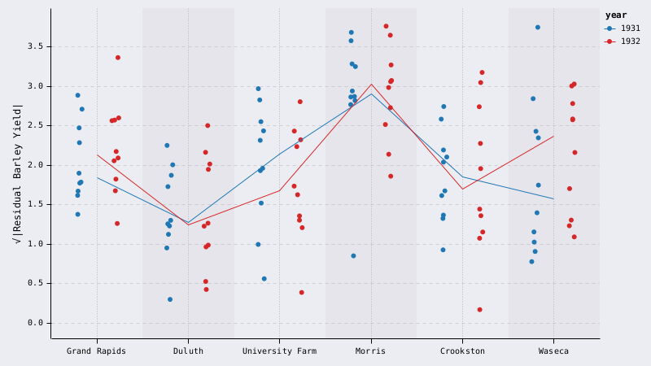
:::


## Chapter 4 - Displaying Multiway Tables


### Fig 4.1 Dot plot of a table

Virginia death rates (1940) per 1000 by age group, a panel per population group.

Source: [Lattice Fig 4.1](http://lmdvr.r-forge.r-project.org/figures/figures.html?chapter=04;figure=04_01;theme=stdColor;code=right). Data: Death rates in Virginia (1940), R datasets package `VADeaths` (Molyneaux et al. 1947); licence: Part of R (GPL-2 | GPL-3).


::: {.sourceClojure}
```clojure
(plot/render-image
 {:data va-deaths
  :mapping {:x :rate :y :age :facet :group}
  :charts [(chart/scatter)]
  :facets {:columns 2}
  :labels {:x "Freq" :y nil}}
 {:width 700 :height 450})
```
:::


::: {.clay-image}
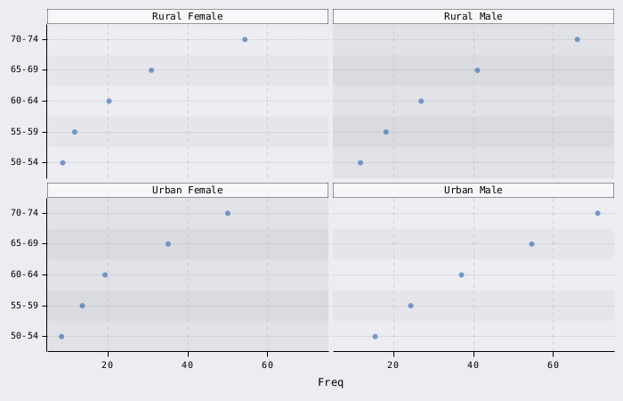
:::


### Fig 4.2 Stems from zero

Source: [Lattice Fig 4.2](http://lmdvr.r-forge.r-project.org/figures/figures.html?chapter=04;figure=04_02;theme=stdColor;code=right). Data: Death rates in Virginia (1940), R datasets package `VADeaths` (Molyneaux et al. 1947); licence: Part of R (GPL-2 | GPL-3).


::: {.sourceClojure}
```clojure
(plot/render-image
 {:data va-deaths
  :mapping {:x :rate :y :age :facet :group}
  :charts [(chart/segment {:xend 0}) (chart/scatter)]
  :facets {:columns 1}
  :labels {:title "Death Rates in Virginia - 1940" :x "Rate (per 1000)" :y nil}}
 {:width 450 :height 750})
```
:::


::: {.clay-image}
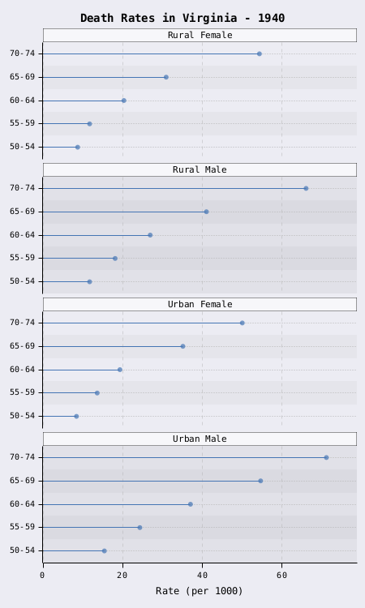
:::


### Fig 4.3 Groups joined

One line per population group across the age groups (the rows in age order, unsorted by rate).

Source: [Lattice Fig 4.3](http://lmdvr.r-forge.r-project.org/figures/figures.html?chapter=04;figure=04_03;theme=stdColor;code=right). Data: Death rates in Virginia (1940), R datasets package `VADeaths` (Molyneaux et al. 1947); licence: Part of R (GPL-2 | GPL-3).


::: {.sourceClojure}
```clojure
(plot/render-image
 {:data (sort-by :age va-deaths)
  :mapping {:x :rate :y :age :color :group}
  :charts [(chart/line {:order :data}) (chart/scatter)]
  :labels {:title "Death Rates in Virginia - 1940" :x "Rate (per 1000)" :y nil}}
 {:width 700 :height 450})
```
:::


::: {.clay-image}

:::


### Fig 4.4 Bar charts

Source: [Lattice Fig 4.4](http://lmdvr.r-forge.r-project.org/figures/figures.html?chapter=04;figure=04_04;theme=stdColor;code=right). Data: Death rates in Virginia (1940), R datasets package `VADeaths` (Molyneaux et al. 1947); licence: Part of R (GPL-2 | GPL-3).


::: {.sourceClojure}
```clojure
(plot/render-image
 {:data va-deaths
  :mapping {:x :rate :y :age :facet :group}
  :charts [(chart/bar)]
  :facets {:columns 1}
  :labels {:title "Death Rates in Virginia - 1940" :x "Rate (per 1000)" :y nil}}
 {:width 450 :height 750})
```
:::


::: {.clay-image}
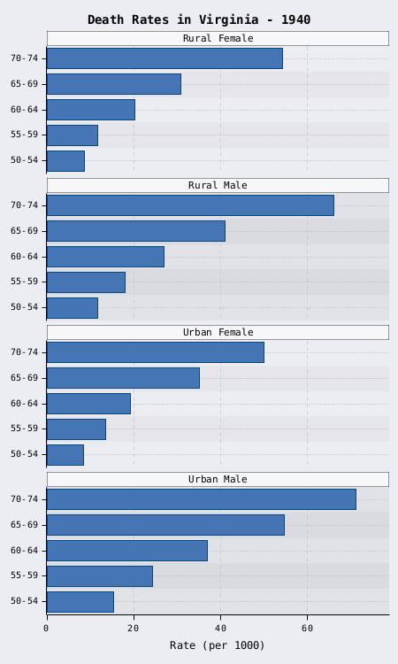
:::


### Fig 4.5 Proportions as stacked bars

Reasons for taking a postdoctoral position, as proportions of each field (`:position :normalize`), in R's
order.

Source: [Lattice Fig 4.5](http://lmdvr.r-forge.r-project.org/figures/figures.html?chapter=04;figure=04_05;theme=stdColor;code=right). Data: Reasons for taking a postdoc, by field, R latticeExtra package `postdoc` (NSF Survey of Doctorate Recipients 1999); licence: GPL (>= 2) (latticeExtra).


::: {.sourceClojure}
```clojure
(plot/render-image
 {:data postdoc
  :mapping {:x :count :y :field :color :reason}
  :scales {:color {:domain (nu/levels :postdoc :reason)} :x {:domain [0 1]}}
  :charts [(chart/bar {:position :normalize})]
  :labels {:x "Proportion" :y nil}}
 {:width 900 :height 450})
```
:::


::: {.clay-image}
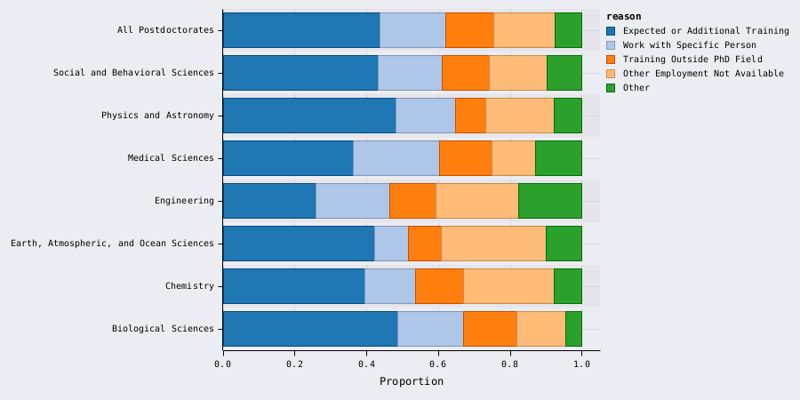
:::


### Fig 4.6 Proportions as dot plots

Source: [Lattice Fig 4.6](http://lmdvr.r-forge.r-project.org/figures/figures.html?chapter=04;figure=04_06;theme=stdColor;code=right). Data: Reasons for taking a postdoc, by field, R latticeExtra package `postdoc` (NSF Survey of Doctorate Recipients 1999); licence: GPL (>= 2) (latticeExtra).


::: {.sourceClojure}
```clojure
(def postdoc-proportions
  "postdoc counts as proportions of each field's total."
  (let [totals (update-vals (group-by :field postdoc) #(reduce + (map :count %)))]
    (mapv #(assoc % :proportion (/ (double (:count %)) (double (totals (:field %))))) postdoc)))
```
:::


```{=html}
<div class="data-table"><table class="table table-hover table-responsive clay-table"><thead><tr><th>field</th><th>reason</th><th>count</th><th>proportion</th></tr></thead><tbody><tr><td>Biological Sciences</td><td>Expected or Additional Training</td><td>6404</td><td>0.48655219571493696</td></tr><tr><td>Chemistry</td><td>Expected or Additional Training</td><td>865</td><td>0.39606227106227104</td></tr><tr><td>Earth, Atmospheric, and Ocean Sciences</td><td>Expected or Additional Training</td><td>343</td><td>0.42293464858199753</td></tr><tr><td>Engineering</td><td>Expected or Additional Training</td><td>586</td><td>0.25975177304964536</td></tr><tr><td>Medical Sciences</td><td>Expected or Additional Training</td><td>205</td><td>0.3621908127208481</td></tr><tr><td>Physics and Astronomy</td><td>Expected or Additional Training</td><td>1010</td><td>0.482560917343526</td></tr><tr><td>Social and Behavioral Sciences</td><td>Expected or Additional Training</td><td>1368</td><td>0.43250079038887135</td></tr><tr><td>All Postdoctorates</td><td>Expected or Additional Training</td><td>11197</td><td>0.4372632483305346</td></tr><tr><td>Biological Sciences</td><td>Work with Specific Person</td><td>2427</td><td>0.1843944689256952</td></tr><tr><td>Chemistry</td><td>Work with Specific Person</td><td>308</td><td>0.14102564102564102</td></tr><tr><td>Earth, Atmospheric, and Ocean Sciences</td><td>Work with Specific Person</td><td>75</td><td>0.09247842170160296</td></tr><tr><td>Engineering</td><td>Work with Specific Person</td><td>464</td><td>0.20567375886524822</td></tr><tr><td>Medical Sciences</td><td>Work with Specific Person</td><td>137</td><td>0.2420494699646643</td></tr><tr><td>Physics and Astronomy</td><td>Work with Specific Person</td><td>347</td><td>0.1657907310081223</td></tr><tr><td>Social and Behavioral Sciences</td><td>Work with Specific Person</td><td>564</td><td>0.17831172937085046</td></tr><tr><td>All Postdoctorates</td><td>Work with Specific Person</td><td>4687</td><td>0.1830358886242043</td></tr><tr><td>Biological Sciences</td><td>Training Outside PhD Field</td><td>1950</td><td>0.14815377602188118</td></tr><tr><td>Chemistry</td><td>Training Outside PhD Field</td><td>292</td><td>0.1336996336996337</td></tr><tr><td>Earth, Atmospheric, and Ocean Sciences</td><td>Training Outside PhD Field</td><td>75</td><td>0.09247842170160296</td></tr><tr><td>Engineering</td><td>Training Outside PhD Field</td><td>288</td><td>0.1276595744680851</td></tr><tr><td>Medical Sciences</td><td>Training Outside PhD Field</td><td>82</td><td>0.14487632508833923</td></tr><tr><td>Physics and Astronomy</td><td>Training Outside PhD Field</td><td>175</td><td>0.08361204013377926</td></tr><tr><td>Social and Behavioral Sciences</td><td>Training Outside PhD Field</td><td>412</td><td>0.1302560859943092</td></tr><tr><td>All Postdoctorates</td><td>Training Outside PhD Field</td><td>3403</td><td>0.132893349474753</td></tr><tr><td>Biological Sciences</td><td>Other Employment Not Available</td><td>1779</td><td>0.13516182950919314</td></tr><tr><td>Chemistry</td><td>Other Employment Not Available</td><td>551</td><td>0.2522893772893773</td></tr><tr><td>Earth, Atmospheric, and Ocean Sciences</td><td>Other Employment Not Available</td><td>238</td><td>0.2934648581997534</td></tr><tr><td>Engineering</td><td>Other Employment Not Available</td><td>517</td><td>0.22916666666666666</td></tr><tr><td>Medical Sciences</td><td>Other Employment Not Available</td><td>68</td><td>0.12014134275618374</td></tr><tr><td>Physics and Astronomy</td><td>Other Employment Not Available</td><td>399</td><td>0.19063545150501673</td></tr><tr><td>Social and Behavioral Sciences</td><td>Other Employment Not Available</td><td>514</td><td>0.16250395194435663</td></tr><tr><td>All Postdoctorates</td><td>Other Employment Not Available</td><td>4406</td><td>0.1720623267075409</td></tr><tr><td>Biological Sciences</td><td>Other</td><td>602</td><td>0.04573772982829357</td></tr><tr><td>Chemistry</td><td>Other</td><td>168</td><td>0.07692307692307693</td></tr><tr><td>Earth, Atmospheric, and Ocean Sciences</td><td>Other</td><td>80</td><td>0.09864364981504316</td></tr><tr><td>Engineering</td><td>Other</td><td>401</td><td>0.1777482269503546</td></tr><tr><td>Medical Sciences</td><td>Other</td><td>74</td><td>0.13074204946996468</td></tr><tr><td>Physics and Astronomy</td><td>Other</td><td>162</td><td>0.07740086000955566</td></tr><tr><td>Social and Behavioral Sciences</td><td>Other</td><td>305</td><td>0.09642744230161239</td></tr><tr><td>All Postdoctorates</td><td>Other</td><td>1914</td><td>0.07474518686296716</td></tr></tbody></table></div>
```


::: {.sourceClojure}
```clojure
(plot/render-image
 {:data postdoc-proportions
  :mapping {:x :proportion :y :field :facet :reason}
  :charts [(chart/scatter)]
  :facets {:columns 3}
  :labels {:x "Proportion" :y nil}}
 {:width 1000 :height 550})
```
:::


::: {.clay-image}
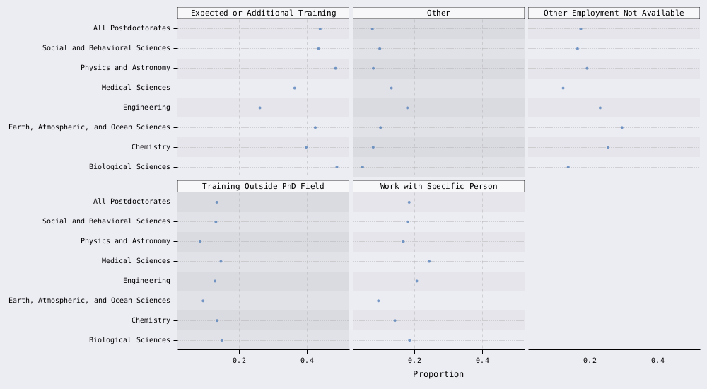
:::


### Fig 4.7 Ordered panels and levels

Panels ordered by their median proportion from the bottom up, the fields within each panel by their proportion
(free y scales).

Source: [Lattice Fig 4.7](http://lmdvr.r-forge.r-project.org/figures/figures.html?chapter=04;figure=04_07;theme=stdColor;code=right). Data: Reasons for taking a postdoc, by field, R latticeExtra package `postdoc` (NSF Survey of Doctorate Recipients 1999); licence: GPL (>= 2) (latticeExtra).


::: {.sourceClojure}
```clojure
(plot/render-image
 {:data postdoc-proportions
  :mapping {:x :proportion :y :field :facet :reason}
  :scales {:facet {:order-by #(stats/median (map :proportion %))}
           :y {:order-by #(stats/mean (map :proportion %))}}
  :charts [(chart/scatter)]
  :facets {:columns 1 :order :bottom-up :scales {:y :free}}
  :labels {:x "Proportion" :y nil}}
 {:width 600 :height 800})
```
:::


::: {.clay-image}

:::


### Fig 4.8 Frequencies as spikes

How many candidates have each average GCSE score, by gender.

Source: [Lattice Fig 4.8](http://lmdvr.r-forge.r-project.org/figures/figures.html?chapter=04;figure=04_08;theme=stdColor;code=right). Data: A-level chemistry scores, England 1997, R mlmRev package `Chem97` (Yang et al. 2002); licence: GPL (>= 2) (mlmRev).


::: {.sourceClojure}
```clojure
(plot/render-image
 {:data (for [[[score gender] n] (frequencies (map (juxt :gcsescore :gender) chem97))]
          {:gcsescore score :gender gender :freq n})
  :mapping {:x :gcsescore :y :freq :facet :gender}
  :charts [(chart/segment {:yend 0})]
  :facets {:columns 1}
  :labels {:x "Average GCSE Score" :y "Freq"}}
 {:width 800 :height 500})
```
:::


::: {.clay-image}

:::


### Fig 4.9 Bar chart of counts

Source: [Lattice Fig 4.9](http://lmdvr.r-forge.r-project.org/figures/figures.html?chapter=04;figure=04_09;theme=stdColor;code=right). Data: A-level chemistry scores, England 1997, R mlmRev package `Chem97` (Yang et al. 2002); licence: GPL (>= 2) (mlmRev).


::: {.sourceClojure}
```clojure
(plot/render-image
 {:data chem97
  :mapping {:y (levels/categorical :score) :facet :gender}
  :scales {:facet {:domain ["M" "F"]}}
  :charts [(chart/bar {:stat :count})]
  :flip true
  :facets {:columns 2}
  :labels {:x "Freq" :y "score"}}
 {:width 800 :height 400})
```
:::


::: {.clay-image}
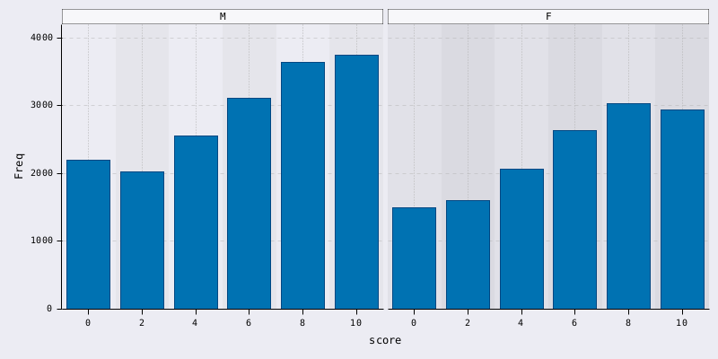
:::


## Chapter 5 - Scatter Plots and Extensions


### Fig 5.1 Conditioning on a cut numeric variable

Earthquake epicentres off Fiji, a panel per depth interval (two equal-width intervals, `levels/bin`).

Source: [Lattice Fig 5.1](http://lmdvr.r-forge.r-project.org/figures/figures.html?chapter=05;figure=05_01;theme=stdColor;code=right). Data: Earthquakes off Fiji since 1964, R datasets package `quakes` (Harvard PRIM-H project); licence: Part of R (GPL-2 | GPL-3).


::: {.sourceClojure}
```clojure
(plot/render-image
 {:data (levels/bin quakes :depth {:as :depth-cut :bins 2})
  :mapping {:x :long :y :lat :facet :depth-cut}
  :charts [(chart/scatter {:shape \o :size 5})]
  :facets {:columns 2}
  :labels {:x "long" :y "lat"}}
 {:width 800 :height 450})
```
:::


::: {.clay-image}
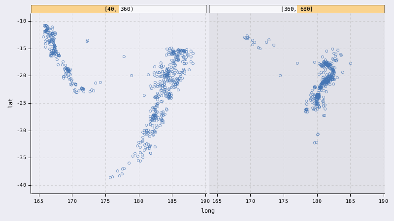
:::


### Fig 5.2 Three depth intervals, isometric

Source: [Lattice Fig 5.2](http://lmdvr.r-forge.r-project.org/figures/figures.html?chapter=05;figure=05_02;theme=stdColor;code=right). Data: Earthquakes off Fiji since 1964, R datasets package `quakes` (Harvard PRIM-H project); licence: Part of R (GPL-2 | GPL-3).


::: {.sourceClojure}
```clojure
(plot/render-image
 {:data (levels/bin quakes :depth {:as :depth-cut :bins 3 :label "Depth"})
  :mapping {:x :long :y :lat :facet :depth-cut}
  :charts [(chart/scatter {:size 4})]
  :facets {:columns 3}
  :aspect :iso
  :labels {:x "Longitude" :y "Latitude"}}
 {:width 900 :height 450})
```
:::


::: {.clay-image}

:::


### Fig 5.3 Depth as groups

Depth cut at its terciles: three groups of equal size, coloured.

Source: [Lattice Fig 5.3](http://lmdvr.r-forge.r-project.org/figures/figures.html?chapter=05;figure=05_03;theme=stdColor;code=right). Data: Earthquakes off Fiji since 1964, R datasets package `quakes` (Harvard PRIM-H project); licence: Part of R (GPL-2 | GPL-3).


::: {.sourceClojure}
```clojure
(plot/render-image
 {:data (levels/bin quakes :depth {:as :depth-cut :bins {:quantiles 3}})
  :mapping {:x :long :y :lat :color :depth-cut}
  :scales {:color {:title "Depth"}}
  :charts [(chart/scatter {:size 4})]
  :aspect :iso
  :labels {:x "Longitude" :y "Latitude"}}
 {:width 650 :height 650})
```
:::


::: {.clay-image}

:::


### Fig 5.4 Depth as grey levels

Filled circles from dark (shallow) to light (deep); the deepest drawn first, so shallow ones stay on top.

Source: [Lattice Fig 5.4](http://lmdvr.r-forge.r-project.org/figures/figures.html?chapter=05;figure=05_04;theme=stdColor;code=right). Data: Earthquakes off Fiji since 1964, R datasets package `quakes` (Harvard PRIM-H project); licence: Part of R (GPL-2 | GPL-3).


::: {.sourceClojure}
```clojure
(def quakes-by-depth
  "quakes, deepest first."
  (vec (sort-by :depth > quakes)))
```
:::


```{=html}
<div class="data-table"><table class="table table-hover table-responsive clay-table"><thead><tr><th>lat</th><th>long</th><th>depth</th><th>mag</th><th>stations</th></tr></thead><tbody><tr><td>-20.32</td><td>180.88</td><td>680</td><td>4.2</td><td>22</td></tr><tr><td>-19.3</td><td>180.6</td><td>671</td><td>4.2</td><td>16</td></tr><tr><td>-19.4</td><td>180.94</td><td>664</td><td>4.7</td><td>34</td></tr><tr><td>-12.93</td><td>169.52</td><td>663</td><td>4.4</td><td>30</td></tr><tr><td>-12.66</td><td>169.46</td><td>658</td><td>4.6</td><td>43</td></tr><tr><td>-14.82</td><td>171.17</td><td>658</td><td>4.7</td><td>49</td></tr><tr><td>-18.89</td><td>181.24</td><td>655</td><td>4.1</td><td>14</td></tr><tr><td>-17.96</td><td>181.4</td><td>655</td><td>4.3</td><td>20</td></tr><tr><td>-13.09</td><td>169.28</td><td>654</td><td>4.4</td><td>22</td></tr><tr><td>-18.17</td><td>181.98</td><td>651</td><td>4.8</td><td>43</td></tr><tr><td>-20.62</td><td>181.03</td><td>650</td><td>4.2</td><td>15</td></tr><tr><td>-20.42</td><td>181.96</td><td>649</td><td>4</td><td>11</td></tr><tr><td>-18.12</td><td>181.88</td><td>649</td><td>5.4</td><td>88</td></tr><tr><td>-23.7</td><td>179.6</td><td>646</td><td>4.2</td><td>21</td></tr><tr><td>-13.05</td><td>169.58</td><td>644</td><td>4.9</td><td>68</td></tr><tr><td>-26</td><td>178.43</td><td>644</td><td>4.9</td><td>27</td></tr><tr><td>-14.28</td><td>170.34</td><td>642</td><td>4.7</td><td>29</td></tr><tr><td>-17.95</td><td>181.37</td><td>642</td><td>4</td><td>17</td></tr><tr><td>-18.48</td><td>181.49</td><td>641</td><td>5</td><td>49</td></tr><tr><td>-12.93</td><td>169.63</td><td>641</td><td>5.1</td><td>57</td></tr><tr><td>-13.45</td><td>170.3</td><td>641</td><td>5.3</td><td>93</td></tr><tr><td>-17.82</td><td>181.83</td><td>640</td><td>4.3</td><td>24</td></tr><tr><td>-18.04</td><td>181.75</td><td>640</td><td>4.5</td><td>47</td></tr><tr><td>-18.18</td><td>180.63</td><td>639</td><td>4.6</td><td>39</td></tr><tr><td>-13.84</td><td>170.62</td><td>638</td><td>4.6</td><td>20</td></tr><tr><td>-21.03</td><td>180.78</td><td>638</td><td>4</td><td>14</td></tr><tr><td>-20.36</td><td>181.19</td><td>637</td><td>4.2</td><td>23</td></tr><tr><td>-14.99</td><td>171.39</td><td>637</td><td>4.3</td><td>21</td></tr><tr><td>-21.33</td><td>180.69</td><td>636</td><td>4.6</td><td>29</td></tr><tr><td>-18</td><td>180.62</td><td>636</td><td>5</td><td>100</td></tr><tr><td>-18.05</td><td>180.86</td><td>632</td><td>4.4</td><td>15</td></tr><tr><td>-18.21</td><td>180.87</td><td>631</td><td>5.2</td><td>69</td></tr><tr><td>-18.26</td><td>180.98</td><td>631</td><td>4.8</td><td>36</td></tr><tr><td>-19.77</td><td>181.4</td><td>630</td><td>5.1</td><td>54</td></tr><tr><td>-12.95</td><td>169.09</td><td>629</td><td>4.5</td><td>19</td></tr><tr><td>-18.08</td><td>180.7</td><td>628</td><td>5.2</td><td>72</td></tr><tr><td>-21.96</td><td>179.62</td><td>627</td><td>5</td><td>45</td></tr><tr><td>-20.2</td><td>180.9</td><td>627</td><td>4.1</td><td>11</td></tr><tr><td>-17.94</td><td>180.6</td><td>627</td><td>4.5</td><td>29</td></tr><tr><td>-21.08</td><td>180.85</td><td>627</td><td>5.9</td><td>119</td></tr><tr><td>-17.97</td><td>181.66</td><td>626</td><td>4.1</td><td>19</td></tr><tr><td>-17.98</td><td>180.5</td><td>626</td><td>4.1</td><td>19</td></tr><tr><td>-20.99</td><td>181.02</td><td>626</td><td>4.5</td><td>36</td></tr><tr><td>-21.14</td><td>181.06</td><td>625</td><td>4.5</td><td>35</td></tr><tr><td>-21.3</td><td>180.82</td><td>624</td><td>4.3</td><td>14</td></tr><tr><td>-18.14</td><td>180.87</td><td>624</td><td>5.5</td><td>105</td></tr><tr><td>-18.44</td><td>181.04</td><td>624</td><td>4.2</td><td>21</td></tr><tr><td>-17.47</td><td>179.59</td><td>622</td><td>4.3</td><td>19</td></tr><tr><td>-17.88</td><td>180.58</td><td>622</td><td>4.2</td><td>23</td></tr><tr><td>-20.83</td><td>181.01</td><td>622</td><td>4.3</td><td>15</td></tr><tr><td>-17.95</td><td>181.65</td><td>619</td><td>4.3</td><td>26</td></tr><tr><td>-21.18</td><td>180.92</td><td>619</td><td>4.5</td><td>18</td></tr><tr><td>-18.13</td><td>181.52</td><td>618</td><td>4.6</td><td>41</td></tr><tr><td>-13.36</td><td>172.76</td><td>618</td><td>4.4</td><td>18</td></tr><tr><td>-21.77</td><td>181</td><td>618</td><td>4.1</td><td>10</td></tr><tr><td>-26.11</td><td>178.3</td><td>617</td><td>4.8</td><td>39</td></tr><tr><td>-21.68</td><td>180.63</td><td>617</td><td>5</td><td>63</td></tr><tr><td>-21.39</td><td>180.68</td><td>617</td><td>4.5</td><td>18</td></tr><tr><td>-21.3</td><td>180.92</td><td>617</td><td>4.5</td><td>26</td></tr><tr><td>-18.19</td><td>181.74</td><td>616</td><td>4.3</td><td>17</td></tr><tr><td>-21.05</td><td>180.9</td><td>616</td><td>4.3</td><td>10</td></tr><tr><td>-21.24</td><td>180.86</td><td>615</td><td>4.9</td><td>23</td></tr><tr><td>-21.4</td><td>180.78</td><td>615</td><td>4.7</td><td>51</td></tr><tr><td>-14.31</td><td>173.5</td><td>614</td><td>4.2</td><td>23</td></tr><tr><td>-17.86</td><td>181.3</td><td>614</td><td>4</td><td>12</td></tr><tr><td>-13.82</td><td>172.38</td><td>613</td><td>5</td><td>61</td></tr><tr><td>-21.23</td><td>181.09</td><td>613</td><td>4.6</td><td>18</td></tr><tr><td>-21.4</td><td>180.74</td><td>613</td><td>4.2</td><td>20</td></tr><tr><td>-20.95</td><td>181.06</td><td>611</td><td>4.3</td><td>20</td></tr><tr><td>-18.04</td><td>181.84</td><td>611</td><td>4.2</td><td>20</td></tr><tr><td>-26.13</td><td>178.31</td><td>609</td><td>4.2</td><td>25</td></tr><tr><td>-18.18</td><td>182.04</td><td>609</td><td>4.4</td><td>26</td></tr><tr><td>-26.5</td><td>178.29</td><td>609</td><td>5</td><td>50</td></tr><tr><td>-20.27</td><td>181.51</td><td>609</td><td>4.4</td><td>32</td></tr><tr><td>-21.88</td><td>180.39</td><td>608</td><td>4.7</td><td>30</td></tr><tr><td>-20.3</td><td>181.4</td><td>608</td><td>4.6</td><td>13</td></tr><tr><td>-21.29</td><td>180.85</td><td>607</td><td>4.5</td><td>23</td></tr><tr><td>-26.2</td><td>178.35</td><td>606</td><td>4.4</td><td>21</td></tr><tr><td>-22.05</td><td>180.4</td><td>606</td><td>4.7</td><td>27</td></tr><tr><td>-24.08</td><td>179.5</td><td>605</td><td>4.1</td><td>21</td></tr><tr><td>-20.04</td><td>182.01</td><td>605</td><td>5.1</td><td>49</td></tr><tr><td>-20.57</td><td>181.33</td><td>605</td><td>4.3</td><td>18</td></tr><tr><td>-21.24</td><td>180.81</td><td>605</td><td>4.6</td><td>34</td></tr><tr><td>-26.53</td><td>178.3</td><td>605</td><td>4.9</td><td>43</td></tr><tr><td>-20.97</td><td>181.2</td><td>605</td><td>4.5</td><td>31</td></tr><tr><td>-18.06</td><td>181.59</td><td>604</td><td>4.5</td><td>23</td></tr><tr><td>-21.96</td><td>180.54</td><td>603</td><td>5.2</td><td>66</td></tr><tr><td>-18.07</td><td>181.58</td><td>603</td><td>5</td><td>65</td></tr><tr><td>-22.1</td><td>180.4</td><td>603</td><td>4.1</td><td>11</td></tr><tr><td>-20.58</td><td>181.24</td><td>602</td><td>4.7</td><td>44</td></tr><tr><td>-17.94</td><td>181.51</td><td>601</td><td>4</td><td>16</td></tr><tr><td>-22.24</td><td>180.28</td><td>601</td><td>4.2</td><td>21</td></tr><tr><td>-21</td><td>181.66</td><td>600</td><td>4.4</td><td>10</td></tr><tr><td>-25.82</td><td>179.33</td><td>600</td><td>4.3</td><td>13</td></tr><tr><td>-26.53</td><td>178.57</td><td>600</td><td>5</td><td>69</td></tr><tr><td>-18.4</td><td>181.77</td><td>600</td><td>4.1</td><td>11</td></tr><tr><td>-20.89</td><td>181.25</td><td>599</td><td>4.6</td><td>20</td></tr><tr><td>-20.63</td><td>181.61</td><td>599</td><td>4.6</td><td>30</td></tr><tr><td>-22.63</td><td>180.31</td><td>598</td><td>4.4</td><td>18</td></tr><tr><td>-17.81</td><td>181.82</td><td>598</td><td>4.1</td><td>14</td></tr><tr><td>…</td><td>…</td><td>…</td><td>…</td><td>…</td></tr></tbody></table></div>
```


::: {.sourceClojure}
```clojure
(def grey-depth
  "Colour scale of depth: grey levels as R's `gray.colors`, dark for shallow."
  {:color {:range [[77 77 77] [230 230 230]] :title "depth"}})
```
:::


::: {.sourceClojure}
```clojure
(plot/render-image
 {:data quakes-by-depth
  :mapping {:x :long :y :lat :color :depth}
  :scales grey-depth
  :charts [(chart/scatter {:size 8 :stroke-color :black :stroke-width 0.5})]
  :aspect :iso
  :legend false
  :labels {:x "Longitude" :y "Latitude"}}
 {:width 600 :height 650})
```
:::


::: {.clay-image}

:::


### Fig 5.5 Grey levels by magnitude

A panel per magnitude interval: a shingle of four equal-count, half-overlapping intervals.

Source: [Lattice Fig 5.5](http://lmdvr.r-forge.r-project.org/figures/figures.html?chapter=05;figure=05_05;theme=stdColor;code=right). Data: Earthquakes off Fiji since 1964, R datasets package `quakes` (Harvard PRIM-H project); licence: Part of R (GPL-2 | GPL-3).


::: {.sourceClojure}
```clojure
(def quakes-magnitude
  (shingle/shingle quakes-by-depth :mag {:n 4 :overlap 0.5 :as :magnitude :label "Magnitude"}))
```
:::


```{=html}
<div class="data-table"><table class="table table-hover table-responsive clay-table"><thead><tr><th>lat</th><th>long</th><th>depth</th><th>mag</th><th>stations</th><th>magnitude</th></tr></thead><tbody><tr><td>-20.32</td><td>180.88</td><td>680</td><td>4.2</td><td>22</td><td>Magnitude: [3.95, 4.55]</td></tr><tr><td>-19.3</td><td>180.6</td><td>671</td><td>4.2</td><td>16</td><td>Magnitude: [3.95, 4.55]</td></tr><tr><td>-19.4</td><td>180.94</td><td>664</td><td>4.7</td><td>34</td><td>Magnitude: [4.25, 4.75]</td></tr><tr><td>-19.4</td><td>180.94</td><td>664</td><td>4.7</td><td>34</td><td>Magnitude: [4.45, 4.95]</td></tr><tr><td>-19.4</td><td>180.94</td><td>664</td><td>4.7</td><td>34</td><td>Magnitude: [4.65, 6.45]</td></tr><tr><td>-12.93</td><td>169.52</td><td>663</td><td>4.4</td><td>30</td><td>Magnitude: [3.95, 4.55]</td></tr><tr><td>-12.93</td><td>169.52</td><td>663</td><td>4.4</td><td>30</td><td>Magnitude: [4.25, 4.75]</td></tr><tr><td>-12.66</td><td>169.46</td><td>658</td><td>4.6</td><td>43</td><td>Magnitude: [4.25, 4.75]</td></tr><tr><td>-12.66</td><td>169.46</td><td>658</td><td>4.6</td><td>43</td><td>Magnitude: [4.45, 4.95]</td></tr><tr><td>-14.82</td><td>171.17</td><td>658</td><td>4.7</td><td>49</td><td>Magnitude: [4.25, 4.75]</td></tr><tr><td>-14.82</td><td>171.17</td><td>658</td><td>4.7</td><td>49</td><td>Magnitude: [4.45, 4.95]</td></tr><tr><td>-14.82</td><td>171.17</td><td>658</td><td>4.7</td><td>49</td><td>Magnitude: [4.65, 6.45]</td></tr><tr><td>-18.89</td><td>181.24</td><td>655</td><td>4.1</td><td>14</td><td>Magnitude: [3.95, 4.55]</td></tr><tr><td>-17.96</td><td>181.4</td><td>655</td><td>4.3</td><td>20</td><td>Magnitude: [3.95, 4.55]</td></tr><tr><td>-17.96</td><td>181.4</td><td>655</td><td>4.3</td><td>20</td><td>Magnitude: [4.25, 4.75]</td></tr><tr><td>-13.09</td><td>169.28</td><td>654</td><td>4.4</td><td>22</td><td>Magnitude: [3.95, 4.55]</td></tr><tr><td>-13.09</td><td>169.28</td><td>654</td><td>4.4</td><td>22</td><td>Magnitude: [4.25, 4.75]</td></tr><tr><td>-18.17</td><td>181.98</td><td>651</td><td>4.8</td><td>43</td><td>Magnitude: [4.45, 4.95]</td></tr><tr><td>-18.17</td><td>181.98</td><td>651</td><td>4.8</td><td>43</td><td>Magnitude: [4.65, 6.45]</td></tr><tr><td>-20.62</td><td>181.03</td><td>650</td><td>4.2</td><td>15</td><td>Magnitude: [3.95, 4.55]</td></tr><tr><td>-20.42</td><td>181.96</td><td>649</td><td>4</td><td>11</td><td>Magnitude: [3.95, 4.55]</td></tr><tr><td>-18.12</td><td>181.88</td><td>649</td><td>5.4</td><td>88</td><td>Magnitude: [4.65, 6.45]</td></tr><tr><td>-23.7</td><td>179.6</td><td>646</td><td>4.2</td><td>21</td><td>Magnitude: [3.95, 4.55]</td></tr><tr><td>-13.05</td><td>169.58</td><td>644</td><td>4.9</td><td>68</td><td>Magnitude: [4.45, 4.95]</td></tr><tr><td>-13.05</td><td>169.58</td><td>644</td><td>4.9</td><td>68</td><td>Magnitude: [4.65, 6.45]</td></tr><tr><td>-26</td><td>178.43</td><td>644</td><td>4.9</td><td>27</td><td>Magnitude: [4.45, 4.95]</td></tr><tr><td>-26</td><td>178.43</td><td>644</td><td>4.9</td><td>27</td><td>Magnitude: [4.65, 6.45]</td></tr><tr><td>-14.28</td><td>170.34</td><td>642</td><td>4.7</td><td>29</td><td>Magnitude: [4.25, 4.75]</td></tr><tr><td>-14.28</td><td>170.34</td><td>642</td><td>4.7</td><td>29</td><td>Magnitude: [4.45, 4.95]</td></tr><tr><td>-14.28</td><td>170.34</td><td>642</td><td>4.7</td><td>29</td><td>Magnitude: [4.65, 6.45]</td></tr><tr><td>-17.95</td><td>181.37</td><td>642</td><td>4</td><td>17</td><td>Magnitude: [3.95, 4.55]</td></tr><tr><td>-18.48</td><td>181.49</td><td>641</td><td>5</td><td>49</td><td>Magnitude: [4.65, 6.45]</td></tr><tr><td>-12.93</td><td>169.63</td><td>641</td><td>5.1</td><td>57</td><td>Magnitude: [4.65, 6.45]</td></tr><tr><td>-13.45</td><td>170.3</td><td>641</td><td>5.3</td><td>93</td><td>Magnitude: [4.65, 6.45]</td></tr><tr><td>-17.82</td><td>181.83</td><td>640</td><td>4.3</td><td>24</td><td>Magnitude: [3.95, 4.55]</td></tr><tr><td>-17.82</td><td>181.83</td><td>640</td><td>4.3</td><td>24</td><td>Magnitude: [4.25, 4.75]</td></tr><tr><td>-18.04</td><td>181.75</td><td>640</td><td>4.5</td><td>47</td><td>Magnitude: [3.95, 4.55]</td></tr><tr><td>-18.04</td><td>181.75</td><td>640</td><td>4.5</td><td>47</td><td>Magnitude: [4.25, 4.75]</td></tr><tr><td>-18.04</td><td>181.75</td><td>640</td><td>4.5</td><td>47</td><td>Magnitude: [4.45, 4.95]</td></tr><tr><td>-18.18</td><td>180.63</td><td>639</td><td>4.6</td><td>39</td><td>Magnitude: [4.25, 4.75]</td></tr><tr><td>-18.18</td><td>180.63</td><td>639</td><td>4.6</td><td>39</td><td>Magnitude: [4.45, 4.95]</td></tr><tr><td>-13.84</td><td>170.62</td><td>638</td><td>4.6</td><td>20</td><td>Magnitude: [4.25, 4.75]</td></tr><tr><td>-13.84</td><td>170.62</td><td>638</td><td>4.6</td><td>20</td><td>Magnitude: [4.45, 4.95]</td></tr><tr><td>-21.03</td><td>180.78</td><td>638</td><td>4</td><td>14</td><td>Magnitude: [3.95, 4.55]</td></tr><tr><td>-20.36</td><td>181.19</td><td>637</td><td>4.2</td><td>23</td><td>Magnitude: [3.95, 4.55]</td></tr><tr><td>-14.99</td><td>171.39</td><td>637</td><td>4.3</td><td>21</td><td>Magnitude: [3.95, 4.55]</td></tr><tr><td>-14.99</td><td>171.39</td><td>637</td><td>4.3</td><td>21</td><td>Magnitude: [4.25, 4.75]</td></tr><tr><td>-21.33</td><td>180.69</td><td>636</td><td>4.6</td><td>29</td><td>Magnitude: [4.25, 4.75]</td></tr><tr><td>-21.33</td><td>180.69</td><td>636</td><td>4.6</td><td>29</td><td>Magnitude: [4.45, 4.95]</td></tr><tr><td>-18</td><td>180.62</td><td>636</td><td>5</td><td>100</td><td>Magnitude: [4.65, 6.45]</td></tr><tr><td>-18.05</td><td>180.86</td><td>632</td><td>4.4</td><td>15</td><td>Magnitude: [3.95, 4.55]</td></tr><tr><td>-18.05</td><td>180.86</td><td>632</td><td>4.4</td><td>15</td><td>Magnitude: [4.25, 4.75]</td></tr><tr><td>-18.21</td><td>180.87</td><td>631</td><td>5.2</td><td>69</td><td>Magnitude: [4.65, 6.45]</td></tr><tr><td>-18.26</td><td>180.98</td><td>631</td><td>4.8</td><td>36</td><td>Magnitude: [4.45, 4.95]</td></tr><tr><td>-18.26</td><td>180.98</td><td>631</td><td>4.8</td><td>36</td><td>Magnitude: [4.65, 6.45]</td></tr><tr><td>-19.77</td><td>181.4</td><td>630</td><td>5.1</td><td>54</td><td>Magnitude: [4.65, 6.45]</td></tr><tr><td>-12.95</td><td>169.09</td><td>629</td><td>4.5</td><td>19</td><td>Magnitude: [3.95, 4.55]</td></tr><tr><td>-12.95</td><td>169.09</td><td>629</td><td>4.5</td><td>19</td><td>Magnitude: [4.25, 4.75]</td></tr><tr><td>-12.95</td><td>169.09</td><td>629</td><td>4.5</td><td>19</td><td>Magnitude: [4.45, 4.95]</td></tr><tr><td>-18.08</td><td>180.7</td><td>628</td><td>5.2</td><td>72</td><td>Magnitude: [4.65, 6.45]</td></tr><tr><td>-21.96</td><td>179.62</td><td>627</td><td>5</td><td>45</td><td>Magnitude: [4.65, 6.45]</td></tr><tr><td>-20.2</td><td>180.9</td><td>627</td><td>4.1</td><td>11</td><td>Magnitude: [3.95, 4.55]</td></tr><tr><td>-17.94</td><td>180.6</td><td>627</td><td>4.5</td><td>29</td><td>Magnitude: [3.95, 4.55]</td></tr><tr><td>-17.94</td><td>180.6</td><td>627</td><td>4.5</td><td>29</td><td>Magnitude: [4.25, 4.75]</td></tr><tr><td>-17.94</td><td>180.6</td><td>627</td><td>4.5</td><td>29</td><td>Magnitude: [4.45, 4.95]</td></tr><tr><td>-21.08</td><td>180.85</td><td>627</td><td>5.9</td><td>119</td><td>Magnitude: [4.65, 6.45]</td></tr><tr><td>-17.97</td><td>181.66</td><td>626</td><td>4.1</td><td>19</td><td>Magnitude: [3.95, 4.55]</td></tr><tr><td>-17.98</td><td>180.5</td><td>626</td><td>4.1</td><td>19</td><td>Magnitude: [3.95, 4.55]</td></tr><tr><td>-20.99</td><td>181.02</td><td>626</td><td>4.5</td><td>36</td><td>Magnitude: [3.95, 4.55]</td></tr><tr><td>-20.99</td><td>181.02</td><td>626</td><td>4.5</td><td>36</td><td>Magnitude: [4.25, 4.75]</td></tr><tr><td>-20.99</td><td>181.02</td><td>626</td><td>4.5</td><td>36</td><td>Magnitude: [4.45, 4.95]</td></tr><tr><td>-21.14</td><td>181.06</td><td>625</td><td>4.5</td><td>35</td><td>Magnitude: [3.95, 4.55]</td></tr><tr><td>-21.14</td><td>181.06</td><td>625</td><td>4.5</td><td>35</td><td>Magnitude: [4.25, 4.75]</td></tr><tr><td>-21.14</td><td>181.06</td><td>625</td><td>4.5</td><td>35</td><td>Magnitude: [4.45, 4.95]</td></tr><tr><td>-21.3</td><td>180.82</td><td>624</td><td>4.3</td><td>14</td><td>Magnitude: [3.95, 4.55]</td></tr><tr><td>-21.3</td><td>180.82</td><td>624</td><td>4.3</td><td>14</td><td>Magnitude: [4.25, 4.75]</td></tr><tr><td>-18.14</td><td>180.87</td><td>624</td><td>5.5</td><td>105</td><td>Magnitude: [4.65, 6.45]</td></tr><tr><td>-18.44</td><td>181.04</td><td>624</td><td>4.2</td><td>21</td><td>Magnitude: [3.95, 4.55]</td></tr><tr><td>-17.47</td><td>179.59</td><td>622</td><td>4.3</td><td>19</td><td>Magnitude: [3.95, 4.55]</td></tr><tr><td>-17.47</td><td>179.59</td><td>622</td><td>4.3</td><td>19</td><td>Magnitude: [4.25, 4.75]</td></tr><tr><td>-17.88</td><td>180.58</td><td>622</td><td>4.2</td><td>23</td><td>Magnitude: [3.95, 4.55]</td></tr><tr><td>-20.83</td><td>181.01</td><td>622</td><td>4.3</td><td>15</td><td>Magnitude: [3.95, 4.55]</td></tr><tr><td>-20.83</td><td>181.01</td><td>622</td><td>4.3</td><td>15</td><td>Magnitude: [4.25, 4.75]</td></tr><tr><td>-17.95</td><td>181.65</td><td>619</td><td>4.3</td><td>26</td><td>Magnitude: [3.95, 4.55]</td></tr><tr><td>-17.95</td><td>181.65</td><td>619</td><td>4.3</td><td>26</td><td>Magnitude: [4.25, 4.75]</td></tr><tr><td>-21.18</td><td>180.92</td><td>619</td><td>4.5</td><td>18</td><td>Magnitude: [3.95, 4.55]</td></tr><tr><td>-21.18</td><td>180.92</td><td>619</td><td>4.5</td><td>18</td><td>Magnitude: [4.25, 4.75]</td></tr><tr><td>-21.18</td><td>180.92</td><td>619</td><td>4.5</td><td>18</td><td>Magnitude: [4.45, 4.95]</td></tr><tr><td>-18.13</td><td>181.52</td><td>618</td><td>4.6</td><td>41</td><td>Magnitude: [4.25, 4.75]</td></tr><tr><td>-18.13</td><td>181.52</td><td>618</td><td>4.6</td><td>41</td><td>Magnitude: [4.45, 4.95]</td></tr><tr><td>-13.36</td><td>172.76</td><td>618</td><td>4.4</td><td>18</td><td>Magnitude: [3.95, 4.55]</td></tr><tr><td>-13.36</td><td>172.76</td><td>618</td><td>4.4</td><td>18</td><td>Magnitude: [4.25, 4.75]</td></tr><tr><td>-21.77</td><td>181</td><td>618</td><td>4.1</td><td>10</td><td>Magnitude: [3.95, 4.55]</td></tr><tr><td>-26.11</td><td>178.3</td><td>617</td><td>4.8</td><td>39</td><td>Magnitude: [4.45, 4.95]</td></tr><tr><td>-26.11</td><td>178.3</td><td>617</td><td>4.8</td><td>39</td><td>Magnitude: [4.65, 6.45]</td></tr><tr><td>-21.68</td><td>180.63</td><td>617</td><td>5</td><td>63</td><td>Magnitude: [4.65, 6.45]</td></tr><tr><td>-21.39</td><td>180.68</td><td>617</td><td>4.5</td><td>18</td><td>Magnitude: [3.95, 4.55]</td></tr><tr><td>-21.39</td><td>180.68</td><td>617</td><td>4.5</td><td>18</td><td>Magnitude: [4.25, 4.75]</td></tr><tr><td>-21.39</td><td>180.68</td><td>617</td><td>4.5</td><td>18</td><td>Magnitude: [4.45, 4.95]</td></tr><tr><td>-21.3</td><td>180.92</td><td>617</td><td>4.5</td><td>26</td><td>Magnitude: [3.95, 4.55]</td></tr><tr><td>…</td><td>…</td><td>…</td><td>…</td><td>…</td><td>…</td></tr></tbody></table></div>
```


::: {.sourceClojure}
```clojure
(plot/render-image
 {:data quakes-magnitude
  :mapping {:x :long :y :lat :color :depth :facet :magnitude}
  :scales grey-depth
  :charts [(chart/scatter {:size 7 :stroke-color :black :stroke-width 0.5})]
  :facets {:columns 2}
  :aspect :iso
  :legend false
  :labels {:x "Longitude" :y "Latitude"}}
 {:width 700 :height 800})
```
:::


::: {.clay-image}

:::


### Fig 5.6 With a colour key

Source: [Lattice Fig 5.6](http://lmdvr.r-forge.r-project.org/figures/figures.html?chapter=05;figure=05_06;theme=stdColor;code=right). Data: Earthquakes off Fiji since 1964, R datasets package `quakes` (Harvard PRIM-H project); licence: Part of R (GPL-2 | GPL-3).


::: {.sourceClojure}
```clojure
(plot/render-image
 {:data quakes-magnitude
  :mapping {:x :long :y :lat :color :depth :facet :magnitude}
  :scales grey-depth
  :charts [(chart/scatter {:size 7 :stroke-color :black :stroke-width 0.5})]
  :facets {:columns 2}
  :aspect :iso
  :labels {:x "Longitude" :y "Latitude"}}
 {:width 750 :height 800})
```
:::


::: {.clay-image}
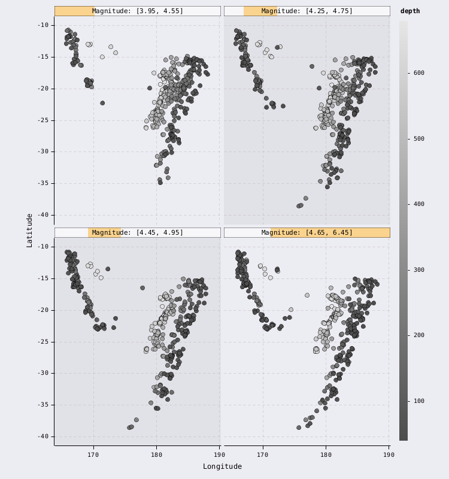
:::


### Fig 5.7 Plot types

Lattice's `type` argument drawn with cljplot2 charts on one seeded data set: points, lines in data order, both,
a regression line, the grid alone, steps (two kinds), stems, averages per x, a loess curve. The bottom row
repeats the last five with x and y exchanged (lattice's `horizontal = TRUE`): the same charts of the swapped
columns in a `:flip` plot.

Source: [Lattice Fig 5.7](http://lmdvr.r-forge.r-project.org/figures/figures.html?chapter=05;figure=05_07;theme=stdColor;code=right).


::: {.sourceClojure}
```clojure
(let [rng (r/rng :mersenne 2007041)
      grid-xs (mapv #(+ -10.0 (* 20.0 (/ % 14.0))) (range 15))
      xy (vec (for [_ (range 30)
                    :let [x (grid-xs (r/irandom rng 15))]]
                {:x x :y (+ x (* 0.25 (m/sq (+ x 1.0))) (r/grandom rng 0.0 5.0))}))
      sorted (sort-by :x xy)
      steps (fn [corner] (concat (mapcat (fn [a b] [a (corner a b)]) sorted (rest sorted)) [(last sorted)]))
      averages (for [[x rs] (sort-by key (group-by :x xy))] {:x x :y (stats/mean (map :y rs))})
      types [["p" xy [(chart/scatter)]]
             ["l" xy [(chart/line {:order :data})]]
             ["o" xy [(chart/line {:order :data}) (chart/scatter)]]
             ["r" xy [(chart/smooth {:method :lm :band :none})]]
             ["g" xy [(chart/scatter {:color [0 0 0 0]})]]
             ["s" (steps (fn [a b] {:x (:x b) :y (:y a)})) [(chart/line {:order :data})]]
             ["S" (steps (fn [a b] {:x (:x a) :y (:y b)})) [(chart/line {:order :data})]]
             ["h" xy [(chart/segment {:yend 0})]]
             ["a" averages [(chart/line)]]
             ["smooth" xy [(chart/smooth {:band :none})]]]
      panel (fn [[title data charts]]
              {:data data :mapping {:x :x :y :y} :charts charts
               :labels {:title (str "\"" title "\"") :x nil :y nil}})
      swapped (mapv (fn [{:keys [x y]}] {:x y :y x}) xy)]
  (plot/render-image
   (plot/arrange (concat (map panel types)
                         ;; horizontal: the same charts of the swapped columns, drawn flipped
                         (for [[title _ charts] (drop 5 types)
                               :let [sorted (sort-by :x swapped)
                                     data (case title
                                            "s" (concat (mapcat (fn [a b] [a {:x (:x b) :y (:y a)}]) sorted (rest sorted)) [(last sorted)])
                                            "S" (concat (mapcat (fn [a b] [a {:x (:x a) :y (:y b)}]) sorted (rest sorted)) [(last sorted)])
                                            "a" (for [[x rs] (sort-by key (group-by :x swapped))] {:x x :y (stats/mean (map :y rs))})
                                            swapped)]]
                           (assoc (panel [(str title ", horizontal") data charts]) :flip true)))
                 {:columns 5})
   {:width 1000 :height 650}))
```
:::


::: {.clay-image}

:::


### Fig 5.8 Scatter plot with a loess curve

Peak ground acceleration against distance from the epicentre, for 23 Californian earthquakes.

Source: [Lattice Fig 5.8](http://lmdvr.r-forge.r-project.org/figures/figures.html?chapter=05;figure=05_08;theme=stdColor;code=right). Data: Western US earthquakes: ground acceleration, R MEMSS package `Earthquake` (Joyner & Boore 1981); licence: GPL (>= 2) (MEMSS).


::: {.sourceClojure}
```clojure
(def earthquake-labels {:x "Distance From Epicenter (km)" :y "Maximum Horizontal Acceleration (g)"})
```
:::


::: {.sourceClojure}
```clojure
(plot/render-image
 {:data earthquake
  :mapping {:x :distance :y :accel}
  :charts [(chart/scatter) (chart/smooth {:band :none})]
  :labels earthquake-labels}
 {:width 650 :height 500})
```
:::


::: {.clay-image}

:::


### Fig 5.9 Logarithmic axes

Source: [Lattice Fig 5.9](http://lmdvr.r-forge.r-project.org/figures/figures.html?chapter=05;figure=05_09;theme=stdColor;code=right). Data: Western US earthquakes: ground acceleration, R MEMSS package `Earthquake` (Joyner & Boore 1981); licence: GPL (>= 2) (MEMSS).


::: {.sourceClojure}
```clojure
(def log2-axes
  "Base-2 logarithmic x and y scales labelled as powers of two."
  {:x {:kind :log :base 2 :formatter :power} :y {:kind :log :base 2 :formatter :power}})
```
:::


::: {.sourceClojure}
```clojure
(plot/render-image
 {:data earthquake
  :mapping {:x :distance :y :accel}
  :scales log2-axes
  :charts [(chart/scatter) (chart/smooth {:band :none})]
  :labels earthquake-labels}
 {:width 650 :height 500})
```
:::


::: {.clay-image}
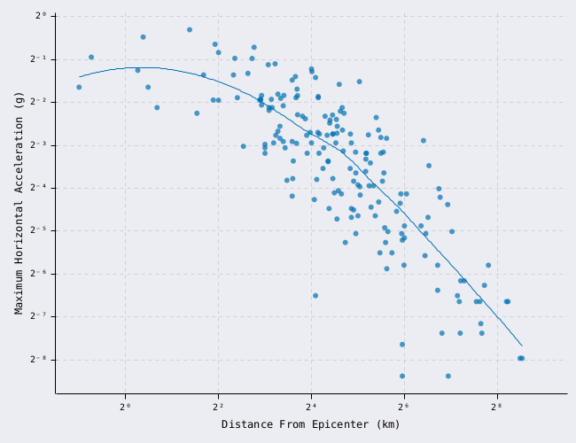
:::


### Fig 5.10 Local fits by magnitude

A panel per magnitude interval (three equal-count intervals overlapping by 10 %): a loess curve per panel (the
book uses locfit) and the least-squares line of all quakes on the log-log scale, the same in every panel.

Source: [Lattice Fig 5.10](http://lmdvr.r-forge.r-project.org/figures/figures.html?chapter=05;figure=05_10;theme=stdColor;code=right). Data: Western US earthquakes: ground acceleration, R MEMSS package `Earthquake` (Joyner & Boore 1981); licence: GPL (>= 2) (MEMSS).


::: {.sourceClojure}
```clojure
(let [model (regression/lm (mapv #(m/log2 (:accel %)) earthquake) (mapv (fn [row] [(m/log2 (:distance row))]) earthquake))
      intercept (:intercept model)
      slope (first (:beta model))]
  (plot/render-image
   {:data (shingle/shingle earthquake :richter {:n 3 :overlap 0.1 :as :magnitude :label "Magnitude"})
    :mapping {:x :distance :y :accel :facet :magnitude}
    :scales log2-axes
    :charts [(chart/scatter)
             (chart/smooth {:band :none :color :grey :line-width 2})
             (chart/function {:f (fn [d] (m/pow 2.0 (+ intercept (* slope (m/log2 d))))) :color :black})]
    :facets {:columns 3}
    :labels earthquake-labels}
   {:width 900 :height 400}))
```
:::


::: {.clay-image}

:::


### Fig 5.11 Several variables against one

Seattle-Tacoma weather, January to March 2007: minimum and maximum temperature and rainfall by day.

Source: [Lattice Fig 5.11](http://lmdvr.r-forge.r-project.org/figures/figures.html?chapter=05;figure=05_11;theme=stdColor;code=right). Data: Seattle-Tacoma airport weather, Jan-Mar 2007, R latticeExtra package `SeatacWeather` (NOAA); licence: GPL (>= 2) (latticeExtra).


::: {.sourceClojure}
```clojure
(def months {:facet {:domain ["January" "February" "March"]}})
```
:::


::: {.sourceClojure}
```clojure
(def seatac-long
  "SeaTac weather, one row per day and variable."
  (for [row seatac, k [:min-temp :max-temp :precip]]
    {:month (:month row) :day (:day row) :variable (name k) :value (k row)}))
```
:::


```{=html}
<div class="data-table"><table class="table table-hover table-responsive clay-table"><thead><tr><th>month</th><th>day</th><th>variable</th><th>value</th></tr></thead><tbody><tr><td>January</td><td>1</td><td>min-temp</td><td>34</td></tr><tr><td>January</td><td>1</td><td>max-temp</td><td>43</td></tr><tr><td>January</td><td>1</td><td>precip</td><td>0.13</td></tr><tr><td>January</td><td>2</td><td>min-temp</td><td>45</td></tr><tr><td>January</td><td>2</td><td>max-temp</td><td>56</td></tr><tr><td>January</td><td>2</td><td>precip</td><td>1.77</td></tr><tr><td>January</td><td>3</td><td>min-temp</td><td>43</td></tr><tr><td>January</td><td>3</td><td>max-temp</td><td>48</td></tr><tr><td>January</td><td>3</td><td>precip</td><td>1.01</td></tr><tr><td>January</td><td>4</td><td>min-temp</td><td>37</td></tr><tr><td>January</td><td>4</td><td>max-temp</td><td>42</td></tr><tr><td>January</td><td>4</td><td>precip</td><td>0.06</td></tr><tr><td>January</td><td>5</td><td>min-temp</td><td>31</td></tr><tr><td>January</td><td>5</td><td>max-temp</td><td>43</td></tr><tr><td>January</td><td>5</td><td>precip</td><td>0.19</td></tr><tr><td>January</td><td>6</td><td>min-temp</td><td>36</td></tr><tr><td>January</td><td>6</td><td>max-temp</td><td>44</td></tr><tr><td>January</td><td>6</td><td>precip</td><td></td></tr><tr><td>January</td><td>7</td><td>min-temp</td><td>40</td></tr><tr><td>January</td><td>7</td><td>max-temp</td><td>49</td></tr><tr><td>January</td><td>7</td><td>precip</td><td>0.93</td></tr><tr><td>January</td><td>8</td><td>min-temp</td><td>38</td></tr><tr><td>January</td><td>8</td><td>max-temp</td><td>47</td></tr><tr><td>January</td><td>8</td><td>precip</td><td>0</td></tr><tr><td>January</td><td>9</td><td>min-temp</td><td>41</td></tr><tr><td>January</td><td>9</td><td>max-temp</td><td>51</td></tr><tr><td>January</td><td>9</td><td>precip</td><td>0.16</td></tr><tr><td>January</td><td>10</td><td>min-temp</td><td>32</td></tr><tr><td>January</td><td>10</td><td>max-temp</td><td>36</td></tr><tr><td>January</td><td>10</td><td>precip</td><td>0.01</td></tr><tr><td>January</td><td>11</td><td>min-temp</td><td>27</td></tr><tr><td>January</td><td>11</td><td>max-temp</td><td>31</td></tr><tr><td>January</td><td>11</td><td>precip</td><td>0</td></tr><tr><td>January</td><td>12</td><td>min-temp</td><td>19</td></tr><tr><td>January</td><td>12</td><td>max-temp</td><td>31</td></tr><tr><td>January</td><td>12</td><td>precip</td><td></td></tr><tr><td>January</td><td>13</td><td>min-temp</td><td>21</td></tr><tr><td>January</td><td>13</td><td>max-temp</td><td>29</td></tr><tr><td>January</td><td>13</td><td>precip</td><td>0</td></tr><tr><td>January</td><td>14</td><td>min-temp</td><td>20</td></tr><tr><td>January</td><td>14</td><td>max-temp</td><td>35</td></tr><tr><td>January</td><td>14</td><td>precip</td><td></td></tr><tr><td>January</td><td>15</td><td>min-temp</td><td>23</td></tr><tr><td>January</td><td>15</td><td>max-temp</td><td>35</td></tr><tr><td>January</td><td>15</td><td>precip</td><td></td></tr><tr><td>January</td><td>16</td><td>min-temp</td><td>28</td></tr><tr><td>January</td><td>16</td><td>max-temp</td><td>35</td></tr><tr><td>January</td><td>16</td><td>precip</td><td>0.18</td></tr><tr><td>January</td><td>17</td><td>min-temp</td><td>33</td></tr><tr><td>January</td><td>17</td><td>max-temp</td><td>39</td></tr><tr><td>January</td><td>17</td><td>precip</td><td></td></tr><tr><td>January</td><td>18</td><td>min-temp</td><td>34</td></tr><tr><td>January</td><td>18</td><td>max-temp</td><td>42</td></tr><tr><td>January</td><td>18</td><td>precip</td><td>0.16</td></tr><tr><td>January</td><td>19</td><td>min-temp</td><td>38</td></tr><tr><td>January</td><td>19</td><td>max-temp</td><td>42</td></tr><tr><td>January</td><td>19</td><td>precip</td><td>0.08</td></tr><tr><td>January</td><td>20</td><td>min-temp</td><td>37</td></tr><tr><td>January</td><td>20</td><td>max-temp</td><td>45</td></tr><tr><td>January</td><td>20</td><td>precip</td><td></td></tr><tr><td>January</td><td>21</td><td>min-temp</td><td>37</td></tr><tr><td>January</td><td>21</td><td>max-temp</td><td>42</td></tr><tr><td>January</td><td>21</td><td>precip</td><td></td></tr><tr><td>January</td><td>22</td><td>min-temp</td><td>40</td></tr><tr><td>January</td><td>22</td><td>max-temp</td><td>50</td></tr><tr><td>January</td><td>22</td><td>precip</td><td>0</td></tr><tr><td>January</td><td>23</td><td>min-temp</td><td>44</td></tr><tr><td>January</td><td>23</td><td>max-temp</td><td>52</td></tr><tr><td>January</td><td>23</td><td>precip</td><td>0</td></tr><tr><td>January</td><td>24</td><td>min-temp</td><td>35</td></tr><tr><td>January</td><td>24</td><td>max-temp</td><td>51</td></tr><tr><td>January</td><td>24</td><td>precip</td><td></td></tr><tr><td>January</td><td>25</td><td>min-temp</td><td>33</td></tr><tr><td>January</td><td>25</td><td>max-temp</td><td>43</td></tr><tr><td>January</td><td>25</td><td>precip</td><td>0.02</td></tr><tr><td>January</td><td>26</td><td>min-temp</td><td>37</td></tr><tr><td>January</td><td>26</td><td>max-temp</td><td>44</td></tr><tr><td>January</td><td>26</td><td>precip</td><td></td></tr><tr><td>January</td><td>27</td><td>min-temp</td><td>32</td></tr><tr><td>January</td><td>27</td><td>max-temp</td><td>52</td></tr><tr><td>January</td><td>27</td><td>precip</td><td></td></tr><tr><td>January</td><td>28</td><td>min-temp</td><td>28</td></tr><tr><td>January</td><td>28</td><td>max-temp</td><td>50</td></tr><tr><td>January</td><td>28</td><td>precip</td><td></td></tr><tr><td>January</td><td>29</td><td>min-temp</td><td>28</td></tr><tr><td>January</td><td>29</td><td>max-temp</td><td>40</td></tr><tr><td>January</td><td>29</td><td>precip</td><td></td></tr><tr><td>January</td><td>30</td><td>min-temp</td><td>33</td></tr><tr><td>January</td><td>30</td><td>max-temp</td><td>48</td></tr><tr><td>January</td><td>30</td><td>precip</td><td></td></tr><tr><td>January</td><td>31</td><td>min-temp</td><td>28</td></tr><tr><td>January</td><td>31</td><td>max-temp</td><td>48</td></tr><tr><td>January</td><td>31</td><td>precip</td><td></td></tr><tr><td>February</td><td>1</td><td>min-temp</td><td>30</td></tr><tr><td>February</td><td>1</td><td>max-temp</td><td>49</td></tr><tr><td>February</td><td>1</td><td>precip</td><td></td></tr><tr><td>February</td><td>2</td><td>min-temp</td><td>28</td></tr><tr><td>February</td><td>2</td><td>max-temp</td><td>44</td></tr><tr><td>February</td><td>2</td><td>precip</td><td></td></tr><tr><td>February</td><td>3</td><td>min-temp</td><td>31</td></tr><tr><td>…</td><td>…</td><td>…</td><td>…</td></tr></tbody></table></div>
```


::: {.sourceClojure}
```clojure
(plot/render-image
 {:data seatac-long
  :mapping {:x :day :y :value :group :variable :facet :month}
  :scales months
  :charts [(chart/line {:color :black})]
  :facets {:columns 3}
  :labels {:x "day" :y "Temperature and Rainfall"}}
 {:width 900 :height 400})
```
:::


::: {.clay-image}
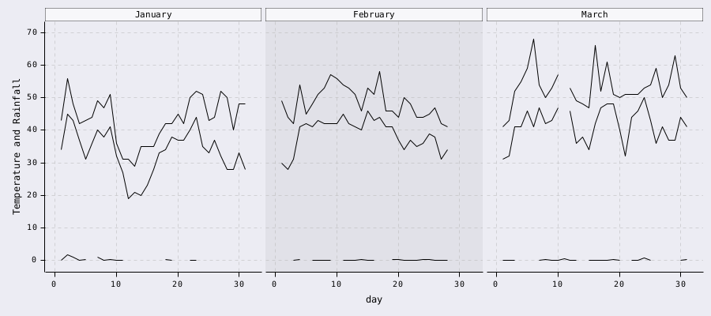
:::


### Fig 5.12 Lines and stems

Rainfall scaled to the temperature range (× 80 / its maximum) and drawn as stems.

Source: [Lattice Fig 5.12](http://lmdvr.r-forge.r-project.org/figures/figures.html?chapter=05;figure=05_12;theme=stdColor;code=right). Data: Seattle-Tacoma airport weather, Jan-Mar 2007, R latticeExtra package `SeatacWeather` (NOAA); licence: GPL (>= 2) (latticeExtra).


::: {.sourceClojure}
```clojure
(def max-precip (reduce max (keep :precip seatac)))
```
:::


::: {.sourceClojure}
```clojure
(plot/render-image
 {:data seatac
  :mapping {:x :day :facet :month}
  :scales months
  :charts [(chart/line {:mapping {:y :min-temp} :color :black})
           (chart/line {:mapping {:y :max-temp} :color :black})
           (chart/segment {:data (map #(update % :precip (fn [p] (some-> p (* 80.0) (/ max-precip)))) seatac)
                           :mapping {:y :precip} :yend 0 :color :black})]
  :facets {:columns 3}
  :labels {:x "day" :y "Temperature and Rainfall"}}
 {:width 900 :height 400})
```
:::


::: {.clay-image}
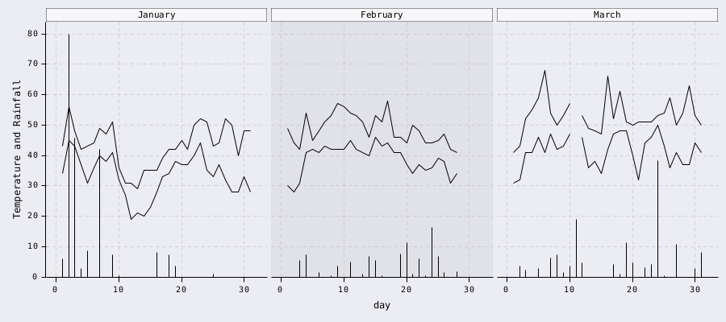
:::


### Fig 5.13 Temperature and rainfall, each on its own axis

The book adds a rainfall axis on the right of one panel; cljplot2 has no secondary axes, so the two measures are
two plots - each with its own axis.

Source: [Lattice Fig 5.13](http://lmdvr.r-forge.r-project.org/figures/figures.html?chapter=05;figure=05_13;theme=stdColor;code=right). Data: Seattle-Tacoma airport weather, Jan-Mar 2007, R latticeExtra package `SeatacWeather` (NOAA); licence: GPL (>= 2) (latticeExtra).


::: {.sourceClojure}
```clojure
(plot/render-image
 (plot/arrange [{:data (filter #(not= "precip" (:variable %)) seatac-long)
                 :mapping {:x :day :y :value :group :variable :facet :month}
                 :scales months
                 :charts [(chart/line {:color :black})]
                 :facets {:columns 3}
                 :labels {:x nil :y "Temperature (Fahrenheit)"}}
                {:data seatac
                 :mapping {:x :day :y :precip :facet :month}
                 :scales months
                 :charts [(chart/segment {:yend 0 :color :black})]
                 :facets {:columns 3}
                 :labels {:x "day" :y "Rainfall (inches)"}}]
               {:columns 1})
 {:width 900 :height 600})
```
:::


::: {.clay-image}

:::


### Fig 5.14 Hexagonal binning

Two fluorescence channels of the GvHD cells (asinh-transformed), counted in hexagons, a panel per day; grey
levels by the square root of the count (`:transform :sqrt`, lattice's `trans = sqrt`).

Source: [Lattice Fig 5.14](http://lmdvr.r-forge.r-project.org/figures/figures.html?chapter=05;figure=05_14;theme=stdColor;code=right). Data: Flow cytometry of a GvHD patient, 10 days, R latticeExtra package `gvhd10` (Brinkman et al. 2007); licence: GPL (>= 2) (latticeExtra).


::: {.sourceClojure}
```clojure
(plot/render-image
 {:data (mapv (fn [row] {:days (:days row) :ssc (m/asinh (:ssc-h row)) :fl2 (m/asinh (:fl2-h row))}) gvhd10)
  :mapping {:x :fl2 :y :ssc :facet :days}
  :scales {:x {:domain [0 10.5]} :color {:range [[200 200 200] [0 0 0]] :transform :sqrt}}
  :charts [(chart/bin2d {:bins 30})]
  :facets {:columns 4}
  :aspect :iso
  :labels {:x "asinh(FL2.H)" :y "asinh(SSC.H)"}}
 {:width 900 :height 550})
```
:::


::: {.clay-image}

:::


### Fig 5.15 Scatter-plot matrix

Source: [Lattice Fig 5.15](http://lmdvr.r-forge.r-project.org/figures/figures.html?chapter=05;figure=05_15;theme=stdColor;code=right). Data: Violent crime rates by US state (1973), R datasets package `USArrests` (McNeil 1977); licence: Part of R (GPL-2 | GPL-3).


::: {.sourceClojure}
```clojure
(plot/render-image
 (plot/pairs us-arrests {:variables [:murder :assault :urban-pop :rape]
                         :upper (chart/scatter) :diagonal :names})
 {:width 700 :height 700})
```
:::


::: {.clay-image}

:::


### Fig 5.16 A matrix per region

Arrest rates of the states of each census region (joined from the state facts): points and a loess curve with
lattice's `panel.loess` settings (span 2/3, degree 1) - with a dozen states per region, ggplot2's degree 2 bends.

Source: [Lattice Fig 5.16](http://lmdvr.r-forge.r-project.org/figures/figures.html?chapter=05;figure=05_16;theme=stdColor;code=right). Data: Violent crime rates by US state (1973), R datasets package `USArrests` (McNeil 1977); licence: Part of R (GPL-2 | GPL-3).


::: {.sourceClojure}
```clojure
(let [region (into {} (map (juxt :name :region) states))
      rows (map #(assoc % :region (region (:state %))) us-arrests)
      cell [(chart/scatter {:size 3}) (chart/smooth {:band :none :method-params {:bandwidth (/ 2.0 3.0) :degree 1}})]]
  (plot/render-image
   (plot/arrange (for [r ["Northeast" "South" "North Central" "West"]]
                   (plot/pairs (filterv #(= r (:region %)) rows)
                               {:variables [:urban-pop :murder :assault :rape]
                                :lower cell :upper cell :diagonal :names :title r}))
                 {:columns 2})
   {:width 900 :height 800}))
```
:::


::: {.clay-image}

:::


### Fig 5.17 Groups in a scatter-plot matrix

Source: [Lattice Fig 5.17](http://lmdvr.r-forge.r-project.org/figures/figures.html?chapter=05;figure=05_17;theme=stdColor;code=right). Data: Motor Trend car road tests (1974), R datasets package `mtcars` (Henderson & Velleman 1981); licence: Part of R (GPL-2 | GPL-3).


::: {.sourceClojure}
```clojure
(plot/render-image
 (plot/pairs mtcars {:variables [:mpg :disp :hp :drat :wt :qsec]
                     :mapping {:color (levels/categorical :cyl)}
                     :upper (chart/scatter) :diagonal :names
                     :variable-names {:mpg "Miles/gallon" :disp "Displacement" :hp "Horsepower"
                              :drat "Axle ratio" :wt "Weight" :qsec "1/4 mile time"}})
 {:width 900 :height 800})
```
:::


::: {.clay-image}
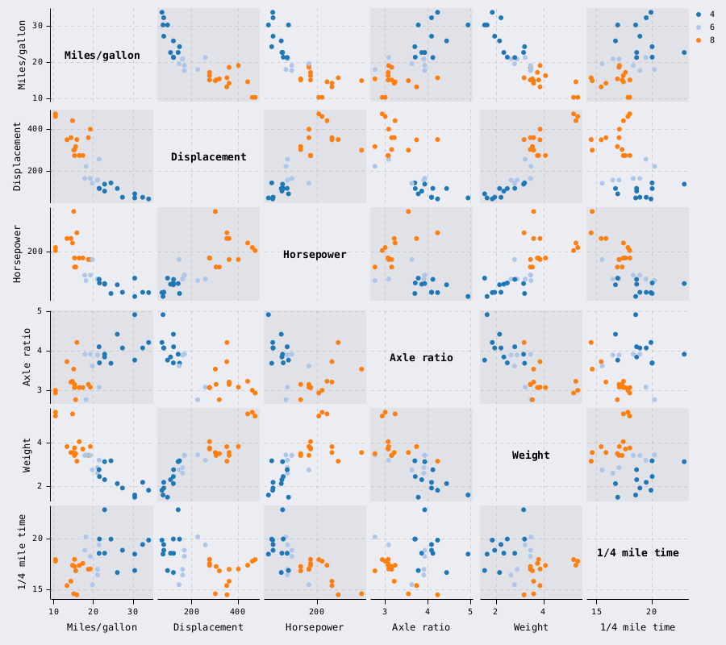
:::


### Fig 5.18 Parallel coordinates

Six car variables, a panel per cylinder count, coloured by the number of carburettors.

Source: [Lattice Fig 5.18](http://lmdvr.r-forge.r-project.org/figures/figures.html?chapter=05;figure=05_18;theme=stdColor;code=right). Data: Motor Trend car road tests (1974), R datasets package `mtcars` (Henderson & Velleman 1981); licence: Part of R (GPL-2 | GPL-3).


::: {.sourceClojure}
```clojure
(plot/render-image
 {:data mtcars
  :mapping {:color (levels/categorical :carb) :facet :cyl}
  :charts [(chart/parallel {:variables [:mpg :disp :hp :drat :wt :qsec]})]
  :facets {:columns 3}
  :flip true
  :labels {:x nil :y nil}}
 {:width 900 :height 500})
```
:::


::: {.clay-image}

:::


### Fig 5.19 Many translucent lines

The cells of day 13 (asinh-transformed channels), each a nearly transparent line (colour alpha 3 of 255).

Source: [Lattice Fig 5.19](http://lmdvr.r-forge.r-project.org/figures/figures.html?chapter=05;figure=05_19;theme=stdColor;code=right). Data: Flow cytometry of a GvHD patient, 10 days, R latticeExtra package `gvhd10` (Brinkman et al. 2007); licence: GPL (>= 2) (latticeExtra).


::: {.sourceClojure}
```clojure
(plot/render-image
 {:data (for [row gvhd10 :when (= 13 (:days row))]
          (update-vals (select-keys row [:fl1-h :ssc-h :fl2-h :fsc-h :fl3-h]) m/asinh))
  :charts [(chart/parallel {:variables [:fl1-h :ssc-h :fl2-h :fsc-h :fl3-h] :color [140 40 40 3]})]
  :flip true
  :labels {:x nil :y nil}}
 {:width 700 :height 600})
```
:::


::: {.clay-image}

:::


## Chapter 6 - Trivariate Displays


### Fig 6.1 Three-dimensional scatter plot

Earthquake locations and depths (depth growing downward) in a box, a panel per magnitude interval.

Source: [Lattice Fig 6.1](http://lmdvr.r-forge.r-project.org/figures/figures.html?chapter=06;figure=06_01;theme=stdColor;code=right). Data: Earthquakes off Fiji since 1964, R datasets package `quakes` (Harvard PRIM-H project); licence: Part of R (GPL-2 | GPL-3).


::: {.sourceClojure}
```clojure
(def quakes-magnitude-4
  "quakes with a shingle of four equal-count, half-overlapping magnitude intervals."
  (shingle/shingle quakes :mag {:n 4 :overlap 0.5 :as :magnitude :label "Magnitude"}))
```
:::


```{=html}
<div class="data-table"><table class="table table-hover table-responsive clay-table"><thead><tr><th>lat</th><th>long</th><th>depth</th><th>mag</th><th>stations</th><th>magnitude</th></tr></thead><tbody><tr><td>-20.42</td><td>181.62</td><td>562</td><td>4.8</td><td>41</td><td>Magnitude: [4.45, 4.95]</td></tr><tr><td>-20.42</td><td>181.62</td><td>562</td><td>4.8</td><td>41</td><td>Magnitude: [4.65, 6.45]</td></tr><tr><td>-20.62</td><td>181.03</td><td>650</td><td>4.2</td><td>15</td><td>Magnitude: [3.95, 4.55]</td></tr><tr><td>-26</td><td>184.1</td><td>42</td><td>5.4</td><td>43</td><td>Magnitude: [4.65, 6.45]</td></tr><tr><td>-17.97</td><td>181.66</td><td>626</td><td>4.1</td><td>19</td><td>Magnitude: [3.95, 4.55]</td></tr><tr><td>-20.42</td><td>181.96</td><td>649</td><td>4</td><td>11</td><td>Magnitude: [3.95, 4.55]</td></tr><tr><td>-19.68</td><td>184.31</td><td>195</td><td>4</td><td>12</td><td>Magnitude: [3.95, 4.55]</td></tr><tr><td>-11.7</td><td>166.1</td><td>82</td><td>4.8</td><td>43</td><td>Magnitude: [4.45, 4.95]</td></tr><tr><td>-11.7</td><td>166.1</td><td>82</td><td>4.8</td><td>43</td><td>Magnitude: [4.65, 6.45]</td></tr><tr><td>-28.11</td><td>181.93</td><td>194</td><td>4.4</td><td>15</td><td>Magnitude: [3.95, 4.55]</td></tr><tr><td>-28.11</td><td>181.93</td><td>194</td><td>4.4</td><td>15</td><td>Magnitude: [4.25, 4.75]</td></tr><tr><td>-28.74</td><td>181.74</td><td>211</td><td>4.7</td><td>35</td><td>Magnitude: [4.25, 4.75]</td></tr><tr><td>-28.74</td><td>181.74</td><td>211</td><td>4.7</td><td>35</td><td>Magnitude: [4.45, 4.95]</td></tr><tr><td>-28.74</td><td>181.74</td><td>211</td><td>4.7</td><td>35</td><td>Magnitude: [4.65, 6.45]</td></tr><tr><td>-17.47</td><td>179.59</td><td>622</td><td>4.3</td><td>19</td><td>Magnitude: [3.95, 4.55]</td></tr><tr><td>-17.47</td><td>179.59</td><td>622</td><td>4.3</td><td>19</td><td>Magnitude: [4.25, 4.75]</td></tr><tr><td>-21.44</td><td>180.69</td><td>583</td><td>4.4</td><td>13</td><td>Magnitude: [3.95, 4.55]</td></tr><tr><td>-21.44</td><td>180.69</td><td>583</td><td>4.4</td><td>13</td><td>Magnitude: [4.25, 4.75]</td></tr><tr><td>-12.26</td><td>167</td><td>249</td><td>4.6</td><td>16</td><td>Magnitude: [4.25, 4.75]</td></tr><tr><td>-12.26</td><td>167</td><td>249</td><td>4.6</td><td>16</td><td>Magnitude: [4.45, 4.95]</td></tr><tr><td>-18.54</td><td>182.11</td><td>554</td><td>4.4</td><td>19</td><td>Magnitude: [3.95, 4.55]</td></tr><tr><td>-18.54</td><td>182.11</td><td>554</td><td>4.4</td><td>19</td><td>Magnitude: [4.25, 4.75]</td></tr><tr><td>-21</td><td>181.66</td><td>600</td><td>4.4</td><td>10</td><td>Magnitude: [3.95, 4.55]</td></tr><tr><td>-21</td><td>181.66</td><td>600</td><td>4.4</td><td>10</td><td>Magnitude: [4.25, 4.75]</td></tr><tr><td>-20.7</td><td>169.92</td><td>139</td><td>6.1</td><td>94</td><td>Magnitude: [4.65, 6.45]</td></tr><tr><td>-15.94</td><td>184.95</td><td>306</td><td>4.3</td><td>11</td><td>Magnitude: [3.95, 4.55]</td></tr><tr><td>-15.94</td><td>184.95</td><td>306</td><td>4.3</td><td>11</td><td>Magnitude: [4.25, 4.75]</td></tr><tr><td>-13.64</td><td>165.96</td><td>50</td><td>6</td><td>83</td><td>Magnitude: [4.65, 6.45]</td></tr><tr><td>-17.83</td><td>181.5</td><td>590</td><td>4.5</td><td>21</td><td>Magnitude: [3.95, 4.55]</td></tr><tr><td>-17.83</td><td>181.5</td><td>590</td><td>4.5</td><td>21</td><td>Magnitude: [4.25, 4.75]</td></tr><tr><td>-17.83</td><td>181.5</td><td>590</td><td>4.5</td><td>21</td><td>Magnitude: [4.45, 4.95]</td></tr><tr><td>-23.5</td><td>179.78</td><td>570</td><td>4.4</td><td>13</td><td>Magnitude: [3.95, 4.55]</td></tr><tr><td>-23.5</td><td>179.78</td><td>570</td><td>4.4</td><td>13</td><td>Magnitude: [4.25, 4.75]</td></tr><tr><td>-22.63</td><td>180.31</td><td>598</td><td>4.4</td><td>18</td><td>Magnitude: [3.95, 4.55]</td></tr><tr><td>-22.63</td><td>180.31</td><td>598</td><td>4.4</td><td>18</td><td>Magnitude: [4.25, 4.75]</td></tr><tr><td>-20.84</td><td>181.16</td><td>576</td><td>4.5</td><td>17</td><td>Magnitude: [3.95, 4.55]</td></tr><tr><td>-20.84</td><td>181.16</td><td>576</td><td>4.5</td><td>17</td><td>Magnitude: [4.25, 4.75]</td></tr><tr><td>-20.84</td><td>181.16</td><td>576</td><td>4.5</td><td>17</td><td>Magnitude: [4.45, 4.95]</td></tr><tr><td>-10.98</td><td>166.32</td><td>211</td><td>4.2</td><td>12</td><td>Magnitude: [3.95, 4.55]</td></tr><tr><td>-23.3</td><td>180.16</td><td>512</td><td>4.4</td><td>18</td><td>Magnitude: [3.95, 4.55]</td></tr><tr><td>-23.3</td><td>180.16</td><td>512</td><td>4.4</td><td>18</td><td>Magnitude: [4.25, 4.75]</td></tr><tr><td>-30.2</td><td>182</td><td>125</td><td>4.7</td><td>22</td><td>Magnitude: [4.25, 4.75]</td></tr><tr><td>-30.2</td><td>182</td><td>125</td><td>4.7</td><td>22</td><td>Magnitude: [4.45, 4.95]</td></tr><tr><td>-30.2</td><td>182</td><td>125</td><td>4.7</td><td>22</td><td>Magnitude: [4.65, 6.45]</td></tr><tr><td>-19.66</td><td>180.28</td><td>431</td><td>5.4</td><td>57</td><td>Magnitude: [4.65, 6.45]</td></tr><tr><td>-17.94</td><td>181.49</td><td>537</td><td>4</td><td>15</td><td>Magnitude: [3.95, 4.55]</td></tr><tr><td>-14.72</td><td>167.51</td><td>155</td><td>4.6</td><td>18</td><td>Magnitude: [4.25, 4.75]</td></tr><tr><td>-14.72</td><td>167.51</td><td>155</td><td>4.6</td><td>18</td><td>Magnitude: [4.45, 4.95]</td></tr><tr><td>-16.46</td><td>180.79</td><td>498</td><td>5.2</td><td>79</td><td>Magnitude: [4.65, 6.45]</td></tr><tr><td>-20.97</td><td>181.47</td><td>582</td><td>4.5</td><td>25</td><td>Magnitude: [3.95, 4.55]</td></tr><tr><td>-20.97</td><td>181.47</td><td>582</td><td>4.5</td><td>25</td><td>Magnitude: [4.25, 4.75]</td></tr><tr><td>-20.97</td><td>181.47</td><td>582</td><td>4.5</td><td>25</td><td>Magnitude: [4.45, 4.95]</td></tr><tr><td>-19.84</td><td>182.37</td><td>328</td><td>4.4</td><td>17</td><td>Magnitude: [3.95, 4.55]</td></tr><tr><td>-19.84</td><td>182.37</td><td>328</td><td>4.4</td><td>17</td><td>Magnitude: [4.25, 4.75]</td></tr><tr><td>-22.58</td><td>179.24</td><td>553</td><td>4.6</td><td>21</td><td>Magnitude: [4.25, 4.75]</td></tr><tr><td>-22.58</td><td>179.24</td><td>553</td><td>4.6</td><td>21</td><td>Magnitude: [4.45, 4.95]</td></tr><tr><td>-16.32</td><td>166.74</td><td>50</td><td>4.7</td><td>30</td><td>Magnitude: [4.25, 4.75]</td></tr><tr><td>-16.32</td><td>166.74</td><td>50</td><td>4.7</td><td>30</td><td>Magnitude: [4.45, 4.95]</td></tr><tr><td>-16.32</td><td>166.74</td><td>50</td><td>4.7</td><td>30</td><td>Magnitude: [4.65, 6.45]</td></tr><tr><td>-15.55</td><td>185.05</td><td>292</td><td>4.8</td><td>42</td><td>Magnitude: [4.45, 4.95]</td></tr><tr><td>-15.55</td><td>185.05</td><td>292</td><td>4.8</td><td>42</td><td>Magnitude: [4.65, 6.45]</td></tr><tr><td>-23.55</td><td>180.8</td><td>349</td><td>4</td><td>10</td><td>Magnitude: [3.95, 4.55]</td></tr><tr><td>-16.3</td><td>186</td><td>48</td><td>4.5</td><td>10</td><td>Magnitude: [3.95, 4.55]</td></tr><tr><td>-16.3</td><td>186</td><td>48</td><td>4.5</td><td>10</td><td>Magnitude: [4.25, 4.75]</td></tr><tr><td>-16.3</td><td>186</td><td>48</td><td>4.5</td><td>10</td><td>Magnitude: [4.45, 4.95]</td></tr><tr><td>-25.82</td><td>179.33</td><td>600</td><td>4.3</td><td>13</td><td>Magnitude: [3.95, 4.55]</td></tr><tr><td>-25.82</td><td>179.33</td><td>600</td><td>4.3</td><td>13</td><td>Magnitude: [4.25, 4.75]</td></tr><tr><td>-18.73</td><td>169.23</td><td>206</td><td>4.5</td><td>17</td><td>Magnitude: [3.95, 4.55]</td></tr><tr><td>-18.73</td><td>169.23</td><td>206</td><td>4.5</td><td>17</td><td>Magnitude: [4.25, 4.75]</td></tr><tr><td>-18.73</td><td>169.23</td><td>206</td><td>4.5</td><td>17</td><td>Magnitude: [4.45, 4.95]</td></tr><tr><td>-17.64</td><td>181.28</td><td>574</td><td>4.6</td><td>17</td><td>Magnitude: [4.25, 4.75]</td></tr><tr><td>-17.64</td><td>181.28</td><td>574</td><td>4.6</td><td>17</td><td>Magnitude: [4.45, 4.95]</td></tr><tr><td>-17.66</td><td>181.4</td><td>585</td><td>4.1</td><td>17</td><td>Magnitude: [3.95, 4.55]</td></tr><tr><td>-18.82</td><td>169.33</td><td>230</td><td>4.4</td><td>11</td><td>Magnitude: [3.95, 4.55]</td></tr><tr><td>-18.82</td><td>169.33</td><td>230</td><td>4.4</td><td>11</td><td>Magnitude: [4.25, 4.75]</td></tr><tr><td>-37.37</td><td>176.78</td><td>263</td><td>4.7</td><td>34</td><td>Magnitude: [4.25, 4.75]</td></tr><tr><td>-37.37</td><td>176.78</td><td>263</td><td>4.7</td><td>34</td><td>Magnitude: [4.45, 4.95]</td></tr><tr><td>-37.37</td><td>176.78</td><td>263</td><td>4.7</td><td>34</td><td>Magnitude: [4.65, 6.45]</td></tr><tr><td>-15.31</td><td>186.1</td><td>96</td><td>4.6</td><td>32</td><td>Magnitude: [4.25, 4.75]</td></tr><tr><td>-15.31</td><td>186.1</td><td>96</td><td>4.6</td><td>32</td><td>Magnitude: [4.45, 4.95]</td></tr><tr><td>-24.97</td><td>179.82</td><td>511</td><td>4.4</td><td>23</td><td>Magnitude: [3.95, 4.55]</td></tr><tr><td>-24.97</td><td>179.82</td><td>511</td><td>4.4</td><td>23</td><td>Magnitude: [4.25, 4.75]</td></tr><tr><td>-15.49</td><td>186.04</td><td>94</td><td>4.3</td><td>26</td><td>Magnitude: [3.95, 4.55]</td></tr><tr><td>-15.49</td><td>186.04</td><td>94</td><td>4.3</td><td>26</td><td>Magnitude: [4.25, 4.75]</td></tr><tr><td>-19.23</td><td>169.41</td><td>246</td><td>4.6</td><td>27</td><td>Magnitude: [4.25, 4.75]</td></tr><tr><td>-19.23</td><td>169.41</td><td>246</td><td>4.6</td><td>27</td><td>Magnitude: [4.45, 4.95]</td></tr><tr><td>-30.1</td><td>182.3</td><td>56</td><td>4.9</td><td>34</td><td>Magnitude: [4.45, 4.95]</td></tr><tr><td>-30.1</td><td>182.3</td><td>56</td><td>4.9</td><td>34</td><td>Magnitude: [4.65, 6.45]</td></tr><tr><td>-26.4</td><td>181.7</td><td>329</td><td>4.5</td><td>24</td><td>Magnitude: [3.95, 4.55]</td></tr><tr><td>-26.4</td><td>181.7</td><td>329</td><td>4.5</td><td>24</td><td>Magnitude: [4.25, 4.75]</td></tr><tr><td>-26.4</td><td>181.7</td><td>329</td><td>4.5</td><td>24</td><td>Magnitude: [4.45, 4.95]</td></tr><tr><td>-11.77</td><td>166.32</td><td>70</td><td>4.4</td><td>18</td><td>Magnitude: [3.95, 4.55]</td></tr><tr><td>-11.77</td><td>166.32</td><td>70</td><td>4.4</td><td>18</td><td>Magnitude: [4.25, 4.75]</td></tr><tr><td>-24.12</td><td>180.08</td><td>493</td><td>4.3</td><td>21</td><td>Magnitude: [3.95, 4.55]</td></tr><tr><td>-24.12</td><td>180.08</td><td>493</td><td>4.3</td><td>21</td><td>Magnitude: [4.25, 4.75]</td></tr><tr><td>-18.97</td><td>185.25</td><td>129</td><td>5.1</td><td>73</td><td>Magnitude: [4.65, 6.45]</td></tr><tr><td>-18.75</td><td>182.35</td><td>554</td><td>4.2</td><td>13</td><td>Magnitude: [3.95, 4.55]</td></tr><tr><td>-19.26</td><td>184.42</td><td>223</td><td>4</td><td>15</td><td>Magnitude: [3.95, 4.55]</td></tr><tr><td>-22.75</td><td>173.2</td><td>46</td><td>4.6</td><td>26</td><td>Magnitude: [4.25, 4.75]</td></tr><tr><td>-22.75</td><td>173.2</td><td>46</td><td>4.6</td><td>26</td><td>Magnitude: [4.45, 4.95]</td></tr><tr><td>…</td><td>…</td><td>…</td><td>…</td><td>…</td><td>…</td></tr></tbody></table></div>
```


::: {.sourceClojure}
```clojure
(plot/render-image
 {:data quakes-magnitude-4
  :mapping {:x :lat :y :long :z :depth :facet :magnitude}
  :charts [(chart/cloud {:domain {:z [680 40]} :view {:azimuth -105 :elevation 20 :distance 0.2} :size 3
                         :axis-titles {:x "Latitude" :y "Longitude" :z "Depth"}})]
  :facets {:columns 2}}
 {:width 800 :height 700})
```
:::


::: {.clay-image}
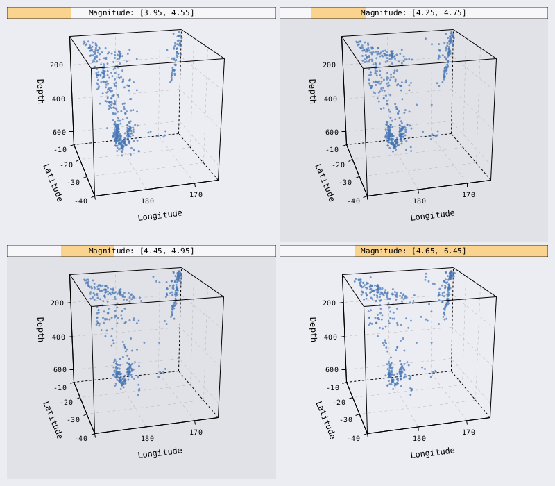
:::


### Fig 6.2 Another view

Source: [Lattice Fig 6.2](http://lmdvr.r-forge.r-project.org/figures/figures.html?chapter=06;figure=06_02;theme=stdColor;code=right). Data: Earthquakes off Fiji since 1964, R datasets package `quakes` (Harvard PRIM-H project); licence: Part of R (GPL-2 | GPL-3).


::: {.sourceClojure}
```clojure
(plot/render-image
 {:data quakes-magnitude-4
  :mapping {:x :lat :y :long :z :depth :facet :magnitude}
  :charts [(chart/cloud {:domain {:z [680 40]} :view {:azimuth -80 :elevation 20 :distance 0.2} :size 3
                         :axis-titles {:x "Latitude" :y "Longitude" :z "Depth (km)"}})]
  :facets {:columns 2}}
 {:width 800 :height 700})
```
:::


::: {.clay-image}
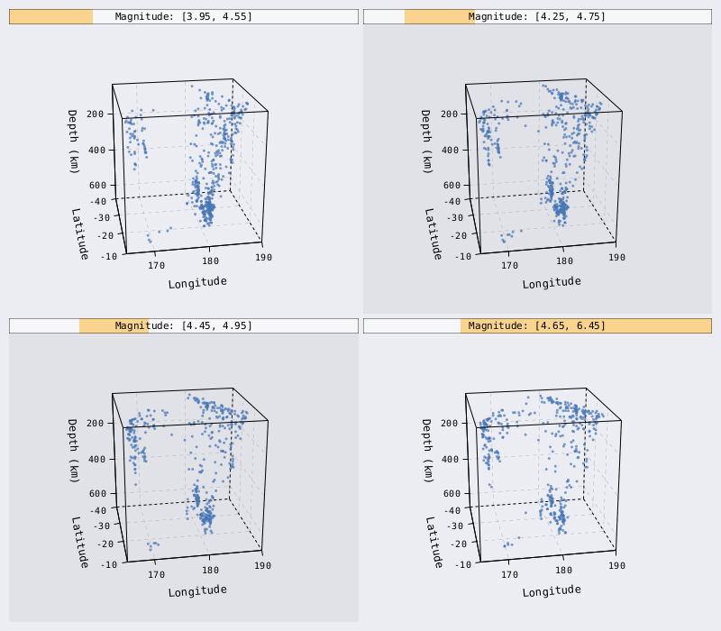
:::


### Fig 6.3 Turning the cloud

One cloud from eight directions: turned by lattice's z = 30, 10, -10, -30 degrees down the rows (azimuth -z;
lattice's rows run bottom-up), the first column slightly higher (in place of the book's 3-degree y turn).

Source: [Lattice Fig 6.3](http://lmdvr.r-forge.r-project.org/figures/figures.html?chapter=06;figure=06_03;theme=stdColor;code=right). Data: Earthquakes off Fiji since 1964, R datasets package `quakes` (Harvard PRIM-H project); licence: Part of R (GPL-2 | GPL-3).


::: {.sourceClojure}
```clojure
(plot/render-image
 (plot/arrange (for [turn [30 10 -10 -30], tilt [33 30]]
                 {:data quakes
                  :mapping {:x :long :y :lat :z :depth}
                  :charts [(chart/cloud {:domain {:z [690 30]} :view {:azimuth (- turn) :elevation tilt :distance 0.2}
                                         :axes false :size 2})]})
               {:columns 2})
 {:width 600 :height 800})
```
:::


::: {.clay-image}
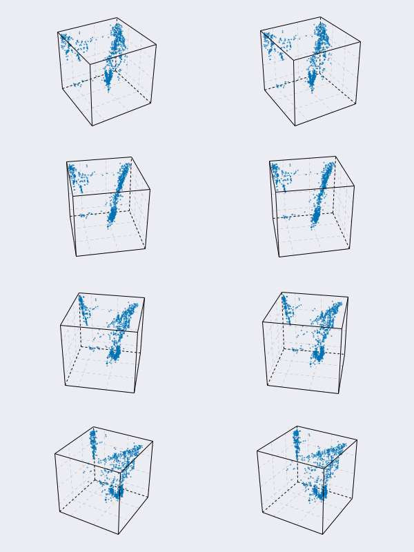
:::


### Fig 6.4 Spikes

Population density of the 48 contiguous states (people per square mile) as spikes over their centres.

Source: [Lattice Fig 6.4](http://lmdvr.r-forge.r-project.org/figures/figures.html?chapter=06;figure=06_04;theme=stdColor;code=right). Data: US state facts (1970s), R datasets packages `state.x77`, `state.name`, `state.abb`, `state.region`, `state.division`, `state.center` (US Census); licence: Part of R (GPL-2 | GPL-3).


::: {.sourceClojure}
```clojure
(def state-density
  (for [{:keys [name long lat population area]} states
        :when (not (#{"Alaska" "Hawaii"} name))]
    {:name name :long long :lat lat :density (/ (* 1000.0 population) area)}))
```
:::


```{=html}
<div class="data-table"><table class="table table-hover table-responsive clay-table"><thead><tr><th>name</th><th>long</th><th>lat</th><th>density</th></tr></thead><tbody><tr><td>Alabama</td><td>-86.7509</td><td>32.5901</td><td>71.29052614971997</td></tr><tr><td>Arizona</td><td>-111.625</td><td>34.2192</td><td>19.503249072008604</td></tr><tr><td>Arkansas</td><td>-92.2992</td><td>34.7336</td><td>40.61988641832708</td></tr><tr><td>California</td><td>-119.773</td><td>36.5341</td><td>135.57089043943182</td></tr><tr><td>Colorado</td><td>-105.513</td><td>38.6777</td><td>24.487789834820653</td></tr><tr><td>Connecticut</td><td>-72.3573</td><td>41.5928</td><td>637.5976964212258</td></tr><tr><td>Delaware</td><td>-74.9841</td><td>38.6777</td><td>292.12916246215946</td></tr><tr><td>Florida</td><td>-81.685</td><td>27.8744</td><td>153.02273987798114</td></tr><tr><td>Georgia</td><td>-83.3736</td><td>32.3329</td><td>84.91037142906342</td></tr><tr><td>Idaho</td><td>-113.93</td><td>43.5648</td><td>9.833448238325047</td></tr><tr><td>Illinois</td><td>-89.3776</td><td>40.0495</td><td>200.85025471765803</td></tr><tr><td>Indiana</td><td>-86.0808</td><td>40.0495</td><td>147.18674682106547</td></tr><tr><td>Iowa</td><td>-93.3714</td><td>41.9358</td><td>51.14316869559</td></tr><tr><td>Kansas</td><td>-98.1156</td><td>38.4204</td><td>27.877291012019025</td></tr><tr><td>Kentucky</td><td>-84.7674</td><td>37.3915</td><td>85.42244640605297</td></tr><tr><td>Louisiana</td><td>-92.2724</td><td>30.6181</td><td>84.70954818606721</td></tr><tr><td>Maine</td><td>-68.9801</td><td>45.6226</td><td>34.21733505821475</td></tr><tr><td>Maryland</td><td>-76.6459</td><td>39.2778</td><td>416.7424931756142</td></tr><tr><td>Massachusetts</td><td>-71.58</td><td>42.3645</td><td>742.9082545361615</td></tr><tr><td>Michigan</td><td>-84.687</td><td>43.1361</td><td>160.35693542425682</td></tr><tr><td>Minnesota</td><td>-94.6043</td><td>46.3943</td><td>49.45200469169746</td></tr><tr><td>Mississippi</td><td>-89.8065</td><td>32.6758</td><td>49.496786197564276</td></tr><tr><td>Missouri</td><td>-92.5137</td><td>38.3347</td><td>69.0919631857381</td></tr><tr><td>Montana</td><td>-109.32</td><td>46.823</td><td>5.124083881115759</td></tr><tr><td>Nebraska</td><td>-99.5898</td><td>41.3356</td><td>20.187492645424474</td></tr><tr><td>Nevada</td><td>-116.851</td><td>39.1063</td><td>5.369054227447697</td></tr><tr><td>New Hampshire</td><td>-71.3924</td><td>43.3934</td><td>89.9523651268417</td></tr><tr><td>New Jersey</td><td>-74.2336</td><td>39.9637</td><td>975.0033240260603</td></tr><tr><td>New Mexico</td><td>-105.942</td><td>34.4764</td><td>9.42246235956907</td></tr><tr><td>New York</td><td>-75.1449</td><td>43.1361</td><td>377.9139052079195</td></tr><tr><td>North Carolina</td><td>-78.4686</td><td>35.4195</td><td>111.50047133079225</td></tr><tr><td>North Dakota</td><td>-100.099</td><td>47.2517</td><td>9.195501854979574</td></tr><tr><td>Ohio</td><td>-82.5963</td><td>40.221</td><td>261.98901769371565</td></tr><tr><td>Oklahoma</td><td>-97.1239</td><td>35.5053</td><td>39.47253641941206</td></tr><tr><td>Oregon</td><td>-120.068</td><td>43.9078</td><td>23.74615320635449</td></tr><tr><td>Pennsylvania</td><td>-77.45</td><td>40.9069</td><td>263.7548369879465</td></tr><tr><td>Rhode Island</td><td>-71.1244</td><td>41.5928</td><td>887.5119161105815</td></tr><tr><td>South Carolina</td><td>-80.5056</td><td>33.619</td><td>93.16790736145575</td></tr><tr><td>South Dakota</td><td>-99.7238</td><td>44.3365</td><td>8.965835033901651</td></tr><tr><td>Tennessee</td><td>-86.456</td><td>35.6767</td><td>100.97270615563299</td></tr><tr><td>Texas</td><td>-98.7857</td><td>31.3897</td><td>46.68223122525121</td></tr><tr><td>Utah</td><td>-111.33</td><td>39.1063</td><td>14.653576300916</td></tr><tr><td>Vermont</td><td>-72.545</td><td>44.2508</td><td>50.93341966116327</td></tr><tr><td>Virginia</td><td>-78.2005</td><td>37.563</td><td>125.21367521367522</td></tr><tr><td>Washington</td><td>-119.746</td><td>47.4231</td><td>53.46252065494968</td></tr><tr><td>West Virginia</td><td>-80.6665</td><td>38.4204</td><td>74.74034067303698</td></tr><tr><td>Wisconsin</td><td>-89.9941</td><td>44.5937</td><td>84.25749118683902</td></tr><tr><td>Wyoming</td><td>-107.256</td><td>43.0504</td><td>3.868193368517433</td></tr></tbody></table></div>
```


::: {.sourceClojure}
```clojure
(plot/render-image
 {:data state-density
  :mapping {:x :long :y :lat :z :density}
  :charts [(chart/cloud {:type :spikes :stroke-width 2 :view {:azimuth -40 :elevation 30 :distance 0.2}
                         :domain {:z [0 (reduce max (map :density state-density))]}
                         :axis-titles {:x "long" :y "lat" :z "density"}})]}
 {:width 600 :height 500})
```
:::


::: {.clay-image}
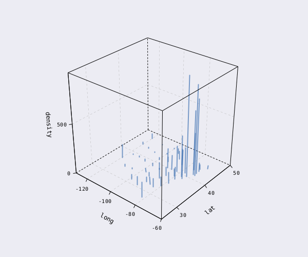
:::


Not reproduced: Fig 6.5 (the spikes over a map of the states - no maps in cljplot2).


### Fig 6.6 Ozone by wind and temperature

Cube root of ozone against wind speed and temperature, a panel per radiation interval.

Source: [Lattice Fig 6.6](http://lmdvr.r-forge.r-project.org/figures/figures.html?chapter=06;figure=06_06;theme=stdColor;code=right). Data: Ozone and weather, New York 1973, R lattice package `environmental` (Bruntz et al. 1974; Cleveland 1993); licence: GPL (>= 2) (lattice).


::: {.sourceClojure}
```clojure
(def env
  "environmental with the cube root of ozone."
  (mapv #(update % :ozone m/cbrt) (nu/dataset :environmental)))
```
:::


```{=html}
<div class="data-table"><table class="table table-hover table-responsive clay-table"><thead><tr><th>ozone</th><th>radiation</th><th>temperature</th><th>wind</th></tr></thead><tbody><tr><td>3.4482172403827303</td><td>190</td><td>67</td><td>7.4</td></tr><tr><td>3.3019272488946267</td><td>118</td><td>72</td><td>8</td></tr><tr><td>2.2894284851066637</td><td>149</td><td>74</td><td>12.6</td></tr><tr><td>2.6207413942088964</td><td>313</td><td>62</td><td>11.5</td></tr><tr><td>2.8438669798515654</td><td>299</td><td>65</td><td>8.6</td></tr><tr><td>2.668401648721945</td><td>99</td><td>59</td><td>13.8</td></tr><tr><td>2.0</td><td>19</td><td>61</td><td>20.1</td></tr><tr><td>2.5198420997897464</td><td>256</td><td>69</td><td>9.7</td></tr><tr><td>2.2239800905693157</td><td>290</td><td>66</td><td>9.2</td></tr><tr><td>2.41014226417523</td><td>274</td><td>68</td><td>10.9</td></tr><tr><td>2.6207413942088964</td><td>65</td><td>58</td><td>13.2</td></tr><tr><td>2.41014226417523</td><td>334</td><td>64</td><td>11.5</td></tr><tr><td>3.2396118012774835</td><td>307</td><td>66</td><td>12</td></tr><tr><td>1.8171205928321397</td><td>78</td><td>57</td><td>18.4</td></tr><tr><td>3.107232505953859</td><td>322</td><td>68</td><td>11.5</td></tr><tr><td>2.2239800905693157</td><td>44</td><td>62</td><td>9.7</td></tr><tr><td>1.0</td><td>8</td><td>59</td><td>9.7</td></tr><tr><td>2.2239800905693157</td><td>320</td><td>73</td><td>16.6</td></tr><tr><td>1.5874010519681996</td><td>25</td><td>61</td><td>9.7</td></tr><tr><td>3.174802103936399</td><td>92</td><td>61</td><td>12</td></tr><tr><td>2.8438669798515654</td><td>13</td><td>67</td><td>12</td></tr><tr><td>3.556893304490063</td><td>252</td><td>81</td><td>14.9</td></tr><tr><td>4.86294413109428</td><td>223</td><td>79</td><td>5.7</td></tr><tr><td>3.3322218516459534</td><td>279</td><td>76</td><td>7.4</td></tr><tr><td>3.072316825685847</td><td>127</td><td>82</td><td>9.7</td></tr><tr><td>4.140817749422853</td><td>291</td><td>90</td><td>13.8</td></tr><tr><td>3.391211443014167</td><td>323</td><td>87</td><td>11.5</td></tr><tr><td>2.8438669798515654</td><td>148</td><td>82</td><td>8</td></tr><tr><td>2.7589241763811208</td><td>191</td><td>77</td><td>14.9</td></tr><tr><td>3.3322218516459534</td><td>284</td><td>72</td><td>20.7</td></tr><tr><td>2.7144176165949068</td><td>37</td><td>65</td><td>9.2</td></tr><tr><td>2.2894284851066637</td><td>120</td><td>73</td><td>11.5</td></tr><tr><td>2.3513346877207577</td><td>137</td><td>76</td><td>10.3</td></tr><tr><td>5.129927840030091</td><td>269</td><td>84</td><td>4</td></tr><tr><td>3.6593057100229713</td><td>248</td><td>85</td><td>9.2</td></tr><tr><td>3.174802103936399</td><td>236</td><td>81</td><td>9.2</td></tr><tr><td>4.0</td><td>175</td><td>83</td><td>4.6</td></tr><tr><td>3.419951893353394</td><td>314</td><td>83</td><td>10.9</td></tr><tr><td>4.254320865115006</td><td>276</td><td>88</td><td>5.1</td></tr><tr><td>4.594700892207039</td><td>267</td><td>92</td><td>6.3</td></tr><tr><td>4.594700892207039</td><td>272</td><td>92</td><td>5.7</td></tr><tr><td>4.396829672158179</td><td>175</td><td>89</td><td>7.4</td></tr><tr><td>2.154434690031884</td><td>264</td><td>73</td><td>14.3</td></tr><tr><td>3.0</td><td>175</td><td>81</td><td>14.9</td></tr><tr><td>1.9129311827723892</td><td>48</td><td>80</td><td>14.3</td></tr><tr><td>3.6342411856642793</td><td>260</td><td>81</td><td>6.9</td></tr><tr><td>3.2710663101885897</td><td>274</td><td>82</td><td>10.3</td></tr><tr><td>3.936497183102173</td><td>285</td><td>84</td><td>6.3</td></tr><tr><td>4.2908404270262075</td><td>187</td><td>87</td><td>5.1</td></tr><tr><td>3.9790572078963917</td><td>220</td><td>85</td><td>11.5</td></tr><tr><td>2.5198420997897464</td><td>7</td><td>74</td><td>6.9</td></tr><tr><td>4.308869380063768</td><td>294</td><td>86</td><td>8.6</td></tr><tr><td>4.762203155904598</td><td>223</td><td>85</td><td>8</td></tr><tr><td>2.7144176165949068</td><td>81</td><td>82</td><td>8.6</td></tr><tr><td>3.732511156817248</td><td>82</td><td>86</td><td>12</td></tr><tr><td>4.344481485768612</td><td>213</td><td>88</td><td>7.4</td></tr><tr><td>3.684031498640387</td><td>275</td><td>86</td><td>7.4</td></tr><tr><td>4.0</td><td>253</td><td>83</td><td>7.4</td></tr><tr><td>3.8929964158732604</td><td>254</td><td>81</td><td>9.2</td></tr><tr><td>3.391211443014167</td><td>83</td><td>81</td><td>6.9</td></tr><tr><td>2.080083823051904</td><td>24</td><td>81</td><td>13.8</td></tr><tr><td>2.5198420997897464</td><td>77</td><td>82</td><td>7.4</td></tr><tr><td>4.959675663842301</td><td>255</td><td>89</td><td>4</td></tr><tr><td>4.464745095584537</td><td>229</td><td>90</td><td>10.3</td></tr><tr><td>4.791419857062784</td><td>207</td><td>90</td><td>8</td></tr><tr><td>3.530348335326063</td><td>192</td><td>86</td><td>11.5</td></tr><tr><td>3.0365889718756627</td><td>273</td><td>82</td><td>11.5</td></tr><tr><td>4.020725758589058</td><td>157</td><td>80</td><td>9.7</td></tr><tr><td>2.8020393306553872</td><td>71</td><td>77</td><td>10.3</td></tr><tr><td>3.8929964158732604</td><td>51</td><td>79</td><td>6.3</td></tr><tr><td>2.8438669798515654</td><td>115</td><td>76</td><td>7.4</td></tr><tr><td>3.141380652391393</td><td>244</td><td>78</td><td>10.9</td></tr><tr><td>3.530348335326063</td><td>190</td><td>78</td><td>10.3</td></tr><tr><td>2.7589241763811208</td><td>259</td><td>77</td><td>15.5</td></tr><tr><td>2.080083823051904</td><td>36</td><td>72</td><td>14.3</td></tr><tr><td>3.556893304490063</td><td>212</td><td>79</td><td>9.7</td></tr><tr><td>5.5178483527622415</td><td>238</td><td>81</td><td>3.4</td></tr><tr><td>4.179339196381232</td><td>215</td><td>86</td><td>8</td></tr><tr><td>4.235823584254893</td><td>203</td><td>97</td><td>9.7</td></tr><tr><td>4.904868131524017</td><td>225</td><td>94</td><td>2.3</td></tr><tr><td>4.379519139887889</td><td>237</td><td>96</td><td>6.3</td></tr><tr><td>4.396829672158179</td><td>188</td><td>94</td><td>6.3</td></tr><tr><td>4.5788569702133275</td><td>167</td><td>91</td><td>6.9</td></tr><tr><td>4.272658681697917</td><td>197</td><td>92</td><td>5.1</td></tr><tr><td>4.179339196381232</td><td>183</td><td>93</td><td>2.8</td></tr><tr><td>4.497941445275415</td><td>189</td><td>93</td><td>4.6</td></tr><tr><td>3.608826080138695</td><td>95</td><td>87</td><td>7.4</td></tr><tr><td>3.174802103936399</td><td>92</td><td>84</td><td>15.5</td></tr><tr><td>2.7144176165949068</td><td>252</td><td>80</td><td>10.9</td></tr><tr><td>2.8438669798515654</td><td>220</td><td>78</td><td>10.3</td></tr><tr><td>2.7589241763811208</td><td>230</td><td>75</td><td>10.9</td></tr><tr><td>2.8844991406148166</td><td>259</td><td>73</td><td>9.7</td></tr><tr><td>3.530348335326063</td><td>236</td><td>81</td><td>14.9</td></tr><tr><td>2.7589241763811208</td><td>259</td><td>76</td><td>15.5</td></tr><tr><td>3.0365889718756627</td><td>238</td><td>77</td><td>6.3</td></tr><tr><td>2.080083823051904</td><td>24</td><td>71</td><td>10.9</td></tr><tr><td>2.3513346877207577</td><td>112</td><td>71</td><td>11.5</td></tr><tr><td>3.5830478710159466</td><td>237</td><td>78</td><td>6.9</td></tr><tr><td>2.6207413942088964</td><td>224</td><td>67</td><td>13.8</td></tr><tr><td>2.3513346877207577</td><td>27</td><td>76</td><td>10.3</td></tr><tr><td>…</td><td>…</td><td>…</td><td>…</td></tr></tbody></table></div>
```


::: {.sourceClojure}
```clojure
(plot/render-image
 {:data (shingle/shingle env :radiation {:n 4 :overlap 0.5 :as :radiation-cut :label "Radiation"})
  :mapping {:x :wind :y :temperature :z :ozone :facet :radiation-cut}
  :charts [(chart/cloud {:size 4 :view {:azimuth -40 :elevation 30 :distance 0.2}})]
  :facets {:columns 4}}
 {:width 1000 :height 350})
```
:::


::: {.clay-image}
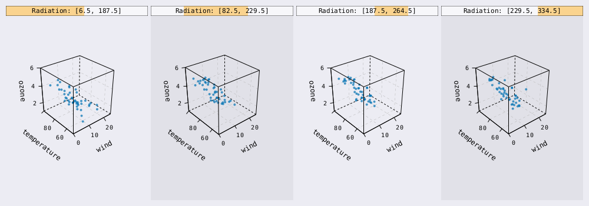
:::


### Fig 6.7 Scatter-plot matrix

Source: [Lattice Fig 6.7](http://lmdvr.r-forge.r-project.org/figures/figures.html?chapter=06;figure=06_07;theme=stdColor;code=right). Data: Ozone and weather, New York 1973, R lattice package `environmental` (Bruntz et al. 1974; Cleveland 1993); licence: GPL (>= 2) (lattice).


::: {.sourceClojure}
```clojure
(plot/render-image
 (plot/pairs env {:variables [:ozone :radiation :temperature :wind] :upper (chart/scatter) :diagonal :names})
 {:width 650 :height 650})
```
:::


::: {.clay-image}
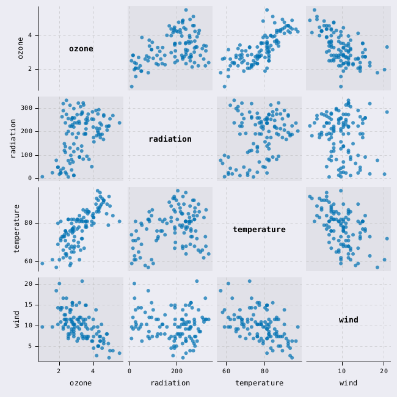
:::


### Fig 6.8 Four models as surfaces

Ozone modelled on wind, temperature and radiation, evaluated on a wind x temperature grid at four radiation
levels: a linear model with all interactions (as the book), and - in place of the book's loess and locfit fits -
a Gaussian process (kernel sigma 0.25), a radial basis function fit and Shepard interpolation (fastmath, on the
predictors scaled to [0, 1]). Shepard's inverse-distance weights use power 1 (default 2) for a smoother surface;
it still passes through every observation, so the slices show small dimples where they come close to one. The
view turned so the side along temperature, where ozone grows, faces us.

Source: [Lattice Fig 6.8](http://lmdvr.r-forge.r-project.org/figures/figures.html?chapter=06;figure=06_08;theme=stdColor;code=right). Data: Ozone and weather, New York 1973, R lattice package `environmental` (Bruntz et al. 1974; Cleveland 1993); licence: GPL (>= 2) (lattice).


::: {.sourceClojure}
```clojure
(def env-fits
  "Fitted ozone on a 51 x 51 wind x temperature grid at 4 radiation levels, one row per model and grid point."
  (let [predictors [:wind :temperature :radiation]
        ranges (into {} (for [c predictors] [c [(reduce min (map c env)) (reduce max (map c env))]]))
        unit (fn [point] (mapv (fn [c v] (let [[lo hi] (ranges c)] (/ (- v lo) (- hi lo)))) predictors point))
        points (mapv (apply juxt predictors) env)
        ozone (mapv :ozone env)
        terms (fn [[w t r]] [r t w (* r t) (* r w) (* t w) (* r t w)])
        linear (regression/lm ozone (mapv terms points))
        gp (interp/interpolation :gp (mapv unit points) ozone (k/kernel :gaussian {:sigma 0.25}) {:noise 0.2})
        rbf (interp/interpolation :rbf (mapv unit points) ozone (k/rbf :gaussian {:scale 0.4}) {:lambda 0.5})
        shepard (interp/interpolation :shepard (mapv unit points) ozone {:p 1.0})
        models [["linear" #(linear (terms %))] ["Gaussian process" #(gp (unit %))]
                ["radial basis" #(rbf (unit %))] ["Shepard" #(shepard (unit %))]]
        mesh (fn [[lo hi] n] (mapv #(+ lo (* (- hi lo) (/ % (double n)))) (range (inc n))))]
    (vec (for [[model f] models, r (mesh (ranges :radiation) 3), w (mesh (ranges :wind) 50), t (mesh (ranges :temperature) 50)]
           {:model model :radiation (m/round r) :wind w :temperature t :fit (f [w t r])}))))
```
:::


```{=html}
<div class="data-table"><table class="table table-hover table-responsive clay-table"><thead><tr><th>model</th><th>radiation</th><th>wind</th><th>temperature</th><th>fit</th></tr></thead><tbody><tr><td>linear</td><td>7</td><td>2.3</td><td>57.0</td><td>1.6474856063065357</td></tr><tr><td>linear</td><td>7</td><td>2.3</td><td>57.8</td><td>1.7075033244266682</td></tr><tr><td>linear</td><td>7</td><td>2.3</td><td>58.6</td><td>1.7675210425468015</td></tr><tr><td>linear</td><td>7</td><td>2.3</td><td>59.4</td><td>1.827538760666934</td></tr><tr><td>linear</td><td>7</td><td>2.3</td><td>60.2</td><td>1.8875564787870673</td></tr><tr><td>linear</td><td>7</td><td>2.3</td><td>61.0</td><td>1.947574196907199</td></tr><tr><td>linear</td><td>7</td><td>2.3</td><td>61.8</td><td>2.0075919150273314</td></tr><tr><td>linear</td><td>7</td><td>2.3</td><td>62.6</td><td>2.0676096331474647</td></tr><tr><td>linear</td><td>7</td><td>2.3</td><td>63.4</td><td>2.127627351267597</td></tr><tr><td>linear</td><td>7</td><td>2.3</td><td>64.2</td><td>2.1876450693877296</td></tr><tr><td>linear</td><td>7</td><td>2.3</td><td>65.0</td><td>2.247662787507864</td></tr><tr><td>linear</td><td>7</td><td>2.3</td><td>65.8</td><td>2.3076805056279945</td></tr><tr><td>linear</td><td>7</td><td>2.3</td><td>66.6</td><td>2.367698223748127</td></tr><tr><td>linear</td><td>7</td><td>2.3</td><td>67.4</td><td>2.4277159418682612</td></tr><tr><td>linear</td><td>7</td><td>2.3</td><td>68.2</td><td>2.4877336599883937</td></tr><tr><td>linear</td><td>7</td><td>2.3</td><td>69.0</td><td>2.547751378108527</td></tr><tr><td>linear</td><td>7</td><td>2.3</td><td>69.8</td><td>2.6077690962286577</td></tr><tr><td>linear</td><td>7</td><td>2.3</td><td>70.6</td><td>2.667786814348792</td></tr><tr><td>linear</td><td>7</td><td>2.3</td><td>71.4</td><td>2.7278045324689253</td></tr><tr><td>linear</td><td>7</td><td>2.3</td><td>72.2</td><td>2.787822250589057</td></tr><tr><td>linear</td><td>7</td><td>2.3</td><td>73.0</td><td>2.84783996870919</td></tr><tr><td>linear</td><td>7</td><td>2.3</td><td>73.8</td><td>2.9078576868293218</td></tr><tr><td>linear</td><td>7</td><td>2.3</td><td>74.6</td><td>2.9678754049494542</td></tr><tr><td>linear</td><td>7</td><td>2.3</td><td>75.4</td><td>3.0278931230695885</td></tr><tr><td>linear</td><td>7</td><td>2.3</td><td>76.2</td><td>3.08791084118972</td></tr><tr><td>linear</td><td>7</td><td>2.3</td><td>77.0</td><td>3.1479285593098534</td></tr><tr><td>linear</td><td>7</td><td>2.3</td><td>77.8</td><td>3.207946277429986</td></tr><tr><td>linear</td><td>7</td><td>2.3</td><td>78.6</td><td>3.2679639955501174</td></tr><tr><td>linear</td><td>7</td><td>2.3</td><td>79.4</td><td>3.3279817136702516</td></tr><tr><td>linear</td><td>7</td><td>2.3</td><td>80.2</td><td>3.387999431790384</td></tr><tr><td>linear</td><td>7</td><td>2.3</td><td>81.0</td><td>3.4480171499105157</td></tr><tr><td>linear</td><td>7</td><td>2.3</td><td>81.8</td><td>3.508034868030649</td></tr><tr><td>linear</td><td>7</td><td>2.3</td><td>82.6</td><td>3.5680525861507806</td></tr><tr><td>linear</td><td>7</td><td>2.3</td><td>83.4</td><td>3.628070304270914</td></tr><tr><td>linear</td><td>7</td><td>2.3</td><td>84.2</td><td>3.6880880223910464</td></tr><tr><td>linear</td><td>7</td><td>2.3</td><td>85.0</td><td>3.748105740511179</td></tr><tr><td>linear</td><td>7</td><td>2.3</td><td>85.8</td><td>3.8081234586313113</td></tr><tr><td>linear</td><td>7</td><td>2.3</td><td>86.6</td><td>3.868141176751443</td></tr><tr><td>linear</td><td>7</td><td>2.3</td><td>87.4</td><td>3.928158894871577</td></tr><tr><td>linear</td><td>7</td><td>2.3</td><td>88.2</td><td>3.9881766129917113</td></tr><tr><td>linear</td><td>7</td><td>2.3</td><td>89.0</td><td>4.0481943311118425</td></tr><tr><td>linear</td><td>7</td><td>2.3</td><td>89.8</td><td>4.108212049231975</td></tr><tr><td>linear</td><td>7</td><td>2.3</td><td>90.6</td><td>4.168229767352107</td></tr><tr><td>linear</td><td>7</td><td>2.3</td><td>91.4</td><td>4.228247485472242</td></tr><tr><td>linear</td><td>7</td><td>2.3</td><td>92.2</td><td>4.288265203592376</td></tr><tr><td>linear</td><td>7</td><td>2.3</td><td>93.0</td><td>4.348282921712505</td></tr><tr><td>linear</td><td>7</td><td>2.3</td><td>93.80000000000001</td><td>4.408300639832637</td></tr><tr><td>linear</td><td>7</td><td>2.3</td><td>94.6</td><td>4.46831835795277</td></tr><tr><td>linear</td><td>7</td><td>2.3</td><td>95.4</td><td>4.528336076072904</td></tr><tr><td>linear</td><td>7</td><td>2.3</td><td>96.2</td><td>4.588353794193036</td></tr><tr><td>linear</td><td>7</td><td>2.3</td><td>97.0</td><td>4.648371512313167</td></tr><tr><td>linear</td><td>7</td><td>2.6679999999999997</td><td>57.0</td><td>1.6593064909981021</td></tr><tr><td>linear</td><td>7</td><td>2.6679999999999997</td><td>57.8</td><td>1.7178677552849915</td></tr><tr><td>linear</td><td>7</td><td>2.6679999999999997</td><td>58.6</td><td>1.7764290195718808</td></tr><tr><td>linear</td><td>7</td><td>2.6679999999999997</td><td>59.4</td><td>1.8349902838587684</td></tr><tr><td>linear</td><td>7</td><td>2.6679999999999997</td><td>60.2</td><td>1.8935515481456586</td></tr><tr><td>linear</td><td>7</td><td>2.6679999999999997</td><td>61.0</td><td>1.9521128124325462</td></tr><tr><td>linear</td><td>7</td><td>2.6679999999999997</td><td>61.8</td><td>2.0106740767194347</td></tr><tr><td>linear</td><td>7</td><td>2.6679999999999997</td><td>62.6</td><td>2.069235341006324</td></tr><tr><td>linear</td><td>7</td><td>2.6679999999999997</td><td>63.4</td><td>2.1277966052932116</td></tr><tr><td>linear</td><td>7</td><td>2.6679999999999997</td><td>64.2</td><td>2.186357869580101</td></tr><tr><td>linear</td><td>7</td><td>2.6679999999999997</td><td>65.0</td><td>2.2449191338669903</td></tr><tr><td>linear</td><td>7</td><td>2.6679999999999997</td><td>65.8</td><td>2.303480398153877</td></tr><tr><td>linear</td><td>7</td><td>2.6679999999999997</td><td>66.6</td><td>2.3620416624407663</td></tr><tr><td>linear</td><td>7</td><td>2.6679999999999997</td><td>67.4</td><td>2.4206029267276565</td></tr><tr><td>linear</td><td>7</td><td>2.6679999999999997</td><td>68.2</td><td>2.479164191014544</td></tr><tr><td>linear</td><td>7</td><td>2.6679999999999997</td><td>69.0</td><td>2.5377254553014335</td></tr><tr><td>linear</td><td>7</td><td>2.6679999999999997</td><td>69.8</td><td>2.596286719588321</td></tr><tr><td>linear</td><td>7</td><td>2.6679999999999997</td><td>70.6</td><td>2.6548479838752104</td></tr><tr><td>linear</td><td>7</td><td>2.6679999999999997</td><td>71.4</td><td>2.7134092481621006</td></tr><tr><td>linear</td><td>7</td><td>2.6679999999999997</td><td>72.2</td><td>2.771970512448989</td></tr><tr><td>linear</td><td>7</td><td>2.6679999999999997</td><td>73.0</td><td>2.8305317767358775</td></tr><tr><td>linear</td><td>7</td><td>2.6679999999999997</td><td>73.8</td><td>2.889093041022765</td></tr><tr><td>linear</td><td>7</td><td>2.6679999999999997</td><td>74.6</td><td>2.9476543053096544</td></tr><tr><td>linear</td><td>7</td><td>2.6679999999999997</td><td>75.4</td><td>3.006215569596544</td></tr><tr><td>linear</td><td>7</td><td>2.6679999999999997</td><td>76.2</td><td>3.0647768338834322</td></tr><tr><td>linear</td><td>7</td><td>2.6679999999999997</td><td>77.0</td><td>3.1233380981703216</td></tr><tr><td>linear</td><td>7</td><td>2.6679999999999997</td><td>77.8</td><td>3.181899362457209</td></tr><tr><td>linear</td><td>7</td><td>2.6679999999999997</td><td>78.6</td><td>3.2404606267440976</td></tr><tr><td>linear</td><td>7</td><td>2.6679999999999997</td><td>79.4</td><td>3.299021891030987</td></tr><tr><td>linear</td><td>7</td><td>2.6679999999999997</td><td>80.2</td><td>3.3575831553178754</td></tr><tr><td>linear</td><td>7</td><td>2.6679999999999997</td><td>81.0</td><td>3.416144419604764</td></tr><tr><td>linear</td><td>7</td><td>2.6679999999999997</td><td>81.8</td><td>3.4747056838916524</td></tr><tr><td>linear</td><td>7</td><td>2.6679999999999997</td><td>82.6</td><td>3.533266948178541</td></tr><tr><td>linear</td><td>7</td><td>2.6679999999999997</td><td>83.4</td><td>3.591828212465431</td></tr><tr><td>linear</td><td>7</td><td>2.6679999999999997</td><td>84.2</td><td>3.6503894767523195</td></tr><tr><td>linear</td><td>7</td><td>2.6679999999999997</td><td>85.0</td><td>3.708950741039207</td></tr><tr><td>linear</td><td>7</td><td>2.6679999999999997</td><td>85.8</td><td>3.7675120053260955</td></tr><tr><td>linear</td><td>7</td><td>2.6679999999999997</td><td>86.6</td><td>3.826073269612983</td></tr><tr><td>linear</td><td>7</td><td>2.6679999999999997</td><td>87.4</td><td>3.8846345338998733</td></tr><tr><td>linear</td><td>7</td><td>2.6679999999999997</td><td>88.2</td><td>3.9431957981867645</td></tr><tr><td>linear</td><td>7</td><td>2.6679999999999997</td><td>89.0</td><td>4.0017570624736525</td></tr><tr><td>linear</td><td>7</td><td>2.6679999999999997</td><td>89.8</td><td>4.060318326760541</td></tr><tr><td>linear</td><td>7</td><td>2.6679999999999997</td><td>90.6</td><td>4.118879591047429</td></tr><tr><td>linear</td><td>7</td><td>2.6679999999999997</td><td>91.4</td><td>4.177440855334318</td></tr><tr><td>linear</td><td>7</td><td>2.6679999999999997</td><td>92.2</td><td>4.236002119621208</td></tr><tr><td>linear</td><td>7</td><td>2.6679999999999997</td><td>93.0</td><td>4.294563383908095</td></tr><tr><td>linear</td><td>7</td><td>2.6679999999999997</td><td>93.80000000000001</td><td>4.353124648194983</td></tr><tr><td>linear</td><td>7</td><td>2.6679999999999997</td><td>94.6</td><td>4.411685912481872</td></tr><tr><td>linear</td><td>7</td><td>2.6679999999999997</td><td>95.4</td><td>4.47024717676876</td></tr><tr><td>…</td><td>…</td><td>…</td><td>…</td><td>…</td></tr></tbody></table></div>
```


::: {.sourceClojure}
```clojure
(def model-order {:facet-row {:domain ["Shepard" "radial basis" "Gaussian process" "linear"]}})
```
:::


::: {.sourceClojure}
```clojure
(plot/render-image
 {:data env-fits
  :mapping {:x :wind :y :temperature :z :fit :facet-col :radiation :facet-row :model}
  :scales model-order
  :charts [(chart/surface {:view {:azimuth -40 :elevation 30 :distance 0.2} :axes false})]}
 {:width 900 :height 800})
```
:::


::: {.clay-image}
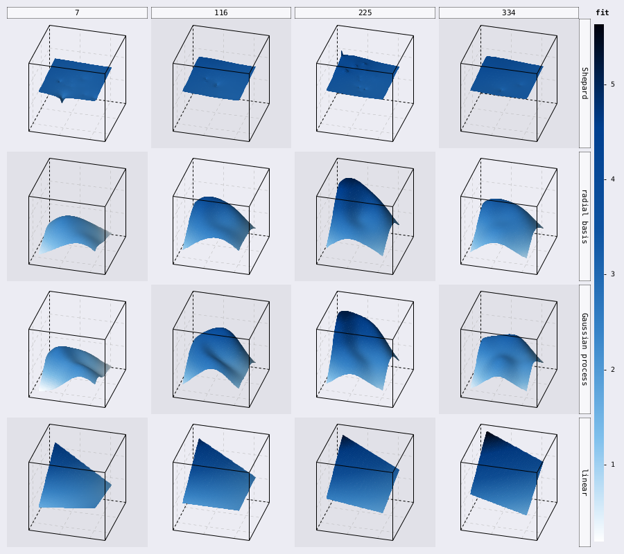
:::


### Fig 6.9 The same models as level plots

Source: [Lattice Fig 6.9](http://lmdvr.r-forge.r-project.org/figures/figures.html?chapter=06;figure=06_09;theme=stdColor;code=right). Data: Ozone and weather, New York 1973, R lattice package `environmental` (Bruntz et al. 1974; Cleveland 1993); licence: GPL (>= 2) (lattice).


::: {.sourceClojure}
```clojure
(plot/render-image
 {:data env-fits
  :mapping {:x :wind :y :temperature :value :fit :facet-col :radiation :facet-row :model}
  :scales model-order
  :charts [(chart/field)]
  :labels {:x "wind" :y "temperature"}}
 {:width 900 :height 800})
```
:::


::: {.clay-image}
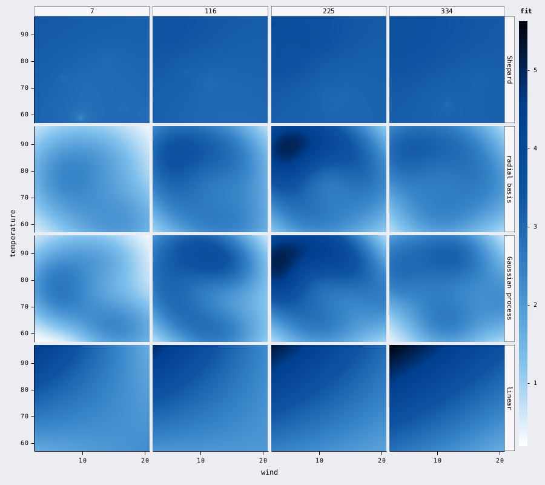
:::


### Fig 6.10 Labelled contours

The Gaussian process fit (in place of the book's locfit) as contour lines with their levels, a panel per
radiation level - from the bottom up, the highest on top.

Source: [Lattice Fig 6.10](http://lmdvr.r-forge.r-project.org/figures/figures.html?chapter=06;figure=06_10;theme=stdColor;code=right). Data: Ozone and weather, New York 1973, R lattice package `environmental` (Bruntz et al. 1974; Cleveland 1993); licence: GPL (>= 2) (lattice).


::: {.sourceClojure}
```clojure
(plot/render-image
 {:data (filterv #(= "Gaussian process" (:model %)) env-fits)
  :mapping {:x :wind :y :temperature :value :fit :facet :radiation}
  :charts [(chart/contour {:levels 15 :labels true :color [40 40 40]})]
  :facets {:columns 1 :order :bottom-up}
  :labels {:x "wind" :y "temperature"}}
 {:width 500 :height 800})
```
:::


::: {.clay-image}
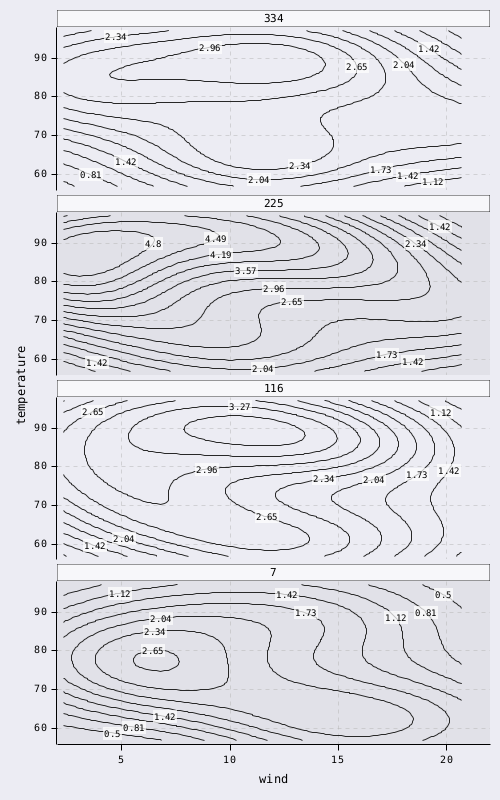
:::


### Fig 6.11 Volcano three ways

The Maunga Whau volcano (a 10 m grid of heights) as a level plot, as contours, as a wireframe.

Source: [Lattice Fig 6.11](http://lmdvr.r-forge.r-project.org/figures/figures.html?chapter=06;figure=06_11;theme=stdColor;code=right). Data: Maunga Whau volcano topography, R datasets package `volcano` (Ross Ihaka); licence: Part of R (GPL-2 | GPL-3).


::: {.sourceClojure}
```clojure
(def volcano (nu/dataset :volcano))
```
:::


```{=html}
<div class="data-table"><table class="table table-hover table-responsive clay-table"><thead><tr><th>row</th><th>column</th><th>height</th></tr></thead><tbody><tr><td>1</td><td>1</td><td>100</td></tr><tr><td>2</td><td>1</td><td>101</td></tr><tr><td>3</td><td>1</td><td>102</td></tr><tr><td>4</td><td>1</td><td>103</td></tr><tr><td>5</td><td>1</td><td>104</td></tr><tr><td>6</td><td>1</td><td>105</td></tr><tr><td>7</td><td>1</td><td>105</td></tr><tr><td>8</td><td>1</td><td>106</td></tr><tr><td>9</td><td>1</td><td>107</td></tr><tr><td>10</td><td>1</td><td>108</td></tr><tr><td>11</td><td>1</td><td>109</td></tr><tr><td>12</td><td>1</td><td>110</td></tr><tr><td>13</td><td>1</td><td>110</td></tr><tr><td>14</td><td>1</td><td>111</td></tr><tr><td>15</td><td>1</td><td>114</td></tr><tr><td>16</td><td>1</td><td>116</td></tr><tr><td>17</td><td>1</td><td>118</td></tr><tr><td>18</td><td>1</td><td>120</td></tr><tr><td>19</td><td>1</td><td>120</td></tr><tr><td>20</td><td>1</td><td>121</td></tr><tr><td>21</td><td>1</td><td>122</td></tr><tr><td>22</td><td>1</td><td>122</td></tr><tr><td>23</td><td>1</td><td>123</td></tr><tr><td>24</td><td>1</td><td>124</td></tr><tr><td>25</td><td>1</td><td>123</td></tr><tr><td>26</td><td>1</td><td>123</td></tr><tr><td>27</td><td>1</td><td>120</td></tr><tr><td>28</td><td>1</td><td>118</td></tr><tr><td>29</td><td>1</td><td>117</td></tr><tr><td>30</td><td>1</td><td>115</td></tr><tr><td>31</td><td>1</td><td>114</td></tr><tr><td>32</td><td>1</td><td>115</td></tr><tr><td>33</td><td>1</td><td>113</td></tr><tr><td>34</td><td>1</td><td>111</td></tr><tr><td>35</td><td>1</td><td>110</td></tr><tr><td>36</td><td>1</td><td>109</td></tr><tr><td>37</td><td>1</td><td>108</td></tr><tr><td>38</td><td>1</td><td>108</td></tr><tr><td>39</td><td>1</td><td>107</td></tr><tr><td>40</td><td>1</td><td>107</td></tr><tr><td>41</td><td>1</td><td>107</td></tr><tr><td>42</td><td>1</td><td>108</td></tr><tr><td>43</td><td>1</td><td>109</td></tr><tr><td>44</td><td>1</td><td>110</td></tr><tr><td>45</td><td>1</td><td>111</td></tr><tr><td>46</td><td>1</td><td>111</td></tr><tr><td>47</td><td>1</td><td>112</td></tr><tr><td>48</td><td>1</td><td>113</td></tr><tr><td>49</td><td>1</td><td>113</td></tr><tr><td>50</td><td>1</td><td>114</td></tr><tr><td>51</td><td>1</td><td>115</td></tr><tr><td>52</td><td>1</td><td>115</td></tr><tr><td>53</td><td>1</td><td>114</td></tr><tr><td>54</td><td>1</td><td>113</td></tr><tr><td>55</td><td>1</td><td>112</td></tr><tr><td>56</td><td>1</td><td>111</td></tr><tr><td>57</td><td>1</td><td>111</td></tr><tr><td>58</td><td>1</td><td>112</td></tr><tr><td>59</td><td>1</td><td>112</td></tr><tr><td>60</td><td>1</td><td>112</td></tr><tr><td>61</td><td>1</td><td>113</td></tr><tr><td>62</td><td>1</td><td>114</td></tr><tr><td>63</td><td>1</td><td>114</td></tr><tr><td>64</td><td>1</td><td>115</td></tr><tr><td>65</td><td>1</td><td>115</td></tr><tr><td>66</td><td>1</td><td>116</td></tr><tr><td>67</td><td>1</td><td>116</td></tr><tr><td>68</td><td>1</td><td>117</td></tr><tr><td>69</td><td>1</td><td>117</td></tr><tr><td>70</td><td>1</td><td>116</td></tr><tr><td>71</td><td>1</td><td>114</td></tr><tr><td>72</td><td>1</td><td>112</td></tr><tr><td>73</td><td>1</td><td>109</td></tr><tr><td>74</td><td>1</td><td>106</td></tr><tr><td>75</td><td>1</td><td>104</td></tr><tr><td>76</td><td>1</td><td>102</td></tr><tr><td>77</td><td>1</td><td>101</td></tr><tr><td>78</td><td>1</td><td>100</td></tr><tr><td>79</td><td>1</td><td>100</td></tr><tr><td>80</td><td>1</td><td>99</td></tr><tr><td>81</td><td>1</td><td>99</td></tr><tr><td>82</td><td>1</td><td>99</td></tr><tr><td>83</td><td>1</td><td>99</td></tr><tr><td>84</td><td>1</td><td>98</td></tr><tr><td>85</td><td>1</td><td>98</td></tr><tr><td>86</td><td>1</td><td>97</td></tr><tr><td>87</td><td>1</td><td>97</td></tr><tr><td>1</td><td>2</td><td>100</td></tr><tr><td>2</td><td>2</td><td>101</td></tr><tr><td>3</td><td>2</td><td>102</td></tr><tr><td>4</td><td>2</td><td>103</td></tr><tr><td>5</td><td>2</td><td>104</td></tr><tr><td>6</td><td>2</td><td>105</td></tr><tr><td>7</td><td>2</td><td>106</td></tr><tr><td>8</td><td>2</td><td>107</td></tr><tr><td>9</td><td>2</td><td>108</td></tr><tr><td>10</td><td>2</td><td>109</td></tr><tr><td>11</td><td>2</td><td>110</td></tr><tr><td>12</td><td>2</td><td>110</td></tr><tr><td>13</td><td>2</td><td>111</td></tr><tr><td>…</td><td>…</td><td>…</td></tr></tbody></table></div>
```


::: {.sourceClojure}
```clojure
(plot/render-image
 (plot/arrange [{:data volcano
                 :mapping {:x :row :y :column :value :height}
                 :charts [(chart/field)]
                 :aspect :iso}
                {:data volcano
                 :mapping {:x :row :y :column :value :height}
                 :charts [(chart/contour {:levels 20 :color :black})]
                 :aspect :iso}
                {:data volcano
                 :mapping {:x :row :y :column :z :height}
                 :charts [(chart/surface {:style :wireframe :view {:azimuth -40 :elevation 30 :distance 0.2}
                                          :color :black :stroke-width 0.3 :aspect [1 0.7 0.5]
                                          :axis-titles {:x "row" :y "column" :z "volcano"}})]}]
               {:columns 1 :heights [1 1 1.6]})
 {:width 600 :height 800})
```
:::


::: {.clay-image}
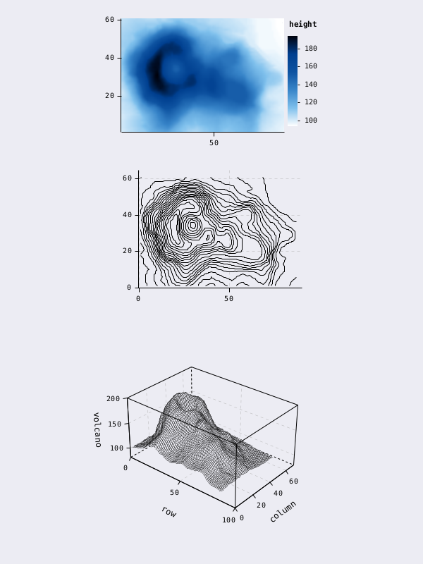
:::


### Fig 6.12 A correlation matrix

Pairwise correlations of the numeric columns of the 1993 cars (complete pairs).

Source: [Lattice Fig 6.12](http://lmdvr.r-forge.r-project.org/figures/figures.html?chapter=06;figure=06_12;theme=stdColor;code=right). Data: Cars on sale in the USA, 1993, R MASS package `Cars93` (Lock 1993); licence: GPL-2 | GPL-3 (MASS).


::: {.sourceClojure}
```clojure
(def cars93 (nu/dataset :cars93))
```
:::


```{=html}
<div class="data-table"><table class="table table-hover table-responsive clay-table"><thead><tr><th>manufacturer</th><th>model</th><th>type</th><th>min-price</th><th>price</th><th>max-price</th><th>mpg-city</th><th>mpg-highway</th><th>air-bags</th><th>drive-train</th><th>cylinders</th><th>engine-size</th><th>horsepower</th><th>rpm</th><th>rev-per-mile</th><th>man-trans-avail</th><th>fuel-tank-capacity</th><th>passengers</th><th>length</th><th>wheelbase</th><th>width</th><th>turn-circle</th><th>rear-seat-room</th><th>luggage-room</th><th>weight</th><th>origin</th><th>make</th></tr></thead><tbody><tr><td>Acura</td><td>Integra</td><td>Small</td><td>12.9</td><td>15.9</td><td>18.8</td><td>25</td><td>31</td><td>None</td><td>Front</td><td>4</td><td>1.8</td><td>140</td><td>6300</td><td>2890</td><td>Yes</td><td>13.2</td><td>5</td><td>177</td><td>102</td><td>68</td><td>37</td><td>26.5</td><td>11</td><td>2705</td><td>non-USA</td><td>Acura Integra</td></tr><tr><td>Acura</td><td>Legend</td><td>Midsize</td><td>29.2</td><td>33.9</td><td>38.7</td><td>18</td><td>25</td><td>Driver & Passenger</td><td>Front</td><td>6</td><td>3.2</td><td>200</td><td>5500</td><td>2335</td><td>Yes</td><td>18</td><td>5</td><td>195</td><td>115</td><td>71</td><td>38</td><td>30</td><td>15</td><td>3560</td><td>non-USA</td><td>Acura Legend</td></tr><tr><td>Audi</td><td>90</td><td>Compact</td><td>25.9</td><td>29.1</td><td>32.3</td><td>20</td><td>26</td><td>Driver only</td><td>Front</td><td>6</td><td>2.8</td><td>172</td><td>5500</td><td>2280</td><td>Yes</td><td>16.9</td><td>5</td><td>180</td><td>102</td><td>67</td><td>37</td><td>28</td><td>14</td><td>3375</td><td>non-USA</td><td>Audi 90</td></tr><tr><td>Audi</td><td>100</td><td>Midsize</td><td>30.8</td><td>37.7</td><td>44.6</td><td>19</td><td>26</td><td>Driver & Passenger</td><td>Front</td><td>6</td><td>2.8</td><td>172</td><td>5500</td><td>2535</td><td>Yes</td><td>21.1</td><td>6</td><td>193</td><td>106</td><td>70</td><td>37</td><td>31</td><td>17</td><td>3405</td><td>non-USA</td><td>Audi 100</td></tr><tr><td>BMW</td><td>535i</td><td>Midsize</td><td>23.7</td><td>30</td><td>36.2</td><td>22</td><td>30</td><td>Driver only</td><td>Rear</td><td>4</td><td>3.5</td><td>208</td><td>5700</td><td>2545</td><td>Yes</td><td>21.1</td><td>4</td><td>186</td><td>109</td><td>69</td><td>39</td><td>27</td><td>13</td><td>3640</td><td>non-USA</td><td>BMW 535i</td></tr><tr><td>Buick</td><td>Century</td><td>Midsize</td><td>14.2</td><td>15.7</td><td>17.3</td><td>22</td><td>31</td><td>Driver only</td><td>Front</td><td>4</td><td>2.2</td><td>110</td><td>5200</td><td>2565</td><td>No</td><td>16.4</td><td>6</td><td>189</td><td>105</td><td>69</td><td>41</td><td>28</td><td>16</td><td>2880</td><td>USA</td><td>Buick Century</td></tr><tr><td>Buick</td><td>LeSabre</td><td>Large</td><td>19.9</td><td>20.8</td><td>21.7</td><td>19</td><td>28</td><td>Driver only</td><td>Front</td><td>6</td><td>3.8</td><td>170</td><td>4800</td><td>1570</td><td>No</td><td>18</td><td>6</td><td>200</td><td>111</td><td>74</td><td>42</td><td>30.5</td><td>17</td><td>3470</td><td>USA</td><td>Buick LeSabre</td></tr><tr><td>Buick</td><td>Roadmaster</td><td>Large</td><td>22.6</td><td>23.7</td><td>24.9</td><td>16</td><td>25</td><td>Driver only</td><td>Rear</td><td>6</td><td>5.7</td><td>180</td><td>4000</td><td>1320</td><td>No</td><td>23</td><td>6</td><td>216</td><td>116</td><td>78</td><td>45</td><td>30.5</td><td>21</td><td>4105</td><td>USA</td><td>Buick Roadmaster</td></tr><tr><td>Buick</td><td>Riviera</td><td>Midsize</td><td>26.3</td><td>26.3</td><td>26.3</td><td>19</td><td>27</td><td>Driver only</td><td>Front</td><td>6</td><td>3.8</td><td>170</td><td>4800</td><td>1690</td><td>No</td><td>18.8</td><td>5</td><td>198</td><td>108</td><td>73</td><td>41</td><td>26.5</td><td>14</td><td>3495</td><td>USA</td><td>Buick Riviera</td></tr><tr><td>Cadillac</td><td>DeVille</td><td>Large</td><td>33</td><td>34.7</td><td>36.3</td><td>16</td><td>25</td><td>Driver only</td><td>Front</td><td>8</td><td>4.9</td><td>200</td><td>4100</td><td>1510</td><td>No</td><td>18</td><td>6</td><td>206</td><td>114</td><td>73</td><td>43</td><td>35</td><td>18</td><td>3620</td><td>USA</td><td>Cadillac DeVille</td></tr><tr><td>Cadillac</td><td>Seville</td><td>Midsize</td><td>37.5</td><td>40.1</td><td>42.7</td><td>16</td><td>25</td><td>Driver & Passenger</td><td>Front</td><td>8</td><td>4.6</td><td>295</td><td>6000</td><td>1985</td><td>No</td><td>20</td><td>5</td><td>204</td><td>111</td><td>74</td><td>44</td><td>31</td><td>14</td><td>3935</td><td>USA</td><td>Cadillac Seville</td></tr><tr><td>Chevrolet</td><td>Cavalier</td><td>Compact</td><td>8.5</td><td>13.4</td><td>18.3</td><td>25</td><td>36</td><td>None</td><td>Front</td><td>4</td><td>2.2</td><td>110</td><td>5200</td><td>2380</td><td>Yes</td><td>15.2</td><td>5</td><td>182</td><td>101</td><td>66</td><td>38</td><td>25</td><td>13</td><td>2490</td><td>USA</td><td>Chevrolet Cavalier</td></tr><tr><td>Chevrolet</td><td>Corsica</td><td>Compact</td><td>11.4</td><td>11.4</td><td>11.4</td><td>25</td><td>34</td><td>Driver only</td><td>Front</td><td>4</td><td>2.2</td><td>110</td><td>5200</td><td>2665</td><td>Yes</td><td>15.6</td><td>5</td><td>184</td><td>103</td><td>68</td><td>39</td><td>26</td><td>14</td><td>2785</td><td>USA</td><td>Chevrolet Corsica</td></tr><tr><td>Chevrolet</td><td>Camaro</td><td>Sporty</td><td>13.4</td><td>15.1</td><td>16.8</td><td>19</td><td>28</td><td>Driver & Passenger</td><td>Rear</td><td>6</td><td>3.4</td><td>160</td><td>4600</td><td>1805</td><td>Yes</td><td>15.5</td><td>4</td><td>193</td><td>101</td><td>74</td><td>43</td><td>25</td><td>13</td><td>3240</td><td>USA</td><td>Chevrolet Camaro</td></tr><tr><td>Chevrolet</td><td>Lumina</td><td>Midsize</td><td>13.4</td><td>15.9</td><td>18.4</td><td>21</td><td>29</td><td>None</td><td>Front</td><td>4</td><td>2.2</td><td>110</td><td>5200</td><td>2595</td><td>No</td><td>16.5</td><td>6</td><td>198</td><td>108</td><td>71</td><td>40</td><td>28.5</td><td>16</td><td>3195</td><td>USA</td><td>Chevrolet Lumina</td></tr><tr><td>Chevrolet</td><td>Lumina_APV</td><td>Van</td><td>14.7</td><td>16.3</td><td>18</td><td>18</td><td>23</td><td>None</td><td>Front</td><td>6</td><td>3.8</td><td>170</td><td>4800</td><td>1690</td><td>No</td><td>20</td><td>7</td><td>178</td><td>110</td><td>74</td><td>44</td><td>30.5</td><td></td><td>3715</td><td>USA</td><td>Chevrolet Lumina_APV</td></tr><tr><td>Chevrolet</td><td>Astro</td><td>Van</td><td>14.7</td><td>16.6</td><td>18.6</td><td>15</td><td>20</td><td>None</td><td>4WD</td><td>6</td><td>4.3</td><td>165</td><td>4000</td><td>1790</td><td>No</td><td>27</td><td>8</td><td>194</td><td>111</td><td>78</td><td>42</td><td>33.5</td><td></td><td>4025</td><td>USA</td><td>Chevrolet Astro</td></tr><tr><td>Chevrolet</td><td>Caprice</td><td>Large</td><td>18</td><td>18.8</td><td>19.6</td><td>17</td><td>26</td><td>Driver only</td><td>Rear</td><td>8</td><td>5</td><td>170</td><td>4200</td><td>1350</td><td>No</td><td>23</td><td>6</td><td>214</td><td>116</td><td>77</td><td>42</td><td>29.5</td><td>20</td><td>3910</td><td>USA</td><td>Chevrolet Caprice</td></tr><tr><td>Chevrolet</td><td>Corvette</td><td>Sporty</td><td>34.6</td><td>38</td><td>41.5</td><td>17</td><td>25</td><td>Driver only</td><td>Rear</td><td>8</td><td>5.7</td><td>300</td><td>5000</td><td>1450</td><td>Yes</td><td>20</td><td>2</td><td>179</td><td>96</td><td>74</td><td>43</td><td></td><td></td><td>3380</td><td>USA</td><td>Chevrolet Corvette</td></tr><tr><td>Chrylser</td><td>Concorde</td><td>Large</td><td>18.4</td><td>18.4</td><td>18.4</td><td>20</td><td>28</td><td>Driver & Passenger</td><td>Front</td><td>6</td><td>3.3</td><td>153</td><td>5300</td><td>1990</td><td>No</td><td>18</td><td>6</td><td>203</td><td>113</td><td>74</td><td>40</td><td>31</td><td>15</td><td>3515</td><td>USA</td><td>Chrylser Concorde</td></tr><tr><td>Chrysler</td><td>LeBaron</td><td>Compact</td><td>14.5</td><td>15.8</td><td>17.1</td><td>23</td><td>28</td><td>Driver & Passenger</td><td>Front</td><td>4</td><td>3</td><td>141</td><td>5000</td><td>2090</td><td>No</td><td>16</td><td>6</td><td>183</td><td>104</td><td>68</td><td>41</td><td>30.5</td><td>14</td><td>3085</td><td>USA</td><td>Chrysler LeBaron</td></tr><tr><td>Chrysler</td><td>Imperial</td><td>Large</td><td>29.5</td><td>29.5</td><td>29.5</td><td>20</td><td>26</td><td>Driver only</td><td>Front</td><td>6</td><td>3.3</td><td>147</td><td>4800</td><td>1785</td><td>No</td><td>16</td><td>6</td><td>203</td><td>110</td><td>69</td><td>44</td><td>36</td><td>17</td><td>3570</td><td>USA</td><td>Chrysler Imperial</td></tr><tr><td>Dodge</td><td>Colt</td><td>Small</td><td>7.9</td><td>9.2</td><td>10.6</td><td>29</td><td>33</td><td>None</td><td>Front</td><td>4</td><td>1.5</td><td>92</td><td>6000</td><td>3285</td><td>Yes</td><td>13.2</td><td>5</td><td>174</td><td>98</td><td>66</td><td>32</td><td>26.5</td><td>11</td><td>2270</td><td>USA</td><td>Dodge Colt</td></tr><tr><td>Dodge</td><td>Shadow</td><td>Small</td><td>8.4</td><td>11.3</td><td>14.2</td><td>23</td><td>29</td><td>Driver only</td><td>Front</td><td>4</td><td>2.2</td><td>93</td><td>4800</td><td>2595</td><td>Yes</td><td>14</td><td>5</td><td>172</td><td>97</td><td>67</td><td>38</td><td>26.5</td><td>13</td><td>2670</td><td>USA</td><td>Dodge Shadow</td></tr><tr><td>Dodge</td><td>Spirit</td><td>Compact</td><td>11.9</td><td>13.3</td><td>14.7</td><td>22</td><td>27</td><td>Driver only</td><td>Front</td><td>4</td><td>2.5</td><td>100</td><td>4800</td><td>2535</td><td>Yes</td><td>16</td><td>6</td><td>181</td><td>104</td><td>68</td><td>39</td><td>30.5</td><td>14</td><td>2970</td><td>USA</td><td>Dodge Spirit</td></tr><tr><td>Dodge</td><td>Caravan</td><td>Van</td><td>13.6</td><td>19</td><td>24.4</td><td>17</td><td>21</td><td>Driver only</td><td>4WD</td><td>6</td><td>3</td><td>142</td><td>5000</td><td>1970</td><td>No</td><td>20</td><td>7</td><td>175</td><td>112</td><td>72</td><td>42</td><td>26.5</td><td></td><td>3705</td><td>USA</td><td>Dodge Caravan</td></tr><tr><td>Dodge</td><td>Dynasty</td><td>Midsize</td><td>14.8</td><td>15.6</td><td>16.4</td><td>21</td><td>27</td><td>Driver only</td><td>Front</td><td>4</td><td>2.5</td><td>100</td><td>4800</td><td>2465</td><td>No</td><td>16</td><td>6</td><td>192</td><td>105</td><td>69</td><td>42</td><td>30.5</td><td>16</td><td>3080</td><td>USA</td><td>Dodge Dynasty</td></tr><tr><td>Dodge</td><td>Stealth</td><td>Sporty</td><td>18.5</td><td>25.8</td><td>33.1</td><td>18</td><td>24</td><td>Driver only</td><td>4WD</td><td>6</td><td>3</td><td>300</td><td>6000</td><td>2120</td><td>Yes</td><td>19.8</td><td>4</td><td>180</td><td>97</td><td>72</td><td>40</td><td>20</td><td>11</td><td>3805</td><td>USA</td><td>Dodge Stealth</td></tr><tr><td>Eagle</td><td>Summit</td><td>Small</td><td>7.9</td><td>12.2</td><td>16.5</td><td>29</td><td>33</td><td>None</td><td>Front</td><td>4</td><td>1.5</td><td>92</td><td>6000</td><td>2505</td><td>Yes</td><td>13.2</td><td>5</td><td>174</td><td>98</td><td>66</td><td>36</td><td>26.5</td><td>11</td><td>2295</td><td>USA</td><td>Eagle Summit</td></tr><tr><td>Eagle</td><td>Vision</td><td>Large</td><td>17.5</td><td>19.3</td><td>21.2</td><td>20</td><td>28</td><td>Driver & Passenger</td><td>Front</td><td>6</td><td>3.5</td><td>214</td><td>5800</td><td>1980</td><td>No</td><td>18</td><td>6</td><td>202</td><td>113</td><td>74</td><td>40</td><td>30</td><td>15</td><td>3490</td><td>USA</td><td>Eagle Vision</td></tr><tr><td>Ford</td><td>Festiva</td><td>Small</td><td>6.9</td><td>7.4</td><td>7.9</td><td>31</td><td>33</td><td>None</td><td>Front</td><td>4</td><td>1.3</td><td>63</td><td>5000</td><td>3150</td><td>Yes</td><td>10</td><td>4</td><td>141</td><td>90</td><td>63</td><td>33</td><td>26</td><td>12</td><td>1845</td><td>USA</td><td>Ford Festiva</td></tr><tr><td>Ford</td><td>Escort</td><td>Small</td><td>8.4</td><td>10.1</td><td>11.9</td><td>23</td><td>30</td><td>None</td><td>Front</td><td>4</td><td>1.8</td><td>127</td><td>6500</td><td>2410</td><td>Yes</td><td>13.2</td><td>5</td><td>171</td><td>98</td><td>67</td><td>36</td><td>28</td><td>12</td><td>2530</td><td>USA</td><td>Ford Escort</td></tr><tr><td>Ford</td><td>Tempo</td><td>Compact</td><td>10.4</td><td>11.3</td><td>12.2</td><td>22</td><td>27</td><td>None</td><td>Front</td><td>4</td><td>2.3</td><td>96</td><td>4200</td><td>2805</td><td>Yes</td><td>15.9</td><td>5</td><td>177</td><td>100</td><td>68</td><td>39</td><td>27.5</td><td>13</td><td>2690</td><td>USA</td><td>Ford Tempo</td></tr><tr><td>Ford</td><td>Mustang</td><td>Sporty</td><td>10.8</td><td>15.9</td><td>21</td><td>22</td><td>29</td><td>Driver only</td><td>Rear</td><td>4</td><td>2.3</td><td>105</td><td>4600</td><td>2285</td><td>Yes</td><td>15.4</td><td>4</td><td>180</td><td>101</td><td>68</td><td>40</td><td>24</td><td>12</td><td>2850</td><td>USA</td><td>Ford Mustang</td></tr><tr><td>Ford</td><td>Probe</td><td>Sporty</td><td>12.8</td><td>14</td><td>15.2</td><td>24</td><td>30</td><td>Driver only</td><td>Front</td><td>4</td><td>2</td><td>115</td><td>5500</td><td>2340</td><td>Yes</td><td>15.5</td><td>4</td><td>179</td><td>103</td><td>70</td><td>38</td><td>23</td><td>18</td><td>2710</td><td>USA</td><td>Ford Probe</td></tr><tr><td>Ford</td><td>Aerostar</td><td>Van</td><td>14.5</td><td>19.9</td><td>25.3</td><td>15</td><td>20</td><td>Driver only</td><td>4WD</td><td>6</td><td>3</td><td>145</td><td>4800</td><td>2080</td><td>Yes</td><td>21</td><td>7</td><td>176</td><td>119</td><td>72</td><td>45</td><td>30</td><td></td><td>3735</td><td>USA</td><td>Ford Aerostar</td></tr><tr><td>Ford</td><td>Taurus</td><td>Midsize</td><td>15.6</td><td>20.2</td><td>24.8</td><td>21</td><td>30</td><td>Driver only</td><td>Front</td><td>6</td><td>3</td><td>140</td><td>4800</td><td>1885</td><td>No</td><td>16</td><td>5</td><td>192</td><td>106</td><td>71</td><td>40</td><td>27.5</td><td>18</td><td>3325</td><td>USA</td><td>Ford Taurus</td></tr><tr><td>Ford</td><td>Crown_Victoria</td><td>Large</td><td>20.1</td><td>20.9</td><td>21.7</td><td>18</td><td>26</td><td>Driver only</td><td>Rear</td><td>8</td><td>4.6</td><td>190</td><td>4200</td><td>1415</td><td>No</td><td>20</td><td>6</td><td>212</td><td>114</td><td>78</td><td>43</td><td>30</td><td>21</td><td>3950</td><td>USA</td><td>Ford Crown_Victoria</td></tr><tr><td>Geo</td><td>Metro</td><td>Small</td><td>6.7</td><td>8.4</td><td>10</td><td>46</td><td>50</td><td>None</td><td>Front</td><td>3</td><td>1</td><td>55</td><td>5700</td><td>3755</td><td>Yes</td><td>10.6</td><td>4</td><td>151</td><td>93</td><td>63</td><td>34</td><td>27.5</td><td>10</td><td>1695</td><td>non-USA</td><td>Geo Metro</td></tr><tr><td>Geo</td><td>Storm</td><td>Sporty</td><td>11.5</td><td>12.5</td><td>13.5</td><td>30</td><td>36</td><td>Driver only</td><td>Front</td><td>4</td><td>1.6</td><td>90</td><td>5400</td><td>3250</td><td>Yes</td><td>12.4</td><td>4</td><td>164</td><td>97</td><td>67</td><td>37</td><td>24.5</td><td>11</td><td>2475</td><td>non-USA</td><td>Geo Storm</td></tr><tr><td>Honda</td><td>Prelude</td><td>Sporty</td><td>17</td><td>19.8</td><td>22.7</td><td>24</td><td>31</td><td>Driver & Passenger</td><td>Front</td><td>4</td><td>2.3</td><td>160</td><td>5800</td><td>2855</td><td>Yes</td><td>15.9</td><td>4</td><td>175</td><td>100</td><td>70</td><td>39</td><td>23.5</td><td>8</td><td>2865</td><td>non-USA</td><td>Honda Prelude</td></tr><tr><td>Honda</td><td>Civic</td><td>Small</td><td>8.4</td><td>12.1</td><td>15.8</td><td>42</td><td>46</td><td>Driver only</td><td>Front</td><td>4</td><td>1.5</td><td>102</td><td>5900</td><td>2650</td><td>Yes</td><td>11.9</td><td>4</td><td>173</td><td>103</td><td>67</td><td>36</td><td>28</td><td>12</td><td>2350</td><td>non-USA</td><td>Honda Civic</td></tr><tr><td>Honda</td><td>Accord</td><td>Compact</td><td>13.8</td><td>17.5</td><td>21.2</td><td>24</td><td>31</td><td>Driver & Passenger</td><td>Front</td><td>4</td><td>2.2</td><td>140</td><td>5600</td><td>2610</td><td>Yes</td><td>17</td><td>4</td><td>185</td><td>107</td><td>67</td><td>41</td><td>28</td><td>14</td><td>3040</td><td>non-USA</td><td>Honda Accord</td></tr><tr><td>Hyundai</td><td>Excel</td><td>Small</td><td>6.8</td><td>8</td><td>9.2</td><td>29</td><td>33</td><td>None</td><td>Front</td><td>4</td><td>1.5</td><td>81</td><td>5500</td><td>2710</td><td>Yes</td><td>11.9</td><td>5</td><td>168</td><td>94</td><td>63</td><td>35</td><td>26</td><td>11</td><td>2345</td><td>non-USA</td><td>Hyundai Excel</td></tr><tr><td>Hyundai</td><td>Elantra</td><td>Small</td><td>9</td><td>10</td><td>11</td><td>22</td><td>29</td><td>None</td><td>Front</td><td>4</td><td>1.8</td><td>124</td><td>6000</td><td>2745</td><td>Yes</td><td>13.7</td><td>5</td><td>172</td><td>98</td><td>66</td><td>36</td><td>28</td><td>12</td><td>2620</td><td>non-USA</td><td>Hyundai Elantra</td></tr><tr><td>Hyundai</td><td>Scoupe</td><td>Sporty</td><td>9.1</td><td>10</td><td>11</td><td>26</td><td>34</td><td>None</td><td>Front</td><td>4</td><td>1.5</td><td>92</td><td>5550</td><td>2540</td><td>Yes</td><td>11.9</td><td>4</td><td>166</td><td>94</td><td>64</td><td>34</td><td>23.5</td><td>9</td><td>2285</td><td>non-USA</td><td>Hyundai Scoupe</td></tr><tr><td>Hyundai</td><td>Sonata</td><td>Midsize</td><td>12.4</td><td>13.9</td><td>15.3</td><td>20</td><td>27</td><td>None</td><td>Front</td><td>4</td><td>2</td><td>128</td><td>6000</td><td>2335</td><td>Yes</td><td>17.2</td><td>5</td><td>184</td><td>104</td><td>69</td><td>41</td><td>31</td><td>14</td><td>2885</td><td>non-USA</td><td>Hyundai Sonata</td></tr><tr><td>Infiniti</td><td>Q45</td><td>Midsize</td><td>45.4</td><td>47.9</td><td>50.4</td><td>17</td><td>22</td><td>Driver only</td><td>Rear</td><td>8</td><td>4.5</td><td>278</td><td>6000</td><td>1955</td><td>No</td><td>22.5</td><td>5</td><td>200</td><td>113</td><td>72</td><td>42</td><td>29</td><td>15</td><td>4000</td><td>non-USA</td><td>Infiniti Q45</td></tr><tr><td>Lexus</td><td>ES300</td><td>Midsize</td><td>27.5</td><td>28</td><td>28.4</td><td>18</td><td>24</td><td>Driver only</td><td>Front</td><td>6</td><td>3</td><td>185</td><td>5200</td><td>2325</td><td>Yes</td><td>18.5</td><td>5</td><td>188</td><td>103</td><td>70</td><td>40</td><td>27.5</td><td>14</td><td>3510</td><td>non-USA</td><td>Lexus ES300</td></tr><tr><td>Lexus</td><td>SC300</td><td>Midsize</td><td>34.7</td><td>35.2</td><td>35.6</td><td>18</td><td>23</td><td>Driver & Passenger</td><td>Rear</td><td>6</td><td>3</td><td>225</td><td>6000</td><td>2510</td><td>Yes</td><td>20.6</td><td>4</td><td>191</td><td>106</td><td>71</td><td>39</td><td>25</td><td>9</td><td>3515</td><td>non-USA</td><td>Lexus SC300</td></tr><tr><td>Lincoln</td><td>Continental</td><td>Midsize</td><td>33.3</td><td>34.3</td><td>35.3</td><td>17</td><td>26</td><td>Driver & Passenger</td><td>Front</td><td>6</td><td>3.8</td><td>160</td><td>4400</td><td>1835</td><td>No</td><td>18.4</td><td>6</td><td>205</td><td>109</td><td>73</td><td>42</td><td>30</td><td>19</td><td>3695</td><td>USA</td><td>Lincoln Continental</td></tr><tr><td>Lincoln</td><td>Town_Car</td><td>Large</td><td>34.4</td><td>36.1</td><td>37.8</td><td>18</td><td>26</td><td>Driver & Passenger</td><td>Rear</td><td>8</td><td>4.6</td><td>210</td><td>4600</td><td>1840</td><td>No</td><td>20</td><td>6</td><td>219</td><td>117</td><td>77</td><td>45</td><td>31.5</td><td>22</td><td>4055</td><td>USA</td><td>Lincoln Town_Car</td></tr><tr><td>Mazda</td><td>323</td><td>Small</td><td>7.4</td><td>8.3</td><td>9.1</td><td>29</td><td>37</td><td>None</td><td>Front</td><td>4</td><td>1.6</td><td>82</td><td>5000</td><td>2370</td><td>Yes</td><td>13.2</td><td>4</td><td>164</td><td>97</td><td>66</td><td>34</td><td>27</td><td>16</td><td>2325</td><td>non-USA</td><td>Mazda 323</td></tr><tr><td>Mazda</td><td>Protege</td><td>Small</td><td>10.9</td><td>11.6</td><td>12.3</td><td>28</td><td>36</td><td>None</td><td>Front</td><td>4</td><td>1.8</td><td>103</td><td>5500</td><td>2220</td><td>Yes</td><td>14.5</td><td>5</td><td>172</td><td>98</td><td>66</td><td>36</td><td>26.5</td><td>13</td><td>2440</td><td>non-USA</td><td>Mazda Protege</td></tr><tr><td>Mazda</td><td>626</td><td>Compact</td><td>14.3</td><td>16.5</td><td>18.7</td><td>26</td><td>34</td><td>Driver only</td><td>Front</td><td>4</td><td>2.5</td><td>164</td><td>5600</td><td>2505</td><td>Yes</td><td>15.5</td><td>5</td><td>184</td><td>103</td><td>69</td><td>40</td><td>29.5</td><td>14</td><td>2970</td><td>non-USA</td><td>Mazda 626</td></tr><tr><td>Mazda</td><td>MPV</td><td>Van</td><td>16.6</td><td>19.1</td><td>21.7</td><td>18</td><td>24</td><td>None</td><td>4WD</td><td>6</td><td>3</td><td>155</td><td>5000</td><td>2240</td><td>No</td><td>19.6</td><td>7</td><td>190</td><td>110</td><td>72</td><td>39</td><td>27.5</td><td></td><td>3735</td><td>non-USA</td><td>Mazda MPV</td></tr><tr><td>Mazda</td><td>RX-7</td><td>Sporty</td><td>32.5</td><td>32.5</td><td>32.5</td><td>17</td><td>25</td><td>Driver only</td><td>Rear</td><td>rotary</td><td>1.3</td><td>255</td><td>6500</td><td>2325</td><td>Yes</td><td>20</td><td>2</td><td>169</td><td>96</td><td>69</td><td>37</td><td></td><td></td><td>2895</td><td>non-USA</td><td>Mazda RX-7</td></tr><tr><td>Mercedes-Benz</td><td>190E</td><td>Compact</td><td>29</td><td>31.9</td><td>34.9</td><td>20</td><td>29</td><td>Driver only</td><td>Rear</td><td>4</td><td>2.3</td><td>130</td><td>5100</td><td>2425</td><td>Yes</td><td>14.5</td><td>5</td><td>175</td><td>105</td><td>67</td><td>34</td><td>26</td><td>12</td><td>2920</td><td>non-USA</td><td>Mercedes-Benz 190E</td></tr><tr><td>Mercedes-Benz</td><td>300E</td><td>Midsize</td><td>43.8</td><td>61.9</td><td>80</td><td>19</td><td>25</td><td>Driver & Passenger</td><td>Rear</td><td>6</td><td>3.2</td><td>217</td><td>5500</td><td>2220</td><td>No</td><td>18.5</td><td>5</td><td>187</td><td>110</td><td>69</td><td>37</td><td>27</td><td>15</td><td>3525</td><td>non-USA</td><td>Mercedes-Benz 300E</td></tr><tr><td>Mercury</td><td>Capri</td><td>Sporty</td><td>13.3</td><td>14.1</td><td>15</td><td>23</td><td>26</td><td>Driver only</td><td>Front</td><td>4</td><td>1.6</td><td>100</td><td>5750</td><td>2475</td><td>Yes</td><td>11.1</td><td>4</td><td>166</td><td>95</td><td>65</td><td>36</td><td>19</td><td>6</td><td>2450</td><td>USA</td><td>Mercury Capri</td></tr><tr><td>Mercury</td><td>Cougar</td><td>Midsize</td><td>14.9</td><td>14.9</td><td>14.9</td><td>19</td><td>26</td><td>None</td><td>Rear</td><td>6</td><td>3.8</td><td>140</td><td>3800</td><td>1730</td><td>No</td><td>18</td><td>5</td><td>199</td><td>113</td><td>73</td><td>38</td><td>28</td><td>15</td><td>3610</td><td>USA</td><td>Mercury Cougar</td></tr><tr><td>Mitsubishi</td><td>Mirage</td><td>Small</td><td>7.7</td><td>10.3</td><td>12.9</td><td>29</td><td>33</td><td>None</td><td>Front</td><td>4</td><td>1.5</td><td>92</td><td>6000</td><td>2505</td><td>Yes</td><td>13.2</td><td>5</td><td>172</td><td>98</td><td>67</td><td>36</td><td>26</td><td>11</td><td>2295</td><td>non-USA</td><td>Mitsubishi Mirage</td></tr><tr><td>Mitsubishi</td><td>Diamante</td><td>Midsize</td><td>22.4</td><td>26.1</td><td>29.9</td><td>18</td><td>24</td><td>Driver only</td><td>Front</td><td>6</td><td>3</td><td>202</td><td>6000</td><td>2210</td><td>No</td><td>19</td><td>5</td><td>190</td><td>107</td><td>70</td><td>43</td><td>27.5</td><td>14</td><td>3730</td><td>non-USA</td><td>Mitsubishi Diamante</td></tr><tr><td>Nissan</td><td>Sentra</td><td>Small</td><td>8.7</td><td>11.8</td><td>14.9</td><td>29</td><td>33</td><td>Driver only</td><td>Front</td><td>4</td><td>1.6</td><td>110</td><td>6000</td><td>2435</td><td>Yes</td><td>13.2</td><td>5</td><td>170</td><td>96</td><td>66</td><td>33</td><td>26</td><td>12</td><td>2545</td><td>non-USA</td><td>Nissan Sentra</td></tr><tr><td>Nissan</td><td>Altima</td><td>Compact</td><td>13</td><td>15.7</td><td>18.3</td><td>24</td><td>30</td><td>Driver only</td><td>Front</td><td>4</td><td>2.4</td><td>150</td><td>5600</td><td>2130</td><td>Yes</td><td>15.9</td><td>5</td><td>181</td><td>103</td><td>67</td><td>40</td><td>28.5</td><td>14</td><td>3050</td><td>non-USA</td><td>Nissan Altima</td></tr><tr><td>Nissan</td><td>Quest</td><td>Van</td><td>16.7</td><td>19.1</td><td>21.5</td><td>17</td><td>23</td><td>None</td><td>Front</td><td>6</td><td>3</td><td>151</td><td>4800</td><td>2065</td><td>No</td><td>20</td><td>7</td><td>190</td><td>112</td><td>74</td><td>41</td><td>27</td><td></td><td>4100</td><td>non-USA</td><td>Nissan Quest</td></tr><tr><td>Nissan</td><td>Maxima</td><td>Midsize</td><td>21</td><td>21.5</td><td>22</td><td>21</td><td>26</td><td>Driver only</td><td>Front</td><td>6</td><td>3</td><td>160</td><td>5200</td><td>2045</td><td>No</td><td>18.5</td><td>5</td><td>188</td><td>104</td><td>69</td><td>41</td><td>28.5</td><td>14</td><td>3200</td><td>non-USA</td><td>Nissan Maxima</td></tr><tr><td>Oldsmobile</td><td>Achieva</td><td>Compact</td><td>13</td><td>13.5</td><td>14</td><td>24</td><td>31</td><td>None</td><td>Front</td><td>4</td><td>2.3</td><td>155</td><td>6000</td><td>2380</td><td>No</td><td>15.2</td><td>5</td><td>188</td><td>103</td><td>67</td><td>39</td><td>28</td><td>14</td><td>2910</td><td>USA</td><td>Oldsmobile Achieva</td></tr><tr><td>Oldsmobile</td><td>Cutlass_Ciera</td><td>Midsize</td><td>14.2</td><td>16.3</td><td>18.4</td><td>23</td><td>31</td><td>Driver only</td><td>Front</td><td>4</td><td>2.2</td><td>110</td><td>5200</td><td>2565</td><td>No</td><td>16.5</td><td>5</td><td>190</td><td>105</td><td>70</td><td>42</td><td>28</td><td>16</td><td>2890</td><td>USA</td><td>Oldsmobile Cutlass_Ciera</td></tr><tr><td>Oldsmobile</td><td>Silhouette</td><td>Van</td><td>19.5</td><td>19.5</td><td>19.5</td><td>18</td><td>23</td><td>None</td><td>Front</td><td>6</td><td>3.8</td><td>170</td><td>4800</td><td>1690</td><td>No</td><td>20</td><td>7</td><td>194</td><td>110</td><td>74</td><td>44</td><td>30.5</td><td></td><td>3715</td><td>USA</td><td>Oldsmobile Silhouette</td></tr><tr><td>Oldsmobile</td><td>Eighty-Eight</td><td>Large</td><td>19.5</td><td>20.7</td><td>21.9</td><td>19</td><td>28</td><td>Driver only</td><td>Front</td><td>6</td><td>3.8</td><td>170</td><td>4800</td><td>1570</td><td>No</td><td>18</td><td>6</td><td>201</td><td>111</td><td>74</td><td>42</td><td>31.5</td><td>17</td><td>3470</td><td>USA</td><td>Oldsmobile Eighty-Eight</td></tr><tr><td>Plymouth</td><td>Laser</td><td>Sporty</td><td>11.4</td><td>14.4</td><td>17.4</td><td>23</td><td>30</td><td>None</td><td>4WD</td><td>4</td><td>1.8</td><td>92</td><td>5000</td><td>2360</td><td>Yes</td><td>15.9</td><td>4</td><td>173</td><td>97</td><td>67</td><td>39</td><td>24.5</td><td>8</td><td>2640</td><td>USA</td><td>Plymouth Laser</td></tr><tr><td>Pontiac</td><td>LeMans</td><td>Small</td><td>8.2</td><td>9</td><td>9.9</td><td>31</td><td>41</td><td>None</td><td>Front</td><td>4</td><td>1.6</td><td>74</td><td>5600</td><td>3130</td><td>Yes</td><td>13.2</td><td>4</td><td>177</td><td>99</td><td>66</td><td>35</td><td>25.5</td><td>17</td><td>2350</td><td>USA</td><td>Pontiac LeMans</td></tr><tr><td>Pontiac</td><td>Sunbird</td><td>Compact</td><td>9.4</td><td>11.1</td><td>12.8</td><td>23</td><td>31</td><td>None</td><td>Front</td><td>4</td><td>2</td><td>110</td><td>5200</td><td>2665</td><td>Yes</td><td>15.2</td><td>5</td><td>181</td><td>101</td><td>66</td><td>39</td><td>25</td><td>13</td><td>2575</td><td>USA</td><td>Pontiac Sunbird</td></tr><tr><td>Pontiac</td><td>Firebird</td><td>Sporty</td><td>14</td><td>17.7</td><td>21.4</td><td>19</td><td>28</td><td>Driver & Passenger</td><td>Rear</td><td>6</td><td>3.4</td><td>160</td><td>4600</td><td>1805</td><td>Yes</td><td>15.5</td><td>4</td><td>196</td><td>101</td><td>75</td><td>43</td><td>25</td><td>13</td><td>3240</td><td>USA</td><td>Pontiac Firebird</td></tr><tr><td>Pontiac</td><td>Grand_Prix</td><td>Midsize</td><td>15.4</td><td>18.5</td><td>21.6</td><td>19</td><td>27</td><td>None</td><td>Front</td><td>6</td><td>3.4</td><td>200</td><td>5000</td><td>1890</td><td>Yes</td><td>16.5</td><td>5</td><td>195</td><td>108</td><td>72</td><td>41</td><td>28.5</td><td>16</td><td>3450</td><td>USA</td><td>Pontiac Grand_Prix</td></tr><tr><td>Pontiac</td><td>Bonneville</td><td>Large</td><td>19.4</td><td>24.4</td><td>29.4</td><td>19</td><td>28</td><td>Driver & Passenger</td><td>Front</td><td>6</td><td>3.8</td><td>170</td><td>4800</td><td>1565</td><td>No</td><td>18</td><td>6</td><td>177</td><td>111</td><td>74</td><td>43</td><td>30.5</td><td>18</td><td>3495</td><td>USA</td><td>Pontiac Bonneville</td></tr><tr><td>Saab</td><td>900</td><td>Compact</td><td>20.3</td><td>28.7</td><td>37.1</td><td>20</td><td>26</td><td>Driver only</td><td>Front</td><td>4</td><td>2.1</td><td>140</td><td>6000</td><td>2910</td><td>Yes</td><td>18</td><td>5</td><td>184</td><td>99</td><td>67</td><td>37</td><td>26.5</td><td>14</td><td>2775</td><td>non-USA</td><td>Saab 900</td></tr><tr><td>Saturn</td><td>SL</td><td>Small</td><td>9.2</td><td>11.1</td><td>12.9</td><td>28</td><td>38</td><td>Driver only</td><td>Front</td><td>4</td><td>1.9</td><td>85</td><td>5000</td><td>2145</td><td>Yes</td><td>12.8</td><td>5</td><td>176</td><td>102</td><td>68</td><td>40</td><td>26.5</td><td>12</td><td>2495</td><td>USA</td><td>Saturn SL</td></tr><tr><td>Subaru</td><td>Justy</td><td>Small</td><td>7.3</td><td>8.4</td><td>9.5</td><td>33</td><td>37</td><td>None</td><td>4WD</td><td>3</td><td>1.2</td><td>73</td><td>5600</td><td>2875</td><td>Yes</td><td>9.2</td><td>4</td><td>146</td><td>90</td><td>60</td><td>32</td><td>23.5</td><td>10</td><td>2045</td><td>non-USA</td><td>Subaru Justy</td></tr><tr><td>Subaru</td><td>Loyale</td><td>Small</td><td>10.5</td><td>10.9</td><td>11.3</td><td>25</td><td>30</td><td>None</td><td>4WD</td><td>4</td><td>1.8</td><td>90</td><td>5200</td><td>3375</td><td>Yes</td><td>15.9</td><td>5</td><td>175</td><td>97</td><td>65</td><td>35</td><td>27.5</td><td>15</td><td>2490</td><td>non-USA</td><td>Subaru Loyale</td></tr><tr><td>Subaru</td><td>Legacy</td><td>Compact</td><td>16.3</td><td>19.5</td><td>22.7</td><td>23</td><td>30</td><td>Driver only</td><td>4WD</td><td>4</td><td>2.2</td><td>130</td><td>5600</td><td>2330</td><td>Yes</td><td>15.9</td><td>5</td><td>179</td><td>102</td><td>67</td><td>37</td><td>27</td><td>14</td><td>3085</td><td>non-USA</td><td>Subaru Legacy</td></tr><tr><td>Suzuki</td><td>Swift</td><td>Small</td><td>7.3</td><td>8.6</td><td>10</td><td>39</td><td>43</td><td>None</td><td>Front</td><td>3</td><td>1.3</td><td>70</td><td>6000</td><td>3360</td><td>Yes</td><td>10.6</td><td>4</td><td>161</td><td>93</td><td>63</td><td>34</td><td>27.5</td><td>10</td><td>1965</td><td>non-USA</td><td>Suzuki Swift</td></tr><tr><td>Toyota</td><td>Tercel</td><td>Small</td><td>7.8</td><td>9.8</td><td>11.8</td><td>32</td><td>37</td><td>Driver only</td><td>Front</td><td>4</td><td>1.5</td><td>82</td><td>5200</td><td>3505</td><td>Yes</td><td>11.9</td><td>5</td><td>162</td><td>94</td><td>65</td><td>36</td><td>24</td><td>11</td><td>2055</td><td>non-USA</td><td>Toyota Tercel</td></tr><tr><td>Toyota</td><td>Celica</td><td>Sporty</td><td>14.2</td><td>18.4</td><td>22.6</td><td>25</td><td>32</td><td>Driver only</td><td>Front</td><td>4</td><td>2.2</td><td>135</td><td>5400</td><td>2405</td><td>Yes</td><td>15.9</td><td>4</td><td>174</td><td>99</td><td>69</td><td>39</td><td>23</td><td>13</td><td>2950</td><td>non-USA</td><td>Toyota Celica</td></tr><tr><td>Toyota</td><td>Camry</td><td>Midsize</td><td>15.2</td><td>18.2</td><td>21.2</td><td>22</td><td>29</td><td>Driver only</td><td>Front</td><td>4</td><td>2.2</td><td>130</td><td>5400</td><td>2340</td><td>Yes</td><td>18.5</td><td>5</td><td>188</td><td>103</td><td>70</td><td>38</td><td>28.5</td><td>15</td><td>3030</td><td>non-USA</td><td>Toyota Camry</td></tr><tr><td>Toyota</td><td>Previa</td><td>Van</td><td>18.9</td><td>22.7</td><td>26.6</td><td>18</td><td>22</td><td>Driver only</td><td>4WD</td><td>4</td><td>2.4</td><td>138</td><td>5000</td><td>2515</td><td>Yes</td><td>19.8</td><td>7</td><td>187</td><td>113</td><td>71</td><td>41</td><td>35</td><td></td><td>3785</td><td>non-USA</td><td>Toyota Previa</td></tr><tr><td>Volkswagen</td><td>Fox</td><td>Small</td><td>8.7</td><td>9.1</td><td>9.5</td><td>25</td><td>33</td><td>None</td><td>Front</td><td>4</td><td>1.8</td><td>81</td><td>5500</td><td>2550</td><td>Yes</td><td>12.4</td><td>4</td><td>163</td><td>93</td><td>63</td><td>34</td><td>26</td><td>10</td><td>2240</td><td>non-USA</td><td>Volkswagen Fox</td></tr><tr><td>Volkswagen</td><td>Eurovan</td><td>Van</td><td>16.6</td><td>19.7</td><td>22.7</td><td>17</td><td>21</td><td>None</td><td>Front</td><td>5</td><td>2.5</td><td>109</td><td>4500</td><td>2915</td><td>Yes</td><td>21.1</td><td>7</td><td>187</td><td>115</td><td>72</td><td>38</td><td>34</td><td></td><td>3960</td><td>non-USA</td><td>Volkswagen Eurovan</td></tr><tr><td>Volkswagen</td><td>Passat</td><td>Compact</td><td>17.6</td><td>20</td><td>22.4</td><td>21</td><td>30</td><td>None</td><td>Front</td><td>4</td><td>2</td><td>134</td><td>5800</td><td>2685</td><td>Yes</td><td>18.5</td><td>5</td><td>180</td><td>103</td><td>67</td><td>35</td><td>31.5</td><td>14</td><td>2985</td><td>non-USA</td><td>Volkswagen Passat</td></tr><tr><td>Volkswagen</td><td>Corrado</td><td>Sporty</td><td>22.9</td><td>23.3</td><td>23.7</td><td>18</td><td>25</td><td>None</td><td>Front</td><td>6</td><td>2.8</td><td>178</td><td>5800</td><td>2385</td><td>Yes</td><td>18.5</td><td>4</td><td>159</td><td>97</td><td>66</td><td>36</td><td>26</td><td>15</td><td>2810</td><td>non-USA</td><td>Volkswagen Corrado</td></tr><tr><td>Volvo</td><td>240</td><td>Compact</td><td>21.8</td><td>22.7</td><td>23.5</td><td>21</td><td>28</td><td>Driver only</td><td>Rear</td><td>4</td><td>2.3</td><td>114</td><td>5400</td><td>2215</td><td>Yes</td><td>15.8</td><td>5</td><td>190</td><td>104</td><td>67</td><td>37</td><td>29.5</td><td>14</td><td>2985</td><td>non-USA</td><td>Volvo 240</td></tr><tr><td>Volvo</td><td>850</td><td>Midsize</td><td>24.8</td><td>26.7</td><td>28.5</td><td>20</td><td>28</td><td>Driver & Passenger</td><td>Front</td><td>5</td><td>2.4</td><td>168</td><td>6200</td><td>2310</td><td>Yes</td><td>19.3</td><td>5</td><td>184</td><td>105</td><td>69</td><td>38</td><td>30</td><td>15</td><td>3245</td><td>non-USA</td><td>Volvo 850</td></tr></tbody></table></div>
```


::: {.sourceClojure}
```clojure
(def cars93-correlations
  "Correlation of every pair of numeric Cars93 columns, over the rows where both are present."
  (let [columns [:min-price :price :max-price :mpg-city :mpg-highway :engine-size :horsepower :rpm :rev-per-mile
                 :fuel-tank-capacity :passengers :length :wheelbase :width :turn-circle :rear-seat-room
                 :luggage-room :weight]]
    (vec (for [a columns, b columns
               :let [pairs (filter #(and (some? (a %)) (some? (b %))) cars93)]]
           {:row (name a) :column (name b) :r (stats/correlation (map a pairs) (map b pairs))}))))
```
:::


```{=html}
<div class="data-table"><table class="table table-hover table-responsive clay-table"><thead><tr><th>row</th><th>column</th><th>r</th></tr></thead><tbody><tr><td>min-price</td><td>min-price</td><td>1.0</td></tr><tr><td>min-price</td><td>price</td><td>0.9706014017830377</td></tr><tr><td>min-price</td><td>max-price</td><td>0.906756076744809</td></tr><tr><td>min-price</td><td>mpg-city</td><td>-0.6228754378819865</td></tr><tr><td>min-price</td><td>mpg-highway</td><td>-0.5799658128357866</td></tr><tr><td>min-price</td><td>engine-size</td><td>0.6454876677956223</td></tr><tr><td>min-price</td><td>horsepower</td><td>0.8024441158160064</td></tr><tr><td>min-price</td><td>rpm</td><td>-0.042598158242726926</td></tr><tr><td>min-price</td><td>rev-per-mile</td><td>-0.4703949892221343</td></tr><tr><td>min-price</td><td>fuel-tank-capacity</td><td>0.6353690222437547</td></tr><tr><td>min-price</td><td>passengers</td><td>0.061236437997991916</td></tr><tr><td>min-price</td><td>length</td><td>0.5538588079605768</td></tr><tr><td>min-price</td><td>wheelbase</td><td>0.5167578572112066</td></tr><tr><td>min-price</td><td>width</td><td>0.492878300930305</td></tr><tr><td>min-price</td><td>turn-circle</td><td>0.42860290424013775</td></tr><tr><td>min-price</td><td>rear-seat-room</td><td>0.37664209868689</td></tr><tr><td>min-price</td><td>luggage-room</td><td>0.41348464690824255</td></tr><tr><td>min-price</td><td>weight</td><td>0.6665537674004086</td></tr><tr><td>price</td><td>min-price</td><td>0.9706014017830377</td></tr><tr><td>price</td><td>price</td><td>1.0</td></tr><tr><td>price</td><td>max-price</td><td>0.9815802720120923</td></tr><tr><td>price</td><td>mpg-city</td><td>-0.594562163314947</td></tr><tr><td>price</td><td>mpg-highway</td><td>-0.5606803617055318</td></tr><tr><td>price</td><td>engine-size</td><td>0.5974253916659135</td></tr><tr><td>price</td><td>horsepower</td><td>0.7882175778513335</td></tr><tr><td>price</td><td>rpm</td><td>-0.004954931392456918</td></tr><tr><td>price</td><td>rev-per-mile</td><td>-0.4263951130311043</td></tr><tr><td>price</td><td>fuel-tank-capacity</td><td>0.619479980745119</td></tr><tr><td>price</td><td>passengers</td><td>0.057860073691324454</td></tr><tr><td>price</td><td>length</td><td>0.5036284404653106</td></tr><tr><td>price</td><td>wheelbase</td><td>0.5008641627249432</td></tr><tr><td>price</td><td>width</td><td>0.4560278659301728</td></tr><tr><td>price</td><td>turn-circle</td><td>0.3925899267214403</td></tr><tr><td>price</td><td>rear-seat-room</td><td>0.31149881902025456</td></tr><tr><td>price</td><td>luggage-room</td><td>0.3665685586705611</td></tr><tr><td>price</td><td>weight</td><td>0.6471790053743406</td></tr><tr><td>max-price</td><td>min-price</td><td>0.906756076744809</td></tr><tr><td>max-price</td><td>price</td><td>0.9815802720120923</td></tr><tr><td>max-price</td><td>max-price</td><td>1.0</td></tr><tr><td>max-price</td><td>mpg-city</td><td>-0.5478109021982839</td></tr><tr><td>max-price</td><td>mpg-highway</td><td>-0.5225607445585139</td></tr><tr><td>max-price</td><td>engine-size</td><td>0.5350119673948089</td></tr><tr><td>max-price</td><td>horsepower</td><td>0.744444745784467</td></tr><tr><td>max-price</td><td>rpm</td><td>0.025014781800050383</td></tr><tr><td>max-price</td><td>rev-per-mile</td><td>-0.3740242136529774</td></tr><tr><td>max-price</td><td>fuel-tank-capacity</td><td>0.5812943884021613</td></tr><tr><td>max-price</td><td>passengers</td><td>0.05321591694886588</td></tr><tr><td>max-price</td><td>length</td><td>0.44293341142824777</td></tr><tr><td>max-price</td><td>wheelbase</td><td>0.46750078758586855</td></tr><tr><td>max-price</td><td>width</td><td>0.40841435111615604</td></tr><tr><td>max-price</td><td>turn-circle</td><td>0.3477848545969153</td></tr><tr><td>max-price</td><td>rear-seat-room</td><td>0.24725978768062745</td></tr><tr><td>max-price</td><td>luggage-room</td><td>0.31531537566645745</td></tr><tr><td>max-price</td><td>weight</td><td>0.605141566330808</td></tr><tr><td>mpg-city</td><td>min-price</td><td>-0.6228754378819865</td></tr><tr><td>mpg-city</td><td>price</td><td>-0.594562163314947</td></tr><tr><td>mpg-city</td><td>max-price</td><td>-0.5478109021982839</td></tr><tr><td>mpg-city</td><td>mpg-city</td><td>1.0</td></tr><tr><td>mpg-city</td><td>mpg-highway</td><td>0.9439357893445909</td></tr><tr><td>mpg-city</td><td>engine-size</td><td>-0.7100031616203692</td></tr><tr><td>mpg-city</td><td>horsepower</td><td>-0.6726361507957244</td></tr><tr><td>mpg-city</td><td>rpm</td><td>0.36304512864824146</td></tr><tr><td>mpg-city</td><td>rev-per-mile</td><td>0.69585698569207</td></tr><tr><td>mpg-city</td><td>fuel-tank-capacity</td><td>-0.8131444169922427</td></tr><tr><td>mpg-city</td><td>passengers</td><td>-0.41685585933414004</td></tr><tr><td>mpg-city</td><td>length</td><td>-0.6662390348989818</td></tr><tr><td>mpg-city</td><td>wheelbase</td><td>-0.6671076476226464</td></tr><tr><td>mpg-city</td><td>width</td><td>-0.7205344021381329</td></tr><tr><td>mpg-city</td><td>turn-circle</td><td>-0.6663888975315526</td></tr><tr><td>mpg-city</td><td>rear-seat-room</td><td>-0.38434686421751213</td></tr><tr><td>mpg-city</td><td>luggage-room</td><td>-0.4948936449702689</td></tr><tr><td>mpg-city</td><td>weight</td><td>-0.84313854799682</td></tr><tr><td>mpg-highway</td><td>min-price</td><td>-0.5799658128357866</td></tr><tr><td>mpg-highway</td><td>price</td><td>-0.5606803617055318</td></tr><tr><td>mpg-highway</td><td>max-price</td><td>-0.5225607445585139</td></tr><tr><td>mpg-highway</td><td>mpg-city</td><td>0.9439357893445909</td></tr><tr><td>mpg-highway</td><td>mpg-highway</td><td>1.0</td></tr><tr><td>mpg-highway</td><td>engine-size</td><td>-0.6267945530726069</td></tr><tr><td>mpg-highway</td><td>horsepower</td><td>-0.6190436848094556</td></tr><tr><td>mpg-highway</td><td>rpm</td><td>0.31346872793461716</td></tr><tr><td>mpg-highway</td><td>rev-per-mile</td><td>0.5874967908701213</td></tr><tr><td>mpg-highway</td><td>fuel-tank-capacity</td><td>-0.7860386347943433</td></tr><tr><td>mpg-highway</td><td>passengers</td><td>-0.46638582667436046</td></tr><tr><td>mpg-highway</td><td>length</td><td>-0.5428974108177609</td></tr><tr><td>mpg-highway</td><td>wheelbase</td><td>-0.615384249777684</td></tr><tr><td>mpg-highway</td><td>width</td><td>-0.6403592165584162</td></tr><tr><td>mpg-highway</td><td>turn-circle</td><td>-0.5936832790109131</td></tr><tr><td>mpg-highway</td><td>rear-seat-room</td><td>-0.3666843815333906</td></tr><tr><td>mpg-highway</td><td>luggage-room</td><td>-0.3716290913791111</td></tr><tr><td>mpg-highway</td><td>weight</td><td>-0.8106580570674169</td></tr><tr><td>engine-size</td><td>min-price</td><td>0.6454876677956223</td></tr><tr><td>engine-size</td><td>price</td><td>0.5974253916659135</td></tr><tr><td>engine-size</td><td>max-price</td><td>0.5350119673948089</td></tr><tr><td>engine-size</td><td>mpg-city</td><td>-0.7100031616203692</td></tr><tr><td>engine-size</td><td>mpg-highway</td><td>-0.6267945530726069</td></tr><tr><td>engine-size</td><td>engine-size</td><td>1.0</td></tr><tr><td>engine-size</td><td>horsepower</td><td>0.7321197304173866</td></tr><tr><td>engine-size</td><td>rpm</td><td>-0.5478978052071475</td></tr><tr><td>engine-size</td><td>rev-per-mile</td><td>-0.8240086056811998</td></tr><tr><td>engine-size</td><td>fuel-tank-capacity</td><td>0.7593062249034012</td></tr><tr><td>…</td><td>…</td><td>…</td></tr></tbody></table></div>
```


::: {.sourceClojure}
```clojure
(plot/render-image
 {:data cars93-correlations
  :mapping {:x :row :y :column :color :r}
  :scales {:color {:domain [-1 1] :range :spectral-11}}
  :charts [(chart/tile)]
  :theme {:axis {:x {:label-rotation -90}}}
  :labels {:x nil :y nil}}
 {:width 900 :height 800})
```
:::


::: {.clay-image}
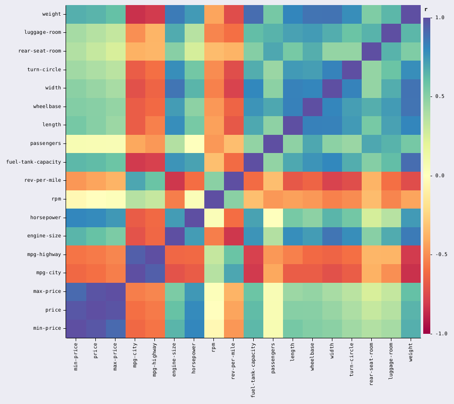
:::


### Fig 6.13 Ordered by clustering

The same matrix, rows and columns in the order of a hierarchical clustering (the clustered heatmap without its
dendrograms).

Source: [Lattice Fig 6.13](http://lmdvr.r-forge.r-project.org/figures/figures.html?chapter=06;figure=06_13;theme=stdColor;code=right). Data: Cars on sale in the USA, 1993, R MASS package `Cars93` (Lock 1993); licence: GPL-2 | GPL-3 (MASS).


::: {.sourceClojure}
```clojure
(plot/render-image
 (plot/clustered-heatmap cars93-correlations {:row :row :col :column :value :r :row-tree false :col-tree false
                                              :scales {:color {:domain [-1 1] :range :spectral-11}}})
 {:width 900 :height 800})
```
:::


::: {.clay-image}
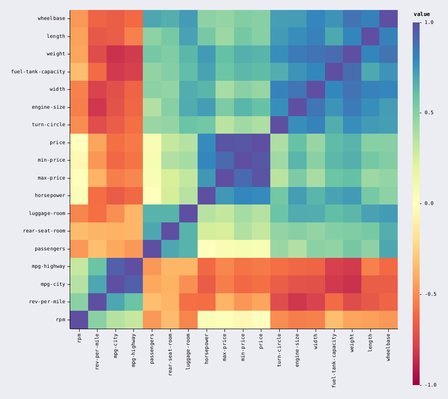
:::


### Fig 6.14 Cell sizes

Chem97 counts of A-level score by GCSE score decile per gender: colour and size by the square root of the
count, the colour bar labelled in counts.

Source: [Lattice Fig 6.14](http://lmdvr.r-forge.r-project.org/figures/figures.html?chapter=06;figure=06_14;theme=stdColor;code=right). Data: A-level chemistry scores, England 1997, R mlmRev package `Chem97` (Yang et al. 2002); licence: GPL (>= 2) (mlmRev).


::: {.sourceClojure}
```clojure
(def chem97-deciles
  "Chem97 counts by A-level score, GCSE score decile and gender, every combination (zeros included)."
  (let [binned (levels/bin chem97 :gcsescore {:as :gcd :bins {:quantiles 10}})
        counts (frequencies (map (juxt :score :gcd :gender) binned))]
    (vec (for [gender ["M" "F"], score (sort (distinct (map :score binned))), gcd (sort (distinct (map :gcd binned)))]
           {:score score :gcd gcd :gender gender :count (get counts [score gcd gender] 0)}))))
```
:::


```{=html}
<div class="data-table"><table class="table table-hover table-responsive clay-table"><thead><tr><th>score</th><th>gcd</th><th>gender</th><th>count</th></tr></thead><tbody><tr><td>0</td><td>[0, 5.13)</td><td>M</td><td>962</td></tr><tr><td>0</td><td>[5.13, 5.57)</td><td>M</td><td>567</td></tr><tr><td>0</td><td>[5.57, 5.88)</td><td>M</td><td>268</td></tr><tr><td>0</td><td>[5.88, 6.13)</td><td>M</td><td>183</td></tr><tr><td>0</td><td>[6.13, 6.38)</td><td>M</td><td>125</td></tr><tr><td>0</td><td>[6.38, 6.6)</td><td>M</td><td>52</td></tr><tr><td>0</td><td>[6.6, 6.8)</td><td>M</td><td>24</td></tr><tr><td>0</td><td>[6.8, 7)</td><td>M</td><td>8</td></tr><tr><td>0</td><td>[7, 7.38)</td><td>M</td><td>7</td></tr><tr><td>0</td><td>[7.38, 8]</td><td>M</td><td>2</td></tr><tr><td>2</td><td>[0, 5.13)</td><td>M</td><td>509</td></tr><tr><td>2</td><td>[5.13, 5.57)</td><td>M</td><td>481</td></tr><tr><td>2</td><td>[5.57, 5.88)</td><td>M</td><td>315</td></tr><tr><td>2</td><td>[5.88, 6.13)</td><td>M</td><td>320</td></tr><tr><td>2</td><td>[6.13, 6.38)</td><td>M</td><td>186</td></tr><tr><td>2</td><td>[6.38, 6.6)</td><td>M</td><td>115</td></tr><tr><td>2</td><td>[6.6, 6.8)</td><td>M</td><td>53</td></tr><tr><td>2</td><td>[6.8, 7)</td><td>M</td><td>23</td></tr><tr><td>2</td><td>[7, 7.38)</td><td>M</td><td>24</td></tr><tr><td>2</td><td>[7.38, 8]</td><td>M</td><td>1</td></tr><tr><td>4</td><td>[0, 5.13)</td><td>M</td><td>403</td></tr><tr><td>4</td><td>[5.13, 5.57)</td><td>M</td><td>465</td></tr><tr><td>4</td><td>[5.57, 5.88)</td><td>M</td><td>395</td></tr><tr><td>4</td><td>[5.88, 6.13)</td><td>M</td><td>447</td></tr><tr><td>4</td><td>[6.13, 6.38)</td><td>M</td><td>296</td></tr><tr><td>4</td><td>[6.38, 6.6)</td><td>M</td><td>254</td></tr><tr><td>4</td><td>[6.6, 6.8)</td><td>M</td><td>156</td></tr><tr><td>4</td><td>[6.8, 7)</td><td>M</td><td>61</td></tr><tr><td>4</td><td>[7, 7.38)</td><td>M</td><td>70</td></tr><tr><td>4</td><td>[7.38, 8]</td><td>M</td><td>8</td></tr><tr><td>6</td><td>[0, 5.13)</td><td>M</td><td>243</td></tr><tr><td>6</td><td>[5.13, 5.57)</td><td>M</td><td>368</td></tr><tr><td>6</td><td>[5.57, 5.88)</td><td>M</td><td>381</td></tr><tr><td>6</td><td>[5.88, 6.13)</td><td>M</td><td>492</td></tr><tr><td>6</td><td>[6.13, 6.38)</td><td>M</td><td>491</td></tr><tr><td>6</td><td>[6.38, 6.6)</td><td>M</td><td>418</td></tr><tr><td>6</td><td>[6.6, 6.8)</td><td>M</td><td>303</td></tr><tr><td>6</td><td>[6.8, 7)</td><td>M</td><td>160</td></tr><tr><td>6</td><td>[7, 7.38)</td><td>M</td><td>207</td></tr><tr><td>6</td><td>[7.38, 8]</td><td>M</td><td>40</td></tr><tr><td>8</td><td>[0, 5.13)</td><td>M</td><td>105</td></tr><tr><td>8</td><td>[5.13, 5.57)</td><td>M</td><td>202</td></tr><tr><td>8</td><td>[5.57, 5.88)</td><td>M</td><td>245</td></tr><tr><td>8</td><td>[5.88, 6.13)</td><td>M</td><td>398</td></tr><tr><td>8</td><td>[6.13, 6.38)</td><td>M</td><td>456</td></tr><tr><td>8</td><td>[6.38, 6.6)</td><td>M</td><td>501</td></tr><tr><td>8</td><td>[6.6, 6.8)</td><td>M</td><td>523</td></tr><tr><td>8</td><td>[6.8, 7)</td><td>M</td><td>354</td></tr><tr><td>8</td><td>[7, 7.38)</td><td>M</td><td>652</td></tr><tr><td>8</td><td>[7.38, 8]</td><td>M</td><td>198</td></tr><tr><td>10</td><td>[0, 5.13)</td><td>M</td><td>21</td></tr><tr><td>10</td><td>[5.13, 5.57)</td><td>M</td><td>30</td></tr><tr><td>10</td><td>[5.57, 5.88)</td><td>M</td><td>71</td></tr><tr><td>10</td><td>[5.88, 6.13)</td><td>M</td><td>139</td></tr><tr><td>10</td><td>[6.13, 6.38)</td><td>M</td><td>190</td></tr><tr><td>10</td><td>[6.38, 6.6)</td><td>M</td><td>283</td></tr><tr><td>10</td><td>[6.6, 6.8)</td><td>M</td><td>422</td></tr><tr><td>10</td><td>[6.8, 7)</td><td>M</td><td>353</td></tr><tr><td>10</td><td>[7, 7.38)</td><td>M</td><td>1126</td></tr><tr><td>10</td><td>[7.38, 8]</td><td>M</td><td>1110</td></tr><tr><td>0</td><td>[0, 5.13)</td><td>F</td><td>398</td></tr><tr><td>0</td><td>[5.13, 5.57)</td><td>F</td><td>329</td></tr><tr><td>0</td><td>[5.57, 5.88)</td><td>F</td><td>225</td></tr><tr><td>0</td><td>[5.88, 6.13)</td><td>F</td><td>202</td></tr><tr><td>0</td><td>[6.13, 6.38)</td><td>F</td><td>151</td></tr><tr><td>0</td><td>[6.38, 6.6)</td><td>F</td><td>97</td></tr><tr><td>0</td><td>[6.6, 6.8)</td><td>F</td><td>49</td></tr><tr><td>0</td><td>[6.8, 7)</td><td>F</td><td>13</td></tr><tr><td>0</td><td>[7, 7.38)</td><td>F</td><td>22</td></tr><tr><td>0</td><td>[7.38, 8]</td><td>F</td><td>4</td></tr><tr><td>2</td><td>[0, 5.13)</td><td>F</td><td>181</td></tr><tr><td>2</td><td>[5.13, 5.57)</td><td>F</td><td>283</td></tr><tr><td>2</td><td>[5.57, 5.88)</td><td>F</td><td>241</td></tr><tr><td>2</td><td>[5.88, 6.13)</td><td>F</td><td>298</td></tr><tr><td>2</td><td>[6.13, 6.38)</td><td>F</td><td>221</td></tr><tr><td>2</td><td>[6.38, 6.6)</td><td>F</td><td>156</td></tr><tr><td>2</td><td>[6.6, 6.8)</td><td>F</td><td>124</td></tr><tr><td>2</td><td>[6.8, 7)</td><td>F</td><td>37</td></tr><tr><td>2</td><td>[7, 7.38)</td><td>F</td><td>54</td></tr><tr><td>2</td><td>[7.38, 8]</td><td>F</td><td>5</td></tr><tr><td>4</td><td>[0, 5.13)</td><td>F</td><td>103</td></tr><tr><td>4</td><td>[5.13, 5.57)</td><td>F</td><td>211</td></tr><tr><td>4</td><td>[5.57, 5.88)</td><td>F</td><td>231</td></tr><tr><td>4</td><td>[5.88, 6.13)</td><td>F</td><td>380</td></tr><tr><td>4</td><td>[6.13, 6.38)</td><td>F</td><td>333</td></tr><tr><td>4</td><td>[6.38, 6.6)</td><td>F</td><td>281</td></tr><tr><td>4</td><td>[6.6, 6.8)</td><td>F</td><td>238</td></tr><tr><td>4</td><td>[6.8, 7)</td><td>F</td><td>107</td></tr><tr><td>4</td><td>[7, 7.38)</td><td>F</td><td>150</td></tr><tr><td>4</td><td>[7.38, 8]</td><td>F</td><td>30</td></tr><tr><td>6</td><td>[0, 5.13)</td><td>F</td><td>62</td></tr><tr><td>6</td><td>[5.13, 5.57)</td><td>F</td><td>147</td></tr><tr><td>6</td><td>[5.57, 5.88)</td><td>F</td><td>177</td></tr><tr><td>6</td><td>[5.88, 6.13)</td><td>F</td><td>329</td></tr><tr><td>6</td><td>[6.13, 6.38)</td><td>F</td><td>411</td></tr><tr><td>6</td><td>[6.38, 6.6)</td><td>F</td><td>438</td></tr><tr><td>6</td><td>[6.6, 6.8)</td><td>F</td><td>410</td></tr><tr><td>6</td><td>[6.8, 7)</td><td>F</td><td>191</td></tr><tr><td>6</td><td>[7, 7.38)</td><td>F</td><td>382</td></tr><tr><td>6</td><td>[7.38, 8]</td><td>F</td><td>89</td></tr><tr><td>…</td><td>…</td><td>…</td><td>…</td></tr></tbody></table></div>
```


::: {.sourceClojure}
```clojure
(plot/render-image
 {:data (map #(assoc % :root (m/sqrt (:count %))) chem97-deciles)
  :mapping {:x (levels/categorical :score) :y :gcd :color :root :size :root :facet :gender}
  :scales {:size {:range [7 10] :legend false}
           :facet {:domain ["M" "F"]}
           :color {:formatter #(str (m/round (* (double %) (double %)))) :title "count"}}
  :charts [(chart/tile)]
  :facets {:columns 2}
  :labels {:x "score" :y "gcd"}}
 {:width 900 :height 500})
```
:::


::: {.clay-image}
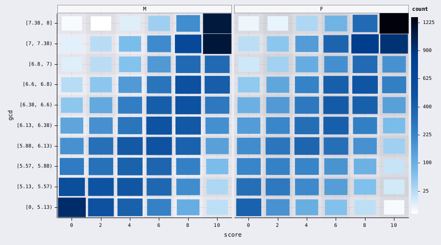
:::


### Fig 6.15 Bars in three dimensions

Source: [Lattice Fig 6.15](http://lmdvr.r-forge.r-project.org/figures/figures.html?chapter=06;figure=06_15;theme=stdColor;code=right). Data: A-level chemistry scores, England 1997, R mlmRev package `Chem97` (Yang et al. 2002); licence: GPL (>= 2) (mlmRev).


::: {.sourceClojure}
```clojure
(plot/render-image
 {:data chem97-deciles
  :mapping {:x (levels/categorical :score) :y :gcd :z :count :facet :gender}
  :scales {:facet {:domain ["M" "F"]}}
  :charts [(chart/cloud {:type :bars :base 0 :color [180 180 180] :stroke-color [60 60 60] :stroke-width 1
                         :view {:azimuth 40 :elevation 65 :distance 0.2} :aspect [1 1.5 0.75] :axis-titles {:x "score" :y "gcd" :z "Freq"}})]
  :facets {:columns 2}}
 {:width 1000 :height 550})
```
:::


::: {.clay-image}
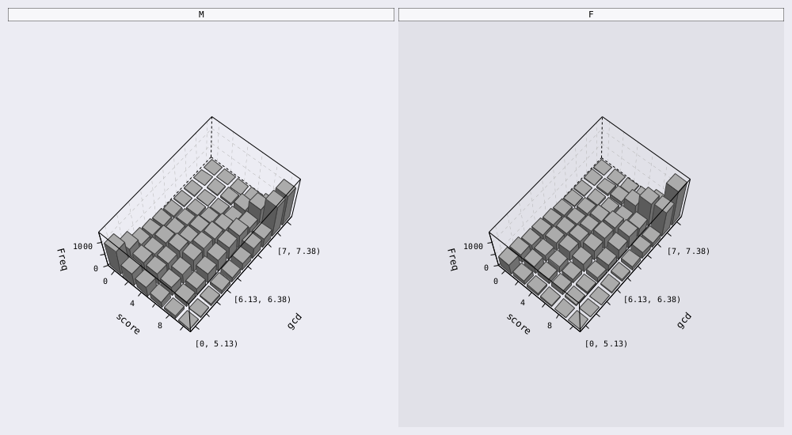
:::


Not reproduced: Figs 6.16 and 6.17 (copula densities - not in fastmath).


### Fig 6.18 A parametric surface

A twisted band: x, y, z functions of angles u and v (the book's `kx`, `ky`, `kz` with r = 2, t = 1), shaded,
translucent. Seen from the side opposite the book's view (its z = 170, azimuth -170), so x and y grow left to
right without mirroring the band (`:reverse #{:x}` at the book's view would mirror it).

Source: [Lattice Fig 6.18](http://lmdvr.r-forge.r-project.org/figures/figures.html?chapter=06;figure=06_18;theme=stdColor;code=right).


::: {.sourceClojure}
```clojure
(plot/render-image
 {:charts [(chart/surface {:fu (fn [[u v]]
                                 (let [band (+ 2.0 (* (m/cos (/ u 2.0)) (m/sin v)) (- (* (m/sin (/ u 2.0)) (m/sin (* 2.0 v)))))]
                                   [(* (m/cos u) band) (* (m/sin u) band)
                                    (+ (* (m/sin (/ u 2.0)) (m/sin v)) (* (m/cos (/ u 2.0)) (m/sin v)))]))
                           :u [(* 0.3 m/TWO_PI) (* 1.25 m/TWO_PI)] :v [0.0 m/TWO_PI] :n 50
                           :aspect [1 1 0.4] :view {:azimuth 10 :elevation 30 :distance 0.2}
                           :axis-titles {:x "kx(um, vm)" :y "ky(um, vm)" :z "kz(um, vm)"}})]
  :scales {:color {:range [[60 80 200 190] [80 200 200 190] [240 230 120 190] [220 80 160 190]]}}}
 {:width 800 :height 600})
```
:::


::: {.clay-image}
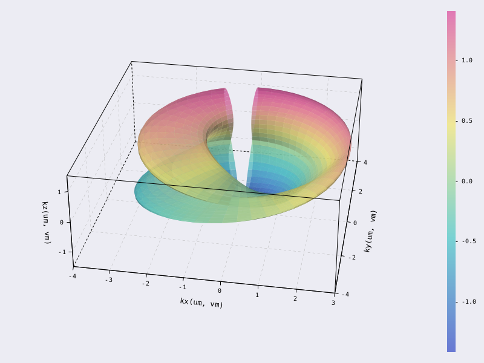
:::


### Fig 6.19 A level plot of population

US population by age and year, 1900 - 1979, per sex, on a spectral palette.

Source: [Lattice Fig 6.19](http://lmdvr.r-forge.r-project.org/figures/figures.html?chapter=06;figure=06_19;theme=stdColor;code=right). Data: US population by age and sex, 1900-1979, R latticeExtra package `USAge.df` (US Census Bureau); licence: GPL (>= 2) (latticeExtra).


::: {.sourceClojure}
```clojure
(plot/render-image
 {:data (nu/dataset :us-age)
  :mapping {:x :year :y :age :color :population :facet :sex}
  :scales {:color {:range :spectral-11} :facet {:domain (nu/levels :us-age :sex)}}
  :charts [(chart/tile)]
  :facets {:columns 2}
  :aspect :iso
  :labels {:x "Year" :y "Age"}}
 {:width 900 :height 500})
```
:::


::: {.clay-image}
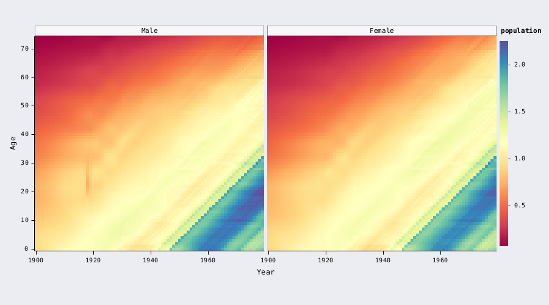
:::


## Chapter 7 - Graphical Parameters and Other Settings


### Fig 7.1 Ordered groups with stems

Virginia death rates, a panel per age group; the population groups ordered by their mean rate.

Source: [Lattice Fig 7.1](http://lmdvr.r-forge.r-project.org/figures/figures.html?chapter=07;figure=07_01;theme=stdColor;code=right). Data: Death rates in Virginia (1940), R datasets package `VADeaths` (Molyneaux et al. 1947); licence: Part of R (GPL-2 | GPL-3).


::: {.sourceClojure}
```clojure
(def va-plot
  {:data va-deaths
   :mapping {:x :rate :y :group :facet :age}
   :scales {:y {:order-by #(stats/mean (map :rate %))}}
   :facets {:columns 5}
   :labels {:title "Death Rates in Virginia - 1940" :x "Number of deaths per 100" :y nil}})
```
:::


::: {.sourceClojure}
```clojure
(plot/render-image
 (assoc va-plot :charts [(chart/segment {:xend 0}) (chart/scatter)])
 {:width 1000 :height 350})
```
:::


::: {.clay-image}
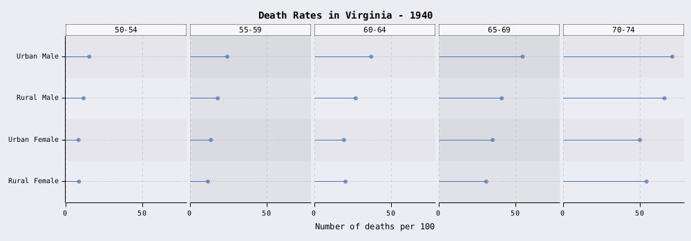
:::


### Fig 7.2 Changed settings

The book changes lattice's settings: no dotted guide lines, stems twice as wide. Here the same as plot options -
no grid, `:width 2`.

Source: [Lattice Fig 7.2](http://lmdvr.r-forge.r-project.org/figures/figures.html?chapter=07;figure=07_02;theme=stdColor;code=right). Data: Death rates in Virginia (1940), R datasets package `VADeaths` (Molyneaux et al. 1947); licence: Part of R (GPL-2 | GPL-3).


::: {.sourceClojure}
```clojure
(plot/render-image
 (assoc va-plot
        :charts [(chart/segment {:xend 0 :line-width 2}) (chart/scatter)]
        :theme {:panel {:grid {:x :none :y :none}}})
 {:width 1000 :height 350})
```
:::


::: {.clay-image}
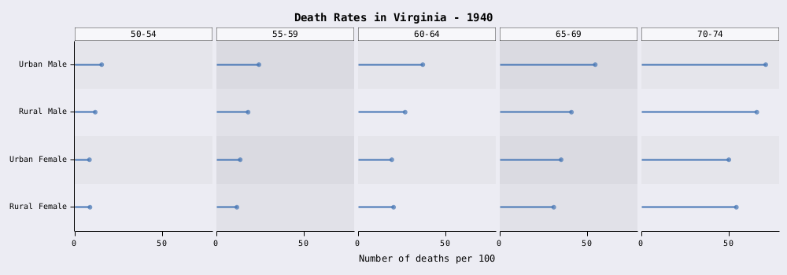
:::


### Fig 7.3 Settings and their parameters

Which graphical parameters (columns) each lattice setting (rows) has: parameters by how many settings use them,
settings by how many parameters they have.

Source: [Lattice Fig 7.3](http://lmdvr.r-forge.r-project.org/figures/figures.html?chapter=07;figure=07_03;theme=stdColor;code=right). Data: lattice graphical settings and their parameters, R lattice package `trellis.par.get()` (Sarkar 2008, Fig 7.3); licence: GPL (>= 2) (lattice).


```{=html}
<div class="data-table"><table class="table table-hover table-responsive clay-table"><thead><tr><th>setting</th><th>parameter</th></tr></thead><tbody><tr><td>background</td><td>alpha</td></tr><tr><td>background</td><td>col</td></tr><tr><td>panel.background</td><td>col</td></tr><tr><td>add.line</td><td>alpha</td></tr><tr><td>add.line</td><td>col</td></tr><tr><td>add.line</td><td>lty</td></tr><tr><td>add.line</td><td>lwd</td></tr><tr><td>add.text</td><td>alpha</td></tr><tr><td>add.text</td><td>cex</td></tr><tr><td>add.text</td><td>col</td></tr><tr><td>add.text</td><td>font</td></tr><tr><td>add.text</td><td>lineheight</td></tr><tr><td>plot.polygon</td><td>alpha</td></tr><tr><td>plot.polygon</td><td>col</td></tr><tr><td>plot.polygon</td><td>border</td></tr><tr><td>plot.polygon</td><td>lty</td></tr><tr><td>plot.polygon</td><td>lwd</td></tr><tr><td>box.dot</td><td>alpha</td></tr><tr><td>box.dot</td><td>col</td></tr><tr><td>box.dot</td><td>cex</td></tr><tr><td>box.dot</td><td>font</td></tr><tr><td>box.dot</td><td>pch</td></tr><tr><td>box.rectangle</td><td>alpha</td></tr><tr><td>box.rectangle</td><td>col</td></tr><tr><td>box.rectangle</td><td>fill</td></tr><tr><td>box.rectangle</td><td>lty</td></tr><tr><td>box.rectangle</td><td>lwd</td></tr><tr><td>box.umbrella</td><td>alpha</td></tr><tr><td>box.umbrella</td><td>col</td></tr><tr><td>box.umbrella</td><td>lty</td></tr><tr><td>box.umbrella</td><td>lwd</td></tr><tr><td>dot.line</td><td>alpha</td></tr><tr><td>dot.line</td><td>col</td></tr><tr><td>dot.line</td><td>lty</td></tr><tr><td>dot.line</td><td>lwd</td></tr><tr><td>dot.symbol</td><td>alpha</td></tr><tr><td>dot.symbol</td><td>cex</td></tr><tr><td>dot.symbol</td><td>col</td></tr><tr><td>dot.symbol</td><td>font</td></tr><tr><td>dot.symbol</td><td>pch</td></tr><tr><td>plot.line</td><td>alpha</td></tr><tr><td>plot.line</td><td>col</td></tr><tr><td>plot.line</td><td>lty</td></tr><tr><td>plot.line</td><td>lwd</td></tr><tr><td>plot.symbol</td><td>alpha</td></tr><tr><td>plot.symbol</td><td>cex</td></tr><tr><td>plot.symbol</td><td>col</td></tr><tr><td>plot.symbol</td><td>font</td></tr><tr><td>plot.symbol</td><td>pch</td></tr><tr><td>plot.symbol</td><td>fill</td></tr><tr><td>reference.line</td><td>alpha</td></tr><tr><td>reference.line</td><td>col</td></tr><tr><td>reference.line</td><td>lty</td></tr><tr><td>reference.line</td><td>lwd</td></tr><tr><td>strip.background</td><td>alpha</td></tr><tr><td>strip.background</td><td>col</td></tr><tr><td>strip.shingle</td><td>alpha</td></tr><tr><td>strip.shingle</td><td>col</td></tr><tr><td>strip.border</td><td>alpha</td></tr><tr><td>strip.border</td><td>col</td></tr><tr><td>strip.border</td><td>lty</td></tr><tr><td>strip.border</td><td>lwd</td></tr><tr><td>superpose.line</td><td>alpha</td></tr><tr><td>superpose.line</td><td>col</td></tr><tr><td>superpose.line</td><td>lty</td></tr><tr><td>superpose.line</td><td>lwd</td></tr><tr><td>superpose.symbol</td><td>alpha</td></tr><tr><td>superpose.symbol</td><td>cex</td></tr><tr><td>superpose.symbol</td><td>col</td></tr><tr><td>superpose.symbol</td><td>fill</td></tr><tr><td>superpose.symbol</td><td>font</td></tr><tr><td>superpose.symbol</td><td>pch</td></tr><tr><td>superpose.polygon</td><td>alpha</td></tr><tr><td>superpose.polygon</td><td>col</td></tr><tr><td>superpose.polygon</td><td>border</td></tr><tr><td>superpose.polygon</td><td>lty</td></tr><tr><td>superpose.polygon</td><td>lwd</td></tr><tr><td>regions</td><td>alpha</td></tr><tr><td>regions</td><td>col</td></tr><tr><td>shade.colors</td><td>alpha</td></tr><tr><td>shade.colors</td><td>palette</td></tr><tr><td>axis.line</td><td>alpha</td></tr><tr><td>axis.line</td><td>col</td></tr><tr><td>axis.line</td><td>lty</td></tr><tr><td>axis.line</td><td>lwd</td></tr><tr><td>axis.text</td><td>alpha</td></tr><tr><td>axis.text</td><td>cex</td></tr><tr><td>axis.text</td><td>col</td></tr><tr><td>axis.text</td><td>font</td></tr><tr><td>axis.text</td><td>lineheight</td></tr><tr><td>box.3d</td><td>alpha</td></tr><tr><td>box.3d</td><td>col</td></tr><tr><td>box.3d</td><td>lty</td></tr><tr><td>box.3d</td><td>lwd</td></tr><tr><td>par.title.text</td><td>alpha</td></tr><tr><td>par.title.text</td><td>cex</td></tr><tr><td>par.title.text</td><td>col</td></tr><tr><td>par.title.text</td><td>font</td></tr><tr><td>par.title.text</td><td>lineheight</td></tr><tr><td>par.xlab.text</td><td>alpha</td></tr><tr><td>…</td><td>…</td></tr></tbody></table></div>
```


::: {.sourceClojure}
```clojure
(let [settings (nu/dataset :lattice-settings)
      by-count (fn [k descending?] (->> (frequencies (map k settings)) (sort-by (fn [[v n]] [(if descending? (- n) n) v])) (mapv key)))]
  (plot/render-image
   {:data settings
    :mapping {:x :parameter :y :setting}
    :scales {:x {:domain (by-count :parameter true)} :y {:domain (by-count :setting false)}}
    :charts [(chart/scatter {:size 5 :color :black})]
    :theme {:panel {:grid {:x {:color [160 160 160] :line-width 0.5 :dash :none} :y {:color [160 160 160] :line-width 0.5 :dash :none}}}}
    :labels {:x "Graphical parameters" :y "Setting names"}}
   {:width 900 :height 700}))
```
:::


::: {.clay-image}
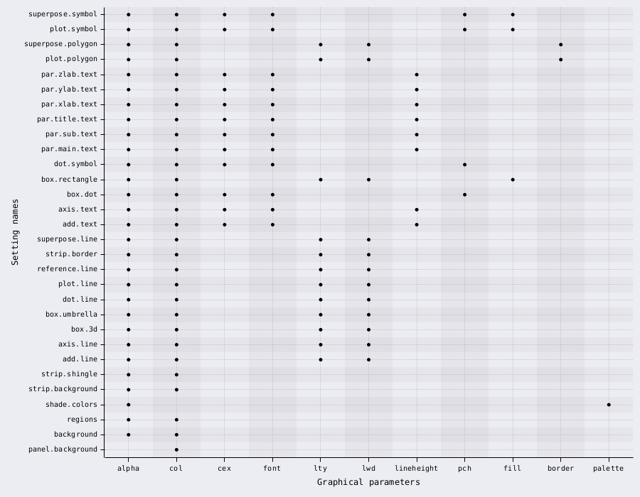
:::


Not reproduced: Fig 7.4 (lattice's own graphical settings).


## Chapter 8 - Plot Coordinates and Axis Annotation


### Fig 8.1 A reversed axis

Depth growing downward (a reversed y domain), jittered by magnitude.

Source: [Lattice Fig 8.1](http://lmdvr.r-forge.r-project.org/figures/figures.html?chapter=08;figure=08_01;theme=stdColor;code=right). Data: Earthquakes off Fiji since 1964, R datasets package `quakes` (Harvard PRIM-H project); licence: Part of R (GPL-2 | GPL-3).


::: {.sourceClojure}
```clojure
(plot/render-image
 {:data quakes
  :mapping {:x (levels/categorical :mag) :y :depth}
  :scales {:y {:domain [700 0]}}
  :charts [(chart/stripplot {:rng (r/rng :mersenne 81)})]
  :labels {:x "Magnitude (Richter scale)" :y "depth"}}
 {:width 900 :height 400})
```
:::


::: {.clay-image}

:::


### Fig 8.2 A long series cut into slices

Hourly accesses of the Bioconductor website in 2007, cut into nine overlapping time slices (a shingle of the
hours: equal counts of hourly rows, so equal lengths), each panel its own date range, no strips. Lattice's
`relation = "sliced"` (equal ranges) needs numbers in cljplot2; the equal-length slices make `:free` the same.

Source: [Lattice Fig 8.2](http://lmdvr.r-forge.r-project.org/figures/figures.html?chapter=08;figure=08_02;theme=stdColor;code=right). Data: Hourly accesses of the Bioconductor website, 2007, R latticeExtra package `biocAccess` (Bioconductor web logs); licence: GPL (>= 2) (latticeExtra).


```{=html}
<div class="data-table"><table class="table table-hover table-responsive clay-table"><thead><tr><th>counts</th><th>day</th><th>month</th><th>year</th><th>hour</th><th>weekday</th><th>time</th></tr></thead><tbody><tr><td>390</td><td>1</td><td>Jan</td><td>2007</td><td>0</td><td>Monday</td><td>2007-01-01T00:00:00</td></tr><tr><td>768</td><td>1</td><td>Jan</td><td>2007</td><td>1</td><td>Monday</td><td>2007-01-01T01:00:00</td></tr><tr><td>528</td><td>1</td><td>Jan</td><td>2007</td><td>2</td><td>Monday</td><td>2007-01-01T02:00:00</td></tr><tr><td>547</td><td>1</td><td>Jan</td><td>2007</td><td>3</td><td>Monday</td><td>2007-01-01T03:00:00</td></tr><tr><td>545</td><td>1</td><td>Jan</td><td>2007</td><td>4</td><td>Monday</td><td>2007-01-01T04:00:00</td></tr><tr><td>460</td><td>1</td><td>Jan</td><td>2007</td><td>5</td><td>Monday</td><td>2007-01-01T05:00:00</td></tr><tr><td>1034</td><td>1</td><td>Jan</td><td>2007</td><td>6</td><td>Monday</td><td>2007-01-01T06:00:00</td></tr><tr><td>1004</td><td>1</td><td>Jan</td><td>2007</td><td>7</td><td>Monday</td><td>2007-01-01T07:00:00</td></tr><tr><td>1263</td><td>1</td><td>Jan</td><td>2007</td><td>8</td><td>Monday</td><td>2007-01-01T08:00:00</td></tr><tr><td>1158</td><td>1</td><td>Jan</td><td>2007</td><td>9</td><td>Monday</td><td>2007-01-01T09:00:00</td></tr><tr><td>1586</td><td>1</td><td>Jan</td><td>2007</td><td>10</td><td>Monday</td><td>2007-01-01T10:00:00</td></tr><tr><td>1576</td><td>1</td><td>Jan</td><td>2007</td><td>11</td><td>Monday</td><td>2007-01-01T11:00:00</td></tr><tr><td>1645</td><td>1</td><td>Jan</td><td>2007</td><td>12</td><td>Monday</td><td>2007-01-01T12:00:00</td></tr><tr><td>892</td><td>1</td><td>Jan</td><td>2007</td><td>13</td><td>Monday</td><td>2007-01-01T13:00:00</td></tr><tr><td>1275</td><td>1</td><td>Jan</td><td>2007</td><td>14</td><td>Monday</td><td>2007-01-01T14:00:00</td></tr><tr><td>1248</td><td>1</td><td>Jan</td><td>2007</td><td>15</td><td>Monday</td><td>2007-01-01T15:00:00</td></tr><tr><td>867</td><td>1</td><td>Jan</td><td>2007</td><td>16</td><td>Monday</td><td>2007-01-01T16:00:00</td></tr><tr><td>891</td><td>1</td><td>Jan</td><td>2007</td><td>17</td><td>Monday</td><td>2007-01-01T17:00:00</td></tr><tr><td>1019</td><td>1</td><td>Jan</td><td>2007</td><td>18</td><td>Monday</td><td>2007-01-01T18:00:00</td></tr><tr><td>5927</td><td>1</td><td>Jan</td><td>2007</td><td>19</td><td>Monday</td><td>2007-01-01T19:00:00</td></tr><tr><td>7431</td><td>1</td><td>Jan</td><td>2007</td><td>20</td><td>Monday</td><td>2007-01-01T20:00:00</td></tr><tr><td>7171</td><td>1</td><td>Jan</td><td>2007</td><td>21</td><td>Monday</td><td>2007-01-01T21:00:00</td></tr><tr><td>9113</td><td>1</td><td>Jan</td><td>2007</td><td>22</td><td>Monday</td><td>2007-01-01T22:00:00</td></tr><tr><td>1415</td><td>1</td><td>Jan</td><td>2007</td><td>23</td><td>Monday</td><td>2007-01-01T23:00:00</td></tr><tr><td>938</td><td>2</td><td>Jan</td><td>2007</td><td>0</td><td>Tuesday</td><td>2007-01-02T00:00:00</td></tr><tr><td>1513</td><td>2</td><td>Jan</td><td>2007</td><td>1</td><td>Tuesday</td><td>2007-01-02T01:00:00</td></tr><tr><td>1217</td><td>2</td><td>Jan</td><td>2007</td><td>2</td><td>Tuesday</td><td>2007-01-02T02:00:00</td></tr><tr><td>1539</td><td>2</td><td>Jan</td><td>2007</td><td>3</td><td>Tuesday</td><td>2007-01-02T03:00:00</td></tr><tr><td>1196</td><td>2</td><td>Jan</td><td>2007</td><td>4</td><td>Tuesday</td><td>2007-01-02T04:00:00</td></tr><tr><td>2145</td><td>2</td><td>Jan</td><td>2007</td><td>5</td><td>Tuesday</td><td>2007-01-02T05:00:00</td></tr><tr><td>1805</td><td>2</td><td>Jan</td><td>2007</td><td>6</td><td>Tuesday</td><td>2007-01-02T06:00:00</td></tr><tr><td>2225</td><td>2</td><td>Jan</td><td>2007</td><td>7</td><td>Tuesday</td><td>2007-01-02T07:00:00</td></tr><tr><td>1830</td><td>2</td><td>Jan</td><td>2007</td><td>8</td><td>Tuesday</td><td>2007-01-02T08:00:00</td></tr><tr><td>2099</td><td>2</td><td>Jan</td><td>2007</td><td>9</td><td>Tuesday</td><td>2007-01-02T09:00:00</td></tr><tr><td>1753</td><td>2</td><td>Jan</td><td>2007</td><td>10</td><td>Tuesday</td><td>2007-01-02T10:00:00</td></tr><tr><td>2440</td><td>2</td><td>Jan</td><td>2007</td><td>11</td><td>Tuesday</td><td>2007-01-02T11:00:00</td></tr><tr><td>1624</td><td>2</td><td>Jan</td><td>2007</td><td>12</td><td>Tuesday</td><td>2007-01-02T12:00:00</td></tr><tr><td>1610</td><td>2</td><td>Jan</td><td>2007</td><td>13</td><td>Tuesday</td><td>2007-01-02T13:00:00</td></tr><tr><td>1164</td><td>2</td><td>Jan</td><td>2007</td><td>14</td><td>Tuesday</td><td>2007-01-02T14:00:00</td></tr><tr><td>1579</td><td>2</td><td>Jan</td><td>2007</td><td>15</td><td>Tuesday</td><td>2007-01-02T15:00:00</td></tr><tr><td>1498</td><td>2</td><td>Jan</td><td>2007</td><td>16</td><td>Tuesday</td><td>2007-01-02T16:00:00</td></tr><tr><td>1081</td><td>2</td><td>Jan</td><td>2007</td><td>17</td><td>Tuesday</td><td>2007-01-02T17:00:00</td></tr><tr><td>2420</td><td>2</td><td>Jan</td><td>2007</td><td>18</td><td>Tuesday</td><td>2007-01-02T18:00:00</td></tr><tr><td>2628</td><td>2</td><td>Jan</td><td>2007</td><td>19</td><td>Tuesday</td><td>2007-01-02T19:00:00</td></tr><tr><td>2061</td><td>2</td><td>Jan</td><td>2007</td><td>20</td><td>Tuesday</td><td>2007-01-02T20:00:00</td></tr><tr><td>1457</td><td>2</td><td>Jan</td><td>2007</td><td>21</td><td>Tuesday</td><td>2007-01-02T21:00:00</td></tr><tr><td>1182</td><td>2</td><td>Jan</td><td>2007</td><td>22</td><td>Tuesday</td><td>2007-01-02T22:00:00</td></tr><tr><td>3169</td><td>2</td><td>Jan</td><td>2007</td><td>23</td><td>Tuesday</td><td>2007-01-02T23:00:00</td></tr><tr><td>3351</td><td>3</td><td>Jan</td><td>2007</td><td>0</td><td>Wednesday</td><td>2007-01-03T00:00:00</td></tr><tr><td>5469</td><td>3</td><td>Jan</td><td>2007</td><td>1</td><td>Wednesday</td><td>2007-01-03T01:00:00</td></tr><tr><td>5451</td><td>3</td><td>Jan</td><td>2007</td><td>2</td><td>Wednesday</td><td>2007-01-03T02:00:00</td></tr><tr><td>2406</td><td>3</td><td>Jan</td><td>2007</td><td>3</td><td>Wednesday</td><td>2007-01-03T03:00:00</td></tr><tr><td>1587</td><td>3</td><td>Jan</td><td>2007</td><td>4</td><td>Wednesday</td><td>2007-01-03T04:00:00</td></tr><tr><td>5595</td><td>3</td><td>Jan</td><td>2007</td><td>5</td><td>Wednesday</td><td>2007-01-03T05:00:00</td></tr><tr><td>2914</td><td>3</td><td>Jan</td><td>2007</td><td>6</td><td>Wednesday</td><td>2007-01-03T06:00:00</td></tr><tr><td>2509</td><td>3</td><td>Jan</td><td>2007</td><td>7</td><td>Wednesday</td><td>2007-01-03T07:00:00</td></tr><tr><td>3103</td><td>3</td><td>Jan</td><td>2007</td><td>8</td><td>Wednesday</td><td>2007-01-03T08:00:00</td></tr><tr><td>2750</td><td>3</td><td>Jan</td><td>2007</td><td>9</td><td>Wednesday</td><td>2007-01-03T09:00:00</td></tr><tr><td>1885</td><td>3</td><td>Jan</td><td>2007</td><td>10</td><td>Wednesday</td><td>2007-01-03T10:00:00</td></tr><tr><td>2603</td><td>3</td><td>Jan</td><td>2007</td><td>11</td><td>Wednesday</td><td>2007-01-03T11:00:00</td></tr><tr><td>2730</td><td>3</td><td>Jan</td><td>2007</td><td>12</td><td>Wednesday</td><td>2007-01-03T12:00:00</td></tr><tr><td>2091</td><td>3</td><td>Jan</td><td>2007</td><td>13</td><td>Wednesday</td><td>2007-01-03T13:00:00</td></tr><tr><td>1923</td><td>3</td><td>Jan</td><td>2007</td><td>14</td><td>Wednesday</td><td>2007-01-03T14:00:00</td></tr><tr><td>1331</td><td>3</td><td>Jan</td><td>2007</td><td>15</td><td>Wednesday</td><td>2007-01-03T15:00:00</td></tr><tr><td>1352</td><td>3</td><td>Jan</td><td>2007</td><td>16</td><td>Wednesday</td><td>2007-01-03T16:00:00</td></tr><tr><td>864</td><td>3</td><td>Jan</td><td>2007</td><td>17</td><td>Wednesday</td><td>2007-01-03T17:00:00</td></tr><tr><td>1614</td><td>3</td><td>Jan</td><td>2007</td><td>18</td><td>Wednesday</td><td>2007-01-03T18:00:00</td></tr><tr><td>8364</td><td>3</td><td>Jan</td><td>2007</td><td>19</td><td>Wednesday</td><td>2007-01-03T19:00:00</td></tr><tr><td>8105</td><td>3</td><td>Jan</td><td>2007</td><td>20</td><td>Wednesday</td><td>2007-01-03T20:00:00</td></tr><tr><td>7576</td><td>3</td><td>Jan</td><td>2007</td><td>21</td><td>Wednesday</td><td>2007-01-03T21:00:00</td></tr><tr><td>7808</td><td>3</td><td>Jan</td><td>2007</td><td>22</td><td>Wednesday</td><td>2007-01-03T22:00:00</td></tr><tr><td>1923</td><td>3</td><td>Jan</td><td>2007</td><td>23</td><td>Wednesday</td><td>2007-01-03T23:00:00</td></tr><tr><td>1363</td><td>4</td><td>Jan</td><td>2007</td><td>0</td><td>Thursday</td><td>2007-01-04T00:00:00</td></tr><tr><td>2901</td><td>4</td><td>Jan</td><td>2007</td><td>1</td><td>Thursday</td><td>2007-01-04T01:00:00</td></tr><tr><td>1740</td><td>4</td><td>Jan</td><td>2007</td><td>2</td><td>Thursday</td><td>2007-01-04T02:00:00</td></tr><tr><td>1823</td><td>4</td><td>Jan</td><td>2007</td><td>3</td><td>Thursday</td><td>2007-01-04T03:00:00</td></tr><tr><td>2542</td><td>4</td><td>Jan</td><td>2007</td><td>4</td><td>Thursday</td><td>2007-01-04T04:00:00</td></tr><tr><td>2683</td><td>4</td><td>Jan</td><td>2007</td><td>5</td><td>Thursday</td><td>2007-01-04T05:00:00</td></tr><tr><td>2449</td><td>4</td><td>Jan</td><td>2007</td><td>6</td><td>Thursday</td><td>2007-01-04T06:00:00</td></tr><tr><td>3346</td><td>4</td><td>Jan</td><td>2007</td><td>7</td><td>Thursday</td><td>2007-01-04T07:00:00</td></tr><tr><td>2266</td><td>4</td><td>Jan</td><td>2007</td><td>8</td><td>Thursday</td><td>2007-01-04T08:00:00</td></tr><tr><td>3344</td><td>4</td><td>Jan</td><td>2007</td><td>9</td><td>Thursday</td><td>2007-01-04T09:00:00</td></tr><tr><td>1656</td><td>4</td><td>Jan</td><td>2007</td><td>10</td><td>Thursday</td><td>2007-01-04T10:00:00</td></tr><tr><td>2123</td><td>4</td><td>Jan</td><td>2007</td><td>11</td><td>Thursday</td><td>2007-01-04T11:00:00</td></tr><tr><td>2167</td><td>4</td><td>Jan</td><td>2007</td><td>12</td><td>Thursday</td><td>2007-01-04T12:00:00</td></tr><tr><td>1939</td><td>4</td><td>Jan</td><td>2007</td><td>13</td><td>Thursday</td><td>2007-01-04T13:00:00</td></tr><tr><td>2082</td><td>4</td><td>Jan</td><td>2007</td><td>14</td><td>Thursday</td><td>2007-01-04T14:00:00</td></tr><tr><td>1382</td><td>4</td><td>Jan</td><td>2007</td><td>15</td><td>Thursday</td><td>2007-01-04T15:00:00</td></tr><tr><td>1178</td><td>4</td><td>Jan</td><td>2007</td><td>16</td><td>Thursday</td><td>2007-01-04T16:00:00</td></tr><tr><td>3537</td><td>4</td><td>Jan</td><td>2007</td><td>17</td><td>Thursday</td><td>2007-01-04T17:00:00</td></tr><tr><td>1877</td><td>4</td><td>Jan</td><td>2007</td><td>18</td><td>Thursday</td><td>2007-01-04T18:00:00</td></tr><tr><td>6341</td><td>4</td><td>Jan</td><td>2007</td><td>19</td><td>Thursday</td><td>2007-01-04T19:00:00</td></tr><tr><td>8413</td><td>4</td><td>Jan</td><td>2007</td><td>20</td><td>Thursday</td><td>2007-01-04T20:00:00</td></tr><tr><td>7691</td><td>4</td><td>Jan</td><td>2007</td><td>21</td><td>Thursday</td><td>2007-01-04T21:00:00</td></tr><tr><td>8280</td><td>4</td><td>Jan</td><td>2007</td><td>22</td><td>Thursday</td><td>2007-01-04T22:00:00</td></tr><tr><td>7384</td><td>4</td><td>Jan</td><td>2007</td><td>23</td><td>Thursday</td><td>2007-01-04T23:00:00</td></tr><tr><td>1469</td><td>5</td><td>Jan</td><td>2007</td><td>0</td><td>Friday</td><td>2007-01-05T00:00:00</td></tr><tr><td>1470</td><td>5</td><td>Jan</td><td>2007</td><td>1</td><td>Friday</td><td>2007-01-05T01:00:00</td></tr><tr><td>2209</td><td>5</td><td>Jan</td><td>2007</td><td>2</td><td>Friday</td><td>2007-01-05T02:00:00</td></tr><tr><td>1995</td><td>5</td><td>Jan</td><td>2007</td><td>3</td><td>Friday</td><td>2007-01-05T03:00:00</td></tr><tr><td>…</td><td>…</td><td>…</td><td>…</td><td>…</td><td>…</td><td>…</td></tr></tbody></table></div>
```


::: {.sourceClojure}
```clojure
(plot/render-image
 {:data (shingle/shingle (map-indexed (fn [i row] (assoc row :hour-index i :thousands (/ (:counts row) 1000.0)
                                                         :date (java.time.LocalDateTime/parse (:time row))))
                                      (nu/dataset :bioc-access))
                         :hour-index {:n 9 :overlap 0.1 :as :slice})
  :mapping {:x :date :y :thousands :facet :slice}
  :scales {:x {:nice false :formatter "MMM dd"}}
  :charts [(chart/line {:line-width 0.6 :padding {:x [0 0] :y [0.05 0.05]}})]
  :facets {:columns 1 :strips false :scales {:x :free}}
  :labels {:x nil :y "Number of accesses (thousands)"}}
 {:width 900 :height 800})
```
:::


::: {.clay-image}

:::


### Fig 8.3 Logarithmic axes, banked

Source: [Lattice Fig 8.3](http://lmdvr.r-forge.r-project.org/figures/figures.html?chapter=08;figure=08_03;theme=stdColor;code=right). Data: Western US earthquakes: ground acceleration, R MEMSS package `Earthquake` (Joyner & Boore 1981); licence: GPL (>= 2) (MEMSS).


::: {.sourceClojure}
```clojure
(plot/render-image
 {:data earthquake
  :mapping {:x :distance :y :accel}
  :scales log2-axes
  :charts [(chart/scatter) (chart/smooth {:band :none})]
  :labels earthquake-labels}
 {:width 500 :height 550})
```
:::


::: {.clay-image}

:::


### Fig 8.4 Chosen tick positions

Log-2 axes: distances labelled at 1, 3, 10, 30, ... (explicit ticks), accelerations as powers of two; a panel per
magnitude class. (The book also labels the right axis with fractions - no secondary axes here.)

Source: [Lattice Fig 8.4](http://lmdvr.r-forge.r-project.org/figures/figures.html?chapter=08;figure=08_04;theme=stdColor;code=right). Data: Western US earthquakes: ground acceleration, R MEMSS package `Earthquake` (Joyner & Boore 1981); licence: GPL (>= 2) (MEMSS).


::: {.sourceClojure}
```clojure
(plot/render-image
 {:data (levels/bin earthquake :richter {:as :magnitude :bins [4.9 5.5 6.5 7.8]})
  :mapping {:x :distance :y :accel :facet :magnitude}
  :scales {:x {:kind :log :base 2 :ticks [1 3 10 30 100 300]} :y {:kind :log :base 2 :formatter :power}}
  :charts [(chart/scatter)]
  :facets {:columns 3}
  :labels earthquake-labels}
 {:width 900 :height 400})
```
:::


::: {.clay-image}

:::


### Fig 8.5 Minor ticks

Log-10 axes with minor ticks at 2 ... 9 of every decade.

Source: [Lattice Fig 8.5](http://lmdvr.r-forge.r-project.org/figures/figures.html?chapter=08;figure=08_05;theme=stdColor;code=right). Data: Western US earthquakes: ground acceleration, R MEMSS package `Earthquake` (Joyner & Boore 1981); licence: GPL (>= 2) (MEMSS).


::: {.sourceClojure}
```clojure
(plot/render-image
 {:data earthquake
  :mapping {:x :distance :y :accel}
  :scales {:x {:kind :log :minor-ticks 1} :y {:kind :log}}
  :charts [(chart/scatter)]
  :theme {:panel {:grid {:minor {:color [180 180 180] :line-width 0.5 :dash [1.0 2.0]}}}}
  :labels earthquake-labels}
 {:width 500 :height 550})
```
:::


::: {.clay-image}

:::


### Fig 8.6 Fahrenheit and Celsius

Yearly mean temperature in New Haven. The book adds a Celsius axis on the right; here the two scales are two
plots (no secondary axes).

Source: [Lattice Fig 8.6](http://lmdvr.r-forge.r-project.org/figures/figures.html?chapter=08;figure=08_06;theme=stdColor;code=right). Data: Mean annual temperature, New Haven 1912-1971, R datasets package `nhtemp` (Vaux 1972); licence: Part of R (GPL-2 | GPL-3).


```{=html}
<div class="data-table"><table class="table table-hover table-responsive clay-table"><thead><tr><th>time</th><th>value</th></tr></thead><tbody><tr><td>1912</td><td>49.9</td></tr><tr><td>1913</td><td>52.3</td></tr><tr><td>1914</td><td>49.4</td></tr><tr><td>1915</td><td>51.1</td></tr><tr><td>1916</td><td>49.4</td></tr><tr><td>1917</td><td>47.9</td></tr><tr><td>1918</td><td>49.8</td></tr><tr><td>1919</td><td>50.9</td></tr><tr><td>1920</td><td>49.3</td></tr><tr><td>1921</td><td>51.9</td></tr><tr><td>1922</td><td>50.8</td></tr><tr><td>1923</td><td>49.6</td></tr><tr><td>1924</td><td>49.3</td></tr><tr><td>1925</td><td>50.6</td></tr><tr><td>1926</td><td>48.4</td></tr><tr><td>1927</td><td>50.7</td></tr><tr><td>1928</td><td>50.9</td></tr><tr><td>1929</td><td>50.6</td></tr><tr><td>1930</td><td>51.5</td></tr><tr><td>1931</td><td>52.8</td></tr><tr><td>1932</td><td>51.8</td></tr><tr><td>1933</td><td>51.1</td></tr><tr><td>1934</td><td>49.8</td></tr><tr><td>1935</td><td>50.2</td></tr><tr><td>1936</td><td>50.4</td></tr><tr><td>1937</td><td>51.6</td></tr><tr><td>1938</td><td>51.8</td></tr><tr><td>1939</td><td>50.9</td></tr><tr><td>1940</td><td>48.8</td></tr><tr><td>1941</td><td>51.7</td></tr><tr><td>1942</td><td>51</td></tr><tr><td>1943</td><td>50.6</td></tr><tr><td>1944</td><td>51.7</td></tr><tr><td>1945</td><td>51.5</td></tr><tr><td>1946</td><td>52.1</td></tr><tr><td>1947</td><td>51.3</td></tr><tr><td>1948</td><td>51</td></tr><tr><td>1949</td><td>54</td></tr><tr><td>1950</td><td>51.4</td></tr><tr><td>1951</td><td>52.7</td></tr><tr><td>1952</td><td>53.1</td></tr><tr><td>1953</td><td>54.6</td></tr><tr><td>1954</td><td>52</td></tr><tr><td>1955</td><td>52</td></tr><tr><td>1956</td><td>50.9</td></tr><tr><td>1957</td><td>52.6</td></tr><tr><td>1958</td><td>50.2</td></tr><tr><td>1959</td><td>52.6</td></tr><tr><td>1960</td><td>51.6</td></tr><tr><td>1961</td><td>51.9</td></tr><tr><td>1962</td><td>50.5</td></tr><tr><td>1963</td><td>50.9</td></tr><tr><td>1964</td><td>51.7</td></tr><tr><td>1965</td><td>51.4</td></tr><tr><td>1966</td><td>51.7</td></tr><tr><td>1967</td><td>50.8</td></tr><tr><td>1968</td><td>51.9</td></tr><tr><td>1969</td><td>51.8</td></tr><tr><td>1970</td><td>51.9</td></tr><tr><td>1971</td><td>53</td></tr></tbody></table></div>
```


::: {.sourceClojure}
```clojure
(let [nhtemp (map #(assoc % :celsius (/ (* 5.0 (- (:value %) 32.0)) 9.0)) (nu/dataset :nhtemp))]
  (plot/render-image
   (plot/arrange [{:data nhtemp :mapping {:x :time :y :value} :charts [(chart/line) (chart/scatter)]
                   :labels {:x nil :y "Fahrenheit"}}
                  {:data nhtemp :mapping {:x :time :y :celsius} :charts [(chart/line) (chart/scatter)]
                   :labels {:x "Year" :y "Celsius"}}]
                 {:columns 1 :title "Yearly temperature in New Haven, CT"})
   {:width 900 :height 450}))
```
:::


::: {.clay-image}

:::


## Chapter 9 - Labels and Legends


### Fig 9.1 Groups and a legend

1993 cars: price against engine size, a panel per airbag type (ordered by mean price), coloured by the number of
cylinders (the one rotary engine left out); price on a log-2 axis.

Source: [Lattice Fig 9.1](http://lmdvr.r-forge.r-project.org/figures/figures.html?chapter=09;figure=09_01;theme=stdColor;code=right). Data: Cars on sale in the USA, 1993, R MASS package `Cars93` (Lock 1993); licence: GPL-2 | GPL-3 (MASS).


::: {.sourceClojure}
```clojure
(plot/render-image
 {:data (remove #(= "rotary" (:cylinders %)) cars93)
  :mapping {:x :engine-size :y :price :color :cylinders :facet :air-bags}
  :scales {:y {:kind :log :base 2 :formatter :power}
           :facet {:order-by #(stats/mean (map :price %))}
           :color {:domain (vec (remove #{"rotary"} (nu/levels :cars93 :cylinders)))}}
  :charts [(chart/scatter)]
  :facets {:columns 3}
  :labels {:x "Engine Size (litres)" :y "Average Price (1000 USD)"}}
 {:width 900 :height 400})
```
:::


::: {.clay-image}

:::


### Fig 9.2 Two aesthetics, two legends

Cylinders as the point shape, airbags as the fill (none, grey, black - R's level order), outlined in black.

Source: [Lattice Fig 9.2](http://lmdvr.r-forge.r-project.org/figures/figures.html?chapter=09;figure=09_02;theme=stdColor;code=right). Data: Cars on sale in the USA, 1993, R MASS package `Cars93` (Lock 1993); licence: GPL-2 | GPL-3 (MASS).


::: {.sourceClojure}
```clojure
(plot/render-image
 {:data cars93
  :mapping {:x :engine-size :y :price :shape :cylinders :color :air-bags}
  :scales {:y {:kind :log :base 2 :formatter :power}
           :shape {:domain (nu/levels :cars93 :cylinders) :range [\O \S \A \V \{ \}]}
           :color {:domain (nu/levels :cars93 :air-bags) :range [[255 255 255 0] [160 160 160] [0 0 0]]}}
  :charts [(chart/scatter {:size 8 :stroke-color :black})]
  :labels {:x "EngineSize" :y "Price"}}
 {:width 700 :height 450})
```
:::


::: {.clay-image}

:::


### Fig 9.3 A heatmap with a dendrogram

US arrest rates scaled per column, the states (rows) ordered by a hierarchical clustering (Canberra distance), its
dendrogram on the right. (The book also colours the leaves by region.)

Source: [Lattice Fig 9.3](http://lmdvr.r-forge.r-project.org/figures/figures.html?chapter=09;figure=09_03;theme=stdColor;code=right). Data: Violent crime rates by US state (1973), R datasets package `USArrests` (McNeil 1977); licence: Part of R (GPL-2 | GPL-3).


::: {.sourceClojure}
```clojure
(let [columns [:murder :assault :urban-pop :rape]
      scaled (fn [k] (let [vs (map k us-arrests) mu (stats/mean vs) sd (stats/stddev vs)] (fn [v] (/ (- v mu) sd))))
      scalers (into {} (map (juxt identity scaled) columns))]
  (plot/render-image
   (plot/clustered-heatmap (for [row us-arrests, k columns] {:state (:state row) :variable (name k) :z ((scalers k) (k row))})
                           {:row :state :col :variable :value :z :distance :canberra :col-tree false :tree-size [0.3 0.2]
                            :scales {:color {:range :spectral-11}}})
   {:width 600 :height 800}))
```
:::


::: {.clay-image}

:::


Not reproduced: Figs 9.4 and 9.5 (the book's figures page has neither an image nor code for them).


## Chapter 10 - Data Manipulation and Related Topics


### Fig 10.1 A subset as a table

Titanic adults by class and survival, a panel per sex.

Source: [Lattice Fig 10.1](http://lmdvr.r-forge.r-project.org/figures/figures.html?chapter=10;figure=10_01;theme=stdColor;code=right). Data: Titanic passengers and crew by class, sex, age and survival, R datasets package `Titanic` (Dawson 1995); licence: Part of R (GPL-2 | GPL-3).


::: {.sourceClojure}
```clojure
(def titanic-adults (filterv #(= "Adult" (:age %)) titanic))
```
:::


```{=html}
<div class="data-table"><table class="table table-hover table-responsive clay-table"><thead><tr><th>class</th><th>sex</th><th>age</th><th>survived</th><th>n</th></tr></thead><tbody><tr><td>1st</td><td>Male</td><td>Adult</td><td>No</td><td>118</td></tr><tr><td>2nd</td><td>Male</td><td>Adult</td><td>No</td><td>154</td></tr><tr><td>3rd</td><td>Male</td><td>Adult</td><td>No</td><td>387</td></tr><tr><td>Crew</td><td>Male</td><td>Adult</td><td>No</td><td>670</td></tr><tr><td>1st</td><td>Female</td><td>Adult</td><td>No</td><td>4</td></tr><tr><td>2nd</td><td>Female</td><td>Adult</td><td>No</td><td>13</td></tr><tr><td>3rd</td><td>Female</td><td>Adult</td><td>No</td><td>89</td></tr><tr><td>Crew</td><td>Female</td><td>Adult</td><td>No</td><td>3</td></tr><tr><td>1st</td><td>Male</td><td>Adult</td><td>Yes</td><td>57</td></tr><tr><td>2nd</td><td>Male</td><td>Adult</td><td>Yes</td><td>14</td></tr><tr><td>3rd</td><td>Male</td><td>Adult</td><td>Yes</td><td>75</td></tr><tr><td>Crew</td><td>Male</td><td>Adult</td><td>Yes</td><td>192</td></tr><tr><td>1st</td><td>Female</td><td>Adult</td><td>Yes</td><td>140</td></tr><tr><td>2nd</td><td>Female</td><td>Adult</td><td>Yes</td><td>80</td></tr><tr><td>3rd</td><td>Female</td><td>Adult</td><td>Yes</td><td>76</td></tr><tr><td>Crew</td><td>Female</td><td>Adult</td><td>Yes</td><td>20</td></tr></tbody></table></div>
```


::: {.sourceClojure}
```clojure
(plot/render-image
 {:data titanic-adults
  :mapping {:x :n :y :class :color :survived :facet :sex}
  :scales {:y {:domain (nu/levels :titanic :class)} :facet {:domain (nu/levels :titanic :sex)}}
  :charts [(chart/bar {:position :stack})]
  :facets {:columns 2}
  :labels {:x "Freq" :y nil}}
 {:width 800 :height 350})
```
:::


::: {.clay-image}

:::


### Fig 10.2 Two columns stacked

The book reshapes the table wide (a Dead and an Alive column) and stacks the two columns; here the wide rows
melted back to long ones - the same bars.

Source: [Lattice Fig 10.2](http://lmdvr.r-forge.r-project.org/figures/figures.html?chapter=10;figure=10_02;theme=stdColor;code=right). Data: Titanic passengers and crew by class, sex, age and survival, R datasets package `Titanic` (Dawson 1995); licence: Part of R (GPL-2 | GPL-3).


::: {.sourceClojure}
```clojure
(let [wide (for [[[class sex] rows] (group-by (juxt :class :sex) titanic-adults)
                 :let [n (into {} (map (juxt :survived :n) rows))]]
             {:class class :sex sex :dead (n "No") :alive (n "Yes")})]
  (plot/render-image
   {:data (for [row wide, k [:dead :alive]] {:class (:class row) :sex (:sex row) :column (name k) :n (k row)})
    :mapping {:x :n :y :class :color :column :facet :sex}
    :scales {:y {:domain (nu/levels :titanic :class)} :facet {:domain (nu/levels :titanic :sex)}
             :color {:domain ["dead" "alive"]}}
    :charts [(chart/bar {:position :stack})]
    :facets {:columns 2}
    :labels {:x "Dead + Alive" :y nil}}
   {:width 800 :height 350}))
```
:::


::: {.clay-image}

:::


### Fig 10.3 Missing values on the margins

GCSE written exam against coursework scores per gender (slightly jittered), with a loess curve; rugs mark the
scores of students missing the other one - coursework without a written score along the bottom, written scores
without coursework along the left side.

Source: [Lattice Fig 10.3](http://lmdvr.r-forge.r-project.org/figures/figures.html?chapter=10;figure=10_03;theme=stdColor;code=right). Data: GCSE coursework and written exam scores, R mlmRev package `Gcsemv` (Rasbash et al. 2000); licence: GPL (>= 2) (mlmRev).


::: {.sourceClojure}
```clojure
(def gcsemv (nu/dataset :gcsemv))
```
:::


```{=html}
<div class="data-table"><table class="table table-hover table-responsive clay-table"><thead><tr><th>school</th><th>student</th><th>gender</th><th>written</th><th>course</th></tr></thead><tbody><tr><td>20920</td><td>16</td><td>M</td><td>23</td><td></td></tr><tr><td>20920</td><td>25</td><td>F</td><td></td><td>71.2</td></tr><tr><td>20920</td><td>27</td><td>F</td><td>39</td><td>76.8</td></tr><tr><td>20920</td><td>31</td><td>F</td><td>36</td><td>87.9</td></tr><tr><td>20920</td><td>42</td><td>M</td><td>16</td><td>44.4</td></tr><tr><td>20920</td><td>62</td><td>F</td><td>36</td><td></td></tr><tr><td>20920</td><td>101</td><td>F</td><td>49</td><td>89.8</td></tr><tr><td>20920</td><td>113</td><td>M</td><td>25</td><td>17.5</td></tr><tr><td>20920</td><td>146</td><td>M</td><td></td><td>32.4</td></tr><tr><td>22520</td><td>1</td><td>F</td><td>48</td><td>84.2</td></tr><tr><td>22520</td><td>7</td><td>M</td><td>46</td><td>66.6</td></tr><tr><td>22520</td><td>9</td><td>F</td><td>28</td><td>47.2</td></tr><tr><td>22520</td><td>15</td><td>F</td><td>43</td><td>80.5</td></tr><tr><td>22520</td><td>16</td><td>M</td><td>29</td><td>57.4</td></tr><tr><td>22520</td><td>18</td><td>F</td><td>25</td><td>42.5</td></tr><tr><td>22520</td><td>21</td><td>M</td><td>30</td><td>36.1</td></tr><tr><td>22520</td><td>24</td><td>F</td><td>44</td><td>58.3</td></tr><tr><td>22520</td><td>25</td><td>M</td><td>30</td><td>37.9</td></tr><tr><td>22520</td><td>27</td><td>F</td><td>26</td><td>74</td></tr><tr><td>22520</td><td>29</td><td>M</td><td>30</td><td>41.6</td></tr><tr><td>22520</td><td>34</td><td>F</td><td>39</td><td>76.8</td></tr><tr><td>22520</td><td>37</td><td>F</td><td>41</td><td>34.2</td></tr><tr><td>22520</td><td>41</td><td>F</td><td>44</td><td>86.1</td></tr><tr><td>22520</td><td>42</td><td>M</td><td>36</td><td>56.4</td></tr><tr><td>22520</td><td>43</td><td>F</td><td>45</td><td>42.5</td></tr><tr><td>22520</td><td>45</td><td>F</td><td>41</td><td>63.8</td></tr><tr><td>22520</td><td>47</td><td>F</td><td>28</td><td>20.3</td></tr><tr><td>22520</td><td>52</td><td>F</td><td>31</td><td>51.8</td></tr><tr><td>22520</td><td>53</td><td>F</td><td>33</td><td></td></tr><tr><td>22520</td><td>55</td><td>F</td><td>51</td><td>76.8</td></tr><tr><td>22520</td><td>57</td><td>M</td><td>51</td><td>65.7</td></tr><tr><td>22520</td><td>60</td><td>F</td><td>38</td><td>56.4</td></tr><tr><td>22520</td><td>63</td><td>M</td><td>44</td><td>75.9</td></tr><tr><td>22520</td><td>64</td><td>F</td><td>41</td><td>76.8</td></tr><tr><td>22520</td><td>66</td><td>F</td><td>32</td><td>66.6</td></tr><tr><td>22520</td><td>67</td><td>M</td><td>41</td><td>31.4</td></tr><tr><td>22520</td><td>69</td><td>M</td><td>36</td><td>51.8</td></tr><tr><td>22520</td><td>73</td><td>M</td><td>41</td><td></td></tr><tr><td>22520</td><td>74</td><td>M</td><td>36</td><td></td></tr><tr><td>22520</td><td>78</td><td>F</td><td>13</td><td>28.7</td></tr><tr><td>22520</td><td>83</td><td>M</td><td>34</td><td>46.2</td></tr><tr><td>22520</td><td>84</td><td>F</td><td>23</td><td>51.8</td></tr><tr><td>22520</td><td>85</td><td>F</td><td>26</td><td>66.6</td></tr><tr><td>22520</td><td>87</td><td>F</td><td>36</td><td>79.6</td></tr><tr><td>22520</td><td>90</td><td>F</td><td>25</td><td>39.8</td></tr><tr><td>22520</td><td>91</td><td>M</td><td>33</td><td>47.2</td></tr><tr><td>22520</td><td>97</td><td>F</td><td>64</td><td></td></tr><tr><td>22520</td><td>104</td><td>M</td><td>31</td><td>62.9</td></tr><tr><td>22520</td><td>106</td><td>M</td><td>33</td><td>40.7</td></tr><tr><td>22520</td><td>108</td><td>F</td><td>57</td><td>90.7</td></tr><tr><td>22520</td><td>110</td><td>M</td><td>26</td><td>51.8</td></tr><tr><td>22520</td><td>111</td><td>F</td><td>33</td><td>54.6</td></tr><tr><td>22520</td><td>112</td><td>F</td><td>45</td><td>95.3</td></tr><tr><td>22520</td><td>115</td><td>M</td><td>3.1</td><td>9.25</td></tr><tr><td>22520</td><td>116</td><td>F</td><td>25</td><td></td></tr><tr><td>22520</td><td>121</td><td>F</td><td>27</td><td>26.8</td></tr><tr><td>22520</td><td>128</td><td>M</td><td>23</td><td>50</td></tr><tr><td>22520</td><td>131</td><td>M</td><td>39</td><td>44.4</td></tr><tr><td>22520</td><td>134</td><td>M</td><td>64</td><td>59.2</td></tr><tr><td>22520</td><td>137</td><td>F</td><td></td><td>41.6</td></tr><tr><td>22520</td><td>141</td><td>F</td><td>38</td><td></td></tr><tr><td>22520</td><td>143</td><td>F</td><td>53</td><td>87.9</td></tr><tr><td>22520</td><td>144</td><td>F</td><td>46</td><td>93.5</td></tr><tr><td>22520</td><td>146</td><td>F</td><td>40</td><td>75.9</td></tr><tr><td>22520</td><td>153</td><td>M</td><td>28</td><td>26.8</td></tr><tr><td>22520</td><td>156</td><td>F</td><td></td><td>25</td></tr><tr><td>22520</td><td>157</td><td>F</td><td>27</td><td>61.1</td></tr><tr><td>22520</td><td>163</td><td>F</td><td>40</td><td>54.6</td></tr><tr><td>22520</td><td>164</td><td>F</td><td>39</td><td>76.8</td></tr><tr><td>22520</td><td>165</td><td>F</td><td></td><td>46.2</td></tr><tr><td>22520</td><td>170</td><td>F</td><td>30</td><td>80.5</td></tr><tr><td>22520</td><td>177</td><td>F</td><td>32</td><td>41.6</td></tr><tr><td>22520</td><td>178</td><td>F</td><td>26</td><td>60.1</td></tr><tr><td>22520</td><td>181</td><td>F</td><td>35</td><td>53.7</td></tr><tr><td>22710</td><td>5</td><td>F</td><td></td><td>93.5</td></tr><tr><td>22710</td><td>11</td><td>M</td><td>41</td><td>91.6</td></tr><tr><td>22710</td><td>44</td><td>M</td><td>20</td><td></td></tr><tr><td>22710</td><td>46</td><td>M</td><td>36</td><td>94.4</td></tr><tr><td>22710</td><td>49</td><td>M</td><td>55</td><td>94.4</td></tr><tr><td>22710</td><td>50</td><td>F</td><td></td><td>94.4</td></tr><tr><td>22710</td><td>53</td><td>F</td><td></td><td>80.5</td></tr><tr><td>22710</td><td>54</td><td>F</td><td>40</td><td></td></tr><tr><td>22710</td><td>57</td><td>F</td><td>11</td><td>73.1</td></tr><tr><td>22710</td><td>58</td><td>M</td><td>33</td><td>80.5</td></tr><tr><td>22710</td><td>77</td><td>F</td><td>0.6</td><td>41.6</td></tr><tr><td>22710</td><td>79</td><td>F</td><td>31</td><td>93.5</td></tr><tr><td>22710</td><td>84</td><td>F</td><td>41</td><td>90.7</td></tr><tr><td>22710</td><td>90</td><td>M</td><td>21</td><td>60.1</td></tr><tr><td>22710</td><td>102</td><td>F</td><td>26</td><td>82.4</td></tr><tr><td>22710</td><td>103</td><td>F</td><td>30</td><td>82.4</td></tr><tr><td>22710</td><td>109</td><td>M</td><td>35</td><td>78.7</td></tr><tr><td>22710</td><td>169</td><td>F</td><td>55</td><td>94.4</td></tr><tr><td>22738</td><td>7</td><td>F</td><td>43</td><td>75</td></tr><tr><td>22738</td><td>32</td><td>M</td><td>53</td><td>58.3</td></tr><tr><td>22738</td><td>87</td><td>M</td><td>51</td><td>82.4</td></tr><tr><td>22738</td><td>106</td><td>F</td><td>59</td><td>75</td></tr><tr><td>22738</td><td>119</td><td>M</td><td>58</td><td>80.5</td></tr><tr><td>22738</td><td>127</td><td>F</td><td>48</td><td></td></tr><tr><td>22738</td><td>159</td><td>F</td><td>50</td><td>82.4</td></tr><tr><td>22738</td><td>173</td><td>M</td><td>63</td><td>60.1</td></tr><tr><td>…</td><td>…</td><td>…</td><td>…</td><td>…</td></tr></tbody></table></div>
```


::: {.sourceClojure}
```clojure
(plot/render-image
 {:data gcsemv
  :mapping {:x :course :y :written :facet :gender}
  :charts [(chart/scatter {:shape \o :size 5 :jitter [0.5 0.5] :rng (r/rng :mersenne 103)}) (chart/smooth {:band :none})
           (chart/rug {:data (filter #(nil? (:written %)) gcsemv) :mapping {:x :course :y nil} :thickness 12})
           (chart/rug {:data (filter #(nil? (:course %)) gcsemv) :mapping {:x nil :y :written} :level-axis :x
                       :place :edge :thickness 12})]
  :facets {:columns 2}
  :labels {:x "Coursework score" :y "Written exam score"}}
 {:width 900 :height 450})
```
:::


::: {.clay-image}

:::


### Fig 10.4 Two variables as panels

Normal Q-Q plots of the written and the coursework score (200 quantiles each), coloured by gender.

Source: [Lattice Fig 10.4](http://lmdvr.r-forge.r-project.org/figures/figures.html?chapter=10;figure=10_04;theme=stdColor;code=right). Data: GCSE coursework and written exam scores, R mlmRev package `Gcsemv` (Rasbash et al. 2000); licence: GPL (>= 2) (mlmRev).


::: {.sourceClojure}
```clojure
(plot/render-image
 {:data (for [row gcsemv, k [:written :course] :when (some? (k row))] {:gender (:gender row) :variable (name k) :score (k row)})
  :mapping {:y :score :color :gender :facet :variable}
  :scales {:facet {:domain ["written" "course"]} :color {:range two-colors}}
  :charts [(chart/qq {:x-distribution [:normal] :size 3 :line false})]
  :facets {:columns 2}
  :labels {:x "qnorm" :y "Score"}}
 {:width 800 :height 400})
```
:::


::: {.clay-image}

:::


### Fig 10.5 Groups of different sizes

Two seeded exponential samples - 2000 values truncated above 1, and 1000 - against exponential quantiles.

Source: [Lattice Fig 10.5](http://lmdvr.r-forge.r-project.org/figures/figures.html?chapter=10;figure=10_05;theme=stdColor;code=right).


::: {.sourceClojure}
```clojure
(let [rng (r/rng :mersenne 20051028)
      exp-sample (fn [n] (repeatedly n #(- (m/log (r/drandom rng)))))
      x1 (filter #(> % 1.0) (exp-sample 2000))
      x2 (exp-sample 1000)]
  (plot/render-image
   {:data (concat (map (fn [v] {:which "x1" :data v}) x1) (map (fn [v] {:which "x2" :data v}) x2))
    :mapping {:y :data :color :which}
    :scales {:color {:range two-colors}}
    :charts [(chart/qq {:x-distribution [:exponential] :size 3 :line false})]
    :aspect :iso
    :labels {:x "qexp" :y "data"}}
   {:width 550 :height 500}))
```
:::


::: {.clay-image}

:::


### Fig 10.6 Sliced time

Body temperature of two beavers by hour since their first day, coloured by activity; each panel its own hour
range of the same length (`:sliced`).

Source: [Lattice Fig 10.6](http://lmdvr.r-forge.r-project.org/figures/figures.html?chapter=10;figure=10_06;theme=stdColor;code=right). Data: Body temperature of two beavers, R datasets packages `beaver1`, `beaver2` (Reynolds 1994); licence: Part of R (GPL-2 | GPL-3).


```{=html}
<div class="data-table"><table class="table table-hover table-responsive clay-table"><thead><tr><th>beaver</th><th>day</th><th>time</th><th>temp</th><th>activ</th></tr></thead><tbody><tr><td>beaver1</td><td>346</td><td>840</td><td>36.33</td><td>0</td></tr><tr><td>beaver1</td><td>346</td><td>850</td><td>36.34</td><td>0</td></tr><tr><td>beaver1</td><td>346</td><td>900</td><td>36.35</td><td>0</td></tr><tr><td>beaver1</td><td>346</td><td>910</td><td>36.42</td><td>0</td></tr><tr><td>beaver1</td><td>346</td><td>920</td><td>36.55</td><td>0</td></tr><tr><td>beaver1</td><td>346</td><td>930</td><td>36.69</td><td>0</td></tr><tr><td>beaver1</td><td>346</td><td>940</td><td>36.71</td><td>0</td></tr><tr><td>beaver1</td><td>346</td><td>950</td><td>36.75</td><td>0</td></tr><tr><td>beaver1</td><td>346</td><td>1000</td><td>36.81</td><td>0</td></tr><tr><td>beaver1</td><td>346</td><td>1010</td><td>36.88</td><td>0</td></tr><tr><td>beaver1</td><td>346</td><td>1020</td><td>36.89</td><td>0</td></tr><tr><td>beaver1</td><td>346</td><td>1030</td><td>36.91</td><td>0</td></tr><tr><td>beaver1</td><td>346</td><td>1040</td><td>36.85</td><td>0</td></tr><tr><td>beaver1</td><td>346</td><td>1050</td><td>36.89</td><td>0</td></tr><tr><td>beaver1</td><td>346</td><td>1100</td><td>36.89</td><td>0</td></tr><tr><td>beaver1</td><td>346</td><td>1110</td><td>36.67</td><td>0</td></tr><tr><td>beaver1</td><td>346</td><td>1120</td><td>36.5</td><td>0</td></tr><tr><td>beaver1</td><td>346</td><td>1130</td><td>36.74</td><td>0</td></tr><tr><td>beaver1</td><td>346</td><td>1140</td><td>36.77</td><td>0</td></tr><tr><td>beaver1</td><td>346</td><td>1150</td><td>36.76</td><td>0</td></tr><tr><td>beaver1</td><td>346</td><td>1200</td><td>36.78</td><td>0</td></tr><tr><td>beaver1</td><td>346</td><td>1210</td><td>36.82</td><td>0</td></tr><tr><td>beaver1</td><td>346</td><td>1220</td><td>36.89</td><td>0</td></tr><tr><td>beaver1</td><td>346</td><td>1230</td><td>36.99</td><td>0</td></tr><tr><td>beaver1</td><td>346</td><td>1240</td><td>36.92</td><td>0</td></tr><tr><td>beaver1</td><td>346</td><td>1250</td><td>36.99</td><td>0</td></tr><tr><td>beaver1</td><td>346</td><td>1300</td><td>36.89</td><td>0</td></tr><tr><td>beaver1</td><td>346</td><td>1310</td><td>36.94</td><td>0</td></tr><tr><td>beaver1</td><td>346</td><td>1320</td><td>36.92</td><td>0</td></tr><tr><td>beaver1</td><td>346</td><td>1330</td><td>36.97</td><td>0</td></tr><tr><td>beaver1</td><td>346</td><td>1340</td><td>36.91</td><td>0</td></tr><tr><td>beaver1</td><td>346</td><td>1350</td><td>36.79</td><td>0</td></tr><tr><td>beaver1</td><td>346</td><td>1400</td><td>36.77</td><td>0</td></tr><tr><td>beaver1</td><td>346</td><td>1410</td><td>36.69</td><td>0</td></tr><tr><td>beaver1</td><td>346</td><td>1420</td><td>36.62</td><td>0</td></tr><tr><td>beaver1</td><td>346</td><td>1430</td><td>36.54</td><td>0</td></tr><tr><td>beaver1</td><td>346</td><td>1440</td><td>36.55</td><td>0</td></tr><tr><td>beaver1</td><td>346</td><td>1450</td><td>36.67</td><td>0</td></tr><tr><td>beaver1</td><td>346</td><td>1500</td><td>36.69</td><td>0</td></tr><tr><td>beaver1</td><td>346</td><td>1510</td><td>36.62</td><td>0</td></tr><tr><td>beaver1</td><td>346</td><td>1520</td><td>36.64</td><td>0</td></tr><tr><td>beaver1</td><td>346</td><td>1530</td><td>36.59</td><td>0</td></tr><tr><td>beaver1</td><td>346</td><td>1540</td><td>36.65</td><td>0</td></tr><tr><td>beaver1</td><td>346</td><td>1550</td><td>36.75</td><td>0</td></tr><tr><td>beaver1</td><td>346</td><td>1600</td><td>36.8</td><td>0</td></tr><tr><td>beaver1</td><td>346</td><td>1610</td><td>36.81</td><td>0</td></tr><tr><td>beaver1</td><td>346</td><td>1620</td><td>36.87</td><td>0</td></tr><tr><td>beaver1</td><td>346</td><td>1630</td><td>36.87</td><td>0</td></tr><tr><td>beaver1</td><td>346</td><td>1640</td><td>36.89</td><td>0</td></tr><tr><td>beaver1</td><td>346</td><td>1650</td><td>36.94</td><td>0</td></tr><tr><td>beaver1</td><td>346</td><td>1700</td><td>36.98</td><td>0</td></tr><tr><td>beaver1</td><td>346</td><td>1710</td><td>36.95</td><td>0</td></tr><tr><td>beaver1</td><td>346</td><td>1720</td><td>37</td><td>0</td></tr><tr><td>beaver1</td><td>346</td><td>1730</td><td>37.07</td><td>1</td></tr><tr><td>beaver1</td><td>346</td><td>1740</td><td>37.05</td><td>0</td></tr><tr><td>beaver1</td><td>346</td><td>1750</td><td>37</td><td>0</td></tr><tr><td>beaver1</td><td>346</td><td>1800</td><td>36.95</td><td>0</td></tr><tr><td>beaver1</td><td>346</td><td>1810</td><td>37</td><td>0</td></tr><tr><td>beaver1</td><td>346</td><td>1820</td><td>36.94</td><td>0</td></tr><tr><td>beaver1</td><td>346</td><td>1830</td><td>36.88</td><td>0</td></tr><tr><td>beaver1</td><td>346</td><td>1840</td><td>36.93</td><td>0</td></tr><tr><td>beaver1</td><td>346</td><td>1850</td><td>36.98</td><td>0</td></tr><tr><td>beaver1</td><td>346</td><td>1900</td><td>36.97</td><td>0</td></tr><tr><td>beaver1</td><td>346</td><td>1910</td><td>36.85</td><td>0</td></tr><tr><td>beaver1</td><td>346</td><td>1920</td><td>36.92</td><td>0</td></tr><tr><td>beaver1</td><td>346</td><td>1930</td><td>36.99</td><td>0</td></tr><tr><td>beaver1</td><td>346</td><td>1940</td><td>37.01</td><td>0</td></tr><tr><td>beaver1</td><td>346</td><td>1950</td><td>37.1</td><td>1</td></tr><tr><td>beaver1</td><td>346</td><td>2000</td><td>37.09</td><td>0</td></tr><tr><td>beaver1</td><td>346</td><td>2010</td><td>37.02</td><td>0</td></tr><tr><td>beaver1</td><td>346</td><td>2020</td><td>36.96</td><td>0</td></tr><tr><td>beaver1</td><td>346</td><td>2030</td><td>36.84</td><td>0</td></tr><tr><td>beaver1</td><td>346</td><td>2040</td><td>36.87</td><td>0</td></tr><tr><td>beaver1</td><td>346</td><td>2050</td><td>36.85</td><td>0</td></tr><tr><td>beaver1</td><td>346</td><td>2100</td><td>36.85</td><td>0</td></tr><tr><td>beaver1</td><td>346</td><td>2110</td><td>36.87</td><td>0</td></tr><tr><td>beaver1</td><td>346</td><td>2120</td><td>36.89</td><td>0</td></tr><tr><td>beaver1</td><td>346</td><td>2130</td><td>36.86</td><td>0</td></tr><tr><td>beaver1</td><td>346</td><td>2140</td><td>36.91</td><td>0</td></tr><tr><td>beaver1</td><td>346</td><td>2150</td><td>37.53</td><td>1</td></tr><tr><td>beaver1</td><td>346</td><td>2200</td><td>37.23</td><td>0</td></tr><tr><td>beaver1</td><td>346</td><td>2210</td><td>37.2</td><td>0</td></tr><tr><td>beaver1</td><td>346</td><td>2230</td><td>37.25</td><td>1</td></tr><tr><td>beaver1</td><td>346</td><td>2240</td><td>37.2</td><td>0</td></tr><tr><td>beaver1</td><td>346</td><td>2250</td><td>37.21</td><td>0</td></tr><tr><td>beaver1</td><td>346</td><td>2300</td><td>37.24</td><td>1</td></tr><tr><td>beaver1</td><td>346</td><td>2310</td><td>37.1</td><td>0</td></tr><tr><td>beaver1</td><td>346</td><td>2320</td><td>37.2</td><td>0</td></tr><tr><td>beaver1</td><td>346</td><td>2330</td><td>37.18</td><td>0</td></tr><tr><td>beaver1</td><td>346</td><td>2340</td><td>36.93</td><td>0</td></tr><tr><td>beaver1</td><td>346</td><td>2350</td><td>36.83</td><td>0</td></tr><tr><td>beaver1</td><td>347</td><td>0</td><td>36.93</td><td>0</td></tr><tr><td>beaver1</td><td>347</td><td>10</td><td>36.83</td><td>0</td></tr><tr><td>beaver1</td><td>347</td><td>20</td><td>36.8</td><td>0</td></tr><tr><td>beaver1</td><td>347</td><td>30</td><td>36.75</td><td>0</td></tr><tr><td>beaver1</td><td>347</td><td>40</td><td>36.71</td><td>0</td></tr><tr><td>beaver1</td><td>347</td><td>50</td><td>36.73</td><td>0</td></tr><tr><td>beaver1</td><td>347</td><td>100</td><td>36.75</td><td>0</td></tr><tr><td>beaver1</td><td>347</td><td>110</td><td>36.72</td><td>0</td></tr><tr><td>beaver1</td><td>347</td><td>120</td><td>36.76</td><td>0</td></tr><tr><td>…</td><td>…</td><td>…</td><td>…</td><td>…</td></tr></tbody></table></div>
```


::: {.sourceClojure}
```clojure
(plot/render-image
 {:data (for [{:keys [day time activ] :as row} (nu/dataset :beavers)]
          (assoc row :hour (+ (quot time 100) (* 24 (- day 307)) (/ (mod time 100) 60.0))
                     :activity (if (zero? activ) "inactive" "active")))
  :mapping {:x :hour :y :temp :color :activity :facet :beaver}
  :scales {:color {:domain ["inactive" "active"] :range two-colors}}
  :charts [(chart/scatter)]
  :facets {:columns 2 :scales {:x :sliced}}
  :labels {:x "Time (hours)" :y "Body Temperature (C)"}}
 {:width 900 :height 400})
```
:::


::: {.clay-image}

:::


### Fig 10.7 Population by age, a panel per year

Source: [Lattice Fig 10.7](http://lmdvr.r-forge.r-project.org/figures/figures.html?chapter=10;figure=10_07;theme=stdColor;code=right). Data: US population by age and sex, 1900-1979, R latticeExtra package `USAge.df` (US Census Bureau); licence: GPL (>= 2) (latticeExtra).


::: {.sourceClojure}
```clojure
(def us-age (nu/dataset :us-age))
```
:::


```{=html}
<div class="data-table"><table class="table table-hover table-responsive clay-table"><thead><tr><th>age</th><th>sex</th><th>year</th><th>population</th></tr></thead><tbody><tr><td>0</td><td>Male</td><td>1900</td><td>0.919</td></tr><tr><td>1</td><td>Male</td><td>1900</td><td>0.928</td></tr><tr><td>2</td><td>Male</td><td>1900</td><td>0.932</td></tr><tr><td>3</td><td>Male</td><td>1900</td><td>0.932</td></tr><tr><td>4</td><td>Male</td><td>1900</td><td>0.928</td></tr><tr><td>5</td><td>Male</td><td>1900</td><td>0.921</td></tr><tr><td>6</td><td>Male</td><td>1900</td><td>0.911</td></tr><tr><td>7</td><td>Male</td><td>1900</td><td>0.899</td></tr><tr><td>8</td><td>Male</td><td>1900</td><td>0.884</td></tr><tr><td>9</td><td>Male</td><td>1900</td><td>0.868</td></tr><tr><td>10</td><td>Male</td><td>1900</td><td>0.851</td></tr><tr><td>11</td><td>Male</td><td>1900</td><td>0.833</td></tr><tr><td>12</td><td>Male</td><td>1900</td><td>0.816</td></tr><tr><td>13</td><td>Male</td><td>1900</td><td>0.8</td></tr><tr><td>14</td><td>Male</td><td>1900</td><td>0.786</td></tr><tr><td>15</td><td>Male</td><td>1900</td><td>0.772</td></tr><tr><td>16</td><td>Male</td><td>1900</td><td>0.756</td></tr><tr><td>17</td><td>Male</td><td>1900</td><td>0.746</td></tr><tr><td>18</td><td>Male</td><td>1900</td><td>0.742</td></tr><tr><td>19</td><td>Male</td><td>1900</td><td>0.741</td></tr><tr><td>20</td><td>Male</td><td>1900</td><td>0.74</td></tr><tr><td>21</td><td>Male</td><td>1900</td><td>0.739</td></tr><tr><td>22</td><td>Male</td><td>1900</td><td>0.736</td></tr><tr><td>23</td><td>Male</td><td>1900</td><td>0.726</td></tr><tr><td>24</td><td>Male</td><td>1900</td><td>0.712</td></tr><tr><td>25</td><td>Male</td><td>1900</td><td>0.7</td></tr><tr><td>26</td><td>Male</td><td>1900</td><td>0.687</td></tr><tr><td>27</td><td>Male</td><td>1900</td><td>0.672</td></tr><tr><td>28</td><td>Male</td><td>1900</td><td>0.654</td></tr><tr><td>29</td><td>Male</td><td>1900</td><td>0.636</td></tr><tr><td>30</td><td>Male</td><td>1900</td><td>0.617</td></tr><tr><td>31</td><td>Male</td><td>1900</td><td>0.597</td></tr><tr><td>32</td><td>Male</td><td>1900</td><td>0.58</td></tr><tr><td>33</td><td>Male</td><td>1900</td><td>0.568</td></tr><tr><td>34</td><td>Male</td><td>1900</td><td>0.559</td></tr><tr><td>35</td><td>Male</td><td>1900</td><td>0.55</td></tr><tr><td>36</td><td>Male</td><td>1900</td><td>0.54</td></tr><tr><td>37</td><td>Male</td><td>1900</td><td>0.529</td></tr><tr><td>38</td><td>Male</td><td>1900</td><td>0.516</td></tr><tr><td>39</td><td>Male</td><td>1900</td><td>0.501</td></tr><tr><td>40</td><td>Male</td><td>1900</td><td>0.486</td></tr><tr><td>41</td><td>Male</td><td>1900</td><td>0.472</td></tr><tr><td>42</td><td>Male</td><td>1900</td><td>0.457</td></tr><tr><td>43</td><td>Male</td><td>1900</td><td>0.439</td></tr><tr><td>44</td><td>Male</td><td>1900</td><td>0.42</td></tr><tr><td>45</td><td>Male</td><td>1900</td><td>0.401</td></tr><tr><td>46</td><td>Male</td><td>1900</td><td>0.382</td></tr><tr><td>47</td><td>Male</td><td>1900</td><td>0.366</td></tr><tr><td>48</td><td>Male</td><td>1900</td><td>0.355</td></tr><tr><td>49</td><td>Male</td><td>1900</td><td>0.347</td></tr><tr><td>50</td><td>Male</td><td>1900</td><td>0.339</td></tr><tr><td>51</td><td>Male</td><td>1900</td><td>0.332</td></tr><tr><td>52</td><td>Male</td><td>1900</td><td>0.32</td></tr><tr><td>53</td><td>Male</td><td>1900</td><td>0.304</td></tr><tr><td>54</td><td>Male</td><td>1900</td><td>0.282</td></tr><tr><td>55</td><td>Male</td><td>1900</td><td>0.262</td></tr><tr><td>56</td><td>Male</td><td>1900</td><td>0.242</td></tr><tr><td>57</td><td>Male</td><td>1900</td><td>0.226</td></tr><tr><td>58</td><td>Male</td><td>1900</td><td>0.215</td></tr><tr><td>59</td><td>Male</td><td>1900</td><td>0.208</td></tr><tr><td>60</td><td>Male</td><td>1900</td><td>0.201</td></tr><tr><td>61</td><td>Male</td><td>1900</td><td>0.195</td></tr><tr><td>62</td><td>Male</td><td>1900</td><td>0.186</td></tr><tr><td>63</td><td>Male</td><td>1900</td><td>0.176</td></tr><tr><td>64</td><td>Male</td><td>1900</td><td>0.165</td></tr><tr><td>65</td><td>Male</td><td>1900</td><td>0.155</td></tr><tr><td>66</td><td>Male</td><td>1900</td><td>0.144</td></tr><tr><td>67</td><td>Male</td><td>1900</td><td>0.134</td></tr><tr><td>68</td><td>Male</td><td>1900</td><td>0.125</td></tr><tr><td>69</td><td>Male</td><td>1900</td><td>0.115</td></tr><tr><td>70</td><td>Male</td><td>1900</td><td>0.106</td></tr><tr><td>71</td><td>Male</td><td>1900</td><td>0.098</td></tr><tr><td>72</td><td>Male</td><td>1900</td><td>0.09</td></tr><tr><td>73</td><td>Male</td><td>1900</td><td>0.082</td></tr><tr><td>74</td><td>Male</td><td>1900</td><td>0.075</td></tr><tr><td>0</td><td>Female</td><td>1900</td><td>0.892</td></tr><tr><td>1</td><td>Female</td><td>1900</td><td>0.907</td></tr><tr><td>2</td><td>Female</td><td>1900</td><td>0.914</td></tr><tr><td>3</td><td>Female</td><td>1900</td><td>0.916</td></tr><tr><td>4</td><td>Female</td><td>1900</td><td>0.913</td></tr><tr><td>5</td><td>Female</td><td>1900</td><td>0.906</td></tr><tr><td>6</td><td>Female</td><td>1900</td><td>0.895</td></tr><tr><td>7</td><td>Female</td><td>1900</td><td>0.881</td></tr><tr><td>8</td><td>Female</td><td>1900</td><td>0.866</td></tr><tr><td>9</td><td>Female</td><td>1900</td><td>0.849</td></tr><tr><td>10</td><td>Female</td><td>1900</td><td>0.831</td></tr><tr><td>11</td><td>Female</td><td>1900</td><td>0.811</td></tr><tr><td>12</td><td>Female</td><td>1900</td><td>0.795</td></tr><tr><td>13</td><td>Female</td><td>1900</td><td>0.785</td></tr><tr><td>14</td><td>Female</td><td>1900</td><td>0.778</td></tr><tr><td>15</td><td>Female</td><td>1900</td><td>0.772</td></tr><tr><td>16</td><td>Female</td><td>1900</td><td>0.763</td></tr><tr><td>17</td><td>Female</td><td>1900</td><td>0.759</td></tr><tr><td>18</td><td>Female</td><td>1900</td><td>0.758</td></tr><tr><td>19</td><td>Female</td><td>1900</td><td>0.759</td></tr><tr><td>20</td><td>Female</td><td>1900</td><td>0.76</td></tr><tr><td>21</td><td>Female</td><td>1900</td><td>0.761</td></tr><tr><td>22</td><td>Female</td><td>1900</td><td>0.755</td></tr><tr><td>23</td><td>Female</td><td>1900</td><td>0.739</td></tr><tr><td>24</td><td>Female</td><td>1900</td><td>0.715</td></tr><tr><td>…</td><td>…</td><td>…</td><td>…</td></tr></tbody></table></div>
```


::: {.sourceClojure}
```clojure
(def us-sex {:color {:domain (nu/levels :us-age :sex) :range two-colors}})
```
:::


::: {.sourceClojure}
```clojure
(plot/render-image
 {:data (filter #(contains? (set (range 1905 1976 10)) (:year %)) us-age)
  :mapping {:x :age :y :population :color :sex :facet :year}
  :scales us-sex
  :charts [(chart/line)]
  :facets {:columns 4}
  :labels {:x "Age" :y "Population (millions)"}}
 {:width 900 :height 450})
```
:::


::: {.clay-image}

:::


### Fig 10.8 Population by year, a panel per age

Source: [Lattice Fig 10.8](http://lmdvr.r-forge.r-project.org/figures/figures.html?chapter=10;figure=10_08;theme=stdColor;code=right). Data: US population by age and sex, 1900-1979, R latticeExtra package `USAge.df` (US Census Bureau); licence: GPL (>= 2) (latticeExtra).


::: {.sourceClojure}
```clojure
(plot/render-image
 {:data (filter #(#{0 10 20} (:age %)) us-age)
  :mapping {:x :year :y :population :color :sex :facet :age}
  :scales us-sex
  :charts [(chart/line)]
  :facets {:columns 1}
  :labels {:x "Year" :y "Population (millions)"}}
 {:width 800 :height 550})
```
:::


::: {.clay-image}

:::


### Fig 10.9 Birth cohorts

People born in the same year (year - age), followed over the years, a panel per birth year 1894 - 1905.

Source: [Lattice Fig 10.9](http://lmdvr.r-forge.r-project.org/figures/figures.html?chapter=10;figure=10_09;theme=stdColor;code=right). Data: US population by age and sex, 1900-1979, R latticeExtra package `USAge.df` (US Census Bureau); licence: GPL (>= 2) (latticeExtra).


::: {.sourceClojure}
```clojure
(plot/render-image
 {:data (for [row us-age :let [born (- (:year row) (:age row))] :when (<= 1894 born 1905)] (assoc row :born born))
  :mapping {:x :year :y :population :color :sex :facet :born}
  :scales us-sex
  :charts [(chart/line)]
  :facets {:columns 4}
  :labels {:x "Year" :y "Population (millions)"}}
 {:width 900 :height 550})
```
:::


::: {.clay-image}

:::


### Fig 10.10 Jitter and a smooth

Source: [Lattice Fig 10.10](http://lmdvr.r-forge.r-project.org/figures/figures.html?chapter=10;figure=10_10;theme=stdColor;code=right). Data: Earthquakes off Fiji since 1964, R datasets package `quakes` (Harvard PRIM-H project); licence: Part of R (GPL-2 | GPL-3).


::: {.sourceClojure}
```clojure
(plot/render-image
 {:data quakes
  :mapping {:x :mag :y :stations}
  :charts [(chart/scatter {:jitter [0.04 0] :rng (r/rng :mersenne 1010) :shape \o :size 5}) (chart/smooth {:band :none})]
  :labels {:x "Magnitude (Richter)" :y "Number of stations reporting"}}
 {:width 650 :height 500})
```
:::


::: {.clay-image}

:::


### Fig 10.11 A shingle and its box plots

Magnitude cut into ten equal-count intervals overlapping by 20 % (top: the intervals), and box plots of the
number of reporting stations per interval.

Source: [Lattice Fig 10.11](http://lmdvr.r-forge.r-project.org/figures/figures.html?chapter=10;figure=10_11;theme=stdColor;code=right). Data: Earthquakes off Fiji since 1964, R datasets package `quakes` (Harvard PRIM-H project); licence: Part of R (GPL-2 | GPL-3).


::: {.sourceClojure}
```clojure
(def quakes-mag-10
  (shingle/shingle quakes :mag {:n 10 :overlap 0.2 :as :magnitude}))
```
:::


```{=html}
<div class="data-table"><table class="table table-hover table-responsive clay-table"><thead><tr><th>lat</th><th>long</th><th>depth</th><th>mag</th><th>stations</th><th>magnitude</th></tr></thead><tbody><tr><td>-20.42</td><td>181.62</td><td>562</td><td>4.8</td><td>41</td><td>[4.65, 4.85]</td></tr><tr><td>-20.42</td><td>181.62</td><td>562</td><td>4.8</td><td>41</td><td>[4.75, 5.05]</td></tr><tr><td>-20.62</td><td>181.03</td><td>650</td><td>4.2</td><td>15</td><td>[3.95, 4.25]</td></tr><tr><td>-20.62</td><td>181.03</td><td>650</td><td>4.2</td><td>15</td><td>[4.05, 4.35]</td></tr><tr><td>-26</td><td>184.1</td><td>42</td><td>5.4</td><td>43</td><td>[5.05, 6.45]</td></tr><tr><td>-17.97</td><td>181.66</td><td>626</td><td>4.1</td><td>19</td><td>[3.95, 4.25]</td></tr><tr><td>-17.97</td><td>181.66</td><td>626</td><td>4.1</td><td>19</td><td>[4.05, 4.35]</td></tr><tr><td>-20.42</td><td>181.96</td><td>649</td><td>4</td><td>11</td><td>[3.95, 4.25]</td></tr><tr><td>-19.68</td><td>184.31</td><td>195</td><td>4</td><td>12</td><td>[3.95, 4.25]</td></tr><tr><td>-11.7</td><td>166.1</td><td>82</td><td>4.8</td><td>43</td><td>[4.65, 4.85]</td></tr><tr><td>-11.7</td><td>166.1</td><td>82</td><td>4.8</td><td>43</td><td>[4.75, 5.05]</td></tr><tr><td>-28.11</td><td>181.93</td><td>194</td><td>4.4</td><td>15</td><td>[4.25, 4.45]</td></tr><tr><td>-28.11</td><td>181.93</td><td>194</td><td>4.4</td><td>15</td><td>[4.35, 4.55]</td></tr><tr><td>-28.74</td><td>181.74</td><td>211</td><td>4.7</td><td>35</td><td>[4.55, 4.75]</td></tr><tr><td>-28.74</td><td>181.74</td><td>211</td><td>4.7</td><td>35</td><td>[4.65, 4.85]</td></tr><tr><td>-17.47</td><td>179.59</td><td>622</td><td>4.3</td><td>19</td><td>[4.05, 4.35]</td></tr><tr><td>-17.47</td><td>179.59</td><td>622</td><td>4.3</td><td>19</td><td>[4.25, 4.45]</td></tr><tr><td>-21.44</td><td>180.69</td><td>583</td><td>4.4</td><td>13</td><td>[4.25, 4.45]</td></tr><tr><td>-21.44</td><td>180.69</td><td>583</td><td>4.4</td><td>13</td><td>[4.35, 4.55]</td></tr><tr><td>-12.26</td><td>167</td><td>249</td><td>4.6</td><td>16</td><td>[4.45, 4.65]</td></tr><tr><td>-12.26</td><td>167</td><td>249</td><td>4.6</td><td>16</td><td>[4.55, 4.75]</td></tr><tr><td>-18.54</td><td>182.11</td><td>554</td><td>4.4</td><td>19</td><td>[4.25, 4.45]</td></tr><tr><td>-18.54</td><td>182.11</td><td>554</td><td>4.4</td><td>19</td><td>[4.35, 4.55]</td></tr><tr><td>-21</td><td>181.66</td><td>600</td><td>4.4</td><td>10</td><td>[4.25, 4.45]</td></tr><tr><td>-21</td><td>181.66</td><td>600</td><td>4.4</td><td>10</td><td>[4.35, 4.55]</td></tr><tr><td>-20.7</td><td>169.92</td><td>139</td><td>6.1</td><td>94</td><td>[5.05, 6.45]</td></tr><tr><td>-15.94</td><td>184.95</td><td>306</td><td>4.3</td><td>11</td><td>[4.05, 4.35]</td></tr><tr><td>-15.94</td><td>184.95</td><td>306</td><td>4.3</td><td>11</td><td>[4.25, 4.45]</td></tr><tr><td>-13.64</td><td>165.96</td><td>50</td><td>6</td><td>83</td><td>[5.05, 6.45]</td></tr><tr><td>-17.83</td><td>181.5</td><td>590</td><td>4.5</td><td>21</td><td>[4.35, 4.55]</td></tr><tr><td>-17.83</td><td>181.5</td><td>590</td><td>4.5</td><td>21</td><td>[4.45, 4.65]</td></tr><tr><td>-23.5</td><td>179.78</td><td>570</td><td>4.4</td><td>13</td><td>[4.25, 4.45]</td></tr><tr><td>-23.5</td><td>179.78</td><td>570</td><td>4.4</td><td>13</td><td>[4.35, 4.55]</td></tr><tr><td>-22.63</td><td>180.31</td><td>598</td><td>4.4</td><td>18</td><td>[4.25, 4.45]</td></tr><tr><td>-22.63</td><td>180.31</td><td>598</td><td>4.4</td><td>18</td><td>[4.35, 4.55]</td></tr><tr><td>-20.84</td><td>181.16</td><td>576</td><td>4.5</td><td>17</td><td>[4.35, 4.55]</td></tr><tr><td>-20.84</td><td>181.16</td><td>576</td><td>4.5</td><td>17</td><td>[4.45, 4.65]</td></tr><tr><td>-10.98</td><td>166.32</td><td>211</td><td>4.2</td><td>12</td><td>[3.95, 4.25]</td></tr><tr><td>-10.98</td><td>166.32</td><td>211</td><td>4.2</td><td>12</td><td>[4.05, 4.35]</td></tr><tr><td>-23.3</td><td>180.16</td><td>512</td><td>4.4</td><td>18</td><td>[4.25, 4.45]</td></tr><tr><td>-23.3</td><td>180.16</td><td>512</td><td>4.4</td><td>18</td><td>[4.35, 4.55]</td></tr><tr><td>-30.2</td><td>182</td><td>125</td><td>4.7</td><td>22</td><td>[4.55, 4.75]</td></tr><tr><td>-30.2</td><td>182</td><td>125</td><td>4.7</td><td>22</td><td>[4.65, 4.85]</td></tr><tr><td>-19.66</td><td>180.28</td><td>431</td><td>5.4</td><td>57</td><td>[5.05, 6.45]</td></tr><tr><td>-17.94</td><td>181.49</td><td>537</td><td>4</td><td>15</td><td>[3.95, 4.25]</td></tr><tr><td>-14.72</td><td>167.51</td><td>155</td><td>4.6</td><td>18</td><td>[4.45, 4.65]</td></tr><tr><td>-14.72</td><td>167.51</td><td>155</td><td>4.6</td><td>18</td><td>[4.55, 4.75]</td></tr><tr><td>-16.46</td><td>180.79</td><td>498</td><td>5.2</td><td>79</td><td>[4.85, 5.25]</td></tr><tr><td>-16.46</td><td>180.79</td><td>498</td><td>5.2</td><td>79</td><td>[5.05, 6.45]</td></tr><tr><td>-20.97</td><td>181.47</td><td>582</td><td>4.5</td><td>25</td><td>[4.35, 4.55]</td></tr><tr><td>-20.97</td><td>181.47</td><td>582</td><td>4.5</td><td>25</td><td>[4.45, 4.65]</td></tr><tr><td>-19.84</td><td>182.37</td><td>328</td><td>4.4</td><td>17</td><td>[4.25, 4.45]</td></tr><tr><td>-19.84</td><td>182.37</td><td>328</td><td>4.4</td><td>17</td><td>[4.35, 4.55]</td></tr><tr><td>-22.58</td><td>179.24</td><td>553</td><td>4.6</td><td>21</td><td>[4.45, 4.65]</td></tr><tr><td>-22.58</td><td>179.24</td><td>553</td><td>4.6</td><td>21</td><td>[4.55, 4.75]</td></tr><tr><td>-16.32</td><td>166.74</td><td>50</td><td>4.7</td><td>30</td><td>[4.55, 4.75]</td></tr><tr><td>-16.32</td><td>166.74</td><td>50</td><td>4.7</td><td>30</td><td>[4.65, 4.85]</td></tr><tr><td>-15.55</td><td>185.05</td><td>292</td><td>4.8</td><td>42</td><td>[4.65, 4.85]</td></tr><tr><td>-15.55</td><td>185.05</td><td>292</td><td>4.8</td><td>42</td><td>[4.75, 5.05]</td></tr><tr><td>-23.55</td><td>180.8</td><td>349</td><td>4</td><td>10</td><td>[3.95, 4.25]</td></tr><tr><td>-16.3</td><td>186</td><td>48</td><td>4.5</td><td>10</td><td>[4.35, 4.55]</td></tr><tr><td>-16.3</td><td>186</td><td>48</td><td>4.5</td><td>10</td><td>[4.45, 4.65]</td></tr><tr><td>-25.82</td><td>179.33</td><td>600</td><td>4.3</td><td>13</td><td>[4.05, 4.35]</td></tr><tr><td>-25.82</td><td>179.33</td><td>600</td><td>4.3</td><td>13</td><td>[4.25, 4.45]</td></tr><tr><td>-18.73</td><td>169.23</td><td>206</td><td>4.5</td><td>17</td><td>[4.35, 4.55]</td></tr><tr><td>-18.73</td><td>169.23</td><td>206</td><td>4.5</td><td>17</td><td>[4.45, 4.65]</td></tr><tr><td>-17.64</td><td>181.28</td><td>574</td><td>4.6</td><td>17</td><td>[4.45, 4.65]</td></tr><tr><td>-17.64</td><td>181.28</td><td>574</td><td>4.6</td><td>17</td><td>[4.55, 4.75]</td></tr><tr><td>-17.66</td><td>181.4</td><td>585</td><td>4.1</td><td>17</td><td>[3.95, 4.25]</td></tr><tr><td>-17.66</td><td>181.4</td><td>585</td><td>4.1</td><td>17</td><td>[4.05, 4.35]</td></tr><tr><td>-18.82</td><td>169.33</td><td>230</td><td>4.4</td><td>11</td><td>[4.25, 4.45]</td></tr><tr><td>-18.82</td><td>169.33</td><td>230</td><td>4.4</td><td>11</td><td>[4.35, 4.55]</td></tr><tr><td>-37.37</td><td>176.78</td><td>263</td><td>4.7</td><td>34</td><td>[4.55, 4.75]</td></tr><tr><td>-37.37</td><td>176.78</td><td>263</td><td>4.7</td><td>34</td><td>[4.65, 4.85]</td></tr><tr><td>-15.31</td><td>186.1</td><td>96</td><td>4.6</td><td>32</td><td>[4.45, 4.65]</td></tr><tr><td>-15.31</td><td>186.1</td><td>96</td><td>4.6</td><td>32</td><td>[4.55, 4.75]</td></tr><tr><td>-24.97</td><td>179.82</td><td>511</td><td>4.4</td><td>23</td><td>[4.25, 4.45]</td></tr><tr><td>-24.97</td><td>179.82</td><td>511</td><td>4.4</td><td>23</td><td>[4.35, 4.55]</td></tr><tr><td>-15.49</td><td>186.04</td><td>94</td><td>4.3</td><td>26</td><td>[4.05, 4.35]</td></tr><tr><td>-15.49</td><td>186.04</td><td>94</td><td>4.3</td><td>26</td><td>[4.25, 4.45]</td></tr><tr><td>-19.23</td><td>169.41</td><td>246</td><td>4.6</td><td>27</td><td>[4.45, 4.65]</td></tr><tr><td>-19.23</td><td>169.41</td><td>246</td><td>4.6</td><td>27</td><td>[4.55, 4.75]</td></tr><tr><td>-30.1</td><td>182.3</td><td>56</td><td>4.9</td><td>34</td><td>[4.75, 5.05]</td></tr><tr><td>-30.1</td><td>182.3</td><td>56</td><td>4.9</td><td>34</td><td>[4.85, 5.25]</td></tr><tr><td>-26.4</td><td>181.7</td><td>329</td><td>4.5</td><td>24</td><td>[4.35, 4.55]</td></tr><tr><td>-26.4</td><td>181.7</td><td>329</td><td>4.5</td><td>24</td><td>[4.45, 4.65]</td></tr><tr><td>-11.77</td><td>166.32</td><td>70</td><td>4.4</td><td>18</td><td>[4.25, 4.45]</td></tr><tr><td>-11.77</td><td>166.32</td><td>70</td><td>4.4</td><td>18</td><td>[4.35, 4.55]</td></tr><tr><td>-24.12</td><td>180.08</td><td>493</td><td>4.3</td><td>21</td><td>[4.05, 4.35]</td></tr><tr><td>-24.12</td><td>180.08</td><td>493</td><td>4.3</td><td>21</td><td>[4.25, 4.45]</td></tr><tr><td>-18.97</td><td>185.25</td><td>129</td><td>5.1</td><td>73</td><td>[4.85, 5.25]</td></tr><tr><td>-18.97</td><td>185.25</td><td>129</td><td>5.1</td><td>73</td><td>[5.05, 6.45]</td></tr><tr><td>-18.75</td><td>182.35</td><td>554</td><td>4.2</td><td>13</td><td>[3.95, 4.25]</td></tr><tr><td>-18.75</td><td>182.35</td><td>554</td><td>4.2</td><td>13</td><td>[4.05, 4.35]</td></tr><tr><td>-19.26</td><td>184.42</td><td>223</td><td>4</td><td>15</td><td>[3.95, 4.25]</td></tr><tr><td>-22.75</td><td>173.2</td><td>46</td><td>4.6</td><td>26</td><td>[4.45, 4.65]</td></tr><tr><td>-22.75</td><td>173.2</td><td>46</td><td>4.6</td><td>26</td><td>[4.55, 4.75]</td></tr><tr><td>-21.37</td><td>180.67</td><td>593</td><td>4.3</td><td>13</td><td>[4.05, 4.35]</td></tr><tr><td>-21.37</td><td>180.67</td><td>593</td><td>4.3</td><td>13</td><td>[4.25, 4.45]</td></tr><tr><td>-20.1</td><td>182.16</td><td>489</td><td>4.2</td><td>16</td><td>[3.95, 4.25]</td></tr><tr><td>…</td><td>…</td><td>…</td><td>…</td><td>…</td><td>…</td></tr></tbody></table></div>
```


::: {.sourceClojure}
```clojure
(let [intervals (sort (distinct (map :magnitude quakes-mag-10)))]
  (plot/render-image
   (plot/arrange [{:data (map-indexed (fn [i iv] {:level (inc i) :lo (:lo iv) :hi (:hi iv)}) intervals)
                   :mapping {:x :lo :xend :hi :y :level}
                   :charts [(chart/segment {:line-width 8 :color [100 200 200]})]
                   :labels {:x "Magnitude (Richter)" :y "Level"}}
                  {:data (map (fn [row] (assoc row :level (inc (.indexOf ^java.util.List intervals (:magnitude row))))) quakes-mag-10)
                   :mapping {:x (levels/categorical :level) :y :stations}
                   :charts [(chart/box)]
                   :labels {:x "Magnitude" :y "Number of stations reporting"}}]
                 {:columns 1 :heights [0.35 0.65]})
   {:width 700 :height 700}))
```
:::


::: {.clay-image}

:::


### Fig 10.12 Interval labels

Source: [Lattice Fig 10.12](http://lmdvr.r-forge.r-project.org/figures/figures.html?chapter=10;figure=10_12;theme=stdColor;code=right). Data: Earthquakes off Fiji since 1964, R datasets package `quakes` (Harvard PRIM-H project); licence: Part of R (GPL-2 | GPL-3).


::: {.sourceClojure}
```clojure
(plot/render-image
 {:data (map #(assoc % :root-stations (m/sqrt (:stations %))) quakes-mag-10)
  :mapping {:x :magnitude :y :root-stations}
  :charts [(chart/box)]
  :theme {:axis {:x {:label-rotation -60}}}
  :labels {:x "Magnitude (Richter)" :y "√Number of stations"}}
 {:width 800 :height 500})
```
:::


::: {.clay-image}

:::


### Fig 10.13 Q-Q plots per interval

Source: [Lattice Fig 10.13](http://lmdvr.r-forge.r-project.org/figures/figures.html?chapter=10;figure=10_13;theme=stdColor;code=right). Data: Earthquakes off Fiji since 1964, R datasets package `quakes` (Harvard PRIM-H project); licence: Part of R (GPL-2 | GPL-3).


::: {.sourceClojure}
```clojure
(plot/render-image
 {:data (map #(assoc % :root-stations (m/sqrt (:stations %))) quakes-mag-10)
  :mapping {:y :root-stations :facet :magnitude}
  :scales {:x {:ticks [-2 0 2]}}
  :charts [(chart/qq {:x-distribution [:normal] :size 3 :line false})]
  :facets {:columns 5}
  :labels {:x "Standard normal quantiles" :y "√Number of stations"}}
 {:width 1000 :height 450})
```
:::


::: {.clay-image}

:::


### Fig 10.14 A box per magnitude value

Source: [Lattice Fig 10.14](http://lmdvr.r-forge.r-project.org/figures/figures.html?chapter=10;figure=10_14;theme=stdColor;code=right). Data: Earthquakes off Fiji since 1964, R datasets package `quakes` (Harvard PRIM-H project); licence: Part of R (GPL-2 | GPL-3).


::: {.sourceClojure}
```clojure
(plot/render-image
 {:data (map #(assoc % :root-stations (m/sqrt (:stations %))) quakes)
  :mapping {:x (levels/categorical :mag) :y :root-stations}
  :charts [(chart/box {:width 0.3 :size 3})]
  :labels {:x "Magnitude (Richter)" :y "√Number of stations"}}
 {:width 900 :height 450})
```
:::


::: {.clay-image}

:::


### Fig 10.15 A long dot plot

Population density of the states (thousands per square mile), ordered.

Source: [Lattice Fig 10.15](http://lmdvr.r-forge.r-project.org/figures/figures.html?chapter=10;figure=10_15;theme=stdColor;code=right). Data: US state facts (1970s), R datasets packages `state.x77`, `state.name`, `state.abb`, `state.region`, `state.division`, `state.center` (US Census); licence: Part of R (GPL-2 | GPL-3).


::: {.sourceClojure}
```clojure
(def states-density
  (mapv (fn [{:keys [name population area region]}] {:name name :region region :density (/ (double population) area)}) states))
```
:::


```{=html}
<div class="data-table"><table class="table table-hover table-responsive clay-table"><thead><tr><th>name</th><th>region</th><th>density</th></tr></thead><tbody><tr><td>Alabama</td><td>South</td><td>0.07129052614971997</td></tr><tr><td>Alaska</td><td>West</td><td>6.443844980509576E-4</td></tr><tr><td>Arizona</td><td>West</td><td>0.019503249072008604</td></tr><tr><td>Arkansas</td><td>South</td><td>0.040619886418327075</td></tr><tr><td>California</td><td>West</td><td>0.13557089043943182</td></tr><tr><td>Colorado</td><td>West</td><td>0.024487789834820653</td></tr><tr><td>Connecticut</td><td>Northeast</td><td>0.6375976964212259</td></tr><tr><td>Delaware</td><td>South</td><td>0.2921291624621594</td></tr><tr><td>Florida</td><td>South</td><td>0.15302273987798115</td></tr><tr><td>Georgia</td><td>South</td><td>0.08491037142906342</td></tr><tr><td>Hawaii</td><td>West</td><td>0.13509727626459145</td></tr><tr><td>Idaho</td><td>West</td><td>0.009833448238325049</td></tr><tr><td>Illinois</td><td>North Central</td><td>0.20085025471765802</td></tr><tr><td>Indiana</td><td>North Central</td><td>0.14718674682106547</td></tr><tr><td>Iowa</td><td>North Central</td><td>0.05114316869559</td></tr><tr><td>Kansas</td><td>North Central</td><td>0.027877291012019027</td></tr><tr><td>Kentucky</td><td>South</td><td>0.08542244640605297</td></tr><tr><td>Louisiana</td><td>South</td><td>0.08470954818606721</td></tr><tr><td>Maine</td><td>Northeast</td><td>0.03421733505821475</td></tr><tr><td>Maryland</td><td>South</td><td>0.4167424931756142</td></tr><tr><td>Massachusetts</td><td>Northeast</td><td>0.7429082545361615</td></tr><tr><td>Michigan</td><td>North Central</td><td>0.16035693542425683</td></tr><tr><td>Minnesota</td><td>North Central</td><td>0.049452004691697464</td></tr><tr><td>Mississippi</td><td>South</td><td>0.04949678619756428</td></tr><tr><td>Missouri</td><td>North Central</td><td>0.0690919631857381</td></tr><tr><td>Montana</td><td>West</td><td>0.005124083881115759</td></tr><tr><td>Nebraska</td><td>North Central</td><td>0.020187492645424472</td></tr><tr><td>Nevada</td><td>West</td><td>0.005369054227447697</td></tr><tr><td>New Hampshire</td><td>Northeast</td><td>0.0899523651268417</td></tr><tr><td>New Jersey</td><td>Northeast</td><td>0.9750033240260604</td></tr><tr><td>New Mexico</td><td>West</td><td>0.00942246235956907</td></tr><tr><td>New York</td><td>Northeast</td><td>0.37791390520791956</td></tr><tr><td>North Carolina</td><td>South</td><td>0.11150047133079224</td></tr><tr><td>North Dakota</td><td>North Central</td><td>0.009195501854979573</td></tr><tr><td>Ohio</td><td>North Central</td><td>0.2619890176937157</td></tr><tr><td>Oklahoma</td><td>South</td><td>0.039472536419412056</td></tr><tr><td>Oregon</td><td>West</td><td>0.023746153206354488</td></tr><tr><td>Pennsylvania</td><td>Northeast</td><td>0.26375483698794644</td></tr><tr><td>Rhode Island</td><td>Northeast</td><td>0.8875119161105816</td></tr><tr><td>South Carolina</td><td>South</td><td>0.09316790736145575</td></tr><tr><td>South Dakota</td><td>North Central</td><td>0.008965835033901652</td></tr><tr><td>Tennessee</td><td>South</td><td>0.10097270615563299</td></tr><tr><td>Texas</td><td>South</td><td>0.046682231225251204</td></tr><tr><td>Utah</td><td>West</td><td>0.014653576300916</td></tr><tr><td>Vermont</td><td>Northeast</td><td>0.05093341966116327</td></tr><tr><td>Virginia</td><td>South</td><td>0.1252136752136752</td></tr><tr><td>Washington</td><td>West</td><td>0.05346252065494968</td></tr><tr><td>West Virginia</td><td>South</td><td>0.07474034067303698</td></tr><tr><td>Wisconsin</td><td>North Central</td><td>0.084257491186839</td></tr><tr><td>Wyoming</td><td>West</td><td>0.0038681933685174325</td></tr></tbody></table></div>
```


::: {.sourceClojure}
```clojure
(def by-density {:y {:order-by #(stats/mean (map :density %))}})
```
:::


::: {.sourceClojure}
```clojure
(plot/render-image
 {:data states-density
  :mapping {:x :density :y :name}
  :scales by-density
  :charts [(chart/scatter)]
  :theme {:text {:tick-label {:size 8}}}
  :labels {:x "Population Density (thousands per square mile)" :y nil}}
 {:width 600 :height 800})
```
:::


::: {.clay-image}

:::


### Fig 10.16 Two ranges, two widths

The same dot plot split at 0.2 thousand per square mile (a shingle of two intervals): the wide panel the low
densities, each panel its own x range (`:free`), panel widths 2 : 1.

Source: [Lattice Fig 10.16](http://lmdvr.r-forge.r-project.org/figures/figures.html?chapter=10;figure=10_16;theme=stdColor;code=right). Data: US state facts (1970s), R datasets packages `state.x77`, `state.name`, `state.abb`, `state.region`, `state.division`, `state.center` (US Census); licence: Part of R (GPL-2 | GPL-3).


::: {.sourceClojure}
```clojure
(plot/render-image
 {:data (shingle/shingle states-density :density {:intervals [[0 0.2] [0.2 1]] :as :range})
  :mapping {:x :density :y :name :facet :range}
  :scales by-density
  :charts [(chart/scatter)]
  :facets {:columns 2 :strips false :scales {:x :free} :widths [2 1]}
  :theme {:text {:tick-label {:size 8}}}
  :labels {:x "Population Density (thousands per square mile)" :y nil}}
 {:width 700 :height 800})
```
:::


::: {.clay-image}

:::


### Fig 10.17 Cut and stacked

The DAX index cut into six overlapping time slices (a shingle of the decimal year, shown as dates), each with its
own axes.

Source: [Lattice Fig 10.17](http://lmdvr.r-forge.r-project.org/figures/figures.html?chapter=10;figure=10_17;theme=stdColor;code=right). Data: European stock indices, 1991-1998, R datasets package `EuStockMarkets` (Erste Bank AG, Vienna); licence: Part of R (GPL-2 | GPL-3).


```{=html}
<div class="data-table"><table class="table table-hover table-responsive clay-table"><thead><tr><th>time</th><th>series</th><th>value</th></tr></thead><tbody><tr><td>1991.49615384615</td><td>DAX</td><td>1628.75</td></tr><tr><td>1991.5</td><td>DAX</td><td>1613.63</td></tr><tr><td>1991.50384615385</td><td>DAX</td><td>1606.51</td></tr><tr><td>1991.50769230769</td><td>DAX</td><td>1621.04</td></tr><tr><td>1991.51153846154</td><td>DAX</td><td>1618.16</td></tr><tr><td>1991.51538461538</td><td>DAX</td><td>1610.61</td></tr><tr><td>1991.51923076923</td><td>DAX</td><td>1630.75</td></tr><tr><td>1991.52307692308</td><td>DAX</td><td>1640.17</td></tr><tr><td>1991.52692307692</td><td>DAX</td><td>1635.47</td></tr><tr><td>1991.53076923077</td><td>DAX</td><td>1645.89</td></tr><tr><td>1991.53461538462</td><td>DAX</td><td>1647.84</td></tr><tr><td>1991.53846153846</td><td>DAX</td><td>1638.35</td></tr><tr><td>1991.54230769231</td><td>DAX</td><td>1629.93</td></tr><tr><td>1991.54615384615</td><td>DAX</td><td>1621.49</td></tr><tr><td>1991.55</td><td>DAX</td><td>1624.74</td></tr><tr><td>1991.55384615385</td><td>DAX</td><td>1627.63</td></tr><tr><td>1991.55769230769</td><td>DAX</td><td>1631.99</td></tr><tr><td>1991.56153846154</td><td>DAX</td><td>1621.18</td></tr><tr><td>1991.56538461538</td><td>DAX</td><td>1613.42</td></tr><tr><td>1991.56923076923</td><td>DAX</td><td>1604.95</td></tr><tr><td>1991.57307692308</td><td>DAX</td><td>1605.75</td></tr><tr><td>1991.57692307692</td><td>DAX</td><td>1616.67</td></tr><tr><td>1991.58076923077</td><td>DAX</td><td>1619.29</td></tr><tr><td>1991.58461538462</td><td>DAX</td><td>1620.49</td></tr><tr><td>1991.58846153846</td><td>DAX</td><td>1619.67</td></tr><tr><td>1991.59230769231</td><td>DAX</td><td>1623.07</td></tr><tr><td>1991.59615384615</td><td>DAX</td><td>1613.98</td></tr><tr><td>1991.6</td><td>DAX</td><td>1631.87</td></tr><tr><td>1991.60384615385</td><td>DAX</td><td>1630.37</td></tr><tr><td>1991.60769230769</td><td>DAX</td><td>1633.47</td></tr><tr><td>1991.61153846154</td><td>DAX</td><td>1626.55</td></tr><tr><td>1991.61538461538</td><td>DAX</td><td>1650.43</td></tr><tr><td>1991.61923076923</td><td>DAX</td><td>1650.06</td></tr><tr><td>1991.62307692308</td><td>DAX</td><td>1654.11</td></tr><tr><td>1991.62692307692</td><td>DAX</td><td>1653.6</td></tr><tr><td>1991.63076923077</td><td>DAX</td><td>1501.82</td></tr><tr><td>1991.63461538462</td><td>DAX</td><td>1524.28</td></tr><tr><td>1991.63846153846</td><td>DAX</td><td>1603.65</td></tr><tr><td>1991.64230769231</td><td>DAX</td><td>1622.49</td></tr><tr><td>1991.64615384615</td><td>DAX</td><td>1636.68</td></tr><tr><td>1991.65</td><td>DAX</td><td>1652.1</td></tr><tr><td>1991.65384615385</td><td>DAX</td><td>1645.81</td></tr><tr><td>1991.65769230769</td><td>DAX</td><td>1650.36</td></tr><tr><td>1991.66153846154</td><td>DAX</td><td>1651.55</td></tr><tr><td>1991.66538461538</td><td>DAX</td><td>1649.88</td></tr><tr><td>1991.66923076923</td><td>DAX</td><td>1653.52</td></tr><tr><td>1991.67307692308</td><td>DAX</td><td>1657.51</td></tr><tr><td>1991.67692307692</td><td>DAX</td><td>1649.55</td></tr><tr><td>1991.68076923077</td><td>DAX</td><td>1649.09</td></tr><tr><td>1991.68461538462</td><td>DAX</td><td>1646.41</td></tr><tr><td>1991.68846153846</td><td>DAX</td><td>1638.65</td></tr><tr><td>1991.69230769231</td><td>DAX</td><td>1625.8</td></tr><tr><td>1991.69615384615</td><td>DAX</td><td>1628.64</td></tr><tr><td>1991.7</td><td>DAX</td><td>1632.22</td></tr><tr><td>1991.70384615385</td><td>DAX</td><td>1633.65</td></tr><tr><td>1991.70769230769</td><td>DAX</td><td>1631.17</td></tr><tr><td>1991.71153846154</td><td>DAX</td><td>1635.8</td></tr><tr><td>1991.71538461538</td><td>DAX</td><td>1621.27</td></tr><tr><td>1991.71923076923</td><td>DAX</td><td>1624.7</td></tr><tr><td>1991.72307692308</td><td>DAX</td><td>1616.13</td></tr><tr><td>1991.72692307692</td><td>DAX</td><td>1618.12</td></tr><tr><td>1991.73076923077</td><td>DAX</td><td>1627.8</td></tr><tr><td>1991.73461538462</td><td>DAX</td><td>1625.79</td></tr><tr><td>1991.73846153846</td><td>DAX</td><td>1614.8</td></tr><tr><td>1991.74230769231</td><td>DAX</td><td>1612.8</td></tr><tr><td>1991.74615384615</td><td>DAX</td><td>1605.47</td></tr><tr><td>1991.75</td><td>DAX</td><td>1609.32</td></tr><tr><td>1991.75384615385</td><td>DAX</td><td>1607.48</td></tr><tr><td>1991.75769230769</td><td>DAX</td><td>1607.48</td></tr><tr><td>1991.76153846154</td><td>DAX</td><td>1604.89</td></tr><tr><td>1991.76538461538</td><td>DAX</td><td>1589.12</td></tr><tr><td>1991.76923076923</td><td>DAX</td><td>1582.27</td></tr><tr><td>1991.77307692308</td><td>DAX</td><td>1567.99</td></tr><tr><td>1991.77692307692</td><td>DAX</td><td>1568.16</td></tr><tr><td>1991.78076923077</td><td>DAX</td><td>1569.71</td></tr><tr><td>1991.78461538462</td><td>DAX</td><td>1571.74</td></tr><tr><td>1991.78846153846</td><td>DAX</td><td>1585.41</td></tr><tr><td>1991.79230769231</td><td>DAX</td><td>1570.01</td></tr><tr><td>1991.79615384615</td><td>DAX</td><td>1561.89</td></tr><tr><td>1991.8</td><td>DAX</td><td>1565.18</td></tr><tr><td>1991.80384615385</td><td>DAX</td><td>1570.34</td></tr><tr><td>1991.80769230769</td><td>DAX</td><td>1577</td></tr><tr><td>1991.81153846154</td><td>DAX</td><td>1590.29</td></tr><tr><td>1991.81538461538</td><td>DAX</td><td>1572.72</td></tr><tr><td>1991.81923076923</td><td>DAX</td><td>1572.07</td></tr><tr><td>1991.82307692308</td><td>DAX</td><td>1579.19</td></tr><tr><td>1991.82692307692</td><td>DAX</td><td>1588.73</td></tr><tr><td>1991.83076923077</td><td>DAX</td><td>1586.01</td></tr><tr><td>1991.83461538462</td><td>DAX</td><td>1579.77</td></tr><tr><td>1991.83846153846</td><td>DAX</td><td>1572.58</td></tr><tr><td>1991.84230769231</td><td>DAX</td><td>1568.09</td></tr><tr><td>1991.84615384615</td><td>DAX</td><td>1578.21</td></tr><tr><td>1991.85</td><td>DAX</td><td>1573.94</td></tr><tr><td>1991.85384615385</td><td>DAX</td><td>1582.06</td></tr><tr><td>1991.85769230769</td><td>DAX</td><td>1610.18</td></tr><tr><td>1991.86153846154</td><td>DAX</td><td>1605.16</td></tr><tr><td>1991.86538461538</td><td>DAX</td><td>1623.84</td></tr><tr><td>1991.86923076923</td><td>DAX</td><td>1615.26</td></tr><tr><td>1991.87307692308</td><td>DAX</td><td>1627.08</td></tr><tr><td>1991.87692307692</td><td>DAX</td><td>1626.97</td></tr><tr><td>…</td><td>…</td><td>…</td></tr></tbody></table></div>
```


::: {.sourceClojure}
```clojure
(let [date (fn [decimal-year]
             (let [year (long (m/floor decimal-year))
                   start (java.time.LocalDate/of (int year) 1 1)]
               (.plusDays start (long (m/round (* (- decimal-year year) (.lengthOfYear start)))))))]
  (plot/render-image
   {:data (map #(assoc % :date (date (:time %)))
               (shingle/shingle (filter #(= "DAX" (:series %)) (nu/dataset :eu-stock-markets)) :time
                                {:n 6 :overlap 0.1 :as :slice}))
    :mapping {:x :date :y :value :facet :slice}
    :scales {:facet {:formatter (fn [slice] (str (date (:lo slice)) " - " (date (:hi slice))))}}
    :charts [(chart/line)]
    :facets {:columns 1 :scales {:x :free :y :free}}
    :labels {:x "Time" :y "DAX"}}
   {:width 800 :height 700}))
```
:::


::: {.clay-image}

:::


### Fig 10.18 Level order matters

The same barley dot plot with varieties and sites as plain text (alphabetical, left) and in R's factor order,
panels filled bottom-up as lattice does (`:facets {:order :bottom-up}`, right).

Source: [Lattice Fig 10.18](http://lmdvr.r-forge.r-project.org/figures/figures.html?chapter=10;figure=10_18;theme=stdColor;code=right). Data: Barley yields, Minnesota 1931-1932, R lattice package `barley` (Immer et al. 1934; Fisher 1971; Cleveland 1993); licence: GPL (>= 2) (lattice).


::: {.sourceClojure}
```clojure
(let [panel (fn [varieties sites facet-order]
              {:data barley
               :mapping {:x :yield :y :variety :shape :year :facet :site}
               :scales {:y {:domain varieties} :facet {:domain sites} :shape {:domain (nu/levels :barley :year)}}
               :charts [(chart/scatter {:size 5})]
               :facets {:columns 1 :order facet-order}
               :theme {:text {:tick-label {:size 7}}}
               :labels {:x "yield" :y nil}})]
  (plot/render-image
   (plot/arrange [(panel (vec (sort (nu/levels :barley :variety))) (vec (sort (nu/levels :barley :site))) :top-down)
                  (panel (nu/levels :barley :variety) (nu/levels :barley :site) :bottom-up)]
                 {:columns 2})
   {:width 900 :height 800}))
```
:::


::: {.clay-image}

:::


### Fig 10.19 A log axis

Source: [Lattice Fig 10.19](http://lmdvr.r-forge.r-project.org/figures/figures.html?chapter=10;figure=10_19;theme=stdColor;code=right). Data: US state facts (1970s), R datasets packages `state.x77`, `state.name`, `state.abb`, `state.region`, `state.division`, `state.center` (US Census); licence: Part of R (GPL-2 | GPL-3).


::: {.sourceClojure}
```clojure
(def states-per-mile (mapv #(update % :density * 1000.0) states-density))
```
:::


```{=html}
<div class="data-table"><table class="table table-hover table-responsive clay-table"><thead><tr><th>name</th><th>region</th><th>density</th></tr></thead><tbody><tr><td>Alabama</td><td>South</td><td>71.29052614971997</td></tr><tr><td>Alaska</td><td>West</td><td>0.6443844980509575</td></tr><tr><td>Arizona</td><td>West</td><td>19.503249072008604</td></tr><tr><td>Arkansas</td><td>South</td><td>40.61988641832708</td></tr><tr><td>California</td><td>West</td><td>135.57089043943182</td></tr><tr><td>Colorado</td><td>West</td><td>24.487789834820653</td></tr><tr><td>Connecticut</td><td>Northeast</td><td>637.5976964212259</td></tr><tr><td>Delaware</td><td>South</td><td>292.1291624621594</td></tr><tr><td>Florida</td><td>South</td><td>153.02273987798114</td></tr><tr><td>Georgia</td><td>South</td><td>84.91037142906342</td></tr><tr><td>Hawaii</td><td>West</td><td>135.09727626459144</td></tr><tr><td>Idaho</td><td>West</td><td>9.83344823832505</td></tr><tr><td>Illinois</td><td>North Central</td><td>200.85025471765803</td></tr><tr><td>Indiana</td><td>North Central</td><td>147.18674682106547</td></tr><tr><td>Iowa</td><td>North Central</td><td>51.14316869559</td></tr><tr><td>Kansas</td><td>North Central</td><td>27.877291012019025</td></tr><tr><td>Kentucky</td><td>South</td><td>85.42244640605297</td></tr><tr><td>Louisiana</td><td>South</td><td>84.70954818606721</td></tr><tr><td>Maine</td><td>Northeast</td><td>34.21733505821474</td></tr><tr><td>Maryland</td><td>South</td><td>416.7424931756142</td></tr><tr><td>Massachusetts</td><td>Northeast</td><td>742.9082545361615</td></tr><tr><td>Michigan</td><td>North Central</td><td>160.35693542425682</td></tr><tr><td>Minnesota</td><td>North Central</td><td>49.45200469169746</td></tr><tr><td>Mississippi</td><td>South</td><td>49.496786197564276</td></tr><tr><td>Missouri</td><td>North Central</td><td>69.0919631857381</td></tr><tr><td>Montana</td><td>West</td><td>5.124083881115759</td></tr><tr><td>Nebraska</td><td>North Central</td><td>20.187492645424474</td></tr><tr><td>Nevada</td><td>West</td><td>5.3690542274476964</td></tr><tr><td>New Hampshire</td><td>Northeast</td><td>89.9523651268417</td></tr><tr><td>New Jersey</td><td>Northeast</td><td>975.0033240260603</td></tr><tr><td>New Mexico</td><td>West</td><td>9.42246235956907</td></tr><tr><td>New York</td><td>Northeast</td><td>377.9139052079196</td></tr><tr><td>North Carolina</td><td>South</td><td>111.50047133079225</td></tr><tr><td>North Dakota</td><td>North Central</td><td>9.195501854979574</td></tr><tr><td>Ohio</td><td>North Central</td><td>261.9890176937157</td></tr><tr><td>Oklahoma</td><td>South</td><td>39.47253641941206</td></tr><tr><td>Oregon</td><td>West</td><td>23.74615320635449</td></tr><tr><td>Pennsylvania</td><td>Northeast</td><td>263.7548369879464</td></tr><tr><td>Rhode Island</td><td>Northeast</td><td>887.5119161105815</td></tr><tr><td>South Carolina</td><td>South</td><td>93.16790736145575</td></tr><tr><td>South Dakota</td><td>North Central</td><td>8.965835033901653</td></tr><tr><td>Tennessee</td><td>South</td><td>100.97270615563299</td></tr><tr><td>Texas</td><td>South</td><td>46.68223122525121</td></tr><tr><td>Utah</td><td>West</td><td>14.653576300916</td></tr><tr><td>Vermont</td><td>Northeast</td><td>50.93341966116327</td></tr><tr><td>Virginia</td><td>South</td><td>125.21367521367522</td></tr><tr><td>Washington</td><td>West</td><td>53.46252065494968</td></tr><tr><td>West Virginia</td><td>South</td><td>74.74034067303698</td></tr><tr><td>Wisconsin</td><td>North Central</td><td>84.257491186839</td></tr><tr><td>Wyoming</td><td>West</td><td>3.8681933685174323</td></tr></tbody></table></div>
```


::: {.sourceClojure}
```clojure
(plot/render-image
 {:data states-per-mile
  :mapping {:x :density :y :name}
  :scales (assoc by-density :x {:kind :log})
  :charts [(chart/scatter)]
  :theme {:text {:tick-label {:size 8}}}
  :labels {:x "Density (per square mile)" :y nil}}
 {:width 600 :height 800})
```
:::


::: {.clay-image}

:::


### Fig 10.20 A panel per region

Regions ordered by their median density from the bottom up, the states within each by density (free y).

Source: [Lattice Fig 10.20](http://lmdvr.r-forge.r-project.org/figures/figures.html?chapter=10;figure=10_20;theme=stdColor;code=right). Data: US state facts (1970s), R datasets packages `state.x77`, `state.name`, `state.abb`, `state.region`, `state.division`, `state.center` (US Census); licence: Part of R (GPL-2 | GPL-3).


::: {.sourceClojure}
```clojure
(def density-by-region
  {:data states-per-mile
   :mapping {:x :density :y :name :facet :region}
   :scales (assoc by-density :x {:kind :log} :facet {:order-by #(stats/median (map :density %))})
   :charts [(chart/scatter)]
   :facets {:columns 1 :order :bottom-up :scales {:y :free}}
   :theme {:text {:tick-label {:size 8}}}
   :labels {:x "Density (per square mile)" :y nil}})
```
:::


::: {.sourceClojure}
```clojure
(plot/render-image density-by-region {:width 600 :height 800})
```
:::


::: {.clay-image}

:::


### Fig 10.21 Panel heights by content

As Fig 10.20, each panel as tall as its number of states.

Source: [Lattice Fig 10.21](http://lmdvr.r-forge.r-project.org/figures/figures.html?chapter=10;figure=10_21;theme=stdColor;code=right). Data: US state facts (1970s), R datasets packages `state.x77`, `state.name`, `state.abb`, `state.region`, `state.division`, `state.center` (US Census); licence: Part of R (GPL-2 | GPL-3).


::: {.sourceClojure}
```clojure
(let [counts (frequencies (map :region states))
      ;; heights run top-down: the largest median (the top panel) first
      order (sort-by (fn [r] (- (stats/median (map :density (filter #(= r (:region %)) states-per-mile))))) (keys counts))]
  (plot/render-image (assoc-in density-by-region [:facets :heights] (mapv counts order)) {:width 600 :height 800}))
```
:::


::: {.clay-image}

:::


### Fig 10.22 Many panels, ordered

Cancer death rates of men against women per county, a panel per state - ordered by the median difference from the
bottom left up - on log-2 axes with the line y = x (square panels from the image size: `:aspect :iso` needs linear
axes).

Source: [Lattice Fig 10.22](http://lmdvr.r-forge.r-project.org/figures/figures.html?chapter=10;figure=10_22;theme=stdColor;code=right). Data: Cancer death rates by US county, 1999-2003, R latticeExtra package `USCancerRates` (National Cancer Institute); licence: GPL (>= 2) (latticeExtra).


```{=html}
<div class="data-table"><table class="table table-hover table-responsive clay-table"><thead><tr><th>state</th><th>county</th><th>rate-male</th><th>lcl95-male</th><th>ucl95-male</th><th>rate-female</th><th>lcl95-female</th><th>ucl95-female</th></tr></thead><tbody><tr><td>Alabama</td><td>Pickens County</td><td>363.7</td><td>311.1</td><td>423.2</td><td>151</td><td>123.6</td><td>183.6</td></tr><tr><td>Alabama</td><td>Bullock County</td><td>345.7</td><td>274.2</td><td>431.4</td><td>140.5</td><td>102.8</td><td>189.7</td></tr><tr><td>Alabama</td><td>Russell County</td><td>340.7</td><td>304.5</td><td>380.9</td><td>182.3</td><td>161.3</td><td>205.5</td></tr><tr><td>Alabama</td><td>Barbour County</td><td>335.9</td><td>288.9</td><td>389.1</td><td>185.3</td><td>157.2</td><td>217.5</td></tr><tr><td>Alabama</td><td>Dallas County</td><td>330.1</td><td>293.4</td><td>370.6</td><td>172</td><td>151.4</td><td>195</td></tr><tr><td>Alabama</td><td>Greene County</td><td>328.1</td><td>255.9</td><td>416.6</td><td>124.1</td><td>88.5</td><td>171.7</td></tr><tr><td>Alabama</td><td>Perry County</td><td>327.9</td><td>261.4</td><td>408</td><td>174.2</td><td>133.3</td><td>225.4</td></tr><tr><td>Alabama</td><td>Walker County</td><td>327.4</td><td>299.1</td><td>358.2</td><td>157.7</td><td>142.1</td><td>174.8</td></tr><tr><td>Alabama</td><td>Macon County</td><td>323.6</td><td>276.4</td><td>377.5</td><td>184.5</td><td>154.2</td><td>220.1</td></tr><tr><td>Alabama</td><td>Lamar County</td><td>321.4</td><td>265.3</td><td>386.3</td><td>161.4</td><td>129.2</td><td>201.2</td></tr><tr><td>Alabama</td><td>Lawrence County</td><td>318.5</td><td>276.1</td><td>366.9</td><td>169.1</td><td>144.4</td><td>197.3</td></tr><tr><td>Alabama</td><td>Marengo County</td><td>315.6</td><td>267.4</td><td>370.7</td><td>188.3</td><td>158</td><td>223.4</td></tr><tr><td>Alabama</td><td>Geneva County</td><td>313.6</td><td>270.9</td><td>362.3</td><td>120.8</td><td>99.5</td><td>146.5</td></tr><tr><td>Alabama</td><td>Mobile County</td><td>310.9</td><td>298.3</td><td>324</td><td>177.8</td><td>170.1</td><td>185.8</td></tr><tr><td>Alabama</td><td>Chambers County</td><td>309.8</td><td>273.3</td><td>350.2</td><td>165.1</td><td>143.3</td><td>189.9</td></tr><tr><td>Alabama</td><td>Franklin County</td><td>307.4</td><td>267.6</td><td>352.2</td><td>169.2</td><td>144.4</td><td>197.5</td></tr><tr><td>Alabama</td><td>Montgomery County</td><td>305.1</td><td>287.7</td><td>323.4</td><td>169</td><td>159</td><td>179.5</td></tr><tr><td>Alabama</td><td>Covington County</td><td>304.3</td><td>270.7</td><td>341.2</td><td>157.5</td><td>137.5</td><td>180.4</td></tr><tr><td>Alabama</td><td>Coosa County</td><td>304</td><td>244</td><td>376.4</td><td>166.8</td><td>127.9</td><td>216.1</td></tr><tr><td>Alabama</td><td>Winston County</td><td>302.5</td><td>257.1</td><td>355.2</td><td>154.9</td><td>128.8</td><td>185.5</td></tr><tr><td>Alabama</td><td>Conecuh County</td><td>301.5</td><td>245</td><td>368.4</td><td>179.1</td><td>143</td><td>223.2</td></tr><tr><td>Alabama</td><td>Cleburne County</td><td>301.3</td><td>242.8</td><td>371.5</td><td>180.4</td><td>142.8</td><td>226.6</td></tr><tr><td>Alabama</td><td>Bibb County</td><td>299.5</td><td>247.2</td><td>361.4</td><td>167.6</td><td>135.2</td><td>205.9</td></tr><tr><td>Alabama</td><td>Talladega County</td><td>298.1</td><td>271.8</td><td>326.5</td><td>159.9</td><td>144.4</td><td>176.7</td></tr><tr><td>Alabama</td><td>Jackson County</td><td>297.5</td><td>266.5</td><td>331.7</td><td>170.9</td><td>151.5</td><td>192.4</td></tr><tr><td>Alabama</td><td>Marion County</td><td>297</td><td>259.6</td><td>338.9</td><td>162</td><td>138.7</td><td>188.9</td></tr><tr><td>Alabama</td><td>Wilcox County</td><td>294.1</td><td>232.2</td><td>368.3</td><td>132.1</td><td>98</td><td>175.5</td></tr><tr><td>Alabama</td><td>Calhoun County</td><td>291.7</td><td>270</td><td>315.1</td><td>176.3</td><td>162.8</td><td>190.7</td></tr><tr><td>Alabama</td><td>Colbert County</td><td>291.7</td><td>263.1</td><td>322.8</td><td>168.8</td><td>150.7</td><td>188.9</td></tr><tr><td>Alabama</td><td>St. Clair County</td><td>291.4</td><td>261.8</td><td>324.6</td><td>158.7</td><td>140.7</td><td>178.6</td></tr><tr><td>Alabama</td><td>Marshall County</td><td>290.3</td><td>265.7</td><td>317</td><td>162.5</td><td>147.3</td><td>179</td></tr><tr><td>Alabama</td><td>Jefferson County</td><td>287.6</td><td>278.6</td><td>296.9</td><td>168.6</td><td>163.1</td><td>174.3</td></tr><tr><td>Alabama</td><td>Sumter County</td><td>286.1</td><td>228.6</td><td>354.7</td><td>153.2</td><td>117.9</td><td>197.2</td></tr><tr><td>Alabama</td><td>Cherokee County</td><td>286</td><td>244.8</td><td>333.4</td><td>140.6</td><td>116.1</td><td>170</td></tr><tr><td>Alabama</td><td>Coffee County</td><td>286</td><td>252.7</td><td>323</td><td>162.8</td><td>142.3</td><td>185.8</td></tr><tr><td>Alabama</td><td>Dale County</td><td>283.8</td><td>250.4</td><td>321.4</td><td>169.5</td><td>148.1</td><td>193.3</td></tr><tr><td>Alabama</td><td>Autauga County</td><td>283.1</td><td>242.6</td><td>329.8</td><td>173.6</td><td>149.8</td><td>200.3</td></tr><tr><td>Alabama</td><td>Lowndes County</td><td>281.7</td><td>221.6</td><td>353.8</td><td>173.1</td><td>132.7</td><td>222.5</td></tr><tr><td>Alabama</td><td>Hale County</td><td>281.3</td><td>228.7</td><td>343.5</td><td>199.3</td><td>162.1</td><td>243.2</td></tr><tr><td>Alabama</td><td>Escambia County</td><td>281.2</td><td>246.1</td><td>320.3</td><td>164.8</td><td>142.3</td><td>190.2</td></tr><tr><td>Alabama</td><td>Lee County</td><td>280.6</td><td>254</td><td>309.7</td><td>174.4</td><td>157.9</td><td>192.3</td></tr><tr><td>Alabama</td><td>Clarke County</td><td>277.6</td><td>235.4</td><td>325.8</td><td>143.5</td><td>118.9</td><td>172.1</td></tr><tr><td>Alabama</td><td>Monroe County</td><td>277.2</td><td>234.4</td><td>326.3</td><td>138.6</td><td>113</td><td>169</td></tr><tr><td>Alabama</td><td>Tuscaloosa County</td><td>276.7</td><td>257.9</td><td>296.8</td><td>173.9</td><td>161.6</td><td>187</td></tr><tr><td>Alabama</td><td>Houston County</td><td>273.9</td><td>250.5</td><td>299.2</td><td>157.6</td><td>143.2</td><td>173.2</td></tr><tr><td>Alabama</td><td>Morgan County</td><td>272.5</td><td>250.4</td><td>296.3</td><td>167.2</td><td>153.3</td><td>182.1</td></tr><tr><td>Alabama</td><td>Butler County</td><td>271.6</td><td>228.6</td><td>321.1</td><td>161.8</td><td>133.9</td><td>194.9</td></tr><tr><td>Alabama</td><td>Cullman County</td><td>271.5</td><td>247.4</td><td>297.6</td><td>160.9</td><td>145.4</td><td>177.8</td></tr><tr><td>Alabama</td><td>Etowah County</td><td>268.7</td><td>248.5</td><td>290.4</td><td>175.4</td><td>161.9</td><td>189.9</td></tr><tr><td>Alabama</td><td>Chilton County</td><td>265.5</td><td>230.8</td><td>304.9</td><td>158.4</td><td>136.2</td><td>183.6</td></tr><tr><td>Alabama</td><td>Elmore County</td><td>264.7</td><td>236.2</td><td>296.4</td><td>167.8</td><td>148.9</td><td>188.5</td></tr><tr><td>Alabama</td><td>Tallapoosa County</td><td>264</td><td>233.5</td><td>297.7</td><td>174.1</td><td>153.5</td><td>197.3</td></tr><tr><td>Alabama</td><td>Pike County</td><td>263.6</td><td>222</td><td>311.7</td><td>166.1</td><td>140</td><td>196.3</td></tr><tr><td>Alabama</td><td>Clay County</td><td>262.2</td><td>213.2</td><td>319.8</td><td>123.4</td><td>95.2</td><td>159.9</td></tr><tr><td>Alabama</td><td>Lauderdale County</td><td>260.4</td><td>238.5</td><td>284.1</td><td>164.4</td><td>150</td><td>180.1</td></tr><tr><td>Alabama</td><td>Blount County</td><td>260.2</td><td>230.7</td><td>292.8</td><td>172.4</td><td>151.9</td><td>195.1</td></tr><tr><td>Alabama</td><td>Washington County</td><td>257.8</td><td>207.2</td><td>318.5</td><td>141.7</td><td>110.5</td><td>179.5</td></tr><tr><td>Alabama</td><td>Henry County</td><td>257.6</td><td>209.9</td><td>313.7</td><td>166.8</td><td>135.1</td><td>205.3</td></tr><tr><td>Alabama</td><td>Choctaw County</td><td>254.5</td><td>204.9</td><td>313.8</td><td>149.2</td><td>117.8</td><td>187.8</td></tr><tr><td>Alabama</td><td>DeKalb County</td><td>254.4</td><td>228.4</td><td>282.9</td><td>139.4</td><td>123.5</td><td>157</td></tr><tr><td>Alabama</td><td>Crenshaw County</td><td>253.5</td><td>203.4</td><td>313.5</td><td>170.1</td><td>135.4</td><td>212.9</td></tr><tr><td>Alabama</td><td>Randolph County</td><td>253.1</td><td>212.4</td><td>300.1</td><td>175.8</td><td>147</td><td>209.6</td></tr><tr><td>Alabama</td><td>Fayette County</td><td>246.8</td><td>202.6</td><td>298.7</td><td>158.3</td><td>128.7</td><td>194.3</td></tr><tr><td>Alabama</td><td>Madison County</td><td>244</td><td>230.1</td><td>258.8</td><td>165.6</td><td>156.3</td><td>175.4</td></tr><tr><td>Alabama</td><td>Baldwin County</td><td>239.2</td><td>223.5</td><td>255.8</td><td>162</td><td>150.7</td><td>174.1</td></tr><tr><td>Alabama</td><td>Shelby County</td><td>225.5</td><td>204.3</td><td>248.8</td><td>145.2</td><td>132</td><td>159.5</td></tr><tr><td>Alabama</td><td>Limestone County</td><td>220.9</td><td>193.9</td><td>251.4</td><td>126.5</td><td>110.4</td><td>144.5</td></tr><tr><td>Alaska</td><td>Nome Census Area</td><td>375.7</td><td>265.2</td><td>525.9</td><td>147.4</td><td>85.8</td><td>240.8</td></tr><tr><td>Alaska</td><td>Wade Hampton Census Area</td><td>346.5</td><td>217.7</td><td>588.7</td><td>208.4</td><td>113.8</td><td>368.5</td></tr><tr><td>Alaska</td><td>Haines Borough</td><td>333.7</td><td>182.1</td><td>584.5</td><td></td><td></td><td></td></tr><tr><td>Alaska</td><td>North Slope Borough</td><td>319.8</td><td>183.3</td><td>761.6</td><td></td><td></td><td></td></tr><tr><td>Alaska</td><td>Bethel Census Area</td><td>298.9</td><td>216.9</td><td>406.9</td><td>161.4</td><td>106.2</td><td>238.3</td></tr><tr><td>Alaska</td><td>Prince of Wales-Outer Ketchikan Census Area</td><td>297.7</td><td>148.4</td><td>562.1</td><td></td><td></td><td></td></tr><tr><td>Alaska</td><td>Valdez-Cordova Census Area</td><td>285.9</td><td>193.1</td><td>416.6</td><td>157.7</td><td>99.3</td><td>245.1</td></tr><tr><td>Alaska</td><td>Juneau City and Borough</td><td>240.2</td><td>189.6</td><td>302.6</td><td>153</td><td>119.9</td><td>193</td></tr><tr><td>Alaska</td><td>Anchorage Municipality</td><td>238.7</td><td>218.6</td><td>260.8</td><td>156.9</td><td>144.4</td><td>170.4</td></tr><tr><td>Alaska</td><td>Wrangell-Petersburg Census Area</td><td>237.2</td><td>161.3</td><td>343.2</td><td>227.8</td><td>155.9</td><td>327.1</td></tr><tr><td>Alaska</td><td>Kenai Peninsula Borough</td><td>232.5</td><td>194</td><td>279.5</td><td>171.4</td><td>144.3</td><td>202.9</td></tr><tr><td>Alaska</td><td>Matanuska-Susitna Borough</td><td>230.1</td><td>191.9</td><td>276.9</td><td>185.1</td><td>156.1</td><td>218.7</td></tr><tr><td>Alaska</td><td>Ketchikan Gateway Borough</td><td>229.7</td><td>168.1</td><td>309.6</td><td>242.3</td><td>185.5</td><td>311.9</td></tr><tr><td>Alaska</td><td>Fairbanks North Borough</td><td>221.2</td><td>187.4</td><td>261</td><td>159.2</td><td>134.8</td><td>187.2</td></tr><tr><td>Alaska</td><td>Sitka City and Borough</td><td>213.5</td><td>139.2</td><td>324.8</td><td>132.7</td><td>83.4</td><td>205.4</td></tr><tr><td>Alaska</td><td>Southeast Fairbanks Census Area</td><td>212.9</td><td>105.3</td><td>424.5</td><td></td><td></td><td></td></tr><tr><td>Alaska</td><td>Denali / Yukon-Koyukuk</td><td>201.1</td><td>122.5</td><td>318.1</td><td>150.7</td><td>89.7</td><td>247.3</td></tr><tr><td>Alaska</td><td>Kodiak Island Borough</td><td>195.3</td><td>123</td><td>303.5</td><td>196.7</td><td>127.1</td><td>294.9</td></tr><tr><td>Arizona</td><td>Greenlee County</td><td>273.6</td><td>192.9</td><td>380.9</td><td>147.7</td><td>96.9</td><td>218.5</td></tr><tr><td>Arizona</td><td>Mohave County</td><td>255.9</td><td>242.2</td><td>270.3</td><td>183.8</td><td>172.8</td><td>195.4</td></tr><tr><td>Arizona</td><td>Gila County</td><td>247.5</td><td>223.8</td><td>273.7</td><td>167.1</td><td>148.8</td><td>187.9</td></tr><tr><td>Arizona</td><td>Cochise County</td><td>225.5</td><td>208.6</td><td>243.5</td><td>145.1</td><td>132.8</td><td>158.3</td></tr><tr><td>Arizona</td><td>Graham County</td><td>224.8</td><td>189.8</td><td>265</td><td>152.9</td><td>127.3</td><td>182.6</td></tr><tr><td>Arizona</td><td>Pima County</td><td>214.9</td><td>208.5</td><td>221.5</td><td>148.6</td><td>144</td><td>153.4</td></tr><tr><td>Arizona</td><td>Maricopa County</td><td>213.5</td><td>209.8</td><td>217.2</td><td>149.1</td><td>146.4</td><td>151.8</td></tr><tr><td>Arizona</td><td>Yavapai County</td><td>209.3</td><td>197.7</td><td>221.5</td><td>153.5</td><td>144.3</td><td>163.4</td></tr><tr><td>Arizona</td><td>Pinal County</td><td>199.6</td><td>187.2</td><td>212.9</td><td>143.2</td><td>133.1</td><td>154.1</td></tr><tr><td>Arizona</td><td>Navajo County</td><td>196.3</td><td>175.5</td><td>219.3</td><td>137.6</td><td>122.1</td><td>154.6</td></tr><tr><td>Arizona</td><td>Santa Cruz County</td><td>186.4</td><td>155.8</td><td>222.3</td><td>141.8</td><td>118.5</td><td>168.6</td></tr><tr><td>Arizona</td><td>Coconino County</td><td>182.9</td><td>160.7</td><td>208</td><td>142.7</td><td>126.1</td><td>160.9</td></tr><tr><td>Arizona</td><td>Apache County</td><td>159.7</td><td>135.8</td><td>186.9</td><td>139.9</td><td>120.2</td><td>162.2</td></tr><tr><td>Arizona</td><td>Yuma County</td><td>158.5</td><td>146.5</td><td>171.3</td><td>113.5</td><td>103.7</td><td>124.1</td></tr><tr><td>Arizona</td><td>La Paz County</td><td>151.2</td><td>124</td><td>185</td><td>93.4</td><td>71.9</td><td>122.5</td></tr><tr><td>…</td><td>…</td><td>…</td><td>…</td><td>…</td><td>…</td><td>…</td><td>…</td></tr></tbody></table></div>
```


::: {.sourceClojure}
```clojure
(plot/render-image
 {:data (filter #(and (:rate-male %) (:rate-female %)) (nu/dataset :us-cancer-rates))
  :mapping {:x :rate-female :y :rate-male :facet :state}
  :scales {:x {:kind :log :base 2 :ticks [75 150 300 600]} :y {:kind :log :base 2 :ticks [75 150 300 600]}
           :facet {:order-by #(stats/median (map (fn [row] (- (:rate-male row) (:rate-female row))) %))}}
  :charts [(chart/scatter {:size 2}) (chart/function {:f identity :color :black})]
  :facets {:columns 7 :order :bottom-up}
  :theme {:text {:strip {:size 8} :tick-label {:size 7}}}
  :labels {:x "rate.female" :y "rate.male"}}
 {:width 1000 :height 800})
```
:::


::: {.clay-image}

:::


### Fig 10.23 Strips naming the score

Normal Q-Q plots of GCSE score per A-level score, by gender. (The book changes the strip style; strips here are
cljplot2's.)

Source: [Lattice Fig 10.23](http://lmdvr.r-forge.r-project.org/figures/figures.html?chapter=10;figure=10_23;theme=stdColor;code=right). Data: A-level chemistry scores, England 1997, R mlmRev package `Chem97` (Yang et al. 2002); licence: GPL (>= 2) (mlmRev).


::: {.sourceClojure}
```clojure
(plot/render-image
 {:data chem97
  :mapping {:y :gcsescore :color :gender :facet :score}
  :scales {:color {:range two-colors} :x {:ticks [-2 0 2]}}
  :charts [(chart/qq {:x-distribution [:normal] :size 2 :line false})]
  :facets {:columns 3}
  :labels {:x "Standard normal quantiles" :y "Average GCSE score"}}
 {:width 800 :height 500})
```
:::


::: {.clay-image}

:::


### Fig 10.24 Two conditioning variables

A panel per A-level score and gender (a facet grid).

Source: [Lattice Fig 10.24](http://lmdvr.r-forge.r-project.org/figures/figures.html?chapter=10;figure=10_24;theme=stdColor;code=right). Data: A-level chemistry scores, England 1997, R mlmRev package `Chem97` (Yang et al. 2002); licence: GPL (>= 2) (mlmRev).


::: {.sourceClojure}
```clojure
(plot/render-image
 {:data chem97
  :mapping {:y :gcsescore :facet-col :score :facet-row :gender}
  :scales {:x {:ticks [-2 0 2]}}
  :charts [(chart/qq {:x-distribution [:normal] :size 2 :line false})]
  :labels {:x "Standard normal quantiles" :y "Average GCSE score"}}
 {:width 1000 :height 450})
```
:::


::: {.clay-image}

:::


### Fig 10.25 Residuals and their medians (again)

The book repeats [Fig 3.17](#fig-3.17-residuals-and-their-medians) in its chapter on data manipulation; it is
drawn there, not again here.

Source: [Lattice Fig 10.25](http://lmdvr.r-forge.r-project.org/figures/figures.html?chapter=10;figure=10_25;theme=stdColor;code=right). Data: Barley yields, Minnesota 1931-1932, R lattice package `barley` (Immer et al. 1934; Fisher 1971; Cleveland 1993); licence: GPL (>= 2) (lattice).


## Chapter 11 - Manipulating the trellis Object


### Fig 11.1 Linear and log scales side by side

US personal expenditure 1940 - 1960, a panel per category (ordered by the median from the bottom up), stems from 0
on the left, a log-2 axis on the right.

Source: [Lattice Fig 11.1](http://lmdvr.r-forge.r-project.org/figures/figures.html?chapter=11;figure=11_01;theme=stdColor;code=right). Data: US personal expenditure, 1940-1960, R datasets package `USPersonalExpenditure` (The World Almanac and Book of Facts 1962); licence: Part of R (GPL-2 | GPL-3).


```{=html}
<div class="data-table"><table class="table table-hover table-responsive clay-table"><thead><tr><th>category</th><th>year</th><th>expenditure</th></tr></thead><tbody><tr><td>Food and Tobacco</td><td>1940</td><td>22.2</td></tr><tr><td>Household Operation</td><td>1940</td><td>10.5</td></tr><tr><td>Medical and Health</td><td>1940</td><td>3.53</td></tr><tr><td>Personal Care</td><td>1940</td><td>1.04</td></tr><tr><td>Private Education</td><td>1940</td><td>0.341</td></tr><tr><td>Food and Tobacco</td><td>1945</td><td>44.5</td></tr><tr><td>Household Operation</td><td>1945</td><td>15.5</td></tr><tr><td>Medical and Health</td><td>1945</td><td>5.76</td></tr><tr><td>Personal Care</td><td>1945</td><td>1.98</td></tr><tr><td>Private Education</td><td>1945</td><td>0.974</td></tr><tr><td>Food and Tobacco</td><td>1950</td><td>59.6</td></tr><tr><td>Household Operation</td><td>1950</td><td>29</td></tr><tr><td>Medical and Health</td><td>1950</td><td>9.71</td></tr><tr><td>Personal Care</td><td>1950</td><td>2.45</td></tr><tr><td>Private Education</td><td>1950</td><td>1.8</td></tr><tr><td>Food and Tobacco</td><td>1955</td><td>73.2</td></tr><tr><td>Household Operation</td><td>1955</td><td>36.5</td></tr><tr><td>Medical and Health</td><td>1955</td><td>14</td></tr><tr><td>Personal Care</td><td>1955</td><td>3.4</td></tr><tr><td>Private Education</td><td>1955</td><td>2.6</td></tr><tr><td>Food and Tobacco</td><td>1960</td><td>86.8</td></tr><tr><td>Household Operation</td><td>1960</td><td>46.2</td></tr><tr><td>Medical and Health</td><td>1960</td><td>21.1</td></tr><tr><td>Personal Care</td><td>1960</td><td>5.4</td></tr><tr><td>Private Education</td><td>1960</td><td>3.64</td></tr></tbody></table></div>
```


::: {.sourceClojure}
```clojure
(let [expenditure {:data (nu/dataset :us-personal-expenditure)
                   :mapping {:x :expenditure :y :year :facet :category}
                   :scales {:facet {:order-by #(stats/median (map :expenditure %))}}
                   :facets {:columns 1 :order :bottom-up}
                   :labels {:x "Expenditure (billion dollars)" :y nil}}]
  (plot/render-image
   (plot/arrange [(assoc expenditure :charts [(chart/segment {:xend 0}) (chart/scatter)])
                  (-> expenditure
                      (assoc :charts [(chart/scatter)])
                      (assoc-in [:scales :x] {:kind :log :base 2}))]
                 {:columns 2})
   {:width 800 :height 800}))
```
:::


::: {.clay-image}

:::


### Fig 11.2 Panel heights

Days of frost per state, a panel per region (ordered by mean frost from the bottom up), the states by frost within
each (free y); each panel as tall as its number of states.

Source: [Lattice Fig 11.2](http://lmdvr.r-forge.r-project.org/figures/figures.html?chapter=11;figure=11_02;theme=stdColor;code=right). Data: US state facts (1970s), R datasets packages `state.x77`, `state.name`, `state.abb`, `state.region`, `state.division`, `state.center` (US Census); licence: Part of R (GPL-2 | GPL-3).


::: {.sourceClojure}
```clojure
(def frost-plot
  {:data states
   :mapping {:x :frost :y :name :facet :region}
   :scales {:y {:order-by #(stats/mean (map :frost %))} :facet {:order-by #(stats/mean (map :frost %))}}
   :charts [(chart/scatter)]
   :facets {:columns 1 :order :bottom-up :scales {:y :free}}
   :theme {:text {:tick-label {:size 8}}}
   :labels {:x "Frost" :y nil}})
```
:::


::: {.sourceClojure}
```clojure
(let [counts (frequencies (map :region states))
      order (sort-by (fn [r] (- (stats/mean (map :frost (filter #(= r (:region %)) states))))) (keys counts))]
  (plot/render-image (assoc-in frost-plot [:facets :heights] (mapv counts order)) {:width 600 :height 800}))
```
:::


::: {.clay-image}

:::


### Fig 11.3 One panel

Source: [Lattice Fig 11.3](http://lmdvr.r-forge.r-project.org/figures/figures.html?chapter=11;figure=11_03;theme=stdColor;code=right). Data: US state facts (1970s), R datasets packages `state.x77`, `state.name`, `state.abb`, `state.region`, `state.division`, `state.center` (US Census); licence: Part of R (GPL-2 | GPL-3).


::: {.sourceClojure}
```clojure
(plot/render-image (assoc frost-plot :data (filterv #(= "West" (:region %)) states)) {:width 700 :height 450})
```
:::


::: {.clay-image}

:::


### Fig 11.4 Twelve views

The quakes cloud turned 0 - 30 degrees about the vertical and tilted from above (elevation 90) to nearly side-on
(10), step by step.

Source: [Lattice Fig 11.4](http://lmdvr.r-forge.r-project.org/figures/figures.html?chapter=11;figure=11_04;theme=stdColor;code=right). Data: Earthquakes off Fiji since 1964, R datasets package `quakes` (Harvard PRIM-H project); licence: Part of R (GPL-2 | GPL-3).


::: {.sourceClojure}
```clojure
(plot/render-image
 (plot/arrange (for [i (range 12)]
                 {:data quakes
                  :mapping {:x :long :y :lat :z :depth}
                  :charts [(chart/cloud {:domain {:z [690 30]} :axes false :size 2
                                         :view {:azimuth (* -30.0 (/ i 11.0)) :elevation (- 90.0 (* 80.0 (/ i 11.0))) :distance 0.2}})]})
               {:columns 4})
 {:width 900 :height 700})
```
:::


::: {.clay-image}

:::


### Fig 11.5 Tukey mean-difference plot

The two-sample Q-Q plot of Fig 3.10 turned 45 degrees: the difference of each pair of quantiles (girls minus
boys) against their mean, per A-level score.

Source: [Lattice Fig 11.5](http://lmdvr.r-forge.r-project.org/figures/figures.html?chapter=11;figure=11_05;theme=stdColor;code=right). Data: A-level chemistry scores, England 1997, R mlmRev package `Chem97` (Yang et al. 2002); licence: GPL (>= 2) (mlmRev).


::: {.sourceClojure}
```clojure
(let [ps (mapv #(/ (- % 0.5) 100.0) (range 1 101))
      quantiles (fn [rows] (stats/quantiles (map :gcsescore rows) ps))]
  (plot/render-image
   {:data (for [[score rows] (group-by :score chem97)
                :let [by-gender (group-by :gender rows)]
                [f mq] (map vector (quantiles (by-gender "F")) (quantiles (by-gender "M")))]
            {:score score :mean (/ (+ f mq) 2.0) :difference (- f mq)})
    :mapping {:x :mean :y :difference :facet :score}
    :charts [(chart/scatter {:shape \o :size 5})]
    :facets {:columns 3}
    :labels {:x "mean" :y "difference"}}
   {:width 800 :height 500}))
```
:::


::: {.clay-image}

:::


### Fig 11.6 Outer strips

Hourly accesses of the Bioconductor website (log10) by hour of day, a panel per month (columns) and weekday
(rows), with the mean per hour.

Source: [Lattice Fig 11.6](http://lmdvr.r-forge.r-project.org/figures/figures.html?chapter=11;figure=11_06;theme=stdColor;code=right). Data: Hourly accesses of the Bioconductor website, 2007, R latticeExtra package `biocAccess` (Bioconductor web logs); licence: GPL (>= 2) (latticeExtra).


::: {.sourceClojure}
```clojure
(let [rows (map #(assoc % :log-counts (m/log10 (:counts %))) (nu/dataset :bioc-access))
      means (for [[[month weekday hour] rs] (group-by (juxt :month :weekday :hour) rows)]
              {:month month :weekday weekday :hour hour :log-counts (stats/mean (map :log-counts rs))})
      months (vec (filter (set (map :month rows)) (nu/levels :bioc-access :month)))]
  (plot/render-image
   {:data rows
    :mapping {:x :hour :y :log-counts :facet-col :month :facet-row :weekday}
    :scales {:facet-col {:domain months} :facet-row {:domain (nu/levels :bioc-access :weekday)}}
    :charts [(chart/scatter {:size 2}) (chart/line {:data means :color :black})]
    :theme {:text {:strip {:size 9}}}
    :labels {:x "hour" :y "log10(counts)"}}
   {:width 1000 :height 800}))
```
:::


::: {.clay-image}

:::


## Chapter 12 - Interactive Displays

Not reproduced: the chapter's figures - they show interaction with a displayed plot (identifying points,
editing it on screen); cljplot2 draws static images.


## Chapter 13 - Advanced Panel Functions


::: {.sourceClojure}
```clojure
(defn- hypotrochoid
  "Points `{:x :y}` of a hypotrochoid in the unit circle (lattice's `panel.hypotrochoid`): a circle of radius `r`
  rolling inside it, the pen `d` from its centre, over `cycles` turns at `density` points per turn, in drawing order."
  [r d cycles density]
  (let [r (double r) d (double d) a (- 1.0 r)]
    (for [i (range (inc (* (long cycles) (long density))))
          :let [t (* m/TWO_PI (/ (double i) (double density)))]]
      {:x (+ (* a (m/cos t)) (* d (m/cos (/ (* a t) r))))
       :y (- (* a (m/sin t)) (* d (m/sin (/ (* a t) r))))})))
```
:::


::: {.printedClojure}
```clojure
#'galleries.lattice/hypotrochoid

```
:::


### Fig 13.1 Hypocycloids

A panel per ratio k = p / 10 of the fixed to the rolling circle (p = 11 ... 30): the rolling circle of radius 1/k
traced from its rim over 10 turns, the panels from the bottom left up as lattice's.

Source: [Lattice Fig 13.1](http://lmdvr.r-forge.r-project.org/figures/figures.html?chapter=13;figure=13_01;theme=stdColor;code=right).


::: {.sourceClojure}
```clojure
(let [ratio-text (fn [p] (let [k (/ (double p) 10.0)] (if (== k (m/floor k)) (str (long k)) (str k))))
      ps (range 11 31)]
  (plot/render-image
   {:data (for [p ps, point (hypotrochoid (/ 10.0 p) (/ 10.0 p) 10 30)] (assoc point :k (ratio-text p)))
    :mapping {:x :x :y :y :facet :k}
    :scales {:facet {:domain (mapv ratio-text ps)}
             :x {:domain [-1 1] :axis false} :y {:domain [-1 1] :axis false}}
    :charts [(chart/line {:order :data :line-width 0.8})]
    :facets {:columns 4 :order :bottom-up}
    :aspect :iso
    :labels {:x nil :y nil}}
   {:width 650 :height 800}))
```
:::


::: {.clay-image}

:::


### Fig 13.2 Random hypotrochoids

42 hypotrochoids of random rolling radius r in [0.25, 0.75] and pen distance d in [r/4, r], 15 turns each.

Source: [Lattice Fig 13.2](http://lmdvr.r-forge.r-project.org/figures/figures.html?chapter=13;figure=13_02;theme=stdColor;code=right).


::: {.sourceClojure}
```clojure
(let [rng (r/rng :mersenne 20070706)]
  (plot/render-image
   (plot/arrange
    (vec (repeatedly 42 (fn []
                          (let [radius (r/drandom rng 0.25 0.75)
                                d (r/drandom rng (* 0.25 radius) radius)]
                            {:data (hypotrochoid radius d 15 30)
                             :mapping {:x :x :y :y}
                             :scales {:x {:domain [-1 1] :axis false} :y {:domain [-1 1] :axis false}}
                             :charts [(chart/line {:order :data :line-width 0.5})]
                             :theme {:panel {:grid {:x :none :y :none}}}
                             :aspect :iso
                             :labels {:x nil :y nil}}))))
    {:columns 6})
   {:width 800 :height 800}))
```
:::


::: {.clay-image}

:::


### Fig 13.3 Densities by eruption length

Waiting time to the next Old Faithful eruption, a panel per eruption length interval (four equal-count,
half-overlapping); a kernel density in place of the book's logspline fit.

Source: [Lattice Fig 13.3](http://lmdvr.r-forge.r-project.org/figures/figures.html?chapter=13;figure=13_03;theme=stdColor;code=right). Data: Old Faithful geyser eruptions, R datasets package `faithful` (Härdle 1991; Azzalini & Bowman 1990); licence: Part of R (GPL-2 | GPL-3).


::: {.sourceClojure}
```clojure
(plot/render-image
 {:data (shingle/shingle faithful :eruptions {:n 4 :overlap 0.5 :as :eruption-length :label "Eruptions"})
  :mapping {:x :waiting :facet :eruption-length}
  :charts [(chart/density)]
  :facets {:columns 4}
  :labels {:x "waiting"}}
 {:width 900 :height 350})
```
:::


::: {.clay-image}

:::


### Fig 13.4 Tufte's quartile plot

Transformed GCSE score by gender, a panel per A-level score: the median as a point, the whiskers as lines, no box
and no outliers (as the book's `panel.bwtufte`).

Source: [Lattice Fig 13.4](http://lmdvr.r-forge.r-project.org/figures/figures.html?chapter=13;figure=13_04;theme=stdColor;code=right). Data: A-level chemistry scores, England 1997, R mlmRev package `Chem97` (Yang et al. 2002); licence: GPL (>= 2) (mlmRev).


::: {.sourceClojure}
```clojure
(plot/render-image
 {:data chem97-trans
  :mapping {:x :gender :y :gcsescore-trans :facet :score}
  :charts [(chart/box {:variant :tufte :outliers false})]
  :facets {:columns 6}
  :labels {:x nil :y "Transformed GCSE score"}}
 {:width 900 :height 400})
```
:::


::: {.clay-image}

:::


::: {.sourceClojure}
```clojure
(def cars93-cluster-order
  "The numeric Cars93 columns (keywords) in the order of a complete-linkage clustering of the rows of their
  correlation matrix (euclidean distance; R `order.dendrogram(as.dendrogram(hclust(dist(cor))))`)."
  (let [names (vec (distinct (map :row cars93-correlations)))
        r (into {} (map (juxt (juxt :row :column) :r)) cars93-correlations)
        matrix (mapv (fn [a] (mapv (fn [b] (r [a b])) names)) names)]
    (mapv (comp keyword :name) (tree/leaves (tree/from-hclust (cl/hclust matrix {:method :complete}) names)))))
```
:::


::: {.sourceClojure}
```clojure
(def cars93-short-names
  "Names of the numeric Cars93 columns short enough for a strip of the 18 x 18 grid (at most 8 characters)."
  {:min-price "price-lo" :price "price" :max-price "price-hi" :mpg-city "mpg-city" :mpg-highway "mpg-hwy"
   :engine-size "engine" :horsepower "hp" :rpm "rpm" :rev-per-mile "rev/mile" :fuel-tank-capacity "tank"
   :passengers "seats" :length "length" :wheelbase "wheel-b" :width "width" :turn-circle "turn"
   :rear-seat-room "rear-rm" :luggage-room "luggage" :weight "weight"})
```
:::


::: {.sourceClojure}
```clojure
(def cars93-pairs
  "Every ordered pair of the numeric Cars93 columns with every car's two values: `{:a :b :x :y}` (short column
  names; a missing value stays `nil` - the correlation glyph uses the complete pairs)."
  (vec (for [a cars93-cluster-order, b cars93-cluster-order, row cars93]
         {:a (cars93-short-names a) :b (cars93-short-names b) :x (a row) :y (b row)})))
```
:::


```{=html}
<div class="data-table"><table class="table table-hover table-responsive clay-table"><thead><tr><th>a</th><th>b</th><th>x</th><th>y</th></tr></thead><tbody><tr><td>rpm</td><td>rpm</td><td>6300</td><td>6300</td></tr><tr><td>rpm</td><td>rpm</td><td>5500</td><td>5500</td></tr><tr><td>rpm</td><td>rpm</td><td>5500</td><td>5500</td></tr><tr><td>rpm</td><td>rpm</td><td>5500</td><td>5500</td></tr><tr><td>rpm</td><td>rpm</td><td>5700</td><td>5700</td></tr><tr><td>rpm</td><td>rpm</td><td>5200</td><td>5200</td></tr><tr><td>rpm</td><td>rpm</td><td>4800</td><td>4800</td></tr><tr><td>rpm</td><td>rpm</td><td>4000</td><td>4000</td></tr><tr><td>rpm</td><td>rpm</td><td>4800</td><td>4800</td></tr><tr><td>rpm</td><td>rpm</td><td>4100</td><td>4100</td></tr><tr><td>rpm</td><td>rpm</td><td>6000</td><td>6000</td></tr><tr><td>rpm</td><td>rpm</td><td>5200</td><td>5200</td></tr><tr><td>rpm</td><td>rpm</td><td>5200</td><td>5200</td></tr><tr><td>rpm</td><td>rpm</td><td>4600</td><td>4600</td></tr><tr><td>rpm</td><td>rpm</td><td>5200</td><td>5200</td></tr><tr><td>rpm</td><td>rpm</td><td>4800</td><td>4800</td></tr><tr><td>rpm</td><td>rpm</td><td>4000</td><td>4000</td></tr><tr><td>rpm</td><td>rpm</td><td>4200</td><td>4200</td></tr><tr><td>rpm</td><td>rpm</td><td>5000</td><td>5000</td></tr><tr><td>rpm</td><td>rpm</td><td>5300</td><td>5300</td></tr><tr><td>rpm</td><td>rpm</td><td>5000</td><td>5000</td></tr><tr><td>rpm</td><td>rpm</td><td>4800</td><td>4800</td></tr><tr><td>rpm</td><td>rpm</td><td>6000</td><td>6000</td></tr><tr><td>rpm</td><td>rpm</td><td>4800</td><td>4800</td></tr><tr><td>rpm</td><td>rpm</td><td>4800</td><td>4800</td></tr><tr><td>rpm</td><td>rpm</td><td>5000</td><td>5000</td></tr><tr><td>rpm</td><td>rpm</td><td>4800</td><td>4800</td></tr><tr><td>rpm</td><td>rpm</td><td>6000</td><td>6000</td></tr><tr><td>rpm</td><td>rpm</td><td>6000</td><td>6000</td></tr><tr><td>rpm</td><td>rpm</td><td>5800</td><td>5800</td></tr><tr><td>rpm</td><td>rpm</td><td>5000</td><td>5000</td></tr><tr><td>rpm</td><td>rpm</td><td>6500</td><td>6500</td></tr><tr><td>rpm</td><td>rpm</td><td>4200</td><td>4200</td></tr><tr><td>rpm</td><td>rpm</td><td>4600</td><td>4600</td></tr><tr><td>rpm</td><td>rpm</td><td>5500</td><td>5500</td></tr><tr><td>rpm</td><td>rpm</td><td>4800</td><td>4800</td></tr><tr><td>rpm</td><td>rpm</td><td>4800</td><td>4800</td></tr><tr><td>rpm</td><td>rpm</td><td>4200</td><td>4200</td></tr><tr><td>rpm</td><td>rpm</td><td>5700</td><td>5700</td></tr><tr><td>rpm</td><td>rpm</td><td>5400</td><td>5400</td></tr><tr><td>rpm</td><td>rpm</td><td>5800</td><td>5800</td></tr><tr><td>rpm</td><td>rpm</td><td>5900</td><td>5900</td></tr><tr><td>rpm</td><td>rpm</td><td>5600</td><td>5600</td></tr><tr><td>rpm</td><td>rpm</td><td>5500</td><td>5500</td></tr><tr><td>rpm</td><td>rpm</td><td>6000</td><td>6000</td></tr><tr><td>rpm</td><td>rpm</td><td>5550</td><td>5550</td></tr><tr><td>rpm</td><td>rpm</td><td>6000</td><td>6000</td></tr><tr><td>rpm</td><td>rpm</td><td>6000</td><td>6000</td></tr><tr><td>rpm</td><td>rpm</td><td>5200</td><td>5200</td></tr><tr><td>rpm</td><td>rpm</td><td>6000</td><td>6000</td></tr><tr><td>rpm</td><td>rpm</td><td>4400</td><td>4400</td></tr><tr><td>rpm</td><td>rpm</td><td>4600</td><td>4600</td></tr><tr><td>rpm</td><td>rpm</td><td>5000</td><td>5000</td></tr><tr><td>rpm</td><td>rpm</td><td>5500</td><td>5500</td></tr><tr><td>rpm</td><td>rpm</td><td>5600</td><td>5600</td></tr><tr><td>rpm</td><td>rpm</td><td>5000</td><td>5000</td></tr><tr><td>rpm</td><td>rpm</td><td>6500</td><td>6500</td></tr><tr><td>rpm</td><td>rpm</td><td>5100</td><td>5100</td></tr><tr><td>rpm</td><td>rpm</td><td>5500</td><td>5500</td></tr><tr><td>rpm</td><td>rpm</td><td>5750</td><td>5750</td></tr><tr><td>rpm</td><td>rpm</td><td>3800</td><td>3800</td></tr><tr><td>rpm</td><td>rpm</td><td>6000</td><td>6000</td></tr><tr><td>rpm</td><td>rpm</td><td>6000</td><td>6000</td></tr><tr><td>rpm</td><td>rpm</td><td>6000</td><td>6000</td></tr><tr><td>rpm</td><td>rpm</td><td>5600</td><td>5600</td></tr><tr><td>rpm</td><td>rpm</td><td>4800</td><td>4800</td></tr><tr><td>rpm</td><td>rpm</td><td>5200</td><td>5200</td></tr><tr><td>rpm</td><td>rpm</td><td>6000</td><td>6000</td></tr><tr><td>rpm</td><td>rpm</td><td>5200</td><td>5200</td></tr><tr><td>rpm</td><td>rpm</td><td>4800</td><td>4800</td></tr><tr><td>rpm</td><td>rpm</td><td>4800</td><td>4800</td></tr><tr><td>rpm</td><td>rpm</td><td>5000</td><td>5000</td></tr><tr><td>rpm</td><td>rpm</td><td>5600</td><td>5600</td></tr><tr><td>rpm</td><td>rpm</td><td>5200</td><td>5200</td></tr><tr><td>rpm</td><td>rpm</td><td>4600</td><td>4600</td></tr><tr><td>rpm</td><td>rpm</td><td>5000</td><td>5000</td></tr><tr><td>rpm</td><td>rpm</td><td>4800</td><td>4800</td></tr><tr><td>rpm</td><td>rpm</td><td>6000</td><td>6000</td></tr><tr><td>rpm</td><td>rpm</td><td>5000</td><td>5000</td></tr><tr><td>rpm</td><td>rpm</td><td>5600</td><td>5600</td></tr><tr><td>rpm</td><td>rpm</td><td>5200</td><td>5200</td></tr><tr><td>rpm</td><td>rpm</td><td>5600</td><td>5600</td></tr><tr><td>rpm</td><td>rpm</td><td>6000</td><td>6000</td></tr><tr><td>rpm</td><td>rpm</td><td>5200</td><td>5200</td></tr><tr><td>rpm</td><td>rpm</td><td>5400</td><td>5400</td></tr><tr><td>rpm</td><td>rpm</td><td>5400</td><td>5400</td></tr><tr><td>rpm</td><td>rpm</td><td>5000</td><td>5000</td></tr><tr><td>rpm</td><td>rpm</td><td>5500</td><td>5500</td></tr><tr><td>rpm</td><td>rpm</td><td>4500</td><td>4500</td></tr><tr><td>rpm</td><td>rpm</td><td>5800</td><td>5800</td></tr><tr><td>rpm</td><td>rpm</td><td>5800</td><td>5800</td></tr><tr><td>rpm</td><td>rpm</td><td>5400</td><td>5400</td></tr><tr><td>rpm</td><td>rpm</td><td>6200</td><td>6200</td></tr><tr><td>rpm</td><td>rev/mile</td><td>6300</td><td>2890</td></tr><tr><td>rpm</td><td>rev/mile</td><td>5500</td><td>2335</td></tr><tr><td>rpm</td><td>rev/mile</td><td>5500</td><td>2280</td></tr><tr><td>rpm</td><td>rev/mile</td><td>5500</td><td>2535</td></tr><tr><td>rpm</td><td>rev/mile</td><td>5700</td><td>2545</td></tr><tr><td>rpm</td><td>rev/mile</td><td>5200</td><td>2565</td></tr><tr><td>rpm</td><td>rev/mile</td><td>4800</td><td>1570</td></tr><tr><td>…</td><td>…</td><td>…</td><td>…</td></tr></tbody></table></div>
```


### Fig 13.5 Correlation ellipses

The Cars93 correlations (6.12) in clustered order, each pair as the ellipse of a bivariate normal with that
correlation, coloured by it (the book also prints 100 r inside): a facet grid of correlation glyphs - `plot/pairs`
needs larger cells for 18 variables.

Source: [Lattice Fig 13.5](http://lmdvr.r-forge.r-project.org/figures/figures.html?chapter=13;figure=13_05;theme=stdColor;code=right). Data: Cars on sale in the USA, 1993, R MASS package `Cars93` (Lock 1993); licence: GPL-2 | GPL-3 (MASS).


::: {.sourceClojure}
```clojure
(let [names (mapv cars93-short-names cars93-cluster-order)]
  (plot/render-image
   {:data cars93-pairs
    :mapping {:x :x :y :y :facet-row :a :facet-col :b}
    :scales {:facet-row {:domain names} :facet-col {:domain names}
             :x {:domain [0 1] :axis false} :y {:domain [0 1] :axis false}}
    :charts [(chart/correlation {:glyph :ellipse})]
    :theme {:text {:strip {:size 7}}}
    :labels {:x nil :y nil}}
   {:width 1000 :height 800}))
```
:::


::: {.clay-image}

:::


### Fig 13.6 Correlation pies

The same matrix, each correlation as a filled share of a disk: clockwise for positive, counter-clockwise for
negative.

Source: [Lattice Fig 13.6](http://lmdvr.r-forge.r-project.org/figures/figures.html?chapter=13;figure=13_06;theme=stdColor;code=right). Data: Cars on sale in the USA, 1993, R MASS package `Cars93` (Lock 1993); licence: GPL-2 | GPL-3 (MASS).


::: {.sourceClojure}
```clojure
(let [names (mapv cars93-short-names cars93-cluster-order)]
  (plot/render-image
   {:data cars93-pairs
    :mapping {:x :x :y :y :facet-row :a :facet-col :b}
    :scales {:facet-row {:domain names} :facet-col {:domain names}
             :x {:domain [0 1] :axis false} :y {:domain [0 1] :axis false}}
    :charts [(chart/correlation {:glyph :pie})]
    :theme {:text {:strip {:size 7}}}
    :labels {:x nil :y nil}}
   {:width 1000 :height 800}))
```
:::


::: {.clay-image}

:::


### Fig 13.7 Contours on a wireframe

Maunga Whau's heights as a shaded surface with their contour lines (every 10 m) on the top of the box, as dense
points of a cloud over the surface - cljplot2 has no 3D lines.

Source: [Lattice Fig 13.7](http://lmdvr.r-forge.r-project.org/figures/figures.html?chapter=13;figure=13_07;theme=stdColor;code=right). Data: Maunga Whau volcano topography, R datasets package `volcano` (Ross Ihaka); licence: Part of R (GPL-2 | GPL-3).


::: {.sourceClojure}
```clojure
(defn- volcano-contour-points
  "Points every tenth of a grid step along the contour lines of the volcano heights at 100, 110, ... 190 m, at
  height `top`: rows `{:row :column :height}` (the grid - every row x column of `volcano`)."
  [top]
  (let [nx (long (reduce max (map :row volcano))) ny (long (reduce max (map :column volcano)))
        heights (into {} (map (juxt (juxt :row :column) :height)) volcano)
        grid {:xs (double-array (range 1 (inc nx))) :ys (double-array (range 1 (inc ny))) :nx nx :ny ny
              :values (double-array (for [j (range 1 (inc ny)) i (range 1 (inc nx))] (heights [i j])))}]
    (vec (for [level (range 100 200 10)
               {:keys [points closed?]} (contour/isolines grid level)
               [[x0 y0] [x1 y1]] (partition 2 1 (cond-> points closed? (conj (first points))))
               f (range 0.0 1.0 0.1)]
           {:row (+ x0 (* f (- x1 x0))) :column (+ y0 (* f (- y1 y0))) :height top}))))
```
:::


::: {.printedClojure}
```clojure
#'galleries.lattice/volcano-contour-points

```
:::


::: {.sourceClojure}
```clojure
(let [domain {:x [1 87] :y [1 61] :z [90 250]}
      view {:azimuth -20 :elevation 30 :distance 0.2}]
  (plot/render-image
   {:data volcano
    :mapping {:x :row :y :column :z :height}
    :scales {:color {:range [[0 166 0] [230 230 0] [236 177 118] [242 242 242]]}}
    :charts [(chart/surface {:domain domain :view view :aspect [1 (/ 61.0 87.0) 0.3] :axes false})
             (chart/cloud {:data (volcano-contour-points (second (:z domain))) :domain domain :size 1.2
                           :color [40 40 40]})]
    :labels {:x nil :y nil}}
   {:width 800 :height 550}))
```
:::


::: {.clay-image}

:::


Not reproduced: Figs 13.8 - 13.10 (maps).


## Chapter 14 - New Trellis Displays


### Fig 14.1 A cut time series

Yearly sunspot numbers cut into four slightly overlapping periods of equal length (sliced x scales, in place of
banking), one above another; the strips on top (lattice puts them on the left).

Source: [Lattice Fig 14.1](http://lmdvr.r-forge.r-project.org/figures/figures.html?chapter=14;figure=14_01;theme=stdColor;code=right). Data: Yearly sunspot numbers, 1700-1988, R datasets package `sunspot.year` (WDC-SILSO, Royal Observatory of Belgium); licence: Part of R (GPL-2 | GPL-3).


```{=html}
<div class="data-table"><table class="table table-hover table-responsive clay-table"><thead><tr><th>time</th><th>value</th></tr></thead><tbody><tr><td>1700</td><td>5</td></tr><tr><td>1701</td><td>11</td></tr><tr><td>1702</td><td>16</td></tr><tr><td>1703</td><td>23</td></tr><tr><td>1704</td><td>36</td></tr><tr><td>1705</td><td>58</td></tr><tr><td>1706</td><td>29</td></tr><tr><td>1707</td><td>20</td></tr><tr><td>1708</td><td>10</td></tr><tr><td>1709</td><td>8</td></tr><tr><td>1710</td><td>3</td></tr><tr><td>1711</td><td>0</td></tr><tr><td>1712</td><td>0</td></tr><tr><td>1713</td><td>2</td></tr><tr><td>1714</td><td>11</td></tr><tr><td>1715</td><td>27</td></tr><tr><td>1716</td><td>47</td></tr><tr><td>1717</td><td>63</td></tr><tr><td>1718</td><td>60</td></tr><tr><td>1719</td><td>39</td></tr><tr><td>1720</td><td>28</td></tr><tr><td>1721</td><td>26</td></tr><tr><td>1722</td><td>22</td></tr><tr><td>1723</td><td>11</td></tr><tr><td>1724</td><td>21</td></tr><tr><td>1725</td><td>40</td></tr><tr><td>1726</td><td>78</td></tr><tr><td>1727</td><td>122</td></tr><tr><td>1728</td><td>103</td></tr><tr><td>1729</td><td>73</td></tr><tr><td>1730</td><td>47</td></tr><tr><td>1731</td><td>35</td></tr><tr><td>1732</td><td>11</td></tr><tr><td>1733</td><td>5</td></tr><tr><td>1734</td><td>16</td></tr><tr><td>1735</td><td>34</td></tr><tr><td>1736</td><td>70</td></tr><tr><td>1737</td><td>81</td></tr><tr><td>1738</td><td>111</td></tr><tr><td>1739</td><td>101</td></tr><tr><td>1740</td><td>73</td></tr><tr><td>1741</td><td>40</td></tr><tr><td>1742</td><td>20</td></tr><tr><td>1743</td><td>16</td></tr><tr><td>1744</td><td>5</td></tr><tr><td>1745</td><td>11</td></tr><tr><td>1746</td><td>22</td></tr><tr><td>1747</td><td>40</td></tr><tr><td>1748</td><td>60</td></tr><tr><td>1749</td><td>80.9</td></tr><tr><td>1750</td><td>83.4</td></tr><tr><td>1751</td><td>47.7</td></tr><tr><td>1752</td><td>47.8</td></tr><tr><td>1753</td><td>30.7</td></tr><tr><td>1754</td><td>12.2</td></tr><tr><td>1755</td><td>9.6</td></tr><tr><td>1756</td><td>10.2</td></tr><tr><td>1757</td><td>32.4</td></tr><tr><td>1758</td><td>47.6</td></tr><tr><td>1759</td><td>54</td></tr><tr><td>1760</td><td>62.9</td></tr><tr><td>1761</td><td>85.9</td></tr><tr><td>1762</td><td>61.2</td></tr><tr><td>1763</td><td>45.1</td></tr><tr><td>1764</td><td>36.4</td></tr><tr><td>1765</td><td>20.9</td></tr><tr><td>1766</td><td>11.4</td></tr><tr><td>1767</td><td>37.8</td></tr><tr><td>1768</td><td>69.8</td></tr><tr><td>1769</td><td>106.1</td></tr><tr><td>1770</td><td>100.8</td></tr><tr><td>1771</td><td>81.6</td></tr><tr><td>1772</td><td>66.5</td></tr><tr><td>1773</td><td>34.8</td></tr><tr><td>1774</td><td>30.6</td></tr><tr><td>1775</td><td>7</td></tr><tr><td>1776</td><td>19.8</td></tr><tr><td>1777</td><td>92.5</td></tr><tr><td>1778</td><td>154.4</td></tr><tr><td>1779</td><td>125.9</td></tr><tr><td>1780</td><td>84.8</td></tr><tr><td>1781</td><td>68.1</td></tr><tr><td>1782</td><td>38.5</td></tr><tr><td>1783</td><td>22.8</td></tr><tr><td>1784</td><td>10.2</td></tr><tr><td>1785</td><td>24.1</td></tr><tr><td>1786</td><td>82.9</td></tr><tr><td>1787</td><td>132</td></tr><tr><td>1788</td><td>130.9</td></tr><tr><td>1789</td><td>118.1</td></tr><tr><td>1790</td><td>89.9</td></tr><tr><td>1791</td><td>66.6</td></tr><tr><td>1792</td><td>60</td></tr><tr><td>1793</td><td>46.9</td></tr><tr><td>1794</td><td>41</td></tr><tr><td>1795</td><td>21.3</td></tr><tr><td>1796</td><td>16</td></tr><tr><td>1797</td><td>6.4</td></tr><tr><td>1798</td><td>4.1</td></tr><tr><td>1799</td><td>6.8</td></tr><tr><td>…</td><td>…</td></tr></tbody></table></div>
```


::: {.sourceClojure}
```clojure
(plot/render-image
 {:data (shingle/shingle (nu/dataset :sunspot-year) :time {:n 4 :overlap 0.05 :as :period :label "Time"})
  :mapping {:x :time :y :value :facet :period}
  :charts [(chart/line)]
  :facets {:columns 1 :scales {:x :sliced}}
  :labels {:x "Time" :y "sunspot.year"}}
 {:width 1000 :height 700})
```
:::


::: {.clay-image}

:::


### Fig 14.2 Seasonal decomposition

Two months of hourly Bioconductor accesses as data = seasonal + trend + remainder: the seasonal part the mean
daily profile, the trend a loess of the rest over 37 hours - `stl`'s trend window for a 24-hour period (a simple
decomposition in place of the book's `stl`).

Source: [Lattice Fig 14.2](http://lmdvr.r-forge.r-project.org/figures/figures.html?chapter=14;figure=14_02;theme=stdColor;code=right). Data: Hourly accesses of the Bioconductor website, 2007, R latticeExtra package `biocAccess` (Bioconductor web logs); licence: GPL (>= 2) (latticeExtra).


::: {.sourceClojure}
```clojure
(let [counts (mapv (comp double :counts) (take (* 24 30 2) (nu/dataset :bioc-access)))
      n (count counts)
      days (mapv #(+ 1.0 (/ (double %) 24.0)) (range n))
      trend-of (fn [ys] (let [f (interp/loess days ys {:bandwidth (/ 37.0 n) :iters 0})] (mapv f days)))
      profile (fn [ys] (let [by-hour (group-by #(mod (long %) 24) (range n))
                             means (update-vals by-hour #(stats/mean (map ys %)))
                             level (stats/mean (vals means))]
                         (mapv #(- (double (means (mod (long %) 24))) level) (range n))))
      seasonal (profile (mapv - counts (trend-of counts)))
      trend (trend-of (mapv - counts seasonal))
      remainder (mapv - counts seasonal trend)]
  (plot/render-image
   {:data (for [[component values] [["data" counts] ["seasonal" seasonal] ["trend" trend] ["remainder" remainder]]
                i (range n)]
            {:component component :day (days i) :value (values i)})
    :mapping {:x :day :y :value :facet :component}
    :scales {:facet {:domain ["data" "seasonal" "trend" "remainder"]}}
    :charts [(chart/line {:line-width 0.6})]
    :facets {:columns 1 :scales {:y :free}}
    :labels {:x "Time (Days)" :y nil}}
   {:width 1000 :height 700}))
```
:::


::: {.clay-image}

:::


### Fig 14.3 Densities by visit

Forward scatter (FSC-H) of the GvHD cells, a ridge per visit, a panel per patient (flowViz's density plot).

Source: [Lattice Fig 14.3](http://lmdvr.r-forge.r-project.org/figures/figures.html?chapter=14;figure=14_03;theme=stdColor;code=right). Data: Flow cytometry of GvHD patients (FSC-H), R flowCore package `GvHD` (Brinkman et al. 2007); licence: Artistic-2.0 (flowCore).


```{=html}
<div class="data-table"><table class="table table-hover table-responsive clay-table"><thead><tr><th>patient</th><th>visit</th><th>fsc-h</th></tr></thead><tbody><tr><td>5</td><td>1</td><td>371</td></tr><tr><td>5</td><td>1</td><td>190</td></tr><tr><td>5</td><td>1</td><td>141</td></tr><tr><td>5</td><td>1</td><td>167</td></tr><tr><td>5</td><td>1</td><td>128</td></tr><tr><td>5</td><td>1</td><td>208</td></tr><tr><td>5</td><td>1</td><td>172</td></tr><tr><td>5</td><td>1</td><td>236</td></tr><tr><td>5</td><td>1</td><td>353</td></tr><tr><td>5</td><td>1</td><td>85</td></tr><tr><td>5</td><td>1</td><td>407</td></tr><tr><td>5</td><td>1</td><td>233</td></tr><tr><td>5</td><td>1</td><td>234</td></tr><tr><td>5</td><td>1</td><td>107</td></tr><tr><td>5</td><td>1</td><td>130</td></tr><tr><td>5</td><td>1</td><td>286</td></tr><tr><td>5</td><td>1</td><td>261</td></tr><tr><td>5</td><td>1</td><td>137</td></tr><tr><td>5</td><td>1</td><td>411</td></tr><tr><td>5</td><td>1</td><td>141</td></tr><tr><td>5</td><td>1</td><td>188</td></tr><tr><td>5</td><td>1</td><td>222</td></tr><tr><td>5</td><td>1</td><td>206</td></tr><tr><td>5</td><td>1</td><td>140</td></tr><tr><td>5</td><td>1</td><td>224</td></tr><tr><td>5</td><td>1</td><td>60</td></tr><tr><td>5</td><td>1</td><td>130</td></tr><tr><td>5</td><td>1</td><td>95</td></tr><tr><td>5</td><td>1</td><td>168</td></tr><tr><td>5</td><td>1</td><td>129</td></tr><tr><td>5</td><td>1</td><td>192</td></tr><tr><td>5</td><td>1</td><td>136</td></tr><tr><td>5</td><td>1</td><td>237</td></tr><tr><td>5</td><td>1</td><td>591</td></tr><tr><td>5</td><td>1</td><td>285</td></tr><tr><td>5</td><td>1</td><td>321</td></tr><tr><td>5</td><td>1</td><td>326</td></tr><tr><td>5</td><td>1</td><td>213</td></tr><tr><td>5</td><td>1</td><td>220</td></tr><tr><td>5</td><td>1</td><td>154</td></tr><tr><td>5</td><td>1</td><td>177</td></tr><tr><td>5</td><td>1</td><td>60</td></tr><tr><td>5</td><td>1</td><td>131</td></tr><tr><td>5</td><td>1</td><td>101</td></tr><tr><td>5</td><td>1</td><td>131</td></tr><tr><td>5</td><td>1</td><td>342</td></tr><tr><td>5</td><td>1</td><td>111</td></tr><tr><td>5</td><td>1</td><td>389</td></tr><tr><td>5</td><td>1</td><td>216</td></tr><tr><td>5</td><td>1</td><td>83</td></tr><tr><td>5</td><td>1</td><td>466</td></tr><tr><td>5</td><td>1</td><td>157</td></tr><tr><td>5</td><td>1</td><td>186</td></tr><tr><td>5</td><td>1</td><td>59</td></tr><tr><td>5</td><td>1</td><td>113</td></tr><tr><td>5</td><td>1</td><td>181</td></tr><tr><td>5</td><td>1</td><td>102</td></tr><tr><td>5</td><td>1</td><td>318</td></tr><tr><td>5</td><td>1</td><td>257</td></tr><tr><td>5</td><td>1</td><td>99</td></tr><tr><td>5</td><td>1</td><td>105</td></tr><tr><td>5</td><td>1</td><td>70</td></tr><tr><td>5</td><td>1</td><td>156</td></tr><tr><td>5</td><td>1</td><td>464</td></tr><tr><td>5</td><td>1</td><td>129</td></tr><tr><td>5</td><td>1</td><td>371</td></tr><tr><td>5</td><td>1</td><td>61</td></tr><tr><td>5</td><td>1</td><td>113</td></tr><tr><td>5</td><td>1</td><td>748</td></tr><tr><td>5</td><td>1</td><td>232</td></tr><tr><td>5</td><td>1</td><td>60</td></tr><tr><td>5</td><td>1</td><td>143</td></tr><tr><td>5</td><td>1</td><td>365</td></tr><tr><td>5</td><td>1</td><td>266</td></tr><tr><td>5</td><td>1</td><td>404</td></tr><tr><td>5</td><td>1</td><td>105</td></tr><tr><td>5</td><td>1</td><td>75</td></tr><tr><td>5</td><td>1</td><td>278</td></tr><tr><td>5</td><td>1</td><td>97</td></tr><tr><td>5</td><td>1</td><td>74</td></tr><tr><td>5</td><td>1</td><td>251</td></tr><tr><td>5</td><td>1</td><td>275</td></tr><tr><td>5</td><td>1</td><td>62</td></tr><tr><td>5</td><td>1</td><td>123</td></tr><tr><td>5</td><td>1</td><td>87</td></tr><tr><td>5</td><td>1</td><td>403</td></tr><tr><td>5</td><td>1</td><td>64</td></tr><tr><td>5</td><td>1</td><td>81</td></tr><tr><td>5</td><td>1</td><td>188</td></tr><tr><td>5</td><td>1</td><td>1023</td></tr><tr><td>5</td><td>1</td><td>185</td></tr><tr><td>5</td><td>1</td><td>115</td></tr><tr><td>5</td><td>1</td><td>558</td></tr><tr><td>5</td><td>1</td><td>168</td></tr><tr><td>5</td><td>1</td><td>180</td></tr><tr><td>5</td><td>1</td><td>431</td></tr><tr><td>5</td><td>1</td><td>219</td></tr><tr><td>5</td><td>1</td><td>371</td></tr><tr><td>5</td><td>1</td><td>482</td></tr><tr><td>5</td><td>1</td><td>275</td></tr><tr><td>…</td><td>…</td><td>…</td></tr></tbody></table></div>
```


::: {.sourceClojure}
```clojure
(plot/render-image
 {:data (nu/dataset :gvhd)
  :mapping {:x :fsc-h :y (levels/categorical :visit) :color (levels/categorical :visit) :facet :patient}
  :scales {:facet {:domain (nu/levels :gvhd :patient)}}
  :charts [(chart/density)]
  :facets {:columns 3}
  :legend false
  :labels {:x "FSC-H" :y "Visit"}}
 {:width 900 :height 700})
```
:::


::: {.clay-image}

:::


### Fig 14.4 Hexagonal binning

Hemoglobin by total iron-binding capacity in NHANES, counted in hexagons, a panel per sex.

Source: [Lattice Fig 14.4](http://lmdvr.r-forge.r-project.org/figures/figures.html?chapter=14;figure=14_04;theme=stdColor;code=right). Data: NHANES I: iron and anemia, R hexbin package `NHANES` (National Health and Nutrition Examination Survey); licence: GPL-2 (hexbin).


```{=html}
<div class="data-table"><table class="table table-hover table-responsive clay-table"><thead><tr><th>cancer-incidence</th><th>cancer-death</th><th>age</th><th>smoke</th><th>ed</th><th>race</th><th>weight</th><th>bmi</th><th>diet-iron</th><th>albumin</th><th>serum-iron</th><th>tibc</th><th>transferin</th><th>hemoglobin</th><th>sex</th></tr></thead><tbody><tr><td>No</td><td>No</td><td>46</td><td>Nonsmoker</td><td>0</td><td>0</td><td>82.7</td><td>29.4</td><td>12.5</td><td>4.8</td><td></td><td></td><td></td><td>14.7</td><td>M</td></tr><tr><td>No</td><td>No</td><td>72</td><td>Unknown</td><td>0</td><td>0</td><td>85.6</td><td>29.6</td><td></td><td>4.1</td><td></td><td></td><td></td><td>14.5</td><td>M</td></tr><tr><td>No</td><td>No</td><td>53</td><td>Past</td><td>1</td><td>1</td><td>71.5</td><td>23.1</td><td>14.8</td><td></td><td>135</td><td>334</td><td>40.4</td><td>16.8</td><td>M</td></tr><tr><td>No</td><td>No</td><td>49</td><td>Unknown</td><td>0</td><td>1</td><td>93.8</td><td>30</td><td>24.3</td><td>4.3</td><td>85</td><td>385</td><td>22.1</td><td>16</td><td>M</td></tr><tr><td>No</td><td>No</td><td>31</td><td>Current</td><td>0</td><td>1</td><td>81.6</td><td>29.7</td><td>11.8</td><td>4.3</td><td>104</td><td>436</td><td>23.9</td><td>16.1</td><td>M</td></tr><tr><td>No</td><td>No</td><td>42</td><td>Current</td><td>1</td><td>1</td><td>68.3</td><td>21.9</td><td>25.3</td><td>4.8</td><td>124</td><td>285</td><td>43.5</td><td>17.1</td><td>M</td></tr><tr><td>No</td><td>No</td><td>27</td><td>Current</td><td>0</td><td>0</td><td>67.7</td><td>26.3</td><td>25.2</td><td>4.3</td><td>68</td><td>468</td><td>14.5</td><td>14.3</td><td>M</td></tr><tr><td>No</td><td>No</td><td>64</td><td>Unknown</td><td>0</td><td>0</td><td>86.5</td><td>31.9</td><td>6.8</td><td>3.9</td><td></td><td></td><td></td><td>15</td><td>M</td></tr><tr><td>No</td><td>No</td><td>37</td><td>Nonsmoker</td><td>1</td><td>0</td><td>61.7</td><td>20.9</td><td>26.2</td><td>4.4</td><td>69</td><td>291</td><td>23.7</td><td>15.2</td><td>M</td></tr><tr><td>No</td><td>No</td><td>42</td><td>Past</td><td>1</td><td>1</td><td>85</td><td>26.7</td><td>11</td><td>4.7</td><td>89</td><td>456</td><td>19.5</td><td>16.3</td><td>M</td></tr><tr><td>No</td><td>No</td><td>65</td><td>Current</td><td>1</td><td>1</td><td>70.2</td><td>23.7</td><td>6.5</td><td>4</td><td>101</td><td>358</td><td>28.2</td><td>16.1</td><td>M</td></tr><tr><td>No</td><td>No</td><td>57</td><td>Current</td><td>0</td><td>1</td><td>89.6</td><td>26.9</td><td>34</td><td>4</td><td>162</td><td>369</td><td>43.9</td><td>18.2</td><td>M</td></tr><tr><td>No</td><td>No</td><td>53</td><td>Current</td><td>0</td><td>0</td><td>63.2</td><td>20.7</td><td>8</td><td></td><td>138</td><td>302</td><td>45.7</td><td>16.4</td><td>M</td></tr><tr><td>No</td><td>No</td><td>68</td><td>Past</td><td>0</td><td>0</td><td>93</td><td>30.8</td><td>13.7</td><td>4.4</td><td>60</td><td>304</td><td>19.7</td><td>13.9</td><td>M</td></tr><tr><td>No</td><td>No</td><td>60</td><td>Current</td><td>0</td><td>0</td><td>80.6</td><td>27.6</td><td></td><td>4</td><td></td><td>313</td><td></td><td>16.8</td><td>M</td></tr><tr><td>No</td><td>No</td><td>34</td><td>Nonsmoker</td><td>1</td><td>1</td><td>71.7</td><td>21</td><td>12.7</td><td>4.4</td><td></td><td></td><td></td><td>16</td><td>M</td></tr><tr><td>No</td><td>No</td><td>53</td><td>Unknown</td><td>0</td><td>0</td><td>66.8</td><td>23.7</td><td>4.5</td><td>4.1</td><td>94</td><td>339</td><td>27.7</td><td>14.5</td><td>M</td></tr><tr><td>No</td><td>No</td><td>41</td><td>Current</td><td>0</td><td>0</td><td>68.7</td><td>26.5</td><td>15.6</td><td>4.8</td><td>111</td><td>351</td><td>31.6</td><td>15.4</td><td>M</td></tr><tr><td>No</td><td>No</td><td>31</td><td>Current</td><td>0</td><td>1</td><td>85.4</td><td>27</td><td>22.6</td><td>4.4</td><td>129</td><td>433</td><td>29.8</td><td>16.6</td><td>M</td></tr><tr><td>No</td><td>No</td><td>73</td><td>Nonsmoker</td><td>0</td><td>1</td><td>56.8</td><td>24.9</td><td>9.9</td><td>3.9</td><td>95</td><td>309</td><td>30.7</td><td>15.8</td><td>M</td></tr><tr><td>No</td><td>No</td><td>66</td><td>Nonsmoker</td><td>0</td><td>1</td><td>62.4</td><td>24.5</td><td>19.2</td><td>3.9</td><td></td><td></td><td></td><td>14.8</td><td>M</td></tr><tr><td>Yes</td><td>Yes</td><td>65</td><td>Unknown</td><td>0</td><td>1</td><td>81.3</td><td>26.6</td><td>21.4</td><td>4.1</td><td>214</td><td>236</td><td>90.7</td><td>17.1</td><td>M</td></tr><tr><td>No</td><td>No</td><td>43</td><td>Current</td><td>0</td><td>1</td><td>103.9</td><td>30.8</td><td>13.7</td><td>4.6</td><td>149</td><td>443</td><td>33.6</td><td>17.7</td><td>M</td></tr><tr><td>No</td><td>No</td><td>69</td><td>Nonsmoker</td><td>0</td><td>1</td><td>97.8</td><td>30.9</td><td>15.7</td><td>3.6</td><td>134</td><td>303</td><td>44.2</td><td>16.1</td><td>M</td></tr><tr><td>No</td><td>No</td><td>62</td><td>Past</td><td>1</td><td>1</td><td>74.8</td><td>24.9</td><td>23.9</td><td>4.4</td><td>114</td><td>314</td><td>36.3</td><td>15.7</td><td>M</td></tr><tr><td>No</td><td>No</td><td>26</td><td>Current</td><td>0</td><td>0</td><td>75.4</td><td>26.2</td><td>40.9</td><td>4.6</td><td></td><td>301</td><td></td><td>14.6</td><td>M</td></tr><tr><td>No</td><td>No</td><td>44</td><td>Unknown</td><td>0</td><td>1</td><td>81.3</td><td>28.2</td><td>11.7</td><td></td><td>142</td><td>349</td><td>40.7</td><td>16.3</td><td>M</td></tr><tr><td>Yes</td><td>Yes</td><td>54</td><td>Unknown</td><td>0</td><td>0</td><td>78</td><td>24.3</td><td>3.8</td><td>4.1</td><td>144</td><td>334</td><td>43.1</td><td>17.3</td><td>M</td></tr><tr><td>No</td><td>No</td><td>42</td><td>Current</td><td>0</td><td>0</td><td>79</td><td>26</td><td>21.5</td><td>4.9</td><td>77</td><td>340</td><td>22.6</td><td>15.1</td><td>M</td></tr><tr><td>No</td><td>No</td><td>35</td><td>Current</td><td>0</td><td>1</td><td>58.6</td><td>23.1</td><td>35.1</td><td>5.4</td><td>87</td><td>342</td><td>25.4</td><td>15.1</td><td>M</td></tr><tr><td>Yes</td><td>Yes</td><td>68</td><td>Past</td><td>0</td><td>1</td><td>71.5</td><td>22.7</td><td>20.7</td><td>4.2</td><td></td><td></td><td></td><td>15.4</td><td>M</td></tr><tr><td>No</td><td>No</td><td>54</td><td>Current</td><td>0</td><td>0</td><td>74.7</td><td>28.3</td><td>20.5</td><td>4.6</td><td>97</td><td>299</td><td>32.4</td><td>14</td><td>M</td></tr><tr><td>No</td><td>No</td><td>68</td><td>Current</td><td>0</td><td>0</td><td>59.4</td><td>20.5</td><td>6.1</td><td>3.1</td><td></td><td></td><td></td><td>14.4</td><td>M</td></tr><tr><td>No</td><td>No</td><td>53</td><td>Past</td><td>0</td><td>0</td><td>84.3</td><td>25.9</td><td>11.6</td><td>3.8</td><td></td><td></td><td></td><td>15.4</td><td>M</td></tr><tr><td>No</td><td>No</td><td>67</td><td>Nonsmoker</td><td>0</td><td>0</td><td>64.9</td><td>22.6</td><td>7.2</td><td>3.8</td><td></td><td>268</td><td></td><td>12.1</td><td>M</td></tr><tr><td>No</td><td>No</td><td>60</td><td>Unknown</td><td>0</td><td>0</td><td>73.8</td><td>21.5</td><td></td><td>3.9</td><td>72</td><td>316</td><td>22.8</td><td>12.5</td><td>M</td></tr><tr><td>No</td><td>No</td><td>40</td><td>Current</td><td>0</td><td>1</td><td>87.1</td><td>26.3</td><td>16.4</td><td>4.5</td><td>69</td><td>316</td><td>21.8</td><td>15</td><td>M</td></tr><tr><td>No</td><td>No</td><td>49</td><td>Current</td><td>1</td><td>0</td><td>82.3</td><td>22.2</td><td>11.5</td><td></td><td>124</td><td>267</td><td>46.4</td><td>14.3</td><td>M</td></tr><tr><td>No</td><td>No</td><td>31</td><td>Current</td><td>0</td><td>0</td><td>67.9</td><td>25.3</td><td>12</td><td></td><td>92</td><td>356</td><td>25.8</td><td>16.7</td><td>M</td></tr><tr><td>No</td><td>No</td><td>48</td><td>Nonsmoker</td><td>0</td><td>1</td><td>67.9</td><td>26.7</td><td>24.9</td><td>4.6</td><td>101</td><td>307</td><td>32.9</td><td>18.6</td><td>M</td></tr><tr><td>No</td><td>No</td><td>69</td><td>Past</td><td>0</td><td>1</td><td>70.1</td><td>25.6</td><td>24.4</td><td>5.5</td><td>114</td><td>344</td><td>33.1</td><td>16.7</td><td>M</td></tr><tr><td>No</td><td>No</td><td>38</td><td>Nonsmoker</td><td>0</td><td>1</td><td>71.8</td><td>27.1</td><td>14.4</td><td></td><td>70</td><td>302</td><td>23.2</td><td>16.9</td><td>M</td></tr><tr><td>Yes</td><td>Yes</td><td>51</td><td>Unknown</td><td>1</td><td>1</td><td>66.2</td><td>21.7</td><td>66.5</td><td>4.6</td><td></td><td></td><td></td><td>15.6</td><td>M</td></tr><tr><td>No</td><td>No</td><td>55</td><td>Nonsmoker</td><td>0</td><td>1</td><td>78.7</td><td>25</td><td>13.5</td><td>4.5</td><td>115</td><td>403</td><td>28.5</td><td></td><td>M</td></tr><tr><td>No</td><td>No</td><td>26</td><td>Current</td><td>0</td><td>1</td><td>79.7</td><td>23.5</td><td>20.3</td><td>4.5</td><td>221</td><td>363</td><td>60.9</td><td>15.5</td><td>M</td></tr><tr><td>Yes</td><td>Yes</td><td>69</td><td>Past</td><td>0</td><td>1</td><td>73.1</td><td>26.4</td><td>22.6</td><td></td><td></td><td>269</td><td></td><td>14.2</td><td>M</td></tr><tr><td>Yes</td><td>Yes</td><td>65</td><td>Unknown</td><td>0</td><td>1</td><td>83</td><td>28.2</td><td>32.3</td><td>3.9</td><td>144</td><td>340</td><td>42.4</td><td>16.7</td><td>M</td></tr><tr><td>No</td><td>No</td><td>29</td><td>Unknown</td><td>0</td><td>1</td><td>69</td><td>22.5</td><td></td><td>5</td><td>178</td><td>411</td><td>43.3</td><td></td><td>M</td></tr><tr><td>No</td><td>No</td><td>70</td><td>Past</td><td>0</td><td>1</td><td>85.6</td><td>30.3</td><td>17</td><td>4.2</td><td>138</td><td>302</td><td>45.7</td><td>13.1</td><td>M</td></tr><tr><td>No</td><td>No</td><td>66</td><td>Nonsmoker</td><td>0</td><td>1</td><td>86.2</td><td>30.8</td><td>8.6</td><td>4</td><td>120</td><td>290</td><td>41.4</td><td>15</td><td>M</td></tr><tr><td>No</td><td>No</td><td>70</td><td>Past</td><td>0</td><td>1</td><td>74.8</td><td>28.5</td><td>9.6</td><td>4.2</td><td>165</td><td>296</td><td>55.7</td><td></td><td>M</td></tr><tr><td>Yes</td><td>No</td><td>57</td><td>Nonsmoker</td><td>0</td><td>1</td><td>77.9</td><td>23.6</td><td>14.9</td><td></td><td>76</td><td>338</td><td>22.5</td><td>14.8</td><td>M</td></tr><tr><td>No</td><td>No</td><td>69</td><td>Nonsmoker</td><td>0</td><td>0</td><td>62.5</td><td>23.2</td><td>12</td><td></td><td>72</td><td>373</td><td>19.3</td><td>14.4</td><td>M</td></tr><tr><td>No</td><td>No</td><td>72</td><td>Past</td><td>0</td><td>1</td><td>49.5</td><td>17.9</td><td>14.4</td><td>4.2</td><td>110</td><td>324</td><td>34</td><td></td><td>M</td></tr><tr><td>No</td><td>No</td><td>48</td><td>Unknown</td><td>1</td><td>1</td><td>67.9</td><td>26.7</td><td>7.8</td><td>4.5</td><td>110</td><td>388</td><td>28.4</td><td>14.9</td><td>M</td></tr><tr><td>No</td><td>No</td><td>67</td><td>Nonsmoker</td><td>0</td><td>1</td><td>73.3</td><td>24.6</td><td>11.2</td><td></td><td>158</td><td>359</td><td>44</td><td>15.3</td><td>M</td></tr><tr><td>No</td><td>No</td><td>72</td><td>Nonsmoker</td><td>0</td><td>1</td><td>72.6</td><td>24</td><td>8.1</td><td>4.2</td><td>65</td><td>290</td><td>22.4</td><td>13.9</td><td>M</td></tr><tr><td>No</td><td>No</td><td>26</td><td>Current</td><td>0</td><td>1</td><td>89.2</td><td>34.2</td><td>5.5</td><td>4.5</td><td>138</td><td>358</td><td>38.5</td><td>16.4</td><td>M</td></tr><tr><td>No</td><td>No</td><td>51</td><td>Current</td><td>0</td><td>1</td><td>64.9</td><td>23.3</td><td>13.7</td><td>4.3</td><td>78</td><td>325</td><td>24</td><td>15</td><td>M</td></tr><tr><td>No</td><td>No</td><td>43</td><td>Past</td><td>0</td><td>1</td><td>62.3</td><td>20.3</td><td>4.8</td><td></td><td>165</td><td>475</td><td>34.7</td><td>15.6</td><td>M</td></tr><tr><td>No</td><td>No</td><td>31</td><td>Past</td><td>1</td><td>1</td><td>77.2</td><td>21.5</td><td>19.3</td><td>4.5</td><td>147</td><td>350</td><td>42</td><td></td><td>M</td></tr><tr><td>Yes</td><td>No</td><td>45</td><td>Past</td><td>0</td><td>1</td><td>66.8</td><td>24.9</td><td>10.1</td><td></td><td>120</td><td>288</td><td>41.7</td><td>14.5</td><td>M</td></tr><tr><td>Yes</td><td>Yes</td><td>64</td><td>Past</td><td>0</td><td>1</td><td>81.6</td><td>26.6</td><td>4.2</td><td></td><td>125</td><td>370</td><td>33.8</td><td>16.2</td><td>M</td></tr><tr><td>No</td><td>No</td><td>43</td><td>Current</td><td>0</td><td>1</td><td>64</td><td>20.5</td><td>6.9</td><td>5.1</td><td></td><td>358</td><td></td><td>16.8</td><td>M</td></tr><tr><td>No</td><td>No</td><td>34</td><td>Current</td><td>0</td><td>1</td><td>85.3</td><td>24.4</td><td>13.1</td><td></td><td>226</td><td>378</td><td>59.8</td><td>16.4</td><td>M</td></tr><tr><td>No</td><td>No</td><td>68</td><td>Unknown</td><td>0</td><td>1</td><td>73</td><td>26.7</td><td>11.5</td><td></td><td>158</td><td>421</td><td>37.5</td><td>15.6</td><td>M</td></tr><tr><td>No</td><td>No</td><td>67</td><td>Unknown</td><td>0</td><td>1</td><td>83.8</td><td>25.9</td><td>7.6</td><td></td><td>129</td><td>264</td><td>48.9</td><td>16.5</td><td>M</td></tr><tr><td>Yes</td><td>Yes</td><td>64</td><td>Nonsmoker</td><td>0</td><td>1</td><td>55.8</td><td>20.1</td><td>7.9</td><td>3.5</td><td>86</td><td>423</td><td>20.3</td><td>14.9</td><td>M</td></tr><tr><td>No</td><td>No</td><td>52</td><td>Past</td><td>0</td><td>1</td><td>88.5</td><td>24.8</td><td>21</td><td>4.5</td><td>141</td><td>389</td><td>36.2</td><td></td><td>M</td></tr><tr><td>No</td><td>No</td><td>46</td><td>Current</td><td>0</td><td>1</td><td>72.2</td><td>24.3</td><td>16.2</td><td></td><td>95</td><td>352</td><td>27</td><td>16.3</td><td>M</td></tr><tr><td>No</td><td>No</td><td>26</td><td>Nonsmoker</td><td>1</td><td>1</td><td>90.5</td><td>27.3</td><td>7.4</td><td>4.7</td><td>81</td><td>400</td><td>20.3</td><td></td><td>M</td></tr><tr><td>No</td><td>No</td><td>59</td><td>Nonsmoker</td><td>0</td><td>1</td><td>74.7</td><td>27.6</td><td>19.4</td><td>4.5</td><td>74</td><td>340</td><td>21.8</td><td>17</td><td>M</td></tr><tr><td>No</td><td>No</td><td>71</td><td>Current</td><td>0</td><td>1</td><td>84.9</td><td>26.3</td><td>6.7</td><td>4</td><td>93</td><td>330</td><td>28.2</td><td>14.3</td><td>M</td></tr><tr><td>Yes</td><td>Yes</td><td>43</td><td>Current</td><td>0</td><td>1</td><td>63.3</td><td>21.1</td><td>11</td><td>4.5</td><td>105</td><td>349</td><td>30.1</td><td>15.8</td><td>M</td></tr><tr><td>No</td><td>No</td><td>71</td><td>Nonsmoker</td><td>0</td><td>1</td><td>69.2</td><td>24.7</td><td>15.9</td><td>4.5</td><td>124</td><td>382</td><td>32.5</td><td></td><td>M</td></tr><tr><td>No</td><td>No</td><td>56</td><td>Current</td><td>0</td><td>1</td><td>76.7</td><td>26.8</td><td>15.1</td><td></td><td>92</td><td>374</td><td>24.6</td><td>16.8</td><td>M</td></tr><tr><td>No</td><td>No</td><td>31</td><td>Nonsmoker</td><td>0</td><td>1</td><td>86.3</td><td>26.5</td><td>16.4</td><td>4.7</td><td></td><td>337</td><td></td><td>17.5</td><td>M</td></tr><tr><td>No</td><td>No</td><td>74</td><td>Current</td><td>0</td><td>1</td><td>77.9</td><td>27.1</td><td>15.5</td><td></td><td>165</td><td>316</td><td>52.2</td><td></td><td>M</td></tr><tr><td>No</td><td>No</td><td>74</td><td>Nonsmoker</td><td>0</td><td>1</td><td>67.9</td><td>26.7</td><td>11.1</td><td>4.1</td><td>106</td><td>247</td><td>42.9</td><td></td><td>M</td></tr><tr><td>Yes</td><td>No</td><td>47</td><td>Current</td><td>0</td><td>1</td><td>65.1</td><td>20.4</td><td>5.4</td><td>3</td><td>52</td><td>314</td><td>16.6</td><td></td><td>M</td></tr><tr><td>No</td><td>No</td><td>57</td><td>Past</td><td>0</td><td>1</td><td>81.6</td><td>30.7</td><td>9.1</td><td>4.1</td><td>102</td><td>377</td><td>27.1</td><td></td><td>M</td></tr><tr><td>No</td><td>No</td><td>32</td><td>Past</td><td>1</td><td>1</td><td>63.4</td><td>22.2</td><td>13</td><td>4.6</td><td>67</td><td>321</td><td>20.9</td><td></td><td>M</td></tr><tr><td>Yes</td><td>Yes</td><td>73</td><td>Nonsmoker</td><td>0</td><td>1</td><td>65.9</td><td>23</td><td>11.6</td><td>3.8</td><td>156</td><td>226</td><td>69</td><td></td><td>M</td></tr><tr><td>No</td><td>No</td><td>49</td><td>Current</td><td>0</td><td>1</td><td>75.1</td><td>26.2</td><td>8.8</td><td>4.2</td><td>54</td><td>341</td><td>15.8</td><td></td><td>M</td></tr><tr><td>No</td><td>No</td><td>35</td><td>Current</td><td>0</td><td>1</td><td>125.8</td><td>36.6</td><td>22.4</td><td>4.7</td><td>124</td><td>411</td><td>30.2</td><td></td><td>M</td></tr><tr><td>No</td><td>No</td><td>26</td><td>Past</td><td>1</td><td>1</td><td>99.8</td><td>28.6</td><td>15.1</td><td>4.7</td><td>138</td><td>373</td><td>37</td><td></td><td>M</td></tr><tr><td>No</td><td>No</td><td>70</td><td>Nonsmoker</td><td>0</td><td>1</td><td>69</td><td>25.3</td><td>9.5</td><td>4.5</td><td>75</td><td>283</td><td>26.5</td><td></td><td>M</td></tr><tr><td>No</td><td>No</td><td>36</td><td>Current</td><td>0</td><td>1</td><td>92.6</td><td>28.1</td><td>11.4</td><td>4.2</td><td>110</td><td>325</td><td>33.8</td><td></td><td>M</td></tr><tr><td>No</td><td>No</td><td>66</td><td>Nonsmoker</td><td>0</td><td>1</td><td>121.5</td><td>37.6</td><td>21.8</td><td></td><td>111</td><td>367</td><td>30.2</td><td></td><td>M</td></tr><tr><td>No</td><td>No</td><td>38</td><td>Past</td><td>1</td><td>1</td><td>84.1</td><td>28.8</td><td>9.1</td><td>5</td><td>129</td><td>448</td><td>28.8</td><td></td><td>M</td></tr><tr><td>No</td><td>No</td><td>27</td><td>Current</td><td>1</td><td>1</td><td>90.5</td><td>28.8</td><td>36.9</td><td></td><td>93</td><td>389</td><td>23.9</td><td></td><td>M</td></tr><tr><td>No</td><td>No</td><td>60</td><td>Nonsmoker</td><td>1</td><td>1</td><td>75.1</td><td>24.4</td><td>20.9</td><td>4.4</td><td>106</td><td>368</td><td>28.8</td><td></td><td>M</td></tr><tr><td>No</td><td>No</td><td>47</td><td>Current</td><td>0</td><td>1</td><td>54.7</td><td>18.7</td><td>0.6</td><td>4.2</td><td>180</td><td>449</td><td>40.1</td><td></td><td>M</td></tr><tr><td>Yes</td><td>Yes</td><td>70</td><td>Unknown</td><td>0</td><td>1</td><td>62.6</td><td>20.6</td><td>15.2</td><td>4</td><td>173</td><td>274</td><td>63.1</td><td></td><td>M</td></tr><tr><td>No</td><td>No</td><td>71</td><td>Nonsmoker</td><td>0</td><td>1</td><td>77.2</td><td>28.3</td><td>8.6</td><td>4.4</td><td>126</td><td>295</td><td>42.7</td><td></td><td>M</td></tr><tr><td>No</td><td>No</td><td>56</td><td>Current</td><td>1</td><td>1</td><td>65.4</td><td>19.4</td><td>14</td><td>3.8</td><td>121</td><td>252</td><td>48</td><td></td><td>M</td></tr><tr><td>No</td><td>No</td><td>42</td><td>Current</td><td>0</td><td>1</td><td>86.9</td><td>30.9</td><td>15.6</td><td>5</td><td>105</td><td>366</td><td>28.7</td><td></td><td>M</td></tr><tr><td>No</td><td>No</td><td>65</td><td>Current</td><td>0</td><td>1</td><td>66.9</td><td>23.9</td><td>13.5</td><td></td><td>148</td><td>303</td><td>48.8</td><td></td><td>M</td></tr><tr><td>No</td><td>No</td><td>43</td><td>Nonsmoker</td><td>0</td><td>1</td><td>74.8</td><td>23.4</td><td>23.2</td><td></td><td>137</td><td>342</td><td>40.1</td><td></td><td>M</td></tr><tr><td>No</td><td>No</td><td>33</td><td>Nonsmoker</td><td>0</td><td>1</td><td>87.1</td><td>30.3</td><td>36</td><td></td><td>103</td><td>301</td><td>34.2</td><td></td><td>M</td></tr><tr><td>…</td><td>…</td><td>…</td><td>…</td><td>…</td><td>…</td><td>…</td><td>…</td><td>…</td><td>…</td><td>…</td><td>…</td><td>…</td><td>…</td><td>…</td></tr></tbody></table></div>
```


::: {.sourceClojure}
```clojure
(plot/render-image
 {:data (nu/dataset :nhanes)
  :mapping {:x :tibc :y :hemoglobin :facet :sex}
  :scales {:color {:range [[200 200 200] [0 0 0]]}}
  :charts [(chart/bin2d {:bins 30})]
  :facets {:columns 2}
  :labels {:x "TIBC" :y "Hemoglobin"}}
 {:width 900 :height 450})
```
:::


::: {.clay-image}

:::


### Fig 14.5 Pie charts

Virginia death rates (1940) by age group as a pie per population group - bars stacked to the group's whole
(`:position :normalize`) in polar coordinates: panels share the angle scale, so each pie shows shares.

Source: [Lattice Fig 14.5](http://lmdvr.r-forge.r-project.org/figures/figures.html?chapter=14;figure=14_05;theme=stdColor;code=right). Data: Death rates in Virginia (1940), R datasets package `VADeaths` (Molyneaux et al. 1947); licence: Part of R (GPL-2 | GPL-3).


::: {.sourceClojure}
```clojure
(plot/render-image
 {:data va-deaths
  :mapping {:x :rate :color :age :facet :group}
  :coord {:kind :polar}
  :scales {:x {:axis false} :facet {:domain ["Urban Male" "Urban Female" "Rural Male" "Rural Female"]}}
  :charts [(chart/bar {:position :normalize :width 1.0})]
  :facets {:columns 2}
  :labels {:x nil :y nil}}
 {:width 800 :height 800})
```
:::


::: {.clay-image}

:::


```{=html}
<div style="background-color:grey;height:2px;width:100%;"></div>
```


```{=html}
<div><pre><small><small>source: notebooks/galleries/lattice.clj</small></small></pre></div>
```