---
format:
  html: {toc: true, toc-location: right, toc-depth: 4, theme: cosmo}
code-block-background: true

---
<style></style><style>.printedClojure .sourceCode {
  background-color: transparent;
  border-style: none;
}
</style><style>.clay-limit-image-width .clay-image {max-width: 100%}
.clay-side-by-side .sourceCode {margin: 0}
.clay-side-by-side {margin: 1em 0}
</style>
<script src="https://code.jquery.com/jquery-3.6.0.min.js" type="text/javascript"></script><script src="https://code.jquery.com/ui/1.13.1/jquery-ui.min.js" type="text/javascript"></script>

# Vega

The examples of the [Vega-Lite](https://vega.github.io/vega-lite/examples/) and
[Vega](https://vega.github.io/vega/examples/) galleries, rebuilt with cljplot2 - Vega-Lite's categories first, then
the Vega-only ones; an example in both galleries appears once, linking both.

The charts show the same information as the originals; styling differs (cljplot2's theme, not Vega's colours and
padding), and the code is cljplot2's own. Vega-Lite's transforms (`filter`, `calculate`, `aggregate`, `window`,
`fold`, `bin`, `timeUnit`, ...) become plain Clojure data preparation before the plot map; its layers are chart
vectors, its concatenations `plot/arrange`, its facets cljplot2 facets. Only static images: interactive, animated
and geographic examples are listed under *Not reproduced* at the end.

Data are the [vega-datasets](https://github.com/vega/vega-datasets) files (version 3.3.1), exported by
`dev/vega_data.clj` with kebab-case keys and ISO dates (`"2000-01-01"`, parsed here with `java.time`); a dataset whose
name was taken in the book has the suffix `-vega` (`:seattle-weather-vega`). Each block names its dataset and licence;
where vega-datasets lists no licence, the source is Vega.


::: {.sourceClojure}
```clojure
(ns galleries.vega
  (:require [clojure.string :as str]
            [clojure2d.color :as c]
            [clojure2d.core :as c2d]
            [fastmath.core :as m]
            [fastmath.random :as r]
            [fastmath.stats :as stats]
            [cljplot2.chart :as chart]
            [cljplot2.core :as plot]
            [notebook-utils :as nu])
  (:import [java.time LocalDate]
           [java.time.format DateTimeFormatter]
           [java.time.temporal TemporalAccessor]
           [java.util Locale]))
```
:::


::: {.sourceClojure}
```clojure
(defn- vl-url
  "Page of the Vega-Lite example `name`."
  [name]
  (str "https://vega.github.io/vega-lite/examples/" name ".html"))
```
:::


::: {.printedClojure}
```clojure
#'galleries.vega/vl-url

```
:::


::: {.sourceClojure}
```clojure
(defn- vg-url
  "Page of the Vega example `name`."
  [name]
  (str "https://vega.github.io/vega/examples/" name "/"))
```
:::


::: {.printedClojure}
```clojure
#'galleries.vega/vg-url

```
:::


::: {.sourceClojure}
```clojure
(defn- local-date
  "`java.time.LocalDate` of an ISO date (or date-time) string."
  [s]
  (LocalDate/parse (subs s 0 10)))
```
:::


::: {.printedClojure}
```clojure
#'galleries.vega/local-date

```
:::


::: {.sourceClojure}
```clojure
(def month-names ["Jan" "Feb" "Mar" "Apr" "May" "Jun" "Jul" "Aug" "Sep" "Oct" "Nov" "Dec"])
```
:::


::: {.sourceClojure}
```clojure
(defn- month-name
  "Abbreviated month name of an ISO date string."
  [s]
  (month-names (dec (.getMonthValue (local-date s)))))
```
:::


::: {.printedClojure}
```clojure
#'galleries.vega/month-name

```
:::


::: {.sourceClojure}
```clojure
(def cars (nu/dataset :cars))
```
:::


::: {.sourceClojure}
```clojure
(def population (nu/dataset :population))
```
:::


::: {.sourceClojure}
```clojure
(def movies (nu/dataset :movies))
```
:::


::: {.sourceClojure}
```clojure
(def seattle (nu/dataset :seattle-weather-vega))
```
:::


::: {.sourceClojure}
```clojure
(def barley (nu/dataset :barley-vega))
```
:::


::: {.sourceClojure}
```clojure
(def stocks (mapv #(update % :date local-date) (nu/dataset :stocks)))
```
:::


::: {.sourceClojure}
```clojure
(def goog (filterv #(= "GOOG" (:symbol %)) stocks))
```
:::


::: {.sourceClojure}
```clojure
(def yearly-stocks
  "Mean price per symbol and year (Vega-Lite's `timeUnit` year + `aggregate` mean), at January 1."
  (for [[[symbol year] rows] (group-by (juxt :symbol #(.getYear ^LocalDate (:date %))) stocks)]
    {:symbol symbol :date (LocalDate/of (int year) 1 1) :price (stats/mean (map :price rows))}))
```
:::


::: {.sourceClojure}
```clojure
(def penguins (nu/dataset :penguins))
```
:::


::: {.sourceClojure}
```clojure
(def normal-2d (nu/dataset :normal-2d))
```
:::


::: {.sourceClojure}
```clojure
(def imdb
  "Movies with an IMDB rating."
  (filterv #(number? (:imdb-rating %)) movies))
```
:::


::: {.sourceClojure}
```clojure
(defn- bin-start
  "Start of the bin of width `step` (from 0) holding `v`."
  [step v]
  (* (double step) (m/floor (/ (double v) (double step)))))
```
:::


::: {.printedClojure}
```clojure
#'galleries.vega/bin-start

```
:::


::: {.sourceClojure}
```clojure
(def population-2000
  "Population rows of the year 2000 with `:gender` (`sex` 1 - Male, 2 - Female)."
  (->> population
       (filter #(= 2000 (:year %)))
       (mapv #(assoc % :gender (if (= 2 (:sex %)) "Female" "Male")))))
```
:::


::: {.sourceClojure}
```clojure
(def gender-colors {:domain ["Female" "Male"] :range [[103 81 147] [202 136 97]]})
```
:::


::: {.sourceClojure}
```clojure
(defn- millions
  "Tick label of a count in millions (`12M`), magnitude only."
  [v]
  (str (m/round (/ (m/abs (double v)) 1.0e6)) "M"))
```
:::


::: {.printedClojure}
```clojure
#'galleries.vega/millions

```
:::


::: {.sourceClojure}
```clojure
(defn- billions
  "Tick label of an amount in billions (`12B`)."
  [v]
  (str (m/round (/ (double v) 1.0e9)) "B"))
```
:::


::: {.printedClojure}
```clojure
#'galleries.vega/billions

```
:::


## Bar Charts


### Simple Bar Chart

One bar per category.

Source: Vega-Lite - Simple Bar Chart ([1](https://vega.github.io/vega-lite/examples/bar.html), [2](https://vega.github.io/vega/examples/bar-chart/)).


::: {.sourceClojure}
```clojure
(def abc [{:a "A" :b 28} {:a "B" :b 55} {:a "C" :b 43} {:a "D" :b 91} {:a "E" :b 81} {:a "F" :b 53} {:a "G" :b 19}
          {:a "H" :b 87} {:a "I" :b 52}])
```
:::


::: {.sourceClojure}
```clojure
(plot/render-image
 {:data abc :mapping {:x :a :y :b} :charts [(chart/bar)] :labels {:x "a" :y "b"}}
 {:width 500 :height 300})
```
:::


::: {.clay-image}

:::


### Responsive Bar Chart

The number of cars per origin (the original resizes with its container - not a property of a static image).

Source: [Vega-Lite - Responsive Bar Chart](https://vega.github.io/vega-lite/examples/bar_size_responsive.html). Data: Car specifications and fuel economy, vega-datasets 3.3.1 `cars.json` (https://cdn.jsdelivr.net/npm/vega-datasets@3.3.1/data/cars.json); original: StatLib Datasets Archive; licence: notspecified (vega-datasets `datapackage.json`).


::: {.sourceClojure}
```clojure
(plot/render-image
 {:data cars :mapping {:x :origin} :charts [(chart/bar {:stat :count})] :labels {:x "Origin" :y "Number of Cars"}}
 {:width 600 :height 300})
```
:::


::: {.clay-image}

:::


### Aggregate Bar Chart

The US population of 2000 summed per age group.

Source: [Vega-Lite - Aggregate Bar Chart](https://vega.github.io/vega-lite/examples/bar_aggregate.html). Data: U.S. population by age, sex and census year, vega-datasets 3.3.1 `population.json` (https://cdn.jsdelivr.net/npm/vega-datasets@3.3.1/data/population.json); original: IPUMS USA; licence: notspecified (vega-datasets `datapackage.json`).


::: {.sourceClojure}
```clojure
(plot/render-image
 {:data population-2000 :mapping {:y :age :x :people}
  :charts [(chart/bar)]
  :scales {:y {:type :categorical} :x {:formatter millions}}
  :labels {:x "population" :y "age"}}
 {:width 500 :height 450})
```
:::


::: {.clay-image}

:::


### Aggregate Bar Chart (Sorted)

The same bars ordered by population (largest on top).

Source: [Vega-Lite - Aggregate Bar Chart (Sorted)](https://vega.github.io/vega-lite/examples/bar_aggregate_sort_by_encoding.html). Data: U.S. population by age, sex and census year, vega-datasets 3.3.1 `population.json` (https://cdn.jsdelivr.net/npm/vega-datasets@3.3.1/data/population.json); original: IPUMS USA; licence: notspecified (vega-datasets `datapackage.json`).


::: {.sourceClojure}
```clojure
(let [totals (update-vals (group-by :age population-2000) #(reduce + (map :people %)))]
  (plot/render-image
   {:data population-2000 :mapping {:y :age :x :people}
    :charts [(chart/bar)]
    :scales {:y {:type :categorical :domain (vec (sort-by totals (keys totals)))} :x {:formatter millions}}
    :labels {:x "population" :y "age"}}
   {:width 500 :height 450}))
```
:::


::: {.clay-image}

:::


### Grouped Bar Chart

Bars of three groups side by side in every category.

Source: Vega-Lite - Grouped Bar Chart ([1](https://vega.github.io/vega-lite/examples/bar_grouped.html), [2](https://vega.github.io/vega/examples/grouped-bar-chart/)).


::: {.sourceClojure}
```clojure
(plot/render-image
 {:data (for [[category values] [["A" [0.1 0.6 0.9]] ["B" [0.7 0.2 1.1]] ["C" [0.6 0.1 0.2]]]
              [group value] (map vector ["x" "y" "z"] values)]
          {:category category :group group :value value})
  :mapping {:x :category :y :value :color :group}
  :charts [(chart/bar {:position :dodge})]}
 {:width 500 :height 300})
```
:::


::: {.clay-image}

:::


### Grouped Bar Chart (Multiple Measure with Repeat)

Worldwide and US gross summed per genre - the two measures folded into rows (Vega-Lite's `repeat` over layers).

Source: [Vega-Lite - Grouped Bar Chart (Multiple Measure with Repeat)](https://vega.github.io/vega-lite/examples/bar_grouped_repeated.html). Data: Movie box office, budgets and ratings, vega-datasets 3.3.1 `movies.json` (https://cdn.jsdelivr.net/npm/vega-datasets@3.3.1/data/movies.json); licence: none listed - see vega-datasets (cite Vega as the source).


::: {.sourceClojure}
```clojure
(plot/render-image
 {:data (for [movie movies
              :when (:major-genre movie)
              [measure k] [["Worldwide Gross" :worldwide-gross] ["US Gross" :us-gross]]
              :when (number? (k movie))]
          {:genre (:major-genre movie) :gross (k movie) :measure measure})
  :mapping {:y :genre :x :gross :color :measure}
  :charts [(chart/bar {:position :dodge})]
  :scales {:color {:title "Gross"} :x {:formatter billions}}
  :labels {:y "Major Genre" :x "Total Gross"}}
 {:width 800 :height 500})
```
:::


::: {.clay-image}

:::


### Stacked Bar Chart

Days of each weather type per month (Seattle 2012-2015), in the original's colours.

Source: Vega-Lite - Stacked Bar Chart ([1](https://vega.github.io/vega-lite/examples/stacked_bar_weather.html), [2](https://vega.github.io/vega/examples/stacked-bar-chart/)). Data: Seattle daily weather from 2012–2015, vega-datasets 3.3.1 `seattle-weather.csv` (https://cdn.jsdelivr.net/npm/vega-datasets@3.3.1/data/seattle-weather.csv); original: NOAA National Climatic Data Center; licence: other-pd (vega-datasets `datapackage.json`).


::: {.sourceClojure}
```clojure
(def weather-colors {:domain ["sun" "fog" "drizzle" "rain" "snow"]
                     :range [[231 186 82] [199 199 199] [174 199 232] [31 119 180] [148 103 189]]})
```
:::


::: {.sourceClojure}
```clojure
(def seattle-months (mapv #(assoc % :month (month-name (:date %))) seattle))
```
:::


::: {.sourceClojure}
```clojure
(plot/render-image
 {:data seattle-months :mapping {:x :month :color :weather}
  :charts [(chart/bar {:stat :count :position :stack})]
  :scales {:x {:domain month-names} :color (assoc weather-colors :title "Weather type")}
  :labels {:x "Month of the year" :y "Count of Records"}}
 {:width 700 :height 400})
```
:::


::: {.clay-image}

:::


### Stacked Bar Chart with Rounded Corners

The same counts, every segment rounded at its top (`:corner-radius-end`).

Source: [Vega-Lite - Stacked Bar Chart with Rounded Corners](https://vega.github.io/vega-lite/examples/stacked_bar_count_corner_radius_mark.html). Data: Seattle daily weather from 2012–2015, vega-datasets 3.3.1 `seattle-weather.csv` (https://cdn.jsdelivr.net/npm/vega-datasets@3.3.1/data/seattle-weather.csv); original: NOAA National Climatic Data Center; licence: other-pd (vega-datasets `datapackage.json`).


::: {.sourceClojure}
```clojure
(plot/render-image
 {:data seattle-months :mapping {:x :month :color :weather}
  :charts [(chart/bar {:stat :count :position :stack :corner-radius-end 3 :stroke-color :white})]
  :scales {:x {:domain month-names} :color {:domain (:domain weather-colors)}}
  :labels {:x "month" :y "Count of Records"}}
 {:width 700 :height 400})
```
:::


::: {.clay-image}

:::


### Horizontal Stacked Bar Chart

Barley yields summed per variety, stacked by site.

Source: [Vega-Lite - Horizontal Stacked Bar Chart](https://vega.github.io/vega-lite/examples/stacked_bar_h.html). Data: Minnesota barley yields by variety and trial site, vega-datasets 3.3.1 `barley.json` (https://cdn.jsdelivr.net/npm/vega-datasets@3.3.1/data/barley.json); original: The Design of Experiments Reference, Wiebe, G. A., Reinbach-Welch, L., Cowan, P. R. (1940). Yields of Barley Varieties in the United States and Canada, 1932-36. United States: U.S. Department of Agriculture.; licence: notspecified (vega-datasets `datapackage.json`).


::: {.sourceClojure}
```clojure
(plot/render-image
 {:data barley :mapping {:y :variety :x :yield :color :site}
  :charts [(chart/bar {:position :stack})]
  :labels {:x "Sum of yield" :y "variety"}}
 {:width 700 :height 400})
```
:::


::: {.clay-image}
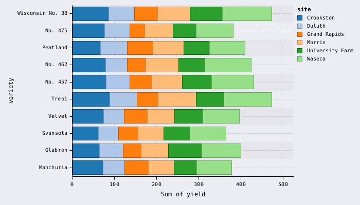
:::


### Normalized (Percentage) Stacked Bar Chart

The share of women and men in every age group (2000).

Source: [Vega-Lite - Normalized (Percentage) Stacked Bar Chart](https://vega.github.io/vega-lite/examples/stacked_bar_normalize.html). Data: U.S. population by age, sex and census year, vega-datasets 3.3.1 `population.json` (https://cdn.jsdelivr.net/npm/vega-datasets@3.3.1/data/population.json); original: IPUMS USA; licence: notspecified (vega-datasets `datapackage.json`).


::: {.sourceClojure}
```clojure
(plot/render-image
 {:data population-2000 :mapping {:x :age :y :people :color :gender}
  :charts [(chart/bar {:position :normalize})]
  :scales {:x {:type :categorical} :color gender-colors}
  :labels {:x "age" :y "population"}}
 {:width 700 :height 350})
```
:::


::: {.clay-image}

:::


### Normalized (Percentage) Stacked Bar Chart With Labels

Horizontal, every segment labelled with its population.

Source: [Vega-Lite - Normalized (Percentage) Stacked Bar Chart With Labels](https://vega.github.io/vega-lite/examples/stacked_bar_h_normalized_labeled.html). Data: U.S. population by age, sex and census year, vega-datasets 3.3.1 `population.json` (https://cdn.jsdelivr.net/npm/vega-datasets@3.3.1/data/population.json); original: IPUMS USA; licence: notspecified (vega-datasets `datapackage.json`).


::: {.sourceClojure}
```clojure
(let [sums (update-vals (group-by (juxt :age :gender) population-2000) #(reduce + (map :people %)))]
  (plot/render-image
   {:data population-2000 :mapping {:y :age :x :people :color :gender}
    :charts [(chart/bar {:position :normalize :value-label #(str (sums [(:level %) (get-in % [:group :color])]))
                         :label-position :center})]
    :scales {:y {:type :categorical} :color gender-colors}
    :labels {:x "population" :y "age"}}
   {:width 700 :height 600}))
```
:::


::: {.clay-image}
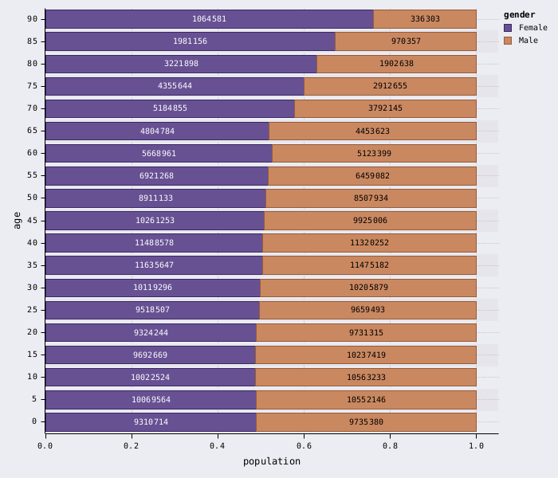
:::


### Gantt Chart (Ranged Bar Marks)

Tasks as ranges from start to end (rects between two data positions).

Source: [Vega-Lite - Gantt Chart (Ranged Bar Marks)](https://vega.github.io/vega-lite/examples/bar_gantt.html).


::: {.sourceClojure}
```clojure
(plot/render-image
 {:data [{:task "A" :start 1 :end 3} {:task "B" :start 3 :end 8} {:task "C" :start 8 :end 10}]
  :charts [(chart/rect {:mapping {:x0 :start :x1 :end :y0 :task :y1 :task} :fill [76 120 168] :stroke-color :white :stroke-width 6})]
  :scales {:y {:padding-in 0.2}}
  :labels {:x "start" :y "task"}}
 {:width 500 :height 200})
```
:::


::: {.clay-image}
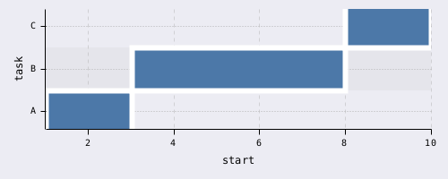
:::


### A Bar Chart Encoding Color Names in the Data

The bar colours are the data's values (an identity colour scale).

Source: [Vega-Lite - A Bar Chart Encoding Color Names in the Data](https://vega.github.io/vega-lite/examples/bar_color_disabled_scale.html).


::: {.sourceClojure}
```clojure
(plot/render-image
 {:data [{:color "red" :b 28} {:color "green" :b 55} {:color "blue" :b 43}]
  :mapping {:x :color :y :b :color :color}
  :charts [(chart/bar)]
  :scales {:color {:kind :identity}}
  :labels {:x "color" :y "b"}}
 {:width 400 :height 300})
```
:::


::: {.clay-image}

:::


### Layered Bar Chart

Women and men per age group as overlapping translucent bars (not stacked).

Source: [Vega-Lite - Layered Bar Chart](https://vega.github.io/vega-lite/examples/bar_layered_transparent.html). Data: U.S. population by age, sex and census year, vega-datasets 3.3.1 `population.json` (https://cdn.jsdelivr.net/npm/vega-datasets@3.3.1/data/population.json); original: IPUMS USA; licence: notspecified (vega-datasets `datapackage.json`).


::: {.sourceClojure}
```clojure
(plot/render-image
 {:data population-2000 :mapping {:x :age :y :people :color :gender}
  :charts [(chart/bar {:position :overlay :alpha 0.7})]
  :scales {:x {:type :categorical} :y {:formatter millions} :color gender-colors}
  :labels {:x "age" :y "population"}}
 {:width 700 :height 350})
```
:::


::: {.clay-image}

:::


### Diverging Stacked Bar Chart (Population Pyramid)

Women to the left, men to the right of 0 (women's counts negated), ages upward.

Source: Vega-Lite - Diverging Stacked Bar Chart (Population Pyramid) ([1](https://vega.github.io/vega-lite/examples/bar_diverging_stack_population_pyramid.html), [2](https://vega.github.io/vega/examples/population-pyramid/)). Data: U.S. population by age, sex and census year, vega-datasets 3.3.1 `population.json` (https://cdn.jsdelivr.net/npm/vega-datasets@3.3.1/data/population.json); original: IPUMS USA; licence: notspecified (vega-datasets `datapackage.json`).


::: {.sourceClojure}
```clojure
(plot/render-image
 {:data (map #(cond-> % (= "Female" (:gender %)) (update :people -)) population-2000)
  :mapping {:y :age :x :people :color :gender}
  :charts [(chart/bar {:position :stack})]
  :scales {:y {:type :categorical} :x {:formatter millions} :color gender-colors}
  :labels {:x "population" :y "age"}}
 {:width 600 :height 450})
```
:::


::: {.clay-image}
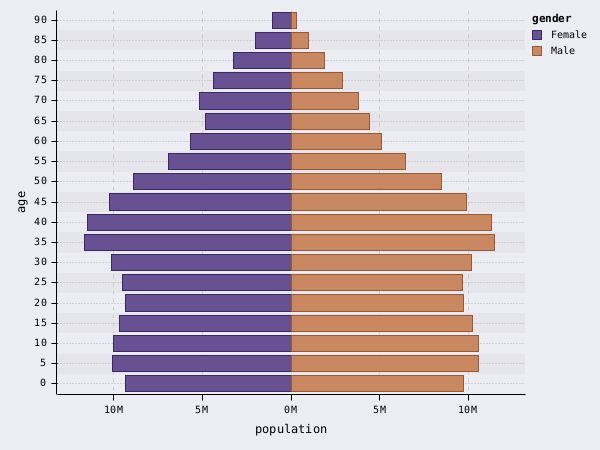
:::


### Diverging Stacked Bar Chart (with Neutral Parts)

Survey answers per question as percentages, centred on the middle of the neutral answer: the stack offsets are
computed in Clojure (Vega-Lite's `stack` and `joinaggregate`) and drawn as rects.

Source: [Vega-Lite - Diverging Stacked Bar Chart (with Neutral Parts)](https://vega.github.io/vega-lite/examples/bar_diverging_stack_transform.html).


::: {.sourceClojure}
```clojure
(def survey-answers ["Strongly disagree" "Disagree" "Neither agree nor disagree" "Agree" "Strongly agree"])
```
:::


::: {.sourceClojure}
```clojure
(def survey
  (let [rows [["Question 1" 0.7 9.1 18.5 59.9 11.7] ["Question 2" 18.2 18.2 0 63.6 0] ["Question 3" 20 0 20 40 20]
              ["Question 4" 0 12.5 6.3 43.8 37.5] ["Question 5" 0 4.2 12.5 66.7 16.7] ["Question 6" 6.3 6.3 12.5 56.3 18.8]
              ["Question 7" 0 0 20 80 0] ["Question 8" 0 0 0 0 100]]]
    (vec (for [[question & ps] rows
               :let [offset (+ (nth ps 0) (nth ps 1) (/ (nth ps 2) 2.0))
                     ends (reductions + 0 ps)]
               [answer lo hi] (map vector survey-answers ends (rest ends))]
           {:question question :answer answer :x0 (- lo offset) :x1 (- hi offset)}))))
```
:::


::: {.sourceClojure}
```clojure
(plot/render-image
 {:data survey
  :charts [(chart/rect {:mapping {:x0 :x0 :x1 :x1 :y0 :question :y1 :question :color :answer}
                        :stroke-color :white :stroke-width 4})]
  :scales {:color {:domain survey-answers :range [[195 13 36] [243 165 131] [204 204 204] [148 198 218] [23 112 171]]
                   :title "Response"}
           :y {:domain (vec (reverse (distinct (map :question survey)))) :padding-in 0.2}}
  :labels {:x "Percentage" :y "Question"}}
 {:width 700 :height 350})
```
:::


::: {.clay-image}
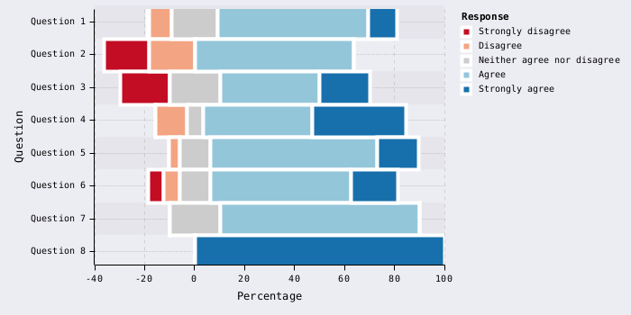
:::


### Simple Bar Chart with Labels

Each bar labelled with its value past its end.

Source: [Vega-Lite - Simple Bar Chart with Labels](https://vega.github.io/vega-lite/examples/layer_bar_labels.html).


::: {.sourceClojure}
```clojure
(plot/render-image
 {:data (take 3 abc) :mapping {:y :a :x :b}
  :charts [(chart/bar {:value-label true})]
  :scales {:x {:domain [0 60]}}
  :labels {:x "b" :y "a"}}
 {:width 500 :height 200})
```
:::


::: {.clay-image}
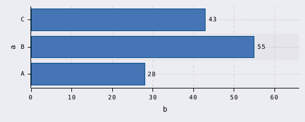
:::


### Bar Chart with Label Overlays

Mean IMDB rating per genre - grey bars, the genre names written over them (no y axis).

Source: [Vega-Lite - Bar Chart with Label Overlays](https://vega.github.io/vega-lite/examples/layer_bar_labels_grey.html). Data: Movie box office, budgets and ratings, vega-datasets 3.3.1 `movies.json` (https://cdn.jsdelivr.net/npm/vega-datasets@3.3.1/data/movies.json); licence: none listed - see vega-datasets (cite Vega as the source).


::: {.sourceClojure}
```clojure
(let [rated (filter #(and (:major-genre %) (number? (:imdb-rating %))) movies)]
  (plot/render-image
   {:data rated :mapping {:y :major-genre :x :imdb-rating}
    :charts [(chart/bar {:stat :mean :color [221 221 221] :stroke-color :none})
             (chart/text {:data (map (fn [g] {:genre g :x 0.1}) (distinct (map :major-genre rated)))
                          :mapping {:x :x :y :genre :label :genre} :anchor [:left :middle]})]
    :scales {:x {:domain [0 10]} :y {:axis false}}
    :labels {:x "Mean IMDB Ratings" :y nil}}
   {:width 500 :height 400}))
```
:::


::: {.clay-image}
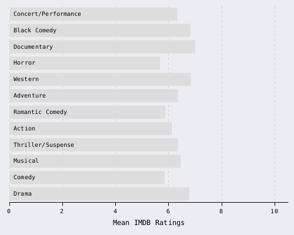
:::


### Bar Chart showing Initials of Month Names

Mean daily precipitation per month, the months labelled by their initials.

Source: [Vega-Lite - Bar Chart showing Initials of Month Names](https://vega.github.io/vega-lite/examples/bar_month_temporal_initial.html). Data: Seattle daily weather from 2012–2015, vega-datasets 3.3.1 `seattle-weather.csv` (https://cdn.jsdelivr.net/npm/vega-datasets@3.3.1/data/seattle-weather.csv); original: NOAA National Climatic Data Center; licence: other-pd (vega-datasets `datapackage.json`).


::: {.sourceClojure}
```clojure
(plot/render-image
 {:data seattle-months :mapping {:x :month :y :precipitation}
  :charts [(chart/bar {:stat :mean})]
  :scales {:x {:domain month-names :formatter #(subs % 0 1)}}
  :labels {:x "date (month)" :y "Mean of precipitation"}}
 {:width 500 :height 300})
```
:::


::: {.clay-image}
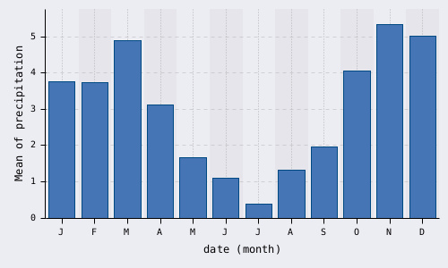
:::


### Bar Chart with bars center-aligned with time unit ticks

The same means on a time axis: each month's bar centred on its first day (rects a month wide).

Source: [Vega-Lite - Bar Chart with bars center-aligned with time unit ticks](https://vega.github.io/vega-lite/examples/bar_month_temporal_band_center.html). Data: Seattle daily weather from 2012–2015, vega-datasets 3.3.1 `seattle-weather.csv` (https://cdn.jsdelivr.net/npm/vega-datasets@3.3.1/data/seattle-weather.csv); original: NOAA National Climatic Data Center; licence: other-pd (vega-datasets `datapackage.json`).


::: {.sourceClojure}
```clojure
(let [means (update-vals (group-by #(.getMonthValue (local-date (:date %))) seattle) #(stats/mean (map :precipitation %)))]
  (plot/render-image
   {:data (for [[month mean] means :let [start (LocalDate/of 2000 (int month) 1)]]
            {:x0 (.minusDays start 13) :x1 (.plusDays start 13) :y0 0.0 :y1 mean})
    :charts [(chart/rect {:mapping {:x0 :x0 :x1 :x1 :y0 :y0 :y1 :y1} :fill [76 120 168]})]
    :scales {:x {:formatter #(.format (DateTimeFormatter/ofPattern "MMM" Locale/ENGLISH) ^TemporalAccessor %)}}
    :labels {:x "date (month)" :y "Mean of precipitation"}}
   {:width 600 :height 300}))
```
:::


::: {.clay-image}
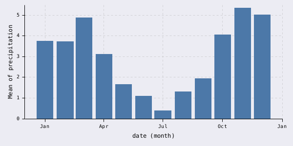
:::


### Bar Chart with Negative Values and a Zero-Baseline

Bars below and above a black line at 0.

Source: [Vega-Lite - Bar Chart with Negative Values and a Zero-Baseline](https://vega.github.io/vega-lite/examples/bar_negative.html).


::: {.sourceClojure}
```clojure
(def abc-negative (mapv (fn [row v] (assoc row :b v)) abc [-28 55 -33 91 81 53 -19 87 52]))
```
:::


::: {.sourceClojure}
```clojure
(plot/render-image
 {:data abc-negative :mapping {:x :a :y :b}
  :charts [(chart/bar) (chart/rule {:y 0 :color :black})]
  :labels {:x "a" :y "b"}}
 {:width 500 :height 300})
```
:::


::: {.clay-image}

:::


### Horizontal Bar Chart with Negative Values and Labels

Labels past each bar's end - on the left of negative bars.

Source: [Vega-Lite - Horizontal Bar Chart with Negative Values and Labels](https://vega.github.io/vega-lite/examples/bar_negative_horizontal_label.html).


::: {.sourceClojure}
```clojure
(plot/render-image
 {:data abc-negative :mapping {:y :a :x :b}
  :charts [(chart/bar {:value-label true}) (chart/rule {:x 0 :color :black})]
  :labels {:x "b" :y "a"}}
 {:width 500 :height 350})
```
:::


::: {.clay-image}
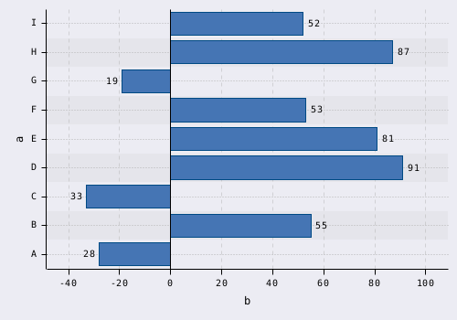
:::


### Bar Chart with a Spacing-Saving Y-Axis

The origin labels sit above their bars at the start of the value axis - text at x = 0, the y axis hidden (a
recipe: cljplot2 has no labels-inside axis option).

Source: [Vega-Lite - Bar Chart with a Spacing-Saving Y-Axis](https://vega.github.io/vega-lite/examples/bar_axis_space_saving.html). Data: Car specifications and fuel economy, vega-datasets 3.3.1 `cars.json` (https://cdn.jsdelivr.net/npm/vega-datasets@3.3.1/data/cars.json); original: StatLib Datasets Archive; licence: notspecified (vega-datasets `datapackage.json`).


::: {.sourceClojure}
```clojure
(plot/render-image
 {:data cars :mapping {:y :origin}
  :charts [(chart/bar {:stat :count :width 0.45 :corner-radius-end 2})
           (chart/text {:data (map (fn [o] {:origin o :x 0}) (distinct (map :origin cars)))
                        :mapping {:x :x :y :origin :label :origin} :anchor [:left :bottom] :offset [2 12]})]
  :scales {:y {:axis false}}
  :labels {:x "Number of Cars" :y nil}}
 {:width 500 :height 250})
```
:::


::: {.clay-image}

:::


### Heat Lane Chart

Cars per horsepower bin as a lane: each bin a rounded rect, as tall as its count and centred on 0, coloured by the
count (the user's variant: plain rounded bars, without the original's outer band).

Source: [Vega-Lite - Heat Lane Chart](https://vega.github.io/vega-lite/examples/bar_heatlane.html). Data: Car specifications and fuel economy, vega-datasets 3.3.1 `cars.json` (https://cdn.jsdelivr.net/npm/vega-datasets@3.3.1/data/cars.json); original: StatLib Datasets Archive; licence: notspecified (vega-datasets `datapackage.json`).


::: {.sourceClojure}
```clojure
(let [hp (keep :horsepower cars)
      bins (->> hp (group-by #(* 20 (quot (long %) 20))) (map (fn [[lo vs]] {:lo lo :n (count vs)})))]
  (plot/render-image
   {:data (map (fn [{:keys [lo n]}] {:x0 (+ lo 1) :x1 (+ lo 19) :y0 (- (/ n 2.0)) :y1 (/ n 2.0) :count n}) bins)
    :charts [(chart/rect {:mapping {:x0 :x0 :x1 :x1 :y0 :y0 :y1 :y1 :color :count} :corner-radius 3})]
    :scales {:y {:axis false} :color {:range [[222 238 238] [44 120 150]] :title "count"}}
    :labels {:title "Heat Lane of Horsepower" :x "Horsepower" :y nil}}
   {:width 700 :height 250}))
```
:::


::: {.clay-image}
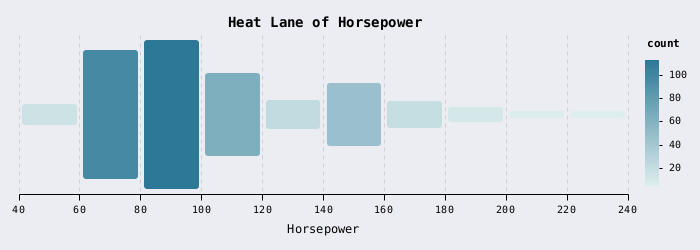
:::


## Histograms, Density Plots, and Dot Plots


### Histogram

IMDB ratings of the movies in bins of 1 (the Vega example bins 500 normal values - right).

Source: Vega-Lite - Histogram ([1](https://vega.github.io/vega-lite/examples/histogram.html), [2](https://vega.github.io/vega/examples/histogram/)). Data: Movie box office, budgets and ratings, vega-datasets 3.3.1 `movies.json` (https://cdn.jsdelivr.net/npm/vega-datasets@3.3.1/data/movies.json); licence: none listed - see vega-datasets (cite Vega as the source).


::: {.sourceClojure}
```clojure
(plot/render-image
 (plot/arrange
  [{:data imdb :mapping {:x :imdb-rating}
    :charts [(chart/histogram {:bins (vec (range 1 11)) :y :count})]
    :labels {:x "IMDB Rating (binned)" :y "Count of Records"}}
   {:data normal-2d :mapping {:x :u}
    :charts [(chart/histogram {:bins (mapv #(/ (double %) 10.0) (range -8 9)) :y :count})]
    :labels {:x "u" :y "count"}}]
  {:columns 2})
 {:width 900 :height 320})
```
:::


::: {.clay-image}
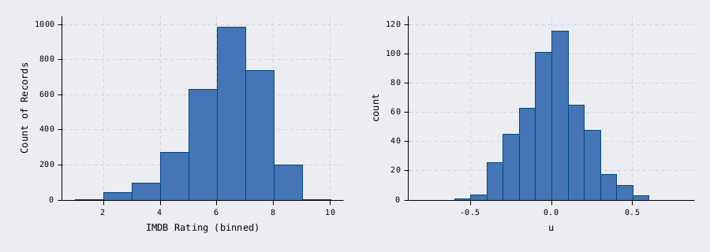
:::


### Histogram (from Binned Data)

Counts already binned in the data: a rect per bin.

Source: [Vega-Lite - Histogram (from Binned Data)](https://vega.github.io/vega-lite/examples/bar_binned_data.html).


::: {.sourceClojure}
```clojure
(plot/render-image
 {:data (map (fn [lo n] {:lo lo :hi (+ lo 2) :y0 0 :count n}) (range 8 24 2) [7 29 71 127 94 54 17 5])
  :charts [(chart/rect {:mapping {:x0 :lo :x1 :hi :y0 :y0 :y1 :count} :fill [76 120 168] :stroke-color :white
                        :stroke-width 1})]
  :scales {:x {:ticks (vec (range 8 25 2))}}
  :labels {:x "bin_start" :y "count"}}
 {:width 500 :height 300})
```
:::


::: {.clay-image}
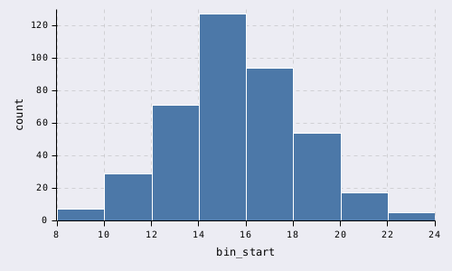
:::


### Log-scaled Histogram

Values spanning five orders of magnitude, binned by powers of ten on a log axis.

Source: [Vega-Lite - Log-scaled Histogram](https://vega.github.io/vega-lite/examples/histogram_log.html).


::: {.sourceClojure}
```clojure
(plot/render-image
 {:data (map (fn [x] {:x x}) [0.01 0.1 1 1 1 1 10 10 100 500 800])
  :mapping {:x :x}
  :charts [(chart/histogram {:bins [0.01 0.1 1 10 100 1000] :y :count})]
  :scales {:x {:kind :log}}
  :labels {:x "x1" :y "Count of Records"}}
 {:width 500 :height 300})
```
:::


::: {.clay-image}
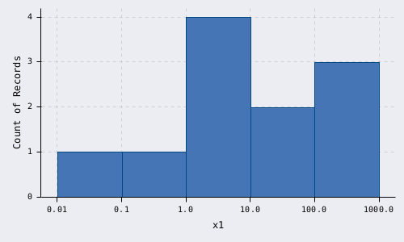
:::


### Non-linear Histogram

Share of frames by render time: bins of unequal width, each bar labelled by the frame rate at its start (`∞` - the
slowest bin's open end).

Source: [Vega-Lite - Non-linear Histogram](https://vega.github.io/vega-lite/examples/histogram_nonlinear.html).


::: {.sourceClojure}
```clojure
(let [starts [0 8.33 12.5 16.67 33.33 50 66.67 83.33]
      fps (fn [ms] (if (zero? (double ms)) "∞" (str (m/round (/ 1000.0 (double ms))))))]
  (plot/render-image
   {:data (map (fn [ms residency] {:fps (fps ms) :residency residency}) starts [0 0 31.17 38.96 6.49 2.9 2.6 16.88])
    :mapping {:x :fps :y :residency}
    :charts [(chart/bar {:width 1.0 :stroke-color :white})]
    :scales {:x {:domain (mapv fps starts)} :y {:domain [0 100] :formatter #(str (m/round (double %)) "%")}}
    :labels {:title "Distribution of Frame Render Time (fps)" :x nil :y nil}}
   {:width 600 :height 300}))
```
:::


::: {.clay-image}

:::


### Relative Frequency Histogram

The share of cars in every horsepower bin.

Source: [Vega-Lite - Relative Frequency Histogram](https://vega.github.io/vega-lite/examples/histogram_rel_freq.html). Data: Car specifications and fuel economy, vega-datasets 3.3.1 `cars.json` (https://cdn.jsdelivr.net/npm/vega-datasets@3.3.1/data/cars.json); original: StatLib Datasets Archive; licence: notspecified (vega-datasets `datapackage.json`).


::: {.sourceClojure}
```clojure
(plot/render-image
 {:data (filter :horsepower cars) :mapping {:x :horsepower}
  :charts [(chart/histogram {:bins (vec (range 40 241 20)) :y :pmf})]
  :scales {:y {:formatter #(format "%.1f%%" (* 100.0 (double %)))}}
  :labels {:x "Horsepower" :y "Relative Frequency"}}
 {:width 500 :height 300})
```
:::


::: {.clay-image}
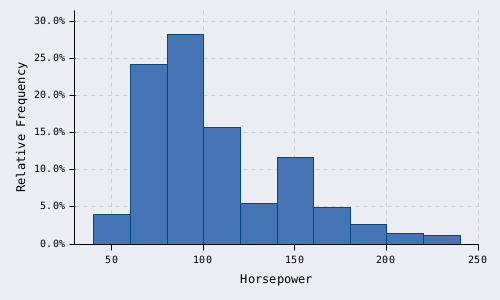
:::


### Density Plot

A kernel density estimate of the IMDB ratings, bandwidth 0.3 (right: the Vega example's normal values).

Source: Vega-Lite - Density Plot ([1](https://vega.github.io/vega-lite/examples/area_density.html), [2](https://vega.github.io/vega/examples/probability-density/)). Data: Movie box office, budgets and ratings, vega-datasets 3.3.1 `movies.json` (https://cdn.jsdelivr.net/npm/vega-datasets@3.3.1/data/movies.json); licence: none listed - see vega-datasets (cite Vega as the source).


::: {.sourceClojure}
```clojure
(plot/render-image
 (plot/arrange
  [{:data imdb :mapping {:x :imdb-rating}
    :charts [(chart/density {:bandwidth 0.3 :fill :color})]
    :labels {:x "IMDB Rating" :y "density"}}
   {:data normal-2d :mapping {:x :u}
    :charts [(chart/density {:fill :color}) (chart/rug)]
    :labels {:x "u" :y "density"}}]
  {:columns 2})
 {:width 900 :height 300})
```
:::


::: {.clay-image}
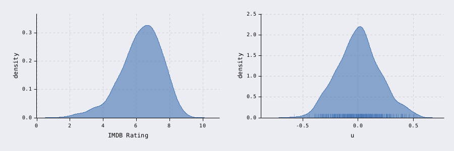
:::


### Stacked Density Estimates

Penguin body mass densities per species, stacked.

Source: [Vega-Lite - Stacked Density Estimates](https://vega.github.io/vega-lite/examples/area_density_stacked.html). Data: Palmer Archipelago penguin measurements, vega-datasets 3.3.1 `penguins.json` (https://cdn.jsdelivr.net/npm/vega-datasets@3.3.1/data/penguins.json); original: Palmer Station Antarctica LTER, Allison Horst's Penguins Repository; licence: CC0-1.0 (vega-datasets `datapackage.json`).


::: {.sourceClojure}
```clojure
(plot/render-image
 {:data (filter :body-mass-g penguins) :mapping {:x :body-mass-g :color :species}
  :charts [(chart/density {:position :stack})]
  :scales {:x {:domain [2500 6500]}}
  :labels {:title "Distribution of Body Mass of Penguins" :x "Body Mass (g)" :y "density"}}
 {:width 600 :height 350})
```
:::


::: {.clay-image}

:::


### 2D Histogram Scatterplot

Movies counted in bins of IMDB (1) and Rotten Tomatoes (10) ratings, a circle per bin sized by its count.

Source: Vega-Lite - 2D Histogram Scatterplot ([1](https://vega.github.io/vega-lite/examples/circle_binned.html), [2](https://vega.github.io/vega/examples/binned-scatter-plot/)). Data: Movie box office, budgets and ratings, vega-datasets 3.3.1 `movies.json` (https://cdn.jsdelivr.net/npm/vega-datasets@3.3.1/data/movies.json); licence: none listed - see vega-datasets (cite Vega as the source).


::: {.sourceClojure}
```clojure
(let [rated (filter #(and (number? (:imdb-rating %)) (number? (:rotten-tomatoes-rating %))) movies)
      counts (frequencies (map (juxt #(bin-start 1 (:imdb-rating %)) #(bin-start 10 (:rotten-tomatoes-rating %))) rated))]
  (plot/render-image
   {:data (map (fn [[[x y] n]] {:x (+ x 0.5) :y (+ y 5.0) :n n}) counts)
    :mapping {:x :x :y :y :size :n}
    :charts [(chart/scatter {:color [76 120 168]})]
    :scales {:size {:range [2 24] :area true :title "Count of Records"}}
    :labels {:x "IMDB Rating (binned)" :y "Rotten Tomatoes Rating (binned)"}}
   {:width 600 :height 450}))
```
:::


::: {.clay-image}

:::


### 2D Histogram Heatmap

The same ratings in finer bins (IMDB 0.2, Rotten Tomatoes 5), each cell coloured by its count.

Source: [Vega-Lite - 2D Histogram Heatmap](https://vega.github.io/vega-lite/examples/rect_binned_heatmap.html). Data: Movie box office, budgets and ratings, vega-datasets 3.3.1 `movies.json` (https://cdn.jsdelivr.net/npm/vega-datasets@3.3.1/data/movies.json); licence: none listed - see vega-datasets (cite Vega as the source).


::: {.sourceClojure}
```clojure
(let [rated (filter #(and (number? (:imdb-rating %)) (number? (:rotten-tomatoes-rating %))) movies)
      counts (frequencies (map (juxt #(bin-start 0.2 (:imdb-rating %)) #(bin-start 5 (:rotten-tomatoes-rating %))) rated))]
  (plot/render-image
   {:data (map (fn [[[x y] n]] {:x (+ x 0.1) :y (+ y 2.5) :n n}) counts)
    :mapping {:x :x :y :y :color :n}
    :charts [(chart/tile)]
    :scales {:color {:title "Count of Records"}}
    :labels {:x "IMDB Rating (binned)" :y "Rotten Tomatoes Rating (binned)"}}
   {:width 700 :height 450}))
```
:::


::: {.clay-image}

:::


### Cumulative Frequency Distribution

Movies with an IMDB rating up to each value - counts per rating, summed in rating order (Vega-Lite's `window`).

Source: [Vega-Lite - Cumulative Frequency Distribution](https://vega.github.io/vega-lite/examples/area_cumulative_freq.html). Data: Movie box office, budgets and ratings, vega-datasets 3.3.1 `movies.json` (https://cdn.jsdelivr.net/npm/vega-datasets@3.3.1/data/movies.json); licence: none listed - see vega-datasets (cite Vega as the source).


::: {.sourceClojure}
```clojure
(let [counts (sort (frequencies (map :imdb-rating imdb)))]
  (plot/render-image
   {:data (map (fn [[rating] total] {:rating rating :total total}) counts (reductions + (map second counts)))
    :mapping {:x :rating :y :total}
    :charts [(chart/line {:fill :color})]
    :labels {:x "IMDB Rating" :y "Cumulative Count"}}
   {:width 600 :height 300}))
```
:::


::: {.clay-image}

:::


### Layered Histogram and Cumulative Histogram

Cumulative counts per rating bin, the bin counts over them in translucent yellow.

Source: [Vega-Lite - Layered Histogram and Cumulative Histogram](https://vega.github.io/vega-lite/examples/layer_cumulative_histogram.html). Data: Movie box office, budgets and ratings, vega-datasets 3.3.1 `movies.json` (https://cdn.jsdelivr.net/npm/vega-datasets@3.3.1/data/movies.json); licence: none listed - see vega-datasets (cite Vega as the source).


::: {.sourceClojure}
```clojure
(let [counts (sort (frequencies (map #(bin-start 1 (:imdb-rating %)) imdb)))
      bins (map (fn [[lo n] total] {:lo lo :hi (+ lo 1.0) :y0 0 :n n :total total})
                counts (reductions + (map second counts)))]
  (plot/render-image
   {:data bins
    :charts [(chart/rect {:mapping {:x0 :lo :x1 :hi :y0 :y0 :y1 :total} :fill [76 120 168] :stroke-color :white})
             (chart/rect {:mapping {:x0 :lo :x1 :hi :y0 :y0 :y1 :n} :fill [255 255 0 128] :stroke-color :white})]
    :labels {:x "IMDB Rating" :y "Cumulative Count"}}
   {:width 600 :height 350}))
```
:::


::: {.clay-image}
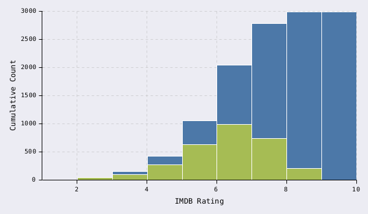
:::


### Wilkinson Dot Plot

A stack of dots per value (Vega's dot plot - Wilkinson dot density bins of its sample - right).

Source: Vega-Lite - Wilkinson Dot Plot ([1](https://vega.github.io/vega-lite/examples/circle_wilkinson_dotplot.html), [2](https://vega.github.io/vega/examples/dot-plot/)).


::: {.sourceClojure}
```clojure
(plot/render-image
 (plot/arrange
  [{:data (map (fn [v] {:v v}) [1 1 1 1 1 1 1 1 1 1 2 2 2 3 3 4 4 4 4 4 4])
    :mapping {:x :v} :charts [(chart/dotplot {:binwidth 1})] :labels {:x "data"}}
   {:data (map (fn [v] {:v v}) [6.3 2.1 9.1 15.8 5.2 10.9 8.3 11.0 3.2 7.6 6.3 8.6 6.6 9.5 4.8 12.0 3.3 11.0 4.7 10.4
                                7.4 2.1 7.7 17.9 6.1 8.2 8.4 11.9 10.8 13.8 14.3 15.2 10.0 11.9 6.5 7.5 10.6 7.4 8.4 5.7
                                4.9 3.2 8.1 11.0 4.9 13.2 9.7 12.8])
    :mapping {:x :v} :charts [(chart/dotplot {:binwidth 0.65})] :labels {:x "Density Dot Plot"}}]
  {:columns 2})
 {:width 900 :height 220})
```
:::


::: {.clay-image}
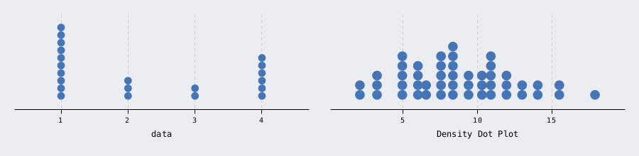
:::


### Isotype Dot Plot

Livestock of Great Britain and the United States, one icon per unit (the icons are cljplot2's own SVG paths).

Source: [Vega-Lite - Isotype Dot Plot](https://vega.github.io/vega-lite/examples/isotype_bar_chart.html).


::: {.sourceClojure}
```clojure
(def livestock
  "Units of livestock per country (one row per icon, `:col` its position)."
  (for [[country counts] [["Great Britain" {"cattle" 3 "pigs" 2 "sheep" 10}]
                          ["United States" {"cattle" 9 "pigs" 6 "sheep" 7}]]
        animal ["cattle" "pigs" "sheep"]
        col (range 1 (inc (counts animal)))]
    {:country country :animal animal :col col}))
```
:::


::: {.sourceClojure}
```clojure
(def animal-icons
  {"cattle" {:path "M2 4 L14 4 L16 2 L19 3 L18 6 L16 6 L16 11 L14 11 L14 8 L5 8 L5 11 L3 11 L3 7 L1 6 Z"}
   "pigs" {:path "M3 5 C3 2 13 2 15 4 L18 4 L18 7 L16 7 C16 9 14 10 12 10 L12 12 L10 12 L10 10 L7 10 L7 12 L5 12 L5 10 C3 9 3 7 3 5 Z"}
   "sheep" {:path "M4 5 C2 5 2 2 5 2 C6 0 9 0 10 2 C12 0 15 1 15 3 L18 3 L18 6 L15 6 C14 8 12 8 11 8 L11 11 L9 11 L9 8 L7 8 L7 11 L5 11 L5 8 C3 8 2 6 4 5 Z"}})
```
:::


::: {.sourceClojure}
```clojure
(plot/render-image
 {:data livestock :mapping {:x :col :y :animal :shape :animal :color :animal :facet :country}
  :charts [(chart/scatter {:size 26})]
  :scales {:shape {:domain ["cattle" "pigs" "sheep"] :range (mapv animal-icons ["cattle" "pigs" "sheep"])}
           :color {:domain ["cattle" "pigs" "sheep"] :range [[118 43 131] [192 144 87] [91 160 87]]}
           :x {:axis false} :y {:domain ["sheep" "pigs" "cattle"]}}
  :facets {:columns 1}
  :labels {:x nil :y nil}}
 {:width 700 :height 400})
```
:::


::: {.clay-image}
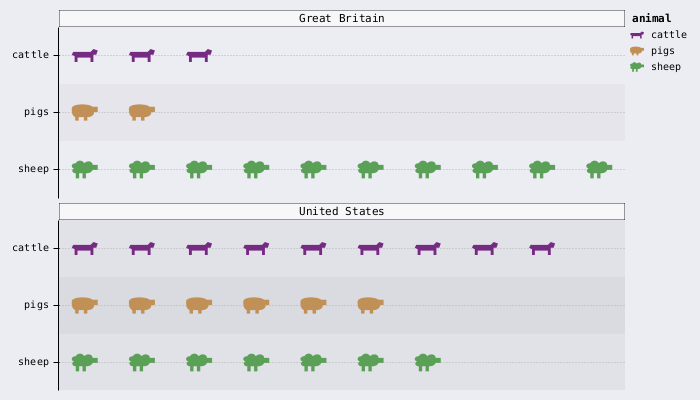
:::


### Isotype Dot Plot with Emoji

The same counts as emoji (monochrome, from the bundled Noto Emoji font), ranked within each country and animal.

Source: [Vega-Lite - Isotype Dot Plot with Emoji](https://vega.github.io/vega-lite/examples/isotype_bar_chart_emoji.html).


::: {.sourceClojure}
```clojure
(plot/render-image
 {:data livestock :mapping {:x :col :y :animal :shape :animal :facet :country}
  :charts [(chart/scatter {:size 24 :color :black})]
  :scales {:shape {:domain ["cattle" "pigs" "sheep"]
                   :range [{:text "\uD83D\uDC04"} {:text "\uD83D\uDC16"} {:text "\uD83D\uDC11"}]}
           :x {:axis false} :y {:domain ["sheep" "pigs" "cattle"]}}
  :facets {:columns 1}
  :labels {:x nil :y nil}}
 {:width 700 :height 400})
```
:::


::: {.clay-image}

:::


### Relative Bar Chart (Calculate Percentage of Total)

Each activity's share of the day (Vega-Lite's `joinaggregate` for the total).

Source: [Vega-Lite - Relative Bar Chart (Calculate Percentage of Total)](https://vega.github.io/vega-lite/examples/bar_percent_of_total.html).


::: {.sourceClojure}
```clojure
(let [activities [["Sleeping" 8] ["Eating" 2] ["TV" 4] ["Work" 8] ["Exercise" 2]]
      total (reduce + (map second activities))]
  (plot/render-image
   {:data (map (fn [[activity time]] {:activity activity :share (/ (double time) total)}) activities)
    :mapping {:y :activity :x :share}
    :charts [(chart/bar)]
    :scales {:x {:formatter #(str (m/round (* 100.0 (double %))) "%")} :y {:domain (vec (reverse (map first activities)))}}
    :labels {:x "% of total Time" :y "Activity"}}
   {:width 500 :height 250}))
```
:::


::: {.clay-image}
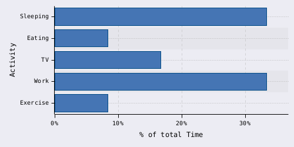
:::


## Scatter & Strip Plots


### Scatterplot

Miles per gallon against horsepower, hollow points.

Source: Vega-Lite - Scatterplot ([1](https://vega.github.io/vega-lite/examples/point_2d.html), [2](https://vega.github.io/vega/examples/scatter-plot/)). Data: Car specifications and fuel economy, vega-datasets 3.3.1 `cars.json` (https://cdn.jsdelivr.net/npm/vega-datasets@3.3.1/data/cars.json); original: StatLib Datasets Archive; licence: notspecified (vega-datasets `datapackage.json`).


::: {.sourceClojure}
```clojure
(plot/render-image
 {:data cars :mapping {:x :horsepower :y :miles-per-gallon}
  :charts [(chart/scatter {:shape \o :size 8 :color [76 120 168]})]
  :labels {:x "Horsepower" :y "Miles_per_Gallon"}}
 {:width 500 :height 400})
```
:::


::: {.clay-image}

:::


### 1D Strip Plot

Daily precipitation as ticks along one axis.

Source: [Vega-Lite - 1D Strip Plot](https://vega.github.io/vega-lite/examples/tick_dot.html). Data: Seattle daily weather from 2012–2015, vega-datasets 3.3.1 `seattle-weather.csv` (https://cdn.jsdelivr.net/npm/vega-datasets@3.3.1/data/seattle-weather.csv); original: NOAA National Climatic Data Center; licence: other-pd (vega-datasets `datapackage.json`).


::: {.sourceClojure}
```clojure
(plot/render-image
 {:data seattle :mapping {:x :precipitation}
  :charts [(chart/stripplot {:shape \| :size 16 :jitter 0 :color [76 120 168]})]
  :labels {:x "precipitation"}}
 {:width 600 :height 120})
```
:::


::: {.clay-image}

:::


### Strip Plot

Horsepower per number of cylinders, a tick per car.

Source: [Vega-Lite - Strip Plot](https://vega.github.io/vega-lite/examples/tick_strip.html). Data: Car specifications and fuel economy, vega-datasets 3.3.1 `cars.json` (https://cdn.jsdelivr.net/npm/vega-datasets@3.3.1/data/cars.json); original: StatLib Datasets Archive; licence: notspecified (vega-datasets `datapackage.json`).


::: {.sourceClojure}
```clojure
(plot/render-image
 {:data cars :mapping {:x :horsepower :y :cylinders}
  :charts [(chart/stripplot {:shape \| :size 14 :jitter 0 :color [76 120 168]})]
  :scales {:y {:type :categorical}}
  :labels {:x "Horsepower" :y "Cylinders"}}
 {:width 600 :height 300})
```
:::


::: {.clay-image}
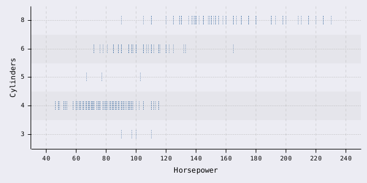
:::


### Colored Scatterplot

Penguins by flipper length and body mass, species in colour and shape.

Source: [Vega-Lite - Colored Scatterplot](https://vega.github.io/vega-lite/examples/point_color_with_shape.html). Data: Palmer Archipelago penguin measurements, vega-datasets 3.3.1 `penguins.json` (https://cdn.jsdelivr.net/npm/vega-datasets@3.3.1/data/penguins.json); original: Palmer Station Antarctica LTER, Allison Horst's Penguins Repository; licence: CC0-1.0 (vega-datasets `datapackage.json`).


::: {.sourceClojure}
```clojure
(plot/render-image
 {:data penguins :mapping {:x :flipper-length-mm :y :body-mass-g :color :species :shape :species}
  :charts [(chart/scatter {:size 8})]
  :scales {:shape {:range [\o \s \+]}}
  :labels {:x "Flipper Length (mm)" :y "Body Mass (g)"}}
 {:width 600 :height 400})
```
:::


::: {.clay-image}
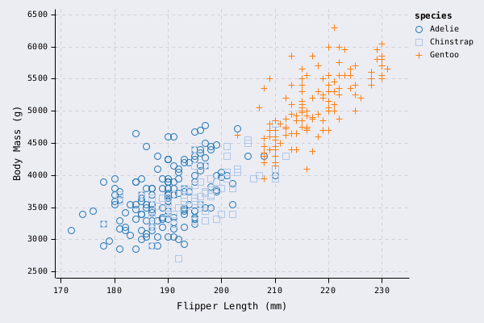
:::


### Bubble Plot

The scatterplot with point sizes by acceleration.

Source: [Vega-Lite - Bubble Plot](https://vega.github.io/vega-lite/examples/point_bubble.html). Data: Car specifications and fuel economy, vega-datasets 3.3.1 `cars.json` (https://cdn.jsdelivr.net/npm/vega-datasets@3.3.1/data/cars.json); original: StatLib Datasets Archive; licence: notspecified (vega-datasets `datapackage.json`).


::: {.sourceClojure}
```clojure
(plot/render-image
 {:data cars :mapping {:x :horsepower :y :miles-per-gallon :size :acceleration}
  :charts [(chart/scatter {:shape \o :color [76 120 168]})]
  :scales {:size {:range [3 14] :title "Acceleration"}}
  :labels {:x "Horsepower" :y "Miles_per_Gallon"}}
 {:width 600 :height 400})
```
:::


::: {.clay-image}

:::


### Scatterplot with Null Values in Grey

Rotten Tomatoes against IMDB ratings; a movie missing one rating can't be a point - it is a grey tick in the
margin of the rating it has (a recipe: `:margins` rugs in the theme's NA colour, the user's suggestion).

Source: Vega-Lite - Scatterplot with Null Values in Grey ([1](https://vega.github.io/vega-lite/examples/point_invalid_color.html), [2](https://vega.github.io/vega/examples/scatter-plot-null-values/)). Data: Movie box office, budgets and ratings, vega-datasets 3.3.1 `movies.json` (https://cdn.jsdelivr.net/npm/vega-datasets@3.3.1/data/movies.json); licence: none listed - see vega-datasets (cite Vega as the source).


::: {.sourceClojure}
```clojure
(let [rated? #(number? (%1 %2))
      na-color [170 170 170]]
  (plot/render-image
   {:data movies :mapping {:x :imdb-rating :y :rotten-tomatoes-rating}
    :charts [(chart/scatter {:shape \o :size 6 :color [76 120 168]})]
    :margins {:top {:charts [(chart/rug {:data (filter #(and (rated? :imdb-rating %) (not (rated? :rotten-tomatoes-rating %))) movies)
                                         :color na-color})]
                    :size 30}
              :right {:charts [(chart/rug {:data (filter #(and (rated? :rotten-tomatoes-rating %) (not (rated? :imdb-rating %))) movies)
                                           :mapping {:x :rotten-tomatoes-rating} :color na-color})]
                      :size 30}}
    :labels {:x "IMDB Rating" :y "Rotten Tomatoes Rating"}}
   {:width 600 :height 450}))
```
:::


::: {.clay-image}

:::


### Scatterplot with Filled Circles

The scatterplot with filled points.

Source: [Vega-Lite - Scatterplot with Filled Circles](https://vega.github.io/vega-lite/examples/circle.html). Data: Car specifications and fuel economy, vega-datasets 3.3.1 `cars.json` (https://cdn.jsdelivr.net/npm/vega-datasets@3.3.1/data/cars.json); original: StatLib Datasets Archive; licence: notspecified (vega-datasets `datapackage.json`).


::: {.sourceClojure}
```clojure
(plot/render-image
 {:data cars :mapping {:x :horsepower :y :miles-per-gallon}
  :charts [(chart/scatter {:size 7 :color [76 120 168 200]})]
  :labels {:x "Horsepower" :y "Miles_per_Gallon"}}
 {:width 500 :height 400})
```
:::


::: {.clay-image}

:::


### Bubble Plot (Gapminder)

Life expectancy against income (log axis), circles sized by population.

Source: [Vega-Lite - Bubble Plot (Gapminder)](https://vega.github.io/vega-lite/examples/circle_bubble_health_income.html). Data: Gapminder income, life expectancy and population, vega-datasets 3.3.1 `gapminder-health-income.csv` (https://cdn.jsdelivr.net/npm/vega-datasets@3.3.1/data/gapminder-health-income.csv); original: Gapminder Foundation, Gapminder GDP Per Capita Data; licence: CC-BY-4.0 (vega-datasets `datapackage.json`).


::: {.sourceClojure}
```clojure
(plot/render-image
 {:data (nu/dataset :gapminder-health-income) :mapping {:x :income :y :health :size :population}
  :charts [(chart/scatter {:color [0 0 0 160]})]
  :scales {:x {:kind :log} :size {:range [2 40] :area true :title "population"}}
  :labels {:x "income" :y "health"}}
 {:width 700 :height 450})
```
:::


::: {.clay-image}

:::


### Bubble Plot (Natural Disasters)

Annual deaths from each type of natural disaster, 1900-2017 - circle areas by deaths.

Source: [Vega-Lite - Bubble Plot (Natural Disasters)](https://vega.github.io/vega-lite/examples/circle_natural_disasters.html). Data: Deaths from natural disasters by type and year, vega-datasets 3.3.1 `disasters.csv` (https://cdn.jsdelivr.net/npm/vega-datasets@3.3.1/data/disasters.csv); original: EM-DAT: The Emergency Events Database, Hannah Ritchie, Pablo Rosado and Max Roser (2022) - Natural Disasters; licence: notspecified, CC-BY-4.0 (vega-datasets `datapackage.json`).


::: {.sourceClojure}
```clojure
(plot/render-image
 {:data (remove #(= "All natural disasters" (:entity %)) (nu/dataset :disasters))
  :mapping {:x :year :y :entity :size :deaths :color :entity}
  :charts [(chart/scatter {:stroke-color :black :stroke-width 1})]
  :scales {:size {:range [0 40] :area true :title "Annual Global Deaths"} :color {:legend false}}
  :labels {:x "Year" :y nil}}
 {:width 900 :height 500})
```
:::


::: {.clay-image}

:::


### Scatter Plot with Text Marks

Each car written as the initial of its origin.

Source: [Vega-Lite - Scatter Plot with Text Marks](https://vega.github.io/vega-lite/examples/text_scatterplot_colored.html). Data: Car specifications and fuel economy, vega-datasets 3.3.1 `cars.json` (https://cdn.jsdelivr.net/npm/vega-datasets@3.3.1/data/cars.json); original: StatLib Datasets Archive; licence: notspecified (vega-datasets `datapackage.json`).


::: {.sourceClojure}
```clojure
(plot/render-image
 {:data cars :mapping {:x :horsepower :y :miles-per-gallon}
  :charts [(chart/text {:data (map #(assoc % :initial (subs (:origin %) 0 1)) cars)
                        :mapping {:x :horsepower :y :miles-per-gallon :label :initial :color :origin}})]
  :labels {:x "Horsepower" :y "Miles_per_Gallon"}}
 {:width 600 :height 400})
```
:::


::: {.clay-image}

:::


### Image-based Scatter Plot

Images at points (the original draws three application icons; here three images drawn with clojure2d).

Source: [Vega-Lite - Image-based Scatter Plot](https://vega.github.io/vega-lite/examples/scatter_image.html).


::: {.sourceClojure}
```clojure
(defn- badge
  "A 48 x 48 image: a disc in `color` with the letter `letter`."
  [color letter]
  (let [cv (c2d/canvas 48 48)]
    (c2d/with-canvas [g cv]
      (c2d/set-color g color)
      (c2d/ellipse g 24 24 44 44)
      (c2d/set-color g :white)
      (c2d/set-font-attributes g 26)
      (c2d/text g letter 24 33 :center))
    (c2d/get-image cv)))
```
:::


::: {.printedClojure}
```clojure
#'galleries.vega/badge

```
:::


::: {.sourceClojure}
```clojure
(plot/render-image
 {:data [{:x 0.5 :y 0.5 :img "f"} {:x 1.5 :y 1.5 :img "g"} {:x 2.5 :y 2.5 :img "z"}]
  :mapping {:x :x :y :y :shape :img}
  :charts [(chart/scatter {:size 40})]
  :scales {:shape {:domain ["f" "g" "z"]
                   :range [{:image (badge [230 100 30] "F")} {:image (badge [90 90 90] "G")} {:image (badge [30 70 160] "Z")}]
                   :legend false}
           :x {:domain [0 3]} :y {:domain [0 3]}}
  :labels {:x "x" :y "y"}}
 {:width 400 :height 400})
```
:::


::: {.clay-image}
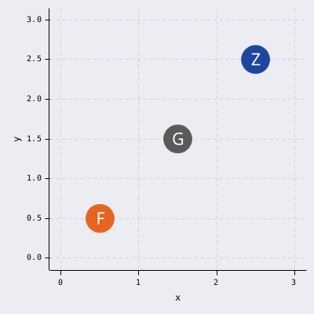
:::


### Strip plot with custom axis tick labels

Mean IMDB rating per genre on a scale labelled Poor - Neutral - Great.

Source: [Vega-Lite - Strip plot with custom axis tick labels](https://vega.github.io/vega-lite/examples/circle_custom_tick_labels.html). Data: Movie box office, budgets and ratings, vega-datasets 3.3.1 `movies.json` (https://cdn.jsdelivr.net/npm/vega-datasets@3.3.1/data/movies.json); licence: none listed - see vega-datasets (cite Vega as the source).


::: {.sourceClojure}
```clojure
(let [means (update-vals (group-by :major-genre (filter :major-genre imdb)) #(stats/mean (map :imdb-rating %)))]
  (plot/render-image
   {:data (map (fn [[genre mean]] {:genre genre :mean mean}) means)
    :mapping {:x :mean :y :genre}
    :charts [(chart/scatter {:size 10 :color [76 120 168]})]
    :scales {:x {:domain [0 10] :ticks [0 5 10] :formatter #(get {0 "Poor" 5 "Neutral" 10 "Great"} (m/round (double %)))}
             :y {:domain (vec (sort-by means (keys means)))}}
    :labels {:x nil :y nil}}
   {:width 500 :height 350}))
```
:::


::: {.clay-image}

:::


### Dot Plot with Jittering

Horsepower per number of cylinders, points spread across each row by a seeded random offset.

Source: [Vega-Lite - Dot Plot with Jittering](https://vega.github.io/vega-lite/examples/point_offset_random.html). Data: Car specifications and fuel economy, vega-datasets 3.3.1 `cars.json` (https://cdn.jsdelivr.net/npm/vega-datasets@3.3.1/data/cars.json); original: StatLib Datasets Archive; licence: notspecified (vega-datasets `datapackage.json`).


::: {.sourceClojure}
```clojure
(plot/render-image
 {:data cars :mapping {:x :horsepower :y :cylinders}
  :charts [(chart/scatter {:shape \o :size 6 :color [76 120 168] :jitter [0 0.3] :rng (r/rng :mersenne 1)})]
  :scales {:y {:ticks [3 4 5 6 8]}}
  :labels {:x "Horsepower" :y "Cylinders"}}
 {:width 600 :height 350})
```
:::


::: {.clay-image}

:::


## Line Charts


### Line Chart

Google's stock price.

Source: [Vega-Lite - Line Chart](https://vega.github.io/vega-lite/examples/line.html). Data: Monthly stock prices for five companies, vega-datasets 3.3.1 `stocks.csv` (https://cdn.jsdelivr.net/npm/vega-datasets@3.3.1/data/stocks.csv); licence: none listed - see vega-datasets (cite Vega as the source).


::: {.sourceClojure}
```clojure
(plot/render-image
 {:data goog :mapping {:x :date :y :price} :charts [(chart/line)] :labels {:x "date" :y "price"}}
 {:width 600 :height 300})
```
:::


::: {.clay-image}

:::


### Line Chart with Point Markers

Mean price per year and company, lines with points.

Source: [Vega-Lite - Line Chart with Point Markers](https://vega.github.io/vega-lite/examples/line_overlay.html). Data: Monthly stock prices for five companies, vega-datasets 3.3.1 `stocks.csv` (https://cdn.jsdelivr.net/npm/vega-datasets@3.3.1/data/stocks.csv); licence: none listed - see vega-datasets (cite Vega as the source).


::: {.sourceClojure}
```clojure
(plot/render-image
 {:data yearly-stocks :mapping {:x :date :y :price :color :symbol}
  :charts [(chart/line) (chart/scatter {:size 7})]
  :labels {:x "date (year)" :y "Mean of price"}}
 {:width 600 :height 350})
```
:::


::: {.clay-image}

:::


### Line Chart with Stroked Point Markers

The same with hollow markers: white points under coloured outlines.

Source: [Vega-Lite - Line Chart with Stroked Point Markers](https://vega.github.io/vega-lite/examples/line_overlay_stroked.html). Data: Monthly stock prices for five companies, vega-datasets 3.3.1 `stocks.csv` (https://cdn.jsdelivr.net/npm/vega-datasets@3.3.1/data/stocks.csv); licence: none listed - see vega-datasets (cite Vega as the source).


::: {.sourceClojure}
```clojure
(plot/render-image
 {:data yearly-stocks :mapping {:x :date :y :price :color :symbol}
  :charts [(chart/line)
           (chart/scatter {:mapping {:color nil} :size 8 :color :white})
           (chart/scatter {:shape \o :size 8 :stroke-width 1.5})]
  :labels {:x "date (year)" :y "Mean of price"}}
 {:width 600 :height 350})
```
:::


::: {.clay-image}
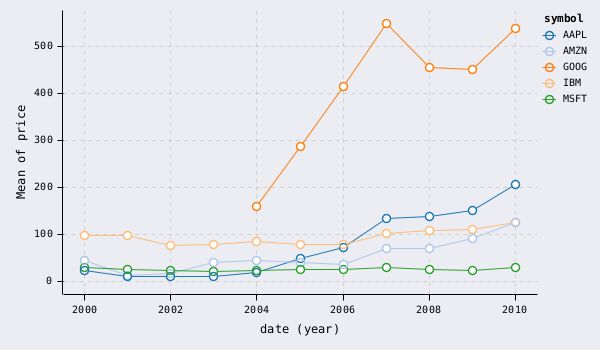
:::


### Multi Series Line Chart

The prices of five companies (Vega's line chart example - the same concept).

Source: Vega-Lite - Multi Series Line Chart ([1](https://vega.github.io/vega-lite/examples/line_color.html), [2](https://vega.github.io/vega/examples/line-chart/)). Data: Monthly stock prices for five companies, vega-datasets 3.3.1 `stocks.csv` (https://cdn.jsdelivr.net/npm/vega-datasets@3.3.1/data/stocks.csv); licence: none listed - see vega-datasets (cite Vega as the source).


::: {.sourceClojure}
```clojure
(plot/render-image
 {:data stocks :mapping {:x :date :y :price :color :symbol} :charts [(chart/line)] :labels {:x "date" :y "price"}}
 {:width 600 :height 350})
```
:::


::: {.clay-image}
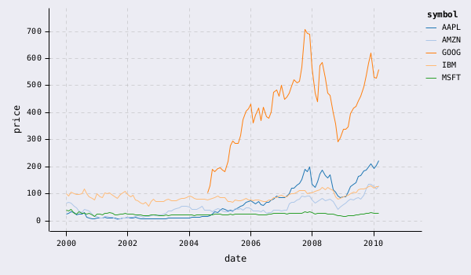
:::


### Repeat and Layer to Show Different Movie Measures

Mean US and worldwide gross per IMDB rating bin - the two measures folded into rows (Vega-Lite's `repeat`).

Source: [Vega-Lite - Repeat and Layer to Show Different Movie Measures](https://vega.github.io/vega-lite/examples/repeat_layer.html). Data: Movie box office, budgets and ratings, vega-datasets 3.3.1 `movies.json` (https://cdn.jsdelivr.net/npm/vega-datasets@3.3.1/data/movies.json); licence: none listed - see vega-datasets (cite Vega as the source).


::: {.sourceClojure}
```clojure
(plot/render-image
 {:data (for [[[measure lo] rows] (group-by (juxt :measure :bin)
                                           (for [movie imdb
                                                 [measure k] [["US Gross" :us-gross] ["Worldwide Gross" :worldwide-gross]]
                                                 :when (number? (k movie))]
                                             {:measure measure :bin (bin-start 1 (:imdb-rating movie)) :gross (k movie)}))]
          {:measure measure :x (+ lo 0.5) :gross (stats/mean (map :gross rows))})
  :mapping {:x :x :y :gross :color :measure}
  :charts [(chart/line)]
  :scales {:y {:formatter #(str (m/round (/ (double %) 1.0e6)) "M")}}
  :labels {:x "IMDB Rating (binned)" :y "Mean of US and Worldwide Gross"}}
 {:width 600 :height 350})
```
:::


::: {.clay-image}
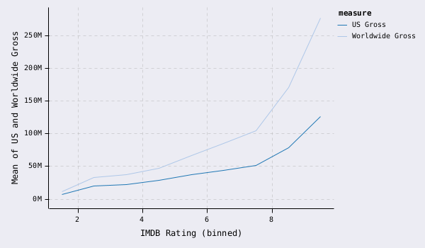
:::


### Multi Series Line Chart with Halo Stroke

Each company's line drawn over a wide white line, so crossings stay readable (a recipe: two line charts per series,
in series order).

Source: [Vega-Lite - Multi Series Line Chart with Halo Stroke](https://vega.github.io/vega-lite/examples/line_color_halo.html). Data: Monthly stock prices for five companies, vega-datasets 3.3.1 `stocks.csv` (https://cdn.jsdelivr.net/npm/vega-datasets@3.3.1/data/stocks.csv); licence: none listed - see vega-datasets (cite Vega as the source).


::: {.sourceClojure}
```clojure
(let [symbols ["AAPL" "AMZN" "GOOG" "IBM" "MSFT"]]
  (plot/render-image
   {:data stocks :mapping {:x :date :y :price :color :symbol}
    :charts (vec (for [symbol symbols
                       :let [rows (filterv #(= symbol (:symbol %)) stocks)]
                       chart [(chart/line {:data rows :mapping {:color nil} :color :white :width 5})
                              (chart/line {:data rows :width 2})]]
                   chart))
    :scales {:color {:domain symbols}}
    :labels {:x "date" :y "price"}}
   {:width 600 :height 350}))
```
:::


::: {.clay-image}

:::


### Slope Graph

Median barley yield per site, 1931 to 1932.

Source: [Vega-Lite - Slope Graph](https://vega.github.io/vega-lite/examples/line_slope.html). Data: Minnesota barley yields by variety and trial site, vega-datasets 3.3.1 `barley.json` (https://cdn.jsdelivr.net/npm/vega-datasets@3.3.1/data/barley.json); original: The Design of Experiments Reference, Wiebe, G. A., Reinbach-Welch, L., Cowan, P. R. (1940). Yields of Barley Varieties in the United States and Canada, 1932-36. United States: U.S. Department of Agriculture.; licence: notspecified (vega-datasets `datapackage.json`).


::: {.sourceClojure}
```clojure
(plot/render-image
 {:data (for [[[site year] rows] (group-by (juxt :site :year) barley)]
          {:site site :year (str year) :yield (stats/median (map :yield rows))})
  :mapping {:x :year :y :yield :color :site}
  :charts [(chart/line)]
  :scales {:x {:domain ["1931" "1932"]}}
  :labels {:x "year" :y "Median of yield"}}
 {:width 400 :height 400})
```
:::


::: {.clay-image}

:::


### Step Chart

Google's price as steps (each value held until the next).

Source: [Vega-Lite - Step Chart](https://vega.github.io/vega-lite/examples/line_step.html). Data: Monthly stock prices for five companies, vega-datasets 3.3.1 `stocks.csv` (https://cdn.jsdelivr.net/npm/vega-datasets@3.3.1/data/stocks.csv); licence: none listed - see vega-datasets (cite Vega as the source).


::: {.sourceClojure}
```clojure
(plot/render-image
 {:data goog :mapping {:x :date :y :price} :charts [(chart/line {:interpolator :step-after})] :labels {:x "date" :y "price"}}
 {:width 600 :height 300})
```
:::


::: {.clay-image}
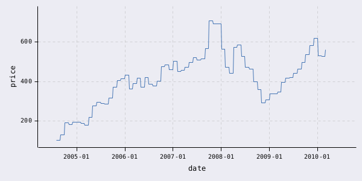
:::


### Line Chart with Monotone Interpolation

Google's price as a monotone curve through the points.

Source: [Vega-Lite - Line Chart with Monotone Interpolation](https://vega.github.io/vega-lite/examples/line_monotone.html). Data: Monthly stock prices for five companies, vega-datasets 3.3.1 `stocks.csv` (https://cdn.jsdelivr.net/npm/vega-datasets@3.3.1/data/stocks.csv); licence: none listed - see vega-datasets (cite Vega as the source).


::: {.sourceClojure}
```clojure
(plot/render-image
 {:data goog :mapping {:x :date :y :price} :charts [(chart/line {:interpolator :monotone})] :labels {:x "date" :y "price"}}
 {:width 600 :height 300})
```
:::


::: {.clay-image}

:::


### Line Chart with Conditional Axis Properties

Google's price in 2006-2007 (the original styles January ticks differently and writes the year under them; here the
plain axis, as the user asked).

Source: [Vega-Lite - Line Chart with Conditional Axis Properties](https://vega.github.io/vega-lite/examples/line_conditional_axis.html). Data: Monthly stock prices for five companies, vega-datasets 3.3.1 `stocks.csv` (https://cdn.jsdelivr.net/npm/vega-datasets@3.3.1/data/stocks.csv); licence: none listed - see vega-datasets (cite Vega as the source).


::: {.sourceClojure}
```clojure
(plot/render-image
 {:data (filter #(<= 2006 (.getYear ^LocalDate (:date %)) 2007) goog)
  :mapping {:x :date :y :price}
  :charts [(chart/line)]
  :labels {:x "date" :y "price"}}
 {:width 600 :height 300})
```
:::


::: {.clay-image}

:::


### Connected Scatterplot (Lines with Custom Paths)

Miles driven per capita against gas price, joined in year order.

Source: Vega-Lite - Connected Scatterplot (Lines with Custom Paths) ([1](https://vega.github.io/vega-lite/examples/connected_scatterplot.html), [2](https://vega.github.io/vega/examples/connected-scatter-plot/)). Data: U.S. driving distances and gasoline prices, vega-datasets 3.3.1 `driving.json` (https://cdn.jsdelivr.net/npm/vega-datasets@3.3.1/data/driving.json); original: New York Times (citing U.S. Energy Information Administration, Federal Highway Administration, and Brookings Institution); licence: none listed - see vega-datasets (cite Vega as the source).


::: {.sourceClojure}
```clojure
(plot/render-image
 {:data (sort-by :year (nu/dataset :driving)) :mapping {:x :miles :y :gas}
  :charts [(chart/line {:sort false}) (chart/scatter {:shape \o :size 7 :color [76 120 168]})]
  :labels {:x "miles" :y "gas"}}
 {:width 600 :height 400})
```
:::


::: {.clay-image}

:::


### Bump Chart

Build results in build order, a categorical y axis.

Source: [Vega-Lite - Bump Chart](https://vega.github.io/vega-lite/examples/line_bump.html).


::: {.sourceClojure}
```clojure
(plot/render-image
 {:data (map (fn [build result] {:build build :result result}) (range 1 17)
             ["PASSED" "PASSED" "FAILED" "FAILED" "SKIPPED" "PASSED" "PASSED" "FAILED" "PASSED" "PASSED" "SKIPPED" "PASSED"
              "PASSED" "FAILED" "PASSED" "SKIPPED"])
  :mapping {:x :build :y :result}
  :charts [(chart/line) (chart/scatter {:size 7})]
  :scales {:y {:domain ["SKIPPED" "FAILED" "PASSED"]}}
  :labels {:x "build" :y "result"}}
 {:width 600 :height 250})
```
:::


::: {.clay-image}

:::


### Line Chart with Varying Size (using the trail mark)

Prices as trails - the width grows with the price.

Source: [Vega-Lite - Line Chart with Varying Size (using the trail mark)](https://vega.github.io/vega-lite/examples/trail_color.html). Data: Monthly stock prices for five companies, vega-datasets 3.3.1 `stocks.csv` (https://cdn.jsdelivr.net/npm/vega-datasets@3.3.1/data/stocks.csv); licence: none listed - see vega-datasets (cite Vega as the source).


::: {.sourceClojure}
```clojure
(plot/render-image
 {:data stocks :mapping {:x :date :y :price :color :symbol :size :price}
  :charts [(chart/line {:trail true})]
  :scales {:size {:range [1 10]}}
  :labels {:x "date" :y "price"}}
 {:width 700 :height 400})
```
:::


::: {.clay-image}

:::


### A comet chart showing changes between between two states

Barley yields from 1931 (thin) to 1932 (wide) per variety and site, coloured by the direction of the change (the
original colours by the change's size; a trail has one colour per group).

Source: [Vega-Lite - A comet chart showing changes between two states](https://vega.github.io/vega-lite/examples/trail_comet.html). Data: Minnesota barley yields by variety and trial site, vega-datasets 3.3.1 `barley.json` (https://cdn.jsdelivr.net/npm/vega-datasets@3.3.1/data/barley.json); original: The Design of Experiments Reference, Wiebe, G. A., Reinbach-Welch, L., Cowan, P. R. (1940). Yields of Barley Varieties in the United States and Canada, 1932-36. United States: U.S. Department of Agriculture.; licence: notspecified (vega-datasets `datapackage.json`).


::: {.sourceClojure}
```clojure
(let [change (into {} (for [[k rows] (group-by (juxt :site :variety) barley)
                            :let [by-year (into {} (map (juxt :year :yield) rows))]]
                        [k (if (> (double (by-year 1932)) (double (by-year 1931))) "increase" "decrease")]))]
  (plot/render-image
   {:data (map #(assoc % :change (change [(:site %) (:variety %)])) (sort-by :year barley))
    :mapping {:x :year :y :variety :size :yield :color :change :group :variety :facet :site}
    :charts [(chart/line {:trail true :sort false})]
    :scales {:size {:range [0 12] :ticks [20 60] :title "Barley Yield (bushels/acre)"}
             :x {:domain [1930.6 1932.4] :nice false :ticks [1931 1932] :formatter #(str (m/round (double %)))}
             :color {:domain ["decrease" "increase"] :range [[202 0 32] [5 113 176]] :title "Yield Delta"}}
    :facets {:columns 6}
    :labels {:title "Barley Yield comparison between 1932 and 1931" :x nil :y "Variety"}}
   {:width 1000 :height 450}))
```
:::


::: {.clay-image}
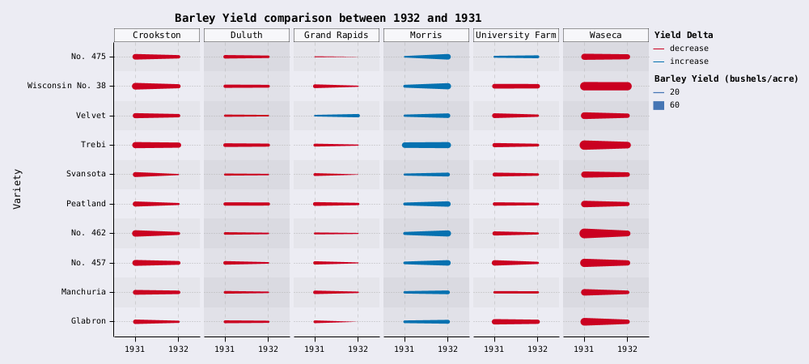
:::


### Line Chart with Markers and Invalid Values

A missing value breaks the line (its points are dropped).

Source: [Vega-Lite - Line Chart with Markers and Invalid Values](https://vega.github.io/vega-lite/examples/line_skip_invalid_mid_overlay.html).


::: {.sourceClojure}
```clojure
(let [rows (map (fn [x y] {:x x :y y}) (range 1 8) [10 30 nil 15 nil 40 20])]
  (plot/render-image
   {:data rows :mapping {:x :x :y :y}
    :charts [(chart/line) (chart/scatter {:data (filter :y rows) :size 7})]
    :labels {:x "x" :y "y"}}
   {:width 500 :height 300}))
```
:::


::: {.clay-image}
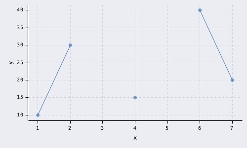
:::


### Carbon Dioxide in the Atmosphere

Monthly CO2 at Mauna Loa: a line per decade over the years into it, each labelled by its first and last year.

Source: [Vega-Lite - Carbon Dioxide in the Atmosphere](https://vega.github.io/vega-lite/examples/layer_line_co2_concentration.html). Data: Monthly atmospheric CO2 at Mauna Loa, vega-datasets 3.3.1 `co2-concentration.csv` (https://cdn.jsdelivr.net/npm/vega-datasets@3.3.1/data/co2-concentration.csv); original: Scripps CO2 Program, In-situ CO2 Data; licence: CC-BY-4.0 (vega-datasets `datapackage.json`).


::: {.sourceClojure}
```clojure
(let [rows (for [{:keys [date co2]} (nu/dataset :co2-concentration)
                 :let [d (local-date date) year (.getYear d)]]
             {:co2 co2 :year (str year) :decade (str (* 10 (quot year 10)) "s")
              :t (+ (mod year 10) (/ (.getMonthValue d) 12.0))})
      decades (vals (group-by :decade rows))]
  (plot/render-image
   {:data rows :mapping {:x :t :y :co2 :color :decade}
    :charts [(chart/line)
             (chart/text {:data (map #(apply min-key :t %) decades) :mapping {:x :t :y :co2 :label :year :color :decade}
                          :size 9 :anchor [:center :top] :offset [0 -4]})
             (chart/text {:data (map #(apply max-key :t %) decades) :mapping {:x :t :y :co2 :label :year :color :decade}
                          :size 9 :anchor [:center :bottom] :offset [0 4]})]
    :scales {:color {:range (mapv (c/gradient :viridis/magma) (map #(* 0.8 (/ (double %) (dec (count decades)))) (range (count decades)))) :legend false}
             :x {:ticks (vec (range 11))}}
    :labels {:x "Year into Decade" :y "CO2 concentration in ppm"}}
   {:width 800 :height 500}))
```
:::


::: {.clay-image}

:::


### Line Charts Showing Ranks Over Time

World Cup 2018 group F: each team's rank after every matchday (points, then goal difference - Vega-Lite's `window`
rank), rank 1 on top.

Source: [Vega-Lite - Line Charts Showing Ranks Over Time](https://vega.github.io/vega-lite/examples/window_rank.html).


::: {.sourceClojure}
```clojure
(let [results [["Germany" 1 0 -1] ["Mexico" 1 3 1] ["South Korea" 1 0 -1] ["Sweden" 1 3 1]
               ["Germany" 2 3 0] ["Mexico" 2 6 2] ["South Korea" 2 0 -2] ["Sweden" 2 3 0]
               ["Germany" 3 3 -2] ["Mexico" 3 6 -1] ["South Korea" 3 3 0] ["Sweden" 3 6 3]]
      ranked (for [[day rows] (group-by second results)
                   [rank [team]] (map-indexed vector (sort-by (fn [[_ _ point diff]] [(- point) (- diff)]) rows))]
               {:team team :matchday (str day) :rank (inc rank)})]
  (plot/render-image
   {:data ranked :mapping {:x :matchday :y :rank :color :team}
    :charts [(chart/line {:width 2})]
    :scales {:y {:domain [4.3 0.7] :ticks [1 2 3 4] :nice false}
             :x {:domain ["1" "2" "3"]}
             :color {:domain ["Germany" "Mexico" "South Korea" "Sweden"]
                     :range [[0 0 0] [18 113 83] [201 26 60] [12 113 171]]}}
    :labels {:title "World Cup 2018: Group F Rankings" :x "matchday" :y "rank"}}
   {:width 500 :height 300}))
```
:::


::: {.clay-image}

:::


### Drawing Sine and Cosine Curves with the Sequence Generator

sin and cos over a generated sequence, folded into long rows (Vega-Lite's `sequence` and `fold`).

Source: [Vega-Lite - Drawing Sine and Cosine Curves with the Sequence Generator](https://vega.github.io/vega-lite/examples/sequence_line_fold.html).


::: {.sourceClojure}
```clojure
(plot/render-image
 {:data (for [i (range 128) :let [x (* 0.1 i)] [k f] [["sin(x)" m/sin] ["cos(x)" m/cos]]]
          {:x x :key k :value (f x)})
  :mapping {:x :x :y :value :color :key}
  :charts [(chart/line)]
  :scales {:color {:title nil}}
  :labels {:x "x" :y "value"}}
 {:width 600 :height 300})
```
:::


::: {.clay-image}
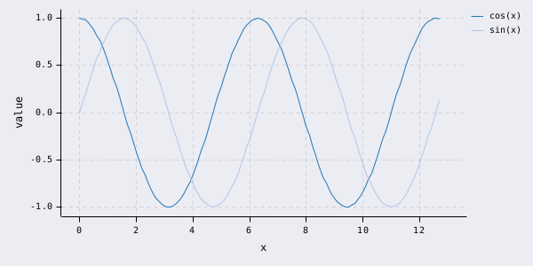
:::


### Line chart with varying stroke dash

The five companies told apart by dash patterns.

Source: [Vega-Lite - Line chart with varying stroke dash](https://vega.github.io/vega-lite/examples/line_strokedash.html). Data: Monthly stock prices for five companies, vega-datasets 3.3.1 `stocks.csv` (https://cdn.jsdelivr.net/npm/vega-datasets@3.3.1/data/stocks.csv); licence: none listed - see vega-datasets (cite Vega as the source).


::: {.sourceClojure}
```clojure
(plot/render-image
 {:data stocks :mapping {:x :date :y :price :dash :symbol} :charts [(chart/line)] :labels {:x "date" :y "price"}}
 {:width 600 :height 350})
```
:::


::: {.clay-image}

:::


### Line chart with a dashed part

Observed values solid, predicted ones dashed (the two parts share point E).

Source: [Vega-Lite - Line chart with a dashed part](https://vega.github.io/vega-lite/examples/line_dashed_part.html).


::: {.sourceClojure}
```clojure
(plot/render-image
 {:data [{:a "A" :b 28 :predicted "false"} {:a "B" :b 55 :predicted "false"} {:a "D" :b 91 :predicted "false"}
         {:a "E" :b 81 :predicted "false"} {:a "E" :b 81 :predicted "true"} {:a "G" :b 19 :predicted "true"}
         {:a "H" :b 87 :predicted "true"}]
  :mapping {:x :a :y :b :dash :predicted}
  :charts [(chart/line {:color [76 120 168]})]
  :scales {:x {:domain ["A" "B" "D" "E" "G" "H"]}}
  :labels {:x "a" :y "b"}}
 {:width 500 :height 300})
```
:::


::: {.clay-image}
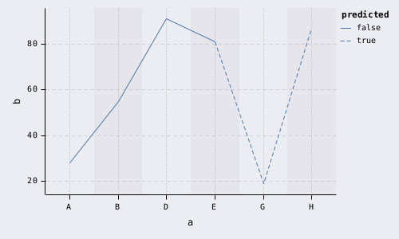
:::


```{=html}
<div style="background-color:grey;height:2px;width:100%;"></div>
```


```{=html}
<div><pre><small><small>source: notebooks/galleries/vega.clj</small></small></pre></div>
```