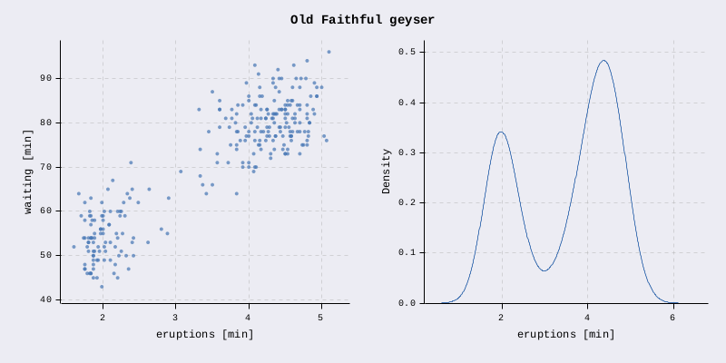

---
format:
  html:
    toc: true
    toc-location: right
    toc-depth: 4
    theme: cosmo
    include-in-header:
      text: |-
        <style>
        .data-table { width: fit-content; max-width: 100%; max-height: 15rem; overflow: auto; margin: 0 0 1rem 0; }
        .data-table .table-responsive { overflow: visible; }
        .data-table table { font-size: 0.75rem; width: auto; margin: 0; }
        .data-table th, .data-table td { padding: 0.1rem 0.45rem !important; white-space: nowrap; }
        .data-table thead th { position: sticky; top: 0; background: var(--bs-body-bg, #fff); }
        </style>
code-block-background: true

---
<style></style><style>.printedClojure .sourceCode {
  background-color: transparent;
  border-style: none;
}
</style><style>.clay-limit-image-width .clay-image {max-width: 100%}
.clay-side-by-side .sourceCode {margin: 0}
.clay-side-by-side {margin: 1em 0}
</style>
<script src="https://code.jquery.com/jquery-3.6.0.min.js" type="text/javascript"></script><script src="https://code.jquery.com/ui/1.13.1/jquery-ui.min.js" type="text/javascript"></script>

# cljplot2 {.unnumbered}

cljplot2 is a Clojure plotting library rendering static images with
[clojure2d](https://github.com/Clojure2D/clojure2d).
A plot is a plain map: data (a sequence of maps), a mapping from data to dimensions, a vector of charts,
labels, scales and a theme. There is no DSL and no grammar of graphics: you build and transform the map with
ordinary Clojure. Statistics come from [fastmath](https://github.com/generateme/fastmath), scales from
[wadogo](https://github.com/scicloj/wadogo).


::: {.sourceClojure}
```clojure
(ns book.index
  (:require [cljplot2.chart :as chart]
            [cljplot2.core :as plot]
            [notebook-utils :as nu]))
```
:::


## How this book is organised


* **Reference** - every option of the library in tables generated from its schemas, in four parts:
  * *concepts* - rendering, data and mapping, aesthetics and legends, scales and coordinates, layering, labels,
    facets and multiplots, the theme, shared option groups, errors and limits;

  * *charts* - every chart kind: its mapping, its options and examples;
  * *builders* - graphs, trees and series built into plots;
  * *data functions* - levels, graphs and trees, sets and series, fields, and specific cases.
* **Use cases** - one chapter per family of the [R Graph Gallery](https://r-graph-gallery.com/) merged with
  [From Data to Viz](https://www.data-to-viz.com/): distribution, correlation, ranking, part of a whole,
  evolution, flow, and colours, in the gallery's order, each family with its variations.

* **Galleries** - figures replicated from other sources: cljplot extras, the
  [lattice book](http://lmdvr.r-forge.r-project.org/figures/figures.html),
  [Vega-Lite](https://vega.github.io/vega-lite/examples/) and [Vega](https://vega.github.io/vega/examples/)
  galleries. Figures are reproduced by content (same data, same idea), not pixel by pixel.

Every example taken from an outside source links to it, and every dataset is credited with its source and
licence; examples written for this book credit only their data. All code is Clojure written for cljplot2; no
code of the original sources is copied. The datasets are in `notebooks/data/` (listed in
`datasets.edn`), not in the library.


## How to read an example

Each example is the code followed by the image it renders. Examples use these aliases:
`cljplot2.core` as `plot` (`plot/render-image` returns a `java.awt.image.BufferedImage`, which the notebook
shows) and `cljplot2.chart` as `chart`. Data is read with `nu/dataset`.


## A first example: Old Faithful

Waiting time between eruptions against eruption duration (left) and the distribution of eruption durations
(right). Two plots sharing one dataset, arranged side by side.

Source: R Graph Gallery - Scatter, Density ([1](https://r-graph-gallery.com/scatterplot.html), [2](https://r-graph-gallery.com/density-plot.html)). Data: Old Faithful geyser eruptions, R datasets package `faithful` (Härdle 1991; Azzalini & Bowman 1990); licence: Part of R (GPL-2 | GPL-3).


::: {.sourceClojure}
```clojure
(def faithful (nu/dataset :faithful))
```
:::


```{=html}
<div class="data-table"><table class="table table-hover table-responsive clay-table"><thead><tr><th>eruptions</th><th>waiting</th></tr></thead><tbody><tr><td>3.6</td><td>79</td></tr><tr><td>1.8</td><td>54</td></tr><tr><td>3.333</td><td>74</td></tr><tr><td>2.283</td><td>62</td></tr><tr><td>4.533</td><td>85</td></tr><tr><td>2.883</td><td>55</td></tr><tr><td>4.7</td><td>88</td></tr><tr><td>3.6</td><td>85</td></tr><tr><td>1.95</td><td>51</td></tr><tr><td>4.35</td><td>85</td></tr><tr><td>1.833</td><td>54</td></tr><tr><td>3.917</td><td>84</td></tr><tr><td>4.2</td><td>78</td></tr><tr><td>1.75</td><td>47</td></tr><tr><td>4.7</td><td>83</td></tr><tr><td>2.167</td><td>52</td></tr><tr><td>1.75</td><td>62</td></tr><tr><td>4.8</td><td>84</td></tr><tr><td>1.6</td><td>52</td></tr><tr><td>4.25</td><td>79</td></tr><tr><td>1.8</td><td>51</td></tr><tr><td>1.75</td><td>47</td></tr><tr><td>3.45</td><td>78</td></tr><tr><td>3.067</td><td>69</td></tr><tr><td>4.533</td><td>74</td></tr><tr><td>3.6</td><td>83</td></tr><tr><td>1.967</td><td>55</td></tr><tr><td>4.083</td><td>76</td></tr><tr><td>3.85</td><td>78</td></tr><tr><td>4.433</td><td>79</td></tr><tr><td>4.3</td><td>73</td></tr><tr><td>4.467</td><td>77</td></tr><tr><td>3.367</td><td>66</td></tr><tr><td>4.033</td><td>80</td></tr><tr><td>3.833</td><td>74</td></tr><tr><td>2.017</td><td>52</td></tr><tr><td>1.867</td><td>48</td></tr><tr><td>4.833</td><td>80</td></tr><tr><td>1.833</td><td>59</td></tr><tr><td>4.783</td><td>90</td></tr><tr><td>4.35</td><td>80</td></tr><tr><td>1.883</td><td>58</td></tr><tr><td>4.567</td><td>84</td></tr><tr><td>1.75</td><td>58</td></tr><tr><td>4.533</td><td>73</td></tr><tr><td>3.317</td><td>83</td></tr><tr><td>3.833</td><td>64</td></tr><tr><td>2.1</td><td>53</td></tr><tr><td>4.633</td><td>82</td></tr><tr><td>2</td><td>59</td></tr><tr><td>4.8</td><td>75</td></tr><tr><td>4.716</td><td>90</td></tr><tr><td>1.833</td><td>54</td></tr><tr><td>4.833</td><td>80</td></tr><tr><td>1.733</td><td>54</td></tr><tr><td>4.883</td><td>83</td></tr><tr><td>3.717</td><td>71</td></tr><tr><td>1.667</td><td>64</td></tr><tr><td>4.567</td><td>77</td></tr><tr><td>4.317</td><td>81</td></tr><tr><td>2.233</td><td>59</td></tr><tr><td>4.5</td><td>84</td></tr><tr><td>1.75</td><td>48</td></tr><tr><td>4.8</td><td>82</td></tr><tr><td>1.817</td><td>60</td></tr><tr><td>4.4</td><td>92</td></tr><tr><td>4.167</td><td>78</td></tr><tr><td>4.7</td><td>78</td></tr><tr><td>2.067</td><td>65</td></tr><tr><td>4.7</td><td>73</td></tr><tr><td>4.033</td><td>82</td></tr><tr><td>1.967</td><td>56</td></tr><tr><td>4.5</td><td>79</td></tr><tr><td>4</td><td>71</td></tr><tr><td>1.983</td><td>62</td></tr><tr><td>5.067</td><td>76</td></tr><tr><td>2.017</td><td>60</td></tr><tr><td>4.567</td><td>78</td></tr><tr><td>3.883</td><td>76</td></tr><tr><td>3.6</td><td>83</td></tr><tr><td>4.133</td><td>75</td></tr><tr><td>4.333</td><td>82</td></tr><tr><td>4.1</td><td>70</td></tr><tr><td>2.633</td><td>65</td></tr><tr><td>4.067</td><td>73</td></tr><tr><td>4.933</td><td>88</td></tr><tr><td>3.95</td><td>76</td></tr><tr><td>4.517</td><td>80</td></tr><tr><td>2.167</td><td>48</td></tr><tr><td>4</td><td>86</td></tr><tr><td>2.2</td><td>60</td></tr><tr><td>4.333</td><td>90</td></tr><tr><td>1.867</td><td>50</td></tr><tr><td>4.817</td><td>78</td></tr><tr><td>1.833</td><td>63</td></tr><tr><td>4.3</td><td>72</td></tr><tr><td>4.667</td><td>84</td></tr><tr><td>3.75</td><td>75</td></tr><tr><td>1.867</td><td>51</td></tr><tr><td>4.9</td><td>82</td></tr><tr><td>…</td><td>…</td></tr></tbody></table></div>
```


::: {.sourceClojure}
```clojure
(plot/render-image
 (plot/arrange [{:data faithful
                 :mapping {:x :eruptions :y :waiting}
                 :charts [(chart/scatter)]
                 :labels {:x "eruptions [min]" :y "waiting [min]"}}
                {:data faithful
                 :mapping {:x :eruptions}
                 :charts [(chart/density)]
                 :labels {:x "eruptions [min]"}}]
               {:columns 2 :title "Old Faithful geyser"})
 {:width 800 :height 400})
```
:::


::: {.clay-image}

:::


```{=html}
<div style="background-color:grey;height:2px;width:100%;"></div>
```


```{=html}
<div><pre><small><small>source: notebooks/book/index.clj</small></small></pre></div>
```