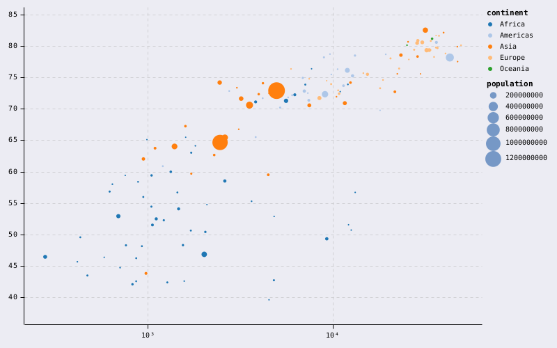
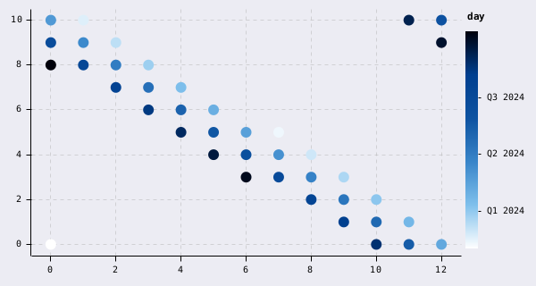
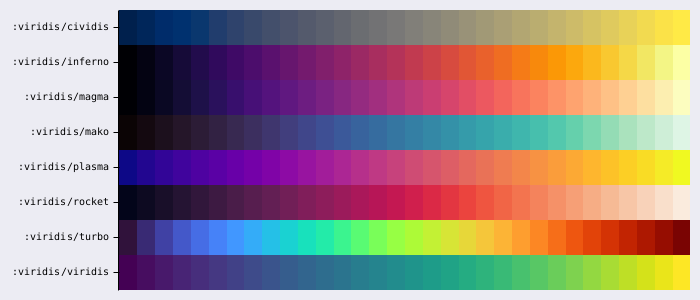
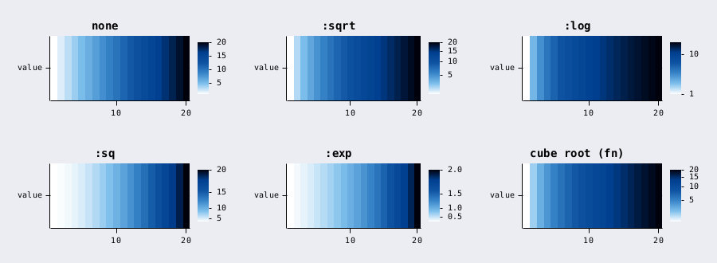
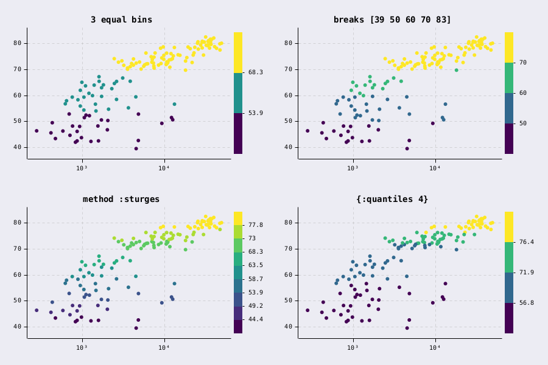
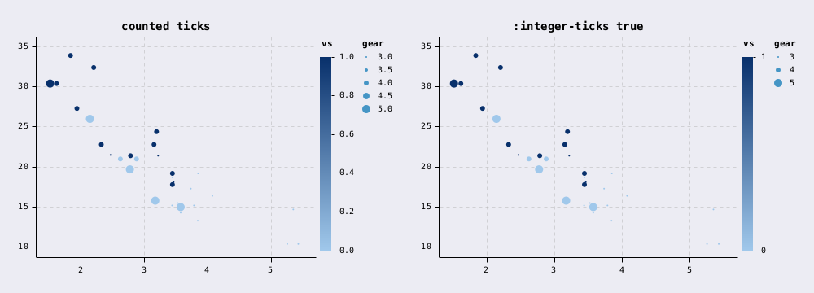
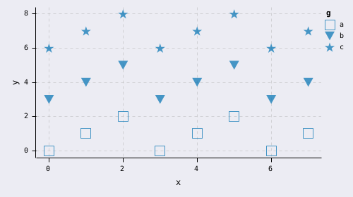

---
format:
  html: {toc: true, toc-location: right, toc-depth: 4, theme: cosmo}
code-block-background: true

---
<style></style><style>.printedClojure .sourceCode {
  background-color: transparent;
  border-style: none;
}
</style><style>.clay-limit-image-width .clay-image {max-width: 100%}
.clay-side-by-side .sourceCode {margin: 0}
.clay-side-by-side {margin: 1em 0}
</style>
<script src="https://code.jquery.com/jquery-3.6.0.min.js" type="text/javascript"></script><script src="https://code.jquery.com/ui/1.13.1/jquery-ui.min.js" type="text/javascript"></script>

# Aesthetics and legends

Five aesthetics style marks from data: `:color`, `:shape`, `:size`, `:dash` and `:pattern`. Each mapped
aesthetic has a scale (`:scales {:color spec}`) mapping its domain (levels or a numeric range) onto attributes
(colours, shapes ...), and every scale draws a legend unless told not to. All five share one spec; the colour
scale uses every key, the others differ only in their `:range`.


::: {.sourceClojure}
```clojure
(ns reference.aesthetics-legends
  (:require [cljplot2.chart :as chart]
            [cljplot2.core :as plot]
            [cljplot2.describe :as describe]
            [cljplot2.scale.aesthetic :as aesthetic]
            [notebook-utils :as nu])
  (:import [java.time LocalDate]))
```
:::


Data: Gapminder 2007: life expectancy, population and GDP per capita, data-to-viz example dataset `4_ThreeNum` (Yan Holtz; Gapminder via the R gapminder package); licence: MIT (data_to_viz repository).


::: {.sourceClojure}
```clojure
(def gapminder (nu/dataset :gapminder-2007))
```
:::


::: {.clay-table}

```{=html}
<table class="table table-hover table-responsive clay-table"><thead><tr><th>country</th><th>continent</th><th>life-exp</th><th>pop</th><th>gdp-per-cap</th></tr></thead><tbody><tr><td>Afghanistan</td><td>Asia</td><td>43.828</td><td>31889923</td><td>974.5803384</td></tr><tr><td>Albania</td><td>Europe</td><td>76.423</td><td>3600523</td><td>5937.029526</td></tr><tr><td>Algeria</td><td>Africa</td><td>72.301</td><td>33333216</td><td>6223.367465</td></tr><tr><td>Angola</td><td>Africa</td><td>42.731</td><td>12420476</td><td>4797.231267</td></tr><tr><td>Argentina</td><td>Americas</td><td>75.32</td><td>40301927</td><td>12779.37964</td></tr><tr><td>Australia</td><td>Oceania</td><td>81.235</td><td>20434176</td><td>34435.36744</td></tr><tr><td>Austria</td><td>Europe</td><td>79.829</td><td>8199783</td><td>36126.4927</td></tr><tr><td>Bahrain</td><td>Asia</td><td>75.635</td><td>708573</td><td>29796.04834</td></tr><tr><td>Bangladesh</td><td>Asia</td><td>64.062</td><td>150448339</td><td>1391.253792</td></tr><tr><td>Belgium</td><td>Europe</td><td>79.441</td><td>10392226</td><td>33692.60508</td></tr><tr><td>Benin</td><td>Africa</td><td>56.728</td><td>8078314</td><td>1441.284873</td></tr><tr><td>Bolivia</td><td>Americas</td><td>65.554</td><td>9119152</td><td>3822.137084</td></tr><tr><td>Bosnia and Herzegovina</td><td>Europe</td><td>74.852</td><td>4552198</td><td>7446.298803</td></tr><tr><td>Botswana</td><td>Africa</td><td>50.728</td><td>1639131</td><td>12569.85177</td></tr><tr><td>Brazil</td><td>Americas</td><td>72.39</td><td>190010647</td><td>9065.800825</td></tr><tr><td>Bulgaria</td><td>Europe</td><td>73.005</td><td>7322858</td><td>10680.79282</td></tr><tr><td>Burkina Faso</td><td>Africa</td><td>52.295</td><td>14326203</td><td>1217.032994</td></tr><tr><td>Burundi</td><td>Africa</td><td>49.58</td><td>8390505</td><td>430.0706916</td></tr><tr><td>Cambodia</td><td>Asia</td><td>59.723</td><td>14131858</td><td>1713.778686</td></tr><tr><td>Cameroon</td><td>Africa</td><td>50.43</td><td>17696293</td><td>2042.09524</td></tr></tbody></table>
```

:::


## Levels or numbers

An aesthetic scale has its own kinds - not those of the position scales (`:log`, `:datetime` ... in the
examples below are the x axis's, Scales chapter). The kind follows the data: levels (strings, keywords) get an
`:ordinal` scale - one attribute per level, in `:domain` order - numbers a `:linear` one - a gradient or a size
range; `:binned` cuts numbers into classes; `:type :categorical` treats numbers or dates as levels; `:identity`
reads the attributes from the data.

::: {.clay-table}

```{=html}
<table class="table table-hover table-responsive clay-table"><thead><tr><th>Option</th><th>Type</th><th>Default</th><th>Description</th></tr></thead><tbody><tr><td>:kind</td><td>one of :binned :identity :linear :ordinal</td><td>:linear for numeric :color / :size data, else :ordinal</td><td>scale kind: :ordinal (levels), :linear (a gradient or size range), :binned (:color by bins) or :identity (values are the attributes)</td></tr><tr><td>:type</td><td>one of :categorical :numeric</td><td></td><td>declare numbers or dates categorical (ordinal levels) or force a numeric scale</td></tr><tr><td>:domain</td><td>sequential of any value or nil</td><td>the data's levels (sorted) or [min max]</td><td>ordinal: the levels in order; linear / binned: [lo hi]</td></tr></tbody></table>
```

:::


::: {.sourceClojure}
```clojure
(plot/render-image (plot/arrange [{:data gapminder
                                   :mapping {:x :gdp-per-cap :y :life-exp :color :continent}
                                   :charts [(chart/scatter)]
                                   :scales {:x {:kind :log :formatter :power}
                                            :color {:domain ["Europe" "Asia" "Africa" "Americas" "Oceania"]}}}
                                  {:data gapminder
                                   :mapping {:x :gdp-per-cap :y :life-exp :color :life-exp}
                                   :charts [(chart/scatter)]
                                   :scales {:x {:kind :log :formatter :power}}}]
                                 {:columns 2})
                   {:width 900 :height 350})
```
:::


::: {.clay-image}

:::


Dates (`java.time` values) mapped to `:color` get a linear gradient over time, the colour bar ticked at dates (a
`Year` / `YearMonth` reads as the date its period starts, on every scale):


::: {.sourceClojure}
```clojure
(def readings (for [i (range 40)]
                {:day (.plusDays (LocalDate/of 2024 1 1) (* 9 i)) :x (mod (* i 7) 13) :y (mod (* i 5) 11)}))
```
:::


::: {.clay-table}

```{=html}
<table class="table table-hover table-responsive clay-table"><thead><tr><th>day</th><th>x</th><th>y</th></tr></thead><tbody><tr><td>2024-01-01</td><td>0</td><td>0</td></tr><tr><td>2024-01-10</td><td>7</td><td>5</td></tr><tr><td>2024-01-19</td><td>1</td><td>10</td></tr><tr><td>2024-01-28</td><td>8</td><td>4</td></tr><tr><td>2024-02-06</td><td>2</td><td>9</td></tr><tr><td>2024-02-15</td><td>9</td><td>3</td></tr><tr><td>2024-02-24</td><td>3</td><td>8</td></tr><tr><td>2024-03-04</td><td>10</td><td>2</td></tr><tr><td>2024-03-13</td><td>4</td><td>7</td></tr><tr><td>2024-03-22</td><td>11</td><td>1</td></tr><tr><td>2024-03-31</td><td>5</td><td>6</td></tr><tr><td>2024-04-09</td><td>12</td><td>0</td></tr><tr><td>2024-04-18</td><td>6</td><td>5</td></tr><tr><td>2024-04-27</td><td>0</td><td>10</td></tr><tr><td>2024-05-06</td><td>7</td><td>4</td></tr><tr><td>2024-05-15</td><td>1</td><td>9</td></tr><tr><td>2024-05-24</td><td>8</td><td>3</td></tr><tr><td>2024-06-02</td><td>2</td><td>8</td></tr><tr><td>2024-06-11</td><td>9</td><td>2</td></tr><tr><td>2024-06-20</td><td>3</td><td>7</td></tr></tbody></table>
```

:::


::: {.sourceClojure}
```clojure
(plot/render-image {:data readings
                    :mapping {:x :x :y :y :color :day}
                    :charts [(chart/scatter {:size 12})]}
                   {:width 600 :height 320})
```
:::


::: {.clay-image}

:::


Its `:ticks` take dates, and `:formatter` gets ticks in the data's type (here `LocalDate`s):


::: {.sourceClojure}
```clojure
(plot/render-image {:data readings
                    :mapping {:x :x :y :y :color :day}
                    :charts [(chart/scatter {:size 12})]
                    :scales {:color {:ticks [(LocalDate/of 2024 3 1) (LocalDate/of 2024 6 1) (LocalDate/of 2024 9 1)]
                                     :formatter #(str "Q" (inc (quot (dec (.getMonthValue ^LocalDate %)) 3)) " " (.getYear ^LocalDate %))}}}
                   {:width 600 :height 320})
```
:::


::: {.clay-image}

:::


## Colour range

The attributes the domain maps to: a sequence of colours, a level → colour map, or a clojure2d palette or
gradient name - 7339 palettes and 5009 gradients. Without `:range` the theme `:palette` supplies it.

::: {.clay-table}

```{=html}
<table class="table table-hover table-responsive clay-table"><thead><tr><th>Option</th><th>Type</th><th>Default</th><th>Description</th></tr></thead><tbody><tr><td>:range</td><td>map of any value to a clojure2d color or a function or a palette or gradient name, or a non-empty sequence of colors</td><td>theme :palette</td><td>attributes the domain maps to: palette, gradient, shapes, sizes [min max], dashes or patterns, or a level map</td></tr></tbody></table>
```

:::


Search palettes and gradients by name with `plot/find-palette` and `plot/find-gradient` (a regular expression,
or a namespace and one); `plot/palette` gives a palette's colours, `plot/gradient` a gradient function:


::: {.sourceClojure}
```clojure
(plot/find-palette #"tableau")
```
:::


::: {.printedClojure}
```clojure
(:tableau-10
 :tableau-10-2
 :tableau-10-light
 :tableau-10-medium
 :tableau-20
 :tableau-20-2
 :tableau-classic-20
 :tableau-classic-medium)

```
:::


Swatches of a few palettes (an `:identity` colour scale reads the colours from the data):


::: {.sourceClojure}
```clojure
(def palettes (plot/find-palette #"^:(rcartocolor/(Bold|Pastel|Vivid|Prism)|tableau-10)$"))
```
:::


::: {.sourceClojure}
```clojure
(def palette-swatches (for [p palettes [i col] (map-indexed vector (plot/palette p))]
                        {:palette (str p) :i i :color col}))
```
:::


::: {.clay-table}

```{=html}
<table class="table table-hover table-responsive clay-table"><thead><tr><th>palette</th><th>i</th><th>color</th></tr></thead><tbody><tr><td>:tableau-10</td><td>0</td><td>[31.0 119.0 180.0 255.0]</td></tr><tr><td>:tableau-10</td><td>1</td><td>[255.0 127.0 14.0 255.0]</td></tr><tr><td>:tableau-10</td><td>2</td><td>[44.0 160.0 44.0 255.0]</td></tr><tr><td>:tableau-10</td><td>3</td><td>[214.0 39.0 40.0 255.0]</td></tr><tr><td>:tableau-10</td><td>4</td><td>[148.0 103.0 189.0 255.0]</td></tr><tr><td>:tableau-10</td><td>5</td><td>[140.0 86.0 75.0 255.0]</td></tr><tr><td>:tableau-10</td><td>6</td><td>[227.0 119.0 194.0 255.0]</td></tr><tr><td>:tableau-10</td><td>7</td><td>[127.0 127.0 127.0 255.0]</td></tr><tr><td>:tableau-10</td><td>8</td><td>[188.0 189.0 34.0 255.0]</td></tr><tr><td>:tableau-10</td><td>9</td><td>[23.0 190.0 207.0 255.0]</td></tr><tr><td>:rcartocolor/Bold</td><td>0</td><td>[127.0 60.0 141.0 255.0]</td></tr><tr><td>:rcartocolor/Bold</td><td>1</td><td>[17.0 165.0 121.0 255.0]</td></tr><tr><td>:rcartocolor/Bold</td><td>2</td><td>[57.0 105.0 172.0 255.0]</td></tr><tr><td>:rcartocolor/Bold</td><td>3</td><td>[242.0 183.0 1.0 255.0]</td></tr><tr><td>:rcartocolor/Bold</td><td>4</td><td>[231.0 63.0 116.0 255.0]</td></tr><tr><td>:rcartocolor/Bold</td><td>5</td><td>[128.0 186.0 90.0 255.0]</td></tr><tr><td>:rcartocolor/Bold</td><td>6</td><td>[230.0 131.0 16.0 255.0]</td></tr><tr><td>:rcartocolor/Bold</td><td>7</td><td>[0.0 134.0 149.0 255.0]</td></tr><tr><td>:rcartocolor/Bold</td><td>8</td><td>[207.0 28.0 144.0 255.0]</td></tr><tr><td>:rcartocolor/Bold</td><td>9</td><td>[249.0 123.0 114.0 255.0]</td></tr></tbody></table>
```

:::


::: {.sourceClojure}
```clojure
(plot/render-image {:data palette-swatches
                    :mapping {:x :i :y :palette :color :color}
                    :charts [(chart/tile)]
                    :scales {:color {:kind :identity :legend false}
                             :y {:reverse true}
                             :x {:ticks 12}}}
                   {:width 700 :height 280})
```
:::


::: {.clay-image}

:::


Gradients, each sampled at 32 points:


::: {.sourceClojure}
```clojure
(def gradients (plot/find-gradient "viridis" #".*"))
```
:::


::: {.sourceClojure}
```clojure
(def gradient-swatches (for [g gradients
                             :let [gradient (plot/gradient g)]
                             i (range 32)]
                         {:gradient (str g) :i i :color (gradient (/ i 31.0))}))
```
:::


::: {.clay-table}

```{=html}
<table class="table table-hover table-responsive clay-table"><thead><tr><th>gradient</th><th>i</th><th>color</th></tr></thead><tbody><tr><td>:viridis/cividis</td><td>0</td><td>[0.0 32.0 77.0 255.0]</td></tr><tr><td>:viridis/cividis</td><td>1</td><td>[0.0 38.096774193548384 90.38709677419355 255.0]</td></tr><tr><td>:viridis/cividis</td><td>2</td><td>[0.0 44.193548387096776 105.58064516129032 255.0]</td></tr><tr><td>:viridis/cividis</td><td>3</td><td>[0.0 48.58064516129032 111.0 255.0]</td></tr><tr><td>:viridis/cividis</td><td>4</td><td>[10.09677419354838 54.774193548387096 110.0 255.0]</td></tr><tr><td>:viridis/cividis</td><td>5</td><td>[32.93548387096774 60.96774193548387 108.51612903225806 255.0]</td></tr><tr><td>:viridis/cividis</td><td>6</td><td>[46.74193548387096 66.58064516129032 108.0 255.0]</td></tr><tr><td>:viridis/cividis</td><td>7</td><td>[57.354838709677416 72.6774193548387 107.0 255.0]</td></tr><tr><td>:viridis/cividis</td><td>8</td><td>[66.54838709677419 78.54838709677419 107.0 255.0]</td></tr><tr><td>:viridis/cividis</td><td>9</td><td>[75.74193548387098 83.87096774193549 107.87096774193549 255.0]</td></tr><tr><td>:viridis/cividis</td><td>10</td><td>[83.93548387096774 89.96774193548387 108.0 255.0]</td></tr><tr><td>:viridis/cividis</td><td>11</td><td>[91.12903225806453 96.06451612903226 110.0 255.0]</td></tr><tr><td>:viridis/cividis</td><td>12</td><td>[99.16129032258064 102.16129032258064 111.16129032258064 255.0]</td></tr><tr><td>:viridis/cividis</td><td>13</td><td>[106.51612903225806 108.51612903225806 113.25806451612904 255.0]</td></tr><tr><td>:viridis/cividis</td><td>14</td><td>[114.0 114.06451612903226 116.0 255.0]</td></tr><tr><td>:viridis/cividis</td><td>15</td><td>[120.90322580645162 120.35483870967742 119.0 255.0]</td></tr><tr><td>:viridis/cividis</td><td>16</td><td>[129.09677419354838 126.64516129032259 121.0 255.0]</td></tr><tr><td>:viridis/cividis</td><td>17</td><td>[136.29032258064515 132.93548387096772 121.0 255.0]</td></tr><tr><td>:viridis/cividis</td><td>18</td><td>[144.48387096774195 139.48387096774195 120.25806451612902 255.0]</td></tr><tr><td>:viridis/cividis</td><td>19</td><td>[152.67741935483872 145.83870967741936 120.0 255.0]</td></tr></tbody></table>
```

:::


::: {.sourceClojure}
```clojure
(plot/render-image {:data gradient-swatches
                    :mapping {:x :i :y :gradient :color :color}
                    :charts [(chart/tile {:stroke-color :none})]
                    :scales {:color {:kind :identity :legend false}
                             :y {:reverse true}
                             :x {:axis false}}}
                   {:width 700 :height 300})
```
:::


::: {.clay-image}

:::


## Placing values on the range

How values spread over the attributes: a diverging gradient around `:midpoint`, values placed by a transform,
the range reversed, size by area.

::: {.clay-table}

```{=html}
<table class="table table-hover table-responsive clay-table"><thead><tr><th>Option</th><th>Type</th><th>Default</th><th>Description</th></tr></thead><tbody><tr><td>:spread</td><td>true or false</td><td>false</td><td>ordinal :color: the range resampled to one colour per level</td></tr><tr><td>:midpoint</td><td>a finite number</td><td></td><td>linear / binned :color: the value at the gradient's middle (a diverging scale)</td></tr><tr><td>:transform</td><td>one of :exp :log :sq :sqrt or a function</td><td></td><td>linear :color: values placed along the gradient by their square root, logarithm, square, exponential or a monotonic function</td></tr><tr><td>:reverse</td><td>true or false</td><td>false</td><td>the attributes in reverse order</td></tr><tr><td>:area</td><td>true or false</td><td>false</td><td>:size: the mark's area, not its size, grows linearly with the value</td></tr></tbody></table>
```

:::


::: {.sourceClojure}
```clojure
(plot/render-image (plot/arrange [{:data gapminder
                                   :mapping {:x :gdp-per-cap :y :life-exp :color :life-exp}
                                   :charts [(chart/scatter)]
                                   :scales {:x {:kind :log :formatter :power}
                                            :color {:range [:steelblue :white :firebrick] :midpoint 65
                                                    :title "life-exp, midpoint 65"}}}
                                  {:data gapminder
                                   :mapping {:x :gdp-per-cap :y :life-exp :color :pop}
                                   :charts [(chart/scatter)]
                                   :scales {:x {:kind :log :formatter :power}
                                            :color {:transform :log :range :viridis/viridis :reverse true
                                                    :title "pop, log, reversed"}}}]
                                 {:columns 2})
                   {:width 900 :height 350})
```
:::


::: {.clay-image}

:::


`:transform` places values along the gradient by `:sqrt`, `:log`, `:sq`, `:exp` or a function of the value; the
function must be monotonic over the domain (the colour bar inverts it numerically) and finite at its ends. The
values 1 to 20 under each (`:exp` - the values 0.1 to 2, the exponential of 20 dwarfs everything):


::: {.sourceClojure}
```clojure
(def ramp (for [i (range 1 21)] {:i i :tenth (* 0.1 i) :row "value"}))
```
:::


::: {.clay-table}

```{=html}
<table class="table table-hover table-responsive clay-table"><thead><tr><th>i</th><th>tenth</th><th>row</th></tr></thead><tbody><tr><td>1</td><td>0.1</td><td>value</td></tr><tr><td>2</td><td>0.2</td><td>value</td></tr><tr><td>3</td><td>0.30000000000000004</td><td>value</td></tr><tr><td>4</td><td>0.4</td><td>value</td></tr><tr><td>5</td><td>0.5</td><td>value</td></tr><tr><td>6</td><td>0.6000000000000001</td><td>value</td></tr><tr><td>7</td><td>0.7000000000000001</td><td>value</td></tr><tr><td>8</td><td>0.8</td><td>value</td></tr><tr><td>9</td><td>0.9</td><td>value</td></tr><tr><td>10</td><td>1.0</td><td>value</td></tr><tr><td>11</td><td>1.1</td><td>value</td></tr><tr><td>12</td><td>1.2000000000000002</td><td>value</td></tr><tr><td>13</td><td>1.3</td><td>value</td></tr><tr><td>14</td><td>1.4000000000000001</td><td>value</td></tr><tr><td>15</td><td>1.5</td><td>value</td></tr><tr><td>16</td><td>1.6</td><td>value</td></tr><tr><td>17</td><td>1.7000000000000002</td><td>value</td></tr><tr><td>18</td><td>1.8</td><td>value</td></tr><tr><td>19</td><td>1.9000000000000001</td><td>value</td></tr><tr><td>20</td><td>2.0</td><td>value</td></tr></tbody></table>
```

:::


::: {.sourceClojure}
```clojure
(plot/render-image (plot/arrange (for [[title transform] [["none" nil] [":sqrt" :sqrt] [":log" :log]
                                                         [":sq" :sq] [":exp" :exp] ["cube root (fn)" #(Math/cbrt %)]]]
                                   {:data ramp
                                    :mapping {:x :i :y :row :color (if (= :exp transform) :tenth :i)}
                                    :charts [(chart/tile)]
                                    :scales (cond-> {:color {:title nil}} transform (assoc-in [:color :transform] transform))
                                    :labels {:title title :y nil}})
                                 {:columns 3})
                   {:width 900 :height 330})
```
:::


::: {.clay-image}

:::


`:area true` grows a size scale's marks by area, not diameter - the right one reads as proportional:


::: {.sourceClojure}
```clojure
(plot/render-image (plot/arrange (for [area [false true]]
                                   {:data ramp
                                    :mapping {:x :i :y :row :size :i}
                                    :charts [(chart/scatter)]
                                    :scales {:size {:range [2 26] :area area :legend false}}
                                    :labels {:title (str ":area " area) :y nil}})
                                 {:columns 2})
                   {:width 900 :height 200})
```
:::


::: {.clay-image}

:::


## Bins

A `:binned` colour scale cuts numbers into classes and draws a key per class. `:bins` takes a count of equal
bins, the breaks themselves, a binning method (`:sturges`, `:sqrt`, `:rice`, `:doane`, `:scott` ...) or quantile
bins:

::: {.clay-table}

```{=html}
<table class="table table-hover table-responsive clay-table"><thead><tr><th>Option</th><th>Type</th><th>Default</th><th>Description</th></tr></thead><tbody><tr><td>:bins</td><td>keyword or vector of a finite number (at least 2) or quantile bins {:quantiles q :estimation e}: q a positive count or a vector of increasing probabilities strictly between 0 and 1, e one of [:legacy :r1 :r2 :r3 :r4 :r5 :r6 :r7 :r8 :r9] or a positive integer</td><td>5 equal bins</td><td>binned :color: a bin count, breaks, a bin method or quantile bins</td></tr></tbody></table>
```

:::


::: {.sourceClojure}
```clojure
(plot/render-image (plot/arrange (for [[title bins] [["3 equal bins" 3] ["breaks [39 50 60 70 83]" [39 50 60 70 83]]
                                                    ["method :sturges" :sturges] ["{:quantiles 4}" {:quantiles 4}]]]
                                   {:data gapminder
                                    :mapping {:x :gdp-per-cap :y :life-exp :color :life-exp}
                                    :charts [(chart/scatter)]
                                    :scales {:x {:kind :log :formatter :power}
                                             :color {:kind :binned :bins bins :range :viridis/viridis :title nil}}
                                    :labels {:title title}})
                                 {:columns 2})
                   {:width 900 :height 600})
```
:::


::: {.clay-image}

:::


## Legend

One legend per mapped aesthetic, titled by the mapped column's name: `:title` renames it, `:formatter` writes its
labels, `:ticks` picks the entries of a numeric scale, `:legend false` hides it (the plot's `:legend false` hides
them all). Aesthetics mapped to the same column with equal levels share one legend. Legends sit right of the
panels; their sizes and frame are in the theme `:legend` section (Theme chapter).

::: {.clay-table}

```{=html}
<table class="table table-hover table-responsive clay-table"><thead><tr><th>Option</th><th>Type</th><th>Default</th><th>Description</th></tr></thead><tbody><tr><td>:formatter</td><td>a function</td><td></td><td>legend labels, a function of the level or value</td></tr><tr><td>:ticks</td><td>sequential of a finite number or a java.time value or a positive integer or nil</td><td></td><td>linear :size / :color: the legend entries or colour bar ticks - a count or the values (dates for a :color scale over dates)</td></tr><tr><td>:title</td><td>string or nil</td><td>the mapped column's name</td><td>legend title (nil - none)</td></tr><tr><td>:legend</td><td>true or false or nil</td><td>true</td><td>show the scale's legend</td></tr></tbody></table>
```

:::


::: {.sourceClojure}
```clojure
(plot/render-image {:data gapminder
                    :mapping {:x :gdp-per-cap :y :life-exp :color :continent :shape :continent :size :pop}
                    :charts [(chart/scatter)]
                    :scales {:x {:kind :log :formatter :power}
                             :color {:title "continent"}
                             :size {:title "population" :ticks [1e7 1e8 1e9]
                                    :formatter #(format "%.0f M" (/ (double %) 1e6))}}}
                   {:width 700 :height 380})
```
:::


::: {.clay-image}

:::


A colour bar takes `:ticks` and `:formatter` too:


::: {.sourceClojure}
```clojure
(plot/render-image {:data gapminder
                    :mapping {:x :gdp-per-cap :y :life-exp :color :life-exp}
                    :charts [(chart/scatter)]
                    :scales {:x {:kind :log :formatter :power}
                             :color {:ticks [45 55 65 75] :formatter #(str % " years") :title "life expectancy"}}}
                   {:width 600 :height 350})
```
:::


::: {.clay-image}

:::


## Shape

Point shapes: characters - filled and outlined circles, squares, triangles, strokes, plus and cross - or shape
maps (an SVG path, a text, an SVG file, an image).

::: {.clay-table}

```{=html}
<table class="table table-hover table-responsive clay-table"><thead><tr><th>Option</th><th>Type</th><th>Default</th><th>Description</th></tr></thead><tbody><tr><td>:range</td><td>map of any value to a shape character, keyword or shape map or sequential of a shape character, keyword or shape map (at least 1)</td><td>theme :palette</td><td>attributes the domain maps to: palette, gradient, shapes, sizes [min max], dashes or patterns, or a level map</td></tr></tbody></table>
```

:::


Every built-in shape (`describe/attribute-values` lists the built-in shapes, dashes, patterns and cells; an
`:identity` scale draws the data's shapes):


::: {.sourceClojure}
```clojure
(def shapes (map-indexed (fn [i s] {:i i :shape s :name (str s)}) (:shape describe/attribute-values)))
```
:::


::: {.clay-table}

```{=html}
<table class="table table-hover table-responsive clay-table"><thead><tr><th>i</th><th>shape</th><th>name</th></tr></thead><tbody><tr><td>0</td><td>\+</td><td>+</td></tr><tr><td>1</td><td>\-</td><td>-</td></tr><tr><td>2</td><td>\/</td><td>/</td></tr><tr><td>3</td><td>\<</td><td><</td></tr><tr><td>4</td><td>\></td><td>></td></tr><tr><td>5</td><td>\A</td><td>A</td></tr><tr><td>6</td><td>\O</td><td>O</td></tr><tr><td>7</td><td>\S</td><td>S</td></tr><tr><td>8</td><td>\V</td><td>V</td></tr><tr><td>9</td><td>\\</td><td>\</td></tr><tr><td>10</td><td>\^</td><td>^</td></tr><tr><td>11</td><td>\o</td><td>o</td></tr><tr><td>12</td><td>\s</td><td>s</td></tr><tr><td>13</td><td>\v</td><td>v</td></tr><tr><td>14</td><td>\x</td><td>x</td></tr><tr><td>15</td><td>\{</td><td>{</td></tr><tr><td>16</td><td>\|</td><td>|</td></tr><tr><td>17</td><td>\}</td><td>}</td></tr></tbody></table>
```

:::


::: {.sourceClojure}
```clojure
(plot/render-image {:data shapes
                    :mapping {:x :i :y (constantly 1) :shape :shape}
                    :charts [(chart/scatter {:size 18 :color [69 117 180]})
                             (chart/text {:mapping {:x :i :y (constantly 0.4) :label :name}})]
                    :scales {:shape {:kind :identity :legend false} :y {:domain [0 1.5] :axis false}}}
                   {:width 800 :height 200})
```
:::


::: {.clay-image}

:::


A shape range of characters and shape maps:


::: {.sourceClojure}
```clojure
(def groups (for [[gi g] (map-indexed vector ["a" "b" "c"]) i (range 8)]
              {:g g :x i :y (+ (* 3 gi) (mod (* i 7) 3))}))
```
:::


::: {.clay-table}

```{=html}
<table class="table table-hover table-responsive clay-table"><thead><tr><th>g</th><th>x</th><th>y</th></tr></thead><tbody><tr><td>a</td><td>0</td><td>0</td></tr><tr><td>a</td><td>1</td><td>1</td></tr><tr><td>a</td><td>2</td><td>2</td></tr><tr><td>a</td><td>3</td><td>0</td></tr><tr><td>a</td><td>4</td><td>1</td></tr><tr><td>a</td><td>5</td><td>2</td></tr><tr><td>a</td><td>6</td><td>0</td></tr><tr><td>a</td><td>7</td><td>1</td></tr><tr><td>b</td><td>0</td><td>3</td></tr><tr><td>b</td><td>1</td><td>4</td></tr><tr><td>b</td><td>2</td><td>5</td></tr><tr><td>b</td><td>3</td><td>3</td></tr><tr><td>b</td><td>4</td><td>4</td></tr><tr><td>b</td><td>5</td><td>5</td></tr><tr><td>b</td><td>6</td><td>3</td></tr><tr><td>b</td><td>7</td><td>4</td></tr><tr><td>c</td><td>0</td><td>6</td></tr><tr><td>c</td><td>1</td><td>7</td></tr><tr><td>c</td><td>2</td><td>8</td></tr><tr><td>c</td><td>3</td><td>6</td></tr></tbody></table>
```

:::


::: {.sourceClojure}
```clojure
(plot/render-image {:data groups
                    :mapping {:x :x :y :y :shape :g}
                    :charts [(chart/scatter {:size 14})]
                    :scales {:shape {:range [\s {:path "M0 0 L10 0 L5 9 Z"} {:text "★"}]}}}
                   {:width 500 :height 280})
```
:::


::: {.clay-image}

:::


## Size

Sizes `[min max]` in pixels for numbers (a level map or a list for levels).

::: {.clay-table}

```{=html}
<table class="table table-hover table-responsive clay-table"><thead><tr><th>Option</th><th>Type</th><th>Default</th><th>Description</th></tr></thead><tbody><tr><td>:range</td><td>map of any value to a non-negative number or [min max], non-negative numbers, min <= max</td><td>theme :palette</td><td>attributes the domain maps to: palette, gradient, shapes, sizes [min max], dashes or patterns, or a level map</td></tr></tbody></table>
```

:::


::: {.sourceClojure}
```clojure
(plot/render-image {:data gapminder
                    :mapping {:x :gdp-per-cap :y :life-exp :size :pop}
                    :charts [(chart/scatter)]
                    :scales {:x {:kind :log :formatter :power}
                             :size {:range [4 50] :area true :legend false}}}
                   {:width 600 :height 350})
```
:::


::: {.clay-image}

:::


## Dash

Line dashes: a named style or a dash array - lengths in pixels of a dash, a gap, a dash, ... repeated along the
line.

::: {.clay-table}

```{=html}
<table class="table table-hover table-responsive clay-table"><thead><tr><th>Option</th><th>Type</th><th>Default</th><th>Description</th></tr></thead><tbody><tr><td>:range</td><td>map of any value to :none, a dash style (:dashed :dot-dash :dot-dot-dash :dotted :long-dash :loose-dot :solid :two-dash) or a sequence of positive numbers or sequential of :none, a dash style (:dashed :dot-dash :dot-dot-dash :dotted :long-dash :loose-dot :solid :two-dash) or a sequence of positive numbers (at least 1)</td><td>theme :palette</td><td>attributes the domain maps to: palette, gradient, shapes, sizes [min max], dashes or patterns, or a level map</td></tr></tbody></table>
```

:::


Every named style, and two dash arrays (an `:identity` scale draws the data's dashes):


::: {.sourceClojure}
```clojure
(def dashes (concat (for [[i d] (map-indexed vector (:dash describe/attribute-values)) x [0 10]]
                      {:i i :x x :dash d :name (str d)})
                    (for [[i d] [[8 [12 4]] [9 [2 2 8 2]]] x [0 10]]
                      {:i i :x x :dash d :name (pr-str d)})))
```
:::


::: {.clay-table}

```{=html}
<table class="table table-hover table-responsive clay-table"><thead><tr><th>i</th><th>x</th><th>dash</th><th>name</th></tr></thead><tbody><tr><td>0</td><td>0</td><td>:dashed</td><td>:dashed</td></tr><tr><td>0</td><td>10</td><td>:dashed</td><td>:dashed</td></tr><tr><td>1</td><td>0</td><td>:dot-dash</td><td>:dot-dash</td></tr><tr><td>1</td><td>10</td><td>:dot-dash</td><td>:dot-dash</td></tr><tr><td>2</td><td>0</td><td>:dot-dot-dash</td><td>:dot-dot-dash</td></tr><tr><td>2</td><td>10</td><td>:dot-dot-dash</td><td>:dot-dot-dash</td></tr><tr><td>3</td><td>0</td><td>:dotted</td><td>:dotted</td></tr><tr><td>3</td><td>10</td><td>:dotted</td><td>:dotted</td></tr><tr><td>4</td><td>0</td><td>:long-dash</td><td>:long-dash</td></tr><tr><td>4</td><td>10</td><td>:long-dash</td><td>:long-dash</td></tr><tr><td>5</td><td>0</td><td>:loose-dot</td><td>:loose-dot</td></tr><tr><td>5</td><td>10</td><td>:loose-dot</td><td>:loose-dot</td></tr><tr><td>6</td><td>0</td><td>:solid</td><td>:solid</td></tr><tr><td>6</td><td>10</td><td>:solid</td><td>:solid</td></tr><tr><td>7</td><td>0</td><td>:two-dash</td><td>:two-dash</td></tr><tr><td>7</td><td>10</td><td>:two-dash</td><td>:two-dash</td></tr><tr><td>8</td><td>0</td><td>[12 4]</td><td>[12 4]</td></tr><tr><td>8</td><td>10</td><td>[12 4]</td><td>[12 4]</td></tr><tr><td>9</td><td>0</td><td>[2 2 8 2]</td><td>[2 2 8 2]</td></tr><tr><td>9</td><td>10</td><td>[2 2 8 2]</td><td>[2 2 8 2]</td></tr></tbody></table>
```

:::


::: {.sourceClojure}
```clojure
(plot/render-image {:data dashes
                    :mapping {:x :x :y :i :dash :dash :group :i}
                    :charts [(chart/line {:width 2 :color :black})
                             (chart/text {:data (filter #(zero? (long (:x %))) dashes)
                                          :mapping {:x :x :y :i :label :name} :anchor [:right :middle] :offset [-8 0]})]
                    :scales {:dash {:kind :identity :legend false}
                             :x {:domain [-6 10] :axis false} :y {:axis false :reverse true}}}
                   {:width 600 :height 380})
```
:::


::: {.clay-image}

:::


A dash range by group:


::: {.sourceClojure}
```clojure
(plot/render-image {:data groups
                    :mapping {:x :x :y :y :dash :g}
                    :charts [(chart/line {:width 2})]
                    :scales {:dash {:range [:solid :dotted [8 3 2 3]]}}}
                   {:width 500 :height 280})
```
:::


::: {.clay-image}

:::


## Pattern

Fill patterns of areas and bars: a named pattern or your own as a pattern map - lines or crosses
`{:kind :lines :angle a :spacing s :width w}` (`a` 0, 45, 90 or 135) or dots `{:kind :dots :spacing s :size d}`.

::: {.clay-table}

```{=html}
<table class="table table-hover table-responsive clay-table"><thead><tr><th>Option</th><th>Type</th><th>Default</th><th>Description</th></tr></thead><tbody><tr><td>:range</td><td>map of any value to a pattern name (:back-hatch :cross :dense-dots :diagonal-cross :dots :hatch :horizontal :solid :vertical) or a pattern map or sequential of a pattern name (:back-hatch :cross :dense-dots :diagonal-cross :dots :hatch :horizontal :solid :vertical) or a pattern map (at least 1)</td><td>theme :palette</td><td>attributes the domain maps to: palette, gradient, shapes, sizes [min max], dashes or patterns, or a level map</td></tr></tbody></table>
```

:::


Every named pattern and two pattern maps:


::: {.sourceClojure}
```clojure
(def patterns (concat (for [p (:pattern describe/attribute-values)] {:name (name p) :pattern p :v 1})
                      [{:name "lines 135, spacing 8" :pattern {:kind :lines :angle 135 :spacing 8 :width 2} :v 1}
                       {:name "dots, spacing 5" :pattern {:kind :dots :spacing 5 :size 3} :v 1}]))
```
:::


::: {.clay-table}

```{=html}
<table class="table table-hover table-responsive clay-table"><thead><tr><th>name</th><th>pattern</th><th>v</th></tr></thead><tbody><tr><td>back-hatch</td><td>:back-hatch</td><td>1</td></tr><tr><td>cross</td><td>:cross</td><td>1</td></tr><tr><td>dense-dots</td><td>:dense-dots</td><td>1</td></tr><tr><td>diagonal-cross</td><td>:diagonal-cross</td><td>1</td></tr><tr><td>dots</td><td>:dots</td><td>1</td></tr><tr><td>hatch</td><td>:hatch</td><td>1</td></tr><tr><td>horizontal</td><td>:horizontal</td><td>1</td></tr><tr><td>solid</td><td>:solid</td><td>1</td></tr><tr><td>vertical</td><td>:vertical</td><td>1</td></tr><tr><td>lines 135, spacing 8</td><td>{:kind :lines, :angle 135, :spacing 8, :width 2}</td><td>1</td></tr><tr><td>dots, spacing 5</td><td>{:kind :dots, :spacing 5, :size 3}</td><td>1</td></tr></tbody></table>
```

:::


::: {.sourceClojure}
```clojure
(plot/render-image {:data patterns
                    :mapping {:x :name :y :v :pattern :pattern}
                    :charts [(chart/bar {:color :white :stroke-color :black :pattern-color :black :width 0.9})]
                    :scales {:pattern {:kind :identity :legend false} :y {:axis false}}
                    :theme {:axis {:x {:label-rotation 45}}}}
                   {:width 800 :height 320})
```
:::


::: {.clay-image}

:::


```{=html}
<div style="background-color:grey;height:2px;width:100%;"></div>
```


```{=html}
<div><pre><small><small>source: notebooks/reference/aesthetics_legends.clj</small></small></pre></div>
```