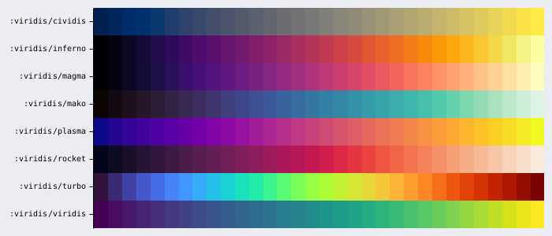

---
format:
  html: {toc: true, toc-location: right, toc-depth: 4, theme: cosmo}
code-block-background: true

---
<style></style><style>.printedClojure .sourceCode {
  background-color: transparent;
  border-style: none;
}
</style><style>.clay-limit-image-width .clay-image {max-width: 100%}
.clay-side-by-side .sourceCode {margin: 0}
.clay-side-by-side {margin: 1em 0}
</style>
<script src="https://code.jquery.com/jquery-3.6.0.min.js" type="text/javascript"></script><script src="https://code.jquery.com/ui/1.13.1/jquery-ui.min.js" type="text/javascript"></script>

# Aesthetics and legends

Five aesthetics style marks from data: `:color`, `:shape`, `:size`, `:dash` and `:pattern`. Each mapped
aesthetic has a scale (`:scales {:color spec}`), and every scale draws a legend unless told not to. The ranges
default to the theme `:palette`.


::: {.sourceClojure}
```clojure
(ns reference.aesthetics-legends
  (:require [clojure2d.color :as c]
            [cljplot2.chart :as chart]
            [cljplot2.core :as plot]
            [cljplot2.describe :as describe]
            [cljplot2.scale.aesthetic :as aesthetic]
            [notebook-utils :as nu]))
```
:::


## Colour scale

Categorical data takes an `:ordinal` scale (palette colours in level order), numbers a `:linear` gradient;
`:binned` cuts numbers into classes, `:identity` reads colours from the data.


::: {.sourceClojure}
```clojure
(nu/options-table (describe/options (aesthetic/scale-spec-schema :color)))
```
:::


::: {.clay-table}

```{=html}
<table class="table table-hover table-responsive clay-table"><thead><tr><th>Option</th><th>Type</th><th>Default</th><th>Description</th></tr></thead><tbody><tr><td>:kind</td><td>one of :binned :identity :linear :ordinal</td><td>:linear for numeric :color / :size data, else :ordinal</td><td>scale kind: :ordinal (levels), :linear (a gradient or size range), :binned (:color by bins) or :identity (values are the attributes)</td></tr><tr><td>:type</td><td>one of :categorical :numeric</td><td></td><td>declare numbers categorical (ordinal levels) or force a numeric scale</td></tr><tr><td>:domain</td><td>sequential of any value or nil</td><td>the data's levels (sorted) or [min max]</td><td>ordinal: the levels in order; linear / binned: [lo hi]</td></tr><tr><td>:range</td><td>map of any value to a clojure2d color or a function or a palette or gradient name, or a non-empty sequence of colors</td><td>theme :palette</td><td>attributes the domain maps to: palette, gradient, shapes, sizes [min max], dashes or patterns, or a level map</td></tr><tr><td>:spread</td><td>true or false</td><td>false</td><td>ordinal :color: the range resampled to one colour per level</td></tr><tr><td>:midpoint</td><td>a finite number</td><td></td><td>linear / binned :color: the value at the gradient's middle (a diverging scale)</td></tr><tr><td>:transform</td><td>one of :sqrt :log</td><td></td><td>linear :color: values placed along the gradient by their square root or logarithm</td></tr><tr><td>:reverse</td><td>true or false</td><td>false</td><td>the attributes in reverse order</td></tr><tr><td>:area</td><td>true or false</td><td>false</td><td>:size: the mark's area, not its size, grows linearly with the value</td></tr><tr><td>:bins</td><td>keyword or vector of a finite number (at least 2) or quantile bins {:quantiles q :estimation e}: q a positive count or a vector of increasing probabilities strictly between 0 and 1, e one of [:legacy :r1 :r2 :r3 :r4 :r5 :r6 :r7 :r8 :r9] or a positive integer</td><td>5 equal bins</td><td>binned :color: a bin count, breaks, a bin method or quantile bins</td></tr><tr><td>:formatter</td><td>a function</td><td></td><td>legend labels, a function of the level or value</td></tr><tr><td>:ticks</td><td>sequential of a finite number or a positive integer or nil</td><td></td><td>linear :size / :color: the legend entries or colour bar ticks - a count or the values</td></tr><tr><td>:title</td><td>string or nil</td><td>the mapped column's name</td><td>legend title (nil - none)</td></tr><tr><td>:legend</td><td>true or false or nil</td><td>true</td><td>show the scale's legend</td></tr></tbody></table>
```

:::


Data: Gapminder 2007: life expectancy, population and GDP per capita, data-to-viz example dataset `4_ThreeNum` (Yan Holtz; Gapminder via the R gapminder package); licence: MIT (data_to_viz repository).


::: {.sourceClojure}
```clojure
(def gapminder (nu/dataset :gapminder-2007))
```
:::


::: {.sourceClojure}
```clojure
(plot/render-image {:data gapminder
                    :mapping {:x :gdp-per-cap :y :life-exp :color :continent :size :pop}
                    :charts [(chart/scatter)]
                    :scales {:x {:kind :log :formatter :power}
                             :size {:range [2 24] :area true :title "population"}}}
                   {:width 800 :height 500})
```
:::


::: {.clay-image}

:::


A numeric colour: a gradient with a colour bar (left), the same values in five quantile classes (right).


::: {.sourceClojure}
```clojure
(plot/render-image (plot/arrange [{:data gapminder
                                   :mapping {:x :gdp-per-cap :y :life-exp :color :life-exp}
                                   :charts [(chart/scatter)]
                                   :scales {:x {:kind :log :formatter :power}
                                            :color {:range :viridis/viridis}}}
                                  {:data gapminder
                                   :mapping {:x :gdp-per-cap :y :life-exp :color :life-exp}
                                   :charts [(chart/scatter)]
                                   :scales {:x {:kind :log :formatter :power}
                                            :color {:kind :binned :bins {:quantiles 5} :range :viridis/viridis}}}]
                                 {:columns 2})
                   {:width 900 :height 400})
```
:::


::: {.clay-image}

:::


## Shape, size, dash and pattern scales

The other aesthetics share the colour scale's schema; each dimension accepts the keys its marks use (shapes,
sizes `[min max]`, dash styles, fill patterns).


::: {.sourceClojure}
```clojure
(nu/options-table (describe/options (aesthetic/scale-spec-schema :shape)))
```
:::


::: {.clay-table}

```{=html}
<table class="table table-hover table-responsive clay-table"><thead><tr><th>Option</th><th>Type</th><th>Default</th><th>Description</th></tr></thead><tbody><tr><td>:kind</td><td>one of :binned :identity :linear :ordinal</td><td>:linear for numeric :color / :size data, else :ordinal</td><td>scale kind: :ordinal (levels), :linear (a gradient or size range), :binned (:color by bins) or :identity (values are the attributes)</td></tr><tr><td>:type</td><td>one of :categorical :numeric</td><td></td><td>declare numbers categorical (ordinal levels) or force a numeric scale</td></tr><tr><td>:domain</td><td>sequential of any value or nil</td><td>the data's levels (sorted) or [min max]</td><td>ordinal: the levels in order; linear / binned: [lo hi]</td></tr><tr><td>:range</td><td>map of any value to a shape character, keyword or shape map or sequential of a shape character, keyword or shape map (at least 1)</td><td>theme :palette</td><td>attributes the domain maps to: palette, gradient, shapes, sizes [min max], dashes or patterns, or a level map</td></tr><tr><td>:spread</td><td>true or false</td><td>false</td><td>ordinal :color: the range resampled to one colour per level</td></tr><tr><td>:midpoint</td><td>a finite number</td><td></td><td>linear / binned :color: the value at the gradient's middle (a diverging scale)</td></tr><tr><td>:transform</td><td>one of :sqrt :log</td><td></td><td>linear :color: values placed along the gradient by their square root or logarithm</td></tr><tr><td>:reverse</td><td>true or false</td><td>false</td><td>the attributes in reverse order</td></tr><tr><td>:area</td><td>true or false</td><td>false</td><td>:size: the mark's area, not its size, grows linearly with the value</td></tr><tr><td>:bins</td><td>keyword or vector of a finite number (at least 2) or quantile bins {:quantiles q :estimation e}: q a positive count or a vector of increasing probabilities strictly between 0 and 1, e one of [:legacy :r1 :r2 :r3 :r4 :r5 :r6 :r7 :r8 :r9] or a positive integer</td><td>5 equal bins</td><td>binned :color: a bin count, breaks, a bin method or quantile bins</td></tr><tr><td>:formatter</td><td>a function</td><td></td><td>legend labels, a function of the level or value</td></tr><tr><td>:ticks</td><td>sequential of a finite number or a positive integer or nil</td><td></td><td>linear :size / :color: the legend entries or colour bar ticks - a count or the values</td></tr><tr><td>:title</td><td>string or nil</td><td>the mapped column's name</td><td>legend title (nil - none)</td></tr><tr><td>:legend</td><td>true or false or nil</td><td>true</td><td>show the scale's legend</td></tr></tbody></table>
```

:::


::: {.sourceClojure}
```clojure
(nu/options-table (describe/options (aesthetic/scale-spec-schema :size)))
```
:::


::: {.clay-table}

```{=html}
<table class="table table-hover table-responsive clay-table"><thead><tr><th>Option</th><th>Type</th><th>Default</th><th>Description</th></tr></thead><tbody><tr><td>:kind</td><td>one of :binned :identity :linear :ordinal</td><td>:linear for numeric :color / :size data, else :ordinal</td><td>scale kind: :ordinal (levels), :linear (a gradient or size range), :binned (:color by bins) or :identity (values are the attributes)</td></tr><tr><td>:type</td><td>one of :categorical :numeric</td><td></td><td>declare numbers categorical (ordinal levels) or force a numeric scale</td></tr><tr><td>:domain</td><td>sequential of any value or nil</td><td>the data's levels (sorted) or [min max]</td><td>ordinal: the levels in order; linear / binned: [lo hi]</td></tr><tr><td>:range</td><td>map of any value to a non-negative number or [min max], non-negative numbers, min <= max</td><td>theme :palette</td><td>attributes the domain maps to: palette, gradient, shapes, sizes [min max], dashes or patterns, or a level map</td></tr><tr><td>:spread</td><td>true or false</td><td>false</td><td>ordinal :color: the range resampled to one colour per level</td></tr><tr><td>:midpoint</td><td>a finite number</td><td></td><td>linear / binned :color: the value at the gradient's middle (a diverging scale)</td></tr><tr><td>:transform</td><td>one of :sqrt :log</td><td></td><td>linear :color: values placed along the gradient by their square root or logarithm</td></tr><tr><td>:reverse</td><td>true or false</td><td>false</td><td>the attributes in reverse order</td></tr><tr><td>:area</td><td>true or false</td><td>false</td><td>:size: the mark's area, not its size, grows linearly with the value</td></tr><tr><td>:bins</td><td>keyword or vector of a finite number (at least 2) or quantile bins {:quantiles q :estimation e}: q a positive count or a vector of increasing probabilities strictly between 0 and 1, e one of [:legacy :r1 :r2 :r3 :r4 :r5 :r6 :r7 :r8 :r9] or a positive integer</td><td>5 equal bins</td><td>binned :color: a bin count, breaks, a bin method or quantile bins</td></tr><tr><td>:formatter</td><td>a function</td><td></td><td>legend labels, a function of the level or value</td></tr><tr><td>:ticks</td><td>sequential of a finite number or a positive integer or nil</td><td></td><td>linear :size / :color: the legend entries or colour bar ticks - a count or the values</td></tr><tr><td>:title</td><td>string or nil</td><td>the mapped column's name</td><td>legend title (nil - none)</td></tr><tr><td>:legend</td><td>true or false or nil</td><td>true</td><td>show the scale's legend</td></tr></tbody></table>
```

:::


::: {.sourceClojure}
```clojure
(nu/options-table (describe/options (aesthetic/scale-spec-schema :dash)))
```
:::


::: {.clay-table}

```{=html}
<table class="table table-hover table-responsive clay-table"><thead><tr><th>Option</th><th>Type</th><th>Default</th><th>Description</th></tr></thead><tbody><tr><td>:kind</td><td>one of :binned :identity :linear :ordinal</td><td>:linear for numeric :color / :size data, else :ordinal</td><td>scale kind: :ordinal (levels), :linear (a gradient or size range), :binned (:color by bins) or :identity (values are the attributes)</td></tr><tr><td>:type</td><td>one of :categorical :numeric</td><td></td><td>declare numbers categorical (ordinal levels) or force a numeric scale</td></tr><tr><td>:domain</td><td>sequential of any value or nil</td><td>the data's levels (sorted) or [min max]</td><td>ordinal: the levels in order; linear / binned: [lo hi]</td></tr><tr><td>:range</td><td>map of any value to :none, a dash style (:dashed :dot-dash :dot-dot-dash :dotted :long-dash :loose-dot :solid :two-dash) or a sequence of positive numbers or sequential of :none, a dash style (:dashed :dot-dash :dot-dot-dash :dotted :long-dash :loose-dot :solid :two-dash) or a sequence of positive numbers (at least 1)</td><td>theme :palette</td><td>attributes the domain maps to: palette, gradient, shapes, sizes [min max], dashes or patterns, or a level map</td></tr><tr><td>:spread</td><td>true or false</td><td>false</td><td>ordinal :color: the range resampled to one colour per level</td></tr><tr><td>:midpoint</td><td>a finite number</td><td></td><td>linear / binned :color: the value at the gradient's middle (a diverging scale)</td></tr><tr><td>:transform</td><td>one of :sqrt :log</td><td></td><td>linear :color: values placed along the gradient by their square root or logarithm</td></tr><tr><td>:reverse</td><td>true or false</td><td>false</td><td>the attributes in reverse order</td></tr><tr><td>:area</td><td>true or false</td><td>false</td><td>:size: the mark's area, not its size, grows linearly with the value</td></tr><tr><td>:bins</td><td>keyword or vector of a finite number (at least 2) or quantile bins {:quantiles q :estimation e}: q a positive count or a vector of increasing probabilities strictly between 0 and 1, e one of [:legacy :r1 :r2 :r3 :r4 :r5 :r6 :r7 :r8 :r9] or a positive integer</td><td>5 equal bins</td><td>binned :color: a bin count, breaks, a bin method or quantile bins</td></tr><tr><td>:formatter</td><td>a function</td><td></td><td>legend labels, a function of the level or value</td></tr><tr><td>:ticks</td><td>sequential of a finite number or a positive integer or nil</td><td></td><td>linear :size / :color: the legend entries or colour bar ticks - a count or the values</td></tr><tr><td>:title</td><td>string or nil</td><td>the mapped column's name</td><td>legend title (nil - none)</td></tr><tr><td>:legend</td><td>true or false or nil</td><td>true</td><td>show the scale's legend</td></tr></tbody></table>
```

:::


::: {.sourceClojure}
```clojure
(nu/options-table (describe/options (aesthetic/scale-spec-schema :pattern)))
```
:::


::: {.clay-table}

```{=html}
<table class="table table-hover table-responsive clay-table"><thead><tr><th>Option</th><th>Type</th><th>Default</th><th>Description</th></tr></thead><tbody><tr><td>:kind</td><td>one of :binned :identity :linear :ordinal</td><td>:linear for numeric :color / :size data, else :ordinal</td><td>scale kind: :ordinal (levels), :linear (a gradient or size range), :binned (:color by bins) or :identity (values are the attributes)</td></tr><tr><td>:type</td><td>one of :categorical :numeric</td><td></td><td>declare numbers categorical (ordinal levels) or force a numeric scale</td></tr><tr><td>:domain</td><td>sequential of any value or nil</td><td>the data's levels (sorted) or [min max]</td><td>ordinal: the levels in order; linear / binned: [lo hi]</td></tr><tr><td>:range</td><td>map of any value to a pattern name (:back-hatch :cross :dense-dots :diagonal-cross :dots :hatch :horizontal :solid :vertical) or a pattern map or sequential of a pattern name (:back-hatch :cross :dense-dots :diagonal-cross :dots :hatch :horizontal :solid :vertical) or a pattern map (at least 1)</td><td>theme :palette</td><td>attributes the domain maps to: palette, gradient, shapes, sizes [min max], dashes or patterns, or a level map</td></tr><tr><td>:spread</td><td>true or false</td><td>false</td><td>ordinal :color: the range resampled to one colour per level</td></tr><tr><td>:midpoint</td><td>a finite number</td><td></td><td>linear / binned :color: the value at the gradient's middle (a diverging scale)</td></tr><tr><td>:transform</td><td>one of :sqrt :log</td><td></td><td>linear :color: values placed along the gradient by their square root or logarithm</td></tr><tr><td>:reverse</td><td>true or false</td><td>false</td><td>the attributes in reverse order</td></tr><tr><td>:area</td><td>true or false</td><td>false</td><td>:size: the mark's area, not its size, grows linearly with the value</td></tr><tr><td>:bins</td><td>keyword or vector of a finite number (at least 2) or quantile bins {:quantiles q :estimation e}: q a positive count or a vector of increasing probabilities strictly between 0 and 1, e one of [:legacy :r1 :r2 :r3 :r4 :r5 :r6 :r7 :r8 :r9] or a positive integer</td><td>5 equal bins</td><td>binned :color: a bin count, breaks, a bin method or quantile bins</td></tr><tr><td>:formatter</td><td>a function</td><td></td><td>legend labels, a function of the level or value</td></tr><tr><td>:ticks</td><td>sequential of a finite number or a positive integer or nil</td><td></td><td>linear :size / :color: the legend entries or colour bar ticks - a count or the values</td></tr><tr><td>:title</td><td>string or nil</td><td>the mapped column's name</td><td>legend title (nil - none)</td></tr><tr><td>:legend</td><td>true or false or nil</td><td>true</td><td>show the scale's legend</td></tr></tbody></table>
```

:::


## Legends

One legend per mapped aesthetic scale, titled by the mapped column's name: `:title` renames it, `:legend false`
hides it, the plot's `:legend false` hides them all. Aesthetics mapped to the same column with equal levels share
one legend (`:color :g :shape :g` - one legend of coloured shapes). Legends sit right of the panels; their sizes
and frame are in the theme `:legend` section (Theme chapter).


## Palettes and gradients

A colour `:range` takes a sequence of colours, a map level → colour, or a clojure2d palette or gradient name -
7339 palettes and 5009 gradients. Search them by name with `clojure2d.color/find-palette` and `find-gradient`:


::: {.sourceClojure}
```clojure
(c/find-palette #"tableau")
```
:::


::: {.printedClojure}
```clojure
(:tableau-10
 :tableau-10-2
 :tableau-10-light
 :tableau-10-medium
 :tableau-20
 :tableau-20-2
 :tableau-classic-20
 :tableau-classic-medium)

```
:::


Swatches of a few found palettes (an `:identity` colour scale reads the colours from the data):


::: {.sourceClojure}
```clojure
(def palettes (c/find-palette #"^:(rcartocolor/(Bold|Pastel|Vivid|Prism)|tableau-10)$"))
```
:::


::: {.sourceClojure}
```clojure
(plot/render-image {:data (for [p palettes [i col] (map-indexed vector (c/palette p))]
                            {:palette (str p) :i i :color col})
                    :mapping {:x :i :y :palette :color :color}
                    :charts [(chart/tile)]
                    :scales {:color {:kind :identity :legend false}
                             :y {:reverse true}
                             :x {:ticks 12}}}
                   {:width 700 :height 300})
```
:::


::: {.clay-image}

:::


Gradients are sampled the same way:


::: {.sourceClojure}
```clojure
(def gradients (c/find-gradient #"^:viridis/"))
```
:::


::: {.sourceClojure}
```clojure
(plot/render-image {:data (for [g gradients i (range 32)]
                            {:gradient (str g) :i i :color ((c/gradient g) (/ i 31.0))})
                    :mapping {:x :i :y :gradient :color :color}
                    :charts [(chart/tile {:stroke-color :none})]
                    :scales {:color {:kind :identity :legend false}
                             :y {:reverse true}
                             :x {:axis false}}}
                   {:width 700 :height 300})
```
:::


::: {.clay-image}

:::


```{=html}
<div style="background-color:grey;height:2px;width:100%;"></div>
```


```{=html}
<div><pre><small><small>source: notebooks/reference/aesthetics_legends.clj</small></small></pre></div>
```