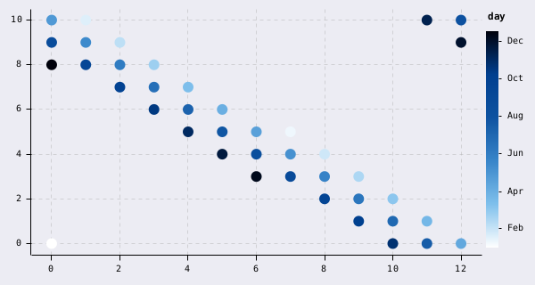
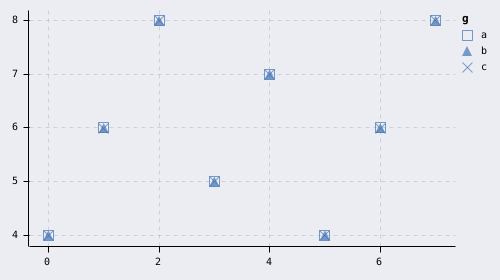
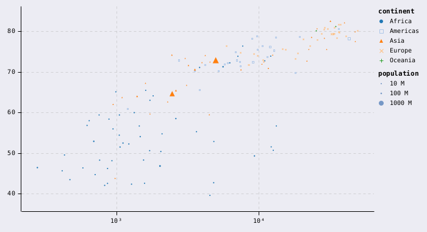
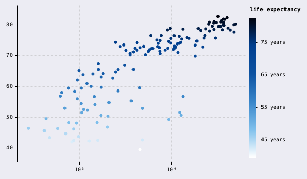
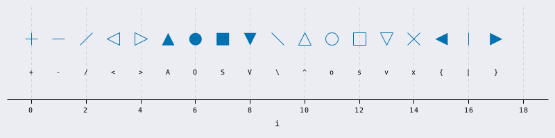
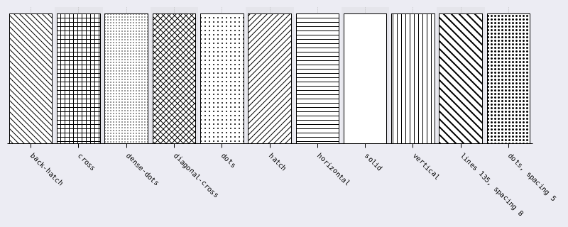

---
format:
  html:
    toc: true
    toc-location: right
    toc-depth: 4
    theme: cosmo
    include-in-header:
      text: |-
        <style>
        .data-table { width: fit-content; max-width: 100%; max-height: 15rem; overflow: auto; margin: 0 0 1rem 0; }
        .data-table .table-responsive { overflow: visible; }
        .data-table table { font-size: 0.75rem; width: auto; margin: 0; }
        .data-table th, .data-table td { padding: 0.1rem 0.45rem !important; white-space: nowrap; }
        .data-table thead th { position: sticky; top: 0; background: var(--bs-body-bg, #fff); }
        </style>
code-block-background: true

---
<style></style><style>.printedClojure .sourceCode {
  background-color: transparent;
  border-style: none;
}
</style><style>.clay-limit-image-width .clay-image {max-width: 100%}
.clay-side-by-side .sourceCode {margin: 0}
.clay-side-by-side {margin: 1em 0}
</style>
<script src="https://code.jquery.com/jquery-3.6.0.min.js" type="text/javascript"></script><script src="https://code.jquery.com/ui/1.13.1/jquery-ui.min.js" type="text/javascript"></script>

# Aesthetics and legends

Five aesthetics style marks from data: `:color`, `:shape`, `:size`, `:dash` and `:pattern`. Each mapped
aesthetic has a scale (`:scales {:color spec}`) mapping its domain (levels or a numeric range) onto attributes
(colours, shapes ...), and every scale draws a legend unless told not to. All five share one spec; the colour
scale uses every key, the others differ only in their `:range`.


::: {.sourceClojure}
```clojure
(ns reference.aesthetics-legends
  (:require [cljplot2.chart :as chart]
            [cljplot2.core :as plot]
            [cljplot2.describe :as describe]
            [cljplot2.scale.aesthetic :as aesthetic]
            [notebook-utils :as nu])
  (:import [java.time LocalDate]))
```
:::


Data: Gapminder 2007: life expectancy, population and GDP per capita, data-to-viz example dataset `4_ThreeNum` (Yan Holtz; Gapminder via the R gapminder package); licence: MIT (data_to_viz repository).


::: {.sourceClojure}
```clojure
(def gapminder (nu/dataset :gapminder-2007))
```
:::


```{=html}
<div class="data-table"><table class="table table-hover table-responsive clay-table"><thead><tr><th>country</th><th>continent</th><th>life-exp</th><th>pop</th><th>gdp-per-cap</th></tr></thead><tbody><tr><td>Afghanistan</td><td>Asia</td><td>43.828</td><td>31889923</td><td>974.5803384</td></tr><tr><td>Albania</td><td>Europe</td><td>76.423</td><td>3600523</td><td>5937.029526</td></tr><tr><td>Algeria</td><td>Africa</td><td>72.301</td><td>33333216</td><td>6223.367465</td></tr><tr><td>Angola</td><td>Africa</td><td>42.731</td><td>12420476</td><td>4797.231267</td></tr><tr><td>Argentina</td><td>Americas</td><td>75.32</td><td>40301927</td><td>12779.37964</td></tr><tr><td>Australia</td><td>Oceania</td><td>81.235</td><td>20434176</td><td>34435.36744</td></tr><tr><td>Austria</td><td>Europe</td><td>79.829</td><td>8199783</td><td>36126.4927</td></tr><tr><td>Bahrain</td><td>Asia</td><td>75.635</td><td>708573</td><td>29796.04834</td></tr><tr><td>Bangladesh</td><td>Asia</td><td>64.062</td><td>150448339</td><td>1391.253792</td></tr><tr><td>Belgium</td><td>Europe</td><td>79.441</td><td>10392226</td><td>33692.60508</td></tr><tr><td>Benin</td><td>Africa</td><td>56.728</td><td>8078314</td><td>1441.284873</td></tr><tr><td>Bolivia</td><td>Americas</td><td>65.554</td><td>9119152</td><td>3822.137084</td></tr><tr><td>Bosnia and Herzegovina</td><td>Europe</td><td>74.852</td><td>4552198</td><td>7446.298803</td></tr><tr><td>Botswana</td><td>Africa</td><td>50.728</td><td>1639131</td><td>12569.85177</td></tr><tr><td>Brazil</td><td>Americas</td><td>72.39</td><td>190010647</td><td>9065.800825</td></tr><tr><td>Bulgaria</td><td>Europe</td><td>73.005</td><td>7322858</td><td>10680.79282</td></tr><tr><td>Burkina Faso</td><td>Africa</td><td>52.295</td><td>14326203</td><td>1217.032994</td></tr><tr><td>Burundi</td><td>Africa</td><td>49.58</td><td>8390505</td><td>430.0706916</td></tr><tr><td>Cambodia</td><td>Asia</td><td>59.723</td><td>14131858</td><td>1713.778686</td></tr><tr><td>Cameroon</td><td>Africa</td><td>50.43</td><td>17696293</td><td>2042.09524</td></tr><tr><td>Canada</td><td>Americas</td><td>80.653</td><td>33390141</td><td>36319.23501</td></tr><tr><td>Central African Republic</td><td>Africa</td><td>44.741</td><td>4369038</td><td>706.016537</td></tr><tr><td>Chad</td><td>Africa</td><td>50.651</td><td>10238807</td><td>1704.063724</td></tr><tr><td>Chile</td><td>Americas</td><td>78.553</td><td>16284741</td><td>13171.63885</td></tr><tr><td>China</td><td>Asia</td><td>72.961</td><td>1318683096</td><td>4959.114854</td></tr><tr><td>Colombia</td><td>Americas</td><td>72.889</td><td>44227550</td><td>7006.580419</td></tr><tr><td>Comoros</td><td>Africa</td><td>65.152</td><td>710960</td><td>986.1478792</td></tr><tr><td>Congo, Dem. Rep.</td><td>Africa</td><td>46.462</td><td>64606759</td><td>277.5518587</td></tr><tr><td>Congo, Rep.</td><td>Africa</td><td>55.322</td><td>3800610</td><td>3632.557798</td></tr><tr><td>Costa Rica</td><td>Americas</td><td>78.782</td><td>4133884</td><td>9645.06142</td></tr><tr><td>Cote d'Ivoire</td><td>Africa</td><td>48.328</td><td>18013409</td><td>1544.750112</td></tr><tr><td>Croatia</td><td>Europe</td><td>75.748</td><td>4493312</td><td>14619.22272</td></tr><tr><td>Cuba</td><td>Americas</td><td>78.273</td><td>11416987</td><td>8948.102923</td></tr><tr><td>Czech Republic</td><td>Europe</td><td>76.486</td><td>10228744</td><td>22833.30851</td></tr><tr><td>Denmark</td><td>Europe</td><td>78.332</td><td>5468120</td><td>35278.41874</td></tr><tr><td>Djibouti</td><td>Africa</td><td>54.791</td><td>496374</td><td>2082.481567</td></tr><tr><td>Dominican Republic</td><td>Americas</td><td>72.235</td><td>9319622</td><td>6025.374752</td></tr><tr><td>Ecuador</td><td>Americas</td><td>74.994</td><td>13755680</td><td>6873.262326</td></tr><tr><td>Egypt</td><td>Africa</td><td>71.338</td><td>80264543</td><td>5581.180998</td></tr><tr><td>El Salvador</td><td>Americas</td><td>71.878</td><td>6939688</td><td>5728.353514</td></tr><tr><td>Equatorial Guinea</td><td>Africa</td><td>51.579</td><td>551201</td><td>12154.08975</td></tr><tr><td>Eritrea</td><td>Africa</td><td>58.04</td><td>4906585</td><td>641.3695236</td></tr><tr><td>Ethiopia</td><td>Africa</td><td>52.947</td><td>76511887</td><td>690.8055759</td></tr><tr><td>Finland</td><td>Europe</td><td>79.313</td><td>5238460</td><td>33207.0844</td></tr><tr><td>France</td><td>Europe</td><td>80.657</td><td>61083916</td><td>30470.0167</td></tr><tr><td>Gabon</td><td>Africa</td><td>56.735</td><td>1454867</td><td>13206.48452</td></tr><tr><td>Gambia</td><td>Africa</td><td>59.448</td><td>1688359</td><td>752.7497265</td></tr><tr><td>Germany</td><td>Europe</td><td>79.406</td><td>82400996</td><td>32170.37442</td></tr><tr><td>Ghana</td><td>Africa</td><td>60.022</td><td>22873338</td><td>1327.60891</td></tr><tr><td>Greece</td><td>Europe</td><td>79.483</td><td>10706290</td><td>27538.41188</td></tr><tr><td>Guatemala</td><td>Americas</td><td>70.259</td><td>12572928</td><td>5186.050003</td></tr><tr><td>Guinea</td><td>Africa</td><td>56.007</td><td>9947814</td><td>942.6542111</td></tr><tr><td>Guinea-Bissau</td><td>Africa</td><td>46.388</td><td>1472041</td><td>579.231743</td></tr><tr><td>Haiti</td><td>Americas</td><td>60.916</td><td>8502814</td><td>1201.637154</td></tr><tr><td>Honduras</td><td>Americas</td><td>70.198</td><td>7483763</td><td>3548.330846</td></tr><tr><td>Hong Kong, China</td><td>Asia</td><td>82.208</td><td>6980412</td><td>39724.97867</td></tr><tr><td>Hungary</td><td>Europe</td><td>73.338</td><td>9956108</td><td>18008.94444</td></tr><tr><td>Iceland</td><td>Europe</td><td>81.757</td><td>301931</td><td>36180.78919</td></tr><tr><td>India</td><td>Asia</td><td>64.698</td><td>1110396331</td><td>2452.210407</td></tr><tr><td>Indonesia</td><td>Asia</td><td>70.65</td><td>223547000</td><td>3540.651564</td></tr><tr><td>Iran</td><td>Asia</td><td>70.964</td><td>69453570</td><td>11605.71449</td></tr><tr><td>Iraq</td><td>Asia</td><td>59.545</td><td>27499638</td><td>4471.061906</td></tr><tr><td>Ireland</td><td>Europe</td><td>78.885</td><td>4109086</td><td>40675.99635</td></tr><tr><td>Israel</td><td>Asia</td><td>80.745</td><td>6426679</td><td>25523.2771</td></tr><tr><td>Italy</td><td>Europe</td><td>80.546</td><td>58147733</td><td>28569.7197</td></tr><tr><td>Jamaica</td><td>Americas</td><td>72.567</td><td>2780132</td><td>7320.880262</td></tr><tr><td>Japan</td><td>Asia</td><td>82.603</td><td>127467972</td><td>31656.06806</td></tr><tr><td>Jordan</td><td>Asia</td><td>72.535</td><td>6053193</td><td>4519.461171</td></tr><tr><td>Kenya</td><td>Africa</td><td>54.11</td><td>35610177</td><td>1463.249282</td></tr><tr><td>Korea, Dem. Rep.</td><td>Asia</td><td>67.297</td><td>23301725</td><td>1593.06548</td></tr><tr><td>Korea, Rep.</td><td>Asia</td><td>78.623</td><td>49044790</td><td>23348.13973</td></tr><tr><td>Kuwait</td><td>Asia</td><td>77.588</td><td>2505559</td><td>47306.98978</td></tr><tr><td>Lebanon</td><td>Asia</td><td>71.993</td><td>3921278</td><td>10461.05868</td></tr><tr><td>Lesotho</td><td>Africa</td><td>42.592</td><td>2012649</td><td>1569.331442</td></tr><tr><td>Liberia</td><td>Africa</td><td>45.678</td><td>3193942</td><td>414.5073415</td></tr><tr><td>Libya</td><td>Africa</td><td>73.952</td><td>6036914</td><td>12057.49928</td></tr><tr><td>Madagascar</td><td>Africa</td><td>59.443</td><td>19167654</td><td>1044.770126</td></tr><tr><td>Malawi</td><td>Africa</td><td>48.303</td><td>13327079</td><td>759.3499101</td></tr><tr><td>Malaysia</td><td>Asia</td><td>74.241</td><td>24821286</td><td>12451.6558</td></tr><tr><td>Mali</td><td>Africa</td><td>54.467</td><td>12031795</td><td>1042.581557</td></tr><tr><td>Mauritania</td><td>Africa</td><td>64.164</td><td>3270065</td><td>1803.151496</td></tr><tr><td>Mauritius</td><td>Africa</td><td>72.801</td><td>1250882</td><td>10956.99112</td></tr><tr><td>Mexico</td><td>Americas</td><td>76.195</td><td>108700891</td><td>11977.57496</td></tr><tr><td>Mongolia</td><td>Asia</td><td>66.803</td><td>2874127</td><td>3095.772271</td></tr><tr><td>Montenegro</td><td>Europe</td><td>74.543</td><td>684736</td><td>9253.896111</td></tr><tr><td>Morocco</td><td>Africa</td><td>71.164</td><td>33757175</td><td>3820.17523</td></tr><tr><td>Mozambique</td><td>Africa</td><td>42.082</td><td>19951656</td><td>823.6856205</td></tr><tr><td>Myanmar</td><td>Asia</td><td>62.069</td><td>47761980</td><td>944</td></tr><tr><td>Namibia</td><td>Africa</td><td>52.906</td><td>2055080</td><td>4811.060429</td></tr><tr><td>Nepal</td><td>Asia</td><td>63.785</td><td>28901790</td><td>1091.359778</td></tr><tr><td>Netherlands</td><td>Europe</td><td>79.762</td><td>16570613</td><td>36797.93332</td></tr><tr><td>New Zealand</td><td>Oceania</td><td>80.204</td><td>4115771</td><td>25185.00911</td></tr><tr><td>Nicaragua</td><td>Americas</td><td>72.899</td><td>5675356</td><td>2749.320965</td></tr><tr><td>Niger</td><td>Africa</td><td>56.867</td><td>12894865</td><td>619.6768924</td></tr><tr><td>Nigeria</td><td>Africa</td><td>46.859</td><td>135031164</td><td>2013.977305</td></tr><tr><td>Norway</td><td>Europe</td><td>80.196</td><td>4627926</td><td>49357.19017</td></tr><tr><td>Oman</td><td>Asia</td><td>75.64</td><td>3204897</td><td>22316.19287</td></tr><tr><td>Pakistan</td><td>Asia</td><td>65.483</td><td>169270617</td><td>2605.94758</td></tr><tr><td>Panama</td><td>Americas</td><td>75.537</td><td>3242173</td><td>9809.185636</td></tr><tr><td>Paraguay</td><td>Americas</td><td>71.752</td><td>6667147</td><td>4172.838464</td></tr><tr><td>…</td><td>…</td><td>…</td><td>…</td><td>…</td></tr></tbody></table></div>
```


## Levels or numbers

An aesthetic scale has its own kinds - not those of the position scales (`:log`, `:datetime` ... in the
examples below are the x axis's, Scales chapter). The kind follows the data: levels (strings, keywords) get an
`:ordinal` scale - one attribute per level, in `:domain` order - numbers a `:linear` one - a gradient or a size
range; `:binned` cuts numbers into classes; `:type :categorical` treats numbers or dates as levels; `:identity`
reads the attributes from the data.

::: {.clay-table}

```{=html}
<table class="table table-hover table-responsive clay-table"><thead><tr><th>Option</th><th>Type</th><th>Default</th><th>Description</th></tr></thead><tbody><tr><td>:kind</td><td>one of :binned :identity :linear :ordinal</td><td>:linear for numeric :color / :size data, else :ordinal</td><td>scale kind: :ordinal (levels), :linear (a gradient or size range), :binned (:color by bins) or :identity (values are the attributes)</td></tr><tr><td>:type</td><td>one of :categorical :numeric</td><td></td><td>declare numbers or dates categorical (ordinal levels) or force a numeric scale</td></tr><tr><td>:domain</td><td>sequential of any value or nil</td><td>the data's levels (sorted) or [min max]</td><td>ordinal: the levels in order; linear / binned: [lo hi]</td></tr></tbody></table>
```

:::


::: {.sourceClojure}
```clojure
(plot/render-image (plot/arrange [{:data gapminder
                                   :mapping {:x :gdp-per-cap :y :life-exp :color :continent}
                                   :charts [(chart/scatter)]
                                   :scales {:x {:kind :log :formatter :power}
                                            :color {:domain ["Europe" "Asia" "Africa" "Americas" "Oceania"]}}}
                                  {:data gapminder
                                   :mapping {:x :gdp-per-cap :y :life-exp :color :life-exp}
                                   :charts [(chart/scatter)]
                                   :scales {:x {:kind :log :formatter :power}}}]
                                 {:columns 2})
                   {:width 900 :height 350})
```
:::


::: {.clay-image}

:::


Dates (`java.time` values) mapped to `:color` get a linear gradient over time, the colour bar ticked at dates (a
`Year` / `YearMonth` reads as the date its period starts, on every scale):


::: {.sourceClojure}
```clojure
(def readings (for [i (range 40)]
                {:day (.plusDays (LocalDate/of 2024 1 1) (* 9 i)) :x (mod (* i 7) 13) :y (mod (* i 5) 11)}))
```
:::


```{=html}
<div class="data-table"><table class="table table-hover table-responsive clay-table"><thead><tr><th>day</th><th>x</th><th>y</th></tr></thead><tbody><tr><td>2024-01-01</td><td>0</td><td>0</td></tr><tr><td>2024-01-10</td><td>7</td><td>5</td></tr><tr><td>2024-01-19</td><td>1</td><td>10</td></tr><tr><td>2024-01-28</td><td>8</td><td>4</td></tr><tr><td>2024-02-06</td><td>2</td><td>9</td></tr><tr><td>2024-02-15</td><td>9</td><td>3</td></tr><tr><td>2024-02-24</td><td>3</td><td>8</td></tr><tr><td>2024-03-04</td><td>10</td><td>2</td></tr><tr><td>2024-03-13</td><td>4</td><td>7</td></tr><tr><td>2024-03-22</td><td>11</td><td>1</td></tr><tr><td>2024-03-31</td><td>5</td><td>6</td></tr><tr><td>2024-04-09</td><td>12</td><td>0</td></tr><tr><td>2024-04-18</td><td>6</td><td>5</td></tr><tr><td>2024-04-27</td><td>0</td><td>10</td></tr><tr><td>2024-05-06</td><td>7</td><td>4</td></tr><tr><td>2024-05-15</td><td>1</td><td>9</td></tr><tr><td>2024-05-24</td><td>8</td><td>3</td></tr><tr><td>2024-06-02</td><td>2</td><td>8</td></tr><tr><td>2024-06-11</td><td>9</td><td>2</td></tr><tr><td>2024-06-20</td><td>3</td><td>7</td></tr><tr><td>2024-06-29</td><td>10</td><td>1</td></tr><tr><td>2024-07-08</td><td>4</td><td>6</td></tr><tr><td>2024-07-17</td><td>11</td><td>0</td></tr><tr><td>2024-07-26</td><td>5</td><td>5</td></tr><tr><td>2024-08-04</td><td>12</td><td>10</td></tr><tr><td>2024-08-13</td><td>6</td><td>4</td></tr><tr><td>2024-08-22</td><td>0</td><td>9</td></tr><tr><td>2024-08-31</td><td>7</td><td>3</td></tr><tr><td>2024-09-09</td><td>1</td><td>8</td></tr><tr><td>2024-09-18</td><td>8</td><td>2</td></tr><tr><td>2024-09-27</td><td>2</td><td>7</td></tr><tr><td>2024-10-06</td><td>9</td><td>1</td></tr><tr><td>2024-10-15</td><td>3</td><td>6</td></tr><tr><td>2024-10-24</td><td>10</td><td>0</td></tr><tr><td>2024-11-02</td><td>4</td><td>5</td></tr><tr><td>2024-11-11</td><td>11</td><td>10</td></tr><tr><td>2024-11-20</td><td>5</td><td>4</td></tr><tr><td>2024-11-29</td><td>12</td><td>9</td></tr><tr><td>2024-12-08</td><td>6</td><td>3</td></tr><tr><td>2024-12-17</td><td>0</td><td>8</td></tr></tbody></table></div>
```


::: {.sourceClojure}
```clojure
(plot/render-image {:data readings
                    :mapping {:x :x :y :y :color :day}
                    :charts [(chart/scatter {:size 12})]}
                   {:width 600 :height 320})
```
:::


::: {.clay-image}

:::


Its `:ticks` take dates, and `:formatter` gets ticks in the data's type (here `LocalDate`s):


::: {.sourceClojure}
```clojure
(plot/render-image {:data readings
                    :mapping {:x :x :y :y :color :day}
                    :charts [(chart/scatter {:size 12})]
                    :scales {:color {:ticks [(LocalDate/of 2024 3 1) (LocalDate/of 2024 6 1) (LocalDate/of 2024 9 1)]
                                     :formatter #(str "Q" (inc (quot (dec (.getMonthValue ^LocalDate %)) 3)) " " (.getYear ^LocalDate %))}}}
                   {:width 600 :height 320})
```
:::


::: {.clay-image}

:::


## Colour range

The attributes the domain maps to: a sequence of colours, a level → colour map, or a clojure2d palette or
gradient name - 7339 palettes and 5009 gradients. Without `:range` the theme `:palette` supplies it.

::: {.clay-table}

```{=html}
<table class="table table-hover table-responsive clay-table"><thead><tr><th>Option</th><th>Type</th><th>Default</th><th>Description</th></tr></thead><tbody><tr><td>:range</td><td>map of any value to a clojure2d color or a function or a palette or gradient name, or a non-empty sequence of colors</td><td>theme :palette</td><td>attributes the domain maps to: palette, gradient, shapes, sizes [min max], dashes or patterns, or a level map</td></tr></tbody></table>
```

:::


Search palettes and gradients by name with `plot/find-palette` and `plot/find-gradient` (a regular expression,
or a namespace and one); `plot/palette` gives a palette's colours, `plot/gradient` a gradient function:


::: {.sourceClojure}
```clojure
(plot/find-palette #"tableau")
```
:::


::: {.printedClojure}
```clojure
(:tableau-10
 :tableau-10-2
 :tableau-10-light
 :tableau-10-medium
 :tableau-20
 :tableau-20-2
 :tableau-classic-20
 :tableau-classic-medium)

```
:::


Swatches of a few palettes (an `:identity` colour scale reads the colours from the data):


::: {.sourceClojure}
```clojure
(def palettes (plot/find-palette #"^:(rcartocolor/(Bold|Pastel|Vivid|Prism)|tableau-10)$"))
```
:::


::: {.sourceClojure}
```clojure
(def palette-swatches (for [p palettes [i col] (map-indexed vector (plot/palette p))]
                        {:palette (str p) :i i :color col}))
```
:::


```{=html}
<div class="data-table"><table class="table table-hover table-responsive clay-table"><thead><tr><th>palette</th><th>i</th><th>color</th></tr></thead><tbody><tr><td>:tableau-10</td><td>0</td><td>[31.0 119.0 180.0 255.0]</td></tr><tr><td>:tableau-10</td><td>1</td><td>[255.0 127.0 14.0 255.0]</td></tr><tr><td>:tableau-10</td><td>2</td><td>[44.0 160.0 44.0 255.0]</td></tr><tr><td>:tableau-10</td><td>3</td><td>[214.0 39.0 40.0 255.0]</td></tr><tr><td>:tableau-10</td><td>4</td><td>[148.0 103.0 189.0 255.0]</td></tr><tr><td>:tableau-10</td><td>5</td><td>[140.0 86.0 75.0 255.0]</td></tr><tr><td>:tableau-10</td><td>6</td><td>[227.0 119.0 194.0 255.0]</td></tr><tr><td>:tableau-10</td><td>7</td><td>[127.0 127.0 127.0 255.0]</td></tr><tr><td>:tableau-10</td><td>8</td><td>[188.0 189.0 34.0 255.0]</td></tr><tr><td>:tableau-10</td><td>9</td><td>[23.0 190.0 207.0 255.0]</td></tr><tr><td>:rcartocolor/Bold</td><td>0</td><td>[127.0 60.0 141.0 255.0]</td></tr><tr><td>:rcartocolor/Bold</td><td>1</td><td>[17.0 165.0 121.0 255.0]</td></tr><tr><td>:rcartocolor/Bold</td><td>2</td><td>[57.0 105.0 172.0 255.0]</td></tr><tr><td>:rcartocolor/Bold</td><td>3</td><td>[242.0 183.0 1.0 255.0]</td></tr><tr><td>:rcartocolor/Bold</td><td>4</td><td>[231.0 63.0 116.0 255.0]</td></tr><tr><td>:rcartocolor/Bold</td><td>5</td><td>[128.0 186.0 90.0 255.0]</td></tr><tr><td>:rcartocolor/Bold</td><td>6</td><td>[230.0 131.0 16.0 255.0]</td></tr><tr><td>:rcartocolor/Bold</td><td>7</td><td>[0.0 134.0 149.0 255.0]</td></tr><tr><td>:rcartocolor/Bold</td><td>8</td><td>[207.0 28.0 144.0 255.0]</td></tr><tr><td>:rcartocolor/Bold</td><td>9</td><td>[249.0 123.0 114.0 255.0]</td></tr><tr><td>:rcartocolor/Bold</td><td>10</td><td>[75.0 75.0 143.0 255.0]</td></tr><tr><td>:rcartocolor/Bold</td><td>11</td><td>[165.0 170.0 153.0 255.0]</td></tr><tr><td>:rcartocolor/Pastel</td><td>0</td><td>[102.0 197.0 204.0 255.0]</td></tr><tr><td>:rcartocolor/Pastel</td><td>1</td><td>[246.0 207.0 113.0 255.0]</td></tr><tr><td>:rcartocolor/Pastel</td><td>2</td><td>[248.0 156.0 116.0 255.0]</td></tr><tr><td>:rcartocolor/Pastel</td><td>3</td><td>[220.0 176.0 242.0 255.0]</td></tr><tr><td>:rcartocolor/Pastel</td><td>4</td><td>[135.0 197.0 95.0 255.0]</td></tr><tr><td>:rcartocolor/Pastel</td><td>5</td><td>[158.0 185.0 243.0 255.0]</td></tr><tr><td>:rcartocolor/Pastel</td><td>6</td><td>[254.0 136.0 177.0 255.0]</td></tr><tr><td>:rcartocolor/Pastel</td><td>7</td><td>[201.0 219.0 116.0 255.0]</td></tr><tr><td>:rcartocolor/Pastel</td><td>8</td><td>[139.0 224.0 164.0 255.0]</td></tr><tr><td>:rcartocolor/Pastel</td><td>9</td><td>[180.0 151.0 231.0 255.0]</td></tr><tr><td>:rcartocolor/Pastel</td><td>10</td><td>[211.0 180.0 132.0 255.0]</td></tr><tr><td>:rcartocolor/Pastel</td><td>11</td><td>[179.0 179.0 179.0 255.0]</td></tr><tr><td>:rcartocolor/Prism</td><td>0</td><td>[95.0 70.0 144.0 255.0]</td></tr><tr><td>:rcartocolor/Prism</td><td>1</td><td>[29.0 105.0 150.0 255.0]</td></tr><tr><td>:rcartocolor/Prism</td><td>2</td><td>[56.0 166.0 165.0 255.0]</td></tr><tr><td>:rcartocolor/Prism</td><td>3</td><td>[15.0 133.0 84.0 255.0]</td></tr><tr><td>:rcartocolor/Prism</td><td>4</td><td>[115.0 175.0 72.0 255.0]</td></tr><tr><td>:rcartocolor/Prism</td><td>5</td><td>[237.0 173.0 8.0 255.0]</td></tr><tr><td>:rcartocolor/Prism</td><td>6</td><td>[225.0 124.0 5.0 255.0]</td></tr><tr><td>:rcartocolor/Prism</td><td>7</td><td>[204.0 80.0 62.0 255.0]</td></tr><tr><td>:rcartocolor/Prism</td><td>8</td><td>[148.0 52.0 110.0 255.0]</td></tr><tr><td>:rcartocolor/Prism</td><td>9</td><td>[111.0 64.0 112.0 255.0]</td></tr><tr><td>:rcartocolor/Prism</td><td>10</td><td>[153.0 78.0 149.0 255.0]</td></tr><tr><td>:rcartocolor/Prism</td><td>11</td><td>[102.0 102.0 102.0 255.0]</td></tr><tr><td>:rcartocolor/Vivid</td><td>0</td><td>[229.0 134.0 6.0 255.0]</td></tr><tr><td>:rcartocolor/Vivid</td><td>1</td><td>[93.0 105.0 177.0 255.0]</td></tr><tr><td>:rcartocolor/Vivid</td><td>2</td><td>[82.0 188.0 163.0 255.0]</td></tr><tr><td>:rcartocolor/Vivid</td><td>3</td><td>[153.0 201.0 69.0 255.0]</td></tr><tr><td>:rcartocolor/Vivid</td><td>4</td><td>[204.0 97.0 176.0 255.0]</td></tr><tr><td>:rcartocolor/Vivid</td><td>5</td><td>[36.0 121.0 108.0 255.0]</td></tr><tr><td>:rcartocolor/Vivid</td><td>6</td><td>[218.0 165.0 27.0 255.0]</td></tr><tr><td>:rcartocolor/Vivid</td><td>7</td><td>[47.0 138.0 196.0 255.0]</td></tr><tr><td>:rcartocolor/Vivid</td><td>8</td><td>[118.0 78.0 159.0 255.0]</td></tr><tr><td>:rcartocolor/Vivid</td><td>9</td><td>[237.0 100.0 90.0 255.0]</td></tr><tr><td>:rcartocolor/Vivid</td><td>10</td><td>[204.0 58.0 142.0 255.0]</td></tr><tr><td>:rcartocolor/Vivid</td><td>11</td><td>[165.0 170.0 153.0 255.0]</td></tr></tbody></table></div>
```


::: {.sourceClojure}
```clojure
(plot/render-image {:data palette-swatches
                    :mapping {:x :i :y :palette :color :color}
                    :charts [(chart/tile)]
                    :scales {:color {:kind :identity :legend false}
                             :y {:reverse true}
                             :x {:ticks 12}}}
                   {:width 700 :height 280})
```
:::


::: {.clay-image}

:::


Gradients, each sampled at 32 points:


::: {.sourceClojure}
```clojure
(def gradients (plot/find-gradient "viridis" #".*"))
```
:::


::: {.sourceClojure}
```clojure
(def gradient-swatches (for [g gradients
                             :let [gradient (plot/gradient g)]
                             i (range 32)]
                         {:gradient (str g) :i i :color (gradient (/ i 31.0))}))
```
:::


```{=html}
<div class="data-table"><table class="table table-hover table-responsive clay-table"><thead><tr><th>gradient</th><th>i</th><th>color</th></tr></thead><tbody><tr><td>:viridis/cividis</td><td>0</td><td>[0.0 32.0 77.0 255.0]</td></tr><tr><td>:viridis/cividis</td><td>1</td><td>[0.0 38.096774193548384 90.38709677419355 255.0]</td></tr><tr><td>:viridis/cividis</td><td>2</td><td>[0.0 44.193548387096776 105.58064516129032 255.0]</td></tr><tr><td>:viridis/cividis</td><td>3</td><td>[0.0 48.58064516129032 111.0 255.0]</td></tr><tr><td>:viridis/cividis</td><td>4</td><td>[10.09677419354838 54.774193548387096 110.0 255.0]</td></tr><tr><td>:viridis/cividis</td><td>5</td><td>[32.93548387096774 60.96774193548387 108.51612903225806 255.0]</td></tr><tr><td>:viridis/cividis</td><td>6</td><td>[46.74193548387096 66.58064516129032 108.0 255.0]</td></tr><tr><td>:viridis/cividis</td><td>7</td><td>[57.354838709677416 72.6774193548387 107.0 255.0]</td></tr><tr><td>:viridis/cividis</td><td>8</td><td>[66.54838709677419 78.54838709677419 107.0 255.0]</td></tr><tr><td>:viridis/cividis</td><td>9</td><td>[75.74193548387098 83.87096774193549 107.87096774193549 255.0]</td></tr><tr><td>:viridis/cividis</td><td>10</td><td>[83.93548387096774 89.96774193548387 108.0 255.0]</td></tr><tr><td>:viridis/cividis</td><td>11</td><td>[91.12903225806453 96.06451612903226 110.0 255.0]</td></tr><tr><td>:viridis/cividis</td><td>12</td><td>[99.16129032258064 102.16129032258064 111.16129032258064 255.0]</td></tr><tr><td>:viridis/cividis</td><td>13</td><td>[106.51612903225806 108.51612903225806 113.25806451612904 255.0]</td></tr><tr><td>:viridis/cividis</td><td>14</td><td>[114.0 114.06451612903226 116.0 255.0]</td></tr><tr><td>:viridis/cividis</td><td>15</td><td>[120.90322580645162 120.35483870967742 119.0 255.0]</td></tr><tr><td>:viridis/cividis</td><td>16</td><td>[129.09677419354838 126.64516129032259 121.0 255.0]</td></tr><tr><td>:viridis/cividis</td><td>17</td><td>[136.29032258064515 132.93548387096772 121.0 255.0]</td></tr><tr><td>:viridis/cividis</td><td>18</td><td>[144.48387096774195 139.48387096774195 120.25806451612902 255.0]</td></tr><tr><td>:viridis/cividis</td><td>19</td><td>[152.67741935483872 145.83870967741936 120.0 255.0]</td></tr><tr><td>:viridis/cividis</td><td>20</td><td>[160.8709677419355 152.8709677419355 118.06451612903226 255.0]</td></tr><tr><td>:viridis/cividis</td><td>21</td><td>[170.06451612903223 159.06451612903223 116.96774193548389 255.0]</td></tr><tr><td>:viridis/cividis</td><td>22</td><td>[178.25806451612905 166.25806451612905 114.0 255.0]</td></tr><tr><td>:viridis/cividis</td><td>23</td><td>[186.4516129032258 173.4516129032258 111.7741935483871 255.0]</td></tr><tr><td>:viridis/cividis</td><td>24</td><td>[195.6451612903226 180.32258064516128 108.6774193548387 255.0]</td></tr><tr><td>:viridis/cividis</td><td>25</td><td>[204.83870967741933 187.41935483870967 104.58064516129033 255.0]</td></tr><tr><td>:viridis/cividis</td><td>26</td><td>[213.54838709677423 195.03225806451616 99.48387096774192 255.0]</td></tr><tr><td>:viridis/cividis</td><td>27</td><td>[222.83870967741936 202.2258064516129 94.38709677419355 255.0]</td></tr><tr><td>:viridis/cividis</td><td>28</td><td>[232.1290322580645 210.4193548387097 88.29032258064515 255.0]</td></tr><tr><td>:viridis/cividis</td><td>29</td><td>[241.61290322580643 217.61290322580643 80.38709677419357 255.0]</td></tr><tr><td>:viridis/cividis</td><td>30</td><td>[250.80645161290326 225.80645161290326 72.19354838709675 255.0]</td></tr><tr><td>:viridis/cividis</td><td>31</td><td>[255.0 234.0 70.0 255.0]</td></tr><tr><td>:viridis/inferno</td><td>0</td><td>[0.0 0.0 4.0 255.0]</td></tr><tr><td>:viridis/inferno</td><td>1</td><td>[4.096774193548387 3.096774193548387 18.483870967741936 255.0]</td></tr><tr><td>:viridis/inferno</td><td>2</td><td>[11.387096774193548 7.193548387096774 36.96774193548387 255.0]</td></tr><tr><td>:viridis/inferno</td><td>3</td><td>[21.870967741935484 11.290322580645162 56.45161290322581 255.0]</td></tr><tr><td>:viridis/inferno</td><td>4</td><td>[34.16129032258064 12.0 75.93548387096774 255.0]</td></tr><tr><td>:viridis/inferno</td><td>5</td><td>[48.4516129032258 10.0 92.45161290322581 255.0]</td></tr><tr><td>:viridis/inferno</td><td>6</td><td>[62.74193548387096 9.58064516129032 102.16129032258064 255.0]</td></tr><tr><td>:viridis/inferno</td><td>7</td><td>[76.03225806451613 12.677419354838708 107.6774193548387 255.0]</td></tr><tr><td>:viridis/inferno</td><td>8</td><td>[89.54838709677419 16.774193548387096 110.0 255.0]</td></tr><tr><td>:viridis/inferno</td><td>9</td><td>[103.48387096774195 21.870967741935488 110.0 255.0]</td></tr><tr><td>:viridis/inferno</td><td>10</td><td>[115.90322580645162 25.967741935483872 110.0 255.0]</td></tr><tr><td>:viridis/inferno</td><td>11</td><td>[129.1935483870968 31.064516129032263 107.93548387096774 255.0]</td></tr><tr><td>:viridis/inferno</td><td>12</td><td>[142.48387096774195 35.32258064516129 104.83870967741936 255.0]</td></tr><tr><td>:viridis/inferno</td><td>13</td><td>[155.03225806451613 41.0 100.0 255.0]</td></tr><tr><td>:viridis/inferno</td><td>14</td><td>[168.06451612903226 46.0 95.29032258064517 255.0]</td></tr><tr><td>:viridis/inferno</td><td>15</td><td>[180.35483870967744 51.35483870967742 89.09677419354838 255.0]</td></tr><tr><td>:viridis/inferno</td><td>16</td><td>[193.09677419354838 58.0 79.90322580645162 255.0]</td></tr><tr><td>:viridis/inferno</td><td>17</td><td>[204.29032258064515 66.29032258064514 71.70967741935486 255.0]</td></tr><tr><td>:viridis/inferno</td><td>18</td><td>[214.9677419354839 75.22580645161293 63.03225806451609 255.0]</td></tr><tr><td>:viridis/inferno</td><td>19</td><td>[224.67741935483872 85.51612903225806 53.322580645161295 255.0]</td></tr><tr><td>:viridis/inferno</td><td>20</td><td>[232.8709677419355 96.74193548387098 44.12903225806451 255.0]</td></tr><tr><td>:viridis/inferno</td><td>21</td><td>[239.06451612903223 109.09677419354836 33.90322580645164 255.0]</td></tr><tr><td>:viridis/inferno</td><td>22</td><td>[245.1290322580645 122.5161290322581 22.612903225806424 255.0]</td></tr><tr><td>:viridis/inferno</td><td>23</td><td>[248.2258064516129 136.90322580645162 11.548387096774196 255.0]</td></tr><tr><td>:viridis/inferno</td><td>24</td><td>[251.0 152.29032258064518 6.0 255.0]</td></tr><tr><td>:viridis/inferno</td><td>25</td><td>[252.0 167.6774193548387 13.258064516129009 255.0]</td></tr><tr><td>:viridis/inferno</td><td>26</td><td>[251.0 184.06451612903228 28.580645161290374 255.0]</td></tr><tr><td>:viridis/inferno</td><td>27</td><td>[249.38709677419354 199.83870967741936 48.064516129032256 255.0]</td></tr><tr><td>:viridis/inferno</td><td>28</td><td>[245.29032258064515 215.83870967741936 71.25806451612905 255.0]</td></tr><tr><td>:viridis/inferno</td><td>29</td><td>[242.19354838709677 231.41935483870967 99.45161290322575 255.0]</td></tr><tr><td>:viridis/inferno</td><td>30</td><td>[242.90322580645162 244.70967741935488 133.1290322580646 255.0]</td></tr><tr><td>:viridis/inferno</td><td>31</td><td>[252.0 255.0 164.0 255.0]</td></tr><tr><td>:viridis/magma</td><td>0</td><td>[0.0 0.0 4.0 255.0]</td></tr><tr><td>:viridis/magma</td><td>1</td><td>[3.193548387096774 3.096774193548387 18.387096774193548 255.0]</td></tr><tr><td>:viridis/magma</td><td>2</td><td>[10.387096774193548 8.193548387096774 34.774193548387096 255.0]</td></tr><tr><td>:viridis/magma</td><td>3</td><td>[19.580645161290324 13.290322580645162 53.16129032258065 255.0]</td></tr><tr><td>:viridis/magma</td><td>4</td><td>[30.16129032258064 17.0 72.54838709677419 255.0]</td></tr><tr><td>:viridis/magma</td><td>5</td><td>[42.4516129032258 17.0 92.41935483870967 255.0]</td></tr><tr><td>:viridis/magma</td><td>6</td><td>[55.74193548387096 15.41935483870968 108.74193548387096 255.0]</td></tr><tr><td>:viridis/magma</td><td>7</td><td>[70.70967741935483 15.677419354838708 119.35483870967741 255.0]</td></tr><tr><td>:viridis/magma</td><td>8</td><td>[84.09677419354838 18.774193548387096 124.7741935483871 255.0]</td></tr><tr><td>:viridis/magma</td><td>9</td><td>[95.74193548387098 23.870967741935488 127.87096774193549 255.0]</td></tr><tr><td>:viridis/magma</td><td>10</td><td>[108.90322580645162 28.967741935483872 129.0 255.0]</td></tr><tr><td>:viridis/magma</td><td>11</td><td>[122.19354838709678 34.06451612903226 130.0 255.0]</td></tr><tr><td>:viridis/magma</td><td>12</td><td>[135.48387096774195 39.32258064516129 129.0 255.0]</td></tr><tr><td>:viridis/magma</td><td>13</td><td>[148.03225806451613 43.25806451612903 128.0 255.0]</td></tr><tr><td>:viridis/magma</td><td>14</td><td>[161.41935483870967 47.354838709677416 126.64516129032258 255.0]</td></tr><tr><td>:viridis/magma</td><td>15</td><td>[175.35483870967744 52.45161290322581 123.54838709677419 255.0]</td></tr><tr><td>:viridis/magma</td><td>16</td><td>[188.6451612903226 57.54838709677419 119.45161290322581 255.0]</td></tr><tr><td>:viridis/magma</td><td>17</td><td>[201.93548387096772 62.0 113.70967741935486 255.0]</td></tr><tr><td>:viridis/magma</td><td>18</td><td>[214.22580645161293 68.74193548387098 108.25806451612902 255.0]</td></tr><tr><td>:viridis/magma</td><td>19</td><td>[226.3548387096774 77.51612903225806 101.3225806451613 255.0]</td></tr><tr><td>:viridis/magma</td><td>20</td><td>[235.8709677419355 87.80645161290323 96.06451612903226 255.0]</td></tr><tr><td>:viridis/magma</td><td>21</td><td>[243.03225806451613 101.09677419354836 92.0 255.0]</td></tr><tr><td>:viridis/magma</td><td>22</td><td>[248.1290322580645 115.64516129032263 92.12903225806453 255.0]</td></tr><tr><td>:viridis/magma</td><td>23</td><td>[251.0 130.90322580645162 95.45161290322581 255.0]</td></tr><tr><td>:viridis/magma</td><td>24</td><td>[253.0 147.29032258064518 102.64516129032259 255.0]</td></tr><tr><td>:viridis/magma</td><td>25</td><td>[254.0 162.6774193548387 111.25806451612901 255.0]</td></tr><tr><td>:viridis/magma</td><td>26</td><td>[254.0 178.06451612903228 121.54838709677422 255.0]</td></tr><tr><td>:viridis/magma</td><td>27</td><td>[254.0 192.83870967741936 133.83870967741936 255.0]</td></tr><tr><td>:viridis/magma</td><td>28</td><td>[254.0 207.83870967741936 146.83870967741936 255.0]</td></tr><tr><td>:viridis/magma</td><td>29</td><td>[253.0 223.22580645161287 160.41935483870967 255.0]</td></tr><tr><td>:viridis/magma</td><td>30</td><td>[252.09677419354838 237.70967741935488 175.6129032258065 255.0]</td></tr><tr><td>:viridis/magma</td><td>31</td><td>[252.0 253.0 191.0 255.0]</td></tr><tr><td>:viridis/mako</td><td>0</td><td>[11.0 4.0 5.0 255.0]</td></tr><tr><td>:viridis/mako</td><td>1</td><td>[20.193548387096776 9.193548387096774 16.29032258064516 255.0]</td></tr><tr><td>:viridis/mako</td><td>2</td><td>[28.387096774193548 16.193548387096776 28.580645161290324 255.0]</td></tr><tr><td>:viridis/mako</td><td>3</td><td>[36.58064516129032 22.29032258064516 40.87096774193548 255.0]</td></tr><tr><td>…</td><td>…</td><td>…</td></tr></tbody></table></div>
```


::: {.sourceClojure}
```clojure
(plot/render-image {:data gradient-swatches
                    :mapping {:x :i :y :gradient :color :color}
                    :charts [(chart/tile {:stroke-color :none})]
                    :scales {:color {:kind :identity :legend false}
                             :y {:reverse true}
                             :x {:axis false}}}
                   {:width 700 :height 300})
```
:::


::: {.clay-image}

:::


## Placing values on the range

How values spread over the attributes: a diverging gradient around `:midpoint`, values placed by a transform,
the range reversed, size by area.

::: {.clay-table}

```{=html}
<table class="table table-hover table-responsive clay-table"><thead><tr><th>Option</th><th>Type</th><th>Default</th><th>Description</th></tr></thead><tbody><tr><td>:spread</td><td>true or false</td><td>false</td><td>ordinal :color: the range resampled to one colour per level</td></tr><tr><td>:midpoint</td><td>a finite number</td><td></td><td>linear / binned :color: the value at the gradient's middle (a diverging scale)</td></tr><tr><td>:transform</td><td>one of :exp :log :sq :sqrt or a function</td><td></td><td>linear :color: values placed along the gradient by their square root, logarithm, square, exponential or a monotonic function</td></tr><tr><td>:reverse</td><td>true or false</td><td>false</td><td>the attributes in reverse order</td></tr><tr><td>:area</td><td>true or false</td><td>false</td><td>:size: the mark's area, not its size, grows linearly with the value</td></tr></tbody></table>
```

:::


::: {.sourceClojure}
```clojure
(plot/render-image (plot/arrange [{:data gapminder
                                   :mapping {:x :gdp-per-cap :y :life-exp :color :life-exp}
                                   :charts [(chart/scatter)]
                                   :scales {:x {:kind :log :formatter :power}
                                            :color {:range [:steelblue :white :firebrick] :midpoint 65
                                                    :title "life-exp, midpoint 65"}}}
                                  {:data gapminder
                                   :mapping {:x :gdp-per-cap :y :life-exp :color :pop}
                                   :charts [(chart/scatter)]
                                   :scales {:x {:kind :log :formatter :power}
                                            :color {:transform :log :range :viridis/viridis :reverse true
                                                    :title "pop, log, reversed"}}}]
                                 {:columns 2})
                   {:width 900 :height 350})
```
:::


::: {.clay-image}

:::


`:transform` places values along the gradient by `:sqrt`, `:log`, `:sq`, `:exp` or a function of the value; the
function must be monotonic over the domain (the colour bar inverts it numerically) and finite at its ends. The
values 1 to 20 under each (`:exp` - the values 0.1 to 2, the exponential of 20 dwarfs everything):


::: {.sourceClojure}
```clojure
(def ramp (for [i (range 1 21)] {:i i :tenth (* 0.1 i) :row "value"}))
```
:::


```{=html}
<div class="data-table"><table class="table table-hover table-responsive clay-table"><thead><tr><th>i</th><th>tenth</th><th>row</th></tr></thead><tbody><tr><td>1</td><td>0.1</td><td>value</td></tr><tr><td>2</td><td>0.2</td><td>value</td></tr><tr><td>3</td><td>0.30000000000000004</td><td>value</td></tr><tr><td>4</td><td>0.4</td><td>value</td></tr><tr><td>5</td><td>0.5</td><td>value</td></tr><tr><td>6</td><td>0.6000000000000001</td><td>value</td></tr><tr><td>7</td><td>0.7000000000000001</td><td>value</td></tr><tr><td>8</td><td>0.8</td><td>value</td></tr><tr><td>9</td><td>0.9</td><td>value</td></tr><tr><td>10</td><td>1.0</td><td>value</td></tr><tr><td>11</td><td>1.1</td><td>value</td></tr><tr><td>12</td><td>1.2000000000000002</td><td>value</td></tr><tr><td>13</td><td>1.3</td><td>value</td></tr><tr><td>14</td><td>1.4000000000000001</td><td>value</td></tr><tr><td>15</td><td>1.5</td><td>value</td></tr><tr><td>16</td><td>1.6</td><td>value</td></tr><tr><td>17</td><td>1.7000000000000002</td><td>value</td></tr><tr><td>18</td><td>1.8</td><td>value</td></tr><tr><td>19</td><td>1.9000000000000001</td><td>value</td></tr><tr><td>20</td><td>2.0</td><td>value</td></tr></tbody></table></div>
```


::: {.sourceClojure}
```clojure
(plot/render-image (plot/arrange (for [[title transform] [["none" nil] [":sqrt" :sqrt] [":log" :log]
                                                         [":sq" :sq] [":exp" :exp] ["cube root (fn)" #(Math/cbrt %)]]]
                                   {:data ramp
                                    :mapping {:x :i :y :row :color (if (= :exp transform) :tenth :i)}
                                    :charts [(chart/tile)]
                                    :scales (cond-> {:color {:title nil}} transform (assoc-in [:color :transform] transform))
                                    :labels {:title title :y nil}})
                                 {:columns 3})
                   {:width 900 :height 330})
```
:::


::: {.clay-image}

:::


`:area true` grows a size scale's marks by area, not diameter - the right one reads as proportional:


::: {.sourceClojure}
```clojure
(plot/render-image (plot/arrange (for [area [false true]]
                                   {:data ramp
                                    :mapping {:x :i :y :row :size :i}
                                    :charts [(chart/scatter)]
                                    :scales {:size {:range [2 26] :area area :legend false}}
                                    :labels {:title (str ":area " area) :y nil}})
                                 {:columns 2})
                   {:width 900 :height 200})
```
:::


::: {.clay-image}

:::


## Bins

A `:binned` colour scale cuts numbers into classes and draws a key per class. `:bins` takes a count of equal
bins, the breaks themselves, a binning method (`:sturges`, `:sqrt`, `:rice`, `:doane`, `:scott` ...) or quantile
bins:

::: {.clay-table}

```{=html}
<table class="table table-hover table-responsive clay-table"><thead><tr><th>Option</th><th>Type</th><th>Default</th><th>Description</th></tr></thead><tbody><tr><td>:bins</td><td>keyword or vector of a finite number (at least 2) or quantile bins {:quantiles q :estimation e}: q a positive count or a vector of increasing probabilities strictly between 0 and 1, e one of [:legacy :r1 :r2 :r3 :r4 :r5 :r6 :r7 :r8 :r9] or a positive integer</td><td>5 equal bins</td><td>binned :color: a bin count, breaks, a bin method or quantile bins</td></tr></tbody></table>
```

:::


::: {.sourceClojure}
```clojure
(plot/render-image (plot/arrange (for [[title bins] [["3 equal bins" 3] ["breaks [39 50 60 70 83]" [39 50 60 70 83]]
                                                    ["method :sturges" :sturges] ["{:quantiles 4}" {:quantiles 4}]]]
                                   {:data gapminder
                                    :mapping {:x :gdp-per-cap :y :life-exp :color :life-exp}
                                    :charts [(chart/scatter)]
                                    :scales {:x {:kind :log :formatter :power}
                                             :color {:kind :binned :bins bins :range :viridis/viridis :title nil}}
                                    :labels {:title title}})
                                 {:columns 2})
                   {:width 900 :height 600})
```
:::


::: {.clay-image}

:::


## Legend

One legend per mapped aesthetic, titled by the mapped column's name: `:title` renames it, `:formatter` writes its
labels, `:ticks` picks the entries of a numeric scale (`:integer-ticks` keeps counted ones at whole numbers),
`:legend false` hides it (the plot's `:legend false` hides
them all). Aesthetics mapped to the same column with equal levels share one legend. Legends sit right of the
panels; their sizes and frame are in the theme `:legend` section (Theme chapter).

::: {.clay-table}

```{=html}
<table class="table table-hover table-responsive clay-table"><thead><tr><th>Option</th><th>Type</th><th>Default</th><th>Description</th></tr></thead><tbody><tr><td>:formatter</td><td>a function</td><td></td><td>legend labels, a function of the level or value</td></tr><tr><td>:ticks</td><td>sequential of a finite number or a java.time value or a positive integer or nil</td><td></td><td>linear :size / :color: the legend entries or colour bar ticks - a count or the values (dates for a :color scale over dates)</td></tr><tr><td>:integer-ticks</td><td>true or false</td><td>false</td><td>linear :size / :color: counted legend entries or colour bar ticks only at whole numbers (an explicit :ticks vector or :midpoint tick is drawn as given)</td></tr><tr><td>:title</td><td>string or nil</td><td>the mapped column's name</td><td>legend title (nil - none)</td></tr><tr><td>:legend</td><td>true or false or nil</td><td>true</td><td>show the scale's legend</td></tr></tbody></table>
```

:::


::: {.sourceClojure}
```clojure
(plot/render-image {:data gapminder
                    :mapping {:x :gdp-per-cap :y :life-exp :color :continent :shape :continent :size :pop}
                    :charts [(chart/scatter)]
                    :scales {:x {:kind :log :formatter :power}
                             :color {:title "continent"}
                             :size {:title "population" :ticks [1e7 1e8 1e9]
                                    :formatter #(format "%.0f M" (/ (double %) 1e6))}}}
                   {:width 700 :height 380})
```
:::


::: {.clay-image}

:::


A colour bar takes `:ticks` and `:formatter` too:


::: {.sourceClojure}
```clojure
(plot/render-image {:data gapminder
                    :mapping {:x :gdp-per-cap :y :life-exp :color :life-exp}
                    :charts [(chart/scatter)]
                    :scales {:x {:kind :log :formatter :power}
                             :color {:ticks [45 55 65 75] :formatter #(str % " years") :title "life expectancy"}}}
                   {:width 600 :height 350})
```
:::


::: {.clay-image}

:::


Data: Motor Trend car road tests (1974), R datasets package `mtcars` (Henderson & Velleman 1981); licence: Part of R (GPL-2 | GPL-3).


::: {.sourceClojure}
```clojure
(def mtcars (nu/dataset :mtcars))
```
:::


```{=html}
<div class="data-table"><table class="table table-hover table-responsive clay-table"><thead><tr><th>model</th><th>mpg</th><th>cyl</th><th>disp</th><th>hp</th><th>drat</th><th>wt</th><th>qsec</th><th>vs</th><th>am</th><th>gear</th><th>carb</th></tr></thead><tbody><tr><td>Mazda RX4</td><td>21</td><td>6</td><td>160</td><td>110</td><td>3.9</td><td>2.62</td><td>16.46</td><td>0</td><td>1</td><td>4</td><td>4</td></tr><tr><td>Mazda RX4 Wag</td><td>21</td><td>6</td><td>160</td><td>110</td><td>3.9</td><td>2.875</td><td>17.02</td><td>0</td><td>1</td><td>4</td><td>4</td></tr><tr><td>Datsun 710</td><td>22.8</td><td>4</td><td>108</td><td>93</td><td>3.85</td><td>2.32</td><td>18.61</td><td>1</td><td>1</td><td>4</td><td>1</td></tr><tr><td>Hornet 4 Drive</td><td>21.4</td><td>6</td><td>258</td><td>110</td><td>3.08</td><td>3.215</td><td>19.44</td><td>1</td><td>0</td><td>3</td><td>1</td></tr><tr><td>Hornet Sportabout</td><td>18.7</td><td>8</td><td>360</td><td>175</td><td>3.15</td><td>3.44</td><td>17.02</td><td>0</td><td>0</td><td>3</td><td>2</td></tr><tr><td>Valiant</td><td>18.1</td><td>6</td><td>225</td><td>105</td><td>2.76</td><td>3.46</td><td>20.22</td><td>1</td><td>0</td><td>3</td><td>1</td></tr><tr><td>Duster 360</td><td>14.3</td><td>8</td><td>360</td><td>245</td><td>3.21</td><td>3.57</td><td>15.84</td><td>0</td><td>0</td><td>3</td><td>4</td></tr><tr><td>Merc 240D</td><td>24.4</td><td>4</td><td>146.7</td><td>62</td><td>3.69</td><td>3.19</td><td>20</td><td>1</td><td>0</td><td>4</td><td>2</td></tr><tr><td>Merc 230</td><td>22.8</td><td>4</td><td>140.8</td><td>95</td><td>3.92</td><td>3.15</td><td>22.9</td><td>1</td><td>0</td><td>4</td><td>2</td></tr><tr><td>Merc 280</td><td>19.2</td><td>6</td><td>167.6</td><td>123</td><td>3.92</td><td>3.44</td><td>18.3</td><td>1</td><td>0</td><td>4</td><td>4</td></tr><tr><td>Merc 280C</td><td>17.8</td><td>6</td><td>167.6</td><td>123</td><td>3.92</td><td>3.44</td><td>18.9</td><td>1</td><td>0</td><td>4</td><td>4</td></tr><tr><td>Merc 450SE</td><td>16.4</td><td>8</td><td>275.8</td><td>180</td><td>3.07</td><td>4.07</td><td>17.4</td><td>0</td><td>0</td><td>3</td><td>3</td></tr><tr><td>Merc 450SL</td><td>17.3</td><td>8</td><td>275.8</td><td>180</td><td>3.07</td><td>3.73</td><td>17.6</td><td>0</td><td>0</td><td>3</td><td>3</td></tr><tr><td>Merc 450SLC</td><td>15.2</td><td>8</td><td>275.8</td><td>180</td><td>3.07</td><td>3.78</td><td>18</td><td>0</td><td>0</td><td>3</td><td>3</td></tr><tr><td>Cadillac Fleetwood</td><td>10.4</td><td>8</td><td>472</td><td>205</td><td>2.93</td><td>5.25</td><td>17.98</td><td>0</td><td>0</td><td>3</td><td>4</td></tr><tr><td>Lincoln Continental</td><td>10.4</td><td>8</td><td>460</td><td>215</td><td>3</td><td>5.424</td><td>17.82</td><td>0</td><td>0</td><td>3</td><td>4</td></tr><tr><td>Chrysler Imperial</td><td>14.7</td><td>8</td><td>440</td><td>230</td><td>3.23</td><td>5.345</td><td>17.42</td><td>0</td><td>0</td><td>3</td><td>4</td></tr><tr><td>Fiat 128</td><td>32.4</td><td>4</td><td>78.7</td><td>66</td><td>4.08</td><td>2.2</td><td>19.47</td><td>1</td><td>1</td><td>4</td><td>1</td></tr><tr><td>Honda Civic</td><td>30.4</td><td>4</td><td>75.7</td><td>52</td><td>4.93</td><td>1.615</td><td>18.52</td><td>1</td><td>1</td><td>4</td><td>2</td></tr><tr><td>Toyota Corolla</td><td>33.9</td><td>4</td><td>71.1</td><td>65</td><td>4.22</td><td>1.835</td><td>19.9</td><td>1</td><td>1</td><td>4</td><td>1</td></tr><tr><td>Toyota Corona</td><td>21.5</td><td>4</td><td>120.1</td><td>97</td><td>3.7</td><td>2.465</td><td>20.01</td><td>1</td><td>0</td><td>3</td><td>1</td></tr><tr><td>Dodge Challenger</td><td>15.5</td><td>8</td><td>318</td><td>150</td><td>2.76</td><td>3.52</td><td>16.87</td><td>0</td><td>0</td><td>3</td><td>2</td></tr><tr><td>AMC Javelin</td><td>15.2</td><td>8</td><td>304</td><td>150</td><td>3.15</td><td>3.435</td><td>17.3</td><td>0</td><td>0</td><td>3</td><td>2</td></tr><tr><td>Camaro Z28</td><td>13.3</td><td>8</td><td>350</td><td>245</td><td>3.73</td><td>3.84</td><td>15.41</td><td>0</td><td>0</td><td>3</td><td>4</td></tr><tr><td>Pontiac Firebird</td><td>19.2</td><td>8</td><td>400</td><td>175</td><td>3.08</td><td>3.845</td><td>17.05</td><td>0</td><td>0</td><td>3</td><td>2</td></tr><tr><td>Fiat X1-9</td><td>27.3</td><td>4</td><td>79</td><td>66</td><td>4.08</td><td>1.935</td><td>18.9</td><td>1</td><td>1</td><td>4</td><td>1</td></tr><tr><td>Porsche 914-2</td><td>26</td><td>4</td><td>120.3</td><td>91</td><td>4.43</td><td>2.14</td><td>16.7</td><td>0</td><td>1</td><td>5</td><td>2</td></tr><tr><td>Lotus Europa</td><td>30.4</td><td>4</td><td>95.1</td><td>113</td><td>3.77</td><td>1.513</td><td>16.9</td><td>1</td><td>1</td><td>5</td><td>2</td></tr><tr><td>Ford Pantera L</td><td>15.8</td><td>8</td><td>351</td><td>264</td><td>4.22</td><td>3.17</td><td>14.5</td><td>0</td><td>1</td><td>5</td><td>4</td></tr><tr><td>Ferrari Dino</td><td>19.7</td><td>6</td><td>145</td><td>175</td><td>3.62</td><td>2.77</td><td>15.5</td><td>0</td><td>1</td><td>5</td><td>6</td></tr><tr><td>Maserati Bora</td><td>15</td><td>8</td><td>301</td><td>335</td><td>3.54</td><td>3.57</td><td>14.6</td><td>0</td><td>1</td><td>5</td><td>8</td></tr><tr><td>Volvo 142E</td><td>21.4</td><td>4</td><td>121</td><td>109</td><td>4.11</td><td>2.78</td><td>18.6</td><td>1</td><td>1</td><td>4</td><td>2</td></tr></tbody></table></div>
```


Whole-number data over a short range - here 3 to 5 gears (size) and the 0 / 1 engine shape `vs` (colour) - gets
fractional counted entries (left); `:integer-ticks true` keeps only whole ones, on a size legend and a colour bar
alike (right):


::: {.sourceClojure}
```clojure
(plot/render-image (plot/arrange [{:data mtcars
                                   :mapping {:x :wt :y :mpg :size :gear :color :vs}
                                   :charts [(chart/scatter)]
                                   :scales {:color {:range [[160 200 235] [8 48 107]]}}
                                   :labels {:title "counted ticks"}}
                                  {:data mtcars
                                   :mapping {:x :wt :y :mpg :size :gear :color :vs}
                                   :charts [(chart/scatter)]
                                   :scales {:size {:integer-ticks true} :color {:integer-ticks true :range [[160 200 235] [8 48 107]]}}
                                   :labels {:title ":integer-ticks true"}}]
                                 {:columns 2})
                   {:width 1000 :height 360})
```
:::


::: {.clay-image}

:::


## Shape

Point shapes: characters - filled and outlined circles, squares, triangles, strokes, plus and cross - or shape
maps (an SVG path, a text, an SVG file, an image).

::: {.clay-table}

```{=html}
<table class="table table-hover table-responsive clay-table"><thead><tr><th>Option</th><th>Type</th><th>Default</th><th>Description</th></tr></thead><tbody><tr><td>:range</td><td>map of any value to a shape character, keyword or shape map or sequential of a shape character, keyword or shape map (at least 1)</td><td>theme :palette</td><td>attributes the domain maps to: palette, gradient, shapes, sizes [min max], dashes or patterns, or a level map</td></tr></tbody></table>
```

:::


Every built-in shape (`describe/attribute-values` lists the built-in shapes, dashes, patterns and cells; an
`:identity` scale draws the data's shapes):


::: {.sourceClojure}
```clojure
(def shapes (map-indexed (fn [i s] {:i i :shape s :name (str s)}) (:shape describe/attribute-values)))
```
:::


```{=html}
<div class="data-table"><table class="table table-hover table-responsive clay-table"><thead><tr><th>i</th><th>shape</th><th>name</th></tr></thead><tbody><tr><td>0</td><td>\+</td><td>+</td></tr><tr><td>1</td><td>\-</td><td>-</td></tr><tr><td>2</td><td>\/</td><td>/</td></tr><tr><td>3</td><td>\<</td><td><</td></tr><tr><td>4</td><td>\></td><td>></td></tr><tr><td>5</td><td>\A</td><td>A</td></tr><tr><td>6</td><td>\O</td><td>O</td></tr><tr><td>7</td><td>\S</td><td>S</td></tr><tr><td>8</td><td>\V</td><td>V</td></tr><tr><td>9</td><td>\\</td><td>\</td></tr><tr><td>10</td><td>\^</td><td>^</td></tr><tr><td>11</td><td>\o</td><td>o</td></tr><tr><td>12</td><td>\s</td><td>s</td></tr><tr><td>13</td><td>\v</td><td>v</td></tr><tr><td>14</td><td>\x</td><td>x</td></tr><tr><td>15</td><td>\{</td><td>{</td></tr><tr><td>16</td><td>\|</td><td>|</td></tr><tr><td>17</td><td>\}</td><td>}</td></tr></tbody></table></div>
```


::: {.sourceClojure}
```clojure
(plot/render-image {:data shapes
                    :mapping {:x :i :y (constantly 1) :shape :shape}
                    :charts [(chart/scatter {:size 18 :color [69 117 180]})
                             (chart/text {:mapping {:x :i :y (constantly 0.4) :label :name}})]
                    :scales {:shape {:kind :identity :legend false} :y {:domain [0 1.5] :axis false}}}
                   {:width 800 :height 200})
```
:::


::: {.clay-image}

:::


A shape range of characters and shape maps:


::: {.sourceClojure}
```clojure
(def groups (for [[gi g] (map-indexed vector ["a" "b" "c"]) i (range 8)]
              {:g g :x i :y (+ (* 3 gi) (mod (* i 7) 3))}))
```
:::


```{=html}
<div class="data-table"><table class="table table-hover table-responsive clay-table"><thead><tr><th>g</th><th>x</th><th>y</th></tr></thead><tbody><tr><td>a</td><td>0</td><td>0</td></tr><tr><td>a</td><td>1</td><td>1</td></tr><tr><td>a</td><td>2</td><td>2</td></tr><tr><td>a</td><td>3</td><td>0</td></tr><tr><td>a</td><td>4</td><td>1</td></tr><tr><td>a</td><td>5</td><td>2</td></tr><tr><td>a</td><td>6</td><td>0</td></tr><tr><td>a</td><td>7</td><td>1</td></tr><tr><td>b</td><td>0</td><td>3</td></tr><tr><td>b</td><td>1</td><td>4</td></tr><tr><td>b</td><td>2</td><td>5</td></tr><tr><td>b</td><td>3</td><td>3</td></tr><tr><td>b</td><td>4</td><td>4</td></tr><tr><td>b</td><td>5</td><td>5</td></tr><tr><td>b</td><td>6</td><td>3</td></tr><tr><td>b</td><td>7</td><td>4</td></tr><tr><td>c</td><td>0</td><td>6</td></tr><tr><td>c</td><td>1</td><td>7</td></tr><tr><td>c</td><td>2</td><td>8</td></tr><tr><td>c</td><td>3</td><td>6</td></tr><tr><td>c</td><td>4</td><td>7</td></tr><tr><td>c</td><td>5</td><td>8</td></tr><tr><td>c</td><td>6</td><td>6</td></tr><tr><td>c</td><td>7</td><td>7</td></tr></tbody></table></div>
```


::: {.sourceClojure}
```clojure
(plot/render-image {:data groups
                    :mapping {:x :x :y :y :shape :g}
                    :charts [(chart/scatter {:size 14})]
                    :scales {:shape {:range [\s {:path "M0 0 L10 0 L5 9 Z"} {:text "★"}]}}}
                   {:width 500 :height 280})
```
:::


::: {.clay-image}

:::


## Size

Sizes `[min max]` in pixels for numbers (a level map or a list for levels).

::: {.clay-table}

```{=html}
<table class="table table-hover table-responsive clay-table"><thead><tr><th>Option</th><th>Type</th><th>Default</th><th>Description</th></tr></thead><tbody><tr><td>:range</td><td>map of any value to a non-negative number or [min max], non-negative numbers, min <= max</td><td>theme :palette</td><td>attributes the domain maps to: palette, gradient, shapes, sizes [min max], dashes or patterns, or a level map</td></tr></tbody></table>
```

:::


::: {.sourceClojure}
```clojure
(plot/render-image {:data gapminder
                    :mapping {:x :gdp-per-cap :y :life-exp :size :pop}
                    :charts [(chart/scatter)]
                    :scales {:x {:kind :log :formatter :power}
                             :size {:range [4 50] :area true :legend false}}}
                   {:width 600 :height 350})
```
:::


::: {.clay-image}

:::


## Dash

Line dashes: a named style or a dash array - lengths in pixels of a dash, a gap, a dash, ... repeated along the
line.

::: {.clay-table}

```{=html}
<table class="table table-hover table-responsive clay-table"><thead><tr><th>Option</th><th>Type</th><th>Default</th><th>Description</th></tr></thead><tbody><tr><td>:range</td><td>map of any value to :none, a dash style (:dashed :dot-dash :dot-dot-dash :dotted :long-dash :loose-dot :solid :two-dash) or a sequence of positive numbers or sequential of :none, a dash style (:dashed :dot-dash :dot-dot-dash :dotted :long-dash :loose-dot :solid :two-dash) or a sequence of positive numbers (at least 1)</td><td>theme :palette</td><td>attributes the domain maps to: palette, gradient, shapes, sizes [min max], dashes or patterns, or a level map</td></tr></tbody></table>
```

:::


Every named style, and two dash arrays (an `:identity` scale draws the data's dashes):


::: {.sourceClojure}
```clojure
(def dashes (concat (for [[i d] (map-indexed vector (:dash describe/attribute-values)) x [0 10]]
                      {:i i :x x :dash d :name (str d)})
                    (for [[i d] [[8 [12 4]] [9 [2 2 8 2]]] x [0 10]]
                      {:i i :x x :dash d :name (pr-str d)})))
```
:::


```{=html}
<div class="data-table"><table class="table table-hover table-responsive clay-table"><thead><tr><th>i</th><th>x</th><th>dash</th><th>name</th></tr></thead><tbody><tr><td>0</td><td>0</td><td>:dashed</td><td>:dashed</td></tr><tr><td>0</td><td>10</td><td>:dashed</td><td>:dashed</td></tr><tr><td>1</td><td>0</td><td>:dot-dash</td><td>:dot-dash</td></tr><tr><td>1</td><td>10</td><td>:dot-dash</td><td>:dot-dash</td></tr><tr><td>2</td><td>0</td><td>:dot-dot-dash</td><td>:dot-dot-dash</td></tr><tr><td>2</td><td>10</td><td>:dot-dot-dash</td><td>:dot-dot-dash</td></tr><tr><td>3</td><td>0</td><td>:dotted</td><td>:dotted</td></tr><tr><td>3</td><td>10</td><td>:dotted</td><td>:dotted</td></tr><tr><td>4</td><td>0</td><td>:long-dash</td><td>:long-dash</td></tr><tr><td>4</td><td>10</td><td>:long-dash</td><td>:long-dash</td></tr><tr><td>5</td><td>0</td><td>:loose-dot</td><td>:loose-dot</td></tr><tr><td>5</td><td>10</td><td>:loose-dot</td><td>:loose-dot</td></tr><tr><td>6</td><td>0</td><td>:solid</td><td>:solid</td></tr><tr><td>6</td><td>10</td><td>:solid</td><td>:solid</td></tr><tr><td>7</td><td>0</td><td>:two-dash</td><td>:two-dash</td></tr><tr><td>7</td><td>10</td><td>:two-dash</td><td>:two-dash</td></tr><tr><td>8</td><td>0</td><td>[12 4]</td><td>[12 4]</td></tr><tr><td>8</td><td>10</td><td>[12 4]</td><td>[12 4]</td></tr><tr><td>9</td><td>0</td><td>[2 2 8 2]</td><td>[2 2 8 2]</td></tr><tr><td>9</td><td>10</td><td>[2 2 8 2]</td><td>[2 2 8 2]</td></tr></tbody></table></div>
```


::: {.sourceClojure}
```clojure
(plot/render-image {:data dashes
                    :mapping {:x :x :y :i :dash :dash :group :i}
                    :charts [(chart/line {:width 2 :color :black})
                             (chart/text {:data (filter #(zero? (long (:x %))) dashes)
                                          :mapping {:x :x :y :i :label :name} :anchor [:right :middle] :offset [-8 0]})]
                    :scales {:dash {:kind :identity :legend false}
                             :x {:domain [-6 10] :axis false} :y {:axis false :reverse true}}}
                   {:width 600 :height 380})
```
:::


::: {.clay-image}

:::


A dash range by group:


::: {.sourceClojure}
```clojure
(plot/render-image {:data groups
                    :mapping {:x :x :y :y :dash :g}
                    :charts [(chart/line {:width 2})]
                    :scales {:dash {:range [:solid :dotted [8 3 2 3]]}}}
                   {:width 500 :height 280})
```
:::


::: {.clay-image}

:::


## Pattern

Fill patterns of areas and bars: a named pattern or your own as a pattern map - lines or crosses
`{:kind :lines :angle a :spacing s :width w}` (`a` 0, 45, 90 or 135) or dots `{:kind :dots :spacing s :size d}`.

::: {.clay-table}

```{=html}
<table class="table table-hover table-responsive clay-table"><thead><tr><th>Option</th><th>Type</th><th>Default</th><th>Description</th></tr></thead><tbody><tr><td>:range</td><td>map of any value to a pattern name (:back-hatch :cross :dense-dots :diagonal-cross :dots :hatch :horizontal :solid :vertical) or a pattern map or sequential of a pattern name (:back-hatch :cross :dense-dots :diagonal-cross :dots :hatch :horizontal :solid :vertical) or a pattern map (at least 1)</td><td>theme :palette</td><td>attributes the domain maps to: palette, gradient, shapes, sizes [min max], dashes or patterns, or a level map</td></tr></tbody></table>
```

:::


Every named pattern and two pattern maps:


::: {.sourceClojure}
```clojure
(def patterns (concat (for [p (:pattern describe/attribute-values)] {:name (name p) :pattern p :v 1})
                      [{:name "lines 135, spacing 8" :pattern {:kind :lines :angle 135 :spacing 8 :width 2} :v 1}
                       {:name "dots, spacing 5" :pattern {:kind :dots :spacing 5 :size 3} :v 1}]))
```
:::


```{=html}
<div class="data-table"><table class="table table-hover table-responsive clay-table"><thead><tr><th>name</th><th>pattern</th><th>v</th></tr></thead><tbody><tr><td>back-hatch</td><td>:back-hatch</td><td>1</td></tr><tr><td>cross</td><td>:cross</td><td>1</td></tr><tr><td>dense-dots</td><td>:dense-dots</td><td>1</td></tr><tr><td>diagonal-cross</td><td>:diagonal-cross</td><td>1</td></tr><tr><td>dots</td><td>:dots</td><td>1</td></tr><tr><td>hatch</td><td>:hatch</td><td>1</td></tr><tr><td>horizontal</td><td>:horizontal</td><td>1</td></tr><tr><td>solid</td><td>:solid</td><td>1</td></tr><tr><td>vertical</td><td>:vertical</td><td>1</td></tr><tr><td>lines 135, spacing 8</td><td>{:kind :lines, :angle 135, :spacing 8, :width 2}</td><td>1</td></tr><tr><td>dots, spacing 5</td><td>{:kind :dots, :spacing 5, :size 3}</td><td>1</td></tr></tbody></table></div>
```


::: {.sourceClojure}
```clojure
(plot/render-image {:data patterns
                    :mapping {:x :name :y :v :pattern :pattern}
                    :charts [(chart/bar {:color :white :stroke-color :black :pattern-color :black :width 0.9})]
                    :scales {:pattern {:kind :identity :legend false} :y {:axis false}}
                    :theme {:axis {:x {:label-rotation 45}}}}
                   {:width 800 :height 320})
```
:::


::: {.clay-image}

:::


```{=html}
<div style="background-color:grey;height:2px;width:100%;"></div>
```


```{=html}
<div><pre><small><small>source: notebooks/reference/aesthetics_legends.clj</small></small></pre></div>
```