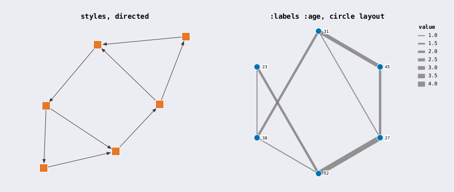
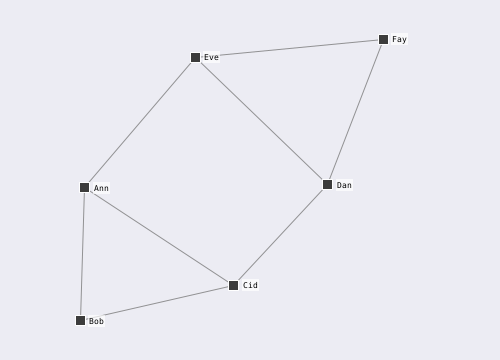
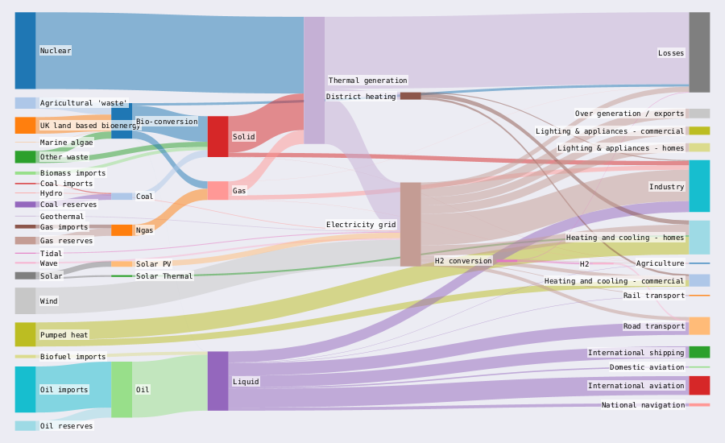
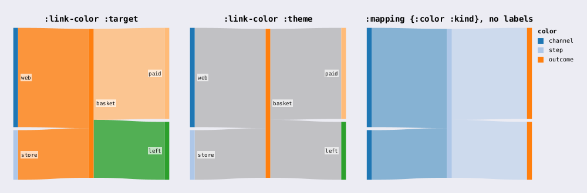
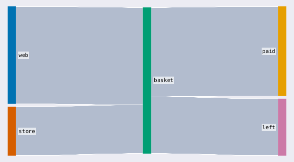

---
format:
  html:
    toc: true
    toc-location: right
    toc-depth: 4
    theme: cosmo
    include-in-header:
      text: |-
        <style>
        .data-table { width: fit-content; max-width: 100%; max-height: 15rem; overflow: auto; margin: 0 0 1rem 0; }
        .data-table .table-responsive { overflow: visible; }
        .data-table table { font-size: 0.75rem; width: auto; margin: 0; }
        .data-table th, .data-table td { padding: 0.1rem 0.45rem !important; white-space: nowrap; }
        .data-table thead th { position: sticky; top: 0; background: var(--bs-body-bg, #fff); }
        </style>
code-block-background: true

---
<style></style><style>.printedClojure .sourceCode {
  background-color: transparent;
  border-style: none;
}
</style><style>.clay-limit-image-width .clay-image {max-width: 100%}
.clay-side-by-side .sourceCode {margin: 0}
.clay-side-by-side {margin: 1em 0}
</style>
<script src="https://code.jquery.com/jquery-3.6.0.min.js" type="text/javascript"></script><script src="https://code.jquery.com/ui/1.13.1/jquery-ui.min.js" type="text/javascript"></script>

# Builders: graphs

Builders turn edge rows (or wide rows) into an ordinary plot map: they lay the graph out with the data functions
of the Graphs and trees chapter and add the charts. Each builder lists its own options; the options it forwards
to the layout functions and the builder options (title, scales, theme) are shared groups.


::: {.sourceClojure}
```clojure
(ns reference.builders-graphs
  (:require [clojure.string :as str]
            [fastmath.random :as r]
            [cljplot2.core :as plot]
            [cljplot2.describe :as describe]
            [notebook-utils :as nu]))
```
:::


::: {.sourceClojure}
```clojure
(def friends [{:from "Ann" :to "Bob" :value 3} {:from "Ann" :to "Cid" :value 1} {:from "Bob" :to "Cid" :value 2}
              {:from "Cid" :to "Dan" :value 4} {:from "Dan" :to "Eve" :value 1} {:from "Eve" :to "Ann" :value 2}
              {:from "Dan" :to "Fay" :value 2} {:from "Fay" :to "Eve" :value 1}])
```
:::


```{=html}
<div class="data-table"><table class="table table-hover table-responsive clay-table"><thead><tr><th>from</th><th>to</th><th>value</th></tr></thead><tbody><tr><td>Ann</td><td>Bob</td><td>3</td></tr><tr><td>Ann</td><td>Cid</td><td>1</td></tr><tr><td>Bob</td><td>Cid</td><td>2</td></tr><tr><td>Cid</td><td>Dan</td><td>4</td></tr><tr><td>Dan</td><td>Eve</td><td>1</td></tr><tr><td>Eve</td><td>Ann</td><td>2</td></tr><tr><td>Dan</td><td>Fay</td><td>2</td></tr><tr><td>Fay</td><td>Eve</td><td>1</td></tr></tbody></table></div>
```


::: {.sourceClojure}
```clojure
(def people [{:id "Ann" :team "red" :age 31} {:id "Bob" :team "red" :age 45} {:id "Cid" :team "blue" :age 27}
             {:id "Dan" :team "blue" :age 52} {:id "Eve" :team "green" :age 38} {:id "Fay" :team "green" :age 23}])
```
:::


```{=html}
<div class="data-table"><table class="table table-hover table-responsive clay-table"><thead><tr><th>id</th><th>team</th><th>age</th></tr></thead><tbody><tr><td>Ann</td><td>red</td><td>31</td></tr><tr><td>Bob</td><td>red</td><td>45</td></tr><tr><td>Cid</td><td>blue</td><td>27</td></tr><tr><td>Dan</td><td>blue</td><td>52</td></tr><tr><td>Eve</td><td>green</td><td>38</td></tr><tr><td>Fay</td><td>green</td><td>23</td></tr></tbody></table></div>
```


Data: Migration flows between world regions, data-to-viz example dataset `13_AdjacencyDirectedWeighted` (long form; Yan Holtz, after Abel & Sander 2014); licence: MIT (data_to_viz repository).


::: {.sourceClojure}
```clojure
(def migration
  "Flows between regions without the zeros and the diagonal; the file spells some names with dots."
  (let [region #(str/replace % "." " ")]
    (vec (for [{:keys [from to value]} (nu/dataset :migration)
               :when (and (pos? (double value)) (not= (region from) (region to)))]
           {:from (region from) :to (region to) :value value}))))
```
:::


```{=html}
<div class="data-table"><table class="table table-hover table-responsive clay-table"><thead><tr><th>from</th><th>to</th><th>value</th></tr></thead><tbody><tr><td>South Asia</td><td>East Asia</td><td>0.525881</td></tr><tr><td>South East Asia</td><td>East Asia</td><td>0.145264</td></tr><tr><td>Africa</td><td>Europe</td><td>2.107883</td></tr><tr><td>East Asia</td><td>Europe</td><td>0.601265</td></tr><tr><td>Latin America</td><td>Europe</td><td>1.762587</td></tr><tr><td>North America</td><td>Europe</td><td>1.215929</td></tr><tr><td>Oceania</td><td>Europe</td><td>0.17037</td></tr><tr><td>South Asia</td><td>Europe</td><td>1.390272</td></tr><tr><td>South East Asia</td><td>Europe</td><td>0.468762</td></tr><tr><td>Soviet Union</td><td>Europe</td><td>0.60923</td></tr><tr><td>West Asia</td><td>Europe</td><td>0.449623</td></tr><tr><td>North America</td><td>Latin America</td><td>0.276908</td></tr><tr><td>Africa</td><td>North America</td><td>0.540887</td></tr><tr><td>East Asia</td><td>North America</td><td>0.97306</td></tr><tr><td>Latin America</td><td>North America</td><td>3.627847</td></tr><tr><td>South Asia</td><td>North America</td><td>1.508008</td></tr><tr><td>South East Asia</td><td>North America</td><td>1.057904</td></tr><tr><td>West Asia</td><td>North America</td><td>0.169274</td></tr><tr><td>Africa</td><td>Oceania</td><td>0.155988</td></tr><tr><td>East Asia</td><td>Oceania</td><td>0.333608</td></tr><tr><td>South Asia</td><td>Oceania</td><td>0.34742</td></tr><tr><td>South East Asia</td><td>Oceania</td><td>0.278746</td></tr><tr><td>East Asia</td><td>South East Asia</td><td>0.380388</td></tr><tr><td>Africa</td><td>West Asia</td><td>0.673004</td></tr><tr><td>East Asia</td><td>West Asia</td><td>0.869311</td></tr><tr><td>South Asia</td><td>West Asia</td><td>4.902081</td></tr></tbody></table></div>
```


Data: UK energy flows in 2050 (a DECC scenario), networkD3 `JSONdata/energy.json` (the d3 sankey example; UK Department of Energy & Climate Change 2050 Calculator); licence: networkD3 is GPL-3; the data's licence isn't stated.


::: {.sourceClojure}
```clojure
(def energy (nu/dataset :energy))
```
:::


```{=html}
<div class="data-table"><table class="table table-hover table-responsive clay-table"><thead><tr><th>from</th><th>to</th><th>value</th></tr></thead><tbody><tr><td>Agricultural 'waste'</td><td>Bio-conversion</td><td>124.729</td></tr><tr><td>Bio-conversion</td><td>Liquid</td><td>0.597</td></tr><tr><td>Bio-conversion</td><td>Losses</td><td>26.862</td></tr><tr><td>Bio-conversion</td><td>Solid</td><td>280.322</td></tr><tr><td>Bio-conversion</td><td>Gas</td><td>81.144</td></tr><tr><td>Biofuel imports</td><td>Liquid</td><td>35</td></tr><tr><td>Biomass imports</td><td>Solid</td><td>35</td></tr><tr><td>Coal imports</td><td>Coal</td><td>11.606</td></tr><tr><td>Coal reserves</td><td>Coal</td><td>63.965</td></tr><tr><td>Coal</td><td>Solid</td><td>75.571</td></tr><tr><td>District heating</td><td>Industry</td><td>10.639</td></tr><tr><td>District heating</td><td>Heating and cooling - commercial</td><td>22.505</td></tr><tr><td>District heating</td><td>Heating and cooling - homes</td><td>46.184</td></tr><tr><td>Electricity grid</td><td>Over generation / exports</td><td>104.453</td></tr><tr><td>Electricity grid</td><td>Heating and cooling - homes</td><td>113.726</td></tr><tr><td>Electricity grid</td><td>H2 conversion</td><td>27.14</td></tr><tr><td>Electricity grid</td><td>Industry</td><td>342.165</td></tr><tr><td>Electricity grid</td><td>Road transport</td><td>37.797</td></tr><tr><td>Electricity grid</td><td>Agriculture</td><td>4.412</td></tr><tr><td>Electricity grid</td><td>Heating and cooling - commercial</td><td>40.858</td></tr><tr><td>Electricity grid</td><td>Losses</td><td>56.691</td></tr><tr><td>Electricity grid</td><td>Rail transport</td><td>7.863</td></tr><tr><td>Electricity grid</td><td>Lighting & appliances - commercial</td><td>90.008</td></tr><tr><td>Electricity grid</td><td>Lighting & appliances - homes</td><td>93.494</td></tr><tr><td>Gas imports</td><td>Ngas</td><td>40.719</td></tr><tr><td>Gas reserves</td><td>Ngas</td><td>82.233</td></tr><tr><td>Gas</td><td>Heating and cooling - commercial</td><td>0.129</td></tr><tr><td>Gas</td><td>Losses</td><td>1.401</td></tr><tr><td>Gas</td><td>Thermal generation</td><td>151.891</td></tr><tr><td>Gas</td><td>Agriculture</td><td>2.096</td></tr><tr><td>Gas</td><td>Industry</td><td>48.58</td></tr><tr><td>Geothermal</td><td>Electricity grid</td><td>7.013</td></tr><tr><td>H2 conversion</td><td>H2</td><td>20.897</td></tr><tr><td>H2 conversion</td><td>Losses</td><td>6.242</td></tr><tr><td>H2</td><td>Road transport</td><td>20.897</td></tr><tr><td>Hydro</td><td>Electricity grid</td><td>6.995</td></tr><tr><td>Liquid</td><td>Industry</td><td>121.066</td></tr><tr><td>Liquid</td><td>International shipping</td><td>128.69</td></tr><tr><td>Liquid</td><td>Road transport</td><td>135.835</td></tr><tr><td>Liquid</td><td>Domestic aviation</td><td>14.458</td></tr><tr><td>Liquid</td><td>International aviation</td><td>206.267</td></tr><tr><td>Liquid</td><td>Agriculture</td><td>3.64</td></tr><tr><td>Liquid</td><td>National navigation</td><td>33.218</td></tr><tr><td>Liquid</td><td>Rail transport</td><td>4.413</td></tr><tr><td>Marine algae</td><td>Bio-conversion</td><td>4.375</td></tr><tr><td>Ngas</td><td>Gas</td><td>122.952</td></tr><tr><td>Nuclear</td><td>Thermal generation</td><td>839.978</td></tr><tr><td>Oil imports</td><td>Oil</td><td>504.287</td></tr><tr><td>Oil reserves</td><td>Oil</td><td>107.703</td></tr><tr><td>Oil</td><td>Liquid</td><td>611.99</td></tr><tr><td>Other waste</td><td>Solid</td><td>56.587</td></tr><tr><td>Other waste</td><td>Bio-conversion</td><td>77.81</td></tr><tr><td>Pumped heat</td><td>Heating and cooling - homes</td><td>193.026</td></tr><tr><td>Pumped heat</td><td>Heating and cooling - commercial</td><td>70.672</td></tr><tr><td>Solar PV</td><td>Electricity grid</td><td>59.901</td></tr><tr><td>Solar Thermal</td><td>Heating and cooling - homes</td><td>19.263</td></tr><tr><td>Solar</td><td>Solar Thermal</td><td>19.263</td></tr><tr><td>Solar</td><td>Solar PV</td><td>59.901</td></tr><tr><td>Solid</td><td>Agriculture</td><td>0.882</td></tr><tr><td>Solid</td><td>Thermal generation</td><td>400.12</td></tr><tr><td>Solid</td><td>Industry</td><td>46.477</td></tr><tr><td>Thermal generation</td><td>Electricity grid</td><td>525.531</td></tr><tr><td>Thermal generation</td><td>Losses</td><td>787.129</td></tr><tr><td>Thermal generation</td><td>District heating</td><td>79.329</td></tr><tr><td>Tidal</td><td>Electricity grid</td><td>9.452</td></tr><tr><td>UK land based bioenergy</td><td>Bio-conversion</td><td>182.01</td></tr><tr><td>Wave</td><td>Electricity grid</td><td>19.013</td></tr><tr><td>Wind</td><td>Electricity grid</td><td>289.366</td></tr></tbody></table></div>
```


Data: Titanic passengers and crew by class, sex, age and survival, R datasets package `Titanic` (Dawson 1995); licence: Part of R (GPL-2 | GPL-3).


::: {.sourceClojure}
```clojure
(def titanic (nu/dataset :titanic))
```
:::


```{=html}
<div class="data-table"><table class="table table-hover table-responsive clay-table"><thead><tr><th>class</th><th>sex</th><th>age</th><th>survived</th><th>n</th></tr></thead><tbody><tr><td>1st</td><td>Male</td><td>Child</td><td>No</td><td>0</td></tr><tr><td>2nd</td><td>Male</td><td>Child</td><td>No</td><td>0</td></tr><tr><td>3rd</td><td>Male</td><td>Child</td><td>No</td><td>35</td></tr><tr><td>Crew</td><td>Male</td><td>Child</td><td>No</td><td>0</td></tr><tr><td>1st</td><td>Female</td><td>Child</td><td>No</td><td>0</td></tr><tr><td>2nd</td><td>Female</td><td>Child</td><td>No</td><td>0</td></tr><tr><td>3rd</td><td>Female</td><td>Child</td><td>No</td><td>17</td></tr><tr><td>Crew</td><td>Female</td><td>Child</td><td>No</td><td>0</td></tr><tr><td>1st</td><td>Male</td><td>Adult</td><td>No</td><td>118</td></tr><tr><td>2nd</td><td>Male</td><td>Adult</td><td>No</td><td>154</td></tr><tr><td>3rd</td><td>Male</td><td>Adult</td><td>No</td><td>387</td></tr><tr><td>Crew</td><td>Male</td><td>Adult</td><td>No</td><td>670</td></tr><tr><td>1st</td><td>Female</td><td>Adult</td><td>No</td><td>4</td></tr><tr><td>2nd</td><td>Female</td><td>Adult</td><td>No</td><td>13</td></tr><tr><td>3rd</td><td>Female</td><td>Adult</td><td>No</td><td>89</td></tr><tr><td>Crew</td><td>Female</td><td>Adult</td><td>No</td><td>3</td></tr><tr><td>1st</td><td>Male</td><td>Child</td><td>Yes</td><td>5</td></tr><tr><td>2nd</td><td>Male</td><td>Child</td><td>Yes</td><td>11</td></tr><tr><td>3rd</td><td>Male</td><td>Child</td><td>Yes</td><td>13</td></tr><tr><td>Crew</td><td>Male</td><td>Child</td><td>Yes</td><td>0</td></tr><tr><td>1st</td><td>Female</td><td>Child</td><td>Yes</td><td>1</td></tr><tr><td>2nd</td><td>Female</td><td>Child</td><td>Yes</td><td>13</td></tr><tr><td>3rd</td><td>Female</td><td>Child</td><td>Yes</td><td>14</td></tr><tr><td>Crew</td><td>Female</td><td>Child</td><td>Yes</td><td>0</td></tr><tr><td>1st</td><td>Male</td><td>Adult</td><td>Yes</td><td>57</td></tr><tr><td>2nd</td><td>Male</td><td>Adult</td><td>Yes</td><td>14</td></tr><tr><td>3rd</td><td>Male</td><td>Adult</td><td>Yes</td><td>75</td></tr><tr><td>Crew</td><td>Male</td><td>Adult</td><td>Yes</td><td>192</td></tr><tr><td>1st</td><td>Female</td><td>Adult</td><td>Yes</td><td>140</td></tr><tr><td>2nd</td><td>Female</td><td>Adult</td><td>Yes</td><td>80</td></tr><tr><td>3rd</td><td>Female</td><td>Adult</td><td>Yes</td><td>76</td></tr><tr><td>Crew</td><td>Female</td><td>Adult</td><td>Yes</td><td>20</td></tr></tbody></table></div>
```


## network

A node-link diagram of edge rows (`:from`, `:to`, optional `:value`): nodes placed by a force-directed, circle or
random layout (seeded here), edges as segments - with arrows for a directed graph.

::: {.clay-table}

```{=html}
<table class="table table-hover table-responsive clay-table"><thead><tr><th>Option</th><th>Type</th><th>Default</th><th>Description</th></tr></thead><tbody><tr><td>:mapping</td><td>map of keyword to any value or nil</td><td></td><td>node aesthetics (:color, :size, :shape): accessors of the nodes (their row's columns, :degree, :in, :out)</td></tr><tr><td>:edge-mapping</td><td>map of keyword to any value or nil</td><td></td><td>edge aesthetics (:color, :size - the width): accessors of the edges (their row's columns, :value); none mapped in :mapping too</td></tr><tr><td>:node-style</td><td>map of keyword to any value or nil</td><td>theme [:chart :network-node]</td><td>scatter options of the nodes, merged over the default</td></tr><tr><td>:edge-style</td><td>map of keyword to any value or nil</td><td>theme [:chart :network-edge]</td><td>segment options of the edges, merged over the default (a mapped colour wins); :arrow - the arrows of a directed graph</td></tr><tr><td>:labels</td><td>true or false or a keyword, a function or a categorical marker of one or nil</td><td>false</td><td>node labels right of the nodes: true - the id, an accessor of the node, false - none</td></tr></tbody></table>
```

:::


Node aesthetics from the node rows or the computed degree (whole numbers: `:integer-ticks` through the builder's
`:scales`), labels beside the nodes:


::: {.sourceClojure}
```clojure
(plot/render-image (plot/network friends {:nodes people :rng (r/rng :mersenne 1)
                                          :mapping {:color :team :size :degree}
                                          :scales {:size {:integer-ticks true}}
                                          :labels true})
                   {:width 600 :height 400})
```
:::


::: {.clay-image}

:::


The node and edge style merged over the defaults, a directed graph's arrows in `:edge-style` (left); edge widths
from the weights and labels from a node column (`:labels :age`, right) - an aesthetic maps either nodes or edges,
not both:


::: {.sourceClojure}
```clojure
(plot/render-image (plot/arrange [(plot/network friends {:directed true :rng (r/rng :mersenne 1)
                                                         :node-style {:size 16 :color [230 120 40] :shape \S}
                                                         :edge-style {:color [60 60 60] :arrow {:size 9}}
                                                         :labels false
                                                         :title "styles, directed"})
                                  (plot/network friends {:nodes people :layout :circle
                                                         :edge-mapping {:size :value}
                                                         :labels :age
                                                         :title ":labels :age, circle layout"})]
                                 {:columns 2})
                   {:width 900 :height 380})
```
:::


::: {.clay-image}

:::


The theme styles a network draws with - the nodes in `[:chart :network-node]` (a scatter style over
`[:chart :scatter]`), the edges in `[:chart :network-edge]` (a segment style), the labels in the text role
`:network-label` (see the Theme chapter); `:node-style` / `:edge-style` win over them per call:

::: {.clay-table}

```{=html}
<table class="table table-hover table-responsive clay-table"><thead><tr><th>Option</th><th>Type</th><th>Default</th><th>Description</th></tr></thead><tbody><tr><td>:size</td><td>a non-negative number</td><td>12</td><td>point size in pixels (a mapped :size wins)</td></tr><tr><td>:color</td><td>a clojure2d color or :none</td><td>[69.0 117.0 180.0 255.0]</td><td>point colour (a mapped :color wins)</td></tr><tr><td>:stroke-color</td><td>a clojure2d color or :none</td><td>:white</td><td>outline colour: a colour or :none</td></tr><tr><td>:stroke-width</td><td>a non-negative number</td><td>1</td><td>outline width in pixels</td></tr><tr><td>:shape</td><td>a shape character, keyword or shape map</td><td>\O</td><td>point shape (a mapped :shape wins)</td></tr></tbody></table>
```

:::


A theme restyles every network of a plot - here square, dark nodes:


::: {.sourceClojure}
```clojure
(plot/render-image (plot/network friends {:rng (r/rng :mersenne 1) :labels true
                                          :theme {:chart {:network-node {:shape \s :color [60 60 60] :size 10}}}})
                   {:width 500 :height 360})
```
:::


::: {.clay-image}

:::


::: {.clay-table}

```{=html}
<table class="table table-hover table-responsive clay-table"><thead><tr><th>Option</th><th>Type</th><th>Default</th><th>Description</th></tr></thead><tbody><tr><td>:color</td><td>a clojure2d color or :none</td><td>[120.0 120.0 120.0 200.0]</td><td>line colour (a mapped :color wins)</td></tr><tr><td>:line-width</td><td>a non-negative number</td><td>1</td><td>line width in pixels</td></tr><tr><td>:dash</td><td>:none, a dash style (:dashed :dot-dash :dot-dot-dash :dotted :long-dash :loose-dot :solid :two-dash) or a sequence of positive numbers or nil</td><td>:none</td><td>dash style of the line (a mapped :dash wins)</td></tr></tbody></table>
```

:::


Dashed blue edges and larger labels through the theme:


::: {.sourceClojure}
```clojure
(plot/render-image (plot/network friends {:rng (r/rng :mersenne 1) :labels true
                                          :theme {:chart {:network-edge {:color [40 90 200] :dash :dashed :line-width 2}}
                                                  :text {:network-label {:size 11}}}})
                   {:width 500 :height 360})
```
:::


::: {.clay-image}

:::


Shared options: [Graph](reference.shared_options.html#graph) (`:from` `:to` `:value` `:nodes` `:id` `:directed`); [Graph layout](reference.shared_options.html#graph-layout) (`:layout` `:iterations` `:gravity` `:rng`); [Builder options](reference.shared_options.html#builder-options) (`:title` `:scales` `:theme`).


## chord

Flows between groups around a circle: a sector per node sized by its flow, a ribbon per link - directed (a
ribbon per flow) or not (a ribbon per pair).

::: {.clay-table}

```{=html}
<table class="table table-hover table-responsive clay-table"><thead><tr><th>Option</th><th>Type</th><th>Default</th><th>Description</th></tr></thead><tbody><tr><td>:alpha</td><td>a number in [0 1]</td><td>0.6</td><td>opacity of the ribbons</td></tr><tr><td>:labels</td><td>true or false</td><td>true</td><td>node names outward from the sectors' middles (nodes without flow unlabelled)</td></tr></tbody></table>
```

:::


Migration between world regions (flows under 0.1 dropped), opaque ribbons and no labels (right):


::: {.sourceClojure}
```clojure
(plot/render-image (plot/arrange [(plot/chord migration {:directed true :min-value 0.1 :title "directed, :alpha 0.6"})
                                  (plot/chord migration {:min-value 0.1 :alpha 1.0 :labels false
                                                         :title ":alpha 1.0, :labels false"})]
                                 {:columns 2})
                   {:width 1000 :height 500})
```
:::


::: {.clay-image}

:::


Shared options: [Graph](reference.shared_options.html#graph) (`:from` `:to` `:value` `:nodes` `:id` `:directed`); [Chord layout](reference.shared_options.html#chord-layout) (`:order` `:gap-angle` `:inner-radius` `:min-value`); [Builder options](reference.shared_options.html#builder-options) (`:title` `:scales` `:theme`).


## arc

Nodes on a line, links as arcs above it - a compact view of a graph whose node order matters.

::: {.clay-table}

```{=html}
<table class="table table-hover table-responsive clay-table"><thead><tr><th>Option</th><th>Type</th><th>Default</th><th>Description</th></tr></thead><tbody><tr><td>:mapping</td><td>map of keyword to any value or nil</td><td></td><td>node aesthetics (:color, :size, :shape): accessors of the nodes (their row's columns, :degree, :in, :out)</td></tr><tr><td>:edge-mapping</td><td>map of keyword to any value or nil</td><td>{:size :value} (widths from the size scale {:range [0.5 4]}) when the edge weights differ and :mapping has no :size</td><td>edge aesthetics (:color, :size - the width): accessors of the edges (their row's columns, :value); none mapped in :mapping too</td></tr><tr><td>:alpha</td><td>a number in [0 1]</td><td>0.5</td><td>opacity of the arcs' strokes</td></tr><tr><td>:node-style</td><td>map of keyword to any value or nil</td><td>theme [:chart :arc-node]</td><td>scatter options of the nodes, merged over the default</td></tr><tr><td>:edge-style</td><td>map of keyword to any value or nil</td><td>theme [:chart :arc-edge]</td><td>line options of the arcs, merged over the default</td></tr><tr><td>:labels</td><td>true or false or a keyword, a function or a categorical marker of one</td><td>true</td><td>node labels under the line, rotated to read downward: true - the id, false - none, or an accessor of the node (a nil or "" result - an empty label)</td></tr></tbody></table>
```

:::


Node colours from their rows, arc widths from the weights (the default when weights differ), names under the
line:


::: {.sourceClojure}
```clojure
(plot/render-image (plot/arc friends {:nodes people :mapping {:color :team}})
                   {:width 600 :height 320})
```
:::


::: {.clay-image}

:::


Arc colours and opacity, node style, labels from a node column (left); no labels (right):


::: {.sourceClojure}
```clojure
(plot/render-image (plot/arrange [(plot/arc friends {:nodes people :edge-mapping {:color :value} :alpha 0.9
                                                     :node-style {:size 12 :color [40 40 40]}
                                                     :edge-style {:line-width 2}
                                                     :labels :team
                                                     :title "arc colours, :labels :team"})
                                  (plot/arc friends {:nodes people :mapping {:size :age} :labels false
                                                     :title ":labels false, node size by age"})]
                                 {:columns 2})
                   {:width 900 :height 320})
```
:::


::: {.clay-image}

:::


The theme styles of an arc diagram - nodes in `[:chart :arc-node]` (scatter), arcs in `[:chart :arc-edge]`
(line; its colour, width and dash shown - the other line style keys apply too, see the line chart):

::: {.clay-table}

```{=html}
<table class="table table-hover table-responsive clay-table"><thead><tr><th>Option</th><th>Type</th><th>Default</th><th>Description</th></tr></thead><tbody><tr><td>:size</td><td>a non-negative number</td><td>8</td><td>point size in pixels (a mapped :size wins)</td></tr><tr><td>:color</td><td>a clojure2d color or :none</td><td>[69.0 117.0 180.0 255.0]</td><td>point colour (a mapped :color wins)</td></tr><tr><td>:stroke-color</td><td>a clojure2d color or :none</td><td>:white</td><td>outline colour: a colour or :none</td></tr><tr><td>:stroke-width</td><td>a non-negative number</td><td>1</td><td>outline width in pixels</td></tr><tr><td>:shape</td><td>a shape character, keyword or shape map</td><td>\O</td><td>point shape (a mapped :shape wins)</td></tr></tbody></table>
```

:::


Hollow nodes through the theme:


::: {.sourceClojure}
```clojure
(plot/render-image (plot/arc friends {:theme {:chart {:arc-node {:shape \o :color [200 60 40] :size 10}}}})
                   {:width 500 :height 300})
```
:::


::: {.clay-image}

:::


::: {.clay-table}

```{=html}
<table class="table table-hover table-responsive clay-table"><thead><tr><th>Option</th><th>Type</th><th>Default</th><th>Description</th></tr></thead><tbody><tr><td>:color</td><td>a clojure2d color or :none</td><td>[120.0 120.0 120.0 255.0]</td><td>line colour (a mapped :color wins)</td></tr><tr><td>:line-width</td><td>a non-negative number</td><td>1</td><td>line width in pixels</td></tr><tr><td>:dash</td><td>:none, a dash style (:dashed :dot-dash :dot-dot-dash :dotted :long-dash :loose-dot :solid :two-dash) or a sequence of positive numbers or nil</td><td>:none</td><td>dash style of the line (a mapped :dash wins)</td></tr></tbody></table>
```

:::


Thick dark arcs through the theme:


::: {.sourceClojure}
```clojure
(plot/render-image (plot/arc friends {:edge-mapping {} :alpha 0.8
                                      :theme {:chart {:arc-edge {:color [40 40 40] :line-width 3}}}})
                   {:width 500 :height 300})
```
:::


::: {.clay-image}

:::


Shared options: [Graph](reference.shared_options.html#graph) (`:from` `:to` `:value` `:nodes` `:id` `:directed`); [Arc layout](reference.shared_options.html#arc-layout) (`:order`); [Builder options](reference.shared_options.html#builder-options) (`:title` `:scales` `:theme`).


## sankey

Flows through layered nodes: nodes as bars in columns, links as bands as wide as their flow.

::: {.clay-table}

```{=html}
<table class="table table-hover table-responsive clay-table"><thead><tr><th>Option</th><th>Type</th><th>Default</th><th>Description</th></tr></thead><tbody><tr><td>:mapping</td><td>map</td><td></td><td>node aesthetics: only :color</td></tr><tr><td>:mapping :color</td><td>a keyword, a function or a categorical marker of one or nil</td><td>the node id, no legend</td><td>accessor of the node rows giving the node colour (a legend unless it's the id)</td></tr><tr><td>:link-color</td><td>one of :source :target :theme or nil</td><td>:source</td><td>the flow colour: that of its :source or :target node, or :theme (the theme style [:chart :sankey-link], grey)</td></tr><tr><td>:alpha</td><td>a number in [0 1]</td><td>0.5</td><td>opacity of the flow bands</td></tr><tr><td>:labels</td><td>true or false</td><td>true</td><td>node names beside the nodes, inside the frame</td></tr></tbody></table>
```

:::


The UK energy flows of a 2050 scenario, bands in their source's colour (the default):


::: {.sourceClojure}
```clojure
(plot/render-image (plot/sankey energy {:link-color :source})
                   {:width 900 :height 550})
```
:::


::: {.clay-image}

:::


Bands in the target's colour or grey with stronger opacity, nodes coloured by a node column with a legend, and
no labels:


::: {.sourceClojure}
```clojure
(def stages [{:id "web" :kind "channel"} {:id "store" :kind "channel"} {:id "basket" :kind "step"}
             {:id "paid" :kind "outcome"} {:id "left" :kind "outcome"}])
```
:::


```{=html}
<div class="data-table"><table class="table table-hover table-responsive clay-table"><thead><tr><th>id</th><th>kind</th></tr></thead><tbody><tr><td>web</td><td>channel</td></tr><tr><td>store</td><td>channel</td></tr><tr><td>basket</td><td>step</td></tr><tr><td>paid</td><td>outcome</td></tr><tr><td>left</td><td>outcome</td></tr></tbody></table></div>
```


::: {.sourceClojure}
```clojure
(def visits [{:from "web" :to "basket" :value 60} {:from "store" :to "basket" :value 30}
             {:from "basket" :to "paid" :value 55} {:from "basket" :to "left" :value 35}])
```
:::


```{=html}
<div class="data-table"><table class="table table-hover table-responsive clay-table"><thead><tr><th>from</th><th>to</th><th>value</th></tr></thead><tbody><tr><td>web</td><td>basket</td><td>60</td></tr><tr><td>store</td><td>basket</td><td>30</td></tr><tr><td>basket</td><td>paid</td><td>55</td></tr><tr><td>basket</td><td>left</td><td>35</td></tr></tbody></table></div>
```


::: {.sourceClojure}
```clojure
(plot/render-image (plot/arrange [(plot/sankey visits {:link-color :target :alpha 0.8 :title ":link-color :target"})
                                  (plot/sankey visits {:link-color :theme :title ":link-color :theme"})
                                  (plot/sankey visits {:nodes stages :mapping {:color :kind} :labels false
                                                       :title ":mapping {:color :kind}, no labels"})]
                                 {:columns 3 :widths [1 1 1.3]})
                   {:width 1000 :height 330})
```
:::


::: {.clay-image}

:::


The flow bands draw in the theme style `[:chart :sankey-link]` (a polygon style; its colour shows with
`:link-color :theme`), the node names in the text role `:sankey-label`:

::: {.clay-table}

```{=html}
<table class="table table-hover table-responsive clay-table"><thead><tr><th>Option</th><th>Type</th><th>Default</th><th>Description</th></tr></thead><tbody><tr><td>:color</td><td>a clojure2d color or :none</td><td>[150.0 150.0 150.0 255.0]</td><td>fill colour (a mapped :color wins)</td></tr><tr><td>:alpha</td><td>a number in [0 1]</td><td>1.0</td><td>fill opacity</td></tr><tr><td>:stroke-color</td><td>:color or a clojure2d color or :none</td><td>:none</td><td>outline colour: a colour, :none or :color (the group colour, opaque)</td></tr><tr><td>:stroke-width</td><td>a non-negative number</td><td>1</td><td>outline width in pixels</td></tr></tbody></table>
```

:::


Grey bands outlined in white, larger names:


::: {.sourceClojure}
```clojure
(plot/render-image (plot/sankey visits {:link-color :theme
                                        :theme {:chart {:sankey-link {:color [120 140 170] :stroke-color :white
                                                                      :stroke-width 1}}
                                                :text {:sankey-label {:size 11}}}})
                   {:width 600 :height 330})
```
:::


::: {.clay-image}

:::


Shared options: [Graph](reference.shared_options.html#graph) (`:from` `:to` `:value` `:nodes` `:id`); [Sankey layout](reference.shared_options.html#sankey-layout) (`:align` `:layer` `:node-width` `:gap` `:iterations` `:order`); [Builder options](reference.shared_options.html#builder-options) (`:title` `:scales` `:theme`).


## alluvial

A column per categorical variable of wide rows, a stratum per level and strands between neighbouring columns,
weighted by a value and coloured by one variable all the way through.

::: {.clay-table}

```{=html}
<table class="table table-hover table-responsive clay-table"><thead><tr><th>Option</th><th>Type</th><th>Default</th><th>Description</th></tr></thead><tbody><tr><td>:alpha</td><td>a number in [0 1]</td><td>0.6</td><td>opacity of the strands</td></tr><tr><td>:node-width</td><td>a number in (0 1)</td><td>0.12</td><td>stratum width, a fraction of the plot width</td></tr><tr><td>:gap</td><td>a non-negative finite number</td><td>0.03</td><td>least gap between the strata of an axis, a fraction of the plot height</td></tr><tr><td>:variable-names</td><td>sequential of any value or nil</td><td>the variables' accessor names (a keyword's name, else its text)</td><td>names under the columns, one per variable</td></tr></tbody></table>
```

:::


Titanic passengers by class, sex, age and survival, coloured by class:


::: {.sourceClojure}
```clojure
(plot/render-image (plot/alluvial titanic {:variables [:class :sex :age :survived] :value :n :strand-color :class})
                   {:width 900 :height 500})
```
:::


::: {.clay-image}

:::


Opaque strands, wide strata with large gaps and names of your own under the columns:


::: {.sourceClojure}
```clojure
(plot/render-image (plot/alluvial titanic {:variables [:class :survived] :value :n :strand-color :survived
                                           :alpha 0.9 :node-width 0.25 :gap 0.1
                                           :variable-names ["passenger class" "survived?"]})
                   {:width 600 :height 400})
```
:::


::: {.clay-image}

:::


The strata draw in the theme style `[:chart :alluvial-stratum]` (a polygon style), their names in the text role
`:alluvial-label`:

::: {.clay-table}

```{=html}
<table class="table table-hover table-responsive clay-table"><thead><tr><th>Option</th><th>Type</th><th>Default</th><th>Description</th></tr></thead><tbody><tr><td>:color</td><td>a clojure2d color or :none</td><td>[150.0 150.0 150.0 255.0]</td><td>fill colour (a mapped :color wins)</td></tr><tr><td>:alpha</td><td>a number in [0 1]</td><td>1.0</td><td>fill opacity</td></tr><tr><td>:stroke-color</td><td>:color or a clojure2d color or :none</td><td>:white</td><td>outline colour: a colour, :none or :color (the group colour, opaque)</td></tr><tr><td>:stroke-width</td><td>a non-negative number</td><td>1</td><td>outline width in pixels</td></tr></tbody></table>
```

:::


Dark strata with light names:


::: {.sourceClojure}
```clojure
(plot/render-image (plot/alluvial titanic {:variables [:class :survived] :value :n :strand-color :survived
                                           :theme {:chart {:alluvial-stratum {:color [50 50 50]}}
                                                   :text {:alluvial-label {:color :white :background :none}}}})
                   {:width 600 :height 400})
```
:::


::: {.clay-image}

:::


Shared options: [Alluvial graph](reference.shared_options.html#alluvial-graph) (`:variables` `:value` `:strand-color`); [Builder options](reference.shared_options.html#builder-options) (`:title` `:scales` `:theme`).


```{=html}
<div style="background-color:grey;height:2px;width:100%;"></div>
```


```{=html}
<div><pre><small><small>source: notebooks/reference/builders_graphs.clj</small></small></pre></div>
```