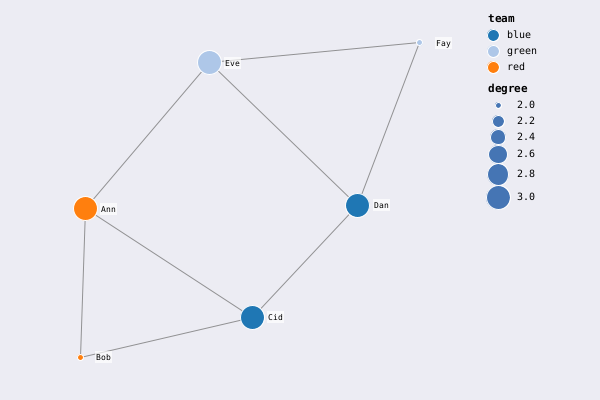
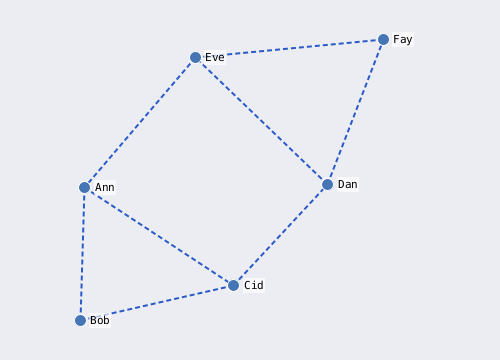
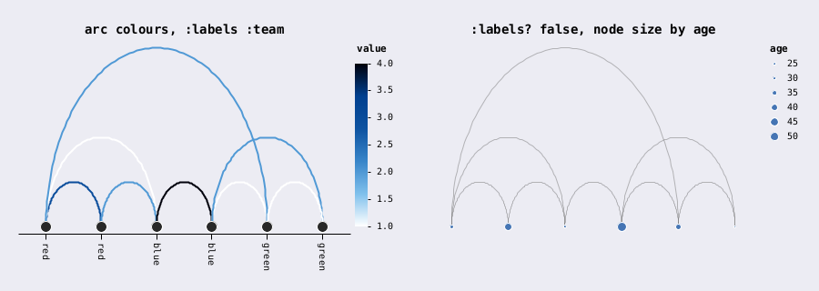
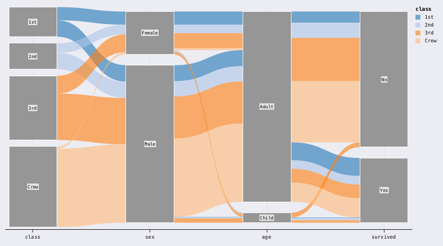
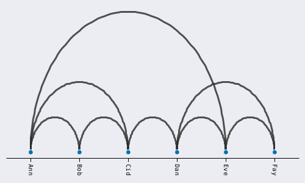
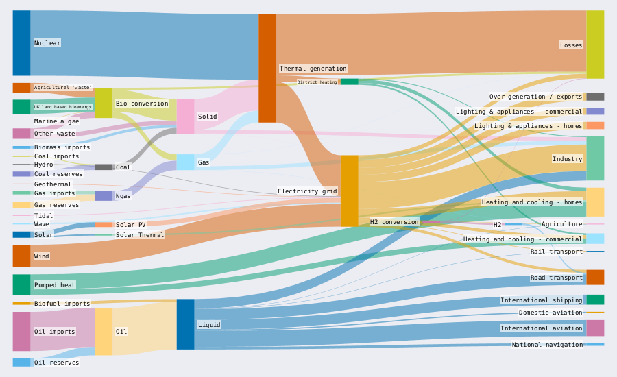
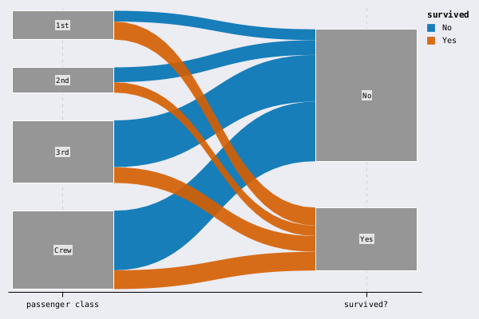
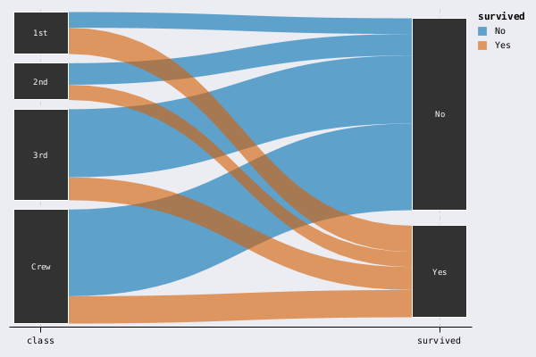

---
format:
  html:
    toc: true
    toc-location: right
    toc-depth: 4
    theme: cosmo
    include-in-header:
      text: |-
        <style>
        .data-table { width: fit-content; max-width: 100%; max-height: 15rem; overflow: auto; margin: 0 0 1rem 0; }
        .data-table .table-responsive { overflow: visible; }
        .data-table table { font-size: 0.75rem; width: auto; margin: 0; }
        .data-table th, .data-table td { padding: 0.1rem 0.45rem !important; white-space: nowrap; }
        .data-table thead th { position: sticky; top: 0; background: var(--bs-body-bg, #fff); }
        .options { margin: 0.5rem 0 1rem 0; }
        .options .option-card { margin: 0 0 0.9rem 0; border: 1px solid var(--bs-border-color, #dee2e6); border-radius: 0.375rem; overflow: hidden; }
        .options dt { display: flex; flex-wrap: wrap; align-items: baseline; gap: 0.1rem 1rem; margin: 0; padding: 0.4rem 0.75rem; background: #eef2f7; border-bottom: 1px solid var(--bs-border-color, #dee2e6); font-weight: normal; }
        .options dt > code { font-weight: 700; font-size: 1rem; background: none; padding: 0; }
        .options .option-default { font-size: 0.85rem; color: var(--bs-secondary-color, #6c757d); }
        .options dd { margin: 0; padding: 0.5rem 0.75rem; }
        .options .option-example { font-size: 0.85rem; padding: 0 0 0.45rem 0; margin-bottom: 0.45rem; border-bottom: 1px dashed var(--bs-border-color, #dee2e6); }
        .options .option-example code { background: none; padding: 0; }
        .options .option-text ul { margin: 0.3rem 0 0 0; padding-left: 1.25rem; }
        .options code, .mapping code { overflow-wrap: anywhere; }
        .mapping { margin: 0.5rem 0 1rem 0; padding: 0.5rem 0.75rem; border: 1px solid var(--bs-border-color, #dee2e6); border-left: 0.3rem solid #2780e3; border-radius: 0.375rem; background: #f5f8fc; }
        .mapping-title { font-weight: 700; margin-bottom: 0.25rem; }
        .mapping-hint { font-weight: normal; font-size: 0.85rem; color: var(--bs-secondary-color, #6c757d); }
        .mapping ul { margin: 0; padding-left: 1.25rem; }
        .mapping .required { font-size: 0.75rem; padding: 0 0.3rem; border: 1px solid currentColor; border-radius: 0.25rem; }
        .mapping-returns { margin-top: 0.25rem; }
        .mapping code { white-space: pre-wrap; }
        .shared { margin: 0.5rem 0 1rem 0; padding: 0.5rem 0.75rem; border: 1px solid var(--bs-border-color, #dee2e6); border-left: 0.3rem solid #6c757d; border-radius: 0.375rem; background: #f6f6f6; }
        .shared-title { font-weight: 700; margin-bottom: 0.25rem; }
        .shared-hint { font-weight: normal; font-size: 0.85rem; color: var(--bs-secondary-color, #6c757d); }
        .shared ul { margin: 0; padding-left: 1.25rem; }
        .shared code { overflow-wrap: anywhere; }
        </style>
code-block-background: true

---
<style></style><style>.printedClojure .sourceCode {
  background-color: transparent;
  border-style: none;
}
</style><style>.clay-limit-image-width .clay-image {max-width: 100%}
.clay-side-by-side .sourceCode {margin: 0}
.clay-side-by-side {margin: 1em 0}
</style>
<script src="https://code.jquery.com/jquery-3.6.0.min.js" type="text/javascript"></script><script src="https://code.jquery.com/ui/1.13.1/jquery-ui.min.js" type="text/javascript"></script>

# Graphs

These builders turn edge rows, or wide rows, into an ordinary plot map: they lay the graph out with the data
functions of the Graphs and trees chapter and add the charts. Use them for networks and flows. The Shared options
chapter documents the layout options they pass on and the builder options (title, scales, theme).


::: {.sourceClojure}
```clojure
(ns reference.builders-graphs
  (:require [clojure.string :as str]
            [fastmath.random :as r]
            [cljplot2.core :as plot]
            [cljplot2.describe :as describe]
            [notebook-utils :as nu]))
```
:::


The tables below hold made-up friendships with their weights, and the people's teams and ages; the networks and arc
diagrams use them:


::: {.sourceClojure}
```clojure
(def friends [{:from "Ann" :to "Bob" :value 3} {:from "Ann" :to "Cid" :value 1} {:from "Bob" :to "Cid" :value 2}
              {:from "Cid" :to "Dan" :value 4} {:from "Dan" :to "Eve" :value 1} {:from "Eve" :to "Ann" :value 2}
              {:from "Dan" :to "Fay" :value 2} {:from "Fay" :to "Eve" :value 1}])
```
:::


```{=html}
<div class="data-table"><table class="table table-hover table-responsive clay-table"><thead><tr><th>from</th><th>to</th><th>value</th></tr></thead><tbody><tr><td>Ann</td><td>Bob</td><td>3</td></tr><tr><td>Ann</td><td>Cid</td><td>1</td></tr><tr><td>Bob</td><td>Cid</td><td>2</td></tr><tr><td>Cid</td><td>Dan</td><td>4</td></tr><tr><td>Dan</td><td>Eve</td><td>1</td></tr><tr><td>Eve</td><td>Ann</td><td>2</td></tr><tr><td>Dan</td><td>Fay</td><td>2</td></tr><tr><td>Fay</td><td>Eve</td><td>1</td></tr></tbody></table></div>
```


::: {.sourceClojure}
```clojure
(def people [{:id "Ann" :team "red" :age 31} {:id "Bob" :team "red" :age 45} {:id "Cid" :team "blue" :age 27}
             {:id "Dan" :team "blue" :age 52} {:id "Eve" :team "green" :age 38} {:id "Fay" :team "green" :age 23}])
```
:::


```{=html}
<div class="data-table"><table class="table table-hover table-responsive clay-table"><thead><tr><th>id</th><th>team</th><th>age</th></tr></thead><tbody><tr><td>Ann</td><td>red</td><td>31</td></tr><tr><td>Bob</td><td>red</td><td>45</td></tr><tr><td>Cid</td><td>blue</td><td>27</td></tr><tr><td>Dan</td><td>blue</td><td>52</td></tr><tr><td>Eve</td><td>green</td><td>38</td></tr><tr><td>Fay</td><td>green</td><td>23</td></tr></tbody></table></div>
```


The tables below hold made-up shop visits through stages, and the stages' kinds; the small sankeys use them:


::: {.sourceClojure}
```clojure
(def stages [{:id "web" :kind "channel"} {:id "store" :kind "channel"} {:id "basket" :kind "step"}
             {:id "paid" :kind "outcome"} {:id "left" :kind "outcome"}])
```
:::


```{=html}
<div class="data-table"><table class="table table-hover table-responsive clay-table"><thead><tr><th>id</th><th>kind</th></tr></thead><tbody><tr><td>web</td><td>channel</td></tr><tr><td>store</td><td>channel</td></tr><tr><td>basket</td><td>step</td></tr><tr><td>paid</td><td>outcome</td></tr><tr><td>left</td><td>outcome</td></tr></tbody></table></div>
```


::: {.sourceClojure}
```clojure
(def visits [{:from "web" :to "basket" :value 60} {:from "store" :to "basket" :value 30}
             {:from "basket" :to "paid" :value 55} {:from "basket" :to "left" :value 35}])
```
:::


```{=html}
<div class="data-table"><table class="table table-hover table-responsive clay-table"><thead><tr><th>from</th><th>to</th><th>value</th></tr></thead><tbody><tr><td>web</td><td>basket</td><td>60</td></tr><tr><td>store</td><td>basket</td><td>30</td></tr><tr><td>basket</td><td>paid</td><td>55</td></tr><tr><td>basket</td><td>left</td><td>35</td></tr></tbody></table></div>
```


Data: Migration flows between world regions, data-to-viz example dataset `13_AdjacencyDirectedWeighted` (long form; Yan Holtz, after Abel & Sander 2014); licence: MIT (data_to_viz repository).


::: {.sourceClojure}
```clojure
(def migration
  "Flows between regions without the zeros and the diagonal; the file spells some names with dots."
  (let [region #(str/replace % "." " ")]
    (vec (for [{:keys [from to value]} (nu/dataset :migration)
               :when (and (pos? (double value)) (not= (region from) (region to)))]
           {:from (region from) :to (region to) :value value}))))
```
:::


```{=html}
<div class="data-table"><table class="table table-hover table-responsive clay-table"><thead><tr><th>from</th><th>to</th><th>value</th></tr></thead><tbody><tr><td>South Asia</td><td>East Asia</td><td>0.525881</td></tr><tr><td>South East Asia</td><td>East Asia</td><td>0.145264</td></tr><tr><td>Africa</td><td>Europe</td><td>2.107883</td></tr><tr><td>East Asia</td><td>Europe</td><td>0.601265</td></tr><tr><td>Latin America</td><td>Europe</td><td>1.762587</td></tr><tr><td>North America</td><td>Europe</td><td>1.215929</td></tr><tr><td>Oceania</td><td>Europe</td><td>0.17037</td></tr><tr><td>South Asia</td><td>Europe</td><td>1.390272</td></tr><tr><td>South East Asia</td><td>Europe</td><td>0.468762</td></tr><tr><td>Soviet Union</td><td>Europe</td><td>0.60923</td></tr><tr><td>West Asia</td><td>Europe</td><td>0.449623</td></tr><tr><td>North America</td><td>Latin America</td><td>0.276908</td></tr><tr><td>Africa</td><td>North America</td><td>0.540887</td></tr><tr><td>East Asia</td><td>North America</td><td>0.97306</td></tr><tr><td>Latin America</td><td>North America</td><td>3.627847</td></tr><tr><td>South Asia</td><td>North America</td><td>1.508008</td></tr><tr><td>South East Asia</td><td>North America</td><td>1.057904</td></tr><tr><td>West Asia</td><td>North America</td><td>0.169274</td></tr><tr><td>Africa</td><td>Oceania</td><td>0.155988</td></tr><tr><td>East Asia</td><td>Oceania</td><td>0.333608</td></tr><tr><td>South Asia</td><td>Oceania</td><td>0.34742</td></tr><tr><td>South East Asia</td><td>Oceania</td><td>0.278746</td></tr><tr><td>East Asia</td><td>South East Asia</td><td>0.380388</td></tr><tr><td>Africa</td><td>West Asia</td><td>0.673004</td></tr><tr><td>East Asia</td><td>West Asia</td><td>0.869311</td></tr><tr><td>South Asia</td><td>West Asia</td><td>4.902081</td></tr></tbody></table></div>
```


Data: UK energy flows in 2050 (a DECC scenario), networkD3 `JSONdata/energy.json` (the d3 sankey example; UK Department of Energy & Climate Change 2050 Calculator); licence: networkD3 is GPL-3; the data's licence isn't stated.


::: {.sourceClojure}
```clojure
(def energy (nu/dataset :energy))
```
:::


```{=html}
<div class="data-table"><table class="table table-hover table-responsive clay-table"><thead><tr><th>from</th><th>to</th><th>value</th></tr></thead><tbody><tr><td>Agricultural 'waste'</td><td>Bio-conversion</td><td>124.729</td></tr><tr><td>Bio-conversion</td><td>Liquid</td><td>0.597</td></tr><tr><td>Bio-conversion</td><td>Losses</td><td>26.862</td></tr><tr><td>Bio-conversion</td><td>Solid</td><td>280.322</td></tr><tr><td>Bio-conversion</td><td>Gas</td><td>81.144</td></tr><tr><td>Biofuel imports</td><td>Liquid</td><td>35</td></tr><tr><td>Biomass imports</td><td>Solid</td><td>35</td></tr><tr><td>Coal imports</td><td>Coal</td><td>11.606</td></tr><tr><td>Coal reserves</td><td>Coal</td><td>63.965</td></tr><tr><td>Coal</td><td>Solid</td><td>75.571</td></tr><tr><td>District heating</td><td>Industry</td><td>10.639</td></tr><tr><td>District heating</td><td>Heating and cooling - commercial</td><td>22.505</td></tr><tr><td>District heating</td><td>Heating and cooling - homes</td><td>46.184</td></tr><tr><td>Electricity grid</td><td>Over generation / exports</td><td>104.453</td></tr><tr><td>Electricity grid</td><td>Heating and cooling - homes</td><td>113.726</td></tr><tr><td>Electricity grid</td><td>H2 conversion</td><td>27.14</td></tr><tr><td>Electricity grid</td><td>Industry</td><td>342.165</td></tr><tr><td>Electricity grid</td><td>Road transport</td><td>37.797</td></tr><tr><td>Electricity grid</td><td>Agriculture</td><td>4.412</td></tr><tr><td>Electricity grid</td><td>Heating and cooling - commercial</td><td>40.858</td></tr><tr><td>Electricity grid</td><td>Losses</td><td>56.691</td></tr><tr><td>Electricity grid</td><td>Rail transport</td><td>7.863</td></tr><tr><td>Electricity grid</td><td>Lighting & appliances - commercial</td><td>90.008</td></tr><tr><td>Electricity grid</td><td>Lighting & appliances - homes</td><td>93.494</td></tr><tr><td>Gas imports</td><td>Ngas</td><td>40.719</td></tr><tr><td>Gas reserves</td><td>Ngas</td><td>82.233</td></tr><tr><td>Gas</td><td>Heating and cooling - commercial</td><td>0.129</td></tr><tr><td>Gas</td><td>Losses</td><td>1.401</td></tr><tr><td>Gas</td><td>Thermal generation</td><td>151.891</td></tr><tr><td>Gas</td><td>Agriculture</td><td>2.096</td></tr><tr><td>Gas</td><td>Industry</td><td>48.58</td></tr><tr><td>Geothermal</td><td>Electricity grid</td><td>7.013</td></tr><tr><td>H2 conversion</td><td>H2</td><td>20.897</td></tr><tr><td>H2 conversion</td><td>Losses</td><td>6.242</td></tr><tr><td>H2</td><td>Road transport</td><td>20.897</td></tr><tr><td>Hydro</td><td>Electricity grid</td><td>6.995</td></tr><tr><td>Liquid</td><td>Industry</td><td>121.066</td></tr><tr><td>Liquid</td><td>International shipping</td><td>128.69</td></tr><tr><td>Liquid</td><td>Road transport</td><td>135.835</td></tr><tr><td>Liquid</td><td>Domestic aviation</td><td>14.458</td></tr><tr><td>Liquid</td><td>International aviation</td><td>206.267</td></tr><tr><td>Liquid</td><td>Agriculture</td><td>3.64</td></tr><tr><td>Liquid</td><td>National navigation</td><td>33.218</td></tr><tr><td>Liquid</td><td>Rail transport</td><td>4.413</td></tr><tr><td>Marine algae</td><td>Bio-conversion</td><td>4.375</td></tr><tr><td>Ngas</td><td>Gas</td><td>122.952</td></tr><tr><td>Nuclear</td><td>Thermal generation</td><td>839.978</td></tr><tr><td>Oil imports</td><td>Oil</td><td>504.287</td></tr><tr><td>Oil reserves</td><td>Oil</td><td>107.703</td></tr><tr><td>Oil</td><td>Liquid</td><td>611.99</td></tr><tr><td>Other waste</td><td>Solid</td><td>56.587</td></tr><tr><td>Other waste</td><td>Bio-conversion</td><td>77.81</td></tr><tr><td>Pumped heat</td><td>Heating and cooling - homes</td><td>193.026</td></tr><tr><td>Pumped heat</td><td>Heating and cooling - commercial</td><td>70.672</td></tr><tr><td>Solar PV</td><td>Electricity grid</td><td>59.901</td></tr><tr><td>Solar Thermal</td><td>Heating and cooling - homes</td><td>19.263</td></tr><tr><td>Solar</td><td>Solar Thermal</td><td>19.263</td></tr><tr><td>Solar</td><td>Solar PV</td><td>59.901</td></tr><tr><td>Solid</td><td>Agriculture</td><td>0.882</td></tr><tr><td>Solid</td><td>Thermal generation</td><td>400.12</td></tr><tr><td>Solid</td><td>Industry</td><td>46.477</td></tr><tr><td>Thermal generation</td><td>Electricity grid</td><td>525.531</td></tr><tr><td>Thermal generation</td><td>Losses</td><td>787.129</td></tr><tr><td>Thermal generation</td><td>District heating</td><td>79.329</td></tr><tr><td>Tidal</td><td>Electricity grid</td><td>9.452</td></tr><tr><td>UK land based bioenergy</td><td>Bio-conversion</td><td>182.01</td></tr><tr><td>Wave</td><td>Electricity grid</td><td>19.013</td></tr><tr><td>Wind</td><td>Electricity grid</td><td>289.366</td></tr></tbody></table></div>
```


Data: Titanic passengers and crew by class, sex, age and survival, R datasets package `Titanic` (Dawson 1995); licence: Part of R (GPL-2 | GPL-3).


::: {.sourceClojure}
```clojure
(def titanic (nu/dataset :titanic))
```
:::


```{=html}
<div class="data-table"><table class="table table-hover table-responsive clay-table"><thead><tr><th>class</th><th>sex</th><th>age</th><th>survived</th><th>n</th></tr></thead><tbody><tr><td>1st</td><td>Male</td><td>Child</td><td>No</td><td>0</td></tr><tr><td>2nd</td><td>Male</td><td>Child</td><td>No</td><td>0</td></tr><tr><td>3rd</td><td>Male</td><td>Child</td><td>No</td><td>35</td></tr><tr><td>Crew</td><td>Male</td><td>Child</td><td>No</td><td>0</td></tr><tr><td>1st</td><td>Female</td><td>Child</td><td>No</td><td>0</td></tr><tr><td>2nd</td><td>Female</td><td>Child</td><td>No</td><td>0</td></tr><tr><td>3rd</td><td>Female</td><td>Child</td><td>No</td><td>17</td></tr><tr><td>Crew</td><td>Female</td><td>Child</td><td>No</td><td>0</td></tr><tr><td>1st</td><td>Male</td><td>Adult</td><td>No</td><td>118</td></tr><tr><td>2nd</td><td>Male</td><td>Adult</td><td>No</td><td>154</td></tr><tr><td>3rd</td><td>Male</td><td>Adult</td><td>No</td><td>387</td></tr><tr><td>Crew</td><td>Male</td><td>Adult</td><td>No</td><td>670</td></tr><tr><td>1st</td><td>Female</td><td>Adult</td><td>No</td><td>4</td></tr><tr><td>2nd</td><td>Female</td><td>Adult</td><td>No</td><td>13</td></tr><tr><td>3rd</td><td>Female</td><td>Adult</td><td>No</td><td>89</td></tr><tr><td>Crew</td><td>Female</td><td>Adult</td><td>No</td><td>3</td></tr><tr><td>1st</td><td>Male</td><td>Child</td><td>Yes</td><td>5</td></tr><tr><td>2nd</td><td>Male</td><td>Child</td><td>Yes</td><td>11</td></tr><tr><td>3rd</td><td>Male</td><td>Child</td><td>Yes</td><td>13</td></tr><tr><td>Crew</td><td>Male</td><td>Child</td><td>Yes</td><td>0</td></tr><tr><td>1st</td><td>Female</td><td>Child</td><td>Yes</td><td>1</td></tr><tr><td>2nd</td><td>Female</td><td>Child</td><td>Yes</td><td>13</td></tr><tr><td>3rd</td><td>Female</td><td>Child</td><td>Yes</td><td>14</td></tr><tr><td>Crew</td><td>Female</td><td>Child</td><td>Yes</td><td>0</td></tr><tr><td>1st</td><td>Male</td><td>Adult</td><td>Yes</td><td>57</td></tr><tr><td>2nd</td><td>Male</td><td>Adult</td><td>Yes</td><td>14</td></tr><tr><td>3rd</td><td>Male</td><td>Adult</td><td>Yes</td><td>75</td></tr><tr><td>Crew</td><td>Male</td><td>Adult</td><td>Yes</td><td>192</td></tr><tr><td>1st</td><td>Female</td><td>Adult</td><td>Yes</td><td>140</td></tr><tr><td>2nd</td><td>Female</td><td>Adult</td><td>Yes</td><td>80</td></tr><tr><td>3rd</td><td>Female</td><td>Adult</td><td>Yes</td><td>76</td></tr><tr><td>Crew</td><td>Female</td><td>Adult</td><td>Yes</td><td>20</td></tr></tbody></table></div>
```


## Networks

`plot/network` draws a node-link diagram of edge rows. A force-directed, circle or random layout places the nodes,
and segments join them, with arrows in a directed graph. Use it to show who links to whom.


```{=html}
<div class="mapping"><div class="mapping-title">Arguments<span class="mapping-hint"> – what the call takes before its options map</span></div><ul><li><code>edges</code> – The edge rows, one per edge.<div>Columns:<ul><li><code>:from</code> – The source node's id; the option <code>:from</code> names another column.</li><li><code>:to</code> – The target node's id; the option <code>:to</code> names another column.</li><li><code>:value</code> – The weight, a finite number zero or greater; the option <code>:value</code> names another column. Optional: a missing weight counts as 1.</li></ul></div></li></ul><div class="mapping-returns"><strong>Returns</strong> – A plot map of the network: the edges as segments, the nodes as points, optional labels.</div></div>
```


```{=html}
<div class="shared"><div class="shared-title">Shared options<span class="shared-hint"> – groups of options other charts take too</span></div><ul><li><a href="reference.data_graphs_trees.html#graphs">Graph</a> – <code>:from</code> <code>:to</code> <code>:value</code> <code>:nodes</code> <code>:id</code> <code>:directed</code></li><li><a href="reference.data_graphs_trees.html#network-layouts">Graph layout</a> – <code>:layout</code> <code>:iterations</code> <code>:gravity</code> <code>:rng</code></li><li><a href="reference.shared_options.html#builder-options">Builder options</a> – <code>:title</code> <code>:scales</code> <code>:theme</code></li></ul></div>
```


These options map node and edge aesthetics, style the nodes and edges, and write labels. The plot below takes node
aesthetics from the node rows and the computed degree (whole numbers through the builder's `:scales`) and writes
labels beside the nodes; a label overlapping that of a larger node is left out:


```{=html}
<dl class="options"><div class="option-card"><dt><code>:mapping</code><span class="option-default">Default: No node aesthetics.</span></dt><dd><div class="option-example"><code>(plot/network edges {:mapping {:size :degree}})</code></div><div class="option-text">Maps node aesthetics (<code>:color</code>, <code>:size</code>, <code>:shape</code>) to accessors of the nodes: their rows' columns, <code>:degree</code>, <code>:in</code> or <code>:out</code>.<ul><li><span>map of keyword to any value</span></li></ul></div></dd></div><div class="option-card"><dt><code>:edge-mapping</code><span class="option-default">Default: No edge aesthetics.</span></dt><dd><div class="option-example"><code>(plot/network edges {:edge-mapping {:color :value}})</code></div><div class="option-text">Maps edge aesthetics (<code>:color</code>, and <code>:size</code> for the width) to accessors of the edges: their rows' columns or <code>:value</code>; an aesthetic can't be mapped for nodes too.<ul><li><span>map of keyword to any value</span></li></ul></div></dd></div><div class="option-card"><dt><code>:node-style</code><span class="option-default">Default: The theme style <code>[:chart :network-node]</code>.</span></dt><dd><div class="option-example"><code>(plot/network edges {:node-style {:size 16}})</code></div><div class="option-text">Scatter options of the nodes, merged over the theme style <code>[:chart :network-node]</code>.<ul><li><span>map of keyword to any value</span></li></ul></div></dd></div><div class="option-card"><dt><code>:edge-style</code><span class="option-default">Default: The theme style <code>[:chart :network-edge]</code>.</span></dt><dd><div class="option-example"><code>(plot/network edges {:edge-style {:line-width 4}})</code></div><div class="option-text">Segment options of the edges, merged over the theme style <code>[:chart :network-edge]</code>; a mapped colour wins, and <code>:arrow</code> styles a directed graph's arrows.<ul><li><span>map of keyword to any value</span></li></ul></div></dd></div><div class="option-card"><dt><code>:labels</code><span class="option-default">Default: <code>false</code></span></dt><dd><div class="option-example"><code>(plot/network edges {:labels true})</code></div><div class="option-text">Writes a label right of each node.<ul><li><code>false</code> – No labels.</li><li><code>true</code> – The node's id.</li><li><a href="reference.types.html#accessor">accessor</a> – An accessor of the node, e.g. <code>:name</code>; a <code>nil</code> or <code>""</code> result writes no label.</li></ul></div></dd></div></dl>
```


::: {.sourceClojure}
```clojure
(plot/render-image (plot/network friends {:nodes people :rng (r/rng :mersenne 1)
                                          :mapping {:color :team :size :degree}
                                          :scales {:size {:integer-ticks true}
                                                   :color {:range {"red" [213 94 0] "blue" [0 114 178] "green" [0 158 115]}}}
                                          :labels true})
                   {:width 600 :height 400})
```
:::


::: {.clay-image}

:::


The left panel below merges a node and edge style over the defaults, with a directed graph's arrows in
`:edge-style`; the right one takes edge widths from the weights and labels from a node column (`:labels :age`). An
aesthetic maps either nodes or edges, not both:


::: {.sourceClojure}
```clojure
(plot/render-image (plot/arrange [(plot/network friends {:directed true :rng (r/rng :mersenne 1)
                                                         :node-style {:size 16 :color [230 120 40] :shape \S}
                                                         :edge-style {:color [60 60 60] :arrow {:size 9}}
                                                         :labels false
                                                         :title "styles, directed"})
                                  (plot/network friends {:nodes people :layout :circle
                                                         :edge-mapping {:size :value}
                                                         :labels :age
                                                         :title ":labels :age, circle layout"})]
                                 {:columns 2})
                   {:width 900 :height 380})
```
:::


::: {.clay-image}

:::


A network draws in theme styles: the nodes in `[:chart :network-node]` (a scatter style), the edges in
`[:chart :network-edge]` (a segment style) and the labels in the text role `:network-label`. `:node-style` and
`:edge-style` win over them per call:


```{=html}
<div class="mapping"><div class="mapping-title">Theme keys<span class="mapping-hint"> – set under <code>[:theme :chart :network-node]</code>, not options</span></div><ul><li><code>:size</code> (default <code>12</code>) – The point size in pixels; a mapped <code>:size</code> wins.</li><li><code>:color</code> (default <code>[0 114 178]</code>) – The colour of the points (in a 3D cloud, of every mark); a mapped <code>:color</code> wins.</li><li><code>:stroke-color</code> (default <code>:white</code>) – The colour of each point's outline.</li><li><code>:stroke-width</code> (default <code>1</code>) – The width of the outline in pixels; <code>0</code> draws no outline.</li><li><code>:shape</code> (default <code>\O</code>) – The shape of every point; a mapped <code>:shape</code> wins.</li><li><code>:alpha</code> – The opacity of every point (in a 3D cloud, of every mark) and its legend key; the outline keeps its own.</li></ul></div>
```


A theme restyles every network of a plot; the plot below draws square, dark nodes:


::: {.sourceClojure}
```clojure
(plot/render-image (plot/network friends {:rng (r/rng :mersenne 1) :labels true
                                          :theme {:chart {:network-node {:shape \S :color [60 60 60] :size 10}}}})
                   {:width 500 :height 360})
```
:::


::: {.clay-image}

:::


The edges' theme style has these keys; the plot below draws dashed blue edges and larger labels through the theme:


```{=html}
<div class="mapping"><div class="mapping-title">Theme keys<span class="mapping-hint"> – set under <code>[:theme :chart :network-edge]</code>, not options</span></div><ul><li><code>:color</code> (default <code>[120 120 120 200]</code>) – The colour of the line; a mapped <code>:color</code> wins.</li><li><code>:line-width</code> (default <code>1</code>) – The width of the line in pixels.</li><li><code>:dash</code> (default <code>:none</code>) – The dash style of the line; a mapped <code>:dash</code> wins.</li></ul></div>
```


::: {.sourceClojure}
```clojure
(plot/render-image (plot/network friends {:rng (r/rng :mersenne 1) :labels true
                                          :theme {:chart {:network-edge {:color [40 90 200] :dash :dashed :line-width 2}}
                                                  :text {:network-label {:size 11}}}})
                   {:width 500 :height 360})
```
:::


::: {.clay-image}

:::


## Chord diagrams

`plot/chord` draws flows between groups around a circle: a sector per node sized by its flow, and a ribbon per
flow of a directed graph, or per pair of an undirected one. Use it for flows in both directions between a few
groups.


```{=html}
<div class="mapping"><div class="mapping-title">Arguments<span class="mapping-hint"> – what the call takes before its options map</span></div><ul><li><code>edges</code> – The flow rows, one per flow.<div>Columns:<ul><li><code>:from</code> – The source node's id; the option <code>:from</code> names another column.</li><li><code>:to</code> – The target node's id; the option <code>:to</code> names another column.</li><li><code>:value</code> – The weight, a finite number zero or greater; the option <code>:value</code> names another column. Optional: a missing weight counts as 1.</li></ul></div></li></ul><div class="mapping-returns"><strong>Returns</strong> – A plot map of the chord diagram: a ring sector per node and the ribbons between them.</div></div>
```


```{=html}
<div class="shared"><div class="shared-title">Shared options<span class="shared-hint"> – groups of options other charts take too</span></div><ul><li><a href="reference.data_graphs_trees.html#graphs">Graph</a> – <code>:from</code> <code>:to</code> <code>:value</code> <code>:nodes</code> <code>:id</code> <code>:directed</code></li><li><a href="reference.data_graphs_trees.html#chord-layouts">Chord layout</a> – <code>:order</code> <code>:gap-angle</code> <code>:inner-radius</code> <code>:min-value</code></li><li><a href="reference.shared_options.html#builder-options">Builder options</a> – <code>:title</code> <code>:scales</code> <code>:theme</code></li></ul></div>
```


These options set the ribbons' opacity and the node names. The left panel below draws directed migration between
world regions without flows under 0.1; the right one draws opaque ribbons without names:


```{=html}
<dl class="options"><div class="option-card"><dt><code>:alpha</code><span class="option-default">Default: <code>0.6</code></span></dt><dd><div class="option-example"><code>(plot/chord edges {:alpha 1.0})</code></div><div class="option-text">The opacity of the ribbons.<ul><li><a href="reference.types.html#fraction">fraction</a></li></ul></div></dd></div><div class="option-card"><dt><code>:labels</code><span class="option-default">Default: <code>true</code></span></dt><dd><div class="option-example"><code>(plot/chord edges {:labels false})</code></div><div class="option-text">Writes each node's name outward from the middle of its sector; a node without flow gets none.<ul><li><code>true</code> – Writes the names.</li><li><code>false</code> – No names.</li></ul></div></dd></div></dl>
```


::: {.sourceClojure}
```clojure
(plot/render-image (plot/arrange [(plot/chord migration {:directed true :min-value 0.1 :title "directed, :alpha 0.6"})
                                  (plot/chord migration {:min-value 0.1 :alpha 1.0 :labels false
                                                         :title ":alpha 1.0, :labels false"})]
                                 {:columns 2})
                   {:width 1000 :height 500})
```
:::


::: {.clay-image}

:::


## Arc diagrams

`plot/arc` draws the nodes on a line and the links as arcs above it. Use it for a compact view of a graph whose node
order matters.


```{=html}
<div class="mapping"><div class="mapping-title">Arguments<span class="mapping-hint"> – what the call takes before its options map</span></div><ul><li><code>edges</code> – The edge rows, one per edge.<div>Columns:<ul><li><code>:from</code> – The source node's id; the option <code>:from</code> names another column.</li><li><code>:to</code> – The target node's id; the option <code>:to</code> names another column.</li><li><code>:value</code> – The weight, a finite number zero or greater; the option <code>:value</code> names another column. Optional: a missing weight counts as 1.</li></ul></div></li></ul><div class="mapping-returns"><strong>Returns</strong> – A plot map of the arc diagram: the nodes on a line and an arc per edge above it.</div></div>
```


```{=html}
<div class="shared"><div class="shared-title">Shared options<span class="shared-hint"> – groups of options other charts take too</span></div><ul><li><a href="reference.data_graphs_trees.html#graphs">Graph</a> – <code>:from</code> <code>:to</code> <code>:value</code> <code>:nodes</code> <code>:id</code> <code>:directed</code></li><li><a href="reference.data_graphs_trees.html#arc-layouts">Arc layout</a> – <code>:order</code></li><li><a href="reference.shared_options.html#builder-options">Builder options</a> – <code>:title</code> <code>:scales</code> <code>:theme</code></li></ul></div>
```


These options map node and edge aesthetics, set the arcs' opacity, style the nodes and arcs, and write labels. The
plot below colours the nodes by team and takes arc widths from the weights, as arc does by default when the weights
differ:


```{=html}
<dl class="options"><div class="option-card"><dt><code>:mapping</code><span class="option-default">Default: No node aesthetics.</span></dt><dd><div class="option-example"><code>(plot/arc edges {:mapping {:size :degree}})</code></div><div class="option-text">Maps node aesthetics (<code>:color</code>, <code>:size</code>, <code>:shape</code>) to accessors of the nodes: their rows' columns, <code>:degree</code>, <code>:in</code> or <code>:out</code>.<ul><li><span>map of keyword to any value</span></li></ul></div></dd></div><div class="option-card"><dt><code>:edge-mapping</code><span class="option-default">Default: <code>{:size :value}</code> (widths from a size scale of range <code>[0.5 4]</code>) when the edge weights differ and <code>:mapping</code> has no <code>:size</code>.</span></dt><dd><div class="option-example"><code>(plot/arc edges {:edge-mapping {:color :value}})</code></div><div class="option-text">Maps edge aesthetics (<code>:color</code>, and <code>:size</code> for the width) to accessors of the edges: their rows' columns or <code>:value</code>; an aesthetic can't be mapped for nodes too.<ul><li><span>map of keyword to any value</span></li></ul></div></dd></div><div class="option-card"><dt><code>:alpha</code><span class="option-default">Default: <code>0.5</code></span></dt><dd><div class="option-example"><code>(plot/arc edges {:alpha 1.0})</code></div><div class="option-text">The opacity of the arcs.<ul><li><a href="reference.types.html#fraction">fraction</a></li></ul></div></dd></div><div class="option-card"><dt><code>:node-style</code><span class="option-default">Default: The theme style <code>[:chart :arc-node]</code>.</span></dt><dd><div class="option-example"><code>(plot/arc edges {:node-style {:size 16}})</code></div><div class="option-text">Scatter options of the nodes, merged over the theme style <code>[:chart :arc-node]</code>.<ul><li><span>map of keyword to any value</span></li></ul></div></dd></div><div class="option-card"><dt><code>:edge-style</code><span class="option-default">Default: The theme style <code>[:chart :arc-edge]</code>.</span></dt><dd><div class="option-example"><code>(plot/arc edges {:edge-style {:color :black}})</code></div><div class="option-text">Line options of the arcs, merged over the theme style <code>[:chart :arc-edge]</code>.<ul><li><span>map of keyword to any value</span></li></ul></div></dd></div><div class="option-card"><dt><code>:labels</code><span class="option-default">Default: <code>true</code></span></dt><dd><div class="option-example"><code>(plot/arc edges {:labels false})</code></div><div class="option-text">Writes a label under the line for each node, turned to read downward.<ul><li><code>true</code> – The node's id.</li><li><code>false</code> – No labels.</li><li><a href="reference.types.html#accessor">accessor</a> – An accessor of the node, e.g. <code>:name</code>; a <code>nil</code> or <code>""</code> result writes no label.</li></ul></div></dd></div></dl>
```


::: {.sourceClojure}
```clojure
(plot/render-image (plot/arc friends {:nodes people :mapping {:color :team}
                                     :scales {:color {:range {"red" [213 94 0] "blue" [0 114 178] "green" [0 158 115]}}}})
                   {:width 600 :height 320})
```
:::


::: {.clay-image}

:::


The left panel below colours the arcs, sets their opacity and the node style and takes labels from a node column;
the right one draws no labels:


::: {.sourceClojure}
```clojure
(plot/render-image (plot/arrange [(plot/arc friends {:nodes people :edge-mapping {:color :value} :alpha 0.9
                                                     :node-style {:size 12 :color [40 40 40]}
                                                     :edge-style {:line-width 2}
                                                     :labels :team
                                                     :title "arc colours, :labels :team"})
                                  (plot/arc friends {:nodes people :mapping {:size :age} :labels false
                                                     :title ":labels false, node size by age"})]
                                 {:columns 2})
                   {:width 900 :height 320})
```
:::


::: {.clay-image}

:::


An arc diagram draws in theme styles: the nodes in `[:chart :arc-node]` (a scatter style) and the arcs in
`[:chart :arc-edge]` (a line style: the box shows its colour, width and dash; the other line style keys apply too):


```{=html}
<div class="mapping"><div class="mapping-title">Theme keys<span class="mapping-hint"> – set under <code>[:theme :chart :arc-node]</code>, not options</span></div><ul><li><code>:size</code> (default <code>8</code>) – The point size in pixels; a mapped <code>:size</code> wins.</li><li><code>:color</code> (default <code>[0 114 178]</code>) – The colour of the points (in a 3D cloud, of every mark); a mapped <code>:color</code> wins.</li><li><code>:stroke-color</code> (default <code>:white</code>) – The colour of each point's outline.</li><li><code>:stroke-width</code> (default <code>1</code>) – The width of the outline in pixels; <code>0</code> draws no outline.</li><li><code>:shape</code> (default <code>\O</code>) – The shape of every point; a mapped <code>:shape</code> wins.</li><li><code>:alpha</code> – The opacity of every point (in a 3D cloud, of every mark) and its legend key; the outline keeps its own.</li></ul></div>
```


The plot below draws hollow nodes through the theme:


::: {.sourceClojure}
```clojure
(plot/render-image (plot/arc friends {:theme {:chart {:arc-node {:shape \o :color [200 60 40] :size 10}}}})
                   {:width 500 :height 300})
```
:::


::: {.clay-image}

:::


```{=html}
<div class="mapping"><div class="mapping-title">Theme keys<span class="mapping-hint"> – set under <code>[:theme :chart :arc-edge]</code>, not options</span></div><ul><li><code>:color</code> (default <code>[120 120 120]</code>) – The colour of the line; a mapped <code>:color</code> wins.</li><li><code>:line-width</code> (default <code>1</code>) – The width of the line in pixels.</li><li><code>:dash</code> (default <code>:none</code>) – The dash style of the line; a mapped <code>:dash</code> wins.</li></ul></div>
```


The plot below draws thick dark arcs through the theme:


::: {.sourceClojure}
```clojure
(plot/render-image (plot/arc friends {:edge-mapping {} :alpha 0.8
                                      :theme {:chart {:arc-edge {:color [40 40 40] :line-width 3}}}})
                   {:width 500 :height 300})
```
:::


::: {.clay-image}

:::


## Sankey diagrams

`plot/sankey` draws flows through layered nodes: the nodes as bars in columns, the links as bands as wide as their
flows. Use it to follow quantities through stages.


```{=html}
<div class="mapping"><div class="mapping-title">Arguments<span class="mapping-hint"> – what the call takes before its options map</span></div><ul><li><code>edges</code> – The flow rows, one per flow.<div>Columns:<ul><li><code>:from</code> – The source node's id; the option <code>:from</code> names another column.</li><li><code>:to</code> – The target node's id; the option <code>:to</code> names another column.</li><li><code>:value</code> – The weight, a finite number zero or greater; the option <code>:value</code> names another column. Optional: a missing weight counts as 1.</li></ul></div></li></ul><div class="mapping-returns"><strong>Returns</strong> – A plot map of the sankey diagram: the nodes as bars in columns and a band per flow.</div></div>
```


```{=html}
<div class="shared"><div class="shared-title">Shared options<span class="shared-hint"> – groups of options other charts take too</span></div><ul><li><a href="reference.data_graphs_trees.html#graphs">Graph</a> – <code>:from</code> <code>:to</code> <code>:value</code> <code>:nodes</code> <code>:id</code></li><li><a href="reference.data_graphs_trees.html#sankey-layouts">Sankey layout</a> – <code>:align</code> <code>:layer</code> <code>:node-width</code> <code>:gap</code> <code>:iterations</code> <code>:order</code></li><li><a href="reference.shared_options.html#builder-options">Builder options</a> – <code>:title</code> <code>:scales</code> <code>:theme</code></li></ul></div>
```


These options colour the nodes and the flow bands, set the bands' opacity and write the node names. The plot below
draws the UK energy flows of a 2050 scenario, bands in their source's colour (the default). A node name too long for
its room shrinks down to the `:min-size` of the text role `:sankey-label` (here the farm wastes before
Bio-conversion); a name overlapping that of a larger node is left out:


```{=html}
<dl class="options"><div class="option-card"><dt><code>:mapping</code></dt><dd><div class="option-text">Maps the node colour to an accessor of the node rows; sankey maps only <code>:color</code>.</div></dd></div><div class="option-card"><dt><code>:mapping :color</code><span class="option-default">Default: The node id, without a legend.</span></dt><dd><div class="option-example"><code>(plot/sankey edges {:nodes [{:id "a", :kind "x"} {:id "b", :kind "y"} {:id "c", :kind "x"} {:id "d", :kind "y"}], :mapping {:color :kind}})</code></div><div class="option-text">An accessor of the node rows that returns each node's colour; mapping it adds a legend.<ul><li><a href="reference.types.html#accessor">accessor</a></li></ul></div></dd></div><div class="option-card"><dt><code>:link-color</code><span class="option-default">Default: <code>:source</code></span></dt><dd><div class="option-example"><code>(plot/sankey edges {:link-color :target})</code></div><div class="option-text">The colour of each flow band.<ul><li><code>:source</code> – The colour of its source node.</li><li><code>:target</code> – The colour of its target node.</li><li><code>:theme</code> – The colour of the theme style <code>[:chart :sankey-link]</code>, grey by default.</li></ul></div></dd></div><div class="option-card"><dt><code>:alpha</code><span class="option-default">Default: <code>0.5</code></span></dt><dd><div class="option-example"><code>(plot/sankey edges {:alpha 1.0})</code></div><div class="option-text">The opacity of the flow bands.<ul><li><a href="reference.types.html#fraction">fraction</a></li></ul></div></dd></div><div class="option-card"><dt><code>:labels</code><span class="option-default">Default: <code>true</code></span></dt><dd><div class="option-example"><code>(plot/sankey edges {:labels false})</code></div><div class="option-text">Writes each node's name beside it, inside the frame.<ul><li><code>true</code> – Writes the names.</li><li><code>false</code> – No names.</li></ul></div></dd></div></dl>
```


::: {.sourceClojure}
```clojure
(plot/render-image (plot/sankey energy {:link-color :source})
                   {:width 900 :height 550})
```
:::


::: {.clay-image}

:::


The left panel below draws bands in the target's colour at a higher opacity; the middle one draws them in the
theme's grey; the right one colours the nodes by a node column, with a legend and no names:


::: {.sourceClojure}
```clojure
(plot/render-image (plot/arrange [(plot/sankey visits {:link-color :target :alpha 0.8 :title ":link-color :target"})
                                  (plot/sankey visits {:link-color :theme :title ":link-color :theme"})
                                  (plot/sankey visits {:nodes stages :mapping {:color :kind} :labels false
                                                       :title ":mapping {:color :kind}, no labels"})]
                                 {:columns 3 :widths [1 1 1.3]})
                   {:width 1000 :height 330})
```
:::


::: {.clay-image}

:::


The flow bands draw in the theme style `[:chart :sankey-link]` (a polygon style; its colour shows with
`:link-color :theme`) and the node names in the text role `:sankey-label`:


```{=html}
<div class="mapping"><div class="mapping-title">Theme keys<span class="mapping-hint"> – set under <code>[:theme :chart :sankey-link]</code>, not options</span></div><ul><li><code>:color</code> (default <code>[150 150 150]</code>) – The fill colour; a mapped <code>:color</code> wins.</li><li><code>:alpha</code> (default <code>1.0</code>) – How opaque the fill is; it multiplies the fill colour's alpha.</li><li><code>:stroke-color</code> (default <code>:none</code>) – The colour of the outline.</li><li><code>:stroke-width</code> (default <code>1</code>) – The width of the outline in pixels; <code>0</code> draws no outline.</li></ul></div>
```


The plot below draws grey bands outlined in white and larger names:


::: {.sourceClojure}
```clojure
(plot/render-image (plot/sankey visits {:link-color :theme
                                        :theme {:chart {:sankey-link {:color [120 140 170] :stroke-color :white
                                                                      :stroke-width 1}}
                                                :text {:sankey-label {:size 11}}}})
                   {:width 600 :height 330})
```
:::


::: {.clay-image}

:::


## Alluvial diagrams

`plot/alluvial` draws a column per categorical variable of wide rows, with a stratum per level. Strands join
neighbouring columns; a value weights them and one variable colours them all the way through. Use it to follow how
groups split across several categories.


```{=html}
<div class="mapping"><div class="mapping-title">Arguments<span class="mapping-hint"> – what the call takes before its options map</span></div><ul><li><code>rows</code> – Wide rows, one per observation or group of observations.<div>Columns:<ul><li><em>a column per variable</em> – A categorical level, read by an accessor of <code>:variables</code>.</li><li><em>a weight column</em> – The row's weight, named by the option <code>:value</code>; optional.</li></ul></div></li></ul><div class="mapping-returns"><strong>Returns</strong> – A plot map of the alluvial diagram: a column of strata per variable and the strands between them.</div></div>
```


```{=html}
<div class="shared"><div class="shared-title">Shared options<span class="shared-hint"> – groups of options other charts take too</span></div><ul><li><a href="reference.data_graphs_trees.html#alluvial-graphs">Alluvial graph</a> – <code>:variables</code> <code>:value</code> <code>:strand-color</code></li><li><a href="reference.shared_options.html#builder-options">Builder options</a> – <code>:title</code> <code>:scales</code> <code>:theme</code></li></ul></div>
```


These options set the strands' opacity, the strata's width and gaps, and the names under the columns. The plot
below draws Titanic passengers by class, sex, age and survival, coloured by class:


```{=html}
<dl class="options"><div class="option-card"><dt><code>:alpha</code><span class="option-default">Default: <code>0.6</code></span></dt><dd><div class="option-example"><code>(plot/alluvial rows {:variables [:class :sex], :value :n, :alpha 1.0})</code></div><div class="option-text">The opacity of the strands.<ul><li><a href="reference.types.html#fraction">fraction</a></li></ul></div></dd></div><div class="option-card"><dt><code>:node-width</code><span class="option-default">Default: <code>0.12</code></span></dt><dd><div class="option-example"><code>(plot/alluvial rows {:variables [:class :sex], :value :n, :node-width 0.3})</code></div><div class="option-text">The width of each stratum, as a fraction of the plot width.<ul><li><a href="reference.types.html#open-fraction">open fraction</a></li></ul></div></dd></div><div class="option-card"><dt><code>:gap</code><span class="option-default">Default: <code>0.03</code></span></dt><dd><div class="option-example"><code>(plot/alluvial rows {:variables [:class :sex], :value :n, :gap 0.2})</code></div><div class="option-text">The smallest gap between the strata of a column, as a fraction of the plot height.<ul><li><a href="reference.types.html#non-negative-finite-number">non-negative finite number</a></li></ul></div></dd></div><div class="option-card"><dt><code>:variable-names</code><span class="option-default">Default: The variables' accessor names: a keyword's name, else its text.</span></dt><dd><div class="option-example"><code>(plot/alluvial rows {:variables [:class :sex], :value :n, :variable-names ["Class" "Sex"]})</code></div><div class="option-text">The names under the columns, one per variable.<ul><li><span>sequence of any values</span></li></ul></div></dd></div></dl>
```


::: {.sourceClojure}
```clojure
(plot/render-image (plot/alluvial titanic {:variables [:class :sex :age :survived] :value :n :strand-color :class})
                   {:width 900 :height 500})
```
:::


::: {.clay-image}

:::


The next plot draws nearly opaque strands, wide strata with large gaps and names of your own under the columns:


::: {.sourceClojure}
```clojure
(plot/render-image (plot/alluvial titanic {:variables [:class :survived] :value :n :strand-color :survived
                                           :alpha 0.9 :node-width 0.25 :gap 0.1
                                           :variable-names ["passenger class" "survived?"]})
                   {:width 600 :height 400})
```
:::


::: {.clay-image}

:::


The strata draw in the theme style `[:chart :alluvial-stratum]` (a polygon style) and their names in the text
role `:alluvial-label`:


```{=html}
<div class="mapping"><div class="mapping-title">Theme keys<span class="mapping-hint"> – set under <code>[:theme :chart :alluvial-stratum]</code>, not options</span></div><ul><li><code>:color</code> (default <code>[150 150 150]</code>) – The fill colour; a mapped <code>:color</code> wins.</li><li><code>:alpha</code> (default <code>1.0</code>) – How opaque the fill is; it multiplies the fill colour's alpha.</li><li><code>:stroke-color</code> (default <code>:white</code>) – The colour of the outline.</li><li><code>:stroke-width</code> (default <code>1</code>) – The width of the outline in pixels; <code>0</code> draws no outline.</li></ul></div>
```


The plot below draws dark strata with light names:


::: {.sourceClojure}
```clojure
(plot/render-image (plot/alluvial titanic {:variables [:class :survived] :value :n :strand-color :survived
                                           :theme {:chart {:alluvial-stratum {:color [50 50 50]}}
                                                   :text {:alluvial-label {:color :white :background :none}}}})
                   {:width 600 :height 400})
```
:::


::: {.clay-image}

:::


```{=html}
<div style="background-color:grey;height:2px;width:100%;"></div>
```


```{=html}
<div><pre><small><small>source: notebooks/reference/builders_graphs.clj</small></small></pre></div>
```