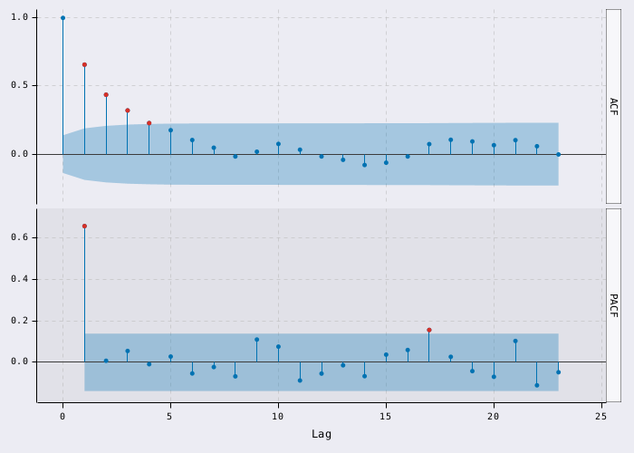
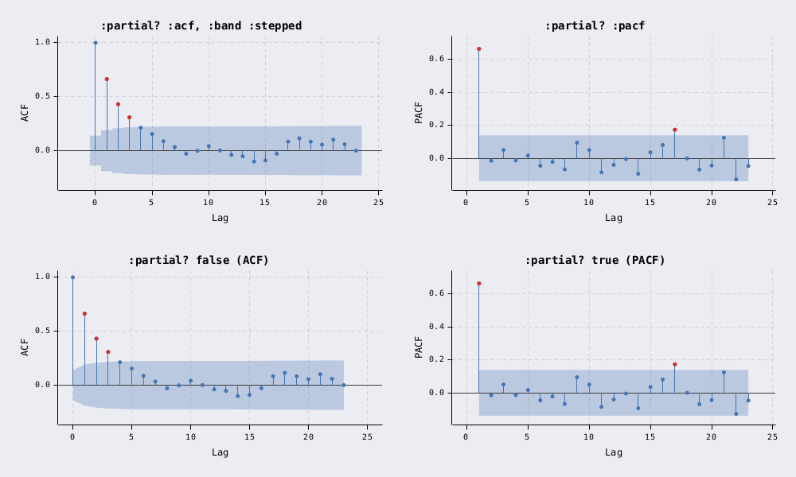
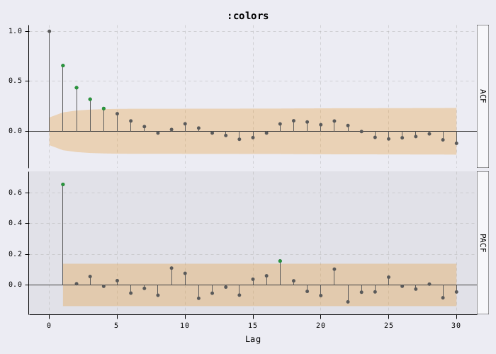
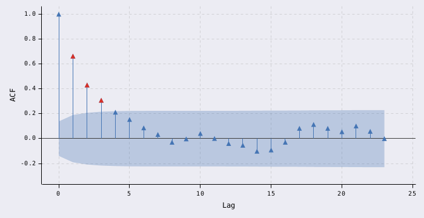
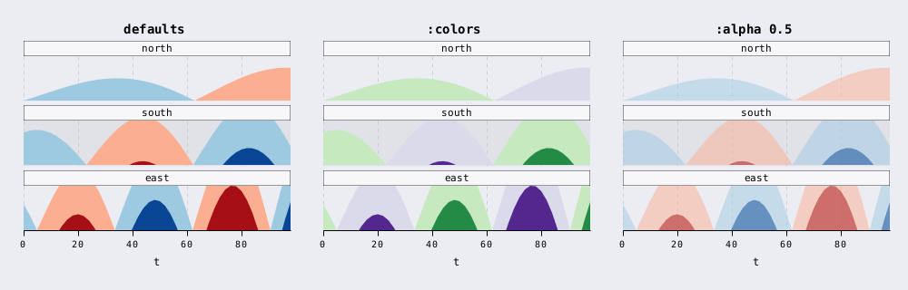

---
format:
  html:
    toc: true
    toc-location: right
    toc-depth: 4
    theme: cosmo
    include-in-header:
      text: |-
        <style>
        .data-table { width: fit-content; max-width: 100%; max-height: 15rem; overflow: auto; margin: 0 0 1rem 0; }
        .data-table .table-responsive { overflow: visible; }
        .data-table table { font-size: 0.75rem; width: auto; margin: 0; }
        .data-table th, .data-table td { padding: 0.1rem 0.45rem !important; white-space: nowrap; }
        .data-table thead th { position: sticky; top: 0; background: var(--bs-body-bg, #fff); }
        .options { margin: 0.5rem 0 1rem 0; }
        .options .option-card { margin: 0 0 0.9rem 0; border: 1px solid var(--bs-border-color, #dee2e6); border-radius: 0.375rem; overflow: hidden; }
        .options dt { display: flex; flex-wrap: wrap; align-items: baseline; gap: 0.1rem 1rem; margin: 0; padding: 0.4rem 0.75rem; background: #eef2f7; border-bottom: 1px solid var(--bs-border-color, #dee2e6); font-weight: normal; }
        .options dt > code { font-weight: 700; font-size: 1rem; background: none; padding: 0; }
        .options .option-default { font-size: 0.85rem; color: var(--bs-secondary-color, #6c757d); }
        .options dd { margin: 0; padding: 0.5rem 0.75rem; }
        .options .option-example { font-size: 0.85rem; padding: 0 0 0.45rem 0; margin-bottom: 0.45rem; border-bottom: 1px dashed var(--bs-border-color, #dee2e6); }
        .options .option-example code { background: none; padding: 0; }
        .options .option-text ul { margin: 0.3rem 0 0 0; padding-left: 1.25rem; }
        .options code, .mapping code { overflow-wrap: anywhere; }
        .mapping { margin: 0.5rem 0 1rem 0; padding: 0.5rem 0.75rem; border: 1px solid var(--bs-border-color, #dee2e6); border-left: 0.3rem solid #2780e3; border-radius: 0.375rem; background: #f5f8fc; }
        .mapping-title { font-weight: 700; margin-bottom: 0.25rem; }
        .mapping-hint { font-weight: normal; font-size: 0.85rem; color: var(--bs-secondary-color, #6c757d); }
        .mapping ul { margin: 0; padding-left: 1.25rem; }
        .mapping .required { font-size: 0.75rem; padding: 0 0.3rem; border: 1px solid currentColor; border-radius: 0.25rem; }
        .mapping-returns { margin-top: 0.25rem; }
        .mapping code { white-space: pre-wrap; }
        .shared { margin: 0.5rem 0 1rem 0; padding: 0.5rem 0.75rem; border: 1px solid var(--bs-border-color, #dee2e6); border-left: 0.3rem solid #6c757d; border-radius: 0.375rem; background: #f6f6f6; }
        .shared-title { font-weight: 700; margin-bottom: 0.25rem; }
        .shared-hint { font-weight: normal; font-size: 0.85rem; color: var(--bs-secondary-color, #6c757d); }
        .shared ul { margin: 0; padding-left: 1.25rem; }
        .shared code { overflow-wrap: anywhere; }
        </style>
code-block-background: true

---
<style></style><style>.printedClojure .sourceCode {
  background-color: transparent;
  border-style: none;
}
</style><style>.clay-limit-image-width .clay-image {max-width: 100%}
.clay-side-by-side .sourceCode {margin: 0}
.clay-side-by-side {margin: 1em 0}
</style>
<script src="https://code.jquery.com/jquery-3.6.0.min.js" type="text/javascript"></script><script src="https://code.jquery.com/ui/1.13.1/jquery-ui.min.js" type="text/javascript"></script>

# Series

These builders draw time series: the autocorrelation correlogram of a series of values, and horizon charts of one
or more series. Use them to look at a series' structure over time. The Shared options chapter documents the series
options they pass on.


::: {.sourceClojure}
```clojure
(ns reference.builders-series
  (:require [fastmath.core :as m]
            [fastmath.random :as r]
            [cljplot2.core :as plot]
            [cljplot2.describe :as describe]
            [notebook-utils :as nu]))
```
:::


The values below form an AR(1) series with coefficient 0.7: fastmath `r/ar` draws 200 values over seeded white
noise:


::: {.sourceClojure}
```clojure
(def ar1 (vec (take 200 (r/ar 0.7 (r/white-noise (r/rng :mersenne 11) 1.0)))))
```
:::


```{=html}
<div class="data-table"><table class="table table-hover table-responsive clay-table"><thead><tr><th>value</th></tr></thead><tbody><tr><td>-0.8681059991636939</td></tr><tr><td>-0.13246657175036403</td></tr><tr><td>-0.16733061455991885</td></tr><tr><td>0.2694449098582038</td></tr><tr><td>0.7626152170591383</td></tr><tr><td>1.1643101963530955</td></tr><tr><td>1.680869004658373</td></tr><tr><td>0.5178927660569208</td></tr><tr><td>1.560261885121078</td></tr><tr><td>2.4418647463226844</td></tr><tr><td>2.043455780603937</td></tr><tr><td>1.3350134131667004</td></tr><tr><td>1.354758198765417</td></tr><tr><td>2.1640502223875067</td></tr><tr><td>1.454799683098602</td></tr><tr><td>1.3371138223355488</td></tr><tr><td>-0.33367593984463084</td></tr><tr><td>-0.005741120165596719</td></tr><tr><td>0.7212290841961994</td></tr><tr><td>-0.1195911846804324</td></tr><tr><td>-0.6812899355665778</td></tr><tr><td>-0.8392514895150631</td></tr><tr><td>-0.9029773174253988</td></tr><tr><td>1.2775138991235113</td></tr><tr><td>1.3052496901727149</td></tr><tr><td>0.10749064244688167</td></tr><tr><td>2.182404272999568</td></tr><tr><td>0.8020152567350689</td></tr><tr><td>2.2480086429639803</td></tr><tr><td>-0.5815891130571396</td></tr><tr><td>-1.2200475860286044</td></tr><tr><td>-0.9148598795692016</td></tr><tr><td>-1.9929339785508062</td></tr><tr><td>-1.167556833223004</td></tr><tr><td>1.1831111606916571</td></tr><tr><td>1.6305003825662951</td></tr><tr><td>0.4225635017131969</td></tr><tr><td>-1.070811370568912</td></tr><tr><td>0.4073366876810065</td></tr><tr><td>-0.07175255029977834</td></tr><tr><td>0.7898405901980585</td></tr><tr><td>0.8608244191036003</td></tr><tr><td>-0.005997950498821458</td></tr><tr><td>-0.5461824357074251</td></tr><tr><td>2.655506073055612</td></tr><tr><td>1.9812883429230417</td></tr><tr><td>0.948280488545405</td></tr><tr><td>0.9976731056744998</td></tr><tr><td>-1.9587787208592302</td></tr><tr><td>-3.5257537738930718</td></tr><tr><td>-2.5932394631294877</td></tr><tr><td>-1.249754246667226</td></tr><tr><td>-2.1034623224484736</td></tr><tr><td>-3.159937484622108</td></tr><tr><td>-3.512030778343192</td></tr><tr><td>-1.9824140637082557</td></tr><tr><td>-2.7829299042529643</td></tr><tr><td>-0.7251573880955828</td></tr><tr><td>-2.072278723660861</td></tr><tr><td>-1.0646342854393418</td></tr><tr><td>-0.4425713020860106</td></tr><tr><td>2.3819350973526423</td></tr><tr><td>2.1408183231391726</td></tr><tr><td>2.454973829360471</td></tr><tr><td>1.4344731917553755</td></tr><tr><td>1.125009999016245</td></tr><tr><td>0.3900070091799304</td></tr><tr><td>-0.7798167218950482</td></tr><tr><td>-0.3342879904823223</td></tr><tr><td>-1.2177391464355098</td></tr><tr><td>0.830731254431112</td></tr><tr><td>0.10821172392000628</td></tr><tr><td>1.2554472029584907</td></tr><tr><td>2.055272585431415</td></tr><tr><td>1.9197473121469386</td></tr><tr><td>1.5763890837670425</td></tr><tr><td>0.23473624714674302</td></tr><tr><td>-0.4411380370130055</td></tr><tr><td>0.03595011068533288</td></tr><tr><td>0.5780803296515352</td></tr><tr><td>1.976207445760896</td></tr><tr><td>1.2935392991386372</td></tr><tr><td>0.8185818425230671</td></tr><tr><td>1.3847837486133925</td></tr><tr><td>0.5583438287031932</td></tr><tr><td>0.7293396933606422</td></tr><tr><td>1.0648721217498003</td></tr><tr><td>0.9532085696520289</td></tr><tr><td>-1.4352271508574979</td></tr><tr><td>-1.2974772446685645</td></tr><tr><td>-2.1190706412323617</td></tr><tr><td>-1.1131573532939294</td></tr><tr><td>-0.9832765035361701</td></tr><tr><td>-2.403094269423963</td></tr><tr><td>-0.5890607058790454</td></tr><tr><td>-1.0802952423453056</td></tr><tr><td>0.04424478384844799</td></tr><tr><td>0.26756324821161415</td></tr><tr><td>-0.8344349067989484</td></tr><tr><td>-1.0274184534958086</td></tr><tr><td>…</td></tr></tbody></table></div>
```


The table below holds three made-up series of growing waves, `:t` and `:v` per series; the horizon charts use it:


::: {.sourceClojure}
```clojure
(def waves (for [[i series] (map-indexed vector ["north" "south" "east"]) t (range 0 100 2)]
             {:t t :series series
              :v (m/* (m/inc i) (m/sin (m/+ (m/* (m/+ 0.05 (m/* 0.03 i)) t) (m/* 1.3 i))) (m/inc (m/* 0.01 t)))}))
```
:::


```{=html}
<div class="data-table"><table class="table table-hover table-responsive clay-table"><thead><tr><th>t</th><th>series</th><th>v</th></tr></thead><tbody><tr><td>0</td><td>north</td><td>0.0</td></tr><tr><td>2</td><td>north</td><td>0.10183008497976472</td></tr><tr><td>4</td><td>north</td><td>0.20661610402686367</td></tr><tr><td>6</td><td>north</td><td>0.31325141906102</td></tr><tr><td>8</td><td>north</td><td>0.42057180969334257</td></tr><tr><td>10</td><td>north</td><td>0.5273680924646234</td></tr><tr><td>12</td><td>north</td><td>0.6323995702024398</td></tr><tr><td>14</td><td>north</td><td>0.7344081634509679</td></tr><tr><td>16</td><td>north</td><td>0.8321330654434463</td></tr><tr><td>18</td><td>north</td><td>0.9243257533604304</td></tr><tr><td>20</td><td>north</td><td>1.0097651817694757</td></tr><tr><td>22</td><td>north</td><td>1.0872729792749511</td></tr><tr><td>24</td><td>north</td><td>1.1557284665993608</td></tr><tr><td>26</td><td>north</td><td>1.2140833136256632</td></tr><tr><td>28</td><td>north</td><td>1.2613756543852293</td></tr><tr><td>30</td><td>north</td><td>1.2967434825852708</td></tr><tr><td>32</td><td>north</td><td>1.3194371560147868</td></tr><tr><td>34</td><td>north</td><td>1.3288308460063079</td></tr><tr><td>36</td><td>north</td><td>1.3244327779943452</td></tr><tr><td>38</td><td>north</td><td>1.305894121008632</td></tr><tr><td>40</td><td>north</td><td>1.2730163975559543</td></tr><tr><td>42</td><td>north</td><td>1.2257573006414006</td></tr><tr><td>44</td><td>north</td><td>1.1642348215002096</td></tr><tr><td>46</td><td>north</td><td>1.0887296097780113</td></tr><tr><td>48</td><td>north</td><td>0.9996855072157029</td></tr><tr><td>50</td><td>north</td><td>0.8977082161559347</td></tr><tr><td>52</td><td>north</td><td>0.7835620851686256</td></tr><tr><td>54</td><td>north</td><td>0.6581650155600979</td></tr><tr><td>56</td><td>north</td><td>0.5225815142432113</td></tr><tr><td>58</td><td>north</td><td>0.37801394015809153</td></tr><tr><td>60</td><td>north</td><td>0.22579201289578754</td></tr><tr><td>62</td><td>north</td><td>0.0673606731419306</td></tr><tr><td>64</td><td>north</td><td>-0.09573359522123134</td></tr><tr><td>66</td><td>north</td><td>-0.2618578522777928</td></tr><tr><td>68</td><td>north</td><td>-0.42930905140507725</td></tr><tr><td>70</td><td>north</td><td>-0.5963314870723538</td></tr><tr><td>72</td><td>north</td><td>-0.7611351624671462</td></tr><tr><td>74</td><td>north</td><td>-0.9219148851807785</td></tr><tr><td>76</td><td>north</td><td>-1.0768698880591858</td></tr><tr><td>78</td><td>north</td><td>-1.224223763347474</td></tr><tr><td>80</td><td>north</td><td>-1.3622444915542709</td></tr><tr><td>82</td><td>north</td><td>-1.4892643421372278</td></tr><tr><td>84</td><td>north</td><td>-1.603699421241002</td></tr><tr><td>86</td><td>north</td><td>-1.704068642353986</td></tr><tr><td>88</td><td>north</td><td>-1.78901189891229</td></tr><tr><td>90</td><td>north</td><td>-1.8573072235636843</td></tr><tr><td>92</td><td>north</td><td>-1.9078867269762518</td></tr><tr><td>94</td><td>north</td><td>-1.9398511196743555</td></tr><tr><td>96</td><td>north</td><td>-1.9524826333182475</td></tr><tr><td>98</td><td>north</td><td>-1.9452561729961784</td></tr><tr><td>0</td><td>south</td><td>1.927116370834386</td></tr><tr><td>2</td><td>south</td><td>2.0274914613597557</td></tr><tr><td>4</td><td>south</td><td>2.07748266641869</td></tr><tr><td>6</td><td>south</td><td>2.0737768064330546</td></tr><tr><td>8</td><td>south</td><td>2.014448430287953</td></tr><tr><td>10</td><td>south</td><td>1.8990606066275224</td></tr><tr><td>12</td><td>south</td><td>1.7287259629250822</td></tr><tr><td>14</td><td>south</td><td>1.5061251389165777</td></tr><tr><td>16</td><td>south</td><td>1.235480985529041</td></tr><tr><td>18</td><td>south</td><td>0.9224880782003472</td></tr><tr><td>20</td><td>south</td><td>0.5741983901135568</td></tr><tr><td>22</td><td>south</td><td>0.19886525029505664</td></tr><tr><td>24</td><td>south</td><td>-0.19425104300774482</td></tr><tr><td>26</td><td>south</td><td>-0.5951114081561804</td></tr><tr><td>28</td><td>south</td><td>-0.9931543499308296</td></tr><tr><td>30</td><td>south</td><td>-1.377573966362083</td></tr><tr><td>32</td><td>south</td><td>-1.73761228107695</td></tr><tr><td>34</td><td>south</td><td>-2.0628580172475854</td></tr><tr><td>36</td><td>south</td><td>-2.343543568845214</td></tr><tr><td>38</td><td>south</td><td>-2.570831790758949</td></tr><tr><td>40</td><td>south</td><td>-2.7370843294622715</td></tr><tr><td>42</td><td>south</td><td>-2.8361035518292965</td></tr><tr><td>44</td><td>south</td><td>-2.8633406963019015</td></tr><tr><td>46</td><td>south</td><td>-2.816063656168469</td></tr><tr><td>48</td><td>south</td><td>-2.693478791142663</td></tr><tr><td>50</td><td>south</td><td>-2.4968023266717037</td></tr><tr><td>52</td><td>south</td><td>-2.229278211026796</td></tr><tr><td>54</td><td>south</td><td>-1.896140724170266</td></tr><tr><td>56</td><td>south</td><td>-1.5045216318441865</td></tr><tr><td>58</td><td>south</td><td>-1.063303212728876</td></tr><tr><td>60</td><td>south</td><td>-0.5829200136707068</td></tr><tr><td>62</td><td>south</td><td>-0.07511366517530942</td></tr><tr><td>64</td><td>south</td><td>0.4473535254084403</td></tr><tr><td>66</td><td>south</td><td>0.9710192324671676</td></tr><tr><td>68</td><td>south</td><td>1.48206796802804</td></tr><tr><td>70</td><td>south</td><td>1.9666951989198806</td></tr><tr><td>72</td><td>south</td><td>2.4114791376904576</td></tr><tr><td>74</td><td>south</td><td>2.803750220572462</td></tr><tr><td>76</td><td>south</td><td>3.131948154193266</td></tr><tr><td>78</td><td>south</td><td>3.3859565569693078</td></tr><tr><td>80</td><td>south</td><td>3.5574056419572013</td></tr><tr><td>82</td><td>south</td><td>3.6399340784710743</td></tr><tr><td>84</td><td>south</td><td>3.629402115594036</td></tr><tr><td>86</td><td>south</td><td>3.5240492301271233</td></tr><tr><td>88</td><td>south</td><td>3.3245909460791916</td></tr><tr><td>90</td><td>south</td><td>3.0342510279692627</td></tr><tr><td>92</td><td>south</td><td>2.658726936228712</td></tr><tr><td>94</td><td>south</td><td>2.20608820588743</td></tr><tr><td>96</td><td>south</td><td>1.6866092224779732</td></tr><tr><td>98</td><td>south</td><td>1.112539672851955</td></tr><tr><td>…</td><td>…</td><td>…</td></tr></tbody></table></div>
```


## Autocorrelation plots

`plot/acf` draws the autocorrelation (ACF) and partial autocorrelation (PACF) of a series of numbers by lag. It
draws a stem per lag and a significance band around zero, and marks the lags outside the band (but not lag 0, which
is always 1). Use it to find the lags a series depends on.


```{=html}
<div class="mapping"><div class="mapping-title">Arguments<span class="mapping-hint"> – what the call takes before its options map</span></div><ul><li><code>values</code> – The series, a sequence of numbers.</li></ul><div class="mapping-returns"><strong>Returns</strong> – A plot map of the correlograms: a stem per lag and the significance band.</div></div>
```


```{=html}
<div class="shared"><div class="shared-title">Shared options<span class="shared-hint"> – groups of options other charts take too</span></div><ul><li><a href="reference.shared_options.html#autocorrelation-rows">Autocorrelation rows</a> – <code>:lags</code> <code>:level</code></li><li><a href="reference.shared_options.html#builder-options">Builder options</a> – <code>:title</code> <code>:scales</code> <code>:theme</code></li></ul></div>
```


These options choose the correlograms, the band's shape and the colours. The plot below draws both correlograms of
the AR(1) series:


```{=html}
<dl class="options"><div class="option-card"><dt><code>:correlograms</code><span class="option-default">Default: <code>:both</code></span></dt><dd><div class="option-example"><code>(plot/acf values {:correlograms :acf})</code></div><div class="option-text">The correlograms the plot draws.<ul><li><code>:both</code> – The ACF above the PACF.</li><li><code>:acf</code> – Only the autocorrelation function.</li><li><code>:pacf</code> – Only the partial autocorrelation function.</li></ul></div></dd></div><div class="option-card"><dt><code>:band</code><span class="option-default">Default: <code>:smooth</code></span></dt><dd><div class="option-example"><code>(plot/acf values {:band :stepped})</code></div><div class="option-text">How the plot draws the significance band.<ul><li><code>:smooth</code> – A ribbon through the lags.</li><li><code>:stepped</code> – A block per lag.</li></ul></div></dd></div><div class="option-card"><dt><code>:colors</code></dt><dd><div class="option-text">The colours of the stems and points, of the band and of the points of significant lags.</div></dd></div><div class="option-card"><dt><code>:colors :stem</code><span class="option-default">Default: <code>[0 114 178]</code></span></dt><dd><div class="option-example"><code>(plot/acf values {:colors {:stem :black}})</code></div><div class="option-text">The colour of the stems and points.<ul><li><code>:none</code> – No stems, and no points except those of significant lags.</li><li><a href="reference.types.html#solid-colour">solid colour</a> – Any other colour, e.g. <code>:black</code>.</li></ul></div></dd></div><div class="option-card"><dt><code>:colors :band</code><span class="option-default">Default: <code>[0 114 178]</code></span></dt><dd><div class="option-example"><code>(plot/acf values {:colors {:band :orange}})</code></div><div class="option-text">The colour of the significance band.<ul><li><code>:none</code> – No band.</li><li><a href="reference.types.html#solid-colour">solid colour</a> – Any other colour, e.g. <code>:black</code>.</li></ul></div></dd></div><div class="option-card"><dt><code>:colors :significant</code><span class="option-default">Default: <code>[215 48 39]</code></span></dt><dd><div class="option-example"><code>(plot/acf values {:colors {:significant :black}})</code></div><div class="option-text">The colour of the points of lags outside the band.<ul><li><code>:none</code> – Draws no extra points; those lags keep the stem colour.</li><li><a href="reference.types.html#solid-colour">solid colour</a> – Any other colour, e.g. <code>:black</code>.</li></ul></div></dd></div></dl>
```


::: {.sourceClojure}
```clojure
(plot/render-image (plot/acf ar1) {:width 700 :height 500})
```
:::


::: {.clay-image}

:::


The next panels draw only the ACF with the band as a block per lag, then only the PACF:


::: {.sourceClojure}
```clojure
(plot/render-image (plot/arrange [(plot/acf ar1 {:correlograms :acf :band :stepped :title ":correlograms :acf, :band :stepped"})
                                  (plot/acf ar1 {:correlograms :pacf :title ":correlograms :pacf"})]
                                 {:columns 2})
                   {:width 1000 :height 300})
```
:::


::: {.clay-image}

:::


The next plot sets the colours of the stems, the band and the significant lags:


::: {.sourceClojure}
```clojure
(plot/render-image (plot/acf ar1 {:correlograms :both :lags 30
                                  :colors {:stem [90 90 90] :band [230 150 40] :significant [40 150 60]}
                                  :title ":colors"})
                   {:width 700 :height 500})
```
:::


::: {.clay-image}

:::


The lag points draw in the theme style `[:chart :acf-point]` (a scatter style; the `:colors` option sets their
colours):


```{=html}
<div class="mapping"><div class="mapping-title">Theme keys<span class="mapping-hint"> – set under <code>[:theme :chart :acf-point]</code>, not options</span></div><ul><li><code>:size</code> (default <code>5</code>) – The point size in pixels; a mapped <code>:size</code> wins.</li><li><code>:color</code> (default <code>[0 114 178 180]</code>) – The colour of the points (in a 3D cloud, of every mark); a mapped <code>:color</code> wins.</li><li><code>:stroke-color</code> (default <code>:none</code>) – The colour of each point's outline.</li><li><code>:stroke-width</code> (default <code>1</code>) – The width of the outline in pixels; <code>0</code> draws no outline.</li><li><code>:shape</code> (default <code>\O</code>) – The shape of every point; a mapped <code>:shape</code> wins.</li><li><code>:alpha</code> – The opacity of every point (in a 3D cloud, of every mark) and its legend key; the outline keeps its own.</li></ul></div>
```


The plot below draws larger triangle points through the theme:


::: {.sourceClojure}
```clojure
(plot/render-image (plot/acf ar1 {:correlograms :acf :theme {:chart {:acf-point {:size 8 :shape \A}}}})
                   {:width 700 :height 360})
```
:::


::: {.clay-image}

:::


## Horizon charts

`plot/horizon` folds each series of rows into bands of equal height: values above the first band draw over it in a
darker colour, and negative values mirror up in reds. Use it to compare many series in little height.


```{=html}
<div class="mapping"><div class="mapping-title">Arguments<span class="mapping-hint"> – what the call takes before its options map</span></div><ul><li><code>rows</code> – The series points, one row each.<div>Columns:<ul><li><code>:x</code> – The x value, a number; the option <code>:x</code> names another key.</li><li><code>:y</code> – The y value, a finite number or <code>nil</code>, which breaks the bands; the option <code>:y</code> names another key.</li><li><em>a series key</em> – The row's series, named by the option <code>:series</code>; optional.</li></ul></div></li></ul><div class="mapping-returns"><strong>Returns</strong> – A plot map of the horizon chart: a row of folded bands per series.</div></div>
```


```{=html}
<div class="shared"><div class="shared-title">Shared options<span class="shared-hint"> – groups of options other charts take too</span></div><ul><li><a href="reference.shared_options.html#horizon-rows">Horizon rows</a> – <code>:x</code> <code>:y</code> <code>:series</code> <code>:bands</code> <code>:band-height</code> <code>:interpolator</code> <code>:steps-per-gap</code></li><li><a href="reference.shared_options.html#builder-options">Builder options</a> – <code>:title</code> <code>:scales</code> <code>:theme</code></li></ul></div>
```


These options set the band colours of each sign and the bands' opacity. The plot below folds the waves into 3
bands:


```{=html}
<dl class="options"><div class="option-card"><dt><code>:colors</code></dt><dd><div class="option-text">The band colours of each sign; each list needs at least <code>:bands</code> colours.</div></dd></div><div class="option-card"><dt><code>:colors :positive</code><span class="option-default">Default: <code>:bands</code> blues from <code>[158 202 225]</code> to <code>[8 69 148]</code>.</span></dt><dd><div class="option-example"><code>(plot/horizon rows {:x :t, :y :v, :series :series, :colors {:positive [:yellow :orange]}})</code></div><div class="option-text">The colours of the positive bands, lightest first.<ul><li><span>sequence of colours</span></li></ul></div></dd></div><div class="option-card"><dt><code>:colors :negative</code><span class="option-default">Default: <code>:bands</code> reds from <code>[252 174 145]</code> to <code>[165 15 21]</code>.</span></dt><dd><div class="option-example"><code>(plot/horizon rows {:x :t, :y :v, :series :series, :colors {:negative [:lightgreen :darkgreen]}})</code></div><div class="option-text">The colours of the negative, mirrored bands, lightest first.<ul><li><span>sequence of colours</span></li></ul></div></dd></div><div class="option-card"><dt><code>:alpha</code><span class="option-default">Default: <code>1.0</code></span></dt><dd><div class="option-example"><code>(plot/horizon rows {:x :t, :y :v, :series :series, :alpha 0.4})</code></div><div class="option-text">The opacity of the bands; translucent bands show the ones beneath.<ul><li><a href="reference.types.html#fraction">fraction</a></li></ul></div></dd></div></dl>
```


::: {.sourceClojure}
```clojure
(plot/render-image (plot/horizon waves {:x :t :y :v :series :series :bands 3}) {:width 700 :height 300})
```
:::


::: {.clay-image}

:::


The left panel below draws two bands, the default, in blues and reds; the middle one sets its own band colours per
sign, lightest first; the right one makes the bands translucent, so they show the ones beneath:


::: {.sourceClojure}
```clojure
(plot/render-image (plot/arrange [(plot/horizon waves {:x :t :y :v :series :series :title "defaults"})
                                  (plot/horizon waves {:x :t :y :v :series :series
                                                       :colors {:positive [[199 233 192] [35 139 69]]
                                                                :negative [[218 218 235] [84 39 143]]}
                                                       :title ":colors"})
                                  (plot/horizon waves {:x :t :y :v :series :series :alpha 0.5 :title ":alpha 0.5"})]
                                 {:columns 3})
                   {:width 1000 :height 320})
```
:::


::: {.clay-image}

:::


```{=html}
<div style="background-color:grey;height:2px;width:100%;"></div>
```


```{=html}
<div><pre><small><small>source: notebooks/reference/builders_series.clj</small></small></pre></div>
```