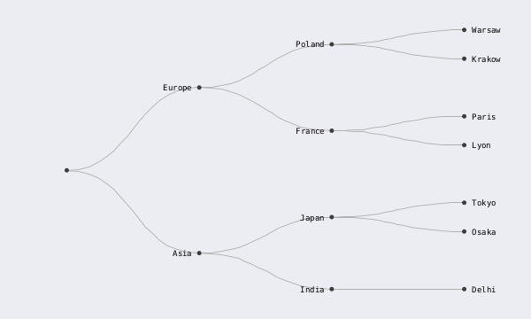
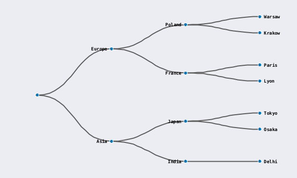
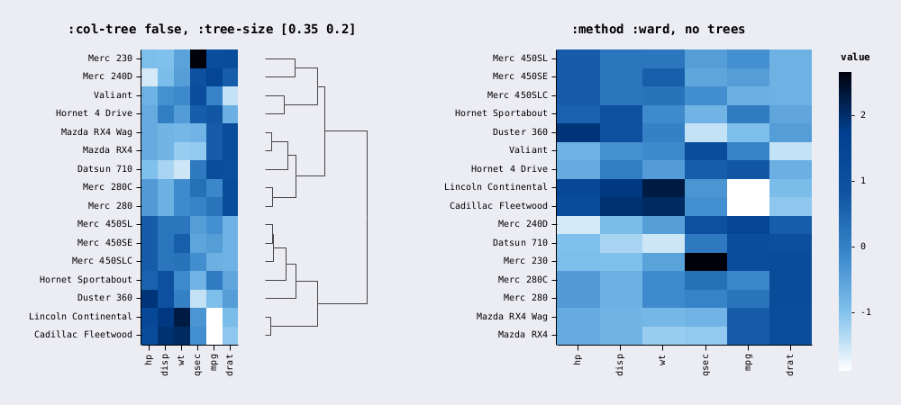
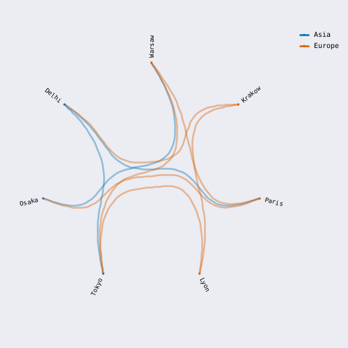
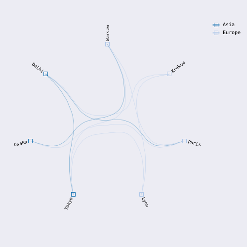
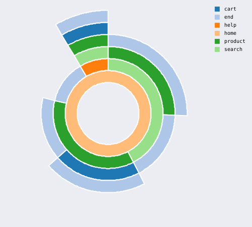

---
format:
  html:
    toc: true
    toc-location: right
    toc-depth: 4
    theme: cosmo
    include-in-header:
      text: |-
        <style>
        .data-table { width: fit-content; max-width: 100%; max-height: 15rem; overflow: auto; margin: 0 0 1rem 0; }
        .data-table .table-responsive { overflow: visible; }
        .data-table table { font-size: 0.75rem; width: auto; margin: 0; }
        .data-table th, .data-table td { padding: 0.1rem 0.45rem !important; white-space: nowrap; }
        .data-table thead th { position: sticky; top: 0; background: var(--bs-body-bg, #fff); }
        .options { margin: 0.5rem 0 1rem 0; }
        .options .option-card { margin: 0 0 0.9rem 0; border: 1px solid var(--bs-border-color, #dee2e6); border-radius: 0.375rem; overflow: hidden; }
        .options dt { display: flex; flex-wrap: wrap; align-items: baseline; gap: 0.1rem 1rem; margin: 0; padding: 0.4rem 0.75rem; background: #eef2f7; border-bottom: 1px solid var(--bs-border-color, #dee2e6); font-weight: normal; }
        .options dt > code { font-weight: 700; font-size: 1rem; background: none; padding: 0; }
        .options .option-default { font-size: 0.85rem; color: var(--bs-secondary-color, #6c757d); }
        .options dd { margin: 0; padding: 0.5rem 0.75rem; }
        .options .option-example { font-size: 0.85rem; padding: 0 0 0.45rem 0; margin-bottom: 0.45rem; border-bottom: 1px dashed var(--bs-border-color, #dee2e6); }
        .options .option-example code { background: none; padding: 0; }
        .options .option-text ul { margin: 0.3rem 0 0 0; padding-left: 1.25rem; }
        .options code, .mapping code { overflow-wrap: anywhere; }
        .mapping { margin: 0.5rem 0 1rem 0; padding: 0.5rem 0.75rem; border: 1px solid var(--bs-border-color, #dee2e6); border-left: 0.3rem solid #2780e3; border-radius: 0.375rem; background: #f5f8fc; }
        .mapping-title { font-weight: 700; margin-bottom: 0.25rem; }
        .mapping-hint { font-weight: normal; font-size: 0.85rem; color: var(--bs-secondary-color, #6c757d); }
        .mapping ul { margin: 0; padding-left: 1.25rem; }
        .mapping .required { font-size: 0.75rem; padding: 0 0.3rem; border: 1px solid currentColor; border-radius: 0.25rem; }
        .shared { margin: 0.5rem 0 1rem 0; padding: 0.5rem 0.75rem; border: 1px solid var(--bs-border-color, #dee2e6); border-left: 0.3rem solid #6c757d; border-radius: 0.375rem; background: #f6f6f6; }
        .shared-title { font-weight: 700; margin-bottom: 0.25rem; }
        .shared-hint { font-weight: normal; font-size: 0.85rem; color: var(--bs-secondary-color, #6c757d); }
        .shared ul { margin: 0; padding-left: 1.25rem; }
        .shared code { overflow-wrap: anywhere; }
        </style>
code-block-background: true

---
<style></style><style>.printedClojure .sourceCode {
  background-color: transparent;
  border-style: none;
}
</style><style>.clay-limit-image-width .clay-image {max-width: 100%}
.clay-side-by-side .sourceCode {margin: 0}
.clay-side-by-side {margin: 1em 0}
</style>
<script src="https://code.jquery.com/jquery-3.6.0.min.js" type="text/javascript"></script><script src="https://code.jquery.com/ui/1.13.1/jquery-ui.min.js" type="text/javascript"></script>

# Trees

Builders drawing a tree or using one: a dendrogram of a clustering or a hierarchy, a node-link tree, a heatmap
ordered by clustering, edges bundled along a tree, and sequences as rings (a flow sunburst). Each takes its data
and an options map and returns an ordinary plot map; the tree functions it forwards to are shared groups (Shared
options), the trees themselves come from the tree data functions.


::: {.sourceClojure}
```clojure
(ns reference.builders-trees
  (:require [fastmath.ml.clustering :as cl]
            [fastmath.stats :as stats]
            [cljplot2.core :as plot]
            [cljplot2.data.tree :as tree]
            [cljplot2.describe :as describe]
            [notebook-utils :as nu]))
```
:::


Data: Motor Trend car road tests (1974), R datasets package `mtcars` (Henderson & Velleman 1981); licence: Part of R (GPL-2 | GPL-3).


::: {.sourceClojure}
```clojure
(def mtcars (take 16 (nu/dataset :mtcars)))
```
:::


```{=html}
<div class="data-table"><table class="table table-hover table-responsive clay-table"><thead><tr><th>model</th><th>mpg</th><th>cyl</th><th>disp</th><th>hp</th><th>drat</th><th>wt</th><th>qsec</th><th>vs</th><th>am</th><th>gear</th><th>carb</th></tr></thead><tbody><tr><td>Mazda RX4</td><td>21</td><td>6</td><td>160</td><td>110</td><td>3.9</td><td>2.62</td><td>16.46</td><td>0</td><td>1</td><td>4</td><td>4</td></tr><tr><td>Mazda RX4 Wag</td><td>21</td><td>6</td><td>160</td><td>110</td><td>3.9</td><td>2.875</td><td>17.02</td><td>0</td><td>1</td><td>4</td><td>4</td></tr><tr><td>Datsun 710</td><td>22.8</td><td>4</td><td>108</td><td>93</td><td>3.85</td><td>2.32</td><td>18.61</td><td>1</td><td>1</td><td>4</td><td>1</td></tr><tr><td>Hornet 4 Drive</td><td>21.4</td><td>6</td><td>258</td><td>110</td><td>3.08</td><td>3.215</td><td>19.44</td><td>1</td><td>0</td><td>3</td><td>1</td></tr><tr><td>Hornet Sportabout</td><td>18.7</td><td>8</td><td>360</td><td>175</td><td>3.15</td><td>3.44</td><td>17.02</td><td>0</td><td>0</td><td>3</td><td>2</td></tr><tr><td>Valiant</td><td>18.1</td><td>6</td><td>225</td><td>105</td><td>2.76</td><td>3.46</td><td>20.22</td><td>1</td><td>0</td><td>3</td><td>1</td></tr><tr><td>Duster 360</td><td>14.3</td><td>8</td><td>360</td><td>245</td><td>3.21</td><td>3.57</td><td>15.84</td><td>0</td><td>0</td><td>3</td><td>4</td></tr><tr><td>Merc 240D</td><td>24.4</td><td>4</td><td>146.7</td><td>62</td><td>3.69</td><td>3.19</td><td>20</td><td>1</td><td>0</td><td>4</td><td>2</td></tr><tr><td>Merc 230</td><td>22.8</td><td>4</td><td>140.8</td><td>95</td><td>3.92</td><td>3.15</td><td>22.9</td><td>1</td><td>0</td><td>4</td><td>2</td></tr><tr><td>Merc 280</td><td>19.2</td><td>6</td><td>167.6</td><td>123</td><td>3.92</td><td>3.44</td><td>18.3</td><td>1</td><td>0</td><td>4</td><td>4</td></tr><tr><td>Merc 280C</td><td>17.8</td><td>6</td><td>167.6</td><td>123</td><td>3.92</td><td>3.44</td><td>18.9</td><td>1</td><td>0</td><td>4</td><td>4</td></tr><tr><td>Merc 450SE</td><td>16.4</td><td>8</td><td>275.8</td><td>180</td><td>3.07</td><td>4.07</td><td>17.4</td><td>0</td><td>0</td><td>3</td><td>3</td></tr><tr><td>Merc 450SL</td><td>17.3</td><td>8</td><td>275.8</td><td>180</td><td>3.07</td><td>3.73</td><td>17.6</td><td>0</td><td>0</td><td>3</td><td>3</td></tr><tr><td>Merc 450SLC</td><td>15.2</td><td>8</td><td>275.8</td><td>180</td><td>3.07</td><td>3.78</td><td>18</td><td>0</td><td>0</td><td>3</td><td>3</td></tr><tr><td>Cadillac Fleetwood</td><td>10.4</td><td>8</td><td>472</td><td>205</td><td>2.93</td><td>5.25</td><td>17.98</td><td>0</td><td>0</td><td>3</td><td>4</td></tr><tr><td>Lincoln Continental</td><td>10.4</td><td>8</td><td>460</td><td>215</td><td>3</td><td>5.424</td><td>17.82</td><td>0</td><td>0</td><td>3</td><td>4</td></tr></tbody></table></div>
```


::: {.sourceClojure}
```clojure
(def variables [:mpg :disp :hp :drat :wt :qsec])
```
:::


The cars' variables as z-scores, a row vector per car, clustered with complete linkage (fastmath `hclust`):


::: {.sourceClojure}
```clojure
(def standardized (apply mapv vector (map (fn [k] (stats/standardize (map k mtcars))) variables)))
```
:::


```{=html}
<div class="data-table"><table class="table table-hover table-responsive clay-table"><thead><tr><th>value</th></tr></thead><tbody><tr><td>[0.6750876206931093 -0.8010684219091876 -0.6554596090331999 1.1283722620337149 -1.1502784754134987 -1.1015230645561858]</td></tr><tr><td>[0.6750876206931093 -0.8010684219091876 -0.6554596090331999 1.1283722620337149 -0.838525042459661 -0.7741715999318604]</td></tr><tr><td>[1.1090725197101083 -1.2597353595104843 -0.9790258770132912 1.014968014593141 -1.517047220065073 0.15527273712649395]</td></tr><tr><td>[0.7715287093635531 0.06334234510864066 -0.6554596090331999 -0.7314573959917041 -0.4228537985212105 0.6404543721946926]</td></tr><tr><td>[0.1205513608380552 0.9630351842496456 0.5817055332436202 -0.5726914495749004 -0.14777724003252984 -0.7741715999318604]</td></tr><tr><td>[-0.024110272167610528 -0.2277347499075668 -0.7506261584391091 -1.4572445796113807 -0.12332599038909156 1.096408197921431]</td></tr><tr><td>[-0.9403006145368302 0.9630351842496456 1.9140372249263495 -0.43660635264621106 0.011155882649818772 -1.4639479003902616]</td></tr><tr><td>[1.4948368743918843 -0.9183813117187501 -1.5690584833299286 0.6520744227833027 -0.45341786057550826 0.967805836819018]</td></tr><tr><td>[1.1090725197101083 -0.9704223681004355 -0.9409592572509275 1.1737339610099446 -0.5023203598623848 2.663018778623563]</td></tr><tr><td>[0.2411027216761104 -0.734032484875152 -0.40802658057783586 1.1737339610099446 -0.14777724003252984 -0.02593968079054295]</td></tr><tr><td>[-0.09644108867044382 -0.734032484875152 -0.40802658057783586 1.1737339610099446 -0.14777724003252984 0.32479403130694806]</td></tr><tr><td>[-0.43398489901699894 0.2203475660567769 0.6768720826495295 -0.7541382454798196 0.6224371237357761 -0.5520402489367825]</td></tr><tr><td>[-0.21699244950849902 0.2203475660567769 0.6768720826495295 -0.7541382454798196 0.2067658797973251 -0.43512901157095013]</td></tr><tr><td>[-0.7233081650283313 0.2203475660567769 0.6768720826495295 -0.7541382454798196 0.26789400390592055 -0.20130653683928948]</td></tr><tr><td>[-1.880601229073661 1.9509332036985922 1.1527048296790756 -1.071670138313427 2.065060852698634 -0.2129976605758723]</td></tr><tr><td>[-1.880601229073661 1.8450869873290623 1.3430379284908942 -0.9129041918966233 2.277786724596547 -0.306526650468537]</td></tr></tbody></table></div>
```


::: {.sourceClojure}
```clojure
(def car-clustering (cl/hclust standardized {:method :complete}))
```
:::


::: {.sourceClojure}
```clojure
(def car-names (mapv :model mtcars))
```
:::


A small hierarchy as rows of levels:


::: {.sourceClojure}
```clojure
(def offices [{:region "Europe" :country "Poland" :city "Warsaw"} {:region "Europe" :country "Poland" :city "Krakow"}
              {:region "Europe" :country "France" :city "Paris"} {:region "Europe" :country "France" :city "Lyon"}
              {:region "Asia" :country "Japan" :city "Tokyo"} {:region "Asia" :country "Japan" :city "Osaka"}
              {:region "Asia" :country "India" :city "Delhi"}])
```
:::


```{=html}
<div class="data-table"><table class="table table-hover table-responsive clay-table"><thead><tr><th>region</th><th>country</th><th>city</th></tr></thead><tbody><tr><td>Europe</td><td>Poland</td><td>Warsaw</td></tr><tr><td>Europe</td><td>Poland</td><td>Krakow</td></tr><tr><td>Europe</td><td>France</td><td>Paris</td></tr><tr><td>Europe</td><td>France</td><td>Lyon</td></tr><tr><td>Asia</td><td>Japan</td><td>Tokyo</td></tr><tr><td>Asia</td><td>Japan</td><td>Osaka</td></tr><tr><td>Asia</td><td>India</td><td>Delhi</td></tr></tbody></table></div>
```


::: {.sourceClojure}
```clojure
(def office-tree (tree/from-levels offices {:hierarchy [:region :country :city]}))
```
:::


## dendrogram

A dendrogram of a clustering (an `hclust` result, its observations named by `:leaf-names`) or of a tree (levels or
parents) - branches at their merge heights, leaves along one axis.

::: {.clay-table}

```{=html}
<table class="table table-hover table-responsive clay-table"><thead><tr><th>Option</th><th>Type</th><th>Default</th><th>Description</th></tr></thead><tbody><tr><td>:leaf-names</td><td>sequential of any value or nil</td><td>the observations' indices</td><td>names of an hclust result's observations, in order (one per observation)</td></tr><tr><td>:horizontal</td><td>true or false or nil</td><td>false</td><td>leaves on the left, heights growing right (not circular)</td></tr><tr><td>:labels</td><td>true or false</td><td>true</td><td>leaf names along the leaf axis (circular - outward around the circle)</td></tr><tr><td>:group-labels</td><td>true or false or nil</td><td>false</td><td>names of the named groups at their nodes (level and parent trees)</td></tr><tr><td>:line-style</td><td>map of keyword to any value or nil</td><td>theme [:chart :dendrogram-branch]</td><td>line options of the branches, merged over the default</td></tr></tbody></table>
```

:::


::: {.sourceClojure}
```clojure
(plot/render-image (plot/dendrogram car-clustering {:leaf-names car-names :k 3 :title "complete linkage, 3 clusters"})
                   {:width 900 :height 420})
```
:::


::: {.clay-image}

:::


Horizontal, with thicker red branches (`:line-style`, merged over the default), and without leaf names (left); a
hierarchy with its group names at their nodes (right):


::: {.sourceClojure}
```clojure
(plot/render-image (plot/arrange [(plot/dendrogram car-clustering {:leaf-names car-names :horizontal true :labels false
                                                                   :line-style {:color [200 60 40] :line-width 2}
                                                                   :title ":horizontal, :labels false, :line-style"})
                                  (plot/dendrogram office-tree {:horizontal false :group-labels true
                                                                :title "a hierarchy, :group-labels true"})]
                                 {:columns 2})
                   {:width 1000 :height 400})
```
:::


::: {.clay-image}

:::


The branches draw in the theme style `[:chart :dendrogram-branch]` (a line style - its colour, width and dash
shown; the clustered heatmap's trees too), the group names in the text role `:dendrogram-group-label`:

::: {.clay-table}

```{=html}
<table class="table table-hover table-responsive clay-table"><thead><tr><th>Option</th><th>Type</th><th>Default</th><th>Description</th></tr></thead><tbody><tr><td>:color</td><td>a clojure2d color or :none</td><td>[70 70 70]</td><td>line colour (a mapped :color wins)</td></tr><tr><td>:line-width</td><td>a non-negative number</td><td>1</td><td>line width in pixels</td></tr><tr><td>:dash</td><td>:none, a dash style (:dashed :dot-dash :dot-dot-dash :dotted :long-dash :loose-dot :solid :two-dash) or a sequence of positive numbers or nil</td><td>:none</td><td>dash style of the line (a mapped :dash wins)</td></tr></tbody></table>
```

:::


Thin blue branches through the theme:


::: {.sourceClojure}
```clojure
(plot/render-image (plot/dendrogram car-clustering {:leaf-names car-names
                                                    :theme {:chart {:dendrogram-branch {:color [40 90 160] :line-width 0.6}}}})
                   {:width 700 :height 380})
```
:::


::: {.clay-image}

:::


```{=html}
<div class="shared"><div class="shared-title">Shared options<span class="shared-hint"> – groups of options other charts take too</span></div><ul><li><a href="reference.shared_options.html#dendrogram-layout">Dendrogram layout</a> – <code>:k</code> <code>:circular</code> <code>:span</code></li><li><a href="reference.shared_options.html#builder-options">Builder options</a> – <code>:title</code> <code>:scales</code> <code>:theme</code></li></ul></div>
```


## tree

A node-link tree: a point per node, links from parents to children, names beside the nodes; tidy (by depth) or
cluster (leaves aligned), cartesian or circular (the Node-link tree layout group).

::: {.clay-table}

```{=html}
<table class="table table-hover table-responsive clay-table"><thead><tr><th>Option</th><th>Type</th><th>Default</th><th>Description</th></tr></thead><tbody><tr><td>:labels</td><td>true or false</td><td>true</td><td>node names (cartesian - leaves right of their node, groups left; circular - leaf names outward)</td></tr><tr><td>:node-points</td><td>true or false</td><td>true</td><td>a point per node</td></tr><tr><td>:mapping</td><td>map of keyword to any value or nil</td><td></td><td>node aesthetics (:color, :size, :shape): accessors of the nodes (their row's columns, :depth, :leaf, :name)</td></tr><tr><td>:node-style</td><td>map of keyword to any value or nil</td><td>theme [:chart :tree-node]</td><td>scatter options of the nodes, merged over the default</td></tr><tr><td>:link-style</td><td>map of keyword to any value or nil</td><td>theme [:chart :tree-link]</td><td>line options of the links, merged over the default</td></tr><tr><td>:leaf-names</td><td>sequential of any value or nil</td><td>the observations' indices</td><td>names of an hclust result's observations, in order (one per observation)</td></tr></tbody></table>
```

:::


::: {.sourceClojure}
```clojure
(plot/render-image (plot/tree office-tree) {:width 600 :height 360})
```
:::


::: {.clay-image}

:::


Nodes coloured by depth through `:mapping`, larger nodes (`:node-style`) and dashed links (`:link-style`) (left);
circular, neither names nor points - only the links (middle); a clustering's tree named by `:labels` (right):


::: {.sourceClojure}
```clojure
(plot/render-image (plot/arrange [(plot/tree office-tree {:mapping {:color #(str (:depth %))}
                                                          :node-style {:size 12}
                                                          :link-style {:dash :dashed :color [90 90 90]}
                                                          :title ":mapping, :node-style, :link-style"
                                                          :scales {:color {:legend false}}})
                                  (plot/tree office-tree {:labels false :node-points false :circular true
                                                          :title ":circular true, no names or points"})
                                  (plot/tree car-clustering {:leaf-names car-names :labels true :node-points true
                                                             :title "a clustering, :labels"})]
                                 {:columns 3})
                   {:width 1000 :height 420})
```
:::


::: {.clay-image}

:::


The theme styles of a node-link tree - nodes in `[:chart :tree-node]` (scatter), links in `[:chart :tree-link]`
(line - its colour, width and dash shown), names in the text role `:tree-label`:

::: {.clay-table}

```{=html}
<table class="table table-hover table-responsive clay-table"><thead><tr><th>Option</th><th>Type</th><th>Default</th><th>Description</th></tr></thead><tbody><tr><td>:size</td><td>a non-negative number</td><td>7</td><td>The point size in pixels; a mapped `:size` wins.</td></tr><tr><td>:color</td><td>a clojure2d color or :none</td><td>[0 114 178]</td><td>The colour of the points (in a 3D cloud, of every mark); a mapped `:color` wins.</td></tr><tr><td>:stroke-color</td><td>a clojure2d color or :none</td><td>:white</td><td>The colour of each point's outline.</td></tr><tr><td>:stroke-width</td><td>a non-negative number</td><td>1</td><td>The width of the outline in pixels.</td></tr><tr><td>:shape</td><td>a shape character or shape map</td><td>\O</td><td>The shape of every point; a mapped `:shape` wins.</td></tr><tr><td>:alpha</td><td>a number in [0 1] or nil</td><td>The colours' own alpha.</td><td>The opacity of every point and its legend key; the outline keeps its own.</td></tr></tbody></table>
```

:::


Small dark nodes through the theme:


::: {.sourceClojure}
```clojure
(plot/render-image (plot/tree office-tree {:theme {:chart {:tree-node {:size 5 :color [60 60 60] :stroke-color :none}}}})
                   {:width 600 :height 360})
```
:::


::: {.clay-image}

:::


::: {.clay-table}

```{=html}
<table class="table table-hover table-responsive clay-table"><thead><tr><th>Option</th><th>Type</th><th>Default</th><th>Description</th></tr></thead><tbody><tr><td>:color</td><td>a clojure2d color or :none</td><td>[176 176 176]</td><td>line colour (a mapped :color wins)</td></tr><tr><td>:line-width</td><td>a non-negative number</td><td>0.9</td><td>line width in pixels</td></tr><tr><td>:dash</td><td>:none, a dash style (:dashed :dot-dash :dot-dot-dash :dotted :long-dash :loose-dot :solid :two-dash) or a sequence of positive numbers or nil</td><td>:none</td><td>dash style of the line (a mapped :dash wins)</td></tr></tbody></table>
```

:::


Darker, thicker links and bold names through the theme:


::: {.sourceClojure}
```clojure
(plot/render-image (plot/tree office-tree {:theme {:chart {:tree-link {:color [90 90 90] :line-width 2}}
                                                   :text {:tree-label {:font-style :bold}}}})
                   {:width 600 :height 360})
```
:::


::: {.clay-image}

:::


```{=html}
<div class="shared"><div class="shared-title">Shared options<span class="shared-hint"> – groups of options other charts take too</span></div><ul><li><a href="reference.shared_options.html#node-link-tree-layout">Node-link tree layout</a> – <code>:layout</code> <code>:links</code> <code>:circular</code> <code>:span</code></li><li><a href="reference.shared_options.html#builder-options">Builder options</a> – <code>:title</code> <code>:scales</code> <code>:theme</code></li></ul></div>
```


## clustered-heatmap

Tiles of a value per row and column, rows and columns ordered by hierarchical clustering, their dendrograms beside
the tiles; the data are long rows (`:row`, `:col`, `:value` accessors).

::: {.clay-table}

```{=html}
<table class="table table-hover table-responsive clay-table"><thead><tr><th>Option</th><th>Type</th><th>Default</th><th>Description</th></tr></thead><tbody><tr><td>:row (required)</td><td>a keyword, a function or a categorical marker of one</td><td></td><td>accessor of a row's tile row</td></tr><tr><td>:col (required)</td><td>a keyword, a function or a categorical marker of one</td><td></td><td>accessor of a row's tile column</td></tr><tr><td>:value (required)</td><td>a keyword, a function or a categorical marker of one</td><td></td><td>accessor of a row's tile value, a finite number</td></tr><tr><td>:method</td><td>one of :single :complete :average :weighted :centroid :median :ward :ward-d :diana</td><td>:complete</td><td>fastmath hclust linkage of the rows and columns</td></tr><tr><td>:distance</td><td>one of :euclidean :chebyshev :manhattan :canberra :earth-movers or a function</td><td>:euclidean</td><td>fastmath hclust distance: a keyword or a function of two double arrays</td></tr><tr><td>:row-tree</td><td>true or false</td><td>true</td><td>the rows' dendrogram right of the tiles (false - order only)</td></tr><tr><td>:col-tree</td><td>true or false</td><td>true</td><td>the columns' dendrogram above the tiles (false - order only)</td></tr><tr><td>:tree-size</td><td>[a number in (0 1), a number in (0 1)]</td><td>[0.2 0.2]</td><td>[w h] - the dendrograms' share of the width (rows) and the height (columns), fractions in (0, 1)</td></tr><tr><td>:row-annotations</td><td>sequential of [a keyword, a function or a categorical marker of one, an aesthetic scale spec or nil] or nil</td><td>no strips</td><td>[[accessor colour-scale-spec] ...]: in order, a strip per accessor between the tiles and the rows' tree, coloured by its values (categorical or continuous), with a legend</td></tr><tr><td>:col-annotations</td><td>sequential of [a keyword, a function or a categorical marker of one, an aesthetic scale spec or nil] or nil</td><td>no strips</td><td>[[accessor colour-scale-spec] ...]: in order, a strip per accessor between the columns' tree and the tiles, coloured by its values (categorical or continuous), with a legend</td></tr><tr><td>:annotation-size</td><td>a positive number or nil</td><td>16</td><td>thickness of an annotation strip in pixels (not a fraction, as :tree-size)</td></tr><tr><td>:legend-span</td><td>one of :row :matrix or nil</td><td>:matrix with annotations, else :row</td><td>height of the legend column: :row - beside the tiles' row; :matrix - one cell beside every row (the trees' and the strips' too), stacking the value legend over the annotations' legends</td></tr></tbody></table>
```

:::


::: {.sourceClojure}
```clojure
(def car-scores (vec (for [[car row] (map vector car-names standardized) [k v] (map vector variables row)]
                       {:car car :variable (name k) :z v})))
```
:::


```{=html}
<div class="data-table"><table class="table table-hover table-responsive clay-table"><thead><tr><th>car</th><th>variable</th><th>z</th></tr></thead><tbody><tr><td>Mazda RX4</td><td>mpg</td><td>0.6750876206931093</td></tr><tr><td>Mazda RX4</td><td>disp</td><td>-0.8010684219091876</td></tr><tr><td>Mazda RX4</td><td>hp</td><td>-0.6554596090331999</td></tr><tr><td>Mazda RX4</td><td>drat</td><td>1.1283722620337149</td></tr><tr><td>Mazda RX4</td><td>wt</td><td>-1.1502784754134987</td></tr><tr><td>Mazda RX4</td><td>qsec</td><td>-1.1015230645561858</td></tr><tr><td>Mazda RX4 Wag</td><td>mpg</td><td>0.6750876206931093</td></tr><tr><td>Mazda RX4 Wag</td><td>disp</td><td>-0.8010684219091876</td></tr><tr><td>Mazda RX4 Wag</td><td>hp</td><td>-0.6554596090331999</td></tr><tr><td>Mazda RX4 Wag</td><td>drat</td><td>1.1283722620337149</td></tr><tr><td>Mazda RX4 Wag</td><td>wt</td><td>-0.838525042459661</td></tr><tr><td>Mazda RX4 Wag</td><td>qsec</td><td>-0.7741715999318604</td></tr><tr><td>Datsun 710</td><td>mpg</td><td>1.1090725197101083</td></tr><tr><td>Datsun 710</td><td>disp</td><td>-1.2597353595104843</td></tr><tr><td>Datsun 710</td><td>hp</td><td>-0.9790258770132912</td></tr><tr><td>Datsun 710</td><td>drat</td><td>1.014968014593141</td></tr><tr><td>Datsun 710</td><td>wt</td><td>-1.517047220065073</td></tr><tr><td>Datsun 710</td><td>qsec</td><td>0.15527273712649395</td></tr><tr><td>Hornet 4 Drive</td><td>mpg</td><td>0.7715287093635531</td></tr><tr><td>Hornet 4 Drive</td><td>disp</td><td>0.06334234510864066</td></tr><tr><td>Hornet 4 Drive</td><td>hp</td><td>-0.6554596090331999</td></tr><tr><td>Hornet 4 Drive</td><td>drat</td><td>-0.7314573959917041</td></tr><tr><td>Hornet 4 Drive</td><td>wt</td><td>-0.4228537985212105</td></tr><tr><td>Hornet 4 Drive</td><td>qsec</td><td>0.6404543721946926</td></tr><tr><td>Hornet Sportabout</td><td>mpg</td><td>0.1205513608380552</td></tr><tr><td>Hornet Sportabout</td><td>disp</td><td>0.9630351842496456</td></tr><tr><td>Hornet Sportabout</td><td>hp</td><td>0.5817055332436202</td></tr><tr><td>Hornet Sportabout</td><td>drat</td><td>-0.5726914495749004</td></tr><tr><td>Hornet Sportabout</td><td>wt</td><td>-0.14777724003252984</td></tr><tr><td>Hornet Sportabout</td><td>qsec</td><td>-0.7741715999318604</td></tr><tr><td>Valiant</td><td>mpg</td><td>-0.024110272167610528</td></tr><tr><td>Valiant</td><td>disp</td><td>-0.2277347499075668</td></tr><tr><td>Valiant</td><td>hp</td><td>-0.7506261584391091</td></tr><tr><td>Valiant</td><td>drat</td><td>-1.4572445796113807</td></tr><tr><td>Valiant</td><td>wt</td><td>-0.12332599038909156</td></tr><tr><td>Valiant</td><td>qsec</td><td>1.096408197921431</td></tr><tr><td>Duster 360</td><td>mpg</td><td>-0.9403006145368302</td></tr><tr><td>Duster 360</td><td>disp</td><td>0.9630351842496456</td></tr><tr><td>Duster 360</td><td>hp</td><td>1.9140372249263495</td></tr><tr><td>Duster 360</td><td>drat</td><td>-0.43660635264621106</td></tr><tr><td>Duster 360</td><td>wt</td><td>0.011155882649818772</td></tr><tr><td>Duster 360</td><td>qsec</td><td>-1.4639479003902616</td></tr><tr><td>Merc 240D</td><td>mpg</td><td>1.4948368743918843</td></tr><tr><td>Merc 240D</td><td>disp</td><td>-0.9183813117187501</td></tr><tr><td>Merc 240D</td><td>hp</td><td>-1.5690584833299286</td></tr><tr><td>Merc 240D</td><td>drat</td><td>0.6520744227833027</td></tr><tr><td>Merc 240D</td><td>wt</td><td>-0.45341786057550826</td></tr><tr><td>Merc 240D</td><td>qsec</td><td>0.967805836819018</td></tr><tr><td>Merc 230</td><td>mpg</td><td>1.1090725197101083</td></tr><tr><td>Merc 230</td><td>disp</td><td>-0.9704223681004355</td></tr><tr><td>Merc 230</td><td>hp</td><td>-0.9409592572509275</td></tr><tr><td>Merc 230</td><td>drat</td><td>1.1737339610099446</td></tr><tr><td>Merc 230</td><td>wt</td><td>-0.5023203598623848</td></tr><tr><td>Merc 230</td><td>qsec</td><td>2.663018778623563</td></tr><tr><td>Merc 280</td><td>mpg</td><td>0.2411027216761104</td></tr><tr><td>Merc 280</td><td>disp</td><td>-0.734032484875152</td></tr><tr><td>Merc 280</td><td>hp</td><td>-0.40802658057783586</td></tr><tr><td>Merc 280</td><td>drat</td><td>1.1737339610099446</td></tr><tr><td>Merc 280</td><td>wt</td><td>-0.14777724003252984</td></tr><tr><td>Merc 280</td><td>qsec</td><td>-0.02593968079054295</td></tr><tr><td>Merc 280C</td><td>mpg</td><td>-0.09644108867044382</td></tr><tr><td>Merc 280C</td><td>disp</td><td>-0.734032484875152</td></tr><tr><td>Merc 280C</td><td>hp</td><td>-0.40802658057783586</td></tr><tr><td>Merc 280C</td><td>drat</td><td>1.1737339610099446</td></tr><tr><td>Merc 280C</td><td>wt</td><td>-0.14777724003252984</td></tr><tr><td>Merc 280C</td><td>qsec</td><td>0.32479403130694806</td></tr><tr><td>Merc 450SE</td><td>mpg</td><td>-0.43398489901699894</td></tr><tr><td>Merc 450SE</td><td>disp</td><td>0.2203475660567769</td></tr><tr><td>Merc 450SE</td><td>hp</td><td>0.6768720826495295</td></tr><tr><td>Merc 450SE</td><td>drat</td><td>-0.7541382454798196</td></tr><tr><td>Merc 450SE</td><td>wt</td><td>0.6224371237357761</td></tr><tr><td>Merc 450SE</td><td>qsec</td><td>-0.5520402489367825</td></tr><tr><td>Merc 450SL</td><td>mpg</td><td>-0.21699244950849902</td></tr><tr><td>Merc 450SL</td><td>disp</td><td>0.2203475660567769</td></tr><tr><td>Merc 450SL</td><td>hp</td><td>0.6768720826495295</td></tr><tr><td>Merc 450SL</td><td>drat</td><td>-0.7541382454798196</td></tr><tr><td>Merc 450SL</td><td>wt</td><td>0.2067658797973251</td></tr><tr><td>Merc 450SL</td><td>qsec</td><td>-0.43512901157095013</td></tr><tr><td>Merc 450SLC</td><td>mpg</td><td>-0.7233081650283313</td></tr><tr><td>Merc 450SLC</td><td>disp</td><td>0.2203475660567769</td></tr><tr><td>Merc 450SLC</td><td>hp</td><td>0.6768720826495295</td></tr><tr><td>Merc 450SLC</td><td>drat</td><td>-0.7541382454798196</td></tr><tr><td>Merc 450SLC</td><td>wt</td><td>0.26789400390592055</td></tr><tr><td>Merc 450SLC</td><td>qsec</td><td>-0.20130653683928948</td></tr><tr><td>Cadillac Fleetwood</td><td>mpg</td><td>-1.880601229073661</td></tr><tr><td>Cadillac Fleetwood</td><td>disp</td><td>1.9509332036985922</td></tr><tr><td>Cadillac Fleetwood</td><td>hp</td><td>1.1527048296790756</td></tr><tr><td>Cadillac Fleetwood</td><td>drat</td><td>-1.071670138313427</td></tr><tr><td>Cadillac Fleetwood</td><td>wt</td><td>2.065060852698634</td></tr><tr><td>Cadillac Fleetwood</td><td>qsec</td><td>-0.2129976605758723</td></tr><tr><td>Lincoln Continental</td><td>mpg</td><td>-1.880601229073661</td></tr><tr><td>Lincoln Continental</td><td>disp</td><td>1.8450869873290623</td></tr><tr><td>Lincoln Continental</td><td>hp</td><td>1.3430379284908942</td></tr><tr><td>Lincoln Continental</td><td>drat</td><td>-0.9129041918966233</td></tr><tr><td>Lincoln Continental</td><td>wt</td><td>2.277786724596547</td></tr><tr><td>Lincoln Continental</td><td>qsec</td><td>-0.306526650468537</td></tr></tbody></table></div>
```


::: {.sourceClojure}
```clojure
(plot/render-image (plot/clustered-heatmap car-scores {:row :car :col :variable :value :z
                                                       :scales {:color {:range :RColorBrewer/RdBu :midpoint 0
                                                                        :reverse true :title "z-score"}}})
                   {:width 700 :height 500})
```
:::


::: {.clay-image}

:::


The distances between rows and columns (`:distance`, here with average linkage) give different orders and trees:


::: {.sourceClojure}
```clojure
(plot/render-image (plot/arrange [(plot/clustered-heatmap car-scores {:row :car :col :variable :value :z :method :average
                                                                      :distance :manhattan :title ":distance :manhattan"
                                                                      :scales {:color {:legend false}}})
                                  (plot/clustered-heatmap car-scores {:row :car :col :variable :value :z :method :average
                                                                      :distance :chebyshev :title ":distance :chebyshev"
                                                                      :scales {:color {:legend false}}})
                                  (plot/clustered-heatmap car-scores {:row :car :col :variable :value :z :method :average
                                                                      :distance :canberra :title ":distance :canberra"
                                                                      :scales {:color {:legend false}}})
                                  (plot/clustered-heatmap car-scores {:row :car :col :variable :value :z :method :average
                                                                      :distance :earth-movers
                                                                      :title ":distance :earth-movers"
                                                                      :scales {:color {:legend false}}})]
                                 {:columns 2})
                   {:width 1000 :height 800})
```
:::


::: {.clay-image}

:::


Only the rows' tree, wider (`:tree-size`), columns ordered without their tree (left); Ward linkage with the
default euclidean distance, no trees - only the order (right):


::: {.sourceClojure}
```clojure
(plot/render-image (plot/arrange [(plot/clustered-heatmap car-scores {:row :car :col :variable :value :z
                                                                      :col-tree false :tree-size [0.35 0.2]
                                                                      :title ":col-tree false, :tree-size [0.35 0.2]"
                                                                      :scales {:color {:legend false}}})
                                  (plot/clustered-heatmap car-scores {:row :car :col :variable :value :z :method :ward
                                                                      :row-tree false :col-tree false
                                                                      :title ":method :ward, no trees"})]
                                 {:columns 2 :widths [1 1.15]})
                   {:width 1000 :height 450})
```
:::


::: {.clay-image}

:::


Annotations (pheatmap's `annotation_row` / `annotation_col`): `:row-annotations` and `:col-annotations` are
vectors of `[accessor colour-scale-spec]` pairs (spec `nil` - the default scale), drawn in order; each draws a strip
along the tile rows (between the tiles and the rows' tree) or columns (under the columns' tree), named beside it,
and adds its legend to the legend column. The rows of one tile row (column) must agree on the value.
`:annotation-size` is the strips' thickness in pixels. With annotations the legend column spans every row
(`:legend-span :matrix`, the default then): the value legend stretches over the room the annotations' legends,
each as tall as it needs, leave below it:


::: {.sourceClojure}
```clojure
(def annotated-scores (let [car-info (into {} (map (fn [r] [(:model r) r])) mtcars)]
                        (mapv (fn [{:keys [car variable] :as r}]
                                (assoc r :cylinders (str (:cyl (car-info car)))
                                       :transmission (if (zero? (:am (car-info car))) "automatic" "manual")
                                       :horsepower (:hp (car-info car))
                                       :kind (if (#{"mpg" "qsec"} variable) "performance" "engine")))
                              car-scores)))
```
:::


```{=html}
<div class="data-table"><table class="table table-hover table-responsive clay-table"><thead><tr><th>car</th><th>variable</th><th>z</th><th>cylinders</th><th>transmission</th><th>horsepower</th><th>kind</th></tr></thead><tbody><tr><td>Mazda RX4</td><td>mpg</td><td>0.6750876206931093</td><td>6</td><td>manual</td><td>110</td><td>performance</td></tr><tr><td>Mazda RX4</td><td>disp</td><td>-0.8010684219091876</td><td>6</td><td>manual</td><td>110</td><td>engine</td></tr><tr><td>Mazda RX4</td><td>hp</td><td>-0.6554596090331999</td><td>6</td><td>manual</td><td>110</td><td>engine</td></tr><tr><td>Mazda RX4</td><td>drat</td><td>1.1283722620337149</td><td>6</td><td>manual</td><td>110</td><td>engine</td></tr><tr><td>Mazda RX4</td><td>wt</td><td>-1.1502784754134987</td><td>6</td><td>manual</td><td>110</td><td>engine</td></tr><tr><td>Mazda RX4</td><td>qsec</td><td>-1.1015230645561858</td><td>6</td><td>manual</td><td>110</td><td>performance</td></tr><tr><td>Mazda RX4 Wag</td><td>mpg</td><td>0.6750876206931093</td><td>6</td><td>manual</td><td>110</td><td>performance</td></tr><tr><td>Mazda RX4 Wag</td><td>disp</td><td>-0.8010684219091876</td><td>6</td><td>manual</td><td>110</td><td>engine</td></tr><tr><td>Mazda RX4 Wag</td><td>hp</td><td>-0.6554596090331999</td><td>6</td><td>manual</td><td>110</td><td>engine</td></tr><tr><td>Mazda RX4 Wag</td><td>drat</td><td>1.1283722620337149</td><td>6</td><td>manual</td><td>110</td><td>engine</td></tr><tr><td>Mazda RX4 Wag</td><td>wt</td><td>-0.838525042459661</td><td>6</td><td>manual</td><td>110</td><td>engine</td></tr><tr><td>Mazda RX4 Wag</td><td>qsec</td><td>-0.7741715999318604</td><td>6</td><td>manual</td><td>110</td><td>performance</td></tr><tr><td>Datsun 710</td><td>mpg</td><td>1.1090725197101083</td><td>4</td><td>manual</td><td>93</td><td>performance</td></tr><tr><td>Datsun 710</td><td>disp</td><td>-1.2597353595104843</td><td>4</td><td>manual</td><td>93</td><td>engine</td></tr><tr><td>Datsun 710</td><td>hp</td><td>-0.9790258770132912</td><td>4</td><td>manual</td><td>93</td><td>engine</td></tr><tr><td>Datsun 710</td><td>drat</td><td>1.014968014593141</td><td>4</td><td>manual</td><td>93</td><td>engine</td></tr><tr><td>Datsun 710</td><td>wt</td><td>-1.517047220065073</td><td>4</td><td>manual</td><td>93</td><td>engine</td></tr><tr><td>Datsun 710</td><td>qsec</td><td>0.15527273712649395</td><td>4</td><td>manual</td><td>93</td><td>performance</td></tr><tr><td>Hornet 4 Drive</td><td>mpg</td><td>0.7715287093635531</td><td>6</td><td>automatic</td><td>110</td><td>performance</td></tr><tr><td>Hornet 4 Drive</td><td>disp</td><td>0.06334234510864066</td><td>6</td><td>automatic</td><td>110</td><td>engine</td></tr><tr><td>Hornet 4 Drive</td><td>hp</td><td>-0.6554596090331999</td><td>6</td><td>automatic</td><td>110</td><td>engine</td></tr><tr><td>Hornet 4 Drive</td><td>drat</td><td>-0.7314573959917041</td><td>6</td><td>automatic</td><td>110</td><td>engine</td></tr><tr><td>Hornet 4 Drive</td><td>wt</td><td>-0.4228537985212105</td><td>6</td><td>automatic</td><td>110</td><td>engine</td></tr><tr><td>Hornet 4 Drive</td><td>qsec</td><td>0.6404543721946926</td><td>6</td><td>automatic</td><td>110</td><td>performance</td></tr><tr><td>Hornet Sportabout</td><td>mpg</td><td>0.1205513608380552</td><td>8</td><td>automatic</td><td>175</td><td>performance</td></tr><tr><td>Hornet Sportabout</td><td>disp</td><td>0.9630351842496456</td><td>8</td><td>automatic</td><td>175</td><td>engine</td></tr><tr><td>Hornet Sportabout</td><td>hp</td><td>0.5817055332436202</td><td>8</td><td>automatic</td><td>175</td><td>engine</td></tr><tr><td>Hornet Sportabout</td><td>drat</td><td>-0.5726914495749004</td><td>8</td><td>automatic</td><td>175</td><td>engine</td></tr><tr><td>Hornet Sportabout</td><td>wt</td><td>-0.14777724003252984</td><td>8</td><td>automatic</td><td>175</td><td>engine</td></tr><tr><td>Hornet Sportabout</td><td>qsec</td><td>-0.7741715999318604</td><td>8</td><td>automatic</td><td>175</td><td>performance</td></tr><tr><td>Valiant</td><td>mpg</td><td>-0.024110272167610528</td><td>6</td><td>automatic</td><td>105</td><td>performance</td></tr><tr><td>Valiant</td><td>disp</td><td>-0.2277347499075668</td><td>6</td><td>automatic</td><td>105</td><td>engine</td></tr><tr><td>Valiant</td><td>hp</td><td>-0.7506261584391091</td><td>6</td><td>automatic</td><td>105</td><td>engine</td></tr><tr><td>Valiant</td><td>drat</td><td>-1.4572445796113807</td><td>6</td><td>automatic</td><td>105</td><td>engine</td></tr><tr><td>Valiant</td><td>wt</td><td>-0.12332599038909156</td><td>6</td><td>automatic</td><td>105</td><td>engine</td></tr><tr><td>Valiant</td><td>qsec</td><td>1.096408197921431</td><td>6</td><td>automatic</td><td>105</td><td>performance</td></tr><tr><td>Duster 360</td><td>mpg</td><td>-0.9403006145368302</td><td>8</td><td>automatic</td><td>245</td><td>performance</td></tr><tr><td>Duster 360</td><td>disp</td><td>0.9630351842496456</td><td>8</td><td>automatic</td><td>245</td><td>engine</td></tr><tr><td>Duster 360</td><td>hp</td><td>1.9140372249263495</td><td>8</td><td>automatic</td><td>245</td><td>engine</td></tr><tr><td>Duster 360</td><td>drat</td><td>-0.43660635264621106</td><td>8</td><td>automatic</td><td>245</td><td>engine</td></tr><tr><td>Duster 360</td><td>wt</td><td>0.011155882649818772</td><td>8</td><td>automatic</td><td>245</td><td>engine</td></tr><tr><td>Duster 360</td><td>qsec</td><td>-1.4639479003902616</td><td>8</td><td>automatic</td><td>245</td><td>performance</td></tr><tr><td>Merc 240D</td><td>mpg</td><td>1.4948368743918843</td><td>4</td><td>automatic</td><td>62</td><td>performance</td></tr><tr><td>Merc 240D</td><td>disp</td><td>-0.9183813117187501</td><td>4</td><td>automatic</td><td>62</td><td>engine</td></tr><tr><td>Merc 240D</td><td>hp</td><td>-1.5690584833299286</td><td>4</td><td>automatic</td><td>62</td><td>engine</td></tr><tr><td>Merc 240D</td><td>drat</td><td>0.6520744227833027</td><td>4</td><td>automatic</td><td>62</td><td>engine</td></tr><tr><td>Merc 240D</td><td>wt</td><td>-0.45341786057550826</td><td>4</td><td>automatic</td><td>62</td><td>engine</td></tr><tr><td>Merc 240D</td><td>qsec</td><td>0.967805836819018</td><td>4</td><td>automatic</td><td>62</td><td>performance</td></tr><tr><td>Merc 230</td><td>mpg</td><td>1.1090725197101083</td><td>4</td><td>automatic</td><td>95</td><td>performance</td></tr><tr><td>Merc 230</td><td>disp</td><td>-0.9704223681004355</td><td>4</td><td>automatic</td><td>95</td><td>engine</td></tr><tr><td>Merc 230</td><td>hp</td><td>-0.9409592572509275</td><td>4</td><td>automatic</td><td>95</td><td>engine</td></tr><tr><td>Merc 230</td><td>drat</td><td>1.1737339610099446</td><td>4</td><td>automatic</td><td>95</td><td>engine</td></tr><tr><td>Merc 230</td><td>wt</td><td>-0.5023203598623848</td><td>4</td><td>automatic</td><td>95</td><td>engine</td></tr><tr><td>Merc 230</td><td>qsec</td><td>2.663018778623563</td><td>4</td><td>automatic</td><td>95</td><td>performance</td></tr><tr><td>Merc 280</td><td>mpg</td><td>0.2411027216761104</td><td>6</td><td>automatic</td><td>123</td><td>performance</td></tr><tr><td>Merc 280</td><td>disp</td><td>-0.734032484875152</td><td>6</td><td>automatic</td><td>123</td><td>engine</td></tr><tr><td>Merc 280</td><td>hp</td><td>-0.40802658057783586</td><td>6</td><td>automatic</td><td>123</td><td>engine</td></tr><tr><td>Merc 280</td><td>drat</td><td>1.1737339610099446</td><td>6</td><td>automatic</td><td>123</td><td>engine</td></tr><tr><td>Merc 280</td><td>wt</td><td>-0.14777724003252984</td><td>6</td><td>automatic</td><td>123</td><td>engine</td></tr><tr><td>Merc 280</td><td>qsec</td><td>-0.02593968079054295</td><td>6</td><td>automatic</td><td>123</td><td>performance</td></tr><tr><td>Merc 280C</td><td>mpg</td><td>-0.09644108867044382</td><td>6</td><td>automatic</td><td>123</td><td>performance</td></tr><tr><td>Merc 280C</td><td>disp</td><td>-0.734032484875152</td><td>6</td><td>automatic</td><td>123</td><td>engine</td></tr><tr><td>Merc 280C</td><td>hp</td><td>-0.40802658057783586</td><td>6</td><td>automatic</td><td>123</td><td>engine</td></tr><tr><td>Merc 280C</td><td>drat</td><td>1.1737339610099446</td><td>6</td><td>automatic</td><td>123</td><td>engine</td></tr><tr><td>Merc 280C</td><td>wt</td><td>-0.14777724003252984</td><td>6</td><td>automatic</td><td>123</td><td>engine</td></tr><tr><td>Merc 280C</td><td>qsec</td><td>0.32479403130694806</td><td>6</td><td>automatic</td><td>123</td><td>performance</td></tr><tr><td>Merc 450SE</td><td>mpg</td><td>-0.43398489901699894</td><td>8</td><td>automatic</td><td>180</td><td>performance</td></tr><tr><td>Merc 450SE</td><td>disp</td><td>0.2203475660567769</td><td>8</td><td>automatic</td><td>180</td><td>engine</td></tr><tr><td>Merc 450SE</td><td>hp</td><td>0.6768720826495295</td><td>8</td><td>automatic</td><td>180</td><td>engine</td></tr><tr><td>Merc 450SE</td><td>drat</td><td>-0.7541382454798196</td><td>8</td><td>automatic</td><td>180</td><td>engine</td></tr><tr><td>Merc 450SE</td><td>wt</td><td>0.6224371237357761</td><td>8</td><td>automatic</td><td>180</td><td>engine</td></tr><tr><td>Merc 450SE</td><td>qsec</td><td>-0.5520402489367825</td><td>8</td><td>automatic</td><td>180</td><td>performance</td></tr><tr><td>Merc 450SL</td><td>mpg</td><td>-0.21699244950849902</td><td>8</td><td>automatic</td><td>180</td><td>performance</td></tr><tr><td>Merc 450SL</td><td>disp</td><td>0.2203475660567769</td><td>8</td><td>automatic</td><td>180</td><td>engine</td></tr><tr><td>Merc 450SL</td><td>hp</td><td>0.6768720826495295</td><td>8</td><td>automatic</td><td>180</td><td>engine</td></tr><tr><td>Merc 450SL</td><td>drat</td><td>-0.7541382454798196</td><td>8</td><td>automatic</td><td>180</td><td>engine</td></tr><tr><td>Merc 450SL</td><td>wt</td><td>0.2067658797973251</td><td>8</td><td>automatic</td><td>180</td><td>engine</td></tr><tr><td>Merc 450SL</td><td>qsec</td><td>-0.43512901157095013</td><td>8</td><td>automatic</td><td>180</td><td>performance</td></tr><tr><td>Merc 450SLC</td><td>mpg</td><td>-0.7233081650283313</td><td>8</td><td>automatic</td><td>180</td><td>performance</td></tr><tr><td>Merc 450SLC</td><td>disp</td><td>0.2203475660567769</td><td>8</td><td>automatic</td><td>180</td><td>engine</td></tr><tr><td>Merc 450SLC</td><td>hp</td><td>0.6768720826495295</td><td>8</td><td>automatic</td><td>180</td><td>engine</td></tr><tr><td>Merc 450SLC</td><td>drat</td><td>-0.7541382454798196</td><td>8</td><td>automatic</td><td>180</td><td>engine</td></tr><tr><td>Merc 450SLC</td><td>wt</td><td>0.26789400390592055</td><td>8</td><td>automatic</td><td>180</td><td>engine</td></tr><tr><td>Merc 450SLC</td><td>qsec</td><td>-0.20130653683928948</td><td>8</td><td>automatic</td><td>180</td><td>performance</td></tr><tr><td>Cadillac Fleetwood</td><td>mpg</td><td>-1.880601229073661</td><td>8</td><td>automatic</td><td>205</td><td>performance</td></tr><tr><td>Cadillac Fleetwood</td><td>disp</td><td>1.9509332036985922</td><td>8</td><td>automatic</td><td>205</td><td>engine</td></tr><tr><td>Cadillac Fleetwood</td><td>hp</td><td>1.1527048296790756</td><td>8</td><td>automatic</td><td>205</td><td>engine</td></tr><tr><td>Cadillac Fleetwood</td><td>drat</td><td>-1.071670138313427</td><td>8</td><td>automatic</td><td>205</td><td>engine</td></tr><tr><td>Cadillac Fleetwood</td><td>wt</td><td>2.065060852698634</td><td>8</td><td>automatic</td><td>205</td><td>engine</td></tr><tr><td>Cadillac Fleetwood</td><td>qsec</td><td>-0.2129976605758723</td><td>8</td><td>automatic</td><td>205</td><td>performance</td></tr><tr><td>Lincoln Continental</td><td>mpg</td><td>-1.880601229073661</td><td>8</td><td>automatic</td><td>215</td><td>performance</td></tr><tr><td>Lincoln Continental</td><td>disp</td><td>1.8450869873290623</td><td>8</td><td>automatic</td><td>215</td><td>engine</td></tr><tr><td>Lincoln Continental</td><td>hp</td><td>1.3430379284908942</td><td>8</td><td>automatic</td><td>215</td><td>engine</td></tr><tr><td>Lincoln Continental</td><td>drat</td><td>-0.9129041918966233</td><td>8</td><td>automatic</td><td>215</td><td>engine</td></tr><tr><td>Lincoln Continental</td><td>wt</td><td>2.277786724596547</td><td>8</td><td>automatic</td><td>215</td><td>engine</td></tr><tr><td>Lincoln Continental</td><td>qsec</td><td>-0.306526650468537</td><td>8</td><td>automatic</td><td>215</td><td>performance</td></tr></tbody></table></div>
```


::: {.sourceClojure}
```clojure
(plot/render-image (plot/clustered-heatmap annotated-scores
                                           {:row :car :col :variable :value :z
                                            :row-annotations [[:cylinders {:range :set2}] [:transmission {:range ["#999999" "#e08214"]}]]
                                            :col-annotations [[:kind {:range :set1 :title "variable kind"}]]
                                            :annotation-size 14 :legend-span :matrix
                                            :scales {:color {:range :RColorBrewer/RdBu :midpoint 0 :reverse true :title "z-score"}}})
                   {:width 800 :height 600})
```
:::


::: {.clay-image}

:::


An annotation is coloured as any colour mapping: categorical values get a palette, numbers a gradient (here
horsepower, a continuous colour bar). `:legend-span :row` keeps the legend cell beside the tiles' row only:


::: {.sourceClojure}
```clojure
(plot/render-image (plot/clustered-heatmap annotated-scores
                                           {:row :car :col :variable :value :z
                                            :row-annotations [[:horsepower {:range :viridis/magma}] [:cylinders nil]]
                                            :legend-span :row
                                            :scales {:color {:range :RColorBrewer/RdBu :midpoint 0 :reverse true :title "z-score"}}})
                   {:width 800 :height 500})
```
:::


::: {.clay-image}

:::


```{=html}
<div class="shared"><div class="shared-title">Shared options<span class="shared-hint"> – groups of options other charts take too</span></div><ul><li><a href="reference.shared_options.html#builder-options">Builder options</a> – <code>:title</code> <code>:scales</code> <code>:theme</code></li></ul></div>
```


## bundle

Hierarchical edge bundling: edges between the leaves of a tree, each bent along the tree path between its ends,
leaves around a circle. Edges name their leaves by key - a `tree/from-parents` node's id, else the leaf's name
(`tree/from-levels`, `tree/from-hclust`): here the office tree from levels, edges between cities.

::: {.clay-table}

```{=html}
<table class="table table-hover table-responsive clay-table"><thead><tr><th>Option</th><th>Type</th><th>Default</th><th>Description</th></tr></thead><tbody><tr><td>:alpha</td><td>a number in [0 1]</td><td>0.4</td><td>opacity of the edges (leaf points and legend keys stay opaque)</td></tr><tr><td>:color-by</td><td>one of :group :none or nil</td><td>:group</td><td>edge and leaf colours: :group - the top-level group of their (source) leaf, with a legend; :none - one :edge-color, no legend</td></tr><tr><td>:edge-color</td><td>a clojure2d color or :none</td><td>[0 114 178]</td><td>colour of the edges when not coloured by group</td></tr><tr><td>:labels</td><td>true or false</td><td>true</td><td>leaf names outward around the circle</td></tr></tbody></table>
```

:::


::: {.sourceClojure}
```clojure
(def calls [{:from "Warsaw" :to "Paris"} {:from "Warsaw" :to "Tokyo"} {:from "Krakow" :to "Lyon"}
            {:from "Krakow" :to "Delhi"} {:from "Paris" :to "Osaka"} {:from "Lyon" :to "Tokyo"}
            {:from "Tokyo" :to "Delhi"} {:from "Osaka" :to "Warsaw"} {:from "Delhi" :to "Paris"}])
```
:::


```{=html}
<div class="data-table"><table class="table table-hover table-responsive clay-table"><thead><tr><th>from</th><th>to</th></tr></thead><tbody><tr><td>Warsaw</td><td>Paris</td></tr><tr><td>Warsaw</td><td>Tokyo</td></tr><tr><td>Krakow</td><td>Lyon</td></tr><tr><td>Krakow</td><td>Delhi</td></tr><tr><td>Paris</td><td>Osaka</td></tr><tr><td>Lyon</td><td>Tokyo</td></tr><tr><td>Tokyo</td><td>Delhi</td></tr><tr><td>Osaka</td><td>Warsaw</td></tr><tr><td>Delhi</td><td>Paris</td></tr></tbody></table></div>
```


::: {.sourceClojure}
```clojure
(plot/render-image (plot/bundle calls office-tree {}) {:width 500 :height 500})
```
:::


::: {.clay-image}

:::


One edge colour, more opaque, without leaf names (left); coloured by group (the default) and fainter (right):


::: {.sourceClojure}
```clojure
(plot/render-image (plot/arrange [(plot/bundle calls office-tree {:color-by :none :edge-color [120 60 160]
                                                                  :alpha 0.8 :labels false
                                                                  :title ":color-by :none, :alpha 0.8"})
                                  (plot/bundle calls office-tree {:alpha 0.15 :title ":alpha 0.15"})]
                                 {:columns 2 :widths [1 1.3]})
                   {:width 1000 :height 480})
```
:::


::: {.clay-image}

:::


The theme styles of edge bundling - edges in `[:chart :bundle-edge]` (line - its colour, width and dash shown),
leaves in `[:chart :bundle-leaf]` (scatter):

::: {.clay-table}

```{=html}
<table class="table table-hover table-responsive clay-table"><thead><tr><th>Option</th><th>Type</th><th>Default</th><th>Description</th></tr></thead><tbody><tr><td>:color</td><td>a clojure2d color or :none</td><td>[0 114 178]</td><td>line colour (a mapped :color wins)</td></tr><tr><td>:line-width</td><td>a non-negative number</td><td>1</td><td>line width in pixels</td></tr><tr><td>:dash</td><td>:none, a dash style (:dashed :dot-dash :dot-dot-dash :dotted :long-dash :loose-dot :solid :two-dash) or a sequence of positive numbers or nil</td><td>:none</td><td>dash style of the line (a mapped :dash wins)</td></tr></tbody></table>
```

:::


Thicker edges through the theme:


::: {.sourceClojure}
```clojure
(plot/render-image (plot/bundle calls office-tree {:theme {:chart {:bundle-edge {:line-width 2.5}}}})
                   {:width 500 :height 500})
```
:::


::: {.clay-image}

:::


::: {.clay-table}

```{=html}
<table class="table table-hover table-responsive clay-table"><thead><tr><th>Option</th><th>Type</th><th>Default</th><th>Description</th></tr></thead><tbody><tr><td>:size</td><td>a non-negative number</td><td>3</td><td>The point size in pixels; a mapped `:size` wins.</td></tr><tr><td>:color</td><td>a clojure2d color or :none</td><td>[0 114 178 180]</td><td>The colour of the points (in a 3D cloud, of every mark); a mapped `:color` wins.</td></tr><tr><td>:stroke-color</td><td>a clojure2d color or :none</td><td>:none</td><td>The colour of each point's outline.</td></tr><tr><td>:stroke-width</td><td>a non-negative number</td><td>1</td><td>The width of the outline in pixels.</td></tr><tr><td>:shape</td><td>a shape character or shape map</td><td>\O</td><td>The shape of every point; a mapped `:shape` wins.</td></tr><tr><td>:alpha</td><td>a number in [0 1] or nil</td><td>The colours' own alpha.</td><td>The opacity of every point and its legend key; the outline keeps its own.</td></tr></tbody></table>
```

:::


Large square leaves through the theme:


::: {.sourceClojure}
```clojure
(plot/render-image (plot/bundle calls office-tree {:theme {:chart {:bundle-leaf {:size 8 :shape \s}}}})
                   {:width 500 :height 500})
```
:::


::: {.clay-image}

:::


```{=html}
<div class="shared"><div class="shared-title">Shared options<span class="shared-hint"> – groups of options other charts take too</span></div><ul><li><a href="reference.shared_options.html#edge-bundling">Edge bundling</a> – <code>:from</code> <code>:to</code> <code>:beta</code></li><li><a href="reference.shared_options.html#builder-options">Builder options</a> – <code>:title</code> <code>:scales</code> <code>:theme</code></li></ul></div>
```


## sequences

A flow sunburst: sequences of steps (a string of steps with a separator) as rings from the centre, every step
coloured by its name wherever it occurs, the end of a sequence a step of its own.

::: {.clay-table}

```{=html}
<table class="table table-hover table-responsive clay-table"><thead><tr><th>Option</th><th>Type</th><th>Default</th><th>Description</th></tr></thead><tbody><tr><td>:inner-radius</td><td>a finite number, >= 0, < 1</td><td>0.3</td><td>radius of the centre hole, a fraction of the outer one</td></tr><tr><td>:labels</td><td>true or false</td><td>false</td><td>step names in the cells that fit</td></tr><tr><td>:keep-end</td><td>true or false</td><td>true</td><td>the end marker a step of its own, coloured and in the legend (false - sequences that end are their group's grey remainder)</td></tr></tbody></table>
```

:::


::: {.sourceClojure}
```clojure
(def visits [{:sequence "home-search-product-end" :n 30} {:sequence "home-product-cart-end" :n 25}
             {:sequence "home-search-end" :n 20} {:sequence "home-end" :n 15}
             {:sequence "home-help-search-product-cart-end" :n 10} {:sequence "home-product-end" :n 18}])
```
:::


```{=html}
<div class="data-table"><table class="table table-hover table-responsive clay-table"><thead><tr><th>sequence</th><th>n</th></tr></thead><tbody><tr><td>home-search-product-end</td><td>30</td></tr><tr><td>home-product-cart-end</td><td>25</td></tr><tr><td>home-search-end</td><td>20</td></tr><tr><td>home-end</td><td>15</td></tr><tr><td>home-help-search-product-cart-end</td><td>10</td></tr><tr><td>home-product-end</td><td>18</td></tr></tbody></table></div>
```


::: {.sourceClojure}
```clojure
(plot/render-image (plot/sequences visits {:value :n}) {:width 500 :height 450})
```
:::


::: {.clay-image}

:::


A smaller hole - more room for the rings - and the step names in the cells where they fit (a larger image):


::: {.sourceClojure}
```clojure
(plot/render-image (plot/sequences visits {:value :n :inner-radius 0.1 :labels true :title ":inner-radius 0.1, :labels true"})
                   {:width 700 :height 600})
```
:::


::: {.clay-image}

:::


Ending sequences left as their group's grey remainder, the end not a step of its own:


::: {.sourceClojure}
```clojure
(plot/render-image (plot/sequences visits {:value :n :keep-end false :title ":keep-end false"})
                   {:width 550 :height 450})
```
:::


::: {.clay-image}

:::


The cells draw in the theme style `[:chart :sequences-cell]` (a partition style over `[:chart :partition]`):

::: {.clay-table}

```{=html}
<table class="table table-hover table-responsive clay-table"><thead><tr><th>Option</th><th>Type</th><th>Default</th><th>Description</th><th>Group</th></tr></thead><tbody><tr><td>:stroke-color</td><td>a clojure2d color or :none</td><td>:white</td><td>cell outline colour</td><td></td></tr><tr><td>:stroke-width</td><td>a non-negative number</td><td>0.3</td><td>cell outline width in pixels</td><td></td></tr><tr><td>:pattern</td><td>a pattern name (:back-hatch :cross :dense-dots :diagonal-cross :dots :hatch :horizontal :solid :vertical) or a pattern map</td><td>:solid</td><td>pattern drawn over the fill (a mapped :pattern wins)</td><td>Fill patterns</td></tr><tr><td>:pattern-color</td><td>:darker or a clojure2d color or :none</td><td>:darker</td><td>pattern ink: a colour, :none or :darker (the darkened fill)</td><td>Fill patterns</td></tr></tbody></table>
```

:::


Thick white cell borders through the theme:


::: {.sourceClojure}
```clojure
(plot/render-image (plot/sequences visits {:value :n :theme {:chart {:sequences-cell {:stroke-width 2}}}})
                   {:width 500 :height 450})
```
:::


::: {.clay-image}

:::


```{=html}
<div class="shared"><div class="shared-title">Shared options<span class="shared-hint"> – groups of options other charts take too</span></div><ul><li><a href="reference.shared_options.html#sequences">Sequences</a> – <code>:sequence</code> <code>:value</code> <code>:separator</code> <code>:end</code></li><li><a href="reference.shared_options.html#builder-options">Builder options</a> – <code>:title</code> <code>:scales</code> <code>:theme</code></li></ul></div>
```


```{=html}
<div style="background-color:grey;height:2px;width:100%;"></div>
```


```{=html}
<div><pre><small><small>source: notebooks/reference/builders_trees.clj</small></small></pre></div>
```