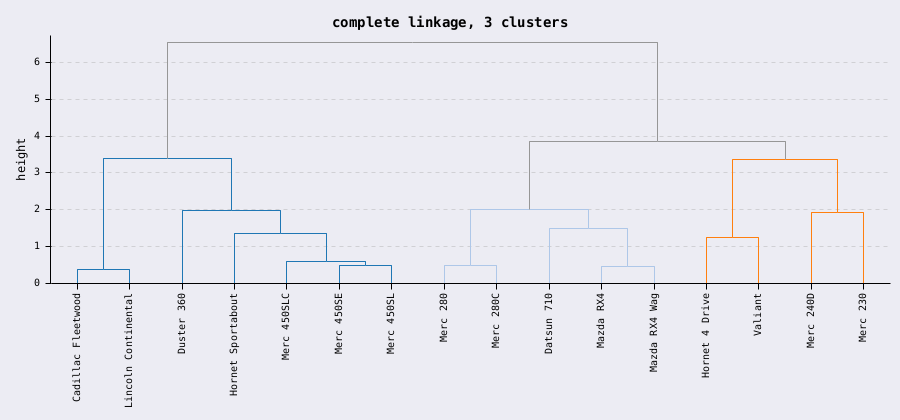
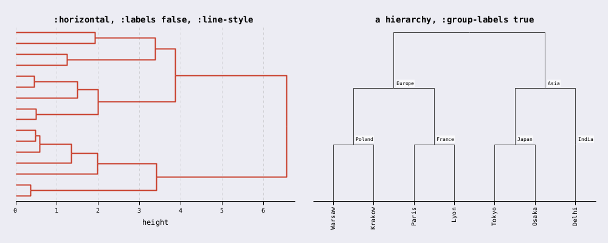
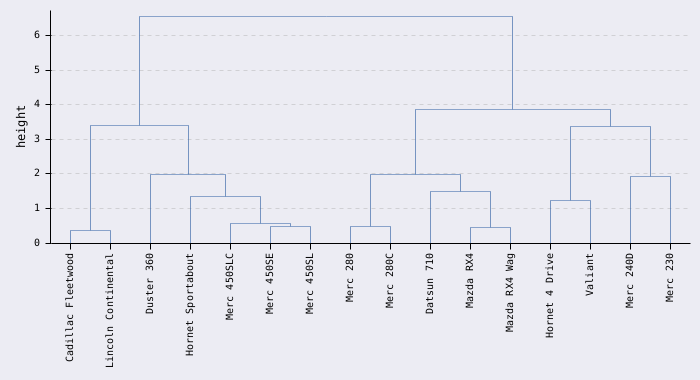
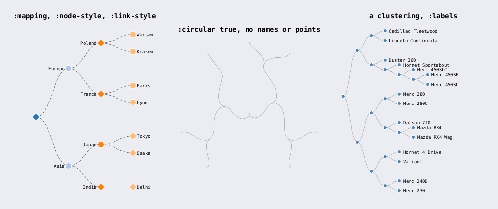
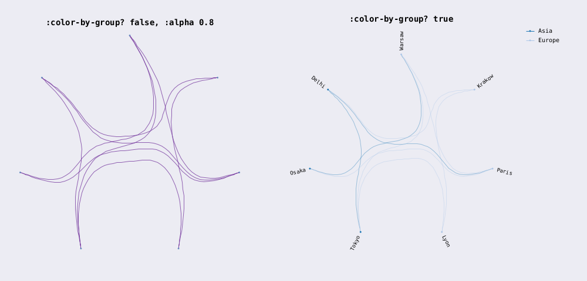
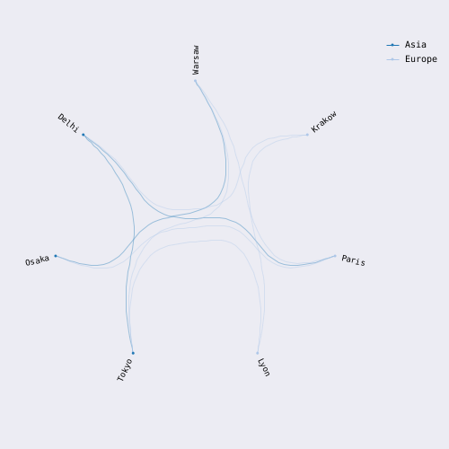
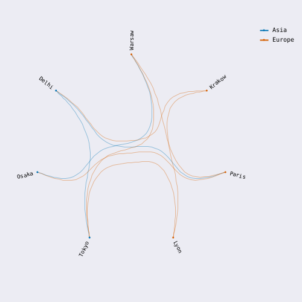
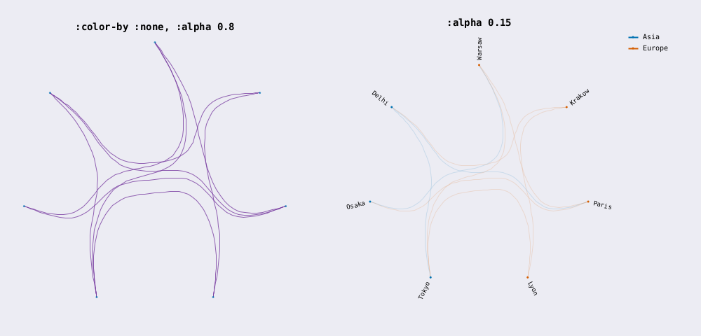
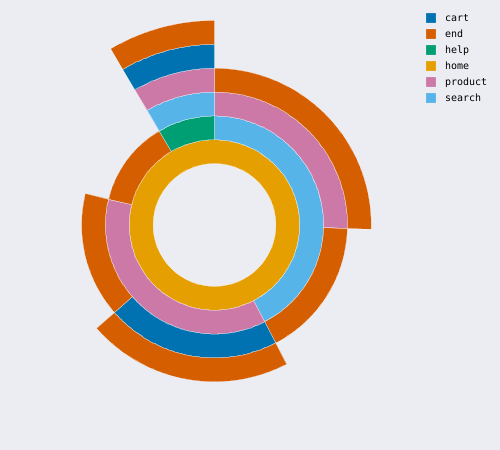
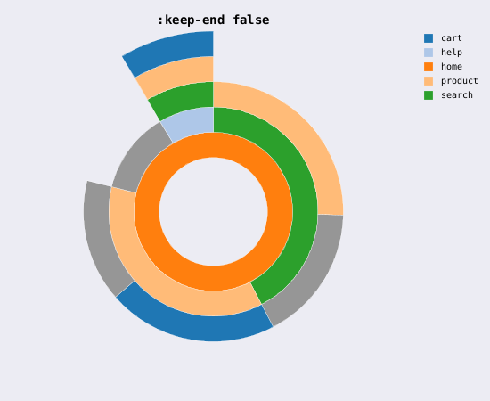

---
format:
  html:
    toc: true
    toc-location: right
    toc-depth: 4
    theme: cosmo
    include-in-header:
      text: |-
        <style>
        .data-table { width: fit-content; max-width: 100%; max-height: 15rem; overflow: auto; margin: 0 0 1rem 0; }
        .data-table .table-responsive { overflow: visible; }
        .data-table table { font-size: 0.75rem; width: auto; margin: 0; }
        .data-table th, .data-table td { padding: 0.1rem 0.45rem !important; white-space: nowrap; }
        .data-table thead th { position: sticky; top: 0; background: var(--bs-body-bg, #fff); }
        .options { margin: 0.5rem 0 1rem 0; }
        .options .option-card { margin: 0 0 0.9rem 0; border: 1px solid var(--bs-border-color, #dee2e6); border-radius: 0.375rem; overflow: hidden; }
        .options dt { display: flex; flex-wrap: wrap; align-items: baseline; gap: 0.1rem 1rem; margin: 0; padding: 0.4rem 0.75rem; background: #eef2f7; border-bottom: 1px solid var(--bs-border-color, #dee2e6); font-weight: normal; }
        .options dt > code { font-weight: 700; font-size: 1rem; background: none; padding: 0; }
        .options .option-default { font-size: 0.85rem; color: var(--bs-secondary-color, #6c757d); }
        .options dd { margin: 0; padding: 0.5rem 0.75rem; }
        .options .option-example { font-size: 0.85rem; padding: 0 0 0.45rem 0; margin-bottom: 0.45rem; border-bottom: 1px dashed var(--bs-border-color, #dee2e6); }
        .options .option-example code { background: none; padding: 0; }
        .options .option-text ul { margin: 0.3rem 0 0 0; padding-left: 1.25rem; }
        .options code, .mapping code { overflow-wrap: anywhere; }
        .options .option-default code, .options .option-example code { white-space: pre-wrap; }
        .mapping { margin: 0.5rem 0 1rem 0; padding: 0.5rem 0.75rem; border: 1px solid var(--bs-border-color, #dee2e6); border-left: 0.3rem solid #2780e3; border-radius: 0.375rem; background: #f5f8fc; }
        .mapping-title { font-weight: 700; margin-bottom: 0.25rem; }
        .mapping-hint { font-weight: normal; font-size: 0.85rem; color: var(--bs-secondary-color, #6c757d); }
        .mapping ul { margin: 0; padding-left: 1.25rem; }
        .mapping .required { font-size: 0.75rem; padding: 0 0.3rem; border: 1px solid currentColor; border-radius: 0.25rem; }
        .mapping-returns { margin-top: 0.25rem; }
        .mapping code { white-space: pre-wrap; }
        .shared { margin: 0.5rem 0 1rem 0; padding: 0.5rem 0.75rem; border: 1px solid var(--bs-border-color, #dee2e6); border-left: 0.3rem solid #6c757d; border-radius: 0.375rem; background: #f6f6f6; }
        .shared-title { font-weight: 700; margin-bottom: 0.25rem; }
        .shared-hint { font-weight: normal; font-size: 0.85rem; color: var(--bs-secondary-color, #6c757d); }
        .shared ul { margin: 0; padding-left: 1.25rem; }
        .shared code { overflow-wrap: anywhere; }
        p code, li code { white-space: pre-wrap; overflow-wrap: anywhere; }
        </style>
code-block-background: true

---
<style></style><style>.printedClojure .sourceCode {
  background-color: transparent;
  border-style: none;
}
</style><style>.clay-limit-image-width .clay-image {max-width: 100%}
.clay-side-by-side .sourceCode {margin: 0}
.clay-side-by-side {margin: 1em 0}
</style>
<script src="https://code.jquery.com/jquery-3.6.0.min.js" type="text/javascript"></script><script src="https://code.jquery.com/ui/1.13.1/jquery-ui.min.js" type="text/javascript"></script>

# Trees

These builders draw a tree or use one: a dendrogram of a clustering or a hierarchy, a node-link tree, a heatmap
ordered by clustering, edges bundled along a tree, and sequences as rings. Use them for clusterings and hierarchies.
Each returns an ordinary plot map; the Shared options chapter documents the tree options they pass on.


::: {.sourceClojure}
```clojure
(ns reference.builders-trees
  (:require [fastmath.ml.clustering :as cl]
            [fastmath.stats :as stats]
            [cljplot2.core :as plot]
            [cljplot2.data.tree :as tree]
            [cljplot2.describe :as describe]
            [notebook-utils :as nu]))
```
:::


Data: Motor Trend car road tests (1974), R datasets package `mtcars` (Henderson & Velleman 1981); licence: Part of R (GPL-2 | GPL-3).


::: {.sourceClojure}
```clojure
(def mtcars (take 16 (nu/dataset :mtcars)))
```
:::


```{=html}
<div class="data-table"><table class="table table-hover table-responsive clay-table"><thead><tr><th>model</th><th>mpg</th><th>cyl</th><th>disp</th><th>hp</th><th>drat</th><th>wt</th><th>qsec</th><th>vs</th><th>am</th><th>gear</th><th>carb</th></tr></thead><tbody><tr><td>Mazda RX4</td><td>21</td><td>6</td><td>160</td><td>110</td><td>3.9</td><td>2.62</td><td>16.46</td><td>0</td><td>1</td><td>4</td><td>4</td></tr><tr><td>Mazda RX4 Wag</td><td>21</td><td>6</td><td>160</td><td>110</td><td>3.9</td><td>2.875</td><td>17.02</td><td>0</td><td>1</td><td>4</td><td>4</td></tr><tr><td>Datsun 710</td><td>22.8</td><td>4</td><td>108</td><td>93</td><td>3.85</td><td>2.32</td><td>18.61</td><td>1</td><td>1</td><td>4</td><td>1</td></tr><tr><td>Hornet 4 Drive</td><td>21.4</td><td>6</td><td>258</td><td>110</td><td>3.08</td><td>3.215</td><td>19.44</td><td>1</td><td>0</td><td>3</td><td>1</td></tr><tr><td>Hornet Sportabout</td><td>18.7</td><td>8</td><td>360</td><td>175</td><td>3.15</td><td>3.44</td><td>17.02</td><td>0</td><td>0</td><td>3</td><td>2</td></tr><tr><td>Valiant</td><td>18.1</td><td>6</td><td>225</td><td>105</td><td>2.76</td><td>3.46</td><td>20.22</td><td>1</td><td>0</td><td>3</td><td>1</td></tr><tr><td>Duster 360</td><td>14.3</td><td>8</td><td>360</td><td>245</td><td>3.21</td><td>3.57</td><td>15.84</td><td>0</td><td>0</td><td>3</td><td>4</td></tr><tr><td>Merc 240D</td><td>24.4</td><td>4</td><td>146.7</td><td>62</td><td>3.69</td><td>3.19</td><td>20</td><td>1</td><td>0</td><td>4</td><td>2</td></tr><tr><td>Merc 230</td><td>22.8</td><td>4</td><td>140.8</td><td>95</td><td>3.92</td><td>3.15</td><td>22.9</td><td>1</td><td>0</td><td>4</td><td>2</td></tr><tr><td>Merc 280</td><td>19.2</td><td>6</td><td>167.6</td><td>123</td><td>3.92</td><td>3.44</td><td>18.3</td><td>1</td><td>0</td><td>4</td><td>4</td></tr><tr><td>Merc 280C</td><td>17.8</td><td>6</td><td>167.6</td><td>123</td><td>3.92</td><td>3.44</td><td>18.9</td><td>1</td><td>0</td><td>4</td><td>4</td></tr><tr><td>Merc 450SE</td><td>16.4</td><td>8</td><td>275.8</td><td>180</td><td>3.07</td><td>4.07</td><td>17.4</td><td>0</td><td>0</td><td>3</td><td>3</td></tr><tr><td>Merc 450SL</td><td>17.3</td><td>8</td><td>275.8</td><td>180</td><td>3.07</td><td>3.73</td><td>17.6</td><td>0</td><td>0</td><td>3</td><td>3</td></tr><tr><td>Merc 450SLC</td><td>15.2</td><td>8</td><td>275.8</td><td>180</td><td>3.07</td><td>3.78</td><td>18</td><td>0</td><td>0</td><td>3</td><td>3</td></tr><tr><td>Cadillac Fleetwood</td><td>10.4</td><td>8</td><td>472</td><td>205</td><td>2.93</td><td>5.25</td><td>17.98</td><td>0</td><td>0</td><td>3</td><td>4</td></tr><tr><td>Lincoln Continental</td><td>10.4</td><td>8</td><td>460</td><td>215</td><td>3</td><td>5.424</td><td>17.82</td><td>0</td><td>0</td><td>3</td><td>4</td></tr></tbody></table></div>
```


::: {.sourceClojure}
```clojure
(def variables [:mpg :disp :hp :drat :wt :qsec])
```
:::


The table below holds the cars' variables as z-scores, a row vector per car; `car-clustering` clusters them with
complete linkage (fastmath `hclust`):


::: {.sourceClojure}
```clojure
(def standardized (apply mapv vector (map (fn [k] (stats/standardize (map k mtcars))) variables)))
```
:::


```{=html}
<div class="data-table"><table class="table table-hover table-responsive clay-table"><thead><tr><th>value</th></tr></thead><tbody><tr><td>[0.6750876206931093 -0.8010684219091876 -0.6554596090331999 1.1283722620337149 -1.1502784754134987 -1.1015230645561858]</td></tr><tr><td>[0.6750876206931093 -0.8010684219091876 -0.6554596090331999 1.1283722620337149 -0.838525042459661 -0.7741715999318604]</td></tr><tr><td>[1.1090725197101083 -1.2597353595104843 -0.9790258770132912 1.014968014593141 -1.517047220065073 0.15527273712649395]</td></tr><tr><td>[0.7715287093635531 0.06334234510864066 -0.6554596090331999 -0.7314573959917041 -0.4228537985212105 0.6404543721946926]</td></tr><tr><td>[0.1205513608380552 0.9630351842496456 0.5817055332436202 -0.5726914495749004 -0.14777724003252984 -0.7741715999318604]</td></tr><tr><td>[-0.024110272167610528 -0.2277347499075668 -0.7506261584391091 -1.4572445796113807 -0.12332599038909156 1.096408197921431]</td></tr><tr><td>[-0.9403006145368302 0.9630351842496456 1.9140372249263495 -0.43660635264621106 0.011155882649818772 -1.4639479003902616]</td></tr><tr><td>[1.4948368743918843 -0.9183813117187501 -1.5690584833299286 0.6520744227833027 -0.45341786057550826 0.967805836819018]</td></tr><tr><td>[1.1090725197101083 -0.9704223681004355 -0.9409592572509275 1.1737339610099446 -0.5023203598623848 2.663018778623563]</td></tr><tr><td>[0.2411027216761104 -0.734032484875152 -0.40802658057783586 1.1737339610099446 -0.14777724003252984 -0.02593968079054295]</td></tr><tr><td>[-0.09644108867044382 -0.734032484875152 -0.40802658057783586 1.1737339610099446 -0.14777724003252984 0.32479403130694806]</td></tr><tr><td>[-0.43398489901699894 0.2203475660567769 0.6768720826495295 -0.7541382454798196 0.6224371237357761 -0.5520402489367825]</td></tr><tr><td>[-0.21699244950849902 0.2203475660567769 0.6768720826495295 -0.7541382454798196 0.2067658797973251 -0.43512901157095013]</td></tr><tr><td>[-0.7233081650283313 0.2203475660567769 0.6768720826495295 -0.7541382454798196 0.26789400390592055 -0.20130653683928948]</td></tr><tr><td>[-1.880601229073661 1.9509332036985922 1.1527048296790756 -1.071670138313427 2.065060852698634 -0.2129976605758723]</td></tr><tr><td>[-1.880601229073661 1.8450869873290623 1.3430379284908942 -0.9129041918966233 2.277786724596547 -0.306526650468537]</td></tr></tbody></table></div>
```


::: {.sourceClojure}
```clojure
(def car-clustering (cl/hclust standardized {:method :complete}))
```
:::


::: {.sourceClojure}
```clojure
(def car-names (mapv :model mtcars))
```
:::


The table below holds a small hierarchy of offices as rows of levels; the dendrograms, trees and edge bundles
use it:


::: {.sourceClojure}
```clojure
(def offices [{:region "Europe" :country "Poland" :city "Warsaw"} {:region "Europe" :country "Poland" :city "Krakow"}
              {:region "Europe" :country "France" :city "Paris"} {:region "Europe" :country "France" :city "Lyon"}
              {:region "Asia" :country "Japan" :city "Tokyo"} {:region "Asia" :country "Japan" :city "Osaka"}
              {:region "Asia" :country "India" :city "Delhi"}])
```
:::


```{=html}
<div class="data-table"><table class="table table-hover table-responsive clay-table"><thead><tr><th>region</th><th>country</th><th>city</th></tr></thead><tbody><tr><td>Europe</td><td>Poland</td><td>Warsaw</td></tr><tr><td>Europe</td><td>Poland</td><td>Krakow</td></tr><tr><td>Europe</td><td>France</td><td>Paris</td></tr><tr><td>Europe</td><td>France</td><td>Lyon</td></tr><tr><td>Asia</td><td>Japan</td><td>Tokyo</td></tr><tr><td>Asia</td><td>Japan</td><td>Osaka</td></tr><tr><td>Asia</td><td>India</td><td>Delhi</td></tr></tbody></table></div>
```


::: {.sourceClojure}
```clojure
(def office-tree (tree/from-levels offices {:hierarchy [:region :country :city]}))
```
:::


The table below holds the cars' z-scores as long rows, a row per car and variable; the clustered heatmaps use it:


::: {.sourceClojure}
```clojure
(def car-scores (vec (for [[car row] (map vector car-names standardized) [k v] (map vector variables row)]
                       {:car car :variable (name k) :z v})))
```
:::


```{=html}
<div class="data-table"><table class="table table-hover table-responsive clay-table"><thead><tr><th>car</th><th>variable</th><th>z</th></tr></thead><tbody><tr><td>Mazda RX4</td><td>mpg</td><td>0.6750876206931093</td></tr><tr><td>Mazda RX4</td><td>disp</td><td>-0.8010684219091876</td></tr><tr><td>Mazda RX4</td><td>hp</td><td>-0.6554596090331999</td></tr><tr><td>Mazda RX4</td><td>drat</td><td>1.1283722620337149</td></tr><tr><td>Mazda RX4</td><td>wt</td><td>-1.1502784754134987</td></tr><tr><td>Mazda RX4</td><td>qsec</td><td>-1.1015230645561858</td></tr><tr><td>Mazda RX4 Wag</td><td>mpg</td><td>0.6750876206931093</td></tr><tr><td>Mazda RX4 Wag</td><td>disp</td><td>-0.8010684219091876</td></tr><tr><td>Mazda RX4 Wag</td><td>hp</td><td>-0.6554596090331999</td></tr><tr><td>Mazda RX4 Wag</td><td>drat</td><td>1.1283722620337149</td></tr><tr><td>Mazda RX4 Wag</td><td>wt</td><td>-0.838525042459661</td></tr><tr><td>Mazda RX4 Wag</td><td>qsec</td><td>-0.7741715999318604</td></tr><tr><td>Datsun 710</td><td>mpg</td><td>1.1090725197101083</td></tr><tr><td>Datsun 710</td><td>disp</td><td>-1.2597353595104843</td></tr><tr><td>Datsun 710</td><td>hp</td><td>-0.9790258770132912</td></tr><tr><td>Datsun 710</td><td>drat</td><td>1.014968014593141</td></tr><tr><td>Datsun 710</td><td>wt</td><td>-1.517047220065073</td></tr><tr><td>Datsun 710</td><td>qsec</td><td>0.15527273712649395</td></tr><tr><td>Hornet 4 Drive</td><td>mpg</td><td>0.7715287093635531</td></tr><tr><td>Hornet 4 Drive</td><td>disp</td><td>0.06334234510864066</td></tr><tr><td>Hornet 4 Drive</td><td>hp</td><td>-0.6554596090331999</td></tr><tr><td>Hornet 4 Drive</td><td>drat</td><td>-0.7314573959917041</td></tr><tr><td>Hornet 4 Drive</td><td>wt</td><td>-0.4228537985212105</td></tr><tr><td>Hornet 4 Drive</td><td>qsec</td><td>0.6404543721946926</td></tr><tr><td>Hornet Sportabout</td><td>mpg</td><td>0.1205513608380552</td></tr><tr><td>Hornet Sportabout</td><td>disp</td><td>0.9630351842496456</td></tr><tr><td>Hornet Sportabout</td><td>hp</td><td>0.5817055332436202</td></tr><tr><td>Hornet Sportabout</td><td>drat</td><td>-0.5726914495749004</td></tr><tr><td>Hornet Sportabout</td><td>wt</td><td>-0.14777724003252984</td></tr><tr><td>Hornet Sportabout</td><td>qsec</td><td>-0.7741715999318604</td></tr><tr><td>Valiant</td><td>mpg</td><td>-0.024110272167610528</td></tr><tr><td>Valiant</td><td>disp</td><td>-0.2277347499075668</td></tr><tr><td>Valiant</td><td>hp</td><td>-0.7506261584391091</td></tr><tr><td>Valiant</td><td>drat</td><td>-1.4572445796113807</td></tr><tr><td>Valiant</td><td>wt</td><td>-0.12332599038909156</td></tr><tr><td>Valiant</td><td>qsec</td><td>1.096408197921431</td></tr><tr><td>Duster 360</td><td>mpg</td><td>-0.9403006145368302</td></tr><tr><td>Duster 360</td><td>disp</td><td>0.9630351842496456</td></tr><tr><td>Duster 360</td><td>hp</td><td>1.9140372249263495</td></tr><tr><td>Duster 360</td><td>drat</td><td>-0.43660635264621106</td></tr><tr><td>Duster 360</td><td>wt</td><td>0.011155882649818772</td></tr><tr><td>Duster 360</td><td>qsec</td><td>-1.4639479003902616</td></tr><tr><td>Merc 240D</td><td>mpg</td><td>1.4948368743918843</td></tr><tr><td>Merc 240D</td><td>disp</td><td>-0.9183813117187501</td></tr><tr><td>Merc 240D</td><td>hp</td><td>-1.5690584833299286</td></tr><tr><td>Merc 240D</td><td>drat</td><td>0.6520744227833027</td></tr><tr><td>Merc 240D</td><td>wt</td><td>-0.45341786057550826</td></tr><tr><td>Merc 240D</td><td>qsec</td><td>0.967805836819018</td></tr><tr><td>Merc 230</td><td>mpg</td><td>1.1090725197101083</td></tr><tr><td>Merc 230</td><td>disp</td><td>-0.9704223681004355</td></tr><tr><td>Merc 230</td><td>hp</td><td>-0.9409592572509275</td></tr><tr><td>Merc 230</td><td>drat</td><td>1.1737339610099446</td></tr><tr><td>Merc 230</td><td>wt</td><td>-0.5023203598623848</td></tr><tr><td>Merc 230</td><td>qsec</td><td>2.663018778623563</td></tr><tr><td>Merc 280</td><td>mpg</td><td>0.2411027216761104</td></tr><tr><td>Merc 280</td><td>disp</td><td>-0.734032484875152</td></tr><tr><td>Merc 280</td><td>hp</td><td>-0.40802658057783586</td></tr><tr><td>Merc 280</td><td>drat</td><td>1.1737339610099446</td></tr><tr><td>Merc 280</td><td>wt</td><td>-0.14777724003252984</td></tr><tr><td>Merc 280</td><td>qsec</td><td>-0.02593968079054295</td></tr><tr><td>Merc 280C</td><td>mpg</td><td>-0.09644108867044382</td></tr><tr><td>Merc 280C</td><td>disp</td><td>-0.734032484875152</td></tr><tr><td>Merc 280C</td><td>hp</td><td>-0.40802658057783586</td></tr><tr><td>Merc 280C</td><td>drat</td><td>1.1737339610099446</td></tr><tr><td>Merc 280C</td><td>wt</td><td>-0.14777724003252984</td></tr><tr><td>Merc 280C</td><td>qsec</td><td>0.32479403130694806</td></tr><tr><td>Merc 450SE</td><td>mpg</td><td>-0.43398489901699894</td></tr><tr><td>Merc 450SE</td><td>disp</td><td>0.2203475660567769</td></tr><tr><td>Merc 450SE</td><td>hp</td><td>0.6768720826495295</td></tr><tr><td>Merc 450SE</td><td>drat</td><td>-0.7541382454798196</td></tr><tr><td>Merc 450SE</td><td>wt</td><td>0.6224371237357761</td></tr><tr><td>Merc 450SE</td><td>qsec</td><td>-0.5520402489367825</td></tr><tr><td>Merc 450SL</td><td>mpg</td><td>-0.21699244950849902</td></tr><tr><td>Merc 450SL</td><td>disp</td><td>0.2203475660567769</td></tr><tr><td>Merc 450SL</td><td>hp</td><td>0.6768720826495295</td></tr><tr><td>Merc 450SL</td><td>drat</td><td>-0.7541382454798196</td></tr><tr><td>Merc 450SL</td><td>wt</td><td>0.2067658797973251</td></tr><tr><td>Merc 450SL</td><td>qsec</td><td>-0.43512901157095013</td></tr><tr><td>Merc 450SLC</td><td>mpg</td><td>-0.7233081650283313</td></tr><tr><td>Merc 450SLC</td><td>disp</td><td>0.2203475660567769</td></tr><tr><td>Merc 450SLC</td><td>hp</td><td>0.6768720826495295</td></tr><tr><td>Merc 450SLC</td><td>drat</td><td>-0.7541382454798196</td></tr><tr><td>Merc 450SLC</td><td>wt</td><td>0.26789400390592055</td></tr><tr><td>Merc 450SLC</td><td>qsec</td><td>-0.20130653683928948</td></tr><tr><td>Cadillac Fleetwood</td><td>mpg</td><td>-1.880601229073661</td></tr><tr><td>Cadillac Fleetwood</td><td>disp</td><td>1.9509332036985922</td></tr><tr><td>Cadillac Fleetwood</td><td>hp</td><td>1.1527048296790756</td></tr><tr><td>Cadillac Fleetwood</td><td>drat</td><td>-1.071670138313427</td></tr><tr><td>Cadillac Fleetwood</td><td>wt</td><td>2.065060852698634</td></tr><tr><td>Cadillac Fleetwood</td><td>qsec</td><td>-0.2129976605758723</td></tr><tr><td>Lincoln Continental</td><td>mpg</td><td>-1.880601229073661</td></tr><tr><td>Lincoln Continental</td><td>disp</td><td>1.8450869873290623</td></tr><tr><td>Lincoln Continental</td><td>hp</td><td>1.3430379284908942</td></tr><tr><td>Lincoln Continental</td><td>drat</td><td>-0.9129041918966233</td></tr><tr><td>Lincoln Continental</td><td>wt</td><td>2.277786724596547</td></tr><tr><td>Lincoln Continental</td><td>qsec</td><td>-0.306526650468537</td></tr></tbody></table></div>
```


The table below adds each car's cylinders, transmission and horsepower and each variable's kind; the annotated
heatmaps use it:


::: {.sourceClojure}
```clojure
(def annotated-scores (let [car-info (into {} (map (fn [r] [(:model r) r])) mtcars)]
                        (mapv (fn [{:keys [car variable] :as r}]
                                (assoc r :cylinders (str (:cyl (car-info car)))
                                       :transmission (if (zero? (:am (car-info car))) "automatic" "manual")
                                       :horsepower (:hp (car-info car))
                                       :kind (if (#{"mpg" "qsec"} variable) "performance" "engine")))
                              car-scores)))
```
:::


```{=html}
<div class="data-table"><table class="table table-hover table-responsive clay-table"><thead><tr><th>car</th><th>variable</th><th>z</th><th>cylinders</th><th>transmission</th><th>horsepower</th><th>kind</th></tr></thead><tbody><tr><td>Mazda RX4</td><td>mpg</td><td>0.6750876206931093</td><td>6</td><td>manual</td><td>110</td><td>performance</td></tr><tr><td>Mazda RX4</td><td>disp</td><td>-0.8010684219091876</td><td>6</td><td>manual</td><td>110</td><td>engine</td></tr><tr><td>Mazda RX4</td><td>hp</td><td>-0.6554596090331999</td><td>6</td><td>manual</td><td>110</td><td>engine</td></tr><tr><td>Mazda RX4</td><td>drat</td><td>1.1283722620337149</td><td>6</td><td>manual</td><td>110</td><td>engine</td></tr><tr><td>Mazda RX4</td><td>wt</td><td>-1.1502784754134987</td><td>6</td><td>manual</td><td>110</td><td>engine</td></tr><tr><td>Mazda RX4</td><td>qsec</td><td>-1.1015230645561858</td><td>6</td><td>manual</td><td>110</td><td>performance</td></tr><tr><td>Mazda RX4 Wag</td><td>mpg</td><td>0.6750876206931093</td><td>6</td><td>manual</td><td>110</td><td>performance</td></tr><tr><td>Mazda RX4 Wag</td><td>disp</td><td>-0.8010684219091876</td><td>6</td><td>manual</td><td>110</td><td>engine</td></tr><tr><td>Mazda RX4 Wag</td><td>hp</td><td>-0.6554596090331999</td><td>6</td><td>manual</td><td>110</td><td>engine</td></tr><tr><td>Mazda RX4 Wag</td><td>drat</td><td>1.1283722620337149</td><td>6</td><td>manual</td><td>110</td><td>engine</td></tr><tr><td>Mazda RX4 Wag</td><td>wt</td><td>-0.838525042459661</td><td>6</td><td>manual</td><td>110</td><td>engine</td></tr><tr><td>Mazda RX4 Wag</td><td>qsec</td><td>-0.7741715999318604</td><td>6</td><td>manual</td><td>110</td><td>performance</td></tr><tr><td>Datsun 710</td><td>mpg</td><td>1.1090725197101083</td><td>4</td><td>manual</td><td>93</td><td>performance</td></tr><tr><td>Datsun 710</td><td>disp</td><td>-1.2597353595104843</td><td>4</td><td>manual</td><td>93</td><td>engine</td></tr><tr><td>Datsun 710</td><td>hp</td><td>-0.9790258770132912</td><td>4</td><td>manual</td><td>93</td><td>engine</td></tr><tr><td>Datsun 710</td><td>drat</td><td>1.014968014593141</td><td>4</td><td>manual</td><td>93</td><td>engine</td></tr><tr><td>Datsun 710</td><td>wt</td><td>-1.517047220065073</td><td>4</td><td>manual</td><td>93</td><td>engine</td></tr><tr><td>Datsun 710</td><td>qsec</td><td>0.15527273712649395</td><td>4</td><td>manual</td><td>93</td><td>performance</td></tr><tr><td>Hornet 4 Drive</td><td>mpg</td><td>0.7715287093635531</td><td>6</td><td>automatic</td><td>110</td><td>performance</td></tr><tr><td>Hornet 4 Drive</td><td>disp</td><td>0.06334234510864066</td><td>6</td><td>automatic</td><td>110</td><td>engine</td></tr><tr><td>Hornet 4 Drive</td><td>hp</td><td>-0.6554596090331999</td><td>6</td><td>automatic</td><td>110</td><td>engine</td></tr><tr><td>Hornet 4 Drive</td><td>drat</td><td>-0.7314573959917041</td><td>6</td><td>automatic</td><td>110</td><td>engine</td></tr><tr><td>Hornet 4 Drive</td><td>wt</td><td>-0.4228537985212105</td><td>6</td><td>automatic</td><td>110</td><td>engine</td></tr><tr><td>Hornet 4 Drive</td><td>qsec</td><td>0.6404543721946926</td><td>6</td><td>automatic</td><td>110</td><td>performance</td></tr><tr><td>Hornet Sportabout</td><td>mpg</td><td>0.1205513608380552</td><td>8</td><td>automatic</td><td>175</td><td>performance</td></tr><tr><td>Hornet Sportabout</td><td>disp</td><td>0.9630351842496456</td><td>8</td><td>automatic</td><td>175</td><td>engine</td></tr><tr><td>Hornet Sportabout</td><td>hp</td><td>0.5817055332436202</td><td>8</td><td>automatic</td><td>175</td><td>engine</td></tr><tr><td>Hornet Sportabout</td><td>drat</td><td>-0.5726914495749004</td><td>8</td><td>automatic</td><td>175</td><td>engine</td></tr><tr><td>Hornet Sportabout</td><td>wt</td><td>-0.14777724003252984</td><td>8</td><td>automatic</td><td>175</td><td>engine</td></tr><tr><td>Hornet Sportabout</td><td>qsec</td><td>-0.7741715999318604</td><td>8</td><td>automatic</td><td>175</td><td>performance</td></tr><tr><td>Valiant</td><td>mpg</td><td>-0.024110272167610528</td><td>6</td><td>automatic</td><td>105</td><td>performance</td></tr><tr><td>Valiant</td><td>disp</td><td>-0.2277347499075668</td><td>6</td><td>automatic</td><td>105</td><td>engine</td></tr><tr><td>Valiant</td><td>hp</td><td>-0.7506261584391091</td><td>6</td><td>automatic</td><td>105</td><td>engine</td></tr><tr><td>Valiant</td><td>drat</td><td>-1.4572445796113807</td><td>6</td><td>automatic</td><td>105</td><td>engine</td></tr><tr><td>Valiant</td><td>wt</td><td>-0.12332599038909156</td><td>6</td><td>automatic</td><td>105</td><td>engine</td></tr><tr><td>Valiant</td><td>qsec</td><td>1.096408197921431</td><td>6</td><td>automatic</td><td>105</td><td>performance</td></tr><tr><td>Duster 360</td><td>mpg</td><td>-0.9403006145368302</td><td>8</td><td>automatic</td><td>245</td><td>performance</td></tr><tr><td>Duster 360</td><td>disp</td><td>0.9630351842496456</td><td>8</td><td>automatic</td><td>245</td><td>engine</td></tr><tr><td>Duster 360</td><td>hp</td><td>1.9140372249263495</td><td>8</td><td>automatic</td><td>245</td><td>engine</td></tr><tr><td>Duster 360</td><td>drat</td><td>-0.43660635264621106</td><td>8</td><td>automatic</td><td>245</td><td>engine</td></tr><tr><td>Duster 360</td><td>wt</td><td>0.011155882649818772</td><td>8</td><td>automatic</td><td>245</td><td>engine</td></tr><tr><td>Duster 360</td><td>qsec</td><td>-1.4639479003902616</td><td>8</td><td>automatic</td><td>245</td><td>performance</td></tr><tr><td>Merc 240D</td><td>mpg</td><td>1.4948368743918843</td><td>4</td><td>automatic</td><td>62</td><td>performance</td></tr><tr><td>Merc 240D</td><td>disp</td><td>-0.9183813117187501</td><td>4</td><td>automatic</td><td>62</td><td>engine</td></tr><tr><td>Merc 240D</td><td>hp</td><td>-1.5690584833299286</td><td>4</td><td>automatic</td><td>62</td><td>engine</td></tr><tr><td>Merc 240D</td><td>drat</td><td>0.6520744227833027</td><td>4</td><td>automatic</td><td>62</td><td>engine</td></tr><tr><td>Merc 240D</td><td>wt</td><td>-0.45341786057550826</td><td>4</td><td>automatic</td><td>62</td><td>engine</td></tr><tr><td>Merc 240D</td><td>qsec</td><td>0.967805836819018</td><td>4</td><td>automatic</td><td>62</td><td>performance</td></tr><tr><td>Merc 230</td><td>mpg</td><td>1.1090725197101083</td><td>4</td><td>automatic</td><td>95</td><td>performance</td></tr><tr><td>Merc 230</td><td>disp</td><td>-0.9704223681004355</td><td>4</td><td>automatic</td><td>95</td><td>engine</td></tr><tr><td>Merc 230</td><td>hp</td><td>-0.9409592572509275</td><td>4</td><td>automatic</td><td>95</td><td>engine</td></tr><tr><td>Merc 230</td><td>drat</td><td>1.1737339610099446</td><td>4</td><td>automatic</td><td>95</td><td>engine</td></tr><tr><td>Merc 230</td><td>wt</td><td>-0.5023203598623848</td><td>4</td><td>automatic</td><td>95</td><td>engine</td></tr><tr><td>Merc 230</td><td>qsec</td><td>2.663018778623563</td><td>4</td><td>automatic</td><td>95</td><td>performance</td></tr><tr><td>Merc 280</td><td>mpg</td><td>0.2411027216761104</td><td>6</td><td>automatic</td><td>123</td><td>performance</td></tr><tr><td>Merc 280</td><td>disp</td><td>-0.734032484875152</td><td>6</td><td>automatic</td><td>123</td><td>engine</td></tr><tr><td>Merc 280</td><td>hp</td><td>-0.40802658057783586</td><td>6</td><td>automatic</td><td>123</td><td>engine</td></tr><tr><td>Merc 280</td><td>drat</td><td>1.1737339610099446</td><td>6</td><td>automatic</td><td>123</td><td>engine</td></tr><tr><td>Merc 280</td><td>wt</td><td>-0.14777724003252984</td><td>6</td><td>automatic</td><td>123</td><td>engine</td></tr><tr><td>Merc 280</td><td>qsec</td><td>-0.02593968079054295</td><td>6</td><td>automatic</td><td>123</td><td>performance</td></tr><tr><td>Merc 280C</td><td>mpg</td><td>-0.09644108867044382</td><td>6</td><td>automatic</td><td>123</td><td>performance</td></tr><tr><td>Merc 280C</td><td>disp</td><td>-0.734032484875152</td><td>6</td><td>automatic</td><td>123</td><td>engine</td></tr><tr><td>Merc 280C</td><td>hp</td><td>-0.40802658057783586</td><td>6</td><td>automatic</td><td>123</td><td>engine</td></tr><tr><td>Merc 280C</td><td>drat</td><td>1.1737339610099446</td><td>6</td><td>automatic</td><td>123</td><td>engine</td></tr><tr><td>Merc 280C</td><td>wt</td><td>-0.14777724003252984</td><td>6</td><td>automatic</td><td>123</td><td>engine</td></tr><tr><td>Merc 280C</td><td>qsec</td><td>0.32479403130694806</td><td>6</td><td>automatic</td><td>123</td><td>performance</td></tr><tr><td>Merc 450SE</td><td>mpg</td><td>-0.43398489901699894</td><td>8</td><td>automatic</td><td>180</td><td>performance</td></tr><tr><td>Merc 450SE</td><td>disp</td><td>0.2203475660567769</td><td>8</td><td>automatic</td><td>180</td><td>engine</td></tr><tr><td>Merc 450SE</td><td>hp</td><td>0.6768720826495295</td><td>8</td><td>automatic</td><td>180</td><td>engine</td></tr><tr><td>Merc 450SE</td><td>drat</td><td>-0.7541382454798196</td><td>8</td><td>automatic</td><td>180</td><td>engine</td></tr><tr><td>Merc 450SE</td><td>wt</td><td>0.6224371237357761</td><td>8</td><td>automatic</td><td>180</td><td>engine</td></tr><tr><td>Merc 450SE</td><td>qsec</td><td>-0.5520402489367825</td><td>8</td><td>automatic</td><td>180</td><td>performance</td></tr><tr><td>Merc 450SL</td><td>mpg</td><td>-0.21699244950849902</td><td>8</td><td>automatic</td><td>180</td><td>performance</td></tr><tr><td>Merc 450SL</td><td>disp</td><td>0.2203475660567769</td><td>8</td><td>automatic</td><td>180</td><td>engine</td></tr><tr><td>Merc 450SL</td><td>hp</td><td>0.6768720826495295</td><td>8</td><td>automatic</td><td>180</td><td>engine</td></tr><tr><td>Merc 450SL</td><td>drat</td><td>-0.7541382454798196</td><td>8</td><td>automatic</td><td>180</td><td>engine</td></tr><tr><td>Merc 450SL</td><td>wt</td><td>0.2067658797973251</td><td>8</td><td>automatic</td><td>180</td><td>engine</td></tr><tr><td>Merc 450SL</td><td>qsec</td><td>-0.43512901157095013</td><td>8</td><td>automatic</td><td>180</td><td>performance</td></tr><tr><td>Merc 450SLC</td><td>mpg</td><td>-0.7233081650283313</td><td>8</td><td>automatic</td><td>180</td><td>performance</td></tr><tr><td>Merc 450SLC</td><td>disp</td><td>0.2203475660567769</td><td>8</td><td>automatic</td><td>180</td><td>engine</td></tr><tr><td>Merc 450SLC</td><td>hp</td><td>0.6768720826495295</td><td>8</td><td>automatic</td><td>180</td><td>engine</td></tr><tr><td>Merc 450SLC</td><td>drat</td><td>-0.7541382454798196</td><td>8</td><td>automatic</td><td>180</td><td>engine</td></tr><tr><td>Merc 450SLC</td><td>wt</td><td>0.26789400390592055</td><td>8</td><td>automatic</td><td>180</td><td>engine</td></tr><tr><td>Merc 450SLC</td><td>qsec</td><td>-0.20130653683928948</td><td>8</td><td>automatic</td><td>180</td><td>performance</td></tr><tr><td>Cadillac Fleetwood</td><td>mpg</td><td>-1.880601229073661</td><td>8</td><td>automatic</td><td>205</td><td>performance</td></tr><tr><td>Cadillac Fleetwood</td><td>disp</td><td>1.9509332036985922</td><td>8</td><td>automatic</td><td>205</td><td>engine</td></tr><tr><td>Cadillac Fleetwood</td><td>hp</td><td>1.1527048296790756</td><td>8</td><td>automatic</td><td>205</td><td>engine</td></tr><tr><td>Cadillac Fleetwood</td><td>drat</td><td>-1.071670138313427</td><td>8</td><td>automatic</td><td>205</td><td>engine</td></tr><tr><td>Cadillac Fleetwood</td><td>wt</td><td>2.065060852698634</td><td>8</td><td>automatic</td><td>205</td><td>engine</td></tr><tr><td>Cadillac Fleetwood</td><td>qsec</td><td>-0.2129976605758723</td><td>8</td><td>automatic</td><td>205</td><td>performance</td></tr><tr><td>Lincoln Continental</td><td>mpg</td><td>-1.880601229073661</td><td>8</td><td>automatic</td><td>215</td><td>performance</td></tr><tr><td>Lincoln Continental</td><td>disp</td><td>1.8450869873290623</td><td>8</td><td>automatic</td><td>215</td><td>engine</td></tr><tr><td>Lincoln Continental</td><td>hp</td><td>1.3430379284908942</td><td>8</td><td>automatic</td><td>215</td><td>engine</td></tr><tr><td>Lincoln Continental</td><td>drat</td><td>-0.9129041918966233</td><td>8</td><td>automatic</td><td>215</td><td>engine</td></tr><tr><td>Lincoln Continental</td><td>wt</td><td>2.277786724596547</td><td>8</td><td>automatic</td><td>215</td><td>engine</td></tr><tr><td>Lincoln Continental</td><td>qsec</td><td>-0.306526650468537</td><td>8</td><td>automatic</td><td>215</td><td>performance</td></tr></tbody></table></div>
```


The table below holds calls between the offices' cities; the edge bundles use it:


::: {.sourceClojure}
```clojure
(def calls [{:from "Warsaw" :to "Paris"} {:from "Warsaw" :to "Tokyo"} {:from "Krakow" :to "Lyon"}
            {:from "Krakow" :to "Delhi"} {:from "Paris" :to "Osaka"} {:from "Lyon" :to "Tokyo"}
            {:from "Tokyo" :to "Delhi"} {:from "Osaka" :to "Warsaw"} {:from "Delhi" :to "Paris"}])
```
:::


```{=html}
<div class="data-table"><table class="table table-hover table-responsive clay-table"><thead><tr><th>from</th><th>to</th></tr></thead><tbody><tr><td>Warsaw</td><td>Paris</td></tr><tr><td>Warsaw</td><td>Tokyo</td></tr><tr><td>Krakow</td><td>Lyon</td></tr><tr><td>Krakow</td><td>Delhi</td></tr><tr><td>Paris</td><td>Osaka</td></tr><tr><td>Lyon</td><td>Tokyo</td></tr><tr><td>Tokyo</td><td>Delhi</td></tr><tr><td>Osaka</td><td>Warsaw</td></tr><tr><td>Delhi</td><td>Paris</td></tr></tbody></table></div>
```


The table below holds visits to a website as sequences of pages; the sequence sunbursts use it:


::: {.sourceClojure}
```clojure
(def visits [{:sequence "home-search-product-end" :n 30} {:sequence "home-product-cart-end" :n 25}
             {:sequence "home-search-end" :n 20} {:sequence "home-end" :n 15}
             {:sequence "home-help-search-product-cart-end" :n 10} {:sequence "home-product-end" :n 18}])
```
:::


```{=html}
<div class="data-table"><table class="table table-hover table-responsive clay-table"><thead><tr><th>sequence</th><th>n</th></tr></thead><tbody><tr><td>home-search-product-end</td><td>30</td></tr><tr><td>home-product-cart-end</td><td>25</td></tr><tr><td>home-search-end</td><td>20</td></tr><tr><td>home-end</td><td>15</td></tr><tr><td>home-help-search-product-cart-end</td><td>10</td></tr><tr><td>home-product-end</td><td>18</td></tr></tbody></table></div>
```


## Dendrograms

`plot/dendrogram` draws a clustering (an `hclust` result) or a tree of levels or parents. It draws the branches at
their merge heights and the leaves along one axis. Use it to show how observations join into clusters.


```{=html}
<div class="mapping"><div class="mapping-title">Arguments<span class="mapping-hint"> – what the call takes before its options map</span></div><ul><li><code>source</code> – A fastmath <code>hclust</code> result or a tree of <code>tree/from-hclust</code>, <code>tree/from-levels</code> or <code>tree/from-parents</code>.</li></ul><div class="mapping-returns"><strong>Returns</strong> – A plot map of the dendrogram: an elbow path per branch, optional clusters and leaf labels.</div></div>
```


```{=html}
<div class="shared"><div class="shared-title">Shared options<span class="shared-hint"> – groups of options other charts take too</span></div><ul><li><a href="reference.data_graphs_trees.html#dendrogram-layouts">Dendrogram layout</a> – <code>:k</code> <code>:circular</code> <code>:span</code></li><li><a href="reference.shared_options.html#builder-options">Builder options</a> – <code>:title</code> <code>:scales</code> <code>:theme</code></li></ul></div>
```


These options name an `hclust` result's leaves, turn the dendrogram, write leaf and group names and style the
branches. The plot below cuts the cars' clustering into 3 clusters:


```{=html}
<dl class="options"><div class="option-card"><dt><code>:leaf-names</code><span class="option-default">Default: The observations' indices.</span></dt><dd><div class="option-example"><code>(plot/dendrogram source {:leaf-names ["a" "b" "c"]})</code></div><div class="option-text">The names of an <code>hclust</code> result's observations, in order, one per observation.<ul><li><span>sequence of any values</span></li></ul></div></dd></div><div class="option-card"><dt><code>:horizontal</code><span class="option-default">Default: <code>false</code></span></dt><dd><div class="option-example"><code>(plot/dendrogram source {:horizontal true})</code></div><div class="option-text">Whether the leaves sit on the left with heights growing right; a circular dendrogram ignores it.<ul><li><code>false</code> – Leaves at the bottom, heights growing up.</li><li><code>true</code> – Leaves on the left.</li></ul></div></dd></div><div class="option-card"><dt><code>:labels</code><span class="option-default">Default: <code>true</code></span></dt><dd><div class="option-example"><code>(plot/dendrogram source {:labels false})</code></div><div class="option-text">Writes the leaf names along the leaf axis, outward around a circular dendrogram.<ul><li><code>true</code> – Writes the names.</li><li><code>false</code> – No names.</li></ul></div></dd></div><div class="option-card"><dt><code>:group-labels</code><span class="option-default">Default: <code>false</code></span></dt><dd><div class="option-example"><code>(plot/dendrogram source {:group-labels true})</code></div><div class="option-text">Writes the names of named groups at their nodes. Only trees built from levels or parents name their groups; an <code>hclust</code> result's groups have no names.<ul><li><code>false</code> – No names.</li><li><code>true</code> – Writes the names.</li></ul></div></dd></div><div class="option-card"><dt><code>:line-style</code><span class="option-default">Default: The theme style <code>[:chart :dendrogram-branch]</code>.</span></dt><dd><div class="option-example"><code>(plot/dendrogram source {:line-style {:line-width 4}})</code></div><div class="option-text">Line options of the branches, merged over the theme style <code>[:chart :dendrogram-branch]</code>.<ul><li><span>map of keyword to any value</span></li></ul></div></dd></div></dl>
```


::: {.sourceClojure}
```clojure
(plot/render-image (plot/dendrogram car-clustering {:leaf-names car-names :k 3 :title "complete linkage, 3 clusters"})
                   {:width 900 :height 420})
```
:::


::: {.clay-image}

:::


The left panel below turns the dendrogram horizontal with thicker red branches and no leaf names; the right one
draws a hierarchy with its group names at their nodes:


::: {.sourceClojure}
```clojure
(plot/render-image (plot/arrange [(plot/dendrogram car-clustering {:leaf-names car-names :horizontal true :labels false
                                                                   :line-style {:color [200 60 40] :line-width 2}
                                                                   :title ":horizontal, :labels false, :line-style"})
                                  (plot/dendrogram office-tree {:horizontal false :group-labels true
                                                                :title "a hierarchy, :group-labels true"})]
                                 {:columns 2})
                   {:width 1000 :height 400})
```
:::


::: {.clay-image}

:::


The branches draw in the theme style `[:chart :dendrogram-branch]` (a line style the clustered heatmap's trees use too)
and the group names in the text role `:dendrogram-group-label`:


```{=html}
<div class="mapping"><div class="mapping-title">Theme keys<span class="mapping-hint"> – set under <code>[:theme :chart :dendrogram-branch]</code>, not options</span></div><ul><li><code>:color</code> (default <code>[70 70 70]</code>) – The colour of the line; a mapped <code>:color</code> wins.</li><li><code>:line-width</code> (default <code>1</code>) – The width of the line in pixels.</li><li><code>:dash</code> (default <code>:none</code>) – The dash style of the line; a mapped <code>:dash</code> wins.</li></ul></div>
```


The plot below draws thin blue branches through the theme:


::: {.sourceClojure}
```clojure
(plot/render-image (plot/dendrogram car-clustering {:leaf-names car-names
                                                    :theme {:chart {:dendrogram-branch {:color [40 90 160] :line-width 0.6}}}})
                   {:width 700 :height 380})
```
:::


::: {.clay-image}

:::


## Node-link trees

`plot/tree` draws a point per node of a tree, links from parents to children and names beside the nodes. The layout
options (Node-link tree layout) make it a tidy tree or a cluster, cartesian or circular. Use it to show a
hierarchy's structure.


```{=html}
<div class="mapping"><div class="mapping-title">Arguments<span class="mapping-hint"> – what the call takes before its options map</span></div><ul><li><code>source</code> – A fastmath <code>hclust</code> result or a tree of <code>tree/from-hclust</code>, <code>tree/from-levels</code> or <code>tree/from-parents</code>.</li></ul><div class="mapping-returns"><strong>Returns</strong> – A plot map of the node-link tree: the links as lines, the nodes as points, optional labels.</div></div>
```


```{=html}
<div class="shared"><div class="shared-title">Shared options<span class="shared-hint"> – groups of options other charts take too</span></div><ul><li><a href="reference.data_graphs_trees.html#node-link-layouts">Node-link tree layout</a> – <code>:layout</code> <code>:links</code> <code>:circular</code> <code>:span</code></li><li><a href="reference.shared_options.html#builder-options">Builder options</a> – <code>:title</code> <code>:scales</code> <code>:theme</code></li></ul></div>
```


These options write node names, draw node points, map node aesthetics and style the nodes and links. The plot below
draws the office tree:


```{=html}
<dl class="options"><div class="option-card"><dt><code>:labels</code><span class="option-default">Default: <code>true</code></span></dt><dd><div class="option-example"><code>(plot/tree source {:labels false})</code></div><div class="option-text">Writes the node names. A cartesian tree writes leaf names right of their nodes and group names left of them; a circular tree writes leaf names outward.<ul><li><code>true</code> – Writes the names.</li><li><code>false</code> – No names.</li></ul></div></dd></div><div class="option-card"><dt><code>:node-points</code><span class="option-default">Default: <code>true</code></span></dt><dd><div class="option-example"><code>(plot/tree source {:node-points false})</code></div><div class="option-text">Whether the plot draws a point per node.<ul><li><code>true</code> – Draws a point per node.</li><li><code>false</code> – Draws no points.</li></ul></div></dd></div><div class="option-card"><dt><code>:mapping</code><span class="option-default">Default: No node aesthetics.</span></dt><dd><div class="option-example"><code>(plot/tree source {:mapping {:color :depth}})</code></div><div class="option-text">Maps node aesthetics (<code>:color</code>, <code>:size</code>, <code>:shape</code>) to accessors of the nodes: their rows' columns, <code>:depth</code>, <code>:leaf</code> or <code>:name</code>.<ul><li><span>map of keyword to any value</span></li></ul></div></dd></div><div class="option-card"><dt><code>:node-style</code><span class="option-default">Default: The theme style <code>[:chart :tree-node]</code>.</span></dt><dd><div class="option-example"><code>(plot/tree source {:node-style {:size 14}})</code></div><div class="option-text">Scatter options of the nodes, merged over the theme style <code>[:chart :tree-node]</code>.<ul><li><span>map of keyword to any value</span></li></ul></div></dd></div><div class="option-card"><dt><code>:link-style</code><span class="option-default">Default: The theme style <code>[:chart :tree-link]</code>.</span></dt><dd><div class="option-example"><code>(plot/tree source {:link-style {:line-width 4}})</code></div><div class="option-text">Line options of the links, merged over the theme style <code>[:chart :tree-link]</code>.<ul><li><span>map of keyword to any value</span></li></ul></div></dd></div><div class="option-card"><dt><code>:leaf-names</code><span class="option-default">Default: The observations' indices.</span></dt><dd><div class="option-example"><code>(plot/tree source {:leaf-names ["a" "b" "c"]})</code></div><div class="option-text">The names of an <code>hclust</code> result's observations, in order, one per observation.<ul><li><span>sequence of any values</span></li></ul></div></dd></div></dl>
```


::: {.sourceClojure}
```clojure
(plot/render-image (plot/tree office-tree) {:width 600 :height 360})
```
:::


::: {.clay-image}

:::


The left panel below colours nodes by depth, enlarges them and dashes the links; the middle one draws only the
links of a circular tree; the right one draws a clustering's tree with names:


::: {.sourceClojure}
```clojure
(plot/render-image (plot/arrange [(plot/tree office-tree {:mapping {:color #(str (:depth %))}
                                                          :node-style {:size 12}
                                                          :link-style {:dash :dashed :color [90 90 90]}
                                                          :title ":mapping, :node-style, :link-style"
                                                          :scales {:color {:legend false}}})
                                  (plot/tree office-tree {:labels false :node-points false :circular true
                                                          :title ":circular true, no names or points"})
                                  (plot/tree car-clustering {:leaf-names car-names :labels true :node-points true
                                                             :title "a clustering, :labels"})]
                                 {:columns 3})
                   {:width 1000 :height 420})
```
:::


::: {.clay-image}

:::


A node-link tree draws in theme styles: the nodes in `[:chart :tree-node]` (a scatter style), the links in
`[:chart :tree-link]` (a line style) and the names in the text role `:tree-label`:


```{=html}
<div class="mapping"><div class="mapping-title">Theme keys<span class="mapping-hint"> – set under <code>[:theme :chart :tree-node]</code>, not options</span></div><ul><li><code>:size</code> (default <code>7</code>) – The point size in pixels; a mapped <code>:size</code> wins.</li><li><code>:color</code> (default <code>[0 114 178]</code>) – The colour of the points (in a 3D cloud, of every mark); a mapped <code>:color</code> wins.</li><li><code>:stroke-color</code> (default <code>:white</code>) – The colour of each point's outline.</li><li><code>:stroke-width</code> (default <code>1</code>) – The width of the outline in pixels; <code>0</code> draws no outline.</li><li><code>:shape</code> (default <code>\O</code>) – The shape of every point; a mapped <code>:shape</code> wins.</li><li><code>:alpha</code> – The opacity of every point (in a 3D cloud, of every mark) and its legend key; the outline keeps its own.</li></ul></div>
```


The plot below draws small dark nodes through the theme:


::: {.sourceClojure}
```clojure
(plot/render-image (plot/tree office-tree {:theme {:chart {:tree-node {:size 5 :color [60 60 60] :stroke-color :none}}}})
                   {:width 600 :height 360})
```
:::


::: {.clay-image}

:::


The links' theme style has these keys; the plot below draws darker, thicker links and bold names through the theme:


```{=html}
<div class="mapping"><div class="mapping-title">Theme keys<span class="mapping-hint"> – set under <code>[:theme :chart :tree-link]</code>, not options</span></div><ul><li><code>:color</code> (default <code>[176 176 176]</code>) – The colour of the line; a mapped <code>:color</code> wins.</li><li><code>:line-width</code> (default <code>0.9</code>) – The width of the line in pixels.</li><li><code>:dash</code> (default <code>:none</code>) – The dash style of the line; a mapped <code>:dash</code> wins.</li></ul></div>
```


::: {.sourceClojure}
```clojure
(plot/render-image (plot/tree office-tree {:theme {:chart {:tree-link {:color [90 90 90] :line-width 2}}
                                                   :text {:tree-label {:font-style :bold}}}})
                   {:width 600 :height 360})
```
:::


::: {.clay-image}

:::


## Clustered heatmaps

`plot/clustered-heatmap` draws a tile per row and column of long rows, coloured by a value. Hierarchical clustering
orders the rows and the columns, and their dendrograms sit beside the tiles. Use it to find groups of similar rows
and columns.


```{=html}
<div class="mapping"><div class="mapping-title">Arguments<span class="mapping-hint"> – what the call takes before its options map</span></div><ul><li><code>rows</code> – Long rows, one per cell.<div>Columns:<ul><li><em>a row column</em> – The cell's heatmap row, named by the option <code>:row</code>.</li><li><em>a column column</em> – The cell's heatmap column, named by the option <code>:col</code>.</li><li><em>a value column</em> – The cell's value, a finite number, named by the option <code>:value</code>; every pair of a heatmap row and column needs one.</li></ul></div></li></ul><div class="mapping-returns"><strong>Returns</strong> – An arrange plot map of the heatmap, its rows and columns ordered by clustering, with their dendrograms beside it unless <code>:row-tree</code> or <code>:col-tree</code> is <code>false</code>.</div></div>
```


```{=html}
<div class="shared"><div class="shared-title">Shared options<span class="shared-hint"> – groups of options other charts take too</span></div><ul><li><a href="reference.shared_options.html#builder-options">Builder options</a> – <code>:title</code> <code>:scales</code> <code>:theme</code></li></ul></div>
```


These options name the tile row, column and value, set the clustering, the trees and their size, and add
annotation strips. The plot below draws the cars' z-scores:


```{=html}
<dl class="options"><div class="option-card"><dt><code>:row</code></dt><dd><div class="option-example"><code>(plot/clustered-heatmap rows {:row :car, :col :variable, :value :score})</code></div><div class="option-text">The accessor that returns each data row's tile row, e.g. <code>:car</code>.<ul><li><a href="reference.types.html#accessor">accessor</a></li></ul></div></dd></div><div class="option-card"><dt><code>:col</code></dt><dd><div class="option-example"><code>(plot/clustered-heatmap rows {:row :car, :col :variable, :value :score})</code></div><div class="option-text">The accessor that returns each data row's tile column, e.g. <code>:variable</code>.<ul><li><a href="reference.types.html#accessor">accessor</a></li></ul></div></dd></div><div class="option-card"><dt><code>:value</code></dt><dd><div class="option-example"><code>(plot/clustered-heatmap rows {:row :car, :col :variable, :value :score})</code></div><div class="option-text">The accessor that returns each data row's tile value, a finite number.<ul><li><a href="reference.types.html#accessor">accessor</a></li></ul></div></dd></div><div class="option-card"><dt><code>:method</code><span class="option-default">Default: <code>:complete</code></span></dt><dd><div class="option-example"><code>(plot/clustered-heatmap rows {:row :car, :col :variable, :value :score, :method :single})</code></div><div class="option-text">The fastmath <code>hclust</code> linkage of the rows and columns: how it measures the distance between two clusters from the distances between their members.<ul><li><code>:complete</code> – The farthest pair of members.</li><li><code>:single</code> – The nearest pair of members.</li><li><code>:average</code> – The mean distance between members (UPGMA).</li><li><code>:centroid</code> – The distance between the clusters' centroids.</li><li><code>:ward</code> – Ward's minimum variance on squared distances (R <code>ward.D2</code>).</li><li><code>:diana</code> – Divisive clustering: splits from one cluster down.</li><li class="option-other">Other fastmath linkages: the mean of the two merged clusters' distances (WPGMA), the distance between weighted centroids (WPGMC), and Ward's update on unsquared distances (R <code>ward.D</code>). <code>:weighted</code>, <code>:median</code>, <code>:ward-d</code></li></ul></div></dd></div><div class="option-card"><dt><code>:distance</code><span class="option-default">Default: <code>:euclidean</code></span></dt><dd><div class="option-example"><code>(plot/clustered-heatmap rows {:row :car, :col :variable, :value :score, :distance :chebyshev})</code></div><div class="option-text">The fastmath <code>hclust</code> distance between two rows or two columns.<ul><li><code>:euclidean</code> – The straight-line distance.</li><li><code>:chebyshev</code> – The largest difference in any position.</li><li><code>:manhattan</code> – The sum of the absolute differences.</li><li><code>:canberra</code> – The sum of absolute differences, each over the sum of the two values' absolute values.</li><li><code>:earth-movers</code> – The earth mover's distance between the two profiles.</li><li><a href="reference.types.html#function">function</a> – A function of two double arrays that returns their distance.</li></ul></div></dd></div><div class="option-card"><dt><code>:row-tree</code><span class="option-default">Default: <code>true</code></span></dt><dd><div class="option-example"><code>(plot/clustered-heatmap rows {:row :car, :col :variable, :value :score, :row-tree false})</code></div><div class="option-text">Whether the plot draws the rows' dendrogram right of the tiles.<ul><li><code>true</code> – Draws the dendrogram.</li><li><code>false</code> – Only orders the rows.</li></ul></div></dd></div><div class="option-card"><dt><code>:col-tree</code><span class="option-default">Default: <code>true</code></span></dt><dd><div class="option-example"><code>(plot/clustered-heatmap rows {:row :car, :col :variable, :value :score, :col-tree false})</code></div><div class="option-text">Whether the plot draws the columns' dendrogram above the tiles.<ul><li><code>true</code> – Draws the dendrogram.</li><li><code>false</code> – Only orders the columns.</li></ul></div></dd></div><div class="option-card"><dt><code>:tree-size</code><span class="option-default">Default: <code>[0.2 0.2]</code></span></dt><dd><div class="option-example"><code>(plot/clustered-heatmap rows {:row :car, :col :variable, :value :score, :tree-size [0.4 0.4]})</code></div><div class="option-text">The fractions <code>[w h]</code> of the plot the dendrograms take: <code>w</code> of the width for the rows' tree, <code>h</code> of the height for the columns' tree.<ul><li><span>pair of open fractions</span></li></ul></div></dd></div><div class="option-card"><dt><code>:row-annotations</code><span class="option-default">Default: No strips.</span></dt><dd><div class="option-example"><code>(plot/clustered-heatmap rows {:row :car, :col :variable, :value :score, :row-annotations [[:origin nil]]})</code></div><div class="option-text">Adds a coloured strip per annotation, in order, between the tiles and the rows' tree. Each strip is coloured by its values and gets a legend.<ul><li><span>sequence of annotations</span></li></ul></div></dd></div><div class="option-card"><dt><code>:col-annotations</code><span class="option-default">Default: No strips.</span></dt><dd><div class="option-example"><code>(plot/clustered-heatmap rows {:row :car, :col :variable, :value :score, :col-annotations [[:unit nil]]})</code></div><div class="option-text">Adds a coloured strip per annotation, in order, between the columns' tree and the tiles. Each strip is coloured by its values and gets a legend.<ul><li><span>sequence of annotations</span></li></ul></div></dd></div><div class="option-card"><dt><code>:annotation-size</code><span class="option-default">Default: <code>16</code></span></dt><dd><div class="option-example"><code>(plot/clustered-heatmap rows {:row :car, :col :variable, :value :score, :row-annotations [[:origin nil]], :annotation-size 40})</code></div><div class="option-text">The thickness of an annotation strip in pixels.<ul><li><a href="reference.types.html#positive-number">positive number</a></li></ul></div></dd></div><div class="option-card"><dt><code>:legend-span</code><span class="option-default">Default: <code>:matrix</code> with annotations, else <code>:row</code>.</span></dt><dd><div class="option-example"><code>(plot/clustered-heatmap rows {:row :car, :col :variable, :value :score, :legend-span :matrix})</code></div><div class="option-text">How far down the plot the legend column reaches; with annotations it stacks the value legend over the annotations' legends.<ul><li><code>:row</code> – One legend cell beside the tiles' row only.</li><li><code>:matrix</code> – One legend cell spanning every row, beside the trees and strips too.</li></ul></div></dd></div></dl>
```


::: {.sourceClojure}
```clojure
(plot/render-image (plot/clustered-heatmap car-scores {:row :car :col :variable :value :z
                                                       :scales {:color {:range :RColorBrewer/RdBu :midpoint 0
                                                                        :reverse true :title "z-score"}}})
                   {:width 700 :height 500})
```
:::


::: {.clay-image}

:::


The next panels use other distances between rows and columns, with average linkage; they give different orders
and trees:


::: {.sourceClojure}
```clojure
(plot/render-image (plot/arrange [(plot/clustered-heatmap car-scores {:row :car :col :variable :value :z :method :average
                                                                      :distance :manhattan :title ":distance :manhattan"
                                                                      :scales {:color {:legend false}}})
                                  (plot/clustered-heatmap car-scores {:row :car :col :variable :value :z :method :average
                                                                      :distance :chebyshev :title ":distance :chebyshev"
                                                                      :scales {:color {:legend false}}})
                                  (plot/clustered-heatmap car-scores {:row :car :col :variable :value :z :method :average
                                                                      :distance :canberra :title ":distance :canberra"
                                                                      :scales {:color {:legend false}}})
                                  (plot/clustered-heatmap car-scores {:row :car :col :variable :value :z :method :average
                                                                      :distance :earth-movers
                                                                      :title ":distance :earth-movers"
                                                                      :scales {:color {:legend false}}})]
                                 {:columns 2})
                   {:width 1000 :height 800})
```
:::


::: {.clay-image}

:::


The left panel below draws only the rows' tree, wider, and orders the columns without their tree; the right one
uses Ward linkage and draws no trees, only the order:


::: {.sourceClojure}
```clojure
(plot/render-image (plot/arrange [(plot/clustered-heatmap car-scores {:row :car :col :variable :value :z
                                                                      :col-tree false :tree-size [0.35 0.2]
                                                                      :title ":col-tree false, :tree-size [0.35 0.2]"
                                                                      :scales {:color {:legend false}}})
                                  (plot/clustered-heatmap car-scores {:row :car :col :variable :value :z :method :ward
                                                                      :row-tree false :col-tree false
                                                                      :title ":method :ward, no trees"})]
                                 {:columns 2 :widths [1 1.15]})
                   {:width 1000 :height 450})
```
:::


::: {.clay-image}

:::


Annotations, as pheatmap's `annotation_row` and `annotation_col`, draw a strip per annotation along the tile rows
or columns, named beside it, and add its legend to the legend column. The rows of one tile row or column must agree
on the value. With annotations the legend column spans every row by default, so the value legend stretches over
the room the annotations' legends leave. The plot below annotates the cars by cylinders and transmission and the
variables by kind:


::: {.sourceClojure}
```clojure
(plot/render-image (plot/clustered-heatmap annotated-scores
                                           {:row :car :col :variable :value :z
                                            :row-annotations [[:cylinders {:range :set2}] [:transmission {:range ["#999999" "#e08214"]}]]
                                            :col-annotations [[:kind {:range :set1 :title "variable kind"}]]
                                            :annotation-size 14 :legend-span :matrix
                                            :scales {:color {:range :RColorBrewer/RdBu :midpoint 0 :reverse true :title "z-score"}}})
                   {:width 800 :height 600})
```
:::


::: {.clay-image}

:::


An annotation is coloured as any colour mapping: categorical values get a palette, numbers a gradient. The plot
below annotates horsepower with a colour bar and keeps the legend cell beside the tiles' row only:


::: {.sourceClojure}
```clojure
(plot/render-image (plot/clustered-heatmap annotated-scores
                                           {:row :car :col :variable :value :z
                                            :row-annotations [[:horsepower {:range :viridis/magma}] [:cylinders nil]]
                                            :legend-span :row
                                            :scales {:color {:range :RColorBrewer/RdBu :midpoint 0 :reverse true :title "z-score"}}})
                   {:width 800 :height 500})
```
:::


::: {.clay-image}

:::


## Edge bundles

`plot/bundle` draws edges between the leaves of a tree around a circle, each edge bent along the tree path between
its ends. Use it for many links between the members of a hierarchy.


```{=html}
<div class="mapping"><div class="mapping-title">Arguments<span class="mapping-hint"> – what the call takes before its options map</span></div><ul><li><code>edges</code> – Edge rows between leaves of the tree.<div>Columns:<ul><li><code>:from</code> – The source leaf: a <code>tree/from-parents</code> node's <code>:id</code>, else a leaf's <code>:name</code>; the option <code>:from</code> names another column.</li><li><code>:to</code> – The target leaf; the option <code>:to</code> names another column.</li></ul></div></li><li><code>leaf-tree</code> – A tree of <code>tree/from-hclust</code>, <code>tree/from-levels</code> or <code>tree/from-parents</code> whose leaves the edges join.</li></ul><div class="mapping-returns"><strong>Returns</strong> – A plot map of the edge bundle: the leaves on a circle and a bundled curve per edge.</div></div>
```


```{=html}
<div class="shared"><div class="shared-title">Shared options<span class="shared-hint"> – groups of options other charts take too</span></div><ul><li><a href="reference.data_graphs_trees.html#edge-bundling">Edge bundling</a> – <code>:from</code> <code>:to</code> <code>:beta</code></li><li><a href="reference.shared_options.html#builder-options">Builder options</a> – <code>:title</code> <code>:scales</code> <code>:theme</code></li></ul></div>
```


These options set the edges' opacity and colours and the leaf names. The plot below bundles calls between the
office tree's cities:


```{=html}
<dl class="options"><div class="option-card"><dt><code>:alpha</code><span class="option-default">Default: <code>0.4</code></span></dt><dd><div class="option-example"><code>(plot/bundle edges leaf-tree {:alpha 1.0})</code></div><div class="option-text">The opacity of the edges; leaf points and legend keys stay opaque.<ul><li><a href="reference.types.html#fraction">fraction</a></li></ul></div></dd></div><div class="option-card"><dt><code>:color-by</code><span class="option-default">Default: <code>:group</code></span></dt><dd><div class="option-example"><code>(plot/bundle edges leaf-tree {:color-by :none})</code></div><div class="option-text">How the plot colours the edges and leaves.<ul><li><code>:group</code> – Colours each edge by the top-level group of its source leaf and each leaf by its own group, with a legend.</li><li><code>:none</code> – Edges in <code>:edge-color</code>, leaves in the theme colour, without a legend.</li></ul></div></dd></div><div class="option-card"><dt><code>:edge-color</code><span class="option-default">Default: <code>[0 114 178]</code></span></dt><dd><div class="option-example"><code>(plot/bundle edges leaf-tree {:color-by :none, :edge-color :darkorange})</code></div><div class="option-text">The colour of the edges with <code>:color-by :none</code>.<ul><li><code>:none</code> – No edges.</li><li><a href="reference.types.html#solid-colour">solid colour</a> – Any other colour, e.g. <code>:black</code>.</li></ul></div></dd></div><div class="option-card"><dt><code>:labels</code><span class="option-default">Default: <code>true</code></span></dt><dd><div class="option-example"><code>(plot/bundle edges leaf-tree {:labels false})</code></div><div class="option-text">Writes the leaf names outward around the circle.<ul><li><code>true</code> – Writes the names.</li><li><code>false</code> – No names.</li></ul></div></dd></div></dl>
```


::: {.sourceClojure}
```clojure
(plot/render-image (plot/bundle calls office-tree {}) {:width 500 :height 500})
```
:::


::: {.clay-image}

:::


The left panel below draws one edge colour, more opaque, without leaf names; the right one colours by group (the
default) and fades the edges:


::: {.sourceClojure}
```clojure
(plot/render-image (plot/arrange [(plot/bundle calls office-tree {:color-by :none :edge-color [120 60 160]
                                                                  :alpha 0.8 :labels false
                                                                  :title ":color-by :none, :alpha 0.8"})
                                  (plot/bundle calls office-tree {:alpha 0.15 :title ":alpha 0.15"})]
                                 {:columns 2 :widths [1 1.3]})
                   {:width 1000 :height 480})
```
:::


::: {.clay-image}

:::


An edge bundle draws in theme styles: the edges in `[:chart :bundle-edge]` (a line style) and the leaves in
`[:chart :bundle-leaf]` (a scatter style):


```{=html}
<div class="mapping"><div class="mapping-title">Theme keys<span class="mapping-hint"> – set under <code>[:theme :chart :bundle-edge]</code>, not options</span></div><ul><li><code>:color</code> (default <code>[0 114 178]</code>) – The colour of the line; a mapped <code>:color</code> wins.</li><li><code>:line-width</code> (default <code>1</code>) – The width of the line in pixels.</li><li><code>:dash</code> (default <code>:none</code>) – The dash style of the line; a mapped <code>:dash</code> wins.</li></ul></div>
```


The plot below draws thicker edges through the theme:


::: {.sourceClojure}
```clojure
(plot/render-image (plot/bundle calls office-tree {:theme {:chart {:bundle-edge {:line-width 2.5}}}})
                   {:width 500 :height 500})
```
:::


::: {.clay-image}

:::


The leaves' theme style has these keys; the plot below draws large square leaves through the theme:


```{=html}
<div class="mapping"><div class="mapping-title">Theme keys<span class="mapping-hint"> – set under <code>[:theme :chart :bundle-leaf]</code>, not options</span></div><ul><li><code>:size</code> (default <code>3</code>) – The point size in pixels; a mapped <code>:size</code> wins.</li><li><code>:color</code> (default <code>[0 114 178 180]</code>) – The colour of the points (in a 3D cloud, of every mark); a mapped <code>:color</code> wins.</li><li><code>:stroke-color</code> (default <code>:none</code>) – The colour of each point's outline.</li><li><code>:stroke-width</code> (default <code>1</code>) – The width of the outline in pixels; <code>0</code> draws no outline.</li><li><code>:shape</code> (default <code>\O</code>) – The shape of every point; a mapped <code>:shape</code> wins.</li><li><code>:alpha</code> – The opacity of every point (in a 3D cloud, of every mark) and its legend key; the outline keeps its own.</li></ul></div>
```


::: {.sourceClojure}
```clojure
(plot/render-image (plot/bundle calls office-tree {:theme {:chart {:bundle-leaf {:size 8 :shape \s}}}})
                   {:width 500 :height 500})
```
:::


::: {.clay-image}

:::


## Sequence sunbursts

`plot/sequences` draws sequences of steps as rings from the centre. A step keeps its name's colour wherever it
occurs, and the end of a sequence is a step of its own. Use it to show the paths through a process, e.g. visits to
a website.


```{=html}
<div class="mapping"><div class="mapping-title">Arguments<span class="mapping-hint"> – what the call takes before its options map</span></div><ul><li><code>rows</code> – One sequence per row.<div>Columns:<ul><li><code>:sequence</code> – The sequence: a string of steps joined by <code>:separator</code>, or a sequence of steps; the option <code>:sequence</code> names another column.</li><li><em>a weight column</em> – The row's weight, named by the option <code>:value</code>; optional.</li></ul></div></li></ul><div class="mapping-returns"><strong>Returns</strong> – A plot map of the sequence sunburst: a ring per step, a sector per sequence prefix.</div></div>
```


```{=html}
<div class="shared"><div class="shared-title">Shared options<span class="shared-hint"> – groups of options other charts take too</span></div><ul><li><a href="reference.data_graphs_trees.html#sequence-levels">Sequences</a> – <code>:sequence</code> <code>:value</code> <code>:separator</code> <code>:end</code></li><li><a href="reference.shared_options.html#builder-options">Builder options</a> – <code>:title</code> <code>:scales</code> <code>:theme</code></li></ul></div>
```


These options set the centre hole, the step names and the end marker. The plot below draws the website visits:


```{=html}
<dl class="options"><div class="option-card"><dt><code>:inner-radius</code><span class="option-default">Default: <code>0.3</code></span></dt><dd><div class="option-example"><code>(plot/sequences rows {:inner-radius 0.6})</code></div><div class="option-text">The radius of the centre hole, as a fraction of the outer radius.<ul><li><span>finite number at least 0 and below 1</span></li></ul></div></dd></div><div class="option-card"><dt><code>:labels</code><span class="option-default">Default: <code>false</code></span></dt><dd><div class="option-example"><code>(plot/sequences rows {:labels true})</code></div><div class="option-text">Writes the step names in the cells they fit in.<ul><li><code>false</code> – No names.</li><li><code>true</code> – Writes the names.</li></ul></div></dd></div><div class="option-card"><dt><code>:keep-end</code><span class="option-default">Default: <code>true</code></span></dt><dd><div class="option-example"><code>(plot/sequences rows {:keep-end false})</code></div><div class="option-text">Whether the end marker is a step of its own.<ul><li><code>true</code> – A step of its own, coloured and in the legend.</li><li><code>false</code> – Sequences that end leave their group's grey remainder.</li></ul></div></dd></div></dl>
```


::: {.sourceClojure}
```clojure
(plot/render-image (plot/sequences visits {:value :n}) {:width 500 :height 450})
```
:::


::: {.clay-image}

:::


The next plot draws a smaller hole, which leaves more room for the rings, and the step names in the cells where
they fit; the larger image gives them room:


::: {.sourceClojure}
```clojure
(plot/render-image (plot/sequences visits {:value :n :inner-radius 0.1 :labels true :title ":inner-radius 0.1, :labels true"})
                   {:width 700 :height 600})
```
:::


::: {.clay-image}

:::


With `:keep-end false` the end is not a step of its own, so sequences that end leave their group's grey remainder:


::: {.sourceClojure}
```clojure
(plot/render-image (plot/sequences visits {:value :n :keep-end false :title ":keep-end false"})
                   {:width 550 :height 450})
```
:::


::: {.clay-image}

:::


The cells draw in the theme style `[:chart :sequences-cell]` (a partition style):


```{=html}
<div class="mapping"><div class="mapping-title">Theme keys<span class="mapping-hint"> – set under <code>[:theme :chart :sequences-cell]</code>, not options</span></div><ul><li><code>:stroke-color</code> (default <code>:white</code>) – The outline colour of the cells.</li><li><code>:stroke-width</code> (default <code>0.3</code>) – The outline width of the cells in pixels; <code>0</code> draws no outline.</li><li><code>:pattern</code> (default <code>:solid</code>) – The pattern drawn over the fill; a mapped <code>:pattern</code> wins.</li><li><code>:pattern-color</code> (default <code>:darker</code>) – The colour of the pattern's ink.</li></ul></div>
```


The plot below draws thick white cell outlines through the theme:


::: {.sourceClojure}
```clojure
(plot/render-image (plot/sequences visits {:value :n :theme {:chart {:sequences-cell {:stroke-width 2}}}})
                   {:width 500 :height 450})
```
:::


::: {.clay-image}

:::


```{=html}
<div style="background-color:grey;height:2px;width:100%;"></div>
```


```{=html}
<div><pre><small><small>source: notebooks/reference/builders_trees.clj</small></small></pre></div>
```