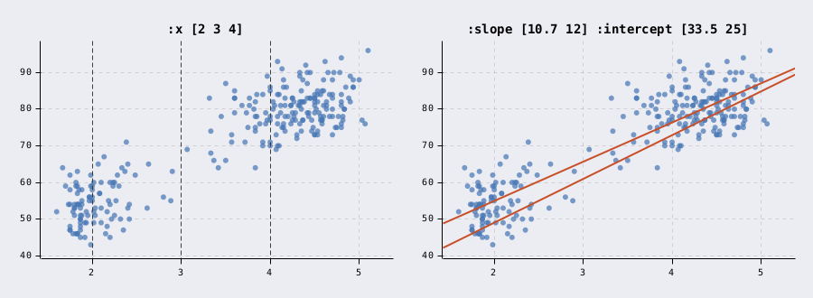
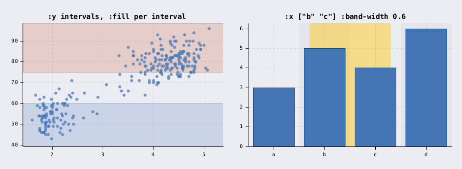
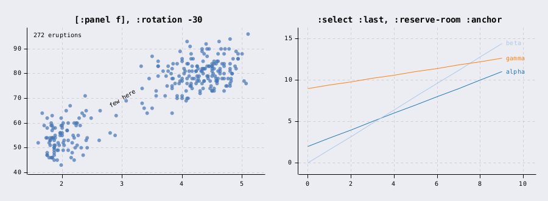
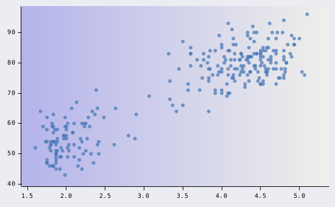

---
format:
  html:
    toc: true
    toc-location: right
    toc-depth: 4
    theme: cosmo
    include-in-header:
      text: |-
        <style>
        .data-table { width: fit-content; max-width: 100%; max-height: 15rem; overflow: auto; margin: 0 0 1rem 0; }
        .data-table .table-responsive { overflow: visible; }
        .data-table table { font-size: 0.75rem; width: auto; margin: 0; }
        .data-table th, .data-table td { padding: 0.1rem 0.45rem !important; white-space: nowrap; }
        .data-table thead th { position: sticky; top: 0; background: var(--bs-body-bg, #fff); }
        </style>
code-block-background: true

---
<style></style><style>.printedClojure .sourceCode {
  background-color: transparent;
  border-style: none;
}
</style><style>.clay-limit-image-width .clay-image {max-width: 100%}
.clay-side-by-side .sourceCode {margin: 0}
.clay-side-by-side {margin: 1em 0}
</style>
<script src="https://code.jquery.com/jquery-3.6.0.min.js" type="text/javascript"></script><script src="https://code.jquery.com/ui/1.13.1/jquery-ui.min.js" type="text/javascript"></script>

# Charts: annotations

Marks placed by literal positions rather than by data: reference lines (`rule`), intervals (`rect`), labels
(`text`), a picture (`image`) and curves of functions (`function`). Rule, rect and text also take data and a
mapping - one mark per row. Each chart lists the mapping keys it reads, its own options and the shared option
groups it takes (documented once in the Shared options chapter).


::: {.sourceClojure}
```clojure
(ns reference.charts-annotations
  (:require [fastmath.core :as m]
            [cljplot2.chart :as chart]
            [cljplot2.core :as plot]
            [cljplot2.describe :as describe]
            [notebook-utils :as nu])
  (:import [java.awt.image BufferedImage]
           [java.time LocalDate]))
```
:::


Data: Old Faithful geyser eruptions, R datasets package `faithful` (Härdle 1991; Azzalini & Bowman 1990); licence: Part of R (GPL-2 | GPL-3).


::: {.sourceClojure}
```clojure
(def faithful (nu/dataset :faithful))
```
:::


```{=html}
<div class="data-table"><table class="table table-hover table-responsive clay-table"><thead><tr><th>eruptions</th><th>waiting</th></tr></thead><tbody><tr><td>3.6</td><td>79</td></tr><tr><td>1.8</td><td>54</td></tr><tr><td>3.333</td><td>74</td></tr><tr><td>2.283</td><td>62</td></tr><tr><td>4.533</td><td>85</td></tr><tr><td>2.883</td><td>55</td></tr><tr><td>4.7</td><td>88</td></tr><tr><td>3.6</td><td>85</td></tr><tr><td>1.95</td><td>51</td></tr><tr><td>4.35</td><td>85</td></tr><tr><td>1.833</td><td>54</td></tr><tr><td>3.917</td><td>84</td></tr><tr><td>4.2</td><td>78</td></tr><tr><td>1.75</td><td>47</td></tr><tr><td>4.7</td><td>83</td></tr><tr><td>2.167</td><td>52</td></tr><tr><td>1.75</td><td>62</td></tr><tr><td>4.8</td><td>84</td></tr><tr><td>1.6</td><td>52</td></tr><tr><td>4.25</td><td>79</td></tr><tr><td>1.8</td><td>51</td></tr><tr><td>1.75</td><td>47</td></tr><tr><td>3.45</td><td>78</td></tr><tr><td>3.067</td><td>69</td></tr><tr><td>4.533</td><td>74</td></tr><tr><td>3.6</td><td>83</td></tr><tr><td>1.967</td><td>55</td></tr><tr><td>4.083</td><td>76</td></tr><tr><td>3.85</td><td>78</td></tr><tr><td>4.433</td><td>79</td></tr><tr><td>4.3</td><td>73</td></tr><tr><td>4.467</td><td>77</td></tr><tr><td>3.367</td><td>66</td></tr><tr><td>4.033</td><td>80</td></tr><tr><td>3.833</td><td>74</td></tr><tr><td>2.017</td><td>52</td></tr><tr><td>1.867</td><td>48</td></tr><tr><td>4.833</td><td>80</td></tr><tr><td>1.833</td><td>59</td></tr><tr><td>4.783</td><td>90</td></tr><tr><td>4.35</td><td>80</td></tr><tr><td>1.883</td><td>58</td></tr><tr><td>4.567</td><td>84</td></tr><tr><td>1.75</td><td>58</td></tr><tr><td>4.533</td><td>73</td></tr><tr><td>3.317</td><td>83</td></tr><tr><td>3.833</td><td>64</td></tr><tr><td>2.1</td><td>53</td></tr><tr><td>4.633</td><td>82</td></tr><tr><td>2</td><td>59</td></tr><tr><td>4.8</td><td>75</td></tr><tr><td>4.716</td><td>90</td></tr><tr><td>1.833</td><td>54</td></tr><tr><td>4.833</td><td>80</td></tr><tr><td>1.733</td><td>54</td></tr><tr><td>4.883</td><td>83</td></tr><tr><td>3.717</td><td>71</td></tr><tr><td>1.667</td><td>64</td></tr><tr><td>4.567</td><td>77</td></tr><tr><td>4.317</td><td>81</td></tr><tr><td>2.233</td><td>59</td></tr><tr><td>4.5</td><td>84</td></tr><tr><td>1.75</td><td>48</td></tr><tr><td>4.8</td><td>82</td></tr><tr><td>1.817</td><td>60</td></tr><tr><td>4.4</td><td>92</td></tr><tr><td>4.167</td><td>78</td></tr><tr><td>4.7</td><td>78</td></tr><tr><td>2.067</td><td>65</td></tr><tr><td>4.7</td><td>73</td></tr><tr><td>4.033</td><td>82</td></tr><tr><td>1.967</td><td>56</td></tr><tr><td>4.5</td><td>79</td></tr><tr><td>4</td><td>71</td></tr><tr><td>1.983</td><td>62</td></tr><tr><td>5.067</td><td>76</td></tr><tr><td>2.017</td><td>60</td></tr><tr><td>4.567</td><td>78</td></tr><tr><td>3.883</td><td>76</td></tr><tr><td>3.6</td><td>83</td></tr><tr><td>4.133</td><td>75</td></tr><tr><td>4.333</td><td>82</td></tr><tr><td>4.1</td><td>70</td></tr><tr><td>2.633</td><td>65</td></tr><tr><td>4.067</td><td>73</td></tr><tr><td>4.933</td><td>88</td></tr><tr><td>3.95</td><td>76</td></tr><tr><td>4.517</td><td>80</td></tr><tr><td>2.167</td><td>48</td></tr><tr><td>4</td><td>86</td></tr><tr><td>2.2</td><td>60</td></tr><tr><td>4.333</td><td>90</td></tr><tr><td>1.867</td><td>50</td></tr><tr><td>4.817</td><td>78</td></tr><tr><td>1.833</td><td>63</td></tr><tr><td>4.3</td><td>72</td></tr><tr><td>4.667</td><td>84</td></tr><tr><td>3.75</td><td>75</td></tr><tr><td>1.867</td><td>51</td></tr><tr><td>4.9</td><td>82</td></tr><tr><td>…</td><td>…</td></tr></tbody></table></div>
```


Data: US economic time series, 1967-2015, R ggplot2 package `economics` (Federal Reserve Bank of St. Louis, FRED); licence: MIT (ggplot2).


::: {.sourceClojure}
```clojure
(def economics (nu/dataset :economics))
```
:::


```{=html}
<div class="data-table"><table class="table table-hover table-responsive clay-table"><thead><tr><th>date</th><th>pce</th><th>pop</th><th>psavert</th><th>uempmed</th><th>unemploy</th></tr></thead><tbody><tr><td>1967-07-01</td><td>506.7</td><td>198712</td><td>12.6</td><td>4.5</td><td>2944</td></tr><tr><td>1967-08-01</td><td>509.8</td><td>198911</td><td>12.6</td><td>4.7</td><td>2945</td></tr><tr><td>1967-09-01</td><td>515.6</td><td>199113</td><td>11.9</td><td>4.6</td><td>2958</td></tr><tr><td>1967-10-01</td><td>512.2</td><td>199311</td><td>12.9</td><td>4.9</td><td>3143</td></tr><tr><td>1967-11-01</td><td>517.4</td><td>199498</td><td>12.8</td><td>4.7</td><td>3066</td></tr><tr><td>1967-12-01</td><td>525.1</td><td>199657</td><td>11.8</td><td>4.8</td><td>3018</td></tr><tr><td>1968-01-01</td><td>530.9</td><td>199808</td><td>11.7</td><td>5.1</td><td>2878</td></tr><tr><td>1968-02-01</td><td>533.6</td><td>199920</td><td>12.3</td><td>4.5</td><td>3001</td></tr><tr><td>1968-03-01</td><td>544.3</td><td>200056</td><td>11.7</td><td>4.1</td><td>2877</td></tr><tr><td>1968-04-01</td><td>544</td><td>200208</td><td>12.3</td><td>4.6</td><td>2709</td></tr><tr><td>1968-05-01</td><td>549.8</td><td>200361</td><td>12</td><td>4.4</td><td>2740</td></tr><tr><td>1968-06-01</td><td>556.3</td><td>200536</td><td>11.7</td><td>4.4</td><td>2938</td></tr><tr><td>1968-07-01</td><td>563.2</td><td>200706</td><td>10.7</td><td>4.5</td><td>2883</td></tr><tr><td>1968-08-01</td><td>567</td><td>200898</td><td>10.5</td><td>4.2</td><td>2768</td></tr><tr><td>1968-09-01</td><td>568.2</td><td>201095</td><td>10.6</td><td>4.6</td><td>2686</td></tr><tr><td>1968-10-01</td><td>571.6</td><td>201290</td><td>10.8</td><td>4.8</td><td>2689</td></tr><tr><td>1968-11-01</td><td>576.7</td><td>201466</td><td>10.6</td><td>4.4</td><td>2715</td></tr><tr><td>1968-12-01</td><td>576.5</td><td>201621</td><td>11.1</td><td>4.4</td><td>2685</td></tr><tr><td>1969-01-01</td><td>583.5</td><td>201760</td><td>10.3</td><td>4.4</td><td>2718</td></tr><tr><td>1969-02-01</td><td>588.7</td><td>201881</td><td>9.7</td><td>4.9</td><td>2692</td></tr><tr><td>1969-03-01</td><td>588.9</td><td>202023</td><td>10.2</td><td>4</td><td>2712</td></tr><tr><td>1969-04-01</td><td>593.9</td><td>202161</td><td>9.7</td><td>4</td><td>2758</td></tr><tr><td>1969-05-01</td><td>600.3</td><td>202331</td><td>10.1</td><td>4.2</td><td>2713</td></tr><tr><td>1969-06-01</td><td>600.9</td><td>202507</td><td>11.1</td><td>4.4</td><td>2816</td></tr><tr><td>1969-07-01</td><td>602.7</td><td>202677</td><td>11.8</td><td>4.4</td><td>2868</td></tr><tr><td>1969-08-01</td><td>609.9</td><td>202877</td><td>11.5</td><td>4.4</td><td>2856</td></tr><tr><td>1969-09-01</td><td>613.2</td><td>203090</td><td>11.6</td><td>4.7</td><td>3040</td></tr><tr><td>1969-10-01</td><td>618.5</td><td>203302</td><td>11.4</td><td>4.5</td><td>3049</td></tr><tr><td>1969-11-01</td><td>620.5</td><td>203500</td><td>11.6</td><td>4.8</td><td>2856</td></tr><tr><td>1969-12-01</td><td>622.8</td><td>203675</td><td>11.8</td><td>4.6</td><td>2884</td></tr><tr><td>1970-01-01</td><td>628.7</td><td>203849</td><td>11.8</td><td>4.6</td><td>3201</td></tr><tr><td>1970-02-01</td><td>634</td><td>204008</td><td>11.7</td><td>4.5</td><td>3453</td></tr><tr><td>1970-03-01</td><td>632.3</td><td>204156</td><td>12.4</td><td>4.6</td><td>3635</td></tr><tr><td>1970-04-01</td><td>636</td><td>204401</td><td>13.3</td><td>4.1</td><td>3797</td></tr><tr><td>1970-05-01</td><td>642.4</td><td>204607</td><td>12.4</td><td>4.7</td><td>3919</td></tr><tr><td>1970-06-01</td><td>646.3</td><td>204830</td><td>12.3</td><td>4.9</td><td>4071</td></tr><tr><td>1970-07-01</td><td>648.5</td><td>205052</td><td>13.5</td><td>5.1</td><td>4175</td></tr><tr><td>1970-08-01</td><td>652.9</td><td>205295</td><td>13.4</td><td>5.4</td><td>4256</td></tr><tr><td>1970-09-01</td><td>659.1</td><td>205540</td><td>12.9</td><td>5.2</td><td>4456</td></tr><tr><td>1970-10-01</td><td>658.3</td><td>205788</td><td>13.1</td><td>5.2</td><td>4591</td></tr><tr><td>1970-11-01</td><td>656.6</td><td>206024</td><td>13.6</td><td>5.6</td><td>4898</td></tr><tr><td>1970-12-01</td><td>665.6</td><td>206238</td><td>13.2</td><td>5.9</td><td>5076</td></tr><tr><td>1971-01-01</td><td>676.1</td><td>206466</td><td>13.3</td><td>6.2</td><td>4986</td></tr><tr><td>1971-02-01</td><td>679.4</td><td>206668</td><td>13.3</td><td>6.3</td><td>4903</td></tr><tr><td>1971-03-01</td><td>682</td><td>206855</td><td>13.5</td><td>6.4</td><td>4987</td></tr><tr><td>1971-04-01</td><td>688.8</td><td>207065</td><td>13.2</td><td>6.5</td><td>4959</td></tr><tr><td>1971-05-01</td><td>691.1</td><td>207260</td><td>13.6</td><td>6.7</td><td>4996</td></tr><tr><td>1971-06-01</td><td>699.8</td><td>207462</td><td>14.7</td><td>5.7</td><td>4949</td></tr><tr><td>1971-07-01</td><td>698.9</td><td>207661</td><td>13.8</td><td>6.2</td><td>5035</td></tr><tr><td>1971-08-01</td><td>704.9</td><td>207881</td><td>13.6</td><td>6.4</td><td>5134</td></tr><tr><td>1971-09-01</td><td>713</td><td>208114</td><td>13.3</td><td>5.8</td><td>5042</td></tr><tr><td>1971-10-01</td><td>715.8</td><td>208345</td><td>13.3</td><td>6.5</td><td>4954</td></tr><tr><td>1971-11-01</td><td>720.9</td><td>208555</td><td>13.1</td><td>6.4</td><td>5161</td></tr><tr><td>1971-12-01</td><td>728.4</td><td>208740</td><td>13</td><td>6.2</td><td>5154</td></tr><tr><td>1972-01-01</td><td>731.5</td><td>208917</td><td>12.5</td><td>6.2</td><td>5019</td></tr><tr><td>1972-02-01</td><td>736.2</td><td>209061</td><td>12.8</td><td>6.6</td><td>4928</td></tr><tr><td>1972-03-01</td><td>749.2</td><td>209212</td><td>11.8</td><td>6.6</td><td>5038</td></tr><tr><td>1972-04-01</td><td>752.5</td><td>209386</td><td>11.5</td><td>6.7</td><td>4959</td></tr><tr><td>1972-05-01</td><td>758</td><td>209545</td><td>11.7</td><td>6.6</td><td>4922</td></tr><tr><td>1972-06-01</td><td>761.6</td><td>209725</td><td>11.7</td><td>5.4</td><td>4923</td></tr><tr><td>1972-07-01</td><td>769.9</td><td>209896</td><td>11.7</td><td>6.1</td><td>4913</td></tr><tr><td>1972-08-01</td><td>776.3</td><td>210075</td><td>12</td><td>6</td><td>4939</td></tr><tr><td>1972-09-01</td><td>781.1</td><td>210278</td><td>12.2</td><td>5.6</td><td>4849</td></tr><tr><td>1972-10-01</td><td>794.9</td><td>210479</td><td>13</td><td>5.7</td><td>4875</td></tr><tr><td>1972-11-01</td><td>800.5</td><td>210656</td><td>13.6</td><td>5.7</td><td>4602</td></tr><tr><td>1972-12-01</td><td>806.1</td><td>210821</td><td>13.7</td><td>6.1</td><td>4543</td></tr><tr><td>1973-01-01</td><td>816.5</td><td>210985</td><td>12.4</td><td>5.7</td><td>4326</td></tr><tr><td>1973-02-01</td><td>825.8</td><td>211120</td><td>12.5</td><td>5.2</td><td>4452</td></tr><tr><td>1973-03-01</td><td>832.8</td><td>211254</td><td>12.7</td><td>5.5</td><td>4394</td></tr><tr><td>1973-04-01</td><td>835.7</td><td>211420</td><td>13.2</td><td>5</td><td>4459</td></tr><tr><td>1973-05-01</td><td>841.6</td><td>211577</td><td>13.2</td><td>4.9</td><td>4329</td></tr><tr><td>1973-06-01</td><td>844.3</td><td>211746</td><td>13.6</td><td>5</td><td>4363</td></tr><tr><td>1973-07-01</td><td>854.1</td><td>211909</td><td>13.2</td><td>5.2</td><td>4305</td></tr><tr><td>1973-08-01</td><td>853.3</td><td>212092</td><td>13.9</td><td>4.9</td><td>4305</td></tr><tr><td>1973-09-01</td><td>869.2</td><td>212289</td><td>13.1</td><td>5.4</td><td>4350</td></tr><tr><td>1973-10-01</td><td>868.2</td><td>212475</td><td>14.4</td><td>5.5</td><td>4144</td></tr><tr><td>1973-11-01</td><td>876.9</td><td>212634</td><td>14.4</td><td>5.1</td><td>4396</td></tr><tr><td>1973-12-01</td><td>876.6</td><td>212785</td><td>14.8</td><td>4.7</td><td>4489</td></tr><tr><td>1974-01-01</td><td>884.5</td><td>212932</td><td>14.3</td><td>5</td><td>4644</td></tr><tr><td>1974-02-01</td><td>889.7</td><td>213074</td><td>14.2</td><td>5.1</td><td>4731</td></tr><tr><td>1974-03-01</td><td>901.4</td><td>213211</td><td>13.4</td><td>4.8</td><td>4634</td></tr><tr><td>1974-04-01</td><td>910.8</td><td>213361</td><td>13.1</td><td>5</td><td>4618</td></tr><tr><td>1974-05-01</td><td>922.4</td><td>213513</td><td>12.8</td><td>4.6</td><td>4705</td></tr><tr><td>1974-06-01</td><td>928</td><td>213686</td><td>12.8</td><td>5.3</td><td>4927</td></tr><tr><td>1974-07-01</td><td>937.9</td><td>213854</td><td>12.8</td><td>5.7</td><td>5063</td></tr><tr><td>1974-08-01</td><td>954.8</td><td>214042</td><td>12.1</td><td>5</td><td>5022</td></tr><tr><td>1974-09-01</td><td>955.1</td><td>214246</td><td>12.9</td><td>5.3</td><td>5437</td></tr><tr><td>1974-10-01</td><td>959.2</td><td>214451</td><td>13.4</td><td>5.5</td><td>5523</td></tr><tr><td>1974-11-01</td><td>956.2</td><td>214625</td><td>13.8</td><td>5.2</td><td>6140</td></tr><tr><td>1974-12-01</td><td>961.8</td><td>214782</td><td>14</td><td>5.7</td><td>6636</td></tr><tr><td>1975-01-01</td><td>975.6</td><td>214931</td><td>13.2</td><td>6.3</td><td>7501</td></tr><tr><td>1975-02-01</td><td>989.4</td><td>215065</td><td>12.5</td><td>7.1</td><td>7520</td></tr><tr><td>1975-03-01</td><td>990.6</td><td>215198</td><td>12.7</td><td>7.2</td><td>7978</td></tr><tr><td>1975-04-01</td><td>995</td><td>215353</td><td>14.2</td><td>8.7</td><td>8210</td></tr><tr><td>1975-05-01</td><td>1018.9</td><td>215523</td><td>17.3</td><td>9.4</td><td>8433</td></tr><tr><td>1975-06-01</td><td>1026.8</td><td>215768</td><td>14.3</td><td>8.8</td><td>8220</td></tr><tr><td>1975-07-01</td><td>1039.8</td><td>215973</td><td>12.6</td><td>8.6</td><td>8127</td></tr><tr><td>1975-08-01</td><td>1047</td><td>216195</td><td>13</td><td>9.2</td><td>7928</td></tr><tr><td>1975-09-01</td><td>1054.8</td><td>216393</td><td>13</td><td>9.2</td><td>7923</td></tr><tr><td>1975-10-01</td><td>1060.9</td><td>216587</td><td>13.4</td><td>8.6</td><td>7897</td></tr><tr><td>…</td><td>…</td><td>…</td><td>…</td><td>…</td><td>…</td></tr></tbody></table></div>
```


## rule

Straight lines across the panel: vertical at an x, horizontal at a y, or sloped y = intercept + slope · x - one
per row of data, or at literal positions.

::: {.clay-table}

```{=html}
<table class="table table-hover table-responsive clay-table"><thead><tr><th>Option</th><th>Type</th><th>Default</th><th>Description</th></tr></thead><tbody><tr><td>:x</td><td>a keyword, a function or a categorical marker of one or nil</td><td></td><td>x position of a line along the y direction, one per row</td></tr><tr><td>:y</td><td>a keyword, a function or a categorical marker of one or nil</td><td></td><td>y position of a line along the x direction, one per row</td></tr><tr><td>:slope</td><td>a keyword, a function or a categorical marker of one or nil</td><td></td><td>slope of a line y = intercept + slope * x, one per row (with :intercept)</td></tr><tr><td>:intercept</td><td>a keyword, a function or a categorical marker of one or nil</td><td></td><td>intercept of a line y = intercept + slope * x, one per row (with :slope)</td></tr><tr><td>:color</td><td>a keyword, a function or a categorical marker of one or nil</td><td></td><td>line colour per group (gives legend keys)</td></tr><tr><td>:dash</td><td>a keyword, a function or a categorical marker of one or nil</td><td></td><td>dash style per group (gives legend keys)</td></tr><tr><td>:group</td><td>a keyword, a function or a categorical marker of one or nil</td><td></td><td>groups without a visual aesthetic</td></tr></tbody></table>
```

:::


::: {.sourceClojure}
```clojure
(def thresholds [{:at 55 :kind "short wait"} {:at 80 :kind "long wait"}])
```
:::


```{=html}
<div class="data-table"><table class="table table-hover table-responsive clay-table"><thead><tr><th>at</th><th>kind</th></tr></thead><tbody><tr><td>55</td><td>short wait</td></tr><tr><td>80</td><td>long wait</td></tr></tbody></table></div>
```


::: {.sourceClojure}
```clojure
(plot/render-image {:data faithful
                    :mapping {:x :eruptions :y :waiting}
                    :charts [(chart/scatter)
                             (chart/rule {:data thresholds :mapping {:y :at :color :kind} :line-width 2})]
                    :labels {:x "eruptions [min]" :y "waiting [min]"}}
                   {:width 600 :height 360})
```
:::


::: {.clay-image}

:::


Its options: literal positions - one or a vector of them, across x (`:x`) or along it (`:y`) - and sloped lines:

::: {.clay-table}

```{=html}
<table class="table table-hover table-responsive clay-table"><thead><tr><th>Option</th><th>Type</th><th>Default</th><th>Description</th></tr></thead><tbody><tr><td>:x</td><td>a finite number, a java.time value or a level (string / keyword) or vector of a finite number, a java.time value or a level (string / keyword) (at least 1) or nil</td><td></td><td>literal x position(s) of lines along the y direction: a position or a vector of them (wins over the mapping)</td></tr><tr><td>:y</td><td>a finite number, a java.time value or a level (string / keyword) or vector of a finite number, a java.time value or a level (string / keyword) (at least 1) or nil</td><td></td><td>literal y position(s) of lines along the x direction: a position or a vector of them (wins over the mapping)</td></tr><tr><td>:slope</td><td>a finite number or vector of a finite number (at least 1) or nil</td><td></td><td>literal slope(s) of lines y = intercept + slope * x, a number or a vector of 1 or n (needs :intercept; linear scales only)</td></tr><tr><td>:intercept</td><td>a finite number or vector of a finite number (at least 1) or nil</td><td></td><td>literal intercept(s) of lines y = intercept + slope * x, a number or a vector of 1 or n (needs :slope)</td></tr></tbody></table>
```

:::


::: {.sourceClojure}
```clojure
(plot/render-image (plot/arrange [{:data faithful :mapping {:x :eruptions :y :waiting}
                                   :charts [(chart/scatter) (chart/rule {:x [2 3 4] :dash :dashed})]
                                   :labels {:title ":x [2 3 4]"}}
                                  {:data faithful :mapping {:x :eruptions :y :waiting}
                                   :charts [(chart/scatter)
                                            (chart/rule {:slope [10.7 12] :intercept [33.5 25] :line-width 2
                                                         :color [200 80 40]})]
                                   :labels {:title ":slope, :intercept (two lines)"}}
                                  {:data faithful :mapping {:x :eruptions :y :waiting}
                                   :charts [(chart/scatter) (chart/rule {:y [55 80] :line-width 2 :color [40 140 60]})]
                                   :labels {:title ":y [55 80]"}}]
                                 {:columns 3})
                   {:width 1000 :height 330})
```
:::


::: {.clay-image}

:::


Shared options: [Line style](reference.shared_options.html#line-style) (`:color` `:line-width` `:dash`); [Data and mapping](reference.shared_options.html#data-and-mapping) (`:data` `:mapping`); [Named theme styles](reference.shared_options.html#named-theme-styles) (`:theme-style`); [Annotation options](reference.shared_options.html#annotation-options) (`:extent`).


## rect

Rectangles spanning x and / or y intervals; an open end (`nil`) reaches the panel edge - shaded periods or
ranges.

::: {.clay-table}

```{=html}
<table class="table table-hover table-responsive clay-table"><thead><tr><th>Option</th><th>Type</th><th>Default</th><th>Description</th></tr></thead><tbody><tr><td>:x0</td><td>a keyword, a function or a categorical marker of one or nil</td><td></td><td>x start of a rect, one per row (with :x1; nil - the panel edge)</td></tr><tr><td>:x1</td><td>a keyword, a function or a categorical marker of one or nil</td><td></td><td>x end of a rect, one per row (with :x0; nil - the panel edge)</td></tr><tr><td>:y0</td><td>a keyword, a function or a categorical marker of one or nil</td><td></td><td>y start of a rect, one per row (with :y1; nil - the panel edge)</td></tr><tr><td>:y1</td><td>a keyword, a function or a categorical marker of one or nil</td><td></td><td>y end of a rect, one per row (with :y0; nil - the panel edge)</td></tr><tr><td>:color</td><td>a keyword, a function or a categorical marker of one or nil</td><td></td><td>fill colour per group or row (gives legend keys)</td></tr><tr><td>:pattern</td><td>a keyword, a function or a categorical marker of one or nil</td><td></td><td>fill pattern per group (gives legend keys)</td></tr><tr><td>:shape</td><td>a keyword, a function or a categorical marker of one or nil</td><td></td><td>groups the rects (no visual effect)</td></tr><tr><td>:size</td><td>a keyword, a function or a categorical marker of one or nil</td><td></td><td>groups the rects (no visual effect)</td></tr><tr><td>:group</td><td>a keyword, a function or a categorical marker of one or nil</td><td></td><td>groups without a visual aesthetic</td></tr></tbody></table>
```

:::


::: {.sourceClojure}
```clojure
(def recessions [{:name "1973-75" :from (LocalDate/parse "1973-11-01") :to (LocalDate/parse "1975-03-01")}
                 {:name "1980-82" :from (LocalDate/parse "1980-01-01") :to (LocalDate/parse "1982-11-01")}
                 {:name "1990-91" :from (LocalDate/parse "1990-07-01") :to (LocalDate/parse "1991-03-01")}
                 {:name "2001" :from (LocalDate/parse "2001-03-01") :to (LocalDate/parse "2001-11-01")}
                 {:name "2007-09" :from (LocalDate/parse "2007-12-01") :to (LocalDate/parse "2009-06-01")}])
```
:::


```{=html}
<div class="data-table"><table class="table table-hover table-responsive clay-table"><thead><tr><th>name</th><th>from</th><th>to</th></tr></thead><tbody><tr><td>1973-75</td><td>1973-11-01</td><td>1975-03-01</td></tr><tr><td>1980-82</td><td>1980-01-01</td><td>1982-11-01</td></tr><tr><td>1990-91</td><td>1990-07-01</td><td>1991-03-01</td></tr><tr><td>2001</td><td>2001-03-01</td><td>2001-11-01</td></tr><tr><td>2007-09</td><td>2007-12-01</td><td>2009-06-01</td></tr></tbody></table></div>
```


::: {.sourceClojure}
```clojure
(plot/render-image {:data economics
                    :mapping {:x #(LocalDate/parse (:date %)) :y :unemploy}
                    :charts [(chart/rect {:data recessions :mapping {:x0 :from :x1 :to}})
                             (chart/line)]
                    :labels {:y "unemployed [thousands]"}}
                   {:width 700 :height 340})
```
:::


::: {.clay-image}

:::


Its options: literal intervals (here on y, with one fill colour each), the fill, its opacity and outline, and
how much of a band a level end covers:

::: {.clay-table}

```{=html}
<table class="table table-hover table-responsive clay-table"><thead><tr><th>Option</th><th>Type</th><th>Default</th><th>Description</th></tr></thead><tbody><tr><td>:stroke-color</td><td>:darker or a clojure2d color or :none</td><td>:none</td><td>outline colour: a colour, :none or :darker (the darkened fill; no outline without a fill)</td></tr><tr><td>:stroke-width</td><td>a non-negative number</td><td>1</td><td>outline width in pixels</td></tr><tr><td>:fill</td><td>a clojure2d color or :none or vector of a clojure2d color or :none (at least 1)</td><td>[0 0 0 30]</td><td>fill colour, or a vector of 1 or n colours paired with literal intervals (a mapped :color wins)</td></tr><tr><td>:alpha</td><td>a number in [0 1]</td><td>colours as they are</td><td>fill opacity</td></tr><tr><td>:x</td><td>[a finite number, a java.time value or a level (string / keyword) or nil, a finite number, a java.time value or a level (string / keyword) or nil] or vector of [a finite number, a java.time value or a level (string / keyword) or nil, a finite number, a java.time value or a level (string / keyword) or nil] (at least 1) or nil</td><td></td><td>literal x interval(s) [a b] (an end nil - the panel edge), alone a band across the panel (wins over the mapping)</td></tr><tr><td>:y</td><td>[a finite number, a java.time value or a level (string / keyword) or nil, a finite number, a java.time value or a level (string / keyword) or nil] or vector of [a finite number, a java.time value or a level (string / keyword) or nil, a finite number, a java.time value or a level (string / keyword) or nil] (at least 1) or nil</td><td></td><td>literal y interval(s) [a b] (an end nil - the panel edge), alone a band across the panel (wins over the mapping)</td></tr><tr><td>:width</td><td>a finite number, > 0, <= 1</td><td>1.0</td><td>fraction of its band step a level end covers, centred</td></tr></tbody></table>
```

:::


::: {.sourceClojure}
```clojure
(def levels-data [{:k "a" :v 3} {:k "b" :v 5} {:k "c" :v 4} {:k "d" :v 6}])
```
:::


```{=html}
<div class="data-table"><table class="table table-hover table-responsive clay-table"><thead><tr><th>k</th><th>v</th></tr></thead><tbody><tr><td>a</td><td>3</td></tr><tr><td>b</td><td>5</td></tr><tr><td>c</td><td>4</td></tr><tr><td>d</td><td>6</td></tr></tbody></table></div>
```


::: {.sourceClojure}
```clojure
(plot/render-image (plot/arrange [{:data faithful :mapping {:x :eruptions :y :waiting}
                                   :charts [(chart/rect {:y [[nil 60] [75 nil]] :fill [[69 117 180] [200 80 40]] :alpha 0.2
                                                         :stroke-color :darker :stroke-width 2})
                                            (chart/scatter)]
                                   :labels {:title ":y intervals, :fill per interval, :stroke-width 2"}}
                                  {:data levels-data :mapping {:x :k :y :v}
                                   :charts [(chart/rect {:x ["b" "c"] :width 0.6 :fill [255 200 0 110]})
                                            (chart/bar)]
                                   :scales {:x {:domain ["a" "b" "c" "d"]}}
                                   :labels {:title ":x [\"b\" \"c\"] :width 0.6"}}]
                                 {:columns 2})
                   {:width 900 :height 330})
```
:::


::: {.clay-image}

:::


Shared options: [Fill patterns](reference.shared_options.html#fill-patterns) (`:pattern` `:pattern-color`); [Data and mapping](reference.shared_options.html#data-and-mapping) (`:data` `:mapping`); [Named theme styles](reference.shared_options.html#named-theme-styles) (`:theme-style`); [Annotation options](reference.shared_options.html#annotation-options) (`:extent`); [Rounded corners](reference.shared_options.html#rounded-corners) (`:corner-radius`).


## text

Labels at positions - from data (one per row, `:label` the text) or literal, also at a fraction of the panel
(`[:panel f]`). As an annotation it reads the plot's data but only its own mapping (and the plot's facet keys).

::: {.clay-table}

```{=html}
<table class="table table-hover table-responsive clay-table"><thead><tr><th>Option</th><th>Type</th><th>Default</th><th>Description</th></tr></thead><tbody><tr><td>:x</td><td>a keyword, a function or a categorical marker of one or nil</td><td></td><td>x position of a label, one per row</td></tr><tr><td>:y</td><td>a keyword, a function or a categorical marker of one or nil</td><td></td><td>y position of a label, one per row</td></tr><tr><td>:label</td><td>a keyword, a function or a categorical marker of one or nil</td><td></td><td>label text, one per row (converted with str)</td></tr><tr><td>:angle</td><td>a keyword, a function or a categorical marker of one or nil</td><td></td><td>label rotation in degrees, clockwise (nil or not finite - :rotation)</td></tr><tr><td>:color</td><td>a keyword, a function or a categorical marker of one or nil</td><td></td><td>text colour per group (gives legend keys)</td></tr><tr><td>:group</td><td>a keyword, a function or a categorical marker of one or nil</td><td></td><td>groups without a visual aesthetic (labels per group with :select)</td></tr></tbody></table>
```

:::


::: {.sourceClojure}
```clojure
(def cities [{:city "Oslo" :lon 10.8 :lat 59.9} {:city "Rome" :lon 12.5 :lat 41.9} {:city "Madrid" :lon -3.7 :lat 40.4}
             {:city "Paris" :lon 2.4 :lat 48.9} {:city "Warsaw" :lon 21.0 :lat 52.2}])
```
:::


```{=html}
<div class="data-table"><table class="table table-hover table-responsive clay-table"><thead><tr><th>city</th><th>lon</th><th>lat</th></tr></thead><tbody><tr><td>Oslo</td><td>10.8</td><td>59.9</td></tr><tr><td>Rome</td><td>12.5</td><td>41.9</td></tr><tr><td>Madrid</td><td>-3.7</td><td>40.4</td></tr><tr><td>Paris</td><td>2.4</td><td>48.9</td></tr><tr><td>Warsaw</td><td>21.0</td><td>52.2</td></tr></tbody></table></div>
```


::: {.sourceClojure}
```clojure
(plot/render-image {:data cities
                    :mapping {:x :lon :y :lat}
                    :charts [(chart/scatter)
                             (chart/text {:mapping {:x :lon :y :lat :label :city} :anchor [:left :bottom] :offset [4 2]})]
                    :labels {:x "longitude" :y "latitude"}}
                   {:width 550 :height 340})
```
:::


::: {.clay-image}

:::


Its options: literal positions and texts, the anchor and offset, rotation, labels of only the last (or first)
row per group, and room kept for labels past the data:

::: {.clay-table}

```{=html}
<table class="table table-hover table-responsive clay-table"><thead><tr><th>Option</th><th>Type</th><th>Default</th><th>Description</th></tr></thead><tbody><tr><td>:role</td><td>keyword</td><td>:annotation</td><td>theme text role of the labels (a role of [:text], e.g. a builder's), the style under the inline style keys</td></tr><tr><td>:x</td><td>[:panel f], f in [0 1] or a finite number, a java.time value or a level (string / keyword) or [:panel f], f in [0 1] or vector of a finite number, a java.time value or a level (string / keyword) or [:panel f], f in [0 1] (at least 1) or nil</td><td></td><td>literal x position(s): a position, [:panel f] (fraction f of the panel, not in the extents) or a vector of 1 or n (wins over the mapping)</td></tr><tr><td>:y</td><td>[:panel f], f in [0 1] or a finite number, a java.time value or a level (string / keyword) or [:panel f], f in [0 1] or vector of a finite number, a java.time value or a level (string / keyword) or [:panel f], f in [0 1] (at least 1) or nil</td><td></td><td>literal y position(s): a position, [:panel f] (fraction f of the panel, not in the extents) or a vector of 1 or n (wins over the mapping)</td></tr><tr><td>:text</td><td>any value or nil</td><td></td><td>literal label text: a value or a vector of 1 or n (converted with str)</td></tr><tr><td>:anchor</td><td>[one of :left :center :right, one of :top :middle :bottom]</td><td>[:center :middle]; with :select just past the point; polar :radial - away from the centre</td><td>point of the text box placed at the position, [h v] (h :left :center :right, v :top :middle :bottom)</td></tr><tr><td>:offset</td><td>[a finite number, a finite number]</td><td>[0 0]; with :select 5 pixels past the point</td><td>shift [dx dy] of the text in pixels, dy up</td></tr><tr><td>:rotation</td><td>a finite number or :radial</td><td>0</td><td>text rotation in degrees, clockwise, or :radial (polar: along each label's angle, upright; 0 in cartesian plots) (a mapped :angle wins)</td></tr><tr><td>:select</td><td>one of :last :first</td><td></td><td>end labels from data: keep per group and text only the row with the largest (:last) or smallest (:first) x</td></tr><tr><td>:anchor-frame</td><td>one of :box :text</td><td>:box</td><td>what :anchor points into: :box (the rotated label's bounding box) or :text (the unrotated text, turned about that point)</td></tr><tr><td>:reserve-room</td><td>true or false or :anchor</td><td>false</td><td>keep pixel room past the data for the labels: true - the largest label's diagonal on every side, :anchor - only where the anchored labels reach</td></tr></tbody></table>
```

:::


::: {.sourceClojure}
```clojure
(def growth (for [g ["alpha" "beta" "gamma"] t (range 10)]
              {:g g :t t :v (+ (case g "alpha" 2.0 "beta" 0.0 "gamma" 9.0) (* t (case g "alpha" 1.0 "beta" 1.6 "gamma" 0.4)))}))
```
:::


```{=html}
<div class="data-table"><table class="table table-hover table-responsive clay-table"><thead><tr><th>g</th><th>t</th><th>v</th></tr></thead><tbody><tr><td>alpha</td><td>0</td><td>2.0</td></tr><tr><td>alpha</td><td>1</td><td>3.0</td></tr><tr><td>alpha</td><td>2</td><td>4.0</td></tr><tr><td>alpha</td><td>3</td><td>5.0</td></tr><tr><td>alpha</td><td>4</td><td>6.0</td></tr><tr><td>alpha</td><td>5</td><td>7.0</td></tr><tr><td>alpha</td><td>6</td><td>8.0</td></tr><tr><td>alpha</td><td>7</td><td>9.0</td></tr><tr><td>alpha</td><td>8</td><td>10.0</td></tr><tr><td>alpha</td><td>9</td><td>11.0</td></tr><tr><td>beta</td><td>0</td><td>0.0</td></tr><tr><td>beta</td><td>1</td><td>1.6</td></tr><tr><td>beta</td><td>2</td><td>3.2</td></tr><tr><td>beta</td><td>3</td><td>4.800000000000001</td></tr><tr><td>beta</td><td>4</td><td>6.4</td></tr><tr><td>beta</td><td>5</td><td>8.0</td></tr><tr><td>beta</td><td>6</td><td>9.600000000000001</td></tr><tr><td>beta</td><td>7</td><td>11.200000000000001</td></tr><tr><td>beta</td><td>8</td><td>12.8</td></tr><tr><td>beta</td><td>9</td><td>14.4</td></tr><tr><td>gamma</td><td>0</td><td>9.0</td></tr><tr><td>gamma</td><td>1</td><td>9.4</td></tr><tr><td>gamma</td><td>2</td><td>9.8</td></tr><tr><td>gamma</td><td>3</td><td>10.2</td></tr><tr><td>gamma</td><td>4</td><td>10.6</td></tr><tr><td>gamma</td><td>5</td><td>11.0</td></tr><tr><td>gamma</td><td>6</td><td>11.4</td></tr><tr><td>gamma</td><td>7</td><td>11.8</td></tr><tr><td>gamma</td><td>8</td><td>12.2</td></tr><tr><td>gamma</td><td>9</td><td>12.6</td></tr></tbody></table></div>
```


::: {.sourceClojure}
```clojure
(plot/render-image (plot/arrange [{:data faithful :mapping {:x :eruptions :y :waiting}
                                   :charts [(chart/scatter)
                                            (chart/text {:x [:panel 0.02] :y [:panel 0.98] :anchor [:left :top]
                                                         :text "272 eruptions"})
                                            (chart/text {:x 3 :y 70 :text "few here" :rotation -30})]
                                   :labels {:title "[:panel f], :rotation -30"}}
                                  {:data growth :mapping {:x :t :y :v :color :g}
                                   :charts [(chart/line)
                                            (chart/text {:mapping {:x :t :y :v :color :g :label :g}
                                                         :select :last :reserve-room :anchor})]
                                   :labels {:title ":select :last, :reserve-room :anchor"}
                                   :legend false}]
                                 {:columns 2})
                   {:width 900 :height 330})
```
:::


::: {.clay-image}

:::


End labels of the first row per group instead (`:select :first`), and what a rotated label's `:anchor` points
into: the rotated label's bounding box (`:box`, the default) or the text itself, turned about the anchor point
(`:text`) - each label turned upright, anchored at its left top on the red point: the box's top left corner,
or the start of the text's top edge:


::: {.sourceClojure}
```clojure
(def anchor-points [{:x 1 :y 1 :label "frame"}])
```
:::


```{=html}
<div class="data-table"><table class="table table-hover table-responsive clay-table"><thead><tr><th>x</th><th>y</th><th>label</th></tr></thead><tbody><tr><td>1</td><td>1</td><td>frame</td></tr></tbody></table></div>
```


::: {.sourceClojure}
```clojure
(plot/render-image (plot/arrange [{:data growth :mapping {:x :t :y :v :color :g}
                                   :charts [(chart/line)
                                            (chart/text {:mapping {:x :t :y :v :color :g :label :g}
                                                         :select :first :anchor [:right :middle] :offset [-5 0]
                                                         :reserve-room :anchor})]
                                   :labels {:title ":select :first"}
                                   :legend false}
                                  {:data anchor-points :mapping {:x :x :y :y}
                                   :charts [(chart/scatter {:color :red})
                                            (chart/text {:mapping {:x :x :y :y :label :label} :rotation -90 :size 18
                                                         :anchor [:left :top] :anchor-frame :box})]
                                   :scales {:x {:domain [0 2]} :y {:domain [0 2]}}
                                   :labels {:title ":anchor-frame :box"}}
                                  {:data anchor-points :mapping {:x :x :y :y}
                                   :charts [(chart/scatter {:color :red})
                                            (chart/text {:mapping {:x :x :y :y :label :label} :rotation -90 :size 18
                                                         :anchor [:left :top] :anchor-frame :text})]
                                   :scales {:x {:domain [0 2]} :y {:domain [0 2]}}
                                   :labels {:title ":anchor-frame :text"}}]
                                 {:columns 3})
                   {:width 1000 :height 320})
```
:::


::: {.clay-image}

:::


The labels' style is a [theme text role](reference.theme.html#text), `:annotation` by default; `:role` picks
another - a role the theme adds (here `:callout`, in the bottom right corner), or a builder's (here
`:network-label`, small names on white boxes), the inline style keys still over it:


::: {.sourceClojure}
```clojure
(plot/render-image {:data cities
                    :mapping {:x :lon :y :lat}
                    :charts [(chart/scatter)
                             (chart/text {:mapping {:x :lon :y :lat :label :city} :anchor [:left :bottom] :offset [4 2]
                                          :role :network-label})
                             (chart/text {:x [:panel 0.98] :y [:panel 0.03] :anchor [:right :bottom] :text "European cities"
                                          :role :callout})]
                    :theme {:text {:callout {:font "DejaVu Sans Mono" :size 13 :font-style :bold :color [178 34 34]
                                             :inset 2}}}
                    :labels {:x "longitude" :y "latitude"}}
                   {:width 550 :height 340})
```
:::


::: {.clay-image}

:::


Shared options: [Text style](reference.shared_options.html#text-style) (`:font` `:size` `:font-style` `:color` `:inset` `:background`); [Data and mapping](reference.shared_options.html#data-and-mapping) (`:data` `:mapping`); [Annotation options](reference.shared_options.html#annotation-options) (`:extent`).


## image

A picture drawn into the panel: a function gets the panel's scales, domains and pixel size and returns an
image; it reads no mapping. Here a radial gradient covering the data range [-1 1] × [-1 1]:


::: {.sourceClojure}
```clojure
(plot/render-image {:charts [(chart/image {:domain {:x [-1 1] :y [-1 1]}
                                           :f (fn [{[w h] :size}]
                                                (let [w (int w) h (int h)
                                                      img (BufferedImage. w h BufferedImage/TYPE_INT_RGB)]
                                                  (doseq [i (range w) j (range h)
                                                          :let [d (m/hypot (- (/ (* 2.0 i) w) 1) (- (/ (* 2.0 j) h) 1))
                                                                c (int (* 255 (max 0.0 (- 1.0 (* 0.7 d)))))]]
                                                    (.setRGB img i j (+ (* 65536 c) (* 256 (quot c 2)) 80)))
                                                  img))})]}
                   {:width 450 :height 350})
```
:::


::: {.clay-image}

:::


Its options: the function and the data range the image covers - without `:domain` the image follows the other
charts' domains (here a scatter's), drawn below them:

::: {.clay-table}

```{=html}
<table class="table table-hover table-responsive clay-table"><thead><tr><th>Option</th><th>Type</th><th>Default</th><th>Description</th></tr></thead><tbody><tr><td>:f (required)</td><td>a function</td><td></td><td>callback of {:x-scale :y-scale :x-domain :y-domain :facet :size} returning the panel's image (a BufferedImage, clojure2d canvas or pixels; nil - nothing)</td></tr><tr><td>:domain</td><td>map</td><td>the image follows the other charts' domains</td><td>the data range the image covers, added to the extents without padding or nice ends</td></tr><tr><td>:domain :x (required)</td><td>[a finite number, a finite number]</td><td></td><td>x range [lo hi] (data units)</td></tr><tr><td>:domain :y (required)</td><td>[a finite number, a finite number]</td><td></td><td>y range [lo hi] (data units)</td></tr></tbody></table>
```

:::


::: {.sourceClojure}
```clojure
(plot/render-image {:data faithful
                    :mapping {:x :eruptions :y :waiting}
                    :charts [(chart/image {:f (fn [{[w h] :size}]
                                                (let [w (int w) h (int h)
                                                      img (BufferedImage. w h BufferedImage/TYPE_INT_RGB)]
                                                  (doseq [i (range w) j (range h)
                                                          :let [c (int (+ 180 (* 60 (/ (double i) w))))]]
                                                    (.setRGB img i j (+ (* 65536 c) (* 256 c) 235)))
                                                  img))})
                             (chart/scatter)]}
                   {:width 550 :height 340})
```
:::


::: {.clay-image}

:::


## function

Curves of functions y = f(x), or parametric [x y] = f(t), sampled at drawing; several functions are labelled and
may be mapped to colour or dash by the chart's own mapping.

::: {.clay-table}

```{=html}
<table class="table table-hover table-responsive clay-table"><thead><tr><th>Option</th><th>Type</th><th>Default</th><th>Description</th></tr></thead><tbody><tr><td>:color</td><td>a keyword, a function or a categorical marker of one or nil</td><td></td><td>line colour per function label (e.g. :function)</td></tr><tr><td>:dash</td><td>a keyword, a function or a categorical marker of one or nil</td><td></td><td>dash style per function label</td></tr><tr><td>:group</td><td>a keyword, a function or a categorical marker of one or nil</td><td></td><td>groups without a visual aesthetic, each its own function</td></tr></tbody></table>
```

:::


::: {.sourceClojure}
```clojure
(plot/render-image {:charts [(chart/function {:f {"sin" #(m/sin %) "cos" #(m/cos %)}
                                              :domain [0 m/TWO_PI]
                                              :mapping {:color :function :dash :function}})]}
                   {:width 600 :height 320})
```
:::


::: {.clay-image}

:::


### Curve

The functions, their domain (or `:t` range of a parametric curve), the sampling step, the fill and the chart's own
mapping:

::: {.clay-table}

```{=html}
<table class="table table-hover table-responsive clay-table"><thead><tr><th>Option</th><th>Type</th><th>Default</th><th>Description</th></tr></thead><tbody><tr><td>:fill</td><td>a clojure2d color or :none</td><td>:none</td><td>fill colour (or :none) of the area to y = 0 (:f) or of the polygon the curve closes (:parametric)</td></tr><tr><td>:mapping</td><td>a mapping: key -> accessor (a keyword or a function of a row)</td><td></td><td>the chart's own mapping of the function labels (e.g. {:color :function}); only facet keys come from the plot</td></tr><tr><td>:f</td><td>a function, a non-empty vector of functions or of [label function] pairs, or a non-empty map label -> function</td><td></td><td>y = f(x): a function, a vector of functions or of [label function] pairs, or a map label -> function (this or :parametric)</td></tr><tr><td>:parametric</td><td>a function, a non-empty vector of functions or of [label function] pairs, or a non-empty map label -> function</td><td></td><td>[x y] = f(t): functions given as for :f (this or :f)</td></tr><tr><td>:domain</td><td>[lo hi]: finite numbers lo < hi, or two different java.time values</td><td>the plot's explicit x domain, else the x scale's domain at drawing</td><td>x span [lo hi] the :f functions are sampled over: numbers or java.time values</td></tr><tr><td>:t</td><td>[lo hi]: finite numbers lo < hi, or two different java.time values</td><td></td><td>t span [lo hi] of :parametric (required there): numbers or java.time values</td></tr><tr><td>:sample-step</td><td>a positive number of pixels or {:count n}, n >= 2</td><td>1 pixel for :f, {:count 500} for :parametric</td><td>distance between samples: pixels along x or {:count n} (:parametric - only {:count n})</td></tr></tbody></table>
```

:::


::: {.sourceClojure}
```clojure
(plot/render-image (plot/arrange [{:charts [(chart/function {:f #(* % % 0.5) :domain [-2 2] :fill [69 117 180 60]})]
                                   :labels {:title ":f, :fill"}}
                                  {:charts [(chart/function {:parametric (fn [t] [(m/sin (* 3 t)) (m/sin (* 4 t))])
                                                             :t [0 m/TWO_PI] :fill [200 80 40 60]})]
                                   :aspect :iso
                                   :labels {:title ":parametric (Lissajous)"}}
                                  {:charts [(chart/function {:f #(m/sin %) :domain [0 10] :sample-step 25})]
                                   :labels {:title ":sample-step 25 px"}}]
                                 {:columns 3})
                   {:width 1000 :height 320})
```
:::


::: {.clay-image}

:::


### Gaps

A `nil` or non-finite result breaks the curve, or a faint segment bridges the gap:

::: {.clay-table}

```{=html}
<table class="table table-hover table-responsive clay-table"><thead><tr><th>Option</th><th>Type</th><th>Default</th><th>Description</th></tr></thead><tbody><tr><td>:bridge</td><td>map</td><td>{:alpha-factor 0.3}</td><td>style of the segments bridging gaps with :gaps :bridge: :alpha-factor (a fraction of the line alpha), optional :line-width and :dash</td></tr><tr><td>:bridge :alpha-factor (required)</td><td>a number in [0 1]</td><td>0.3 in the theme's :bridge (a given :bridge replaces it whole)</td><td>bridge opacity, a fraction of the line's alpha</td></tr><tr><td>:bridge :line-width</td><td>a non-negative number</td><td>the line's width</td><td>bridge line width in pixels</td></tr><tr><td>:bridge :dash</td><td>:none, a dash style (:dashed :dot-dash :dot-dot-dash :dotted :long-dash :loose-dot :solid :two-dash) or a sequence of positive numbers or nil</td><td>the line's dash</td><td>dash style of the bridge</td></tr><tr><td>:gaps</td><td>one of :break :bridge</td><td>:break</td><td>nil or non-finite results break the curve: :break (empty space) or :bridge (a straight segment in the :bridge style)</td></tr></tbody></table>
```

:::


::: {.sourceClojure}
```clojure
(plot/render-image (plot/arrange [{:charts [(chart/function {:f #(m/sqrt (- 1 (* % %))) :domain [-2 2]})]
                                   :labels {:title ":gaps :break (default)"}}
                                  {:charts [(chart/function {:f #(when-not (< 1 % 2) (m/sin %)) :domain [0 6]
                                                             :gaps :bridge :bridge {:alpha-factor 0.6 :dash :dotted}})]
                                   :labels {:title ":gaps :bridge"}}]
                                 {:columns 2})
                   {:width 800 :height 300})
```
:::


::: {.clay-image}

:::


### Extent

Which samples count for the y axis: the 1% - 99% quantiles by default (a pole doesn't stretch the axis), all of
them, or those within `:y-limits`:

::: {.clay-table}

```{=html}
<table class="table table-hover table-responsive clay-table"><thead><tr><th>Option</th><th>Type</th><th>Default</th><th>Description</th></tr></thead><tbody><tr><td>:y-limits</td><td>[lo hi], finite numbers, lo < hi</td><td></td><td>[lo hi] - samples outside don't count for the y extent (the curve is only clipped)</td></tr><tr><td>:y-extent</td><td>:quantiles, :min-max, :none or {:quantiles [p q]}, 0 <= p < q <= 1</td><td>:quantiles</td><td>y extent of the samples without :y-limits or an explicit y domain: :quantiles (1% and 99%), {:quantiles [p q]}, :min-max or :none</td></tr><tr><td>:padding</td><td>map of one of :x :y to [lo hi], non-negative numbers</td><td>0.05 on every side</td><td>padding of the data span per position axis, {:x [lo hi] :y [lo hi]} fractions of the span</td></tr></tbody></table>
```

:::


::: {.sourceClojure}
```clojure
(plot/render-image (plot/arrange [{:charts [(chart/function {:f #(m/tan %) :domain [0 3]})]
                                   :labels {:title ":y-extent :quantiles (default)"}}
                                  {:charts [(chart/function {:f #(m/tan %) :domain [0 3] :y-extent :min-max})]
                                   :labels {:title ":y-extent :min-max"}}
                                  {:charts [(chart/function {:f #(m/tan %) :domain [0 3] :y-limits [-5 5]})]
                                   :labels {:title ":y-limits [-5 5]"}}]
                                 {:columns 3})
                   {:width 1000 :height 300})
```
:::


::: {.clay-image}

:::


The padding of the sampled span: none on x (the curve meets the panel's sides), a quarter of the span on y:


::: {.sourceClojure}
```clojure
(plot/render-image {:charts [(chart/function {:f #(m/sin %) :domain [0 6.3] :padding {:x [0 0] :y [0.25 0.25]}})]
                    :labels {:title ":padding {:x [0 0] :y [0.25 0.25]}"}}
                   {:width 500 :height 280})
```
:::


::: {.clay-image}

:::


Shared options: [Line style](reference.shared_options.html#line-style) (`:color` `:line-width` `:dash`); [Named theme styles](reference.shared_options.html#named-theme-styles) (`:theme-style`).


```{=html}
<div style="background-color:grey;height:2px;width:100%;"></div>
```


```{=html}
<div><pre><small><small>source: notebooks/reference/charts_annotations.clj</small></small></pre></div>
```