---
format:
  html:
    toc: true
    toc-location: right
    toc-depth: 4
    theme: cosmo
    include-in-header:
      text: |-
        <style>
        .data-table { width: fit-content; max-width: 100%; max-height: 15rem; overflow: auto; margin: 0 0 1rem 0; }
        .data-table .table-responsive { overflow: visible; }
        .data-table table { font-size: 0.75rem; width: auto; margin: 0; }
        .data-table th, .data-table td { padding: 0.1rem 0.45rem !important; white-space: nowrap; }
        .data-table thead th { position: sticky; top: 0; background: var(--bs-body-bg, #fff); }
        .options { margin: 0.5rem 0 1rem 0; }
        .options .option-card { margin: 0 0 0.9rem 0; border: 1px solid var(--bs-border-color, #dee2e6); border-radius: 0.375rem; overflow: hidden; }
        .options dt { display: flex; flex-wrap: wrap; align-items: baseline; gap: 0.1rem 1rem; margin: 0; padding: 0.4rem 0.75rem; background: #eef2f7; border-bottom: 1px solid var(--bs-border-color, #dee2e6); font-weight: normal; }
        .options dt > code { font-weight: 700; font-size: 1rem; background: none; padding: 0; }
        .options .option-default { font-size: 0.85rem; color: var(--bs-secondary-color, #6c757d); }
        .options dd { margin: 0; padding: 0.5rem 0.75rem; }
        .options .option-example { font-size: 0.85rem; padding: 0 0 0.45rem 0; margin-bottom: 0.45rem; border-bottom: 1px dashed var(--bs-border-color, #dee2e6); }
        .options .option-example code { background: none; padding: 0; }
        .options .option-text ul { margin: 0.3rem 0 0 0; padding-left: 1.25rem; }
        .options code, .mapping code { overflow-wrap: anywhere; }
        .mapping { margin: 0.5rem 0 1rem 0; padding: 0.5rem 0.75rem; border: 1px solid var(--bs-border-color, #dee2e6); border-left: 0.3rem solid #2780e3; border-radius: 0.375rem; background: #f5f8fc; }
        .mapping-title { font-weight: 700; margin-bottom: 0.25rem; }
        .mapping-hint { font-weight: normal; font-size: 0.85rem; color: var(--bs-secondary-color, #6c757d); }
        .mapping ul { margin: 0; padding-left: 1.25rem; }
        .mapping .required { font-size: 0.75rem; padding: 0 0.3rem; border: 1px solid currentColor; border-radius: 0.25rem; }
        .mapping-returns { margin-top: 0.25rem; }
        .mapping code { white-space: pre-wrap; }
        .shared { margin: 0.5rem 0 1rem 0; padding: 0.5rem 0.75rem; border: 1px solid var(--bs-border-color, #dee2e6); border-left: 0.3rem solid #6c757d; border-radius: 0.375rem; background: #f6f6f6; }
        .shared-title { font-weight: 700; margin-bottom: 0.25rem; }
        .shared-hint { font-weight: normal; font-size: 0.85rem; color: var(--bs-secondary-color, #6c757d); }
        .shared ul { margin: 0; padding-left: 1.25rem; }
        .shared code { overflow-wrap: anywhere; }
        </style>
code-block-background: true

---
<style></style><style>.printedClojure .sourceCode {
  background-color: transparent;
  border-style: none;
}
</style><style>.clay-limit-image-width .clay-image {max-width: 100%}
.clay-side-by-side .sourceCode {margin: 0}
.clay-side-by-side {margin: 1em 0}
</style>
<script src="https://code.jquery.com/jquery-3.6.0.min.js" type="text/javascript"></script><script src="https://code.jquery.com/ui/1.13.1/jquery-ui.min.js" type="text/javascript"></script>

# Annotations

These charts draw marks over the data to point things out: reference lines (`rule`), intervals (`rect`), labels
(`text`), a picture (`image`) and function curves (`function`). `rule`, `rect` and `text` can also draw one mark per
row.


::: {.sourceClojure}
```clojure
(ns reference.charts-annotations
  (:require [fastmath.core :as m]
            [fastmath.stats :as stats]
            [cljplot2.chart :as chart]
            [cljplot2.core :as plot]
            [cljplot2.describe :as describe]
            [notebook-utils :as nu])
  (:import [java.awt.image BufferedImage]
           [java.time LocalDate]))
```
:::


Data: Old Faithful geyser eruptions, R datasets package `faithful` (Härdle 1991; Azzalini & Bowman 1990); licence: Part of R (GPL-2 | GPL-3).


::: {.sourceClojure}
```clojure
(def faithful (nu/dataset :faithful))
```
:::


```{=html}
<div class="data-table"><table class="table table-hover table-responsive clay-table"><thead><tr><th>eruptions</th><th>waiting</th></tr></thead><tbody><tr><td>3.6</td><td>79</td></tr><tr><td>1.8</td><td>54</td></tr><tr><td>3.333</td><td>74</td></tr><tr><td>2.283</td><td>62</td></tr><tr><td>4.533</td><td>85</td></tr><tr><td>2.883</td><td>55</td></tr><tr><td>4.7</td><td>88</td></tr><tr><td>3.6</td><td>85</td></tr><tr><td>1.95</td><td>51</td></tr><tr><td>4.35</td><td>85</td></tr><tr><td>1.833</td><td>54</td></tr><tr><td>3.917</td><td>84</td></tr><tr><td>4.2</td><td>78</td></tr><tr><td>1.75</td><td>47</td></tr><tr><td>4.7</td><td>83</td></tr><tr><td>2.167</td><td>52</td></tr><tr><td>1.75</td><td>62</td></tr><tr><td>4.8</td><td>84</td></tr><tr><td>1.6</td><td>52</td></tr><tr><td>4.25</td><td>79</td></tr><tr><td>1.8</td><td>51</td></tr><tr><td>1.75</td><td>47</td></tr><tr><td>3.45</td><td>78</td></tr><tr><td>3.067</td><td>69</td></tr><tr><td>4.533</td><td>74</td></tr><tr><td>3.6</td><td>83</td></tr><tr><td>1.967</td><td>55</td></tr><tr><td>4.083</td><td>76</td></tr><tr><td>3.85</td><td>78</td></tr><tr><td>4.433</td><td>79</td></tr><tr><td>4.3</td><td>73</td></tr><tr><td>4.467</td><td>77</td></tr><tr><td>3.367</td><td>66</td></tr><tr><td>4.033</td><td>80</td></tr><tr><td>3.833</td><td>74</td></tr><tr><td>2.017</td><td>52</td></tr><tr><td>1.867</td><td>48</td></tr><tr><td>4.833</td><td>80</td></tr><tr><td>1.833</td><td>59</td></tr><tr><td>4.783</td><td>90</td></tr><tr><td>4.35</td><td>80</td></tr><tr><td>1.883</td><td>58</td></tr><tr><td>4.567</td><td>84</td></tr><tr><td>1.75</td><td>58</td></tr><tr><td>4.533</td><td>73</td></tr><tr><td>3.317</td><td>83</td></tr><tr><td>3.833</td><td>64</td></tr><tr><td>2.1</td><td>53</td></tr><tr><td>4.633</td><td>82</td></tr><tr><td>2</td><td>59</td></tr><tr><td>4.8</td><td>75</td></tr><tr><td>4.716</td><td>90</td></tr><tr><td>1.833</td><td>54</td></tr><tr><td>4.833</td><td>80</td></tr><tr><td>1.733</td><td>54</td></tr><tr><td>4.883</td><td>83</td></tr><tr><td>3.717</td><td>71</td></tr><tr><td>1.667</td><td>64</td></tr><tr><td>4.567</td><td>77</td></tr><tr><td>4.317</td><td>81</td></tr><tr><td>2.233</td><td>59</td></tr><tr><td>4.5</td><td>84</td></tr><tr><td>1.75</td><td>48</td></tr><tr><td>4.8</td><td>82</td></tr><tr><td>1.817</td><td>60</td></tr><tr><td>4.4</td><td>92</td></tr><tr><td>4.167</td><td>78</td></tr><tr><td>4.7</td><td>78</td></tr><tr><td>2.067</td><td>65</td></tr><tr><td>4.7</td><td>73</td></tr><tr><td>4.033</td><td>82</td></tr><tr><td>1.967</td><td>56</td></tr><tr><td>4.5</td><td>79</td></tr><tr><td>4</td><td>71</td></tr><tr><td>1.983</td><td>62</td></tr><tr><td>5.067</td><td>76</td></tr><tr><td>2.017</td><td>60</td></tr><tr><td>4.567</td><td>78</td></tr><tr><td>3.883</td><td>76</td></tr><tr><td>3.6</td><td>83</td></tr><tr><td>4.133</td><td>75</td></tr><tr><td>4.333</td><td>82</td></tr><tr><td>4.1</td><td>70</td></tr><tr><td>2.633</td><td>65</td></tr><tr><td>4.067</td><td>73</td></tr><tr><td>4.933</td><td>88</td></tr><tr><td>3.95</td><td>76</td></tr><tr><td>4.517</td><td>80</td></tr><tr><td>2.167</td><td>48</td></tr><tr><td>4</td><td>86</td></tr><tr><td>2.2</td><td>60</td></tr><tr><td>4.333</td><td>90</td></tr><tr><td>1.867</td><td>50</td></tr><tr><td>4.817</td><td>78</td></tr><tr><td>1.833</td><td>63</td></tr><tr><td>4.3</td><td>72</td></tr><tr><td>4.667</td><td>84</td></tr><tr><td>3.75</td><td>75</td></tr><tr><td>1.867</td><td>51</td></tr><tr><td>4.9</td><td>82</td></tr><tr><td>…</td><td>…</td></tr></tbody></table></div>
```


Data: US economic time series, 1967-2015, R ggplot2 package `economics` (Federal Reserve Bank of St. Louis, FRED); licence: MIT (ggplot2).


::: {.sourceClojure}
```clojure
(def economics (nu/dataset :economics))
```
:::


```{=html}
<div class="data-table"><table class="table table-hover table-responsive clay-table"><thead><tr><th>date</th><th>pce</th><th>pop</th><th>psavert</th><th>uempmed</th><th>unemploy</th></tr></thead><tbody><tr><td>1967-07-01</td><td>506.7</td><td>198712</td><td>12.6</td><td>4.5</td><td>2944</td></tr><tr><td>1967-08-01</td><td>509.8</td><td>198911</td><td>12.6</td><td>4.7</td><td>2945</td></tr><tr><td>1967-09-01</td><td>515.6</td><td>199113</td><td>11.9</td><td>4.6</td><td>2958</td></tr><tr><td>1967-10-01</td><td>512.2</td><td>199311</td><td>12.9</td><td>4.9</td><td>3143</td></tr><tr><td>1967-11-01</td><td>517.4</td><td>199498</td><td>12.8</td><td>4.7</td><td>3066</td></tr><tr><td>1967-12-01</td><td>525.1</td><td>199657</td><td>11.8</td><td>4.8</td><td>3018</td></tr><tr><td>1968-01-01</td><td>530.9</td><td>199808</td><td>11.7</td><td>5.1</td><td>2878</td></tr><tr><td>1968-02-01</td><td>533.6</td><td>199920</td><td>12.3</td><td>4.5</td><td>3001</td></tr><tr><td>1968-03-01</td><td>544.3</td><td>200056</td><td>11.7</td><td>4.1</td><td>2877</td></tr><tr><td>1968-04-01</td><td>544</td><td>200208</td><td>12.3</td><td>4.6</td><td>2709</td></tr><tr><td>1968-05-01</td><td>549.8</td><td>200361</td><td>12</td><td>4.4</td><td>2740</td></tr><tr><td>1968-06-01</td><td>556.3</td><td>200536</td><td>11.7</td><td>4.4</td><td>2938</td></tr><tr><td>1968-07-01</td><td>563.2</td><td>200706</td><td>10.7</td><td>4.5</td><td>2883</td></tr><tr><td>1968-08-01</td><td>567</td><td>200898</td><td>10.5</td><td>4.2</td><td>2768</td></tr><tr><td>1968-09-01</td><td>568.2</td><td>201095</td><td>10.6</td><td>4.6</td><td>2686</td></tr><tr><td>1968-10-01</td><td>571.6</td><td>201290</td><td>10.8</td><td>4.8</td><td>2689</td></tr><tr><td>1968-11-01</td><td>576.7</td><td>201466</td><td>10.6</td><td>4.4</td><td>2715</td></tr><tr><td>1968-12-01</td><td>576.5</td><td>201621</td><td>11.1</td><td>4.4</td><td>2685</td></tr><tr><td>1969-01-01</td><td>583.5</td><td>201760</td><td>10.3</td><td>4.4</td><td>2718</td></tr><tr><td>1969-02-01</td><td>588.7</td><td>201881</td><td>9.7</td><td>4.9</td><td>2692</td></tr><tr><td>1969-03-01</td><td>588.9</td><td>202023</td><td>10.2</td><td>4</td><td>2712</td></tr><tr><td>1969-04-01</td><td>593.9</td><td>202161</td><td>9.7</td><td>4</td><td>2758</td></tr><tr><td>1969-05-01</td><td>600.3</td><td>202331</td><td>10.1</td><td>4.2</td><td>2713</td></tr><tr><td>1969-06-01</td><td>600.9</td><td>202507</td><td>11.1</td><td>4.4</td><td>2816</td></tr><tr><td>1969-07-01</td><td>602.7</td><td>202677</td><td>11.8</td><td>4.4</td><td>2868</td></tr><tr><td>1969-08-01</td><td>609.9</td><td>202877</td><td>11.5</td><td>4.4</td><td>2856</td></tr><tr><td>1969-09-01</td><td>613.2</td><td>203090</td><td>11.6</td><td>4.7</td><td>3040</td></tr><tr><td>1969-10-01</td><td>618.5</td><td>203302</td><td>11.4</td><td>4.5</td><td>3049</td></tr><tr><td>1969-11-01</td><td>620.5</td><td>203500</td><td>11.6</td><td>4.8</td><td>2856</td></tr><tr><td>1969-12-01</td><td>622.8</td><td>203675</td><td>11.8</td><td>4.6</td><td>2884</td></tr><tr><td>1970-01-01</td><td>628.7</td><td>203849</td><td>11.8</td><td>4.6</td><td>3201</td></tr><tr><td>1970-02-01</td><td>634</td><td>204008</td><td>11.7</td><td>4.5</td><td>3453</td></tr><tr><td>1970-03-01</td><td>632.3</td><td>204156</td><td>12.4</td><td>4.6</td><td>3635</td></tr><tr><td>1970-04-01</td><td>636</td><td>204401</td><td>13.3</td><td>4.1</td><td>3797</td></tr><tr><td>1970-05-01</td><td>642.4</td><td>204607</td><td>12.4</td><td>4.7</td><td>3919</td></tr><tr><td>1970-06-01</td><td>646.3</td><td>204830</td><td>12.3</td><td>4.9</td><td>4071</td></tr><tr><td>1970-07-01</td><td>648.5</td><td>205052</td><td>13.5</td><td>5.1</td><td>4175</td></tr><tr><td>1970-08-01</td><td>652.9</td><td>205295</td><td>13.4</td><td>5.4</td><td>4256</td></tr><tr><td>1970-09-01</td><td>659.1</td><td>205540</td><td>12.9</td><td>5.2</td><td>4456</td></tr><tr><td>1970-10-01</td><td>658.3</td><td>205788</td><td>13.1</td><td>5.2</td><td>4591</td></tr><tr><td>1970-11-01</td><td>656.6</td><td>206024</td><td>13.6</td><td>5.6</td><td>4898</td></tr><tr><td>1970-12-01</td><td>665.6</td><td>206238</td><td>13.2</td><td>5.9</td><td>5076</td></tr><tr><td>1971-01-01</td><td>676.1</td><td>206466</td><td>13.3</td><td>6.2</td><td>4986</td></tr><tr><td>1971-02-01</td><td>679.4</td><td>206668</td><td>13.3</td><td>6.3</td><td>4903</td></tr><tr><td>1971-03-01</td><td>682</td><td>206855</td><td>13.5</td><td>6.4</td><td>4987</td></tr><tr><td>1971-04-01</td><td>688.8</td><td>207065</td><td>13.2</td><td>6.5</td><td>4959</td></tr><tr><td>1971-05-01</td><td>691.1</td><td>207260</td><td>13.6</td><td>6.7</td><td>4996</td></tr><tr><td>1971-06-01</td><td>699.8</td><td>207462</td><td>14.7</td><td>5.7</td><td>4949</td></tr><tr><td>1971-07-01</td><td>698.9</td><td>207661</td><td>13.8</td><td>6.2</td><td>5035</td></tr><tr><td>1971-08-01</td><td>704.9</td><td>207881</td><td>13.6</td><td>6.4</td><td>5134</td></tr><tr><td>1971-09-01</td><td>713</td><td>208114</td><td>13.3</td><td>5.8</td><td>5042</td></tr><tr><td>1971-10-01</td><td>715.8</td><td>208345</td><td>13.3</td><td>6.5</td><td>4954</td></tr><tr><td>1971-11-01</td><td>720.9</td><td>208555</td><td>13.1</td><td>6.4</td><td>5161</td></tr><tr><td>1971-12-01</td><td>728.4</td><td>208740</td><td>13</td><td>6.2</td><td>5154</td></tr><tr><td>1972-01-01</td><td>731.5</td><td>208917</td><td>12.5</td><td>6.2</td><td>5019</td></tr><tr><td>1972-02-01</td><td>736.2</td><td>209061</td><td>12.8</td><td>6.6</td><td>4928</td></tr><tr><td>1972-03-01</td><td>749.2</td><td>209212</td><td>11.8</td><td>6.6</td><td>5038</td></tr><tr><td>1972-04-01</td><td>752.5</td><td>209386</td><td>11.5</td><td>6.7</td><td>4959</td></tr><tr><td>1972-05-01</td><td>758</td><td>209545</td><td>11.7</td><td>6.6</td><td>4922</td></tr><tr><td>1972-06-01</td><td>761.6</td><td>209725</td><td>11.7</td><td>5.4</td><td>4923</td></tr><tr><td>1972-07-01</td><td>769.9</td><td>209896</td><td>11.7</td><td>6.1</td><td>4913</td></tr><tr><td>1972-08-01</td><td>776.3</td><td>210075</td><td>12</td><td>6</td><td>4939</td></tr><tr><td>1972-09-01</td><td>781.1</td><td>210278</td><td>12.2</td><td>5.6</td><td>4849</td></tr><tr><td>1972-10-01</td><td>794.9</td><td>210479</td><td>13</td><td>5.7</td><td>4875</td></tr><tr><td>1972-11-01</td><td>800.5</td><td>210656</td><td>13.6</td><td>5.7</td><td>4602</td></tr><tr><td>1972-12-01</td><td>806.1</td><td>210821</td><td>13.7</td><td>6.1</td><td>4543</td></tr><tr><td>1973-01-01</td><td>816.5</td><td>210985</td><td>12.4</td><td>5.7</td><td>4326</td></tr><tr><td>1973-02-01</td><td>825.8</td><td>211120</td><td>12.5</td><td>5.2</td><td>4452</td></tr><tr><td>1973-03-01</td><td>832.8</td><td>211254</td><td>12.7</td><td>5.5</td><td>4394</td></tr><tr><td>1973-04-01</td><td>835.7</td><td>211420</td><td>13.2</td><td>5</td><td>4459</td></tr><tr><td>1973-05-01</td><td>841.6</td><td>211577</td><td>13.2</td><td>4.9</td><td>4329</td></tr><tr><td>1973-06-01</td><td>844.3</td><td>211746</td><td>13.6</td><td>5</td><td>4363</td></tr><tr><td>1973-07-01</td><td>854.1</td><td>211909</td><td>13.2</td><td>5.2</td><td>4305</td></tr><tr><td>1973-08-01</td><td>853.3</td><td>212092</td><td>13.9</td><td>4.9</td><td>4305</td></tr><tr><td>1973-09-01</td><td>869.2</td><td>212289</td><td>13.1</td><td>5.4</td><td>4350</td></tr><tr><td>1973-10-01</td><td>868.2</td><td>212475</td><td>14.4</td><td>5.5</td><td>4144</td></tr><tr><td>1973-11-01</td><td>876.9</td><td>212634</td><td>14.4</td><td>5.1</td><td>4396</td></tr><tr><td>1973-12-01</td><td>876.6</td><td>212785</td><td>14.8</td><td>4.7</td><td>4489</td></tr><tr><td>1974-01-01</td><td>884.5</td><td>212932</td><td>14.3</td><td>5</td><td>4644</td></tr><tr><td>1974-02-01</td><td>889.7</td><td>213074</td><td>14.2</td><td>5.1</td><td>4731</td></tr><tr><td>1974-03-01</td><td>901.4</td><td>213211</td><td>13.4</td><td>4.8</td><td>4634</td></tr><tr><td>1974-04-01</td><td>910.8</td><td>213361</td><td>13.1</td><td>5</td><td>4618</td></tr><tr><td>1974-05-01</td><td>922.4</td><td>213513</td><td>12.8</td><td>4.6</td><td>4705</td></tr><tr><td>1974-06-01</td><td>928</td><td>213686</td><td>12.8</td><td>5.3</td><td>4927</td></tr><tr><td>1974-07-01</td><td>937.9</td><td>213854</td><td>12.8</td><td>5.7</td><td>5063</td></tr><tr><td>1974-08-01</td><td>954.8</td><td>214042</td><td>12.1</td><td>5</td><td>5022</td></tr><tr><td>1974-09-01</td><td>955.1</td><td>214246</td><td>12.9</td><td>5.3</td><td>5437</td></tr><tr><td>1974-10-01</td><td>959.2</td><td>214451</td><td>13.4</td><td>5.5</td><td>5523</td></tr><tr><td>1974-11-01</td><td>956.2</td><td>214625</td><td>13.8</td><td>5.2</td><td>6140</td></tr><tr><td>1974-12-01</td><td>961.8</td><td>214782</td><td>14</td><td>5.7</td><td>6636</td></tr><tr><td>1975-01-01</td><td>975.6</td><td>214931</td><td>13.2</td><td>6.3</td><td>7501</td></tr><tr><td>1975-02-01</td><td>989.4</td><td>215065</td><td>12.5</td><td>7.1</td><td>7520</td></tr><tr><td>1975-03-01</td><td>990.6</td><td>215198</td><td>12.7</td><td>7.2</td><td>7978</td></tr><tr><td>1975-04-01</td><td>995</td><td>215353</td><td>14.2</td><td>8.7</td><td>8210</td></tr><tr><td>1975-05-01</td><td>1018.9</td><td>215523</td><td>17.3</td><td>9.4</td><td>8433</td></tr><tr><td>1975-06-01</td><td>1026.8</td><td>215768</td><td>14.3</td><td>8.8</td><td>8220</td></tr><tr><td>1975-07-01</td><td>1039.8</td><td>215973</td><td>12.6</td><td>8.6</td><td>8127</td></tr><tr><td>1975-08-01</td><td>1047</td><td>216195</td><td>13</td><td>9.2</td><td>7928</td></tr><tr><td>1975-09-01</td><td>1054.8</td><td>216393</td><td>13</td><td>9.2</td><td>7923</td></tr><tr><td>1975-10-01</td><td>1060.9</td><td>216587</td><td>13.4</td><td>8.6</td><td>7897</td></tr><tr><td>…</td><td>…</td><td>…</td><td>…</td><td>…</td><td>…</td></tr></tbody></table></div>
```


## Reference lines

`chart/rule` draws straight lines across the panel: vertical at an x, horizontal at a y, or sloped,
y = intercept + slope · x. Use it for thresholds, means or a trend; it draws a line per row of data, or at positions
its options give.


```{=html}
<div class="shared"><div class="shared-title">Shared options<span class="shared-hint"> – groups of options other charts take too</span></div><ul><li><a href="reference.shared_options.html#line-style">Line style</a> – <code>:color</code> <code>:line-width</code> <code>:dash</code></li><li><a href="reference.shared_options.html#common-options">Common options</a> – <code>:data</code> <code>:mapping</code> <code>:legend</code></li><li><a href="reference.shared_options.html#named-theme-styles">Named theme styles</a> – <code>:theme-style</code></li><li><a href="reference.shared_options.html#annotation-options">Annotation options</a> – <code>:extent</code></li></ul></div>
```


```{=html}
<div class="mapping"><div class="mapping-title">Mapping<span class="mapping-hint"> – the row values the chart reads, under <code>:mapping</code></span></div><ul><li><code>:x</code> – Draws a line across the panel at each row's x, vertical unless the plot is flipped.</li><li><code>:y</code> – Draws a line across the panel at each row's y, horizontal unless the plot is flipped.</li><li><code>:slope</code> – The slope of each row's sloped line; it needs a mapped <code>:intercept</code>.</li><li><code>:intercept</code> – The intercept of each row's sloped line; it needs a mapped <code>:slope</code>.</li><li><code>:color</code> – Splits the rows into groups, each with its own line colour.</li><li><code>:dash</code> – Splits the rows into groups, each with its own dash style.</li><li><code>:group</code> – Splits the rows into groups that look the same, each row still its own line.</li></ul></div>
```


::: {.sourceClojure}
```clojure
(def thresholds [{:at 55 :kind "short wait"} {:at 80 :kind "long wait"}])
```
:::


```{=html}
<div class="data-table"><table class="table table-hover table-responsive clay-table"><thead><tr><th>at</th><th>kind</th></tr></thead><tbody><tr><td>55</td><td>short wait</td></tr><tr><td>80</td><td>long wait</td></tr></tbody></table></div>
```


::: {.sourceClojure}
```clojure
(plot/render-image {:data faithful
                    :mapping {:x :eruptions :y :waiting}
                    :charts [(chart/scatter)
                             (chart/rule {:data thresholds :mapping {:y :at :color :kind} :line-width 2})]
                    :labels {:x "eruptions [min]" :y "waiting [min]"}}
                   {:width 600 :height 360})
```
:::


::: {.clay-image}
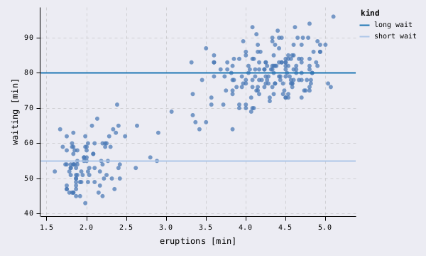
:::


Its options place the lines without data:


```{=html}
<dl class="options"><div class="option-card"><dt><code>:x</code><span class="option-default">Default: None; the lines come from the mapping.</span></dt><dd><div class="option-example"><code>(chart/rule {:x [2 4]})</code></div><div class="option-text">Draws a line across the panel at each x position, vertical unless the plot is flipped. Literal positions replace the chart's mapping.<ul><li><a href="reference.types.html#position">position</a> – One line.</li><li><span>vector of positions</span> – A line at each position.</li></ul></div></dd></div><div class="option-card"><dt><code>:y</code><span class="option-default">Default: None; the lines come from the mapping.</span></dt><dd><div class="option-example"><code>(chart/rule {:y [2 4]})</code></div><div class="option-text">Draws a line across the panel at each y position, horizontal unless the plot is flipped. Literal positions replace the chart's mapping.<ul><li><a href="reference.types.html#position">position</a> – One line.</li><li><span>vector of positions</span> – A line at each position.</li></ul></div></dd></div><div class="option-card"><dt><code>:slope</code><span class="option-default">Default: None; the lines come from the mapping.</span></dt><dd><div class="option-example"><code>(chart/rule {:intercept 1, :slope 0.5})</code></div><div class="option-text">The slope of each sloped line y = intercept + slope · x, drawn across the panel. It needs <code>:intercept</code> and linear x and y scales.<ul><li><a href="reference.types.html#finite-number">finite number</a> – One slope for every line.</li><li><span>vector of finite numbers</span> – A slope per line, paired in order with <code>:intercept</code>.</li></ul></div></dd></div><div class="option-card"><dt><code>:intercept</code><span class="option-default">Default: None; the lines come from the mapping.</span></dt><dd><div class="option-example"><code>(chart/rule {:slope 0.5, :intercept 2})</code></div><div class="option-text">The intercept of each sloped line y = intercept + slope · x. It needs <code>:slope</code>.<ul><li><a href="reference.types.html#finite-number">finite number</a> – One intercept for every line.</li><li><span>vector of finite numbers</span> – An intercept per line, paired in order with <code>:slope</code>.</li></ul></div></dd></div></dl>
```


::: {.sourceClojure}
```clojure
(plot/render-image (plot/arrange [{:data faithful :mapping {:x :eruptions :y :waiting}
                                   :charts [(chart/scatter) (chart/rule {:x [2 3 4] :dash :dashed})]
                                   :labels {:title ":x [2 3 4]"}}
                                  {:data faithful :mapping {:x :eruptions :y :waiting}
                                   :charts [(chart/scatter)
                                            (chart/rule {:slope [10.7 12] :intercept [33.5 25] :line-width 2
                                                         :color [200 80 40]})]
                                   :labels {:title ":slope, :intercept (two lines)"}}
                                  {:data faithful :mapping {:x :eruptions :y :waiting}
                                   :charts [(chart/scatter) (chart/rule {:y [55 80] :line-width 2 :color [40 140 60]})]
                                   :labels {:title ":y [55 80]"}}]
                                 {:columns 3})
                   {:width 1000 :height 330})
```
:::


::: {.clay-image}

:::


## Rectangles

`chart/rect` draws rectangles over x and y intervals, or a band across the panel over one of them; an open end
(`nil`) reaches the panel's edge. Use it to shade periods, ranges or regions; list it before the charts it should
stay behind.


```{=html}
<div class="shared"><div class="shared-title">Shared options<span class="shared-hint"> – groups of options other charts take too</span></div><ul><li><a href="reference.shared_options.html#fill-patterns">Fill patterns</a> – <code>:pattern</code> <code>:pattern-color</code></li><li><a href="reference.shared_options.html#common-options">Common options</a> – <code>:data</code> <code>:mapping</code> <code>:legend</code></li><li><a href="reference.shared_options.html#named-theme-styles">Named theme styles</a> – <code>:theme-style</code></li><li><a href="reference.shared_options.html#annotation-options">Annotation options</a> – <code>:extent</code></li><li><a href="reference.shared_options.html#rounded-corners">Rounded corners</a> – <code>:corner-radius</code></li></ul></div>
```


```{=html}
<div class="mapping"><div class="mapping-title">Mapping<span class="mapping-hint"> – the row values the chart reads, under <code>:mapping</code></span></div><ul><li><code>:x0</code> – The start x of each row's rectangle, with <code>:x1</code>; a <code>nil</code> value reaches the panel's edge.</li><li><code>:x1</code> – The end x of each row's rectangle, with <code>:x0</code>; a <code>nil</code> value reaches the panel's edge.</li><li><code>:y0</code> – The start y of each row's rectangle, with <code>:y1</code>; a <code>nil</code> value reaches the panel's edge.</li><li><code>:y1</code> – The end y of each row's rectangle, with <code>:y0</code>; a <code>nil</code> value reaches the panel's edge.</li><li><code>:color</code> – Fills the rectangles: by a categorical value per group, or by any colour scale per row, e.g. identity colours for swatches.</li><li><code>:pattern</code> – Splits the rows into groups, each with its own fill pattern.</li><li><code>:shape</code> – Splits the rows into groups that look the same, as <code>:group</code> does.</li><li><code>:size</code> – Splits the rows into groups that look the same, as <code>:group</code> does.</li><li><code>:group</code> – Splits the rows into groups that look the same, each row still its own rectangle.</li></ul></div>
```


::: {.sourceClojure}
```clojure
(def recessions [{:name "1973-75" :from (LocalDate/parse "1973-11-01") :to (LocalDate/parse "1975-03-01")}
                 {:name "1980-82" :from (LocalDate/parse "1980-01-01") :to (LocalDate/parse "1982-11-01")}
                 {:name "1990-91" :from (LocalDate/parse "1990-07-01") :to (LocalDate/parse "1991-03-01")}
                 {:name "2001" :from (LocalDate/parse "2001-03-01") :to (LocalDate/parse "2001-11-01")}
                 {:name "2007-09" :from (LocalDate/parse "2007-12-01") :to (LocalDate/parse "2009-06-01")}])
```
:::


```{=html}
<div class="data-table"><table class="table table-hover table-responsive clay-table"><thead><tr><th>name</th><th>from</th><th>to</th></tr></thead><tbody><tr><td>1973-75</td><td>1973-11-01</td><td>1975-03-01</td></tr><tr><td>1980-82</td><td>1980-01-01</td><td>1982-11-01</td></tr><tr><td>1990-91</td><td>1990-07-01</td><td>1991-03-01</td></tr><tr><td>2001</td><td>2001-03-01</td><td>2001-11-01</td></tr><tr><td>2007-09</td><td>2007-12-01</td><td>2009-06-01</td></tr></tbody></table></div>
```


::: {.sourceClojure}
```clojure
(plot/render-image {:data economics
                    :mapping {:x #(LocalDate/parse (:date %)) :y :unemploy}
                    :charts [(chart/rect {:data recessions :mapping {:x0 :from :x1 :to}})
                             (chart/line)]
                    :labels {:y "unemployed [thousands]"}}
                   {:width 700 :height 340})
```
:::


::: {.clay-image}
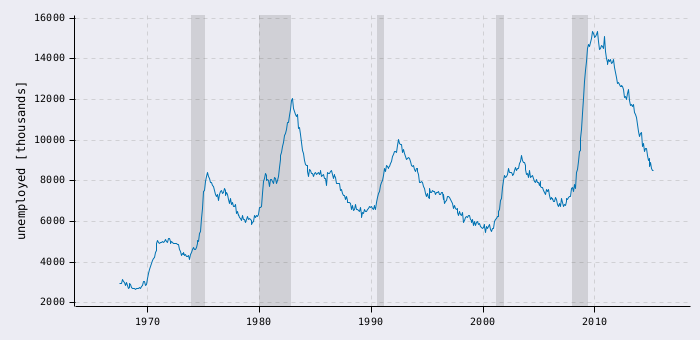
:::


Its options give literal intervals, their fill and outline, and how much of a level's band they cover. On the
left, two y intervals with a fill colour each; on the right, one rectangle from level b to level c, with
`:width 0.6` covering only part of each level's band:


```{=html}
<dl class="options"><div class="option-card"><dt><code>:stroke-color</code><span class="option-default">Default: <code>:none</code> (theme)</span></dt><dd><div class="option-example"><code>(chart/rect {:x [2 6], :y [2 6], :stroke-color :darker})</code></div><div class="option-text">The outline colour of the rectangles.<ul><li><code>:none</code> – No outline.</li><li><code>:darker</code> – The fill colour, darkened; no outline without a fill.</li><li><a href="reference.types.html#solid-colour">solid colour</a> – Any other colour, e.g. <code>:black</code>.</li></ul></div></dd></div><div class="option-card"><dt><code>:stroke-width</code><span class="option-default">Default: <code>1</code> (theme)</span></dt><dd><div class="option-example"><code>(chart/rect {:x [2 6], :y [2 6], :stroke-color :black, :stroke-width 4})</code></div><div class="option-text">The outline width in pixels; <code>0</code> draws no outline.<ul><li><a href="reference.types.html#non-negative-number">non-negative number</a></li></ul></div></dd></div><div class="option-card"><dt><code>:fill</code><span class="option-default">Default: <code>[0 0 0 30]</code> (theme)</span></dt><dd><div class="option-example"><code>(chart/rect {:x [[1 3] [5 7]], :y [2 6], :fill [:steelblue :orange]})</code></div><div class="option-text">The fill colour of the rectangles, or a vector of colours, one per literal interval; a mapped <code>:color</code> wins.<ul><li><code>:none</code> – No fill.</li><li><a href="reference.types.html#solid-colour">solid colour</a> – Any other colour, e.g. <code>:black</code>.</li><li><span>vector of colours</span> – A colour per literal interval, paired in order; a vector of one colour fills them all.</li></ul></div></dd></div><div class="option-card"><dt><code>:alpha</code><span class="option-default">Default: The colours' own alpha.</span></dt><dd><div class="option-example"><code>(chart/rect {:x [2 6], :y [2 6], :alpha 0.3})</code></div><div class="option-text">The opacity of the fill, from 0 (transparent) to 1.<ul><li><a href="reference.types.html#fraction">fraction</a></li></ul></div></dd></div><div class="option-card"><dt><code>:x</code><span class="option-default">Default: None; the rectangles come from the mapping, or span the whole x range when only <code>:y</code> is given.</span></dt><dd><div class="option-example"><code>(chart/rect {:y [2 6], :x [2 6]})</code></div><div class="option-text">The x interval of each rectangle; without <code>:y</code> it draws a band across the whole panel. Literal intervals replace the chart's mapping.<ul><li><span>pair of positions</span> – One interval <code>[a b]</code>; a <code>nil</code> end reaches the panel's edge, e.g. <code>[5 nil]</code>.</li><li><span>vector of (pair of positions)</span> – An interval per rectangle, paired in order with <code>:y</code> and <code>:fill</code>.</li></ul></div></dd></div><div class="option-card"><dt><code>:y</code><span class="option-default">Default: None; the rectangles come from the mapping, or span the whole y range when only <code>:x</code> is given.</span></dt><dd><div class="option-example"><code>(chart/rect {:x [2 6], :y [2 6]})</code></div><div class="option-text">The y interval of each rectangle; without <code>:x</code> it draws a band across the whole panel. Literal intervals replace the chart's mapping.<ul><li><span>pair of positions</span> – One interval <code>[a b]</code>; a <code>nil</code> end reaches the panel's edge, e.g. <code>[5 nil]</code>.</li><li><span>vector of (pair of positions)</span> – An interval per rectangle, paired in order with <code>:x</code> and <code>:fill</code>.</li></ul></div></dd></div><div class="option-card"><dt><code>:width</code><span class="option-default">Default: <code>1.0</code></span></dt><dd><div class="option-example"><code>(chart/rect {:x ["b" "c"], :y [2 6], :width 0.5})</code></div><div class="option-text">On a categorical axis, the fraction of a level's band that an interval ending at that level covers, centred. At <code>1</code> rectangles of neighbouring levels touch.<ul><li><span>finite number above 0 and at most 1</span></li></ul></div></dd></div></dl>
```


::: {.sourceClojure}
```clojure
(def levels-data [{:k "a" :v 3} {:k "b" :v 5} {:k "c" :v 4} {:k "d" :v 6}])
```
:::


```{=html}
<div class="data-table"><table class="table table-hover table-responsive clay-table"><thead><tr><th>k</th><th>v</th></tr></thead><tbody><tr><td>a</td><td>3</td></tr><tr><td>b</td><td>5</td></tr><tr><td>c</td><td>4</td></tr><tr><td>d</td><td>6</td></tr></tbody></table></div>
```


::: {.sourceClojure}
```clojure
(plot/render-image (plot/arrange [{:data faithful :mapping {:x :eruptions :y :waiting}
                                   :charts [(chart/rect {:y [[nil 60] [75 nil]] :fill [[0 114 178] [200 80 40]] :alpha 0.2
                                                         :stroke-color :darker :stroke-width 2})
                                            (chart/scatter)]
                                   :labels {:title ":y intervals, :fill per interval, :stroke-width 2"}}
                                  {:data levels-data :mapping {:x :k :y :v}
                                   :charts [(chart/rect {:x ["b" "c"] :width 0.6 :fill [255 200 0 110]})
                                            (chart/bar)]
                                   :scales {:x {:domain ["a" "b" "c" "d"]}}
                                   :labels {:title ":x [\"b\" \"c\"] :width 0.6"}}]
                                 {:columns 2})
                   {:width 900 :height 330})
```
:::


::: {.clay-image}

:::


## Text labels

`chart/text` draws labels at positions: a label per row of data, with `:label` as its text, or at positions its
options give, also at a fraction of the panel (`[:panel f]`). Use it to name points, mark values or add notes. It
reads the plot's data but takes only the facet keys of the plot's mapping; its positions and texts come from its
own `:mapping`.


```{=html}
<div class="shared"><div class="shared-title">Shared options<span class="shared-hint"> – groups of options other charts take too</span></div><ul><li><a href="reference.shared_options.html#text-style">Text style</a> – <code>:font</code> <code>:size</code> <code>:font-style</code> <code>:color</code> <code>:inset</code> <code>:background</code> <code>:dollar-math</code></li><li><a href="reference.shared_options.html#common-options">Common options</a> – <code>:data</code> <code>:mapping</code> <code>:legend</code></li><li><a href="reference.shared_options.html#annotation-options">Annotation options</a> – <code>:extent</code></li></ul></div>
```


```{=html}
<div class="mapping"><div class="mapping-title">Mapping<span class="mapping-hint"> – the row values the chart reads, under <code>:mapping</code></span></div><ul><li><code>:x</code> – The x of each row's label.</li><li><code>:y</code> – The y of each row's label.</li><li><code>:label</code> – The text of each row's label; a value becomes a string. <code>$...$</code> in it and <code>plot/math</code> values draw as formulas, unless <code>:dollar-math false</code> keeps dollars as typed.</li><li><code>:angle</code> – Turns each row's label by degrees, clockwise; a <code>nil</code> or non-finite value takes <code>:rotation</code>.</li><li><code>:x-span</code> – Each label's room along x, in x units from its x: a longer label shrinks, down to its text role's <code>:min-size</code>. The chart fits only unrotated labels in an unflipped cartesian plot, and not for a <code>nil</code> span.</li><li><code>:color</code> – Splits the rows into groups, each with its own text colour.</li><li><code>:group</code> – Splits the rows into groups that look the same; <code>:select</code> keeps labels per group.</li></ul></div>
```


::: {.sourceClojure}
```clojure
(def cities [{:city "Oslo" :lon 10.8 :lat 59.9} {:city "Rome" :lon 12.5 :lat 41.9} {:city "Madrid" :lon -3.7 :lat 40.4}
             {:city "Paris" :lon 2.4 :lat 48.9} {:city "Warsaw" :lon 21.0 :lat 52.2}])
```
:::


```{=html}
<div class="data-table"><table class="table table-hover table-responsive clay-table"><thead><tr><th>city</th><th>lon</th><th>lat</th></tr></thead><tbody><tr><td>Oslo</td><td>10.8</td><td>59.9</td></tr><tr><td>Rome</td><td>12.5</td><td>41.9</td></tr><tr><td>Madrid</td><td>-3.7</td><td>40.4</td></tr><tr><td>Paris</td><td>2.4</td><td>48.9</td></tr><tr><td>Warsaw</td><td>21.0</td><td>52.2</td></tr></tbody></table></div>
```


::: {.sourceClojure}
```clojure
(plot/render-image {:data cities
                    :mapping {:x :lon :y :lat}
                    :charts [(chart/scatter)
                             (chart/text {:mapping {:x :lon :y :lat :label :city} :anchor [:left :bottom] :offset [4 2]})]
                    :labels {:x "longitude" :y "latitude"}}
                   {:width 550 :height 340})
```
:::


::: {.clay-image}
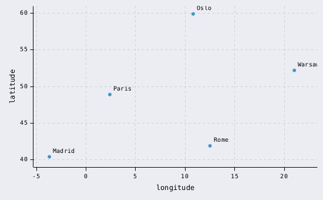
:::


### Labels

These options give the labels' positions, texts and text role, or keep one label per group at a line's end:


```{=html}
<dl class="options"><div class="option-card"><dt><code>:role</code><span class="option-default">Default: <code>:annotation</code></span></dt><dd><div class="option-example"><code>(chart/text {:x 5, :y 5, :text "label", :role :title})</code></div><div class="option-text">The theme text role the labels take their style from, e.g. a builder's role or one your theme adds; the inline style options win over it.<ul><li><span>keyword</span></li></ul></div></dd></div><div class="option-card"><dt><code>:x</code><span class="option-default">Default: None; the labels come from the mapping.</span></dt><dd><div class="option-example"><code>(chart/text {:y 5, :text "label", :x [:panel 0.2]})</code></div><div class="option-text">The x of each literal label. Literal labels need <code>:x</code>, <code>:y</code> and <code>:text</code>, and replace the chart's mapping.<ul><li><a href="reference.types.html#panel-position">panel position</a> – A place across the panel, whatever the data.</li><li><a href="reference.types.html#position">position</a> – One x for every label.</li><li><span>vector of positions or panel positions</span> – An x per label, paired in order with <code>:y</code> and <code>:text</code>.</li></ul></div></dd></div><div class="option-card"><dt><code>:y</code><span class="option-default">Default: None; the labels come from the mapping.</span></dt><dd><div class="option-example"><code>(chart/text {:x 5, :text "label", :y [:panel 0.9]})</code></div><div class="option-text">The y of each literal label. Literal labels need <code>:x</code>, <code>:y</code> and <code>:text</code>, and replace the chart's mapping.<ul><li><a href="reference.types.html#panel-position">panel position</a> – A place across the panel, whatever the data.</li><li><a href="reference.types.html#position">position</a> – One y for every label.</li><li><span>vector of positions or panel positions</span> – A y per label, paired in order with <code>:x</code> and <code>:text</code>.</li></ul></div></dd></div><div class="option-card"><dt><code>:text</code><span class="option-default">Default: None; the labels come from the mapping.</span></dt><dd><div class="option-example"><code>(chart/text {:x 5, :y 5, :text "peak"})</code></div><div class="option-text">The text of the literal labels: one value for all, or a vector paired in order with <code>:x</code> and <code>:y</code>. A value becomes a string; <code>$...$</code> in it and <code>plot/math</code> values draw as formulas, unless <code>:dollar-math false</code> keeps dollars as typed.<ul><li><span>any value</span></li></ul></div></dd></div><div class="option-card"><dt><code>:select</code><span class="option-default">Default: A label for every row.</span></dt><dd><div class="option-example"><code>(chart/text {:data [{:x 1, :y 1, :g "a"} {:x 3, :y 2, :g "a"}], :mapping {:x :x, :y :y, :label :g}, :select :last})</code></div><div class="option-text">Keeps one label per group (see <code>:select-within</code>), for labels at the ends of lines.<ul><li><code>:last</code> – The row with the largest x.</li><li><code>:first</code> – The row with the smallest x.</li></ul></div></dd></div><div class="option-card"><dt><code>:select-within</code><span class="option-default">Default: <code>:group-and-label</code></span></dt><dd><div class="option-example"><code>(chart/text {:select :last, :data [{:x 1, :y 1, :g "a", :l "early"} {:x 3, :y 2, :g "a", :l "late"}], :mapping {:x :x, :y :y, :group :g, :label :l}, :select-within :group})</code></div><div class="option-text">What <code>:select</code> keeps one label in.<ul><li><code>:group-and-label</code> – Each group and label text.</li><li><code>:group</code> – Each group, whatever its labels.</li></ul></div></dd></div></dl>
```


::: {.sourceClojure}
```clojure
(def growth (for [g ["alpha" "beta" "gamma"] t (range 10)]
              {:g g :t t :v (+ (case g "alpha" 2.0 "beta" 0.0 "gamma" 9.0) (* t (case g "alpha" 1.0 "beta" 1.6 "gamma" 0.4)))}))
```
:::


```{=html}
<div class="data-table"><table class="table table-hover table-responsive clay-table"><thead><tr><th>g</th><th>t</th><th>v</th></tr></thead><tbody><tr><td>alpha</td><td>0</td><td>2.0</td></tr><tr><td>alpha</td><td>1</td><td>3.0</td></tr><tr><td>alpha</td><td>2</td><td>4.0</td></tr><tr><td>alpha</td><td>3</td><td>5.0</td></tr><tr><td>alpha</td><td>4</td><td>6.0</td></tr><tr><td>alpha</td><td>5</td><td>7.0</td></tr><tr><td>alpha</td><td>6</td><td>8.0</td></tr><tr><td>alpha</td><td>7</td><td>9.0</td></tr><tr><td>alpha</td><td>8</td><td>10.0</td></tr><tr><td>alpha</td><td>9</td><td>11.0</td></tr><tr><td>beta</td><td>0</td><td>0.0</td></tr><tr><td>beta</td><td>1</td><td>1.6</td></tr><tr><td>beta</td><td>2</td><td>3.2</td></tr><tr><td>beta</td><td>3</td><td>4.800000000000001</td></tr><tr><td>beta</td><td>4</td><td>6.4</td></tr><tr><td>beta</td><td>5</td><td>8.0</td></tr><tr><td>beta</td><td>6</td><td>9.600000000000001</td></tr><tr><td>beta</td><td>7</td><td>11.200000000000001</td></tr><tr><td>beta</td><td>8</td><td>12.8</td></tr><tr><td>beta</td><td>9</td><td>14.4</td></tr><tr><td>gamma</td><td>0</td><td>9.0</td></tr><tr><td>gamma</td><td>1</td><td>9.4</td></tr><tr><td>gamma</td><td>2</td><td>9.8</td></tr><tr><td>gamma</td><td>3</td><td>10.2</td></tr><tr><td>gamma</td><td>4</td><td>10.6</td></tr><tr><td>gamma</td><td>5</td><td>11.0</td></tr><tr><td>gamma</td><td>6</td><td>11.4</td></tr><tr><td>gamma</td><td>7</td><td>11.8</td></tr><tr><td>gamma</td><td>8</td><td>12.2</td></tr><tr><td>gamma</td><td>9</td><td>12.6</td></tr></tbody></table></div>
```


On the left, a note in the panel's top left corner and a label turned by -30 degrees; on the right, `:select :last` names each
line at its end:


::: {.sourceClojure}
```clojure
(plot/render-image (plot/arrange [{:data faithful :mapping {:x :eruptions :y :waiting}
                                   :charts [(chart/scatter)
                                            (chart/text {:x [:panel 0.02] :y [:panel 0.98] :anchor [:left :top]
                                                         :text "272 eruptions"})
                                            (chart/text {:x 3 :y 70 :text "few here" :rotation -30})]
                                   :labels {:title "[:panel f], :rotation -30"}}
                                  {:data growth :mapping {:x :t :y :v :color :g}
                                   :charts [(chart/line)
                                            (chart/text {:mapping {:x :t :y :v :color :g :label :g}
                                                         :select :last :reserve-room :anchor})]
                                   :labels {:title ":select :last, :reserve-room :anchor"}
                                   :legend false}]
                                 {:columns 2})
                   {:width 900 :height 330})
```
:::


::: {.clay-image}

:::


Here the label changes along each line with its phase (beta's early phase is shorter): the default
`:select-within` gives an end label per text, `:group` one per line. A `[:panel f]` position also works on an axis
no chart maps, such as the dot plot's vertical:


::: {.sourceClojure}
```clojure
(plot/render-image (plot/arrange [{:data growth :mapping {:x :t :y :v :color :g}
                                   :charts [(chart/line)
                                            (chart/text {:mapping {:x :t :y :v :color :g
                                                                   :label #(str (:g %) (if (< (:t %) (if (= "beta" (:g %)) 3 5)) " early" " late"))}
                                                         :select :last :select-within :group-and-label :reserve-room :anchor})]
                                   :labels {:title ":select-within :group-and-label"}
                                   :legend false}
                                  {:data growth :mapping {:x :t :y :v :color :g}
                                   :charts [(chart/line)
                                            (chart/text {:mapping {:x :t :y :v :color :g
                                                                   :label #(str (:g %) (if (< (:t %) (if (= "beta" (:g %)) 3 5)) " early" " late"))}
                                                         :select :last :select-within :group :reserve-room :anchor})]
                                   :labels {:title ":select-within :group"}
                                   :legend false}
                                  {:data faithful :mapping {:x :eruptions}
                                   :charts [(chart/dotplot {:binwidth 0.1})
                                            (chart/text {:x [:panel 0.02] :y [:panel 0.95] :anchor [:left :top]
                                                         :text "eruption lengths"})]
                                   :labels {:title "[:panel f] without a y scale"}}]
                                 {:columns 3})
                   {:width 1000 :height 320})
```
:::


::: {.clay-image}
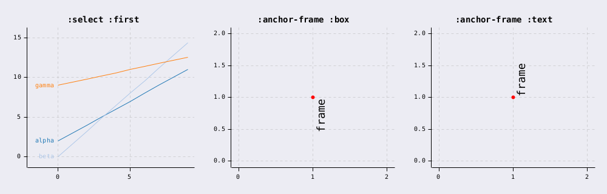
:::


`:role` picks the [theme text role](reference.theme.html#text) the labels take their style from: here one the
theme adds (`:callout`, bottom right) and a builder's (`:network-label`, small names on white boxes):


::: {.sourceClojure}
```clojure
(plot/render-image {:data cities
                    :mapping {:x :lon :y :lat}
                    :charts [(chart/scatter)
                             (chart/text {:mapping {:x :lon :y :lat :label :city} :anchor [:left :bottom] :offset [4 2]
                                          :role :network-label})
                             (chart/text {:x [:panel 0.98] :y [:panel 0.03] :anchor [:right :bottom] :text "European cities"
                                          :role :callout})]
                    :theme {:text {:callout {:font "DejaVu Sans Mono" :size 13 :font-style :bold :color [178 34 34]
                                             :inset 2}}}
                    :labels {:x "longitude" :y "latitude"}}
                   {:width 550 :height 340})
```
:::


::: {.clay-image}
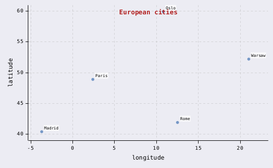
:::


A text draws `$...$` as a LaTeX formula (left; [Formulas](reference.labels_text.html#formulas) has the rules), as
every label in cljplot2 does. `:dollar-math false` keeps the dollars as typed (right); `\$` keeps one dollar
literal in a text with formulas:


::: {.sourceClojure}
```clojure
(plot/render-image (plot/arrange [{:data faithful :mapping {:x :eruptions :y :waiting}
                                   :charts [(chart/scatter)
                                            (chart/text {:x 3.5 :y 95 :text "mean wait $\\bar{w} = 71$ min"})]
                                   :labels {:title "formula in the text"}}
                                  {:data faithful :mapping {:x :eruptions :y :waiting}
                                   :charts [(chart/scatter)
                                            (chart/text {:x 3.5 :y 95 :text "mean wait $\\bar{w} = 71$ min" :dollar-math false})]
                                   :labels {:title ":dollar-math false"}}]
                                 {:columns 2})
                   {:width 900 :height 330})
```
:::


::: {.clay-image}

:::


### Placement

These options place each label around its position: which point of its box sits there, a shift in pixels, a
turn, and room kept past the data:


```{=html}
<dl class="options"><div class="option-card"><dt><code>:anchor</code><span class="option-default">Default: <code>[:center :middle]</code>; with <code>:select :last</code> <code>[:left :middle]</code>, with <code>:first</code> <code>[:right :middle]</code>, past the line's end; with <code>:rotation :radial</code>, the side facing the centre.</span></dt><dd><div class="option-example"><code>(chart/text {:x 5, :y 5, :text "label", :anchor [:left :bottom]})</code></div><div class="option-text">The point of each label's box placed at its position, e.g. <code>[:left :top]</code> puts the box's top left corner there.<ul><li><a href="reference.types.html#alignment">alignment</a></li></ul></div></dd></div><div class="option-card"><dt><code>:offset</code><span class="option-default">Default: <code>[0 0]</code>; with <code>:select</code>, 5 pixels past the line's end.</span></dt><dd><div class="option-example"><code>(chart/text {:x 5, :y 5, :text "label", :offset [10 10]})</code></div><div class="option-text">Shifts each label by <code>[dx dy]</code> pixels, <code>dy</code> up.<ul><li><span>pair of finite numbers</span></li></ul></div></dd></div><div class="option-card"><dt><code>:rotation</code><span class="option-default">Default: <code>0</code></span></dt><dd><div class="option-example"><code>(chart/text {:x 5, :y 5, :text "label", :rotation -30})</code></div><div class="option-text">Turns the labels; a mapped <code>:angle</code> wins.<ul><li><code>:radial</code> – In a polar plot, each label along its angle, turned to read upright; no turn in a cartesian plot.</li><li><a href="reference.types.html#finite-number">finite number</a> – Degrees, clockwise.</li></ul></div></dd></div><div class="option-card"><dt><code>:anchor-frame</code><span class="option-default">Default: <code>:box</code></span></dt><dd><div class="option-example"><code>(chart/text {:x 5, :y 5, :text "label", :rotation -45, :anchor [:left :top], :anchor-frame :text})</code></div><div class="option-text">What <code>:anchor</code> points into on a turned label.<ul><li><code>:box</code> – The bounding box of the turned label.</li><li><code>:text</code> – The text before turning; the text then turns about that point.</li></ul></div></dd></div><div class="option-card"><dt><code>:reserve-room</code><span class="option-default">Default: <code>false</code></span></dt><dd><div class="option-example"><code>(chart/text {:x 5, :y 5, :text "label", :reserve-room true})</code></div><div class="option-text">Keeps room past the data for the labels, so labels at the data's edge stay inside the panel.<ul><li><code>false</code> – No room.</li><li><code>true</code> – The largest label's diagonal on every side, for labels at any angle.</li><li><code>:anchor</code> – Only where the anchored labels reach past their positions.</li></ul></div></dd></div></dl>
```


On the left, each line's start label ends 5 pixels before the line begins, with room kept for the
labels (`:anchor [:right :middle]`, `:offset [-5 0]`, `:reserve-room :anchor`). In the middle and on the right, a
label turned by -90 degrees is anchored at its left top on the red point: `:anchor-frame :box` takes the turned
label's bounding box, `:anchor-frame :text` the start of the text's top edge:


::: {.sourceClojure}
```clojure
(def anchor-points [{:x 1 :y 1 :label "frame"}])
```
:::


```{=html}
<div class="data-table"><table class="table table-hover table-responsive clay-table"><thead><tr><th>x</th><th>y</th><th>label</th></tr></thead><tbody><tr><td>1</td><td>1</td><td>frame</td></tr></tbody></table></div>
```


::: {.sourceClojure}
```clojure
(plot/render-image (plot/arrange [{:data growth :mapping {:x :t :y :v :color :g}
                                   :charts [(chart/line)
                                            (chart/text {:mapping {:x :t :y :v :color :g :label :g}
                                                         :select :first :anchor [:right :middle] :offset [-5 0]
                                                         :reserve-room :anchor})]
                                   :labels {:title ":select :first"}
                                   :legend false}
                                  {:data anchor-points :mapping {:x :x :y :y}
                                   :charts [(chart/scatter {:color :red})
                                            (chart/text {:mapping {:x :x :y :y :label :label} :rotation -90 :size 18
                                                         :anchor [:left :top] :anchor-frame :box})]
                                   :scales {:x {:domain [0 2]} :y {:domain [0 2]}}
                                   :labels {:title ":anchor-frame :box"}}
                                  {:data anchor-points :mapping {:x :x :y :y}
                                   :charts [(chart/scatter {:color :red})
                                            (chart/text {:mapping {:x :x :y :y :label :label} :rotation -90 :size 18
                                                         :anchor [:left :top] :anchor-frame :text})]
                                   :scales {:x {:domain [0 2]} :y {:domain [0 2]}}
                                   :labels {:title ":anchor-frame :text"}}]
                                 {:columns 3})
                   {:width 1000 :height 320})
```
:::


::: {.clay-image}

:::


### Crowding

These options handle labels that overlap: draw them anyway, leave some out, or move them apart:


```{=html}
<dl class="options"><div class="option-card"><dt><code>:overlapping-labels</code><span class="option-default">Default: <code>:keep</code></span></dt><dd><div class="option-example"><code>(chart/text {:x 5, :y 5, :text ["first" "second"], :overlapping-labels :drop})</code></div><div class="option-text">What the chart does with a label that overlaps one placed before it. It places labels group by group, each group's rows in data order, so earlier labels win.<ul><li><code>:keep</code> – Draws it anyway.</li><li><code>:drop</code> – Leaves it out.</li><li><code>:repel</code> – Moves it to the nearest free place within <code>:repel-distance</code>, else leaves it out.</li></ul></div></dd></div><div class="option-card"><dt><code>:repel-distance</code><span class="option-default">Default: <code>60</code></span></dt><dd><div class="option-example"><code>(chart/text {:x 5, :y 5, :text ["first" "second"], :overlapping-labels :repel, :repel-distance 4})</code></div><div class="option-text">The farthest <code>:overlapping-labels :repel</code> moves a label, in pixels.<ul><li><a href="reference.types.html#positive-finite-number">positive finite number</a></li></ul></div></dd></div><div class="option-card"><dt><code>:label-leader</code><span class="option-default">Default: <code>false</code></span></dt><dd><div class="option-example"><code>(chart/text {:x 5, :y [5 5.1], :text ["first" "second"], :anchor [:left :middle], :offset [4 0], :overlapping-labels :repel, :label-leader true})</code></div><div class="option-text">Draws a line in the label's colour from a label's point to the label when <code>:overlapping-labels :repel</code> moved it more than 6 pixels.<ul><li><code>false</code> – Draws no lines.</li><li><code>true</code> – Draws the lines.</li></ul></div></dd></div></dl>
```


From left to right: every label kept, labels overlapping a larger city's left out, then those labels fitted to a
room. The rows are sorted by population, so the larger cities win. On the right a mapped `:x-span` gives each label
room up to the next city east of it at about its latitude, else to the panel's edge: Vienna (next to Bratislava)
and Budapest (near the edge) shrink to fit, down to the `:annotation` role's `:min-size` of 6 points (a role
without `:min-size` doesn't shrink). Builders use both for their node labels:


::: {.sourceClojure}
```clojure
(def capitals [{:city "Paris" :lon 2.35 :lat 48.86 :pop 2.1} {:city "Berlin" :lon 13.40 :lat 52.52 :pop 3.7}
               {:city "Vienna" :lon 16.37 :lat 48.21 :pop 2.0} {:city "Budapest" :lon 19.04 :lat 47.50 :pop 1.7}
               {:city "Prague" :lon 14.42 :lat 50.08 :pop 1.3} {:city "Brussels" :lon 4.35 :lat 50.85 :pop 1.2}
               {:city "Amsterdam" :lon 4.90 :lat 52.37 :pop 0.9} {:city "Bratislava" :lon 17.11 :lat 48.15 :pop 0.5}
               {:city "Luxembourg" :lon 6.13 :lat 49.61 :pop 0.1} {:city "Ljubljana" :lon 14.51 :lat 46.06 :pop 0.3}
               {:city "Zagreb" :lon 15.98 :lat 45.81 :pop 0.8} {:city "Bern" :lon 7.45 :lat 46.95 :pop 0.1}])
```
:::


```{=html}
<div class="data-table"><table class="table table-hover table-responsive clay-table"><thead><tr><th>city</th><th>lon</th><th>lat</th><th>pop</th></tr></thead><tbody><tr><td>Paris</td><td>2.35</td><td>48.86</td><td>2.1</td></tr><tr><td>Berlin</td><td>13.4</td><td>52.52</td><td>3.7</td></tr><tr><td>Vienna</td><td>16.37</td><td>48.21</td><td>2.0</td></tr><tr><td>Budapest</td><td>19.04</td><td>47.5</td><td>1.7</td></tr><tr><td>Prague</td><td>14.42</td><td>50.08</td><td>1.3</td></tr><tr><td>Brussels</td><td>4.35</td><td>50.85</td><td>1.2</td></tr><tr><td>Amsterdam</td><td>4.9</td><td>52.37</td><td>0.9</td></tr><tr><td>Bratislava</td><td>17.11</td><td>48.15</td><td>0.5</td></tr><tr><td>Luxembourg</td><td>6.13</td><td>49.61</td><td>0.1</td></tr><tr><td>Ljubljana</td><td>14.51</td><td>46.06</td><td>0.3</td></tr><tr><td>Zagreb</td><td>15.98</td><td>45.81</td><td>0.8</td></tr><tr><td>Bern</td><td>7.45</td><td>46.95</td><td>0.1</td></tr></tbody></table></div>
```


::: {.sourceClojure}
```clojure
(plot/render-image (plot/arrange (map (fn [[title text-chart]]
                                        {:data (sort-by (comp - :pop) capitals)
                                         :mapping {:x :lon :y :lat}
                                         :charts [(chart/scatter) text-chart]
                                         :scales {:x {:domain [0 24]}}
                                         :labels {:title title :x nil :y nil}})
                                      [[":overlapping-labels :keep"
                                        (chart/text {:mapping {:x :lon :y :lat :label :city} :anchor [:left :middle] :offset [4 0]
                                                     :overlapping-labels :keep})]
                                       [":overlapping-labels :drop"
                                        (chart/text {:mapping {:x :lon :y :lat :label :city} :anchor [:left :middle] :offset [4 0]
                                                     :overlapping-labels :drop})]
                                       [":drop, :x-span to the next city"
                                        (chart/text {:mapping {:x :lon :y :lat :label :city
                                                               :x-span (fn [{:keys [lon lat]}]
                                                                         (- (reduce min 24.0 (keep #(when (and (> (:lon %) lon) (< (abs (- (:lat %) lat)) 0.8)) (:lon %))
                                                                                                   capitals))
                                                                            lon))}
                                                     :anchor [:left :middle] :offset [4 0] :overlapping-labels :drop})]])
                                 {:columns 3})
                   {:width 1000 :height 330})
```
:::


::: {.clay-image}

:::


`:overlapping-labels :repel` finds a free place inside the panel, off the labels placed before it and off every
other label's point, but not off other charts' marks. It compares the drawn boxes in pixels, so it works the same in
flipped, polar and faceted plots; a label larger than the panel stays where it is. A leader line (`:label-leader`)
never crosses a label. A label in a box (`:background`, `:inset`) keeps its
whole box apart and inside the panel (right). Here every car of `mtcars`, heaviest first; `:repel-distance 100`
leaves room for the heavy cars' labels to move left of their points at the panel's right edge:

Data: Motor Trend car road tests (1974), R datasets package `mtcars` (Henderson & Velleman 1981); licence: Part of R (GPL-2 | GPL-3).


::: {.sourceClojure}
```clojure
(def mtcars (nu/dataset :mtcars))
```
:::


```{=html}
<div class="data-table"><table class="table table-hover table-responsive clay-table"><thead><tr><th>model</th><th>mpg</th><th>cyl</th><th>disp</th><th>hp</th><th>drat</th><th>wt</th><th>qsec</th><th>vs</th><th>am</th><th>gear</th><th>carb</th></tr></thead><tbody><tr><td>Mazda RX4</td><td>21</td><td>6</td><td>160</td><td>110</td><td>3.9</td><td>2.62</td><td>16.46</td><td>0</td><td>1</td><td>4</td><td>4</td></tr><tr><td>Mazda RX4 Wag</td><td>21</td><td>6</td><td>160</td><td>110</td><td>3.9</td><td>2.875</td><td>17.02</td><td>0</td><td>1</td><td>4</td><td>4</td></tr><tr><td>Datsun 710</td><td>22.8</td><td>4</td><td>108</td><td>93</td><td>3.85</td><td>2.32</td><td>18.61</td><td>1</td><td>1</td><td>4</td><td>1</td></tr><tr><td>Hornet 4 Drive</td><td>21.4</td><td>6</td><td>258</td><td>110</td><td>3.08</td><td>3.215</td><td>19.44</td><td>1</td><td>0</td><td>3</td><td>1</td></tr><tr><td>Hornet Sportabout</td><td>18.7</td><td>8</td><td>360</td><td>175</td><td>3.15</td><td>3.44</td><td>17.02</td><td>0</td><td>0</td><td>3</td><td>2</td></tr><tr><td>Valiant</td><td>18.1</td><td>6</td><td>225</td><td>105</td><td>2.76</td><td>3.46</td><td>20.22</td><td>1</td><td>0</td><td>3</td><td>1</td></tr><tr><td>Duster 360</td><td>14.3</td><td>8</td><td>360</td><td>245</td><td>3.21</td><td>3.57</td><td>15.84</td><td>0</td><td>0</td><td>3</td><td>4</td></tr><tr><td>Merc 240D</td><td>24.4</td><td>4</td><td>146.7</td><td>62</td><td>3.69</td><td>3.19</td><td>20</td><td>1</td><td>0</td><td>4</td><td>2</td></tr><tr><td>Merc 230</td><td>22.8</td><td>4</td><td>140.8</td><td>95</td><td>3.92</td><td>3.15</td><td>22.9</td><td>1</td><td>0</td><td>4</td><td>2</td></tr><tr><td>Merc 280</td><td>19.2</td><td>6</td><td>167.6</td><td>123</td><td>3.92</td><td>3.44</td><td>18.3</td><td>1</td><td>0</td><td>4</td><td>4</td></tr><tr><td>Merc 280C</td><td>17.8</td><td>6</td><td>167.6</td><td>123</td><td>3.92</td><td>3.44</td><td>18.9</td><td>1</td><td>0</td><td>4</td><td>4</td></tr><tr><td>Merc 450SE</td><td>16.4</td><td>8</td><td>275.8</td><td>180</td><td>3.07</td><td>4.07</td><td>17.4</td><td>0</td><td>0</td><td>3</td><td>3</td></tr><tr><td>Merc 450SL</td><td>17.3</td><td>8</td><td>275.8</td><td>180</td><td>3.07</td><td>3.73</td><td>17.6</td><td>0</td><td>0</td><td>3</td><td>3</td></tr><tr><td>Merc 450SLC</td><td>15.2</td><td>8</td><td>275.8</td><td>180</td><td>3.07</td><td>3.78</td><td>18</td><td>0</td><td>0</td><td>3</td><td>3</td></tr><tr><td>Cadillac Fleetwood</td><td>10.4</td><td>8</td><td>472</td><td>205</td><td>2.93</td><td>5.25</td><td>17.98</td><td>0</td><td>0</td><td>3</td><td>4</td></tr><tr><td>Lincoln Continental</td><td>10.4</td><td>8</td><td>460</td><td>215</td><td>3</td><td>5.424</td><td>17.82</td><td>0</td><td>0</td><td>3</td><td>4</td></tr><tr><td>Chrysler Imperial</td><td>14.7</td><td>8</td><td>440</td><td>230</td><td>3.23</td><td>5.345</td><td>17.42</td><td>0</td><td>0</td><td>3</td><td>4</td></tr><tr><td>Fiat 128</td><td>32.4</td><td>4</td><td>78.7</td><td>66</td><td>4.08</td><td>2.2</td><td>19.47</td><td>1</td><td>1</td><td>4</td><td>1</td></tr><tr><td>Honda Civic</td><td>30.4</td><td>4</td><td>75.7</td><td>52</td><td>4.93</td><td>1.615</td><td>18.52</td><td>1</td><td>1</td><td>4</td><td>2</td></tr><tr><td>Toyota Corolla</td><td>33.9</td><td>4</td><td>71.1</td><td>65</td><td>4.22</td><td>1.835</td><td>19.9</td><td>1</td><td>1</td><td>4</td><td>1</td></tr><tr><td>Toyota Corona</td><td>21.5</td><td>4</td><td>120.1</td><td>97</td><td>3.7</td><td>2.465</td><td>20.01</td><td>1</td><td>0</td><td>3</td><td>1</td></tr><tr><td>Dodge Challenger</td><td>15.5</td><td>8</td><td>318</td><td>150</td><td>2.76</td><td>3.52</td><td>16.87</td><td>0</td><td>0</td><td>3</td><td>2</td></tr><tr><td>AMC Javelin</td><td>15.2</td><td>8</td><td>304</td><td>150</td><td>3.15</td><td>3.435</td><td>17.3</td><td>0</td><td>0</td><td>3</td><td>2</td></tr><tr><td>Camaro Z28</td><td>13.3</td><td>8</td><td>350</td><td>245</td><td>3.73</td><td>3.84</td><td>15.41</td><td>0</td><td>0</td><td>3</td><td>4</td></tr><tr><td>Pontiac Firebird</td><td>19.2</td><td>8</td><td>400</td><td>175</td><td>3.08</td><td>3.845</td><td>17.05</td><td>0</td><td>0</td><td>3</td><td>2</td></tr><tr><td>Fiat X1-9</td><td>27.3</td><td>4</td><td>79</td><td>66</td><td>4.08</td><td>1.935</td><td>18.9</td><td>1</td><td>1</td><td>4</td><td>1</td></tr><tr><td>Porsche 914-2</td><td>26</td><td>4</td><td>120.3</td><td>91</td><td>4.43</td><td>2.14</td><td>16.7</td><td>0</td><td>1</td><td>5</td><td>2</td></tr><tr><td>Lotus Europa</td><td>30.4</td><td>4</td><td>95.1</td><td>113</td><td>3.77</td><td>1.513</td><td>16.9</td><td>1</td><td>1</td><td>5</td><td>2</td></tr><tr><td>Ford Pantera L</td><td>15.8</td><td>8</td><td>351</td><td>264</td><td>4.22</td><td>3.17</td><td>14.5</td><td>0</td><td>1</td><td>5</td><td>4</td></tr><tr><td>Ferrari Dino</td><td>19.7</td><td>6</td><td>145</td><td>175</td><td>3.62</td><td>2.77</td><td>15.5</td><td>0</td><td>1</td><td>5</td><td>6</td></tr><tr><td>Maserati Bora</td><td>15</td><td>8</td><td>301</td><td>335</td><td>3.54</td><td>3.57</td><td>14.6</td><td>0</td><td>1</td><td>5</td><td>8</td></tr><tr><td>Volvo 142E</td><td>21.4</td><td>4</td><td>121</td><td>109</td><td>4.11</td><td>2.78</td><td>18.6</td><td>1</td><td>1</td><td>4</td><td>2</td></tr></tbody></table></div>
```


::: {.sourceClojure}
```clojure
(plot/render-image (plot/arrange (map (fn [[title text-chart]]
                                        {:data (sort-by (comp - :wt) mtcars)
                                         :mapping {:x :wt :y :mpg}
                                         :charts [(chart/scatter {:size 5}) text-chart]
                                         :labels {:title title :x "weight" :y "mpg"}})
                                      [[":drop"
                                        (chart/text {:mapping {:x :wt :y :mpg :label :model} :size 8 :anchor [:left :middle]
                                                     :offset [3 0] :overlapping-labels :drop})]
                                       [":repel, :repel-distance 100"
                                        (chart/text {:mapping {:x :wt :y :mpg :label :model} :size 8 :anchor [:left :middle]
                                                     :offset [3 0] :overlapping-labels :repel :repel-distance 100
                                                     :label-leader true})]
                                       [":repel in label boxes"
                                        (chart/text {:mapping {:x :wt :y :mpg :label :model} :size 8 :anchor [:left :middle]
                                                     :offset [3 0] :overlapping-labels :repel :repel-distance 100 :label-leader true
                                                     :background [255 255 255 210] :inset 2})]])
                                 {:columns 3})
                   {:width 1000 :height 420})
```
:::


::: {.clay-image}
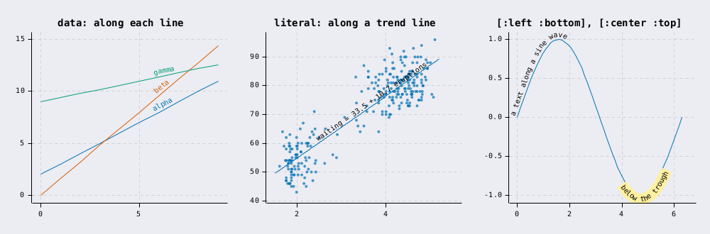
:::


### Path

These options lay a label's text along a line instead of at a point:


```{=html}
<dl class="options"><div class="option-card"><dt><code>:along-path</code><span class="option-default">Default: <code>false</code></span></dt><dd><div class="option-example"><code>(chart/text {:x [1 3 5 7 9], :y [2 4 3 5 4], :text "along a path", :along-path true})</code></div><div class="option-text">Lays each label's text along a path through its group's positions with that text, in data order. Each letter turns with the path.<ul><li><code>false</code> – Each label at its own position.</li><li><code>true</code> – Along the path.</li></ul></div></dd></div><div class="option-card"><dt><code>:path-position</code><span class="option-default">Default: <code>0.5</code></span></dt><dd><div class="option-example"><code>(chart/text {:along-path true, :x [1 3 5 7 9], :y [2 4 3 5 4], :text "along", :path-position 0.2})</code></div><div class="option-text">Where on its path a label sits, as a fraction of the path's length from its first position. <code>:anchor</code> says whether the text starts, centres or ends there.<ul><li><a href="reference.types.html#fraction">fraction</a></li></ul></div></dd></div></dl>
```


The path comes from a line's own rows (left) or from literal positions with one text: a fitted trend line (middle)
and a sine wave (right). The second value of `:anchor` picks the side of the path: `:bottom` puts the text's
bottom on the path, so the text sits above it; `:middle` centres it on the path; `:top` hangs it below.
`:offset [dx dy]` moves the text along the path and up from it in pixels. The letters keep their spacing through
bends and read upright by the path's overall direction (a vertical path reads bottom to top). A `:background`,
inline or the role's, fills a band under the letters, `:inset` past them (right); a text longer than its path isn't
drawn.


::: {.sourceClojure}
```clojure
(let [eruptions (map :eruptions faithful)
      waiting (map :waiting faithful)
      slope (/ (stats/covariance eruptions waiting) (stats/variance eruptions))
      intercept (- (stats/mean waiting) (* slope (stats/mean eruptions)))
      xs [1.5 5.2]
      ys (mapv #(+ intercept (* slope %)) xs)
      wave (m/slice-range 0.0 m/TWO_PI 60)]
  (plot/render-image (plot/arrange [{:data growth :mapping {:x :t :y :v :color :g}
                                     :charts [(chart/line)
                                              (chart/text {:mapping {:x :t :y :v :color :g :label :g} :along-path true
                                                           :path-position 0.7 :anchor [:center :bottom] :offset [0 2]})]
                                     :labels {:title "data: along each line"}
                                     :legend false}
                                    {:data faithful :mapping {:x :eruptions :y :waiting}
                                     :charts [(chart/scatter {:size 4})
                                              (chart/function {:f #(+ intercept (* slope %)) :domain [1.5 5.2]})
                                              (chart/text {:x xs :y ys :text (format "waiting = %.1f + %.1f eruptions" intercept slope)
                                                           :along-path true :path-position 0.6 :anchor [:center :bottom]})]
                                     :labels {:title "literal: along a trend line"}}
                                    {:data (map (fn [x] {:x x :y (m/sin x)}) wave) :mapping {:x :x :y :y}
                                     :charts [(chart/line)
                                              (chart/text {:x (vec wave) :y (mapv m/sin wave) :text "a text along a sine wave"
                                                           :along-path true :path-position 0.0 :anchor [:left :bottom] :offset [0 2]})
                                              (chart/text {:x (vec wave) :y (mapv m/sin wave) :text "below the trough" :along-path true
                                                           :path-position 0.75 :anchor [:center :top]
                                                           :background [255 240 160] :inset 2})]
                                     :labels {:title "[:left :bottom], [:center :top]"}}]
                                   {:columns 3})
                     {:width 1000 :height 330}))
```
:::


::: {.clay-image}
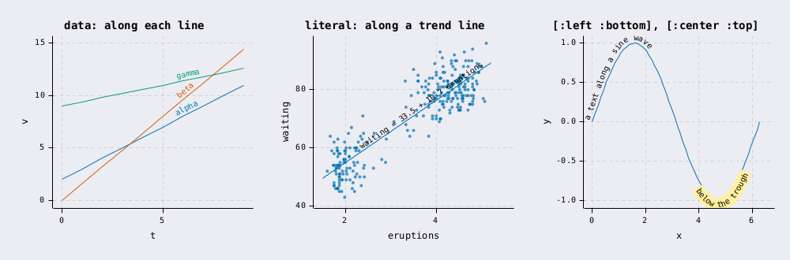
:::


## Images

`chart/image` draws a picture into the panel: a function takes the panel's scales, domains and pixel size and
returns the image. Use it for a background picture, a geographic map or a raster computed per panel; it reads no
data. Here a radial gradient over the data range [-1 1] × [-1 1], which `:domain` sets:


::: {.sourceClojure}
```clojure
(plot/render-image {:charts [(chart/image {:domain {:x [-1 1] :y [-1 1]}
                                           :f (fn [{[w h] :size}]
                                                (let [w (int w) h (int h)
                                                      img (BufferedImage. w h BufferedImage/TYPE_INT_RGB)]
                                                  (doseq [i (range w) j (range h)
                                                          :let [d (m/hypot (- (/ (* 2.0 i) w) 1) (- (/ (* 2.0 j) h) 1))
                                                                c (int (* 255 (max 0.0 (- 1.0 (* 0.7 d)))))]]
                                                    (.setRGB img i j (+ (* 65536 c) (* 256 (quot c 2)) 80)))
                                                  img))})]}
                   {:width 450 :height 350})
```
:::


::: {.clay-image}

:::


Its options give the function and the data range the axes must show; the image always fills the panel. Without
`:domain` the axes follow the other charts' domains, here a scatter's, which draws over the image:


```{=html}
<dl class="options"><div class="option-card"><dt><code>:f</code></dt><dd><div class="option-example"><code>(chart/image {:domain {:x [0 1], :y [0 1]}, :f (fn [{[w h] :size}] (c2d/with-canvas-> (c2d/canvas w h) (c2d/set-background :lightblue)))})</code></div><div class="option-text">A function of the panel's <code>{:x-scale :y-scale :x-domain :y-domain :facet :size}</code> that returns a <code>BufferedImage</code>, a clojure2d canvas or pixels, or <code>nil</code> for nothing. The chart scales the image over the whole panel.<ul><li><a href="reference.types.html#function">function</a></li></ul></div></dd></div><div class="option-card"><dt><code>:domain</code><span class="option-default">Default: The axes follow the other charts' domains.</span></dt><dd><div class="option-text">The data range the axes show at least, without padding or rounding; the image still fills the whole panel.</div></dd></div><div class="option-card"><dt><code>:domain :x</code></dt><dd><div class="option-example"><code>(chart/image {:f (fn [{[w h] :size}] (c2d/with-canvas-> (c2d/canvas w h) (c2d/set-background :lightblue))), :domain {:x [0 4], :y [0 1]}})</code></div><div class="option-text">The x range the axes show at least, in data units.<ul><li><a href="reference.types.html#interval">interval</a></li></ul></div></dd></div><div class="option-card"><dt><code>:domain :y</code></dt><dd><div class="option-example"><code>(chart/image {:f (fn [{[w h] :size}] (c2d/with-canvas-> (c2d/canvas w h) (c2d/set-background :lightblue))), :domain {:x [0 1], :y [0 4]}})</code></div><div class="option-text">The y range the axes show at least, in data units.<ul><li><a href="reference.types.html#interval">interval</a></li></ul></div></dd></div></dl>
```


::: {.sourceClojure}
```clojure
(plot/render-image {:data faithful
                    :mapping {:x :eruptions :y :waiting}
                    :charts [(chart/image {:f (fn [{[w h] :size}]
                                                (let [w (int w) h (int h)
                                                      img (BufferedImage. w h BufferedImage/TYPE_INT_RGB)]
                                                  (doseq [i (range w) j (range h)
                                                          :let [c (int (+ 180 (* 60 (/ (double i) w))))]]
                                                    (.setRGB img i j (+ (* 65536 c) (* 256 c) 235)))
                                                  img))})
                             (chart/scatter)]}
                   {:width 550 :height 340})
```
:::


::: {.clay-image}
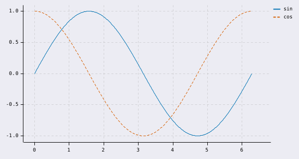
:::


## Function curves

`chart/function` draws curves of functions, y = f(x) or parametric [x y] = f(t), sampled over `:domain` (or `:t`),
by default the panel's x range. Use it for a known curve, a model or a reference shape; the chart's own mapping can
colour or dash several functions by their labels.


```{=html}
<div class="shared"><div class="shared-title">Shared options<span class="shared-hint"> – groups of options other charts take too</span></div><ul><li><a href="reference.shared_options.html#line-style">Line style</a> – <code>:color</code> <code>:line-width</code> <code>:dash</code></li><li><a href="reference.shared_options.html#named-theme-styles">Named theme styles</a> – <code>:theme-style</code></li><li><a href="reference.shared_options.html#common-options">Common options</a> – <code>:legend</code></li></ul></div>
```


```{=html}
<div class="mapping"><div class="mapping-title">Mapping<span class="mapping-hint"> – the row values the chart reads, under <code>:mapping</code></span></div><ul><li><code>:color</code> – Splits the rows, one per function, into groups, each with its own colour.</li><li><code>:dash</code> – Splits the rows, one per function, into groups, each with its own dash style.</li><li><code>:group</code> – Splits the rows into groups that look the same, one row per function.</li></ul></div>
```


::: {.sourceClojure}
```clojure
(plot/render-image {:charts [(chart/function {:f {"sin" #(m/sin %) "cos" #(m/cos %)}
                                              :domain [0 m/TWO_PI]
                                              :mapping {:color :function :dash :function}})]}
                   {:width 600 :height 320})
```
:::


::: {.clay-image}

:::


### Curve

These options give the functions, the range they are sampled over and how densely, the fill and the chart's own
mapping:


```{=html}
<dl class="options"><div class="option-card"><dt><code>:fill</code><span class="option-default">Default: <code>:none</code> (theme)</span></dt><dd><div class="option-example"><code>(chart/function {:f (fn [x] (m/sin x)), :fill :lightblue})</code></div><div class="option-text">The fill of the area between the curve and y = 0, or of the shape a parametric curve closes.<ul><li><code>:none</code> – No fill.</li><li><a href="reference.types.html#solid-colour">solid colour</a> – Any other colour, e.g. <code>:black</code>.</li></ul></div></dd></div><div class="option-card"><dt><code>:mapping</code><span class="option-default">Default: No mapping: every function in the theme's style.</span></dt><dd><div class="option-example"><code>(chart/function {:f {"sin" (fn [x] (m/sin x)), "cos" (fn [x] (m/cos x))}, :mapping {:color :function}})</code></div><div class="option-text">The chart's own mapping of the functions, each a row <code>{:function label}</code>, e.g. <code>{:color :function}</code>. Of the plot's mapping only the facet keys apply.<ul><li><span>mapping</span></li></ul></div></dd></div><div class="option-card"><dt><code>:f</code><span class="option-default">Default: None; give <code>:f</code> or <code>:parametric</code>.</span></dt><dd><div class="option-example"><code>(chart/function {:f (fn [x] (m/sin x))})</code></div><div class="option-text">The functions y = f(x) to draw.<ul><li><a href="reference.types.html#functions">functions</a></li></ul></div></dd></div><div class="option-card"><dt><code>:parametric</code><span class="option-default">Default: None; give <code>:f</code> or <code>:parametric</code>.</span></dt><dd><div class="option-example"><code>(chart/function {:t [0 6.3], :parametric (fn [t] [(m/cos t) (m/sin t)])})</code></div><div class="option-text">The functions [x y] = f(t) to draw, each returning a point.<ul><li><a href="reference.types.html#functions">functions</a></li></ul></div></dd></div><div class="option-card"><dt><code>:domain</code><span class="option-default">Default: The plot's fixed x domain, else the panel's x range.</span></dt><dd><div class="option-example"><code>(chart/function {:f (fn [x] (m/sin x)), :domain [0 3]})</code></div><div class="option-text">The x range the <code>:f</code> functions are sampled over.<ul><li><a href="reference.types.html#span">span</a></li></ul></div></dd></div><div class="option-card"><dt><code>:t</code><span class="option-default">Default: None; <code>:parametric</code> needs it.</span></dt><dd><div class="option-example"><code>(chart/function {:parametric (fn [t] [(m/cos t) (m/sin t)]), :t [0 3.2]})</code></div><div class="option-text">The t range the <code>:parametric</code> functions are sampled over.<ul><li><a href="reference.types.html#span">span</a></li></ul></div></dd></div><div class="option-card"><dt><code>:sample-step</code><span class="option-default">Default: One pixel for <code>:f</code>, <code>{:count 500}</code> for <code>:parametric</code>.</span></dt><dd><div class="option-example"><code>(chart/function {:f (fn [x] (m/sin x)), :sample-step 25})</code></div><div class="option-text">How densely the functions are sampled: pixels between samples along x, or <code>{:count n}</code> samples. <code>:parametric</code> takes only a count.<ul><li><a href="reference.types.html#sample-step">sample step</a></li></ul></div></dd></div></dl>
```


::: {.sourceClojure}
```clojure
(plot/render-image (plot/arrange [{:charts [(chart/function {:f #(* % % 0.5) :domain [-2 2] :fill [0 114 178 60]})]
                                   :labels {:title ":f, :fill"}}
                                  {:charts [(chart/function {:parametric (fn [t] [(m/sin (* 3 t)) (m/sin (* 4 t))])
                                                             :t [0 m/TWO_PI] :fill [200 80 40 60]})]
                                   :aspect :iso
                                   :labels {:title ":parametric (Lissajous)"}}
                                  {:charts [(chart/function {:f #(m/sin %) :domain [0 10] :sample-step 25})]
                                   :labels {:title ":sample-step 25 px"}}]
                                 {:columns 3})
                   {:width 1000 :height 320})
```
:::


::: {.clay-image}
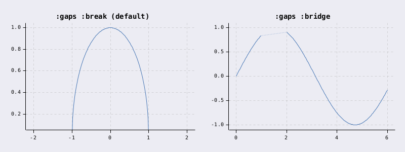
:::


### Gaps

These options handle a `nil` or non-finite result of a function:


```{=html}
<dl class="options"><div class="option-card"><dt><code>:bridge</code><span class="option-default">Default: <code>{:alpha-factor 0.3}</code> (theme)</span></dt><dd><div class="option-text">The style of the segments that bridge gaps with <code>:gaps :bridge</code>.</div></dd></div><div class="option-card"><dt><code>:bridge :alpha-factor</code><span class="option-default">Default: <code>0.3</code> (theme); passing <code>:bridge</code> replaces the theme's map entirely.</span></dt><dd><div class="option-example"><code>(chart/function {:gaps :bridge, :f (fn [x] (when-not (< 2 x 3) (m/sin x))), :bridge {:alpha-factor 0.5}})</code></div><div class="option-text">The bridge's opacity, as a fraction of the line's alpha.<ul><li><a href="reference.types.html#fraction">fraction</a></li></ul></div></dd></div><div class="option-card"><dt><code>:bridge :line-width</code><span class="option-default">Default: The line's width.</span></dt><dd><div class="option-example"><code>(chart/function {:gaps :bridge, :f (fn [x] (when-not (< 2 x 3) (m/sin x))), :bridge {:alpha-factor 0.3, :line-width 3}})</code></div><div class="option-text">The bridge's line width in pixels.<ul><li><a href="reference.types.html#non-negative-number">non-negative number</a></li></ul></div></dd></div><div class="option-card"><dt><code>:bridge :dash</code><span class="option-default">Default: The line's dash.</span></dt><dd><div class="option-example"><code>(chart/function {:gaps :bridge, :f (fn [x] (when-not (< 2 x 3) (m/sin x))), :bridge {:alpha-factor 0.3, :dash :dotted}})</code></div><div class="option-text">The bridge's dash style.<ul><li><a href="reference.types.html#dash">dash</a></li></ul></div></dd></div><div class="option-card"><dt><code>:gaps</code><span class="option-default">Default: <code>:break</code></span></dt><dd><div class="option-example"><code>(chart/function {:f (fn [x] (when-not (< 2 x 3) (m/sin x))), :gaps :bridge})</code></div><div class="option-text">How the curve handles a <code>nil</code> or non-finite result.<ul><li><code>:break</code> – Leaves empty space.</li><li><code>:bridge</code> – Joins the samples on both sides of the gap with a straight segment in the <code>:bridge</code> style.</li></ul></div></dd></div></dl>
```


::: {.sourceClojure}
```clojure
(plot/render-image (plot/arrange [{:charts [(chart/function {:f #(m/sqrt (- 1 (* % %))) :domain [-2 2]})]
                                   :labels {:title ":gaps :break (default)"}}
                                  {:charts [(chart/function {:f #(when-not (< 1 % 2) (m/sin %)) :domain [0 6]
                                                             :gaps :bridge :bridge {:alpha-factor 0.6 :dash :dotted}})]
                                   :labels {:title ":gaps :bridge"}}]
                                 {:columns 2})
                   {:width 800 :height 300})
```
:::


::: {.clay-image}
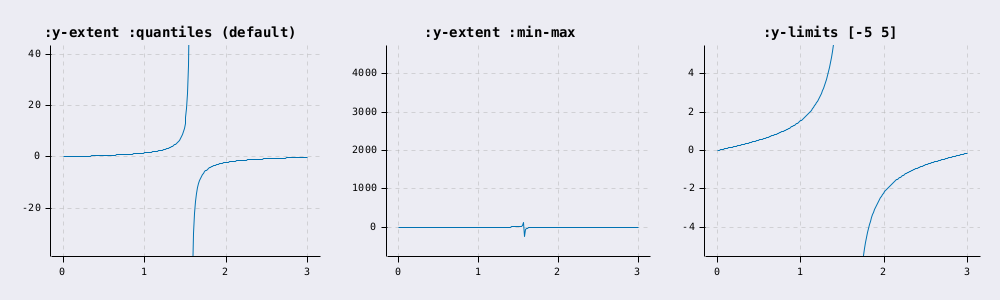
:::


### Extent

These options pick the samples that set the y axis and the room around the curve. Here `tan` has poles: the default
quantiles keep the axis readable, all samples stretch it, `:y-limits` sets it:


```{=html}
<dl class="options"><div class="option-card"><dt><code>:y-limits</code><span class="option-default">Default: No limits: <code>:y-extent</code> picks the samples.</span></dt><dd><div class="option-example"><code>(chart/function {:f (fn [x] (m/sin x)), :y-limits [-0.5 0.5]})</code></div><div class="option-text">Only samples within these limits count for the y extent; the panel's edge clips the rest of the curve.<ul><li><a href="reference.types.html#interval">interval</a></li></ul></div></dd></div><div class="option-card"><dt><code>:y-extent</code><span class="option-default">Default: <code>:quantiles</code></span></dt><dd><div class="option-example"><code>(chart/function {:f (fn [x] (m/sin x)), :y-extent {:quantiles [0.2 0.8]}})</code></div><div class="option-text">Which samples set the y extent when neither <code>:y-limits</code> nor a fixed y domain does.<ul><li><code>:quantiles</code> – The samples between the 1% and 99% quantiles, so a pole doesn't stretch the axis.</li><li><code>:min-max</code> – All samples.</li><li><code>:none</code> – None; other charts or the scale set the y range.</li><li><a href="reference.types.html#quantile-range">quantile range</a> – The samples between these quantiles.</li></ul></div></dd></div><div class="option-card"><dt><code>:padding</code><span class="option-default">Default: <code>0.05</code> on every side.</span></dt><dd><div class="option-example"><code>(chart/function {:f (fn [x] (m/sin x)), :domain [0 6], :padding {:x [0 0]}})</code></div><div class="option-text">Room around the sampled curve on x and y, as fractions of its span.<ul><li><span>map of <code>:x</code> or <code>:y</code> to padding</span></li></ul></div></dd></div></dl>
```


::: {.sourceClojure}
```clojure
(plot/render-image (plot/arrange [{:charts [(chart/function {:f #(m/tan %) :domain [0 3]})]
                                   :labels {:title ":y-extent :quantiles (default)"}}
                                  {:charts [(chart/function {:f #(m/tan %) :domain [0 3] :y-extent :min-max})]
                                   :labels {:title ":y-extent :min-max"}}
                                  {:charts [(chart/function {:f #(m/tan %) :domain [0 3] :y-limits [-5 5]})]
                                   :labels {:title ":y-limits [-5 5]"}}]
                                 {:columns 3})
                   {:width 1000 :height 300})
```
:::


::: {.clay-image}
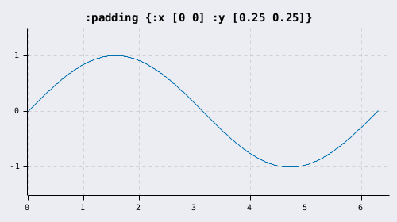
:::


With no padding on x the curve meets the panel's sides; a quarter of the span on y leaves room above and below:


::: {.sourceClojure}
```clojure
(plot/render-image {:charts [(chart/function {:f #(m/sin %) :domain [0 6.3] :padding {:x [0 0] :y [0.25 0.25]}})]
                    :labels {:title ":padding {:x [0 0] :y [0.25 0.25]}"}}
                   {:width 500 :height 280})
```
:::


::: {.clay-image}

:::


```{=html}
<div style="background-color:grey;height:2px;width:100%;"></div>
```


```{=html}
<div><pre><small><small>source: notebooks/reference/charts_annotations.clj</small></small></pre></div>
```