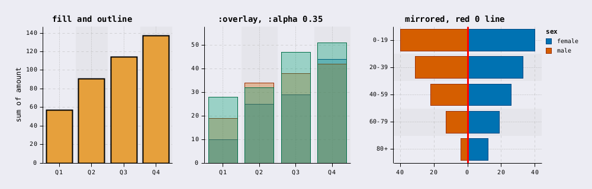
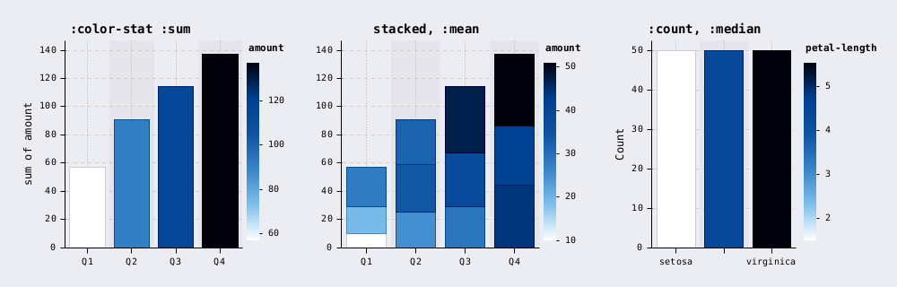
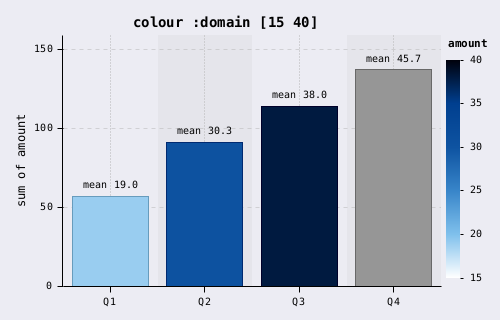
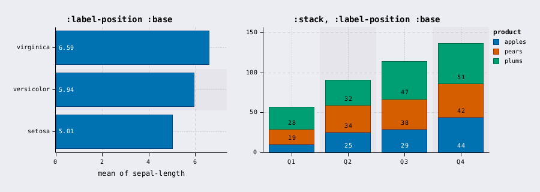
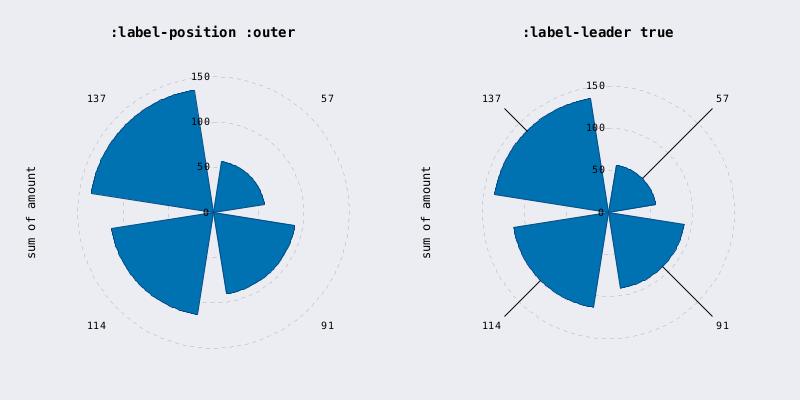
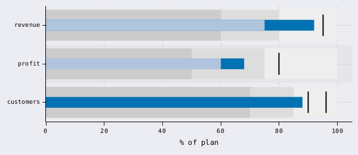
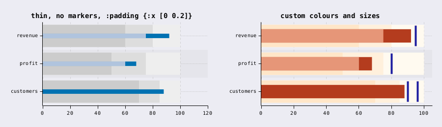

---
format:
  html:
    toc: true
    toc-location: right
    toc-depth: 4
    theme: cosmo
    include-in-header:
      text: |-
        <style>
        .data-table { width: fit-content; max-width: 100%; max-height: 15rem; overflow: auto; margin: 0 0 1rem 0; }
        .data-table .table-responsive { overflow: visible; }
        .data-table table { font-size: 0.75rem; width: auto; margin: 0; }
        .data-table th, .data-table td { padding: 0.1rem 0.45rem !important; white-space: nowrap; }
        .data-table thead th { position: sticky; top: 0; background: var(--bs-body-bg, #fff); }
        .options { margin: 0.5rem 0 1rem 0; }
        .options .option-card { margin: 0 0 0.9rem 0; border: 1px solid var(--bs-border-color, #dee2e6); border-radius: 0.375rem; overflow: hidden; }
        .options dt { display: flex; flex-wrap: wrap; align-items: baseline; gap: 0.1rem 1rem; margin: 0; padding: 0.4rem 0.75rem; background: #eef2f7; border-bottom: 1px solid var(--bs-border-color, #dee2e6); font-weight: normal; }
        .options dt > code { font-weight: 700; font-size: 1rem; background: none; padding: 0; }
        .options .option-default { font-size: 0.85rem; color: var(--bs-secondary-color, #6c757d); }
        .options dd { margin: 0; padding: 0.5rem 0.75rem; }
        .options .option-example { font-size: 0.85rem; padding: 0 0 0.45rem 0; margin-bottom: 0.45rem; border-bottom: 1px dashed var(--bs-border-color, #dee2e6); }
        .options .option-example code { background: none; padding: 0; }
        .options .option-text ul { margin: 0.3rem 0 0 0; padding-left: 1.25rem; }
        .options code, .mapping code { overflow-wrap: anywhere; }
        .mapping { margin: 0.5rem 0 1rem 0; padding: 0.5rem 0.75rem; border: 1px solid var(--bs-border-color, #dee2e6); border-left: 0.3rem solid #2780e3; border-radius: 0.375rem; background: #f5f8fc; }
        .mapping-title { font-weight: 700; margin-bottom: 0.25rem; }
        .mapping-hint { font-weight: normal; font-size: 0.85rem; color: var(--bs-secondary-color, #6c757d); }
        .mapping ul { margin: 0; padding-left: 1.25rem; }
        .mapping .required { font-size: 0.75rem; padding: 0 0.3rem; border: 1px solid currentColor; border-radius: 0.25rem; }
        </style>
code-block-background: true

---
<style></style><style>.printedClojure .sourceCode {
  background-color: transparent;
  border-style: none;
}
</style><style>.clay-limit-image-width .clay-image {max-width: 100%}
.clay-side-by-side .sourceCode {margin: 0}
.clay-side-by-side {margin: 1em 0}
</style>
<script src="https://code.jquery.com/jquery-3.6.0.min.js" type="text/javascript"></script><script src="https://code.jquery.com/ui/1.13.1/jquery-ui.min.js" type="text/javascript"></script>

# Bars

Charts that draw bars along a categorical axis: a summary of each level's values (`bar`) or a measure against
qualitative ranges and targets (`bullet`). Use them to compare amounts across levels.


::: {.sourceClojure}
```clojure
(ns reference.charts-bars
  (:require [cljplot2.chart :as chart]
            [cljplot2.core :as plot]
            [cljplot2.data.levels :as levels]
            [cljplot2.describe :as describe]
            [notebook-utils :as nu]))
```
:::


Data: Edgar Anderson's iris measurements, R datasets package `iris` (Anderson 1935; Fisher 1936); licence: Part of R (GPL-2 | GPL-3).


::: {.sourceClojure}
```clojure
(def iris (nu/dataset :iris))
```
:::


```{=html}
<div class="data-table"><table class="table table-hover table-responsive clay-table"><thead><tr><th>sepal-length</th><th>sepal-width</th><th>petal-length</th><th>petal-width</th><th>species</th></tr></thead><tbody><tr><td>5.1</td><td>3.5</td><td>1.4</td><td>0.2</td><td>setosa</td></tr><tr><td>4.9</td><td>3</td><td>1.4</td><td>0.2</td><td>setosa</td></tr><tr><td>4.7</td><td>3.2</td><td>1.3</td><td>0.2</td><td>setosa</td></tr><tr><td>4.6</td><td>3.1</td><td>1.5</td><td>0.2</td><td>setosa</td></tr><tr><td>5</td><td>3.6</td><td>1.4</td><td>0.2</td><td>setosa</td></tr><tr><td>5.4</td><td>3.9</td><td>1.7</td><td>0.4</td><td>setosa</td></tr><tr><td>4.6</td><td>3.4</td><td>1.4</td><td>0.3</td><td>setosa</td></tr><tr><td>5</td><td>3.4</td><td>1.5</td><td>0.2</td><td>setosa</td></tr><tr><td>4.4</td><td>2.9</td><td>1.4</td><td>0.2</td><td>setosa</td></tr><tr><td>4.9</td><td>3.1</td><td>1.5</td><td>0.1</td><td>setosa</td></tr><tr><td>5.4</td><td>3.7</td><td>1.5</td><td>0.2</td><td>setosa</td></tr><tr><td>4.8</td><td>3.4</td><td>1.6</td><td>0.2</td><td>setosa</td></tr><tr><td>4.8</td><td>3</td><td>1.4</td><td>0.1</td><td>setosa</td></tr><tr><td>4.3</td><td>3</td><td>1.1</td><td>0.1</td><td>setosa</td></tr><tr><td>5.8</td><td>4</td><td>1.2</td><td>0.2</td><td>setosa</td></tr><tr><td>5.7</td><td>4.4</td><td>1.5</td><td>0.4</td><td>setosa</td></tr><tr><td>5.4</td><td>3.9</td><td>1.3</td><td>0.4</td><td>setosa</td></tr><tr><td>5.1</td><td>3.5</td><td>1.4</td><td>0.3</td><td>setosa</td></tr><tr><td>5.7</td><td>3.8</td><td>1.7</td><td>0.3</td><td>setosa</td></tr><tr><td>5.1</td><td>3.8</td><td>1.5</td><td>0.3</td><td>setosa</td></tr><tr><td>5.4</td><td>3.4</td><td>1.7</td><td>0.2</td><td>setosa</td></tr><tr><td>5.1</td><td>3.7</td><td>1.5</td><td>0.4</td><td>setosa</td></tr><tr><td>4.6</td><td>3.6</td><td>1</td><td>0.2</td><td>setosa</td></tr><tr><td>5.1</td><td>3.3</td><td>1.7</td><td>0.5</td><td>setosa</td></tr><tr><td>4.8</td><td>3.4</td><td>1.9</td><td>0.2</td><td>setosa</td></tr><tr><td>5</td><td>3</td><td>1.6</td><td>0.2</td><td>setosa</td></tr><tr><td>5</td><td>3.4</td><td>1.6</td><td>0.4</td><td>setosa</td></tr><tr><td>5.2</td><td>3.5</td><td>1.5</td><td>0.2</td><td>setosa</td></tr><tr><td>5.2</td><td>3.4</td><td>1.4</td><td>0.2</td><td>setosa</td></tr><tr><td>4.7</td><td>3.2</td><td>1.6</td><td>0.2</td><td>setosa</td></tr><tr><td>4.8</td><td>3.1</td><td>1.6</td><td>0.2</td><td>setosa</td></tr><tr><td>5.4</td><td>3.4</td><td>1.5</td><td>0.4</td><td>setosa</td></tr><tr><td>5.2</td><td>4.1</td><td>1.5</td><td>0.1</td><td>setosa</td></tr><tr><td>5.5</td><td>4.2</td><td>1.4</td><td>0.2</td><td>setosa</td></tr><tr><td>4.9</td><td>3.1</td><td>1.5</td><td>0.2</td><td>setosa</td></tr><tr><td>5</td><td>3.2</td><td>1.2</td><td>0.2</td><td>setosa</td></tr><tr><td>5.5</td><td>3.5</td><td>1.3</td><td>0.2</td><td>setosa</td></tr><tr><td>4.9</td><td>3.6</td><td>1.4</td><td>0.1</td><td>setosa</td></tr><tr><td>4.4</td><td>3</td><td>1.3</td><td>0.2</td><td>setosa</td></tr><tr><td>5.1</td><td>3.4</td><td>1.5</td><td>0.2</td><td>setosa</td></tr><tr><td>5</td><td>3.5</td><td>1.3</td><td>0.3</td><td>setosa</td></tr><tr><td>4.5</td><td>2.3</td><td>1.3</td><td>0.3</td><td>setosa</td></tr><tr><td>4.4</td><td>3.2</td><td>1.3</td><td>0.2</td><td>setosa</td></tr><tr><td>5</td><td>3.5</td><td>1.6</td><td>0.6</td><td>setosa</td></tr><tr><td>5.1</td><td>3.8</td><td>1.9</td><td>0.4</td><td>setosa</td></tr><tr><td>4.8</td><td>3</td><td>1.4</td><td>0.3</td><td>setosa</td></tr><tr><td>5.1</td><td>3.8</td><td>1.6</td><td>0.2</td><td>setosa</td></tr><tr><td>4.6</td><td>3.2</td><td>1.4</td><td>0.2</td><td>setosa</td></tr><tr><td>5.3</td><td>3.7</td><td>1.5</td><td>0.2</td><td>setosa</td></tr><tr><td>5</td><td>3.3</td><td>1.4</td><td>0.2</td><td>setosa</td></tr><tr><td>7</td><td>3.2</td><td>4.7</td><td>1.4</td><td>versicolor</td></tr><tr><td>6.4</td><td>3.2</td><td>4.5</td><td>1.5</td><td>versicolor</td></tr><tr><td>6.9</td><td>3.1</td><td>4.9</td><td>1.5</td><td>versicolor</td></tr><tr><td>5.5</td><td>2.3</td><td>4</td><td>1.3</td><td>versicolor</td></tr><tr><td>6.5</td><td>2.8</td><td>4.6</td><td>1.5</td><td>versicolor</td></tr><tr><td>5.7</td><td>2.8</td><td>4.5</td><td>1.3</td><td>versicolor</td></tr><tr><td>6.3</td><td>3.3</td><td>4.7</td><td>1.6</td><td>versicolor</td></tr><tr><td>4.9</td><td>2.4</td><td>3.3</td><td>1</td><td>versicolor</td></tr><tr><td>6.6</td><td>2.9</td><td>4.6</td><td>1.3</td><td>versicolor</td></tr><tr><td>5.2</td><td>2.7</td><td>3.9</td><td>1.4</td><td>versicolor</td></tr><tr><td>5</td><td>2</td><td>3.5</td><td>1</td><td>versicolor</td></tr><tr><td>5.9</td><td>3</td><td>4.2</td><td>1.5</td><td>versicolor</td></tr><tr><td>6</td><td>2.2</td><td>4</td><td>1</td><td>versicolor</td></tr><tr><td>6.1</td><td>2.9</td><td>4.7</td><td>1.4</td><td>versicolor</td></tr><tr><td>5.6</td><td>2.9</td><td>3.6</td><td>1.3</td><td>versicolor</td></tr><tr><td>6.7</td><td>3.1</td><td>4.4</td><td>1.4</td><td>versicolor</td></tr><tr><td>5.6</td><td>3</td><td>4.5</td><td>1.5</td><td>versicolor</td></tr><tr><td>5.8</td><td>2.7</td><td>4.1</td><td>1</td><td>versicolor</td></tr><tr><td>6.2</td><td>2.2</td><td>4.5</td><td>1.5</td><td>versicolor</td></tr><tr><td>5.6</td><td>2.5</td><td>3.9</td><td>1.1</td><td>versicolor</td></tr><tr><td>5.9</td><td>3.2</td><td>4.8</td><td>1.8</td><td>versicolor</td></tr><tr><td>6.1</td><td>2.8</td><td>4</td><td>1.3</td><td>versicolor</td></tr><tr><td>6.3</td><td>2.5</td><td>4.9</td><td>1.5</td><td>versicolor</td></tr><tr><td>6.1</td><td>2.8</td><td>4.7</td><td>1.2</td><td>versicolor</td></tr><tr><td>6.4</td><td>2.9</td><td>4.3</td><td>1.3</td><td>versicolor</td></tr><tr><td>6.6</td><td>3</td><td>4.4</td><td>1.4</td><td>versicolor</td></tr><tr><td>6.8</td><td>2.8</td><td>4.8</td><td>1.4</td><td>versicolor</td></tr><tr><td>6.7</td><td>3</td><td>5</td><td>1.7</td><td>versicolor</td></tr><tr><td>6</td><td>2.9</td><td>4.5</td><td>1.5</td><td>versicolor</td></tr><tr><td>5.7</td><td>2.6</td><td>3.5</td><td>1</td><td>versicolor</td></tr><tr><td>5.5</td><td>2.4</td><td>3.8</td><td>1.1</td><td>versicolor</td></tr><tr><td>5.5</td><td>2.4</td><td>3.7</td><td>1</td><td>versicolor</td></tr><tr><td>5.8</td><td>2.7</td><td>3.9</td><td>1.2</td><td>versicolor</td></tr><tr><td>6</td><td>2.7</td><td>5.1</td><td>1.6</td><td>versicolor</td></tr><tr><td>5.4</td><td>3</td><td>4.5</td><td>1.5</td><td>versicolor</td></tr><tr><td>6</td><td>3.4</td><td>4.5</td><td>1.6</td><td>versicolor</td></tr><tr><td>6.7</td><td>3.1</td><td>4.7</td><td>1.5</td><td>versicolor</td></tr><tr><td>6.3</td><td>2.3</td><td>4.4</td><td>1.3</td><td>versicolor</td></tr><tr><td>5.6</td><td>3</td><td>4.1</td><td>1.3</td><td>versicolor</td></tr><tr><td>5.5</td><td>2.5</td><td>4</td><td>1.3</td><td>versicolor</td></tr><tr><td>5.5</td><td>2.6</td><td>4.4</td><td>1.2</td><td>versicolor</td></tr><tr><td>6.1</td><td>3</td><td>4.6</td><td>1.4</td><td>versicolor</td></tr><tr><td>5.8</td><td>2.6</td><td>4</td><td>1.2</td><td>versicolor</td></tr><tr><td>5</td><td>2.3</td><td>3.3</td><td>1</td><td>versicolor</td></tr><tr><td>5.6</td><td>2.7</td><td>4.2</td><td>1.3</td><td>versicolor</td></tr><tr><td>5.7</td><td>3</td><td>4.2</td><td>1.2</td><td>versicolor</td></tr><tr><td>5.7</td><td>2.9</td><td>4.2</td><td>1.3</td><td>versicolor</td></tr><tr><td>6.2</td><td>2.9</td><td>4.3</td><td>1.3</td><td>versicolor</td></tr><tr><td>5.1</td><td>2.5</td><td>3</td><td>1.1</td><td>versicolor</td></tr><tr><td>5.7</td><td>2.8</td><td>4.1</td><td>1.3</td><td>versicolor</td></tr><tr><td>…</td><td>…</td><td>…</td><td>…</td><td>…</td></tr></tbody></table></div>
```


::: {.sourceClojure}
```clojure
(def sales (for [[qi q] (map-indexed vector ["Q1" "Q2" "Q3" "Q4"]) [i product] (map-indexed vector ["apples" "pears" "plums"])]
             {:quarter q :product product :amount (+ 10 (* 6 i) (* 8 qi) (mod (* 7 (+ qi (* 2 i))) 11))}))
```
:::


```{=html}
<div class="data-table"><table class="table table-hover table-responsive clay-table"><thead><tr><th>quarter</th><th>product</th><th>amount</th></tr></thead><tbody><tr><td>Q1</td><td>apples</td><td>10</td></tr><tr><td>Q1</td><td>pears</td><td>19</td></tr><tr><td>Q1</td><td>plums</td><td>28</td></tr><tr><td>Q2</td><td>apples</td><td>25</td></tr><tr><td>Q2</td><td>pears</td><td>34</td></tr><tr><td>Q2</td><td>plums</td><td>32</td></tr><tr><td>Q3</td><td>apples</td><td>29</td></tr><tr><td>Q3</td><td>pears</td><td>38</td></tr><tr><td>Q3</td><td>plums</td><td>47</td></tr><tr><td>Q4</td><td>apples</td><td>44</td></tr><tr><td>Q4</td><td>pears</td><td>42</td></tr><tr><td>Q4</td><td>plums</td><td>51</td></tr></tbody></table></div>
```


Data: Motor Trend car road tests (1974), R datasets package `mtcars` (Henderson & Velleman 1981); licence: Part of R (GPL-2 | GPL-3).


::: {.sourceClojure}
```clojure
(def mtcars-cyl (map #(select-keys % [:model :cyl]) (nu/dataset :mtcars)))
```
:::


```{=html}
<div class="data-table"><table class="table table-hover table-responsive clay-table"><thead><tr><th>model</th><th>cyl</th></tr></thead><tbody><tr><td>Mazda RX4</td><td>6</td></tr><tr><td>Mazda RX4 Wag</td><td>6</td></tr><tr><td>Datsun 710</td><td>4</td></tr><tr><td>Hornet 4 Drive</td><td>6</td></tr><tr><td>Hornet Sportabout</td><td>8</td></tr><tr><td>Valiant</td><td>6</td></tr><tr><td>Duster 360</td><td>8</td></tr><tr><td>Merc 240D</td><td>4</td></tr><tr><td>Merc 230</td><td>4</td></tr><tr><td>Merc 280</td><td>6</td></tr><tr><td>Merc 280C</td><td>6</td></tr><tr><td>Merc 450SE</td><td>8</td></tr><tr><td>Merc 450SL</td><td>8</td></tr><tr><td>Merc 450SLC</td><td>8</td></tr><tr><td>Cadillac Fleetwood</td><td>8</td></tr><tr><td>Lincoln Continental</td><td>8</td></tr><tr><td>Chrysler Imperial</td><td>8</td></tr><tr><td>Fiat 128</td><td>4</td></tr><tr><td>Honda Civic</td><td>4</td></tr><tr><td>Toyota Corolla</td><td>4</td></tr><tr><td>Toyota Corona</td><td>4</td></tr><tr><td>Dodge Challenger</td><td>8</td></tr><tr><td>AMC Javelin</td><td>8</td></tr><tr><td>Camaro Z28</td><td>8</td></tr><tr><td>Pontiac Firebird</td><td>8</td></tr><tr><td>Fiat X1-9</td><td>4</td></tr><tr><td>Porsche 914-2</td><td>4</td></tr><tr><td>Lotus Europa</td><td>4</td></tr><tr><td>Ford Pantera L</td><td>8</td></tr><tr><td>Ferrari Dino</td><td>6</td></tr><tr><td>Maserati Bora</td><td>8</td></tr><tr><td>Volvo 142E</td><td>4</td></tr></tbody></table></div>
```


## bar

A bar per level (and group) whose length summarises the item's rows - their sum by default, or a count of
them; vertical bars take the levels on x, horizontal ones on y.

::: {.clay-table}

```{=html}
<table class="table table-hover table-responsive clay-table"><thead><tr><th>Option</th><th>Type</th><th>Default</th><th>Description</th></tr></thead><tbody><tr><td>:x</td><td>a keyword, a function or a categorical marker of one or nil</td><td></td><td>x position: the levels (categorical) of vertical bars or the values of horizontal ones</td></tr><tr><td>:y</td><td>a keyword, a function or a categorical marker of one or nil</td><td></td><td>y position: the values of vertical bars or the levels (categorical) of horizontal ones</td></tr><tr><td>:color</td><td>a keyword, a function or a categorical marker of one or nil</td><td></td><td>fill colour: categorical values group the bars (legend keys), numeric ones colour each bar by its value (a colour bar)</td></tr><tr><td>:pattern</td><td>a keyword, a function or a categorical marker of one or nil</td><td></td><td>fill pattern per group (gives legend keys)</td></tr><tr><td>:group</td><td>a keyword, a function or a categorical marker of one or nil</td><td></td><td>groups without a visual aesthetic (dodged, stacked or mirrored as other groups)</td></tr></tbody></table>
```

:::


::: {.sourceClojure}
```clojure
(plot/render-image {:data sales
                    :mapping {:x :quarter :y :amount :color :product}
                    :charts [(chart/bar)]
                    :labels {:y "amount"}}
                   {:width 600 :height 350})
```
:::


::: {.clay-image}

:::


### Style

The fill and outline used when nothing is mapped, the opacity of overlaid groups, and the 0 line drawn over
mirrored bars (`:mirror` - [Mirrored strips](reference.shared_options.html#mirrored-strips)):

::: {.clay-table}

```{=html}
<table class="table table-hover table-responsive clay-table"><thead><tr><th>Option</th><th>Type</th><th>Default</th><th>Description</th></tr></thead><tbody><tr><td>:color</td><td>a clojure2d color</td><td>[0 114 178]</td><td>bar fill colour (a mapped :color wins)</td></tr><tr><td>:stroke-color</td><td>:darker or a clojure2d color or :none</td><td>:darker</td><td>outline colour: a colour, :none or :darker (the darkened fill)</td></tr><tr><td>:stroke-width</td><td>a non-negative number</td><td>1</td><td>outline width in pixels</td></tr><tr><td>:alpha</td><td>a number in [0 1]</td><td>0.6</td><td>fill opacity of overlaid groups sharing a level</td></tr><tr><td>:zero-line-color</td><td>a clojure2d color or :none</td><td>:black</td><td>colour of the 0 line drawn over mirrored bars</td></tr><tr><td>:zero-line-width</td><td>a non-negative number</td><td>1</td><td>width in pixels of the 0 line drawn over mirrored bars</td></tr></tbody></table>
```

:::


::: {.sourceClojure}
```clojure
(def pyramid (for [[i age] (map-indexed vector ["0-19" "20-39" "40-59" "60-79" "80+"])
                   sex ["female" "male"]]
               {:age age :sex sex :people (- 40 (* 7 i) (if (= sex "male") (* 2 i) 0))}))
```
:::


```{=html}
<div class="data-table"><table class="table table-hover table-responsive clay-table"><thead><tr><th>age</th><th>sex</th><th>people</th></tr></thead><tbody><tr><td>0-19</td><td>female</td><td>40</td></tr><tr><td>0-19</td><td>male</td><td>40</td></tr><tr><td>20-39</td><td>female</td><td>33</td></tr><tr><td>20-39</td><td>male</td><td>31</td></tr><tr><td>40-59</td><td>female</td><td>26</td></tr><tr><td>40-59</td><td>male</td><td>22</td></tr><tr><td>60-79</td><td>female</td><td>19</td></tr><tr><td>60-79</td><td>male</td><td>13</td></tr><tr><td>80+</td><td>female</td><td>12</td></tr><tr><td>80+</td><td>male</td><td>4</td></tr></tbody></table></div>
```


::: {.sourceClojure}
```clojure
(plot/render-image (plot/arrange [{:data sales
                                   :mapping {:x :quarter :y :amount}
                                   :charts [(chart/bar {:color [230 160 60] :stroke-color :black :stroke-width 2})]
                                   :labels {:title "fill and outline"}}
                                  {:data sales
                                   :mapping {:x :quarter :y :amount :color :product}
                                   :charts [(chart/bar {:position :overlay :alpha 0.35})]
                                   :labels {:title ":overlay, :alpha 0.35"}
                                   :legend false}
                                  {:data pyramid
                                   :mapping {:x :people :y :age :color :sex}
                                   :charts [(chart/bar {:mirror :color :zero-line-color :red :zero-line-width 3})]
                                   :scales {:y {:reverse true}}
                                   :labels {:title "mirrored, red 0 line"}}]
                                 {:columns 3 :widths [1 1 1.3]})
                   {:width 1000 :height 320})
```
:::


::: {.clay-image}

:::


### Bars

What a bar's length is (`:stat`), how the groups of one level share its band, widths by the item's size, the
order of negative stacked parts, and the padding:

::: {.clay-table}

```{=html}
<table class="table table-hover table-responsive clay-table"><thead><tr><th>Option</th><th>Type</th><th>Default</th><th>Description</th></tr></thead><tbody><tr><td>:stat</td><td>one of :count :mean :median :percent :pmf :sum or a function</td><td>:sum</td><td>bar length from the item's rows: :sum, :mean, :median or a function of the values, or a count measure :count, :percent, :pmf (no values needed)</td></tr><tr><td>:color-stat</td><td>one of :mean :median :sum or a function or nil</td><td>the :stat of value stats, :mean for count stats</td><td>a bar's colour value from its rows' values of a linear or binned :color: :sum, :mean, :median or a function of the values</td></tr><tr><td>:position</td><td>one of :dodge :normalize :overlay :stack</td><td>:dodge when a level holds two or more groups, else :overlay</td><td>how groups of one level share its band: :dodge (side by side), :overlay (on top of each other), :stack or :normalize (stacked, each level summing to 1)</td></tr><tr><td>:zero-line</td><td>true or false or nil</td><td>true</td><td>draw the 0 line on top of mirrored bars (with :mirror only)</td></tr><tr><td>:varwidth</td><td>true or false or a keyword, a function or a categorical marker of one or nil</td><td>false</td><td>bar widths relative to the widest: true - by the square root of the count, a keyword or function of a row - by the item's sum of it</td></tr><tr><td>:negative-order</td><td>one of :forward :reverse</td><td>:forward</td><td>order of the groups below 0 with :stack: :forward (group order) or :reverse (the last group nearest 0)</td></tr><tr><td>:padding</td><td>map of one of :x :y to [lo hi], non-negative numbers</td><td>values 0.05, 0 at the baseline side the bars grow from, 0 for :normalize</td><td>padding of the data span per position axis, {:x [lo hi] :y [lo hi]} fractions of the span (strip frame: :x the values)</td></tr></tbody></table>
```

:::


::: {.sourceClojure}
```clojure
(plot/render-image (plot/arrange [{:data iris
                                   :mapping {:x :species :y :sepal-length}
                                   :charts [(chart/bar {:stat :mean})]
                                   :labels {:title ":stat :mean"}}
                                  {:data sales
                                   :mapping {:x :quarter :y :amount :color :product}
                                   :charts [(chart/bar {:position :stack})]
                                   :labels {:title ":position :stack"}
                                   :legend false}
                                  {:data sales
                                   :mapping {:x :quarter :y :amount}
                                   :charts [(chart/bar {:varwidth :amount})]
                                   :labels {:title ":varwidth :amount"}}]
                                 {:columns 3})
                   {:width 1000 :height 320})
```
:::


::: {.clay-image}

:::


Every `:stat`: summaries of the mapped values (`:sum` - the default, `:mean`, `:median`) and counts of the rows,
needing no values (`:count`, `:percent` of the panel's rows, `:pmf` - shares summing to 1):


::: {.sourceClojure}
```clojure
(plot/render-image (plot/arrange [{:data iris
                                   :mapping {:x :species :y :sepal-length}
                                   :charts [(chart/bar)]
                                   :labels {:title ":sum (default)"}}
                                  {:data iris
                                   :mapping {:x :species :y :sepal-length}
                                   :charts [(chart/bar {:stat :median})]
                                   :labels {:title ":stat :median"}}
                                  {:data mtcars-cyl
                                   :mapping {:x (levels/categorical :cyl)}
                                   :charts [(chart/bar {:stat :count})]
                                   :labels {:title ":stat :count"}}
                                  {:data mtcars-cyl
                                   :mapping {:x (levels/categorical :cyl)}
                                   :charts [(chart/bar {:stat :percent})]
                                   :labels {:title ":stat :percent"}}
                                  {:data mtcars-cyl
                                   :mapping {:x (levels/categorical :cyl)}
                                   :charts [(chart/bar {:stat :pmf})]
                                   :labels {:title ":stat :pmf"}}]
                                 {:columns 5})
                   {:width 1000 :height 280})
```
:::


::: {.clay-image}

:::


Groups side by side (`:dodge`, the default for several groups of a level) or stacked; with negative values a
stack grows both ways from 0 - `:negative-order :reverse` puts the last group nearest 0 below it. Mirrored bars
drop their 0 line with `:zero-line false`, and `:padding` widens the value axis (here 30% past the longest bar):


::: {.sourceClojure}
```clojure
(def balance [{:month "Jan" :item "sales" :eur 40} {:month "Jan" :item "costs" :eur -25} {:month "Jan" :item "tax" :eur -8}
              {:month "Feb" :item "sales" :eur 55} {:month "Feb" :item "costs" :eur -30} {:month "Feb" :item "tax" :eur -12}
              {:month "Mar" :item "sales" :eur 35} {:month "Mar" :item "costs" :eur -20} {:month "Mar" :item "tax" :eur -6}])
```
:::


```{=html}
<div class="data-table"><table class="table table-hover table-responsive clay-table"><thead><tr><th>month</th><th>item</th><th>eur</th></tr></thead><tbody><tr><td>Jan</td><td>sales</td><td>40</td></tr><tr><td>Jan</td><td>costs</td><td>-25</td></tr><tr><td>Jan</td><td>tax</td><td>-8</td></tr><tr><td>Feb</td><td>sales</td><td>55</td></tr><tr><td>Feb</td><td>costs</td><td>-30</td></tr><tr><td>Feb</td><td>tax</td><td>-12</td></tr><tr><td>Mar</td><td>sales</td><td>35</td></tr><tr><td>Mar</td><td>costs</td><td>-20</td></tr><tr><td>Mar</td><td>tax</td><td>-6</td></tr></tbody></table></div>
```


::: {.sourceClojure}
```clojure
(plot/render-image (plot/arrange [{:data balance
                                   :mapping {:x :month :y :eur :color :item}
                                   :charts [(chart/bar {:position :dodge})]
                                   :labels {:title ":position :dodge"}
                                   :legend false}
                                  {:data balance
                                   :mapping {:x :month :y :eur :color :item}
                                   :charts [(chart/bar {:position :stack :negative-order :forward})]
                                   :labels {:title ":stack, :negative-order :forward"}
                                   :legend false}
                                  {:data balance
                                   :mapping {:x :month :y :eur :color :item}
                                   :charts [(chart/bar {:position :stack :negative-order :reverse})]
                                   :labels {:title ":negative-order :reverse"}}]
                                 {:columns 3 :widths [1 1 1.3]})
                   {:width 1000 :height 320})
```
:::


::: {.clay-image}

:::


::: {.sourceClojure}
```clojure
(plot/render-image (plot/arrange [{:data pyramid
                                   :mapping {:x :people :y :age :color :sex}
                                   :charts [(chart/bar {:mirror :color :zero-line false})]
                                   :scales {:y {:reverse true}}
                                   :labels {:title ":zero-line false"}
                                   :legend false}
                                  {:data sales
                                   :mapping {:x :quarter :y :amount}
                                   :charts [(chart/bar {:padding {:y [0 0.3]}})]
                                   :labels {:title ":padding {:y [0 0.3]}"}}]
                                 {:columns 2})
                   {:width 900 :height 300})
```
:::


::: {.clay-image}

:::


A numeric `:color` doesn't group the bars: each bar is filled by its own colour value - `:color-stat` over its
rows' colour values (default the bar's `:stat`, `:mean` for counts) - with a colour bar. Mapped to the values with
`:sum` it colours each bar by its length; stacked segments (groups from `:group` or a categorical aesthetic) take
their own colours; a count can be coloured by a summary of another column:


::: {.sourceClojure}
```clojure
(plot/render-image (plot/arrange [{:data sales
                                   :mapping {:x :quarter :y :amount :color :amount}
                                   :charts [(chart/bar {:color-stat :sum})]
                                   :labels {:title ":color-stat :sum"}}
                                  {:data sales
                                   :mapping {:x :quarter :y :amount :group :product :color :amount}
                                   :charts [(chart/bar {:position :stack :color-stat :mean})]
                                   :labels {:title "stacked, :mean"}}
                                  {:data iris
                                   :mapping {:x :species :color :petal-length}
                                   :charts [(chart/bar {:stat :count :color-stat :median})]
                                   :labels {:title ":count, :median"}}]
                                 {:columns 3})
                   {:width 1000 :height 320})
```
:::


::: {.clay-image}

:::


An explicit colour `:domain` never drops rows: every bar keeps its length, and a bar whose colour value lies
outside the domain is drawn in the NA colour (Q4's mean, 45.7, is above 40). A `:value-label` function reads the
bar's colour value as `:color-value`:


::: {.sourceClojure}
```clojure
(plot/render-image {:data sales
                    :mapping {:x :quarter :y :amount :color :amount}
                    :charts [(chart/bar {:color-stat :mean :value-label #(format "mean %.1f" (:color-value %))})]
                    :scales {:color {:domain [15 40]}}
                    :labels {:title "colour :domain [15 40]"}}
                   {:width 500 :height 320})
```
:::


::: {.clay-image}

:::


### Labels

Each bar's length written past its end or in its middle, formatted or as the text a function returns:

::: {.clay-table}

```{=html}
<table class="table table-hover table-responsive clay-table"><thead><tr><th>Option</th><th>Type</th><th>Default</th><th>Description</th></tr></thead><tbody><tr><td>:label-stack</td><td>one of :horizontal :vertical</td><td>along the bars: :horizontal for horizontal bars, :vertical for vertical ones</td><td>how the value and n texts of one label are joined: :horizontal (side by side) or :vertical (one above the other)</td></tr><tr><td>:value-label</td><td>true or false or a function or nil</td><td>false</td><td>write each bar's length (true) or the text a function of {:value :n :share :level :group} returns</td></tr><tr><td>:label-position</td><td>one of :end :center :base :outer</td><td>:center for :stack / :normalize, else :end</td><td>where labels sit: :end (past the bar's end), :center (in the bar), :base (in the bar at its base) or :outer (polar only: past the outer radius)</td></tr><tr><td>:label-leader</td><td>true or false or nil</td><td>false</td><td>draw a line from the bar's outer edge to its :outer label</td></tr><tr><td>:value-format</td><td>a number format string or a function</td><td>whole numbers as integers, else the fewest digits telling the labels apart</td><td>text of the value labels: a format string or a function of the number</td></tr></tbody></table>
```

:::


::: {.sourceClojure}
```clojure
(plot/render-image (plot/arrange [{:data sales
                                   :mapping {:x :quarter :y :amount :color :product}
                                   :charts [(chart/bar {:value-label true})]
                                   :labels {:title ":value-label true"}
                                   :legend false}
                                  {:data sales
                                   :mapping {:x :quarter :y :amount :color :product}
                                   :charts [(chart/bar {:position :normalize :value-label #(format "%.0f%%" (* 100 (:share %)))})]
                                   :labels {:title ":normalize, shares in %"}
                                   :legend false}
                                  {:data iris
                                   :mapping {:x :species :y :petal-length}
                                   :charts [(chart/bar {:stat :mean :value-label true :value-format "%.2f cm"})]
                                   :labels {:title ":value-format"}}]
                                 {:columns 3})
                   {:width 1000 :height 320})
```
:::


::: {.clay-image}

:::


Where labels sit: past the bar's end (`:end`, the default unstacked) or inside it (`:center`, the default
stacked; `:base` - at its base, shown further down); with the value and the row count (`:n-label`) the two
texts join side by side or one above the other (`:label-stack`):


::: {.sourceClojure}
```clojure
(plot/render-image (plot/arrange [{:data iris
                                   :mapping {:x :species :y :sepal-length}
                                   :charts [(chart/bar {:stat :mean :value-label true :label-position :end})]
                                   :labels {:title ":label-position :end"}}
                                  {:data iris
                                   :mapping {:x :species :y :sepal-length}
                                   :charts [(chart/bar {:stat :mean :value-label true :label-position :center})]
                                   :labels {:title ":label-position :center"}}
                                  {:data iris
                                   :mapping {:x :species :y :sepal-length}
                                   :charts [(chart/bar {:stat :mean :value-label true :n-label true
                                                        :label-stack :horizontal})]
                                   :labels {:title ":label-stack :horizontal"}}
                                  {:data iris
                                   :mapping {:x :species :y :sepal-length}
                                   :charts [(chart/bar {:stat :mean :value-label true :n-label true
                                                        :label-stack :vertical})]
                                   :labels {:title ":label-stack :vertical"}}]
                                 {:columns 2})
                   {:width 900 :height 560})
```
:::


::: {.clay-image}

:::


`:base` writes the label inside the bar at its base (the end nearer 0), reading from the axis - each segment's
own base when stacked. With 0 outside the value domain (e.g. `:scales {:x {:domain [4 nil]}}`) the label sits at
the visible end nearest 0; in a polar plot with the values on the radius the bases meet at the centre, where
labels rarely fit their wedge and are skipped:


::: {.sourceClojure}
```clojure
(plot/render-image (plot/arrange [{:data iris
                                   :mapping {:x :sepal-length :y :species}
                                   :charts [(chart/bar {:stat :mean :value-label true :label-position :base})]
                                   :labels {:title ":label-position :base"}}
                                  {:data sales
                                   :mapping {:x :quarter :y :amount :color :product}
                                   :charts [(chart/bar {:position :stack :value-label true :label-position :base})]
                                   :labels {:title ":stack, :label-position :base"}}]
                                 {:columns 2 :widths [1 1.3]})
                   {:width 900 :height 320})
```
:::


::: {.clay-image}

:::


In a polar plot `:outer` puts the labels past the outer radius, with a leader line from each bar
(`:label-leader`):


::: {.sourceClojure}
```clojure
(plot/render-image (plot/arrange [{:data sales
                                   :mapping {:x :quarter :y :amount}
                                   :charts [(chart/bar {:value-label true :label-position :outer})]
                                   :coord {:kind :polar}
                                   :labels {:title ":label-position :outer"}}
                                  {:data sales
                                   :mapping {:x :quarter :y :amount}
                                   :charts [(chart/bar {:value-label true :label-position :outer :label-leader true})]
                                   :coord {:kind :polar}
                                   :labels {:title ":label-leader true"}}]
                                 {:columns 2})
                   {:width 800 :height 400})
```
:::


::: {.clay-image}

:::


Shared options: [Fill patterns](reference.shared_options.html#fill-patterns) (`:pattern` `:pattern-color`); [Common options](reference.shared_options.html#common-options) (`:data` `:mapping` `:legend`); [Named theme styles](reference.shared_options.html#named-theme-styles) (`:theme-style`); [Strip options](reference.shared_options.html#strip-options) (`:place` `:width` `:thickness` `:dodge-gap` `:bottom-share` `:n-label` `:n-format` `:level-axis`); [Mirrored strips](reference.shared_options.html#mirrored-strips) (`:mirror`); [Rounded corners](reference.shared_options.html#rounded-corners) (`:corner-radius` `:corner-radius-end`).


## bullet

A measure bar over shaded qualitative ranges, with marker lines (targets) - a row per level holding vectors of
ranges, measures and markers (here percents of a plan, so the levels share one axis).

::: {.clay-table}

```{=html}
<table class="table table-hover table-responsive clay-table"><thead><tr><th>Option</th><th>Type</th><th>Default</th><th>Description</th></tr></thead><tbody><tr><td>:ranges</td><td>a keyword, a function or a categorical marker of one or nil</td><td></td><td>qualitative ranges of a level: a number or a vector of them (one row per level and group)</td></tr><tr><td>:measures</td><td>a keyword, a function or a categorical marker of one or nil</td><td></td><td>measures of a level: a number or a vector of them, the first the current value</td></tr><tr><td>:markers</td><td>a keyword, a function or a categorical marker of one or nil</td><td></td><td>marker values of a level: a number or a vector of them</td></tr><tr><td>:y</td><td>a keyword, a function or a categorical marker of one or nil</td><td></td><td>levels on the categorical axis (absent - one bullet)</td></tr><tr><td>:x</td><td>a keyword, a function or a categorical marker of one or nil</td><td></td><td>levels of vertical bullets (values aren't read from it)</td></tr><tr><td>:group</td><td>a keyword, a function or a categorical marker of one or nil</td><td></td><td>groups without a visual aesthetic (dodged as other groups)</td></tr></tbody></table>
```

:::


::: {.sourceClojure}
```clojure
(def kpis [{:kpi "revenue" :ranges [60 80 100] :measures [92 75] :markers [95]}
           {:kpi "profit" :ranges [50 75 100] :measures [68 60] :markers [80]}
           {:kpi "customers" :ranges [70 85 100] :measures [88] :markers [90 96]}])
```
:::


```{=html}
<div class="data-table"><table class="table table-hover table-responsive clay-table"><thead><tr><th>kpi</th><th>ranges</th><th>measures</th><th>markers</th></tr></thead><tbody><tr><td>revenue</td><td>[60 80 100]</td><td>[92 75]</td><td>[95]</td></tr><tr><td>profit</td><td>[50 75 100]</td><td>[68 60]</td><td>[80]</td></tr><tr><td>customers</td><td>[70 85 100]</td><td>[88]</td><td>[90 96]</td></tr></tbody></table></div>
```


::: {.sourceClojure}
```clojure
(plot/render-image {:data kpis
                    :mapping {:y :kpi :ranges :ranges :measures :measures :markers :markers}
                    :charts [(chart/bullet)]
                    :scales {:y {:reverse true}}
                    :labels {:x "% of plan"}}
                   {:width 600 :height 260})
```
:::


::: {.clay-image}

:::


Its options: the shades of ranges and measures (from the first to the last), the measure bar's width, the
markers' colour, width and length, and the padding (left: 20% past the largest value):

::: {.clay-table}

```{=html}
<table class="table table-hover table-responsive clay-table"><thead><tr><th>Option</th><th>Type</th><th>Default</th><th>Description</th></tr></thead><tbody><tr><td>:range-colors</td><td>[a clojure2d color or :none, a clojure2d color or :none]</td><td>[[204 204 204] [238 238 238]]</td><td>[first last] colours shading the ranges from the smallest to the largest</td></tr><tr><td>:measure-colors</td><td>[a clojure2d color or :none, a clojure2d color or :none]</td><td>[[0 114 178] [176 196 222]]</td><td>[first last] colours shading the measures from the first (the current value) to the last</td></tr><tr><td>:measure-fraction</td><td>a number in [0 1]</td><td>0.35</td><td>measure bar width, a fraction of the item slot</td></tr><tr><td>:marker-color</td><td>a clojure2d color or :none</td><td>:black</td><td>marker line colour</td></tr><tr><td>:marker-width</td><td>a non-negative number</td><td>2</td><td>marker line width in pixels (0 - no markers)</td></tr><tr><td>:marker-length</td><td>a number in [0 1]</td><td>0.7</td><td>marker line length, a fraction of the item slot</td></tr><tr><td>:padding</td><td>map of one of :x :y to [lo hi], non-negative numbers</td><td>values 0.05 on a side holding values, 0 on the side of 0</td><td>padding of the data span per position axis, {:x [lo hi] :y [lo hi]} fractions of the span (strip frame: :x the values)</td></tr></tbody></table>
```

:::


::: {.sourceClojure}
```clojure
(plot/render-image (plot/arrange [{:data kpis
                                   :mapping {:y :kpi :ranges :ranges :measures :measures :markers :markers}
                                   :charts [(chart/bullet {:measure-fraction 0.2 :marker-width 0 :padding {:x [0 0.2]}})]
                                   :scales {:y {:reverse true}}
                                   :labels {:title "thin, no markers, :padding {:x [0 0.2]}"}}
                                  {:data kpis
                                   :mapping {:y :kpi :ranges :ranges :measures :measures :markers :markers}
                                   :charts [(chart/bullet {:range-colors [[255 230 200] [255 250 240]]
                                                           :measure-colors [[180 60 30] [230 150 120]]
                                                           :measure-fraction 0.6 :marker-color [30 30 160]
                                                           :marker-width 4 :marker-length 0.9})]
                                   :scales {:y {:reverse true}}
                                   :labels {:title "custom colours and sizes"}}]
                                 {:columns 2})
                   {:width 900 :height 260})
```
:::


::: {.clay-image}

:::


Shared options: [Common options](reference.shared_options.html#common-options) (`:data` `:mapping` `:legend`); [Named theme styles](reference.shared_options.html#named-theme-styles) (`:theme-style`); [Strip options](reference.shared_options.html#strip-options) (`:place` `:width` `:thickness` `:position` `:dodge-gap` `:bottom-share` `:level-axis`).


```{=html}
<div style="background-color:grey;height:2px;width:100%;"></div>
```


```{=html}
<div><pre><small><small>source: notebooks/reference/charts_bars.clj</small></small></pre></div>
```