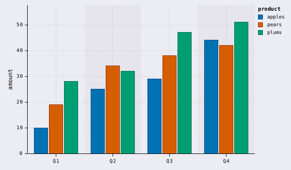
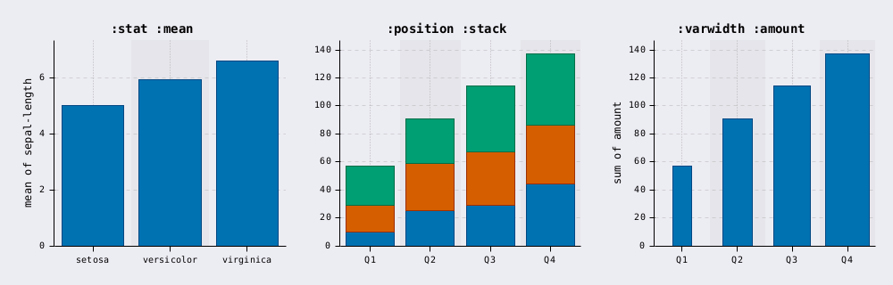
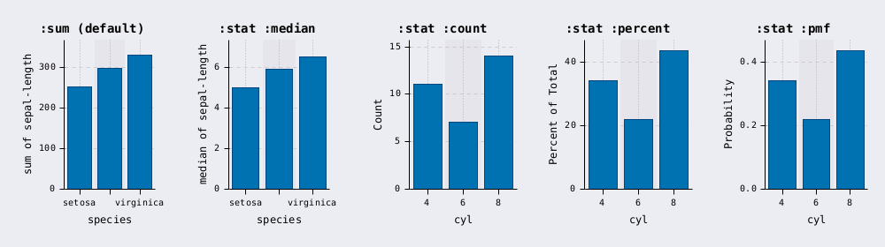
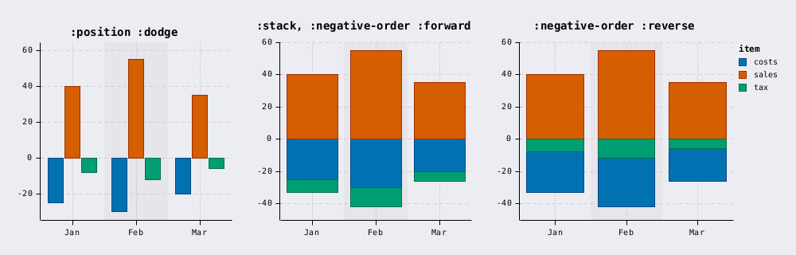
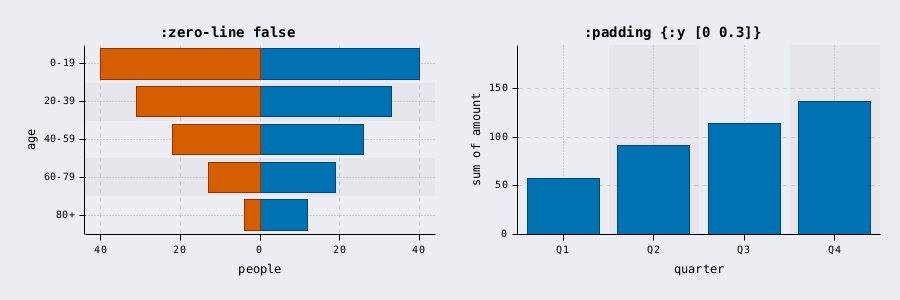
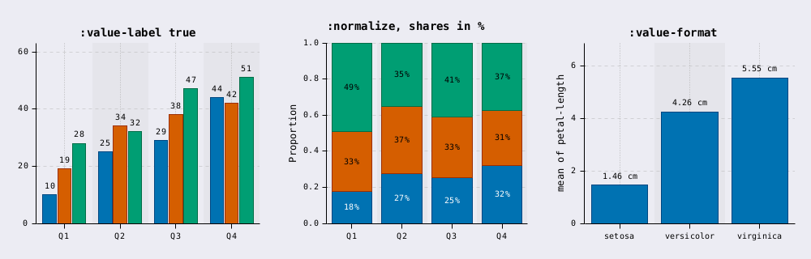
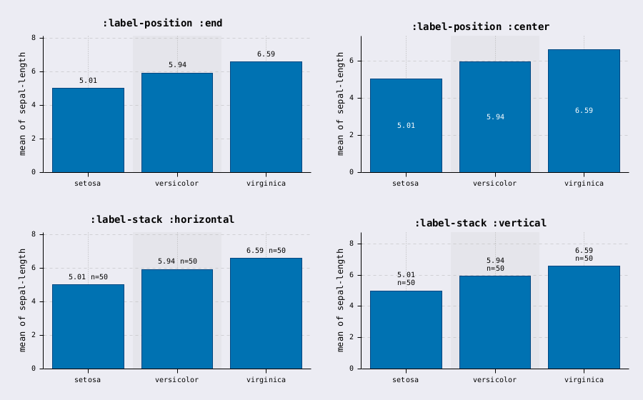

---
format:
  html:
    toc: true
    toc-location: right
    toc-depth: 4
    theme: cosmo
    include-in-header:
      text: |-
        <style>
        .data-table { width: fit-content; max-width: 100%; max-height: 15rem; overflow: auto; margin: 0 0 1rem 0; }
        .data-table .table-responsive { overflow: visible; }
        .data-table table { font-size: 0.75rem; width: auto; margin: 0; }
        .data-table th, .data-table td { padding: 0.1rem 0.45rem !important; white-space: nowrap; }
        .data-table thead th { position: sticky; top: 0; background: var(--bs-body-bg, #fff); }
        .options { margin: 0.5rem 0 1rem 0; }
        .options .option-card { margin: 0 0 0.9rem 0; border: 1px solid var(--bs-border-color, #dee2e6); border-radius: 0.375rem; overflow: hidden; }
        .options dt { display: flex; flex-wrap: wrap; align-items: baseline; gap: 0.1rem 1rem; margin: 0; padding: 0.4rem 0.75rem; background: #eef2f7; border-bottom: 1px solid var(--bs-border-color, #dee2e6); font-weight: normal; }
        .options dt > code { font-weight: 700; font-size: 1rem; background: none; padding: 0; }
        .options .option-default { font-size: 0.85rem; color: var(--bs-secondary-color, #6c757d); }
        .options dd { margin: 0; padding: 0.5rem 0.75rem; }
        .options .option-example { font-size: 0.85rem; padding: 0 0 0.45rem 0; margin-bottom: 0.45rem; border-bottom: 1px dashed var(--bs-border-color, #dee2e6); }
        .options .option-example code { background: none; padding: 0; }
        .options .option-text ul { margin: 0.3rem 0 0 0; padding-left: 1.25rem; }
        .options code, .mapping code { overflow-wrap: anywhere; }
        .mapping { margin: 0.5rem 0 1rem 0; padding: 0.5rem 0.75rem; border: 1px solid var(--bs-border-color, #dee2e6); border-left: 0.3rem solid #2780e3; border-radius: 0.375rem; background: #f5f8fc; }
        .mapping-title { font-weight: 700; margin-bottom: 0.25rem; }
        .mapping-hint { font-weight: normal; font-size: 0.85rem; color: var(--bs-secondary-color, #6c757d); }
        .mapping ul { margin: 0; padding-left: 1.25rem; }
        .mapping .required { font-size: 0.75rem; padding: 0 0.3rem; border: 1px solid currentColor; border-radius: 0.25rem; }
        .shared { margin: 0.5rem 0 1rem 0; padding: 0.5rem 0.75rem; border: 1px solid var(--bs-border-color, #dee2e6); border-left: 0.3rem solid #6c757d; border-radius: 0.375rem; background: #f6f6f6; }
        .shared-title { font-weight: 700; margin-bottom: 0.25rem; }
        .shared-hint { font-weight: normal; font-size: 0.85rem; color: var(--bs-secondary-color, #6c757d); }
        .shared ul { margin: 0; padding-left: 1.25rem; }
        .shared code { overflow-wrap: anywhere; }
        </style>
code-block-background: true

---
<style></style><style>.printedClojure .sourceCode {
  background-color: transparent;
  border-style: none;
}
</style><style>.clay-limit-image-width .clay-image {max-width: 100%}
.clay-side-by-side .sourceCode {margin: 0}
.clay-side-by-side {margin: 1em 0}
</style>
<script src="https://code.jquery.com/jquery-3.6.0.min.js" type="text/javascript"></script><script src="https://code.jquery.com/ui/1.13.1/jquery-ui.min.js" type="text/javascript"></script>

# Bars

These charts draw bars along a categorical axis: a summary of each level's values (`bar`) or a measure against
qualitative ranges and targets (`bullet`). Use them to compare amounts across levels.


::: {.sourceClojure}
```clojure
(ns reference.charts-bars
  (:require [cljplot2.chart :as chart]
            [cljplot2.core :as plot]
            [cljplot2.data.levels :as levels]
            [cljplot2.describe :as describe]
            [notebook-utils :as nu]))
```
:::


Data: Edgar Anderson's iris measurements, R datasets package `iris` (Anderson 1935; Fisher 1936); licence: Part of R (GPL-2 | GPL-3).


::: {.sourceClojure}
```clojure
(def iris (nu/dataset :iris))
```
:::


```{=html}
<div class="data-table"><table class="table table-hover table-responsive clay-table"><thead><tr><th>sepal-length</th><th>sepal-width</th><th>petal-length</th><th>petal-width</th><th>species</th></tr></thead><tbody><tr><td>5.1</td><td>3.5</td><td>1.4</td><td>0.2</td><td>setosa</td></tr><tr><td>4.9</td><td>3</td><td>1.4</td><td>0.2</td><td>setosa</td></tr><tr><td>4.7</td><td>3.2</td><td>1.3</td><td>0.2</td><td>setosa</td></tr><tr><td>4.6</td><td>3.1</td><td>1.5</td><td>0.2</td><td>setosa</td></tr><tr><td>5</td><td>3.6</td><td>1.4</td><td>0.2</td><td>setosa</td></tr><tr><td>5.4</td><td>3.9</td><td>1.7</td><td>0.4</td><td>setosa</td></tr><tr><td>4.6</td><td>3.4</td><td>1.4</td><td>0.3</td><td>setosa</td></tr><tr><td>5</td><td>3.4</td><td>1.5</td><td>0.2</td><td>setosa</td></tr><tr><td>4.4</td><td>2.9</td><td>1.4</td><td>0.2</td><td>setosa</td></tr><tr><td>4.9</td><td>3.1</td><td>1.5</td><td>0.1</td><td>setosa</td></tr><tr><td>5.4</td><td>3.7</td><td>1.5</td><td>0.2</td><td>setosa</td></tr><tr><td>4.8</td><td>3.4</td><td>1.6</td><td>0.2</td><td>setosa</td></tr><tr><td>4.8</td><td>3</td><td>1.4</td><td>0.1</td><td>setosa</td></tr><tr><td>4.3</td><td>3</td><td>1.1</td><td>0.1</td><td>setosa</td></tr><tr><td>5.8</td><td>4</td><td>1.2</td><td>0.2</td><td>setosa</td></tr><tr><td>5.7</td><td>4.4</td><td>1.5</td><td>0.4</td><td>setosa</td></tr><tr><td>5.4</td><td>3.9</td><td>1.3</td><td>0.4</td><td>setosa</td></tr><tr><td>5.1</td><td>3.5</td><td>1.4</td><td>0.3</td><td>setosa</td></tr><tr><td>5.7</td><td>3.8</td><td>1.7</td><td>0.3</td><td>setosa</td></tr><tr><td>5.1</td><td>3.8</td><td>1.5</td><td>0.3</td><td>setosa</td></tr><tr><td>5.4</td><td>3.4</td><td>1.7</td><td>0.2</td><td>setosa</td></tr><tr><td>5.1</td><td>3.7</td><td>1.5</td><td>0.4</td><td>setosa</td></tr><tr><td>4.6</td><td>3.6</td><td>1</td><td>0.2</td><td>setosa</td></tr><tr><td>5.1</td><td>3.3</td><td>1.7</td><td>0.5</td><td>setosa</td></tr><tr><td>4.8</td><td>3.4</td><td>1.9</td><td>0.2</td><td>setosa</td></tr><tr><td>5</td><td>3</td><td>1.6</td><td>0.2</td><td>setosa</td></tr><tr><td>5</td><td>3.4</td><td>1.6</td><td>0.4</td><td>setosa</td></tr><tr><td>5.2</td><td>3.5</td><td>1.5</td><td>0.2</td><td>setosa</td></tr><tr><td>5.2</td><td>3.4</td><td>1.4</td><td>0.2</td><td>setosa</td></tr><tr><td>4.7</td><td>3.2</td><td>1.6</td><td>0.2</td><td>setosa</td></tr><tr><td>4.8</td><td>3.1</td><td>1.6</td><td>0.2</td><td>setosa</td></tr><tr><td>5.4</td><td>3.4</td><td>1.5</td><td>0.4</td><td>setosa</td></tr><tr><td>5.2</td><td>4.1</td><td>1.5</td><td>0.1</td><td>setosa</td></tr><tr><td>5.5</td><td>4.2</td><td>1.4</td><td>0.2</td><td>setosa</td></tr><tr><td>4.9</td><td>3.1</td><td>1.5</td><td>0.2</td><td>setosa</td></tr><tr><td>5</td><td>3.2</td><td>1.2</td><td>0.2</td><td>setosa</td></tr><tr><td>5.5</td><td>3.5</td><td>1.3</td><td>0.2</td><td>setosa</td></tr><tr><td>4.9</td><td>3.6</td><td>1.4</td><td>0.1</td><td>setosa</td></tr><tr><td>4.4</td><td>3</td><td>1.3</td><td>0.2</td><td>setosa</td></tr><tr><td>5.1</td><td>3.4</td><td>1.5</td><td>0.2</td><td>setosa</td></tr><tr><td>5</td><td>3.5</td><td>1.3</td><td>0.3</td><td>setosa</td></tr><tr><td>4.5</td><td>2.3</td><td>1.3</td><td>0.3</td><td>setosa</td></tr><tr><td>4.4</td><td>3.2</td><td>1.3</td><td>0.2</td><td>setosa</td></tr><tr><td>5</td><td>3.5</td><td>1.6</td><td>0.6</td><td>setosa</td></tr><tr><td>5.1</td><td>3.8</td><td>1.9</td><td>0.4</td><td>setosa</td></tr><tr><td>4.8</td><td>3</td><td>1.4</td><td>0.3</td><td>setosa</td></tr><tr><td>5.1</td><td>3.8</td><td>1.6</td><td>0.2</td><td>setosa</td></tr><tr><td>4.6</td><td>3.2</td><td>1.4</td><td>0.2</td><td>setosa</td></tr><tr><td>5.3</td><td>3.7</td><td>1.5</td><td>0.2</td><td>setosa</td></tr><tr><td>5</td><td>3.3</td><td>1.4</td><td>0.2</td><td>setosa</td></tr><tr><td>7</td><td>3.2</td><td>4.7</td><td>1.4</td><td>versicolor</td></tr><tr><td>6.4</td><td>3.2</td><td>4.5</td><td>1.5</td><td>versicolor</td></tr><tr><td>6.9</td><td>3.1</td><td>4.9</td><td>1.5</td><td>versicolor</td></tr><tr><td>5.5</td><td>2.3</td><td>4</td><td>1.3</td><td>versicolor</td></tr><tr><td>6.5</td><td>2.8</td><td>4.6</td><td>1.5</td><td>versicolor</td></tr><tr><td>5.7</td><td>2.8</td><td>4.5</td><td>1.3</td><td>versicolor</td></tr><tr><td>6.3</td><td>3.3</td><td>4.7</td><td>1.6</td><td>versicolor</td></tr><tr><td>4.9</td><td>2.4</td><td>3.3</td><td>1</td><td>versicolor</td></tr><tr><td>6.6</td><td>2.9</td><td>4.6</td><td>1.3</td><td>versicolor</td></tr><tr><td>5.2</td><td>2.7</td><td>3.9</td><td>1.4</td><td>versicolor</td></tr><tr><td>5</td><td>2</td><td>3.5</td><td>1</td><td>versicolor</td></tr><tr><td>5.9</td><td>3</td><td>4.2</td><td>1.5</td><td>versicolor</td></tr><tr><td>6</td><td>2.2</td><td>4</td><td>1</td><td>versicolor</td></tr><tr><td>6.1</td><td>2.9</td><td>4.7</td><td>1.4</td><td>versicolor</td></tr><tr><td>5.6</td><td>2.9</td><td>3.6</td><td>1.3</td><td>versicolor</td></tr><tr><td>6.7</td><td>3.1</td><td>4.4</td><td>1.4</td><td>versicolor</td></tr><tr><td>5.6</td><td>3</td><td>4.5</td><td>1.5</td><td>versicolor</td></tr><tr><td>5.8</td><td>2.7</td><td>4.1</td><td>1</td><td>versicolor</td></tr><tr><td>6.2</td><td>2.2</td><td>4.5</td><td>1.5</td><td>versicolor</td></tr><tr><td>5.6</td><td>2.5</td><td>3.9</td><td>1.1</td><td>versicolor</td></tr><tr><td>5.9</td><td>3.2</td><td>4.8</td><td>1.8</td><td>versicolor</td></tr><tr><td>6.1</td><td>2.8</td><td>4</td><td>1.3</td><td>versicolor</td></tr><tr><td>6.3</td><td>2.5</td><td>4.9</td><td>1.5</td><td>versicolor</td></tr><tr><td>6.1</td><td>2.8</td><td>4.7</td><td>1.2</td><td>versicolor</td></tr><tr><td>6.4</td><td>2.9</td><td>4.3</td><td>1.3</td><td>versicolor</td></tr><tr><td>6.6</td><td>3</td><td>4.4</td><td>1.4</td><td>versicolor</td></tr><tr><td>6.8</td><td>2.8</td><td>4.8</td><td>1.4</td><td>versicolor</td></tr><tr><td>6.7</td><td>3</td><td>5</td><td>1.7</td><td>versicolor</td></tr><tr><td>6</td><td>2.9</td><td>4.5</td><td>1.5</td><td>versicolor</td></tr><tr><td>5.7</td><td>2.6</td><td>3.5</td><td>1</td><td>versicolor</td></tr><tr><td>5.5</td><td>2.4</td><td>3.8</td><td>1.1</td><td>versicolor</td></tr><tr><td>5.5</td><td>2.4</td><td>3.7</td><td>1</td><td>versicolor</td></tr><tr><td>5.8</td><td>2.7</td><td>3.9</td><td>1.2</td><td>versicolor</td></tr><tr><td>6</td><td>2.7</td><td>5.1</td><td>1.6</td><td>versicolor</td></tr><tr><td>5.4</td><td>3</td><td>4.5</td><td>1.5</td><td>versicolor</td></tr><tr><td>6</td><td>3.4</td><td>4.5</td><td>1.6</td><td>versicolor</td></tr><tr><td>6.7</td><td>3.1</td><td>4.7</td><td>1.5</td><td>versicolor</td></tr><tr><td>6.3</td><td>2.3</td><td>4.4</td><td>1.3</td><td>versicolor</td></tr><tr><td>5.6</td><td>3</td><td>4.1</td><td>1.3</td><td>versicolor</td></tr><tr><td>5.5</td><td>2.5</td><td>4</td><td>1.3</td><td>versicolor</td></tr><tr><td>5.5</td><td>2.6</td><td>4.4</td><td>1.2</td><td>versicolor</td></tr><tr><td>6.1</td><td>3</td><td>4.6</td><td>1.4</td><td>versicolor</td></tr><tr><td>5.8</td><td>2.6</td><td>4</td><td>1.2</td><td>versicolor</td></tr><tr><td>5</td><td>2.3</td><td>3.3</td><td>1</td><td>versicolor</td></tr><tr><td>5.6</td><td>2.7</td><td>4.2</td><td>1.3</td><td>versicolor</td></tr><tr><td>5.7</td><td>3</td><td>4.2</td><td>1.2</td><td>versicolor</td></tr><tr><td>5.7</td><td>2.9</td><td>4.2</td><td>1.3</td><td>versicolor</td></tr><tr><td>6.2</td><td>2.9</td><td>4.3</td><td>1.3</td><td>versicolor</td></tr><tr><td>5.1</td><td>2.5</td><td>3</td><td>1.1</td><td>versicolor</td></tr><tr><td>5.7</td><td>2.8</td><td>4.1</td><td>1.3</td><td>versicolor</td></tr><tr><td>…</td><td>…</td><td>…</td><td>…</td><td>…</td></tr></tbody></table></div>
```


::: {.sourceClojure}
```clojure
(def sales (for [[qi q] (map-indexed vector ["Q1" "Q2" "Q3" "Q4"]) [i product] (map-indexed vector ["apples" "pears" "plums"])]
             {:quarter q :product product :amount (+ 10 (* 6 i) (* 8 qi) (mod (* 7 (+ qi (* 2 i))) 11))}))
```
:::


```{=html}
<div class="data-table"><table class="table table-hover table-responsive clay-table"><thead><tr><th>quarter</th><th>product</th><th>amount</th></tr></thead><tbody><tr><td>Q1</td><td>apples</td><td>10</td></tr><tr><td>Q1</td><td>pears</td><td>19</td></tr><tr><td>Q1</td><td>plums</td><td>28</td></tr><tr><td>Q2</td><td>apples</td><td>25</td></tr><tr><td>Q2</td><td>pears</td><td>34</td></tr><tr><td>Q2</td><td>plums</td><td>32</td></tr><tr><td>Q3</td><td>apples</td><td>29</td></tr><tr><td>Q3</td><td>pears</td><td>38</td></tr><tr><td>Q3</td><td>plums</td><td>47</td></tr><tr><td>Q4</td><td>apples</td><td>44</td></tr><tr><td>Q4</td><td>pears</td><td>42</td></tr><tr><td>Q4</td><td>plums</td><td>51</td></tr></tbody></table></div>
```


Data: Motor Trend car road tests (1974), R datasets package `mtcars` (Henderson & Velleman 1981); licence: Part of R (GPL-2 | GPL-3).


::: {.sourceClojure}
```clojure
(def mtcars-cyl (map #(select-keys % [:model :cyl]) (nu/dataset :mtcars)))
```
:::


```{=html}
<div class="data-table"><table class="table table-hover table-responsive clay-table"><thead><tr><th>model</th><th>cyl</th></tr></thead><tbody><tr><td>Mazda RX4</td><td>6</td></tr><tr><td>Mazda RX4 Wag</td><td>6</td></tr><tr><td>Datsun 710</td><td>4</td></tr><tr><td>Hornet 4 Drive</td><td>6</td></tr><tr><td>Hornet Sportabout</td><td>8</td></tr><tr><td>Valiant</td><td>6</td></tr><tr><td>Duster 360</td><td>8</td></tr><tr><td>Merc 240D</td><td>4</td></tr><tr><td>Merc 230</td><td>4</td></tr><tr><td>Merc 280</td><td>6</td></tr><tr><td>Merc 280C</td><td>6</td></tr><tr><td>Merc 450SE</td><td>8</td></tr><tr><td>Merc 450SL</td><td>8</td></tr><tr><td>Merc 450SLC</td><td>8</td></tr><tr><td>Cadillac Fleetwood</td><td>8</td></tr><tr><td>Lincoln Continental</td><td>8</td></tr><tr><td>Chrysler Imperial</td><td>8</td></tr><tr><td>Fiat 128</td><td>4</td></tr><tr><td>Honda Civic</td><td>4</td></tr><tr><td>Toyota Corolla</td><td>4</td></tr><tr><td>Toyota Corona</td><td>4</td></tr><tr><td>Dodge Challenger</td><td>8</td></tr><tr><td>AMC Javelin</td><td>8</td></tr><tr><td>Camaro Z28</td><td>8</td></tr><tr><td>Pontiac Firebird</td><td>8</td></tr><tr><td>Fiat X1-9</td><td>4</td></tr><tr><td>Porsche 914-2</td><td>4</td></tr><tr><td>Lotus Europa</td><td>4</td></tr><tr><td>Ford Pantera L</td><td>8</td></tr><tr><td>Ferrari Dino</td><td>6</td></tr><tr><td>Maserati Bora</td><td>8</td></tr><tr><td>Volvo 142E</td><td>4</td></tr></tbody></table></div>
```


## Bar charts

`chart/bar` draws a bar per level and group; by default its length is the sum of its rows' values, and it can also
summarise or count the rows. Use it to compare amounts across categories. Levels on x give vertical bars, levels
on y horizontal ones.


```{=html}
<div class="shared"><div class="shared-title">Shared options<span class="shared-hint"> – groups of options other charts take too</span></div><ul><li><a href="reference.shared_options.html#fill-patterns">Fill patterns</a> – <code>:pattern</code> <code>:pattern-color</code></li><li><a href="reference.shared_options.html#common-options">Common options</a> – <code>:data</code> <code>:mapping</code> <code>:legend</code></li><li><a href="reference.shared_options.html#named-theme-styles">Named theme styles</a> – <code>:theme-style</code></li><li><a href="reference.shared_options.html#strip-options">Strip options</a> – <code>:place</code> <code>:width</code> <code>:thickness</code> <code>:dodge-gap</code> <code>:bottom-share</code> <code>:n-label</code> <code>:n-format</code> <code>:level-axis</code></li><li><a href="reference.shared_options.html#mirrored-strips">Mirrored strips</a> – <code>:mirror</code></li><li><a href="reference.shared_options.html#rounded-corners">Rounded corners</a> – <code>:corner-radius</code> <code>:corner-radius-end</code></li></ul></div>
```


```{=html}
<div class="mapping"><div class="mapping-title">Mapping<span class="mapping-hint"> – the row values the chart reads, under <code>:mapping</code></span></div><ul><li><code>:x</code> – The levels of vertical bars, or the values of horizontal ones.</li><li><code>:y</code> – The values of vertical bars, or the levels of horizontal ones.</li><li><code>:color</code> – Fills the bars: categorical values split the rows into groups, each with its own fill; numbers colour each bar by its value, with a colour bar.</li><li><code>:pattern</code> – Splits the rows into groups, each with its own fill pattern.</li><li><code>:group</code> – Splits the rows into groups that look the same, dodged, stacked or mirrored as other groups.</li></ul></div>
```


::: {.sourceClojure}
```clojure
(plot/render-image {:data sales
                    :mapping {:x :quarter :y :amount :color :product}
                    :charts [(chart/bar)]
                    :labels {:y "amount"}}
                   {:width 600 :height 350})
```
:::


::: {.clay-image}

:::


### Style

These options set the fill and outline of unmapped bars, the opacity of overlaid groups and the 0 line over
mirrored bars (`:mirror`, see [Mirrored strips](reference.shared_options.html#mirrored-strips)):


```{=html}
<dl class="options"><div class="option-card"><dt><code>:color</code><span class="option-default">Default: <code>[0 114 178]</code> (theme)</span></dt><dd><div class="option-example"><code>(chart/bar {:color :orange})</code></div><div class="option-text">The fill colour of the bars; a mapped <code>:color</code> wins.<ul><li><a href="reference.types.html#solid-colour">solid colour</a></li></ul></div></dd></div><div class="option-card"><dt><code>:stroke-color</code><span class="option-default">Default: <code>:darker</code> (theme)</span></dt><dd><div class="option-example"><code>(chart/bar {:stroke-color :none})</code></div><div class="option-text">The outline colour of the bars.<ul><li><code>:darker</code> – The fill colour, darkened.</li><li><code>:none</code> – No outline.</li><li><a href="reference.types.html#solid-colour">solid colour</a> – Any other colour, e.g. <code>:black</code>.</li></ul></div></dd></div><div class="option-card"><dt><code>:stroke-width</code><span class="option-default">Default: <code>1</code> (theme)</span></dt><dd><div class="option-example"><code>(chart/bar {:stroke-width 3})</code></div><div class="option-text">The outline width in pixels; <code>0</code> draws no outline.<ul><li><a href="reference.types.html#non-negative-number">non-negative number</a></li></ul></div></dd></div><div class="option-card"><dt><code>:alpha</code><span class="option-default">Default: <code>0.6</code> (theme)</span></dt><dd><div class="option-example"><code>(chart/bar {:position :overlay, :alpha 0.2})</code></div><div class="option-text">The opacity of the fill with <code>:position :overlay</code> when some level holds two or more groups; then every bar is see-through, its legend key too.<ul><li><a href="reference.types.html#fraction">fraction</a></li></ul></div></dd></div><div class="option-card"><dt><code>:zero-line-color</code><span class="option-default">Default: <code>:black</code> (theme)</span></dt><dd><div class="option-example"><code>(chart/bar {:mirror :group, :zero-line-color :none})</code></div><div class="option-text">The colour of the 0 line drawn over mirrored bars.<ul><li><code>:none</code> – No line.</li><li><a href="reference.types.html#solid-colour">solid colour</a> – Any other colour, e.g. <code>:black</code>.</li></ul></div></dd></div><div class="option-card"><dt><code>:zero-line-width</code><span class="option-default">Default: <code>1</code> (theme)</span></dt><dd><div class="option-example"><code>(chart/bar {:mirror :group, :zero-line-width 4})</code></div><div class="option-text">The width of the 0 line over mirrored bars, in pixels.<ul><li><a href="reference.types.html#non-negative-number">non-negative number</a></li></ul></div></dd></div></dl>
```


::: {.sourceClojure}
```clojure
(def pyramid (for [[i age] (map-indexed vector ["0-19" "20-39" "40-59" "60-79" "80+"])
                   sex ["female" "male"]]
               {:age age :sex sex :people (- 40 (* 7 i) (if (= sex "male") (* 2 i) 0))}))
```
:::


```{=html}
<div class="data-table"><table class="table table-hover table-responsive clay-table"><thead><tr><th>age</th><th>sex</th><th>people</th></tr></thead><tbody><tr><td>0-19</td><td>female</td><td>40</td></tr><tr><td>0-19</td><td>male</td><td>40</td></tr><tr><td>20-39</td><td>female</td><td>33</td></tr><tr><td>20-39</td><td>male</td><td>31</td></tr><tr><td>40-59</td><td>female</td><td>26</td></tr><tr><td>40-59</td><td>male</td><td>22</td></tr><tr><td>60-79</td><td>female</td><td>19</td></tr><tr><td>60-79</td><td>male</td><td>13</td></tr><tr><td>80+</td><td>female</td><td>12</td></tr><tr><td>80+</td><td>male</td><td>4</td></tr></tbody></table></div>
```


::: {.sourceClojure}
```clojure
(plot/render-image (plot/arrange [{:data sales
                                   :mapping {:x :quarter :y :amount}
                                   :charts [(chart/bar {:color [230 160 60] :stroke-color :black :stroke-width 2})]
                                   :labels {:title "fill and outline"}}
                                  {:data sales
                                   :mapping {:x :quarter :y :amount :color :product}
                                   :charts [(chart/bar {:position :overlay :alpha 0.35})]
                                   :labels {:title ":overlay, :alpha 0.35"}
                                   :legend false}
                                  {:data pyramid
                                   :mapping {:x :people :y :age :color :sex}
                                   :charts [(chart/bar {:mirror :color :zero-line-color :red :zero-line-width 3})]
                                   :scales {:y {:reverse true}}
                                   :labels {:title "mirrored, red 0 line"}}]
                                 {:columns 3 :widths [1 1 1.3]})
                   {:width 1000 :height 320})
```
:::


::: {.clay-image}

:::


### Bars

These options set the bars' length, colour value and width, how the groups of a level share its band, and the
padding:


```{=html}
<dl class="options"><div class="option-card"><dt><code>:stat</code><span class="option-default">Default: <code>:sum</code></span></dt><dd><div class="option-example"><code>(chart/bar {:stat :count})</code></div><div class="option-text">How each bar's length comes from its rows.<ul><li><code>:sum</code> – The sum of the values; one row per bar gives its value.</li><li><code>:count</code> – The number of rows; the bars need no values.</li><li><code>:mean</code> – The mean of the values.</li><li><code>:median</code> – The median of the values.</li><li><code>:percent</code> – The rows' share of their group's rows in the panel, in percent.</li><li><code>:pmf</code> – The rows' share of their group's rows in the panel, as a fraction.</li><li><a href="reference.types.html#function">function</a> – A function of the values that returns a finite number.</li></ul></div></dd></div><div class="option-card"><dt><code>:color-stat</code><span class="option-default">Default: The bar's <code>:stat</code>; <code>:mean</code> for a count.</span></dt><dd><div class="option-example"><code>(chart/bar {:mapping {:color :v}, :color-stat :mean})</code></div><div class="option-text">How a bar's colour value comes from its rows when the mapped <code>:color</code> holds numbers.<ul><li><code>:mean</code> – The mean of the colour values.</li><li><code>:median</code> – The median of the colour values.</li><li><code>:sum</code> – The sum of the colour values.</li><li><a href="reference.types.html#function">function</a> – A function of the colour values that returns a number.</li></ul></div></dd></div><div class="option-card"><dt><code>:position</code><span class="option-default">Default: <code>:dodge</code> when a level holds two or more groups, else <code>:overlay</code>.</span></dt><dd><div class="option-example"><code>(chart/bar {:position :stack})</code></div><div class="option-text">How the groups of one level share its band.<ul><li><code>:dodge</code> – Side by side.</li><li><code>:normalize</code> – End to end, each level summing to 1.</li><li><code>:overlay</code> – On top of each other, see-through by <code>:alpha</code> when a level holds two or more groups.</li><li><code>:stack</code> – End to end, in group order; negative bars stack the other way from 0.</li></ul></div></dd></div><div class="option-card"><dt><code>:zero-line</code><span class="option-default">Default: <code>true</code></span></dt><dd><div class="option-example"><code>(chart/bar {:mirror :group, :zero-line false})</code></div><div class="option-text">Draws the 0 line over mirrored bars.<ul><li><code>true</code> – Draws the line.</li><li><code>false</code> – Draws no line.</li></ul></div></dd></div><div class="option-card"><dt><code>:varwidth</code><span class="option-default">Default: <code>false</code></span></dt><dd><div class="option-example"><code>(chart/bar {:varwidth true})</code></div><div class="option-text">How wide each bar is relative to the widest one.<ul><li><code>false</code> – Every bar equally wide.</li><li><code>true</code> – By the square root of each bar's count of values.</li><li><a href="reference.types.html#accessor">accessor</a> – By each bar's sum of this row value, e.g. <code>:weight</code>.</li></ul></div></dd></div><div class="option-card"><dt><code>:negative-order</code><span class="option-default">Default: <code>:forward</code></span></dt><dd><div class="option-example"><code>(chart/bar {:position :stack, :negative-order :reverse})</code></div><div class="option-text">The order of the stacked groups below 0.<ul><li><code>:forward</code> – The group order.</li><li><code>:reverse</code> – The last group nearest 0, so the groups of an ordered scale diverge from the middle, as in Likert charts.</li></ul></div></dd></div><div class="option-card"><dt><code>:padding</code><span class="option-default">Default: <code>0.05</code> on the values' axis, none at the side the bars grow from, none for <code>:normalize</code>.</span></dt><dd><div class="option-example"><code>(chart/bar {:padding {:y [0 0.3]}})</code></div><div class="option-text">Room around the data on x and y, as fractions of the data span.<ul><li><span>map of <code>:x</code> or <code>:y</code> to padding</span></li></ul></div></dd></div></dl>
```


::: {.sourceClojure}
```clojure
(plot/render-image (plot/arrange [{:data iris
                                   :mapping {:x :species :y :sepal-length}
                                   :charts [(chart/bar {:stat :mean})]
                                   :labels {:title ":stat :mean"}}
                                  {:data sales
                                   :mapping {:x :quarter :y :amount :color :product}
                                   :charts [(chart/bar {:position :stack})]
                                   :labels {:title ":position :stack"}
                                   :legend false}
                                  {:data sales
                                   :mapping {:x :quarter :y :amount}
                                   :charts [(chart/bar {:varwidth :amount})]
                                   :labels {:title ":varwidth :amount"}}]
                                 {:columns 3})
                   {:width 1000 :height 320})
```
:::


::: {.clay-image}

:::


Each `:stat` in turn: on the left, summaries of the iris sepal lengths; on the right, counts of the cars per
number of cylinders:


::: {.sourceClojure}
```clojure
(plot/render-image (plot/arrange [{:data iris
                                   :mapping {:x :species :y :sepal-length}
                                   :charts [(chart/bar)]
                                   :labels {:title ":sum (default)"}}
                                  {:data iris
                                   :mapping {:x :species :y :sepal-length}
                                   :charts [(chart/bar {:stat :median})]
                                   :labels {:title ":stat :median"}}
                                  {:data mtcars-cyl
                                   :mapping {:x (levels/categorical :cyl)}
                                   :charts [(chart/bar {:stat :count})]
                                   :labels {:title ":stat :count"}}
                                  {:data mtcars-cyl
                                   :mapping {:x (levels/categorical :cyl)}
                                   :charts [(chart/bar {:stat :percent})]
                                   :labels {:title ":stat :percent"}}
                                  {:data mtcars-cyl
                                   :mapping {:x (levels/categorical :cyl)}
                                   :charts [(chart/bar {:stat :pmf})]
                                   :labels {:title ":stat :pmf"}}]
                                 {:columns 5})
                   {:width 1000 :height 280})
```
:::


::: {.clay-image}

:::


The first image draws a balance side by side, then stacked: with negative values a stack grows both ways from 0,
and `:negative-order :reverse` puts the last group nearest 0. The second image draws mirrored bars without their 0
line (left) and leaves 30% past the longest bar with `:padding` (right):


::: {.sourceClojure}
```clojure
(def balance [{:month "Jan" :item "sales" :eur 40} {:month "Jan" :item "costs" :eur -25} {:month "Jan" :item "tax" :eur -8}
              {:month "Feb" :item "sales" :eur 55} {:month "Feb" :item "costs" :eur -30} {:month "Feb" :item "tax" :eur -12}
              {:month "Mar" :item "sales" :eur 35} {:month "Mar" :item "costs" :eur -20} {:month "Mar" :item "tax" :eur -6}])
```
:::


```{=html}
<div class="data-table"><table class="table table-hover table-responsive clay-table"><thead><tr><th>month</th><th>item</th><th>eur</th></tr></thead><tbody><tr><td>Jan</td><td>sales</td><td>40</td></tr><tr><td>Jan</td><td>costs</td><td>-25</td></tr><tr><td>Jan</td><td>tax</td><td>-8</td></tr><tr><td>Feb</td><td>sales</td><td>55</td></tr><tr><td>Feb</td><td>costs</td><td>-30</td></tr><tr><td>Feb</td><td>tax</td><td>-12</td></tr><tr><td>Mar</td><td>sales</td><td>35</td></tr><tr><td>Mar</td><td>costs</td><td>-20</td></tr><tr><td>Mar</td><td>tax</td><td>-6</td></tr></tbody></table></div>
```


::: {.sourceClojure}
```clojure
(plot/render-image (plot/arrange [{:data balance
                                   :mapping {:x :month :y :eur :color :item}
                                   :charts [(chart/bar {:position :dodge})]
                                   :labels {:title ":position :dodge"}
                                   :legend false}
                                  {:data balance
                                   :mapping {:x :month :y :eur :color :item}
                                   :charts [(chart/bar {:position :stack :negative-order :forward})]
                                   :labels {:title ":stack, :negative-order :forward"}
                                   :legend false}
                                  {:data balance
                                   :mapping {:x :month :y :eur :color :item}
                                   :charts [(chart/bar {:position :stack :negative-order :reverse})]
                                   :labels {:title ":negative-order :reverse"}}]
                                 {:columns 3 :widths [1 1 1.3]})
                   {:width 1000 :height 320})
```
:::


::: {.clay-image}

:::


::: {.sourceClojure}
```clojure
(plot/render-image (plot/arrange [{:data pyramid
                                   :mapping {:x :people :y :age :color :sex}
                                   :charts [(chart/bar {:mirror :color :zero-line false})]
                                   :scales {:y {:reverse true}}
                                   :labels {:title ":zero-line false"}
                                   :legend false}
                                  {:data sales
                                   :mapping {:x :quarter :y :amount}
                                   :charts [(chart/bar {:padding {:y [0 0.3]}})]
                                   :labels {:title ":padding {:y [0 0.3]}"}}]
                                 {:columns 2})
                   {:width 900 :height 300})
```
:::


::: {.clay-image}

:::


A numeric `:color` doesn't group the bars: each bar takes its own colour value, shown on a colour bar. On the left
`:color-stat :sum` colours each bar by its length. In the middle each stacked segment takes the mean of its own
rows. On the right the bars count rows and take their colour from a summary of another column:


::: {.sourceClojure}
```clojure
(plot/render-image (plot/arrange [{:data sales
                                   :mapping {:x :quarter :y :amount :color :amount}
                                   :charts [(chart/bar {:color-stat :sum})]
                                   :labels {:title ":color-stat :sum"}}
                                  {:data sales
                                   :mapping {:x :quarter :y :amount :group :product :color :amount}
                                   :charts [(chart/bar {:position :stack :color-stat :mean})]
                                   :labels {:title "stacked, :mean"}}
                                  {:data iris
                                   :mapping {:x :species :color :petal-length}
                                   :charts [(chart/bar {:stat :count :color-stat :median})]
                                   :labels {:title ":count, :median"}}]
                                 {:columns 3})
                   {:width 1000 :height 320})
```
:::


::: {.clay-image}

:::


An explicit colour `:domain` never drops rows: every bar keeps its length, and a bar whose colour value lies
outside the domain takes the NA colour (Q4's mean, 45.7, is above 40). A `:value-label` function reads the
bar's colour value as `:color-value`:


::: {.sourceClojure}
```clojure
(plot/render-image {:data sales
                    :mapping {:x :quarter :y :amount :color :amount}
                    :charts [(chart/bar {:color-stat :mean :value-label #(format "mean %.1f" (:color-value %))})]
                    :scales {:color {:domain [15 40]}}
                    :labels {:title "colour :domain [15 40]"}}
                   {:width 500 :height 320})
```
:::


::: {.clay-image}

:::


### Labels

These options turn on a label at each bar, set its text and place it:


```{=html}
<dl class="options"><div class="option-card"><dt><code>:label-stack</code><span class="option-default">Default: Along the bars: side by side for horizontal bars, one above the other for vertical ones.</span></dt><dd><div class="option-example"><code>(chart/bar {:value-label true, :n-label true, :label-stack :horizontal})</code></div><div class="option-text">How the value text and the n text of one label sit together when both <code>:value-label</code> and <code>:n-label</code> are on.<ul><li><code>:horizontal</code> – Side by side.</li><li><code>:vertical</code> – One above the other.</li></ul></div></dd></div><div class="option-card"><dt><code>:value-label</code><span class="option-default">Default: <code>false</code></span></dt><dd><div class="option-example"><code>(chart/bar {:value-label true})</code></div><div class="option-text">Writes a label at each bar: its length, or the text a function returns.<ul><li><code>false</code> – No labels.</li><li><code>true</code> – The bar's length, signed as its value.</li><li><a href="reference.types.html#function">function</a> – A function of <code>{:value :n :share :level :group}</code> that returns the text, e.g. a share in percent; <code>nil</code> writes none.</li></ul></div></dd></div><div class="option-card"><dt><code>:label-position</code><span class="option-default">Default: <code>:center</code> for <code>:stack</code> and <code>:normalize</code>, else <code>:end</code>.</span></dt><dd><div class="option-example"><code>(chart/bar {:value-label true, :label-position :center})</code></div><div class="option-text">Where the labels sit. The chart leaves out a label inside a bar that doesn't fit there.<ul><li><code>:end</code> – Past the bar's end.</li><li><code>:center</code> – In the middle of the bar.</li><li><code>:base</code> – Inside the bar at the end nearer 0.</li><li><code>:outer</code> – Past the outer radius, in a polar plot only, e.g. pie labels.</li></ul></div></dd></div><div class="option-card"><dt><code>:label-leader</code><span class="option-default">Default: <code>false</code></span></dt><dd><div class="option-example"><code>(chart/bar {:value-label true, :label-position :outer, :label-leader true})</code></div><div class="option-text">In a polar plot, draws a line from each bar's outer edge to its <code>:outer</code> label, which then sits further out.<ul><li><code>false</code> – Draws no lines.</li><li><code>true</code> – Draws the lines.</li></ul></div></dd></div><div class="option-card"><dt><code>:value-format</code><span class="option-default">Default: Whole numbers as integers, else the fewest digits that tell the labels apart.</span></dt><dd><div class="option-example"><code>(chart/bar {:value-label true, :value-format "%.1f"})</code></div><div class="option-text">The text of the value labels: a format string or a function of the number.<ul><li><a href="reference.types.html#number-format">number format</a></li></ul></div></dd></div></dl>
```


::: {.sourceClojure}
```clojure
(plot/render-image (plot/arrange [{:data sales
                                   :mapping {:x :quarter :y :amount :color :product}
                                   :charts [(chart/bar {:value-label true})]
                                   :labels {:title ":value-label true"}
                                   :legend false}
                                  {:data sales
                                   :mapping {:x :quarter :y :amount :color :product}
                                   :charts [(chart/bar {:position :normalize :value-label #(format "%.0f%%" (* 100 (:share %)))})]
                                   :labels {:title ":normalize, shares in %"}
                                   :legend false}
                                  {:data iris
                                   :mapping {:x :species :y :petal-length}
                                   :charts [(chart/bar {:stat :mean :value-label true :value-format "%.2f cm"})]
                                   :labels {:title ":value-format"}}]
                                 {:columns 3})
                   {:width 1000 :height 320})
```
:::


::: {.clay-image}

:::


The first two panels place labels past the bar's end and in its middle; the last two join a value and a row count
(`:n-label`) side by side and one above the other:


::: {.sourceClojure}
```clojure
(plot/render-image (plot/arrange [{:data iris
                                   :mapping {:x :species :y :sepal-length}
                                   :charts [(chart/bar {:stat :mean :value-label true :label-position :end})]
                                   :labels {:title ":label-position :end"}}
                                  {:data iris
                                   :mapping {:x :species :y :sepal-length}
                                   :charts [(chart/bar {:stat :mean :value-label true :label-position :center})]
                                   :labels {:title ":label-position :center"}}
                                  {:data iris
                                   :mapping {:x :species :y :sepal-length}
                                   :charts [(chart/bar {:stat :mean :value-label true :n-label true
                                                        :label-stack :horizontal})]
                                   :labels {:title ":label-stack :horizontal"}}
                                  {:data iris
                                   :mapping {:x :species :y :sepal-length}
                                   :charts [(chart/bar {:stat :mean :value-label true :n-label true
                                                        :label-stack :vertical})]
                                   :labels {:title ":label-stack :vertical"}}]
                                 {:columns 2})
                   {:width 900 :height 560})
```
:::


::: {.clay-image}

:::


A `:base` label starts at the end of the bar nearer 0, each stacked segment's at its own base. With 0 outside the value domain (e.g.
`:scales {:x {:domain [4 nil]}}`) the label sits at the visible end nearest 0. In a polar plot with the values on
the radius the bases meet at the centre, where labels rarely fit their wedge, so the chart leaves them out:


::: {.sourceClojure}
```clojure
(plot/render-image (plot/arrange [{:data iris
                                   :mapping {:x :sepal-length :y :species}
                                   :charts [(chart/bar {:stat :mean :value-label true :label-position :base})]
                                   :labels {:title ":label-position :base"}}
                                  {:data sales
                                   :mapping {:x :quarter :y :amount :color :product}
                                   :charts [(chart/bar {:position :stack :value-label true :label-position :base})]
                                   :labels {:title ":stack, :label-position :base"}}]
                                 {:columns 2 :widths [1 1.3]})
                   {:width 900 :height 320})
```
:::


::: {.clay-image}

:::


In a polar plot `:outer` places the labels past the outer radius; on the right `:label-leader` adds a line from
each bar:


::: {.sourceClojure}
```clojure
(plot/render-image (plot/arrange [{:data sales
                                   :mapping {:x :quarter :y :amount}
                                   :charts [(chart/bar {:value-label true :label-position :outer})]
                                   :coord {:kind :polar}
                                   :labels {:title ":label-position :outer"}}
                                  {:data sales
                                   :mapping {:x :quarter :y :amount}
                                   :charts [(chart/bar {:value-label true :label-position :outer :label-leader true})]
                                   :coord {:kind :polar}
                                   :labels {:title ":label-leader true"}}]
                                 {:columns 2})
                   {:width 800 :height 400})
```
:::


::: {.clay-image}

:::


## Bullet charts

`chart/bullet` draws a measure bar over shaded qualitative ranges, with marker lines across them. Use it to show a
measure against its targets. Each row holds a level's ranges, measures and markers (here percents of a plan, so
the levels share one axis).


```{=html}
<div class="shared"><div class="shared-title">Shared options<span class="shared-hint"> – groups of options other charts take too</span></div><ul><li><a href="reference.shared_options.html#common-options">Common options</a> – <code>:data</code> <code>:mapping</code> <code>:legend</code></li><li><a href="reference.shared_options.html#named-theme-styles">Named theme styles</a> – <code>:theme-style</code></li><li><a href="reference.shared_options.html#strip-options">Strip options</a> – <code>:place</code> <code>:width</code> <code>:thickness</code> <code>:position</code> <code>:dodge-gap</code> <code>:bottom-share</code> <code>:level-axis</code></li></ul></div>
```


```{=html}
<div class="mapping"><div class="mapping-title">Mapping<span class="mapping-hint"> – the row values the chart reads, under <code>:mapping</code></span></div><ul><li><code>:ranges</code> – The qualitative ranges of a level: a number or a vector of them, one row per level and group.</li><li><code>:measures</code> – The measures of a level: a number or a vector of them, the first the current value.</li><li><code>:markers</code> – The markers of a level: a number or a vector of them, e.g. targets.</li><li><code>:y</code> – The levels of horizontal bullets; with neither <code>:x</code> nor <code>:y</code> the chart draws one bullet.</li><li><code>:x</code> – The levels of vertical bullets; the chart reads no values from it.</li><li><code>:group</code> – Splits the rows into groups that look the same, dodged as other groups.</li></ul></div>
```


::: {.sourceClojure}
```clojure
(def kpis [{:kpi "revenue" :ranges [60 80 100] :measures [92 75] :markers [95]}
           {:kpi "profit" :ranges [50 75 100] :measures [68 60] :markers [80]}
           {:kpi "customers" :ranges [70 85 100] :measures [88] :markers [90 96]}])
```
:::


```{=html}
<div class="data-table"><table class="table table-hover table-responsive clay-table"><thead><tr><th>kpi</th><th>ranges</th><th>measures</th><th>markers</th></tr></thead><tbody><tr><td>revenue</td><td>[60 80 100]</td><td>[92 75]</td><td>[95]</td></tr><tr><td>profit</td><td>[50 75 100]</td><td>[68 60]</td><td>[80]</td></tr><tr><td>customers</td><td>[70 85 100]</td><td>[88]</td><td>[90 96]</td></tr></tbody></table></div>
```


::: {.sourceClojure}
```clojure
(plot/render-image {:data kpis
                    :mapping {:y :kpi :ranges :ranges :measures :measures :markers :markers}
                    :charts [(chart/bullet)]
                    :scales {:y {:reverse true}}
                    :labels {:x "% of plan"}}
                   {:width 600 :height 260})
```
:::


::: {.clay-image}

:::


These options set the colours of the ranges and measures and the sizes of the measure bars and markers. On the
left the bars are thin, the markers hidden and `:padding` leaves 20% past the largest value; on the right every
colour and size is set:


```{=html}
<dl class="options"><div class="option-card"><dt><code>:range-colors</code><span class="option-default">Default: <code>[[204 204 204] [238 238 238]]</code> (theme)</span></dt><dd><div class="option-example"><code>(chart/bullet {:range-colors [:lightblue :white]})</code></div><div class="option-text">Two colours shading the ranges: the first for the smallest, the last for the largest, blends between them. A single range takes the first.<ul><li><span>pair of solid colours</span></li></ul></div></dd></div><div class="option-card"><dt><code>:measure-colors</code><span class="option-default">Default: <code>[[0 114 178] [176 196 222]]</code> (theme)</span></dt><dd><div class="option-example"><code>(chart/bullet {:measure-colors [:orange :gold]})</code></div><div class="option-text">Two colours for the measure bars: the first for the first measure (the current value), the last for the last, blends between them. A single measure takes the first.<ul><li><span>pair of solid colours</span></li></ul></div></dd></div><div class="option-card"><dt><code>:measure-fraction</code><span class="option-default">Default: <code>0.35</code> (theme)</span></dt><dd><div class="option-example"><code>(chart/bullet {:measure-fraction 0.7})</code></div><div class="option-text">The width of the measure bars, as a fraction of the bullet's slot.<ul><li><a href="reference.types.html#fraction">fraction</a></li></ul></div></dd></div><div class="option-card"><dt><code>:marker-color</code><span class="option-default">Default: <code>:black</code> (theme)</span></dt><dd><div class="option-example"><code>(chart/bullet {:marker-color :red})</code></div><div class="option-text">The colour of the marker lines.<ul><li><a href="reference.types.html#solid-colour">solid colour</a></li></ul></div></dd></div><div class="option-card"><dt><code>:marker-width</code><span class="option-default">Default: <code>2</code> (theme)</span></dt><dd><div class="option-example"><code>(chart/bullet {:marker-width 5})</code></div><div class="option-text">The width of the marker lines in pixels; <code>0</code> draws no markers.<ul><li><a href="reference.types.html#non-negative-number">non-negative number</a></li></ul></div></dd></div><div class="option-card"><dt><code>:marker-length</code><span class="option-default">Default: <code>0.7</code> (theme)</span></dt><dd><div class="option-example"><code>(chart/bullet {:marker-length 0.3})</code></div><div class="option-text">The length of the marker lines, as a fraction of the bullet's slot.<ul><li><a href="reference.types.html#fraction">fraction</a></li></ul></div></dd></div><div class="option-card"><dt><code>:padding</code><span class="option-default">Default: <code>0.05</code> on a side holding values, none on the side of 0.</span></dt><dd><div class="option-example"><code>(chart/bullet {:padding {:x [0 0.3]}})</code></div><div class="option-text">Room around the data on x and y, as fractions of the data span.<ul><li><span>map of <code>:x</code> or <code>:y</code> to padding</span></li></ul></div></dd></div></dl>
```


::: {.sourceClojure}
```clojure
(plot/render-image (plot/arrange [{:data kpis
                                   :mapping {:y :kpi :ranges :ranges :measures :measures :markers :markers}
                                   :charts [(chart/bullet {:measure-fraction 0.2 :marker-width 0 :padding {:x [0 0.2]}})]
                                   :scales {:y {:reverse true}}
                                   :labels {:title "thin, no markers, :padding {:x [0 0.2]}"}}
                                  {:data kpis
                                   :mapping {:y :kpi :ranges :ranges :measures :measures :markers :markers}
                                   :charts [(chart/bullet {:range-colors [[255 230 200] [255 250 240]]
                                                           :measure-colors [[180 60 30] [230 150 120]]
                                                           :measure-fraction 0.6 :marker-color [30 30 160]
                                                           :marker-width 4 :marker-length 0.9})]
                                   :scales {:y {:reverse true}}
                                   :labels {:title "custom colours and sizes"}}]
                                 {:columns 2})
                   {:width 900 :height 260})
```
:::


::: {.clay-image}

:::


```{=html}
<div style="background-color:grey;height:2px;width:100%;"></div>
```


```{=html}
<div><pre><small><small>source: notebooks/reference/charts_bars.clj</small></small></pre></div>
```