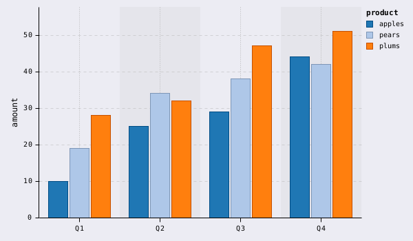
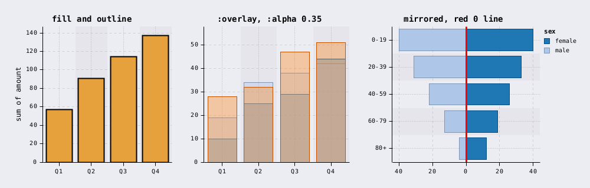
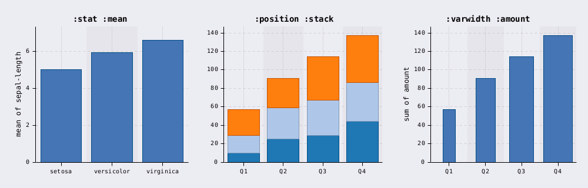
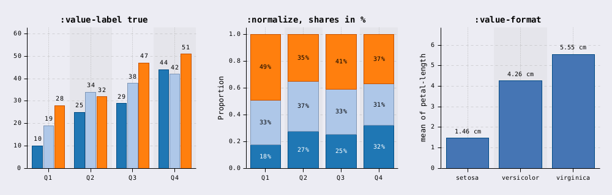
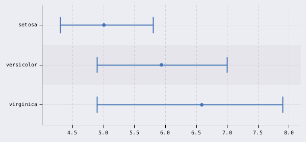
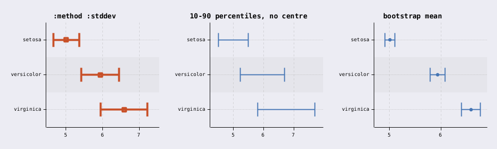
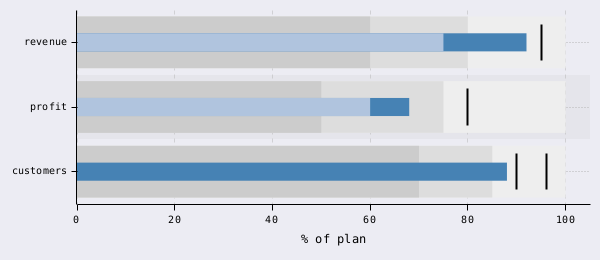
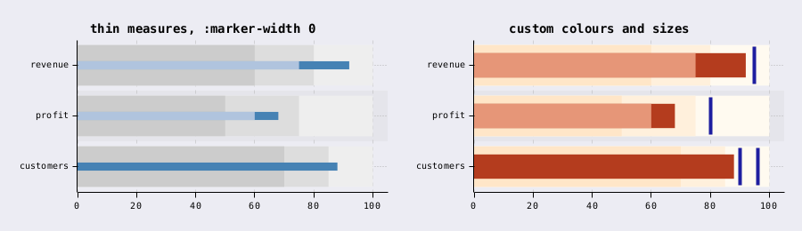

---
format:
  html: {toc: true, toc-location: right, toc-depth: 4, theme: cosmo}
code-block-background: true

---
<style></style><style>.printedClojure .sourceCode {
  background-color: transparent;
  border-style: none;
}
</style><style>.clay-limit-image-width .clay-image {max-width: 100%}
.clay-side-by-side .sourceCode {margin: 0}
.clay-side-by-side {margin: 1em 0}
</style>
<script src="https://code.jquery.com/jquery-3.6.0.min.js" type="text/javascript"></script><script src="https://code.jquery.com/ui/1.13.1/jquery-ui.min.js" type="text/javascript"></script>

# Charts: bars and ranges

Strip charts drawing one item per level of a categorical axis: a bar of a summary (`bar`), an interval with its
centre (`extent`) and a bullet - a measure over qualitative ranges with markers (`bullet`). Each chart lists the
mapping keys it reads, its own options and the shared option groups it takes.


::: {.sourceClojure}
```clojure
(ns reference.charts-bars-ranges
  (:require [fastmath.random :as r]
            [cljplot2.chart :as chart]
            [cljplot2.core :as plot]
            [cljplot2.describe :as describe]
            [notebook-utils :as nu]))
```
:::


Data: Edgar Anderson's iris measurements, R datasets package `iris` (Anderson 1935; Fisher 1936); licence: Part of R (GPL-2 | GPL-3).


::: {.sourceClojure}
```clojure
(def iris (nu/dataset :iris))
```
:::


::: {.clay-table}

```{=html}
<table class="table table-hover table-responsive clay-table"><thead><tr><th>sepal-length</th><th>sepal-width</th><th>petal-length</th><th>petal-width</th><th>species</th></tr></thead><tbody><tr><td>5.1</td><td>3.5</td><td>1.4</td><td>0.2</td><td>setosa</td></tr><tr><td>4.9</td><td>3</td><td>1.4</td><td>0.2</td><td>setosa</td></tr><tr><td>4.7</td><td>3.2</td><td>1.3</td><td>0.2</td><td>setosa</td></tr><tr><td>4.6</td><td>3.1</td><td>1.5</td><td>0.2</td><td>setosa</td></tr><tr><td>5</td><td>3.6</td><td>1.4</td><td>0.2</td><td>setosa</td></tr><tr><td>5.4</td><td>3.9</td><td>1.7</td><td>0.4</td><td>setosa</td></tr><tr><td>4.6</td><td>3.4</td><td>1.4</td><td>0.3</td><td>setosa</td></tr><tr><td>5</td><td>3.4</td><td>1.5</td><td>0.2</td><td>setosa</td></tr><tr><td>4.4</td><td>2.9</td><td>1.4</td><td>0.2</td><td>setosa</td></tr><tr><td>4.9</td><td>3.1</td><td>1.5</td><td>0.1</td><td>setosa</td></tr><tr><td>5.4</td><td>3.7</td><td>1.5</td><td>0.2</td><td>setosa</td></tr><tr><td>4.8</td><td>3.4</td><td>1.6</td><td>0.2</td><td>setosa</td></tr><tr><td>4.8</td><td>3</td><td>1.4</td><td>0.1</td><td>setosa</td></tr><tr><td>4.3</td><td>3</td><td>1.1</td><td>0.1</td><td>setosa</td></tr><tr><td>5.8</td><td>4</td><td>1.2</td><td>0.2</td><td>setosa</td></tr><tr><td>5.7</td><td>4.4</td><td>1.5</td><td>0.4</td><td>setosa</td></tr><tr><td>5.4</td><td>3.9</td><td>1.3</td><td>0.4</td><td>setosa</td></tr><tr><td>5.1</td><td>3.5</td><td>1.4</td><td>0.3</td><td>setosa</td></tr><tr><td>5.7</td><td>3.8</td><td>1.7</td><td>0.3</td><td>setosa</td></tr><tr><td>5.1</td><td>3.8</td><td>1.5</td><td>0.3</td><td>setosa</td></tr></tbody></table>
```

:::


::: {.sourceClojure}
```clojure
(def sales (for [[qi q] (map-indexed vector ["Q1" "Q2" "Q3" "Q4"]) [i product] (map-indexed vector ["apples" "pears" "plums"])]
             {:quarter q :product product :amount (+ 10 (* 6 i) (* 8 qi) (mod (* 7 (+ qi (* 2 i))) 11))}))
```
:::


::: {.clay-table}

```{=html}
<table class="table table-hover table-responsive clay-table"><thead><tr><th>quarter</th><th>product</th><th>amount</th></tr></thead><tbody><tr><td>Q1</td><td>apples</td><td>10</td></tr><tr><td>Q1</td><td>pears</td><td>19</td></tr><tr><td>Q1</td><td>plums</td><td>28</td></tr><tr><td>Q2</td><td>apples</td><td>25</td></tr><tr><td>Q2</td><td>pears</td><td>34</td></tr><tr><td>Q2</td><td>plums</td><td>32</td></tr><tr><td>Q3</td><td>apples</td><td>29</td></tr><tr><td>Q3</td><td>pears</td><td>38</td></tr><tr><td>Q3</td><td>plums</td><td>47</td></tr><tr><td>Q4</td><td>apples</td><td>44</td></tr><tr><td>Q4</td><td>pears</td><td>42</td></tr><tr><td>Q4</td><td>plums</td><td>51</td></tr></tbody></table>
```

:::


## bar

A bar per level (and group) whose length summarises the item's rows - their sum by default, or a count of
them; vertical bars take the levels on x, horizontal ones on y.

::: {.clay-table}

```{=html}
<table class="table table-hover table-responsive clay-table"><thead><tr><th>Option</th><th>Type</th><th>Default</th><th>Description</th></tr></thead><tbody><tr><td>:x</td><td>a keyword, a function or a categorical marker of one or nil</td><td></td><td>x position: the levels (categorical) of vertical bars or the values of horizontal ones</td></tr><tr><td>:y</td><td>a keyword, a function or a categorical marker of one or nil</td><td></td><td>y position: the values of vertical bars or the levels (categorical) of horizontal ones</td></tr><tr><td>:color</td><td>a keyword, a function or a categorical marker of one or nil</td><td></td><td>fill colour per group (gives legend keys)</td></tr><tr><td>:pattern</td><td>a keyword, a function or a categorical marker of one or nil</td><td></td><td>fill pattern per group (gives legend keys)</td></tr><tr><td>:group</td><td>a keyword, a function or a categorical marker of one or nil</td><td></td><td>groups without a visual aesthetic (dodged, stacked or mirrored as other groups)</td></tr></tbody></table>
```

:::


::: {.sourceClojure}
```clojure
(plot/render-image {:data sales
                    :mapping {:x :quarter :y :amount :color :product}
                    :charts [(chart/bar)]
                    :labels {:y "amount"}}
                   {:width 600 :height 350})
```
:::


::: {.clay-image}

:::


### Style

The fill and outline used when nothing is mapped, the opacity of overlaid groups, and the 0 line drawn over
mirrored bars (`:mirror` - Mirrored strips):

::: {.clay-table}

```{=html}
<table class="table table-hover table-responsive clay-table"><thead><tr><th>Option</th><th>Type</th><th>Default</th><th>Description</th></tr></thead><tbody><tr><td>:color</td><td>a clojure2d color</td><td>[69 117 180]</td><td>bar fill colour (a mapped :color wins)</td></tr><tr><td>:stroke-color</td><td>:darker or a clojure2d color or :none</td><td>:darker</td><td>outline colour: a colour, :none or :darker (the darkened fill)</td></tr><tr><td>:stroke-width</td><td>a non-negative number</td><td>1</td><td>outline width in pixels</td></tr><tr><td>:alpha</td><td>a number in [0 1]</td><td>0.6</td><td>fill opacity of overlaid groups sharing a level</td></tr><tr><td>:zero-line-color</td><td>a clojure2d color or :none</td><td>:black</td><td>colour of the 0 line drawn over mirrored bars</td></tr><tr><td>:zero-line-width</td><td>a non-negative number</td><td>1</td><td>width in pixels of the 0 line drawn over mirrored bars</td></tr></tbody></table>
```

:::


::: {.sourceClojure}
```clojure
(def pyramid (for [[i age] (map-indexed vector ["0-19" "20-39" "40-59" "60-79" "80+"])
                   sex ["female" "male"]]
               {:age age :sex sex :people (- 40 (* 7 i) (if (= sex "male") (* 2 i) 0))}))
```
:::


::: {.clay-table}

```{=html}
<table class="table table-hover table-responsive clay-table"><thead><tr><th>age</th><th>sex</th><th>people</th></tr></thead><tbody><tr><td>0-19</td><td>female</td><td>40</td></tr><tr><td>0-19</td><td>male</td><td>40</td></tr><tr><td>20-39</td><td>female</td><td>33</td></tr><tr><td>20-39</td><td>male</td><td>31</td></tr><tr><td>40-59</td><td>female</td><td>26</td></tr><tr><td>40-59</td><td>male</td><td>22</td></tr><tr><td>60-79</td><td>female</td><td>19</td></tr><tr><td>60-79</td><td>male</td><td>13</td></tr><tr><td>80+</td><td>female</td><td>12</td></tr><tr><td>80+</td><td>male</td><td>4</td></tr></tbody></table>
```

:::


::: {.sourceClojure}
```clojure
(plot/render-image (plot/arrange [{:data sales
                                   :mapping {:x :quarter :y :amount}
                                   :charts [(chart/bar {:color [230 160 60] :stroke-color :black :stroke-width 2})]
                                   :labels {:title "fill and outline"}}
                                  {:data sales
                                   :mapping {:x :quarter :y :amount :color :product}
                                   :charts [(chart/bar {:position :overlay :alpha 0.35})]
                                   :labels {:title ":overlay, :alpha 0.35"}
                                   :legend false}
                                  {:data pyramid
                                   :mapping {:x :people :y :age :color :sex}
                                   :charts [(chart/bar {:mirror :color :zero-line-color :red :zero-line-width 3})]
                                   :scales {:y {:reverse true}}
                                   :labels {:title "mirrored, red 0 line"}}]
                                 {:columns 3 :widths [1 1 1.3]})
                   {:width 1000 :height 320})
```
:::


::: {.clay-image}

:::


### Bars

What a bar's length is (`:stat`), how the groups of one level share its band, widths by the item's size, the
order of negative stacked parts, and the padding:

::: {.clay-table}

```{=html}
<table class="table table-hover table-responsive clay-table"><thead><tr><th>Option</th><th>Type</th><th>Default</th><th>Description</th></tr></thead><tbody><tr><td>:stat</td><td>one of :count :mean :median :percent :pmf :sum or a function</td><td>:sum</td><td>bar length from the item's rows: :sum, :mean, :median or a function of the values, or a count measure :count, :percent, :pmf (no values needed)</td></tr><tr><td>:position</td><td>one of :dodge :normalize :overlay :stack</td><td>:dodge when a level holds two or more groups, else :overlay</td><td>how groups of one level share its band: :dodge (side by side), :overlay (on top of each other), :stack or :normalize (stacked, each level summing to 1)</td></tr><tr><td>:zero-line</td><td>true or false or nil</td><td>true</td><td>draw the 0 line on top of mirrored bars (with :mirror only)</td></tr><tr><td>:varwidth</td><td>true or false or a keyword, a function or a categorical marker of one or nil</td><td>false</td><td>bar widths relative to the widest: true - by the square root of the count, a keyword or function of a row - by the item's sum of it</td></tr><tr><td>:negative-order</td><td>one of :forward :reverse</td><td>:forward</td><td>order of the groups below 0 with :stack: :forward (group order) or :reverse (the last group nearest 0)</td></tr><tr><td>:padding</td><td>map of one of :x :y to [lo hi], non-negative numbers</td><td>values 0.05, 0 at the baseline side the bars grow from</td><td>padding of the data span per position axis, {:x [lo hi] :y [lo hi]} fractions of the span (strip frame: :x the values)</td></tr></tbody></table>
```

:::


::: {.sourceClojure}
```clojure
(plot/render-image (plot/arrange [{:data iris
                                   :mapping {:x :species :y :sepal-length}
                                   :charts [(chart/bar {:stat :mean})]
                                   :labels {:title ":stat :mean"}}
                                  {:data sales
                                   :mapping {:x :quarter :y :amount :color :product}
                                   :charts [(chart/bar {:position :stack})]
                                   :labels {:title ":position :stack"}
                                   :legend false}
                                  {:data sales
                                   :mapping {:x :quarter :y :amount}
                                   :charts [(chart/bar {:varwidth :amount})]
                                   :labels {:title ":varwidth :amount"}}]
                                 {:columns 3})
                   {:width 1000 :height 320})
```
:::


::: {.clay-image}

:::


### Labels

Each bar's length written past its end or in its middle, formatted or as the text a function returns:

::: {.clay-table}

```{=html}
<table class="table table-hover table-responsive clay-table"><thead><tr><th>Option</th><th>Type</th><th>Default</th><th>Description</th></tr></thead><tbody><tr><td>:label-stack</td><td>one of :horizontal :vertical</td><td>along the bars: :horizontal for horizontal bars, :vertical for vertical ones</td><td>how the value and n texts of one label are joined: :horizontal (side by side) or :vertical (one above the other)</td></tr><tr><td>:value-label</td><td>true or false or a function or nil</td><td>false</td><td>write each bar's length (true) or the text a function of {:value :n :share :level :group} returns</td></tr><tr><td>:label-position</td><td>one of :end :center :outer</td><td>:center for :stack / :normalize, else :end</td><td>where labels sit: :end (past the bar's end), :center (in the bar) or :outer (polar only: past the outer radius)</td></tr><tr><td>:label-leader</td><td>true or false or nil</td><td>false</td><td>draw a line from the bar's outer edge to its :outer label</td></tr><tr><td>:value-format</td><td>string</td><td>whole numbers as integers, else the fewest digits telling the labels apart</td><td>format string of the value labels' number</td></tr></tbody></table>
```

:::


::: {.sourceClojure}
```clojure
(plot/render-image (plot/arrange [{:data sales
                                   :mapping {:x :quarter :y :amount :color :product}
                                   :charts [(chart/bar {:value-label true})]
                                   :labels {:title ":value-label true"}
                                   :legend false}
                                  {:data sales
                                   :mapping {:x :quarter :y :amount :color :product}
                                   :charts [(chart/bar {:position :normalize :value-label #(format "%.0f%%" (* 100 (:share %)))})]
                                   :labels {:title ":normalize, shares in %"}
                                   :legend false}
                                  {:data iris
                                   :mapping {:x :species :y :petal-length}
                                   :charts [(chart/bar {:stat :mean :value-label true :value-format "%.2f cm"})]
                                   :labels {:title ":value-format"}}]
                                 {:columns 3})
                   {:width 1000 :height 320})
```
:::


::: {.clay-image}

:::


Shared options: [Fill patterns](reference.shared_options.html#fill-patterns) (`:pattern` `:pattern-color`); [Data and mapping](reference.shared_options.html#data-and-mapping) (`:data` `:mapping`); [Strip options](reference.shared_options.html#strip-options) (`:place` `:width` `:thickness` `:dodge-gap` `:bottom-share` `:n-label` `:n-format` `:level-axis`); [Mirrored strips](reference.shared_options.html#mirrored-strips) (`:mirror`); [Rounded corners](reference.shared_options.html#rounded-corners) (`:corner-radius` `:corner-radius-end`).


## extent

An interval per level (and group) from the item's values - their range, a confidence interval, quantiles or a
bootstrap estimate - with a mark at its centre.

::: {.clay-table}

```{=html}
<table class="table table-hover table-responsive clay-table"><thead><tr><th>Option</th><th>Type</th><th>Default</th><th>Description</th></tr></thead><tbody><tr><td>:x</td><td>a keyword, a function or a categorical marker of one or nil</td><td></td><td>values (data units) on the value axis, or levels for vertical intervals</td></tr><tr><td>:y</td><td>a keyword, a function or a categorical marker of one or nil</td><td></td><td>levels on the categorical axis (absent - one interval), or values for vertical intervals</td></tr><tr><td>:color</td><td>a keyword, a function or a categorical marker of one or nil</td><td></td><td>interval colour per group (gives legend keys)</td></tr><tr><td>:shape</td><td>a keyword, a function or a categorical marker of one or nil</td><td></td><td>centre mark shape per group</td></tr><tr><td>:size</td><td>a keyword, a function or a categorical marker of one or nil</td><td></td><td>centre mark size per group</td></tr><tr><td>:group</td><td>a keyword, a function or a categorical marker of one or nil</td><td></td><td>groups without a visual aesthetic (dodged as other groups)</td></tr></tbody></table>
```

:::


::: {.sourceClojure}
```clojure
(plot/render-image {:data iris
                    :mapping {:x :sepal-length :y :species}
                    :charts [(chart/extent)]
                    :scales {:y {:reverse true}}}
                   {:width 600 :height 280})
```
:::


::: {.clay-image}

:::


Its options: the interval's and centre's style, the method giving the interval (and its arguments), the
bootstrap's statistic and random generator (seeded here) and the centre mark:

::: {.clay-table}

```{=html}
<table class="table table-hover table-responsive clay-table"><thead><tr><th>Option</th><th>Type</th><th>Default</th><th>Description</th></tr></thead><tbody><tr><td>:color</td><td>a clojure2d color or :none</td><td>[69 117 180]</td><td>interval colour (a mapped :color wins)</td></tr><tr><td>:line-width</td><td>a non-negative number</td><td>2</td><td>interval line width in pixels</td></tr><tr><td>:shape</td><td>a shape character, keyword or shape map</td><td>\O</td><td>shape of the centre mark (a mapped :shape wins)</td></tr><tr><td>:size</td><td>a non-negative number</td><td>7</td><td>size of the centre mark in pixels (a mapped :size wins)</td></tr><tr><td>:method</td><td>one of :adjacent :bootstrap-basic :bootstrap-bc :bootstrap-bca :bootstrap-mad-median :bootstrap-normal :bootstrap-percentile :bootstrap-studentized :bootstrap-t :ci :hpdi :inner-fence :mad :min-max :outer-fence :percentile :percentile-bc :percentile-bca :pi :quantile :sem :stddev or a function</td><td>:min-max</td><td>interval of the values: a fastmath extent or bootstrap method keyword, or a function of the values returning [lo hi] or [lo hi centre]</td></tr><tr><td>:statistic</td><td>a function or nil</td><td>fastmath mean</td><td>statistic of the values resampled by the bootstrap methods</td></tr><tr><td>:method-args</td><td>sequential of any value or nil</td><td></td><td>extra arguments passed to the method after the values (e.g. [10.0 90.0] for :percentile)</td></tr><tr><td>:rng</td><td>a fastmath random generator or nil</td><td>a fresh generator every build</td><td>fastmath random generator of the bootstrap methods, copied per build (every build draws the same samples)</td></tr><tr><td>:center</td><td>one of :method :none</td><td>:method</td><td>centre mark: :method (the method's centre) or :none</td></tr><tr><td>:padding</td><td>map of one of :x :y to [lo hi], non-negative numbers</td><td>[0.05 0.05] along the value axis; with :place :bottom also :bottom-share below the data</td><td>padding of the data span per position axis, {:x [lo hi] :y [lo hi]} fractions of the span</td></tr></tbody></table>
```

:::


::: {.sourceClojure}
```clojure
(plot/render-image (plot/arrange [{:data iris
                                   :mapping {:x :sepal-length :y :species}
                                   :charts [(chart/extent {:method :stddev :color [200 80 40] :line-width 4 :shape \s})]
                                   :scales {:y {:reverse true}}
                                   :labels {:title ":method :stddev"}}
                                  {:data iris
                                   :mapping {:x :sepal-length :y :species}
                                   :charts [(chart/extent {:method :percentile :method-args [10.0 90.0] :center :none})]
                                   :scales {:y {:reverse true}}
                                   :labels {:title "10-90 percentiles, no centre"}}
                                  {:data iris
                                   :mapping {:x :sepal-length :y :species}
                                   :charts [(chart/extent {:method :bootstrap-percentile :rng (r/rng :mersenne 3)})]
                                   :scales {:y {:reverse true}}
                                   :labels {:title "bootstrap mean"}}]
                                 {:columns 3})
                   {:width 1000 :height 300})
```
:::


::: {.clay-image}

:::


Shared options: [Data and mapping](reference.shared_options.html#data-and-mapping) (`:data` `:mapping`); [Strip options](reference.shared_options.html#strip-options) (`:place` `:width` `:thickness` `:position` `:dodge-gap` `:bottom-share` `:n-label` `:n-format` `:level-axis`); [Mirrored strips](reference.shared_options.html#mirrored-strips) (`:mirror`).


## bullet

A measure bar over shaded qualitative ranges, with marker lines (targets) - a row per level holding vectors of
ranges, measures and markers (here percents of a plan, so the levels share one axis).

::: {.clay-table}

```{=html}
<table class="table table-hover table-responsive clay-table"><thead><tr><th>Option</th><th>Type</th><th>Default</th><th>Description</th></tr></thead><tbody><tr><td>:ranges</td><td>a keyword, a function or a categorical marker of one or nil</td><td></td><td>qualitative ranges of a level: a number or a vector of them (one row per level and group)</td></tr><tr><td>:measures</td><td>a keyword, a function or a categorical marker of one or nil</td><td></td><td>measures of a level: a number or a vector of them, the first the current value</td></tr><tr><td>:markers</td><td>a keyword, a function or a categorical marker of one or nil</td><td></td><td>marker values of a level: a number or a vector of them</td></tr><tr><td>:y</td><td>a keyword, a function or a categorical marker of one or nil</td><td></td><td>levels on the categorical axis (absent - one bullet)</td></tr><tr><td>:x</td><td>a keyword, a function or a categorical marker of one or nil</td><td></td><td>levels of vertical bullets (values aren't read from it)</td></tr><tr><td>:group</td><td>a keyword, a function or a categorical marker of one or nil</td><td></td><td>groups without a visual aesthetic (dodged as other groups)</td></tr></tbody></table>
```

:::


::: {.sourceClojure}
```clojure
(def kpis [{:kpi "revenue" :ranges [60 80 100] :measures [92 75] :markers [95]}
           {:kpi "profit" :ranges [50 75 100] :measures [68 60] :markers [80]}
           {:kpi "customers" :ranges [70 85 100] :measures [88] :markers [90 96]}])
```
:::


::: {.clay-table}

```{=html}
<table class="table table-hover table-responsive clay-table"><thead><tr><th>kpi</th><th>ranges</th><th>measures</th><th>markers</th></tr></thead><tbody><tr><td>revenue</td><td>[60 80 100]</td><td>[92 75]</td><td>[95]</td></tr><tr><td>profit</td><td>[50 75 100]</td><td>[68 60]</td><td>[80]</td></tr><tr><td>customers</td><td>[70 85 100]</td><td>[88]</td><td>[90 96]</td></tr></tbody></table>
```

:::


::: {.sourceClojure}
```clojure
(plot/render-image {:data kpis
                    :mapping {:y :kpi :ranges :ranges :measures :measures :markers :markers}
                    :charts [(chart/bullet)]
                    :scales {:y {:reverse true}}
                    :labels {:x "% of plan"}}
                   {:width 600 :height 260})
```
:::


::: {.clay-image}

:::


Its options: the shades of ranges and measures (from the first to the last), the measure bar's width and the
markers' colour, width and length:

::: {.clay-table}

```{=html}
<table class="table table-hover table-responsive clay-table"><thead><tr><th>Option</th><th>Type</th><th>Default</th><th>Description</th></tr></thead><tbody><tr><td>:range-colors</td><td>[a clojure2d color or :none, a clojure2d color or :none]</td><td>[[204 204 204] [238 238 238]]</td><td>[first last] colours shading the ranges from the smallest to the largest</td></tr><tr><td>:measure-colors</td><td>[a clojure2d color or :none, a clojure2d color or :none]</td><td>[[70 130 180] [176 196 222]]</td><td>[first last] colours shading the measures from the first (the current value) to the last</td></tr><tr><td>:measure-width</td><td>a number in [0 1]</td><td>0.35</td><td>measure bar width, a fraction of the item slot</td></tr><tr><td>:marker-color</td><td>a clojure2d color or :none</td><td>:black</td><td>marker line colour</td></tr><tr><td>:marker-width</td><td>a non-negative number</td><td>2</td><td>marker line width in pixels (0 - no markers)</td></tr><tr><td>:marker-length</td><td>a number in [0 1]</td><td>0.7</td><td>marker line length, a fraction of the item slot</td></tr><tr><td>:padding</td><td>map of one of :x :y to [lo hi], non-negative numbers</td><td>values 0.05 on a side holding values, 0 on the side of 0</td><td>padding of the data span per position axis, {:x [lo hi] :y [lo hi]} fractions of the span (strip frame: :x the values)</td></tr></tbody></table>
```

:::


::: {.sourceClojure}
```clojure
(plot/render-image (plot/arrange [{:data kpis
                                   :mapping {:y :kpi :ranges :ranges :measures :measures :markers :markers}
                                   :charts [(chart/bullet {:measure-width 0.2 :marker-width 0})]
                                   :scales {:y {:reverse true}}
                                   :labels {:title "thin measures, :marker-width 0"}}
                                  {:data kpis
                                   :mapping {:y :kpi :ranges :ranges :measures :measures :markers :markers}
                                   :charts [(chart/bullet {:range-colors [[255 230 200] [255 250 240]]
                                                           :measure-colors [[180 60 30] [230 150 120]]
                                                           :measure-width 0.6 :marker-color [30 30 160]
                                                           :marker-width 4 :marker-length 0.9})]
                                   :scales {:y {:reverse true}}
                                   :labels {:title "custom colours and sizes"}}]
                                 {:columns 2})
                   {:width 900 :height 260})
```
:::


::: {.clay-image}

:::


Shared options: [Data and mapping](reference.shared_options.html#data-and-mapping) (`:data` `:mapping`); [Strip options](reference.shared_options.html#strip-options) (`:place` `:width` `:thickness` `:position` `:dodge-gap` `:bottom-share` `:level-axis`).


```{=html}
<div style="background-color:grey;height:2px;width:100%;"></div>
```


```{=html}
<div><pre><small><small>source: notebooks/reference/charts_bars_ranges.clj</small></small></pre></div>
```