---
format:
  html:
    toc: true
    toc-location: right
    toc-depth: 4
    theme: cosmo
    include-in-header:
      text: |-
        <style>
        .data-table { width: fit-content; max-width: 100%; max-height: 15rem; overflow: auto; margin: 0 0 1rem 0; }
        .data-table .table-responsive { overflow: visible; }
        .data-table table { font-size: 0.75rem; width: auto; margin: 0; }
        .data-table th, .data-table td { padding: 0.1rem 0.45rem !important; white-space: nowrap; }
        .data-table thead th { position: sticky; top: 0; background: var(--bs-body-bg, #fff); }
        .options { margin: 0.5rem 0 1rem 0; }
        .options .option-card { margin: 0 0 0.9rem 0; border: 1px solid var(--bs-border-color, #dee2e6); border-radius: 0.375rem; overflow: hidden; }
        .options dt { display: flex; flex-wrap: wrap; align-items: baseline; gap: 0.1rem 1rem; margin: 0; padding: 0.4rem 0.75rem; background: #eef2f7; border-bottom: 1px solid var(--bs-border-color, #dee2e6); font-weight: normal; }
        .options dt > code { font-weight: 700; font-size: 1rem; background: none; padding: 0; }
        .options .option-default { font-size: 0.85rem; color: var(--bs-secondary-color, #6c757d); }
        .options dd { margin: 0; padding: 0.5rem 0.75rem; }
        .options .option-example { font-size: 0.85rem; padding: 0 0 0.45rem 0; margin-bottom: 0.45rem; border-bottom: 1px dashed var(--bs-border-color, #dee2e6); }
        .options .option-example code { background: none; padding: 0; }
        .options .option-text ul { margin: 0.3rem 0 0 0; padding-left: 1.25rem; }
        .options code, .mapping code { overflow-wrap: anywhere; }
        .options .option-default code, .options .option-example code { white-space: pre-wrap; }
        .mapping { margin: 0.5rem 0 1rem 0; padding: 0.5rem 0.75rem; border: 1px solid var(--bs-border-color, #dee2e6); border-left: 0.3rem solid #2780e3; border-radius: 0.375rem; background: #f5f8fc; }
        .mapping-title { font-weight: 700; margin-bottom: 0.25rem; }
        .mapping-hint { font-weight: normal; font-size: 0.85rem; color: var(--bs-secondary-color, #6c757d); }
        .mapping ul { margin: 0; padding-left: 1.25rem; }
        .mapping .required { font-size: 0.75rem; padding: 0 0.3rem; border: 1px solid currentColor; border-radius: 0.25rem; }
        .mapping-returns { margin-top: 0.25rem; }
        .mapping code { white-space: pre-wrap; }
        .shared { margin: 0.5rem 0 1rem 0; padding: 0.5rem 0.75rem; border: 1px solid var(--bs-border-color, #dee2e6); border-left: 0.3rem solid #6c757d; border-radius: 0.375rem; background: #f6f6f6; }
        .shared-title { font-weight: 700; margin-bottom: 0.25rem; }
        .shared-hint { font-weight: normal; font-size: 0.85rem; color: var(--bs-secondary-color, #6c757d); }
        .shared ul { margin: 0; padding-left: 1.25rem; }
        .shared code { overflow-wrap: anywhere; }
        </style>
code-block-background: true

---
<style></style><style>.printedClojure .sourceCode {
  background-color: transparent;
  border-style: none;
}
</style><style>.clay-limit-image-width .clay-image {max-width: 100%}
.clay-side-by-side .sourceCode {margin: 0}
.clay-side-by-side {margin: 1em 0}
</style>
<script src="https://code.jquery.com/jquery-3.6.0.min.js" type="text/javascript"></script><script src="https://code.jquery.com/ui/1.13.1/jquery-ui.min.js" type="text/javascript"></script>

# 2D bins and fields

These charts colour a plane: a cell per row (`tile`), counts in 2D bins (`bin2d`), and a field as a raster
(`field`) or as level lines (`contour`). Use them for points too dense to draw one by one, or for a value over two
variables.


::: {.sourceClojure}
```clojure
(ns reference.charts-bins-fields
  (:require [fastmath.core :as m]
            [cljplot2.chart :as chart]
            [cljplot2.core :as plot]
            [cljplot2.describe :as describe]
            [notebook-utils :as nu]))
```
:::


Data: Old Faithful geyser eruptions, R datasets package `faithful` (Härdle 1991; Azzalini & Bowman 1990); licence: Part of R (GPL-2 | GPL-3).


::: {.sourceClojure}
```clojure
(def faithful (nu/dataset :faithful))
```
:::


```{=html}
<div class="data-table"><table class="table table-hover table-responsive clay-table"><thead><tr><th>eruptions</th><th>waiting</th></tr></thead><tbody><tr><td>3.6</td><td>79</td></tr><tr><td>1.8</td><td>54</td></tr><tr><td>3.333</td><td>74</td></tr><tr><td>2.283</td><td>62</td></tr><tr><td>4.533</td><td>85</td></tr><tr><td>2.883</td><td>55</td></tr><tr><td>4.7</td><td>88</td></tr><tr><td>3.6</td><td>85</td></tr><tr><td>1.95</td><td>51</td></tr><tr><td>4.35</td><td>85</td></tr><tr><td>1.833</td><td>54</td></tr><tr><td>3.917</td><td>84</td></tr><tr><td>4.2</td><td>78</td></tr><tr><td>1.75</td><td>47</td></tr><tr><td>4.7</td><td>83</td></tr><tr><td>2.167</td><td>52</td></tr><tr><td>1.75</td><td>62</td></tr><tr><td>4.8</td><td>84</td></tr><tr><td>1.6</td><td>52</td></tr><tr><td>4.25</td><td>79</td></tr><tr><td>1.8</td><td>51</td></tr><tr><td>1.75</td><td>47</td></tr><tr><td>3.45</td><td>78</td></tr><tr><td>3.067</td><td>69</td></tr><tr><td>4.533</td><td>74</td></tr><tr><td>3.6</td><td>83</td></tr><tr><td>1.967</td><td>55</td></tr><tr><td>4.083</td><td>76</td></tr><tr><td>3.85</td><td>78</td></tr><tr><td>4.433</td><td>79</td></tr><tr><td>4.3</td><td>73</td></tr><tr><td>4.467</td><td>77</td></tr><tr><td>3.367</td><td>66</td></tr><tr><td>4.033</td><td>80</td></tr><tr><td>3.833</td><td>74</td></tr><tr><td>2.017</td><td>52</td></tr><tr><td>1.867</td><td>48</td></tr><tr><td>4.833</td><td>80</td></tr><tr><td>1.833</td><td>59</td></tr><tr><td>4.783</td><td>90</td></tr><tr><td>4.35</td><td>80</td></tr><tr><td>1.883</td><td>58</td></tr><tr><td>4.567</td><td>84</td></tr><tr><td>1.75</td><td>58</td></tr><tr><td>4.533</td><td>73</td></tr><tr><td>3.317</td><td>83</td></tr><tr><td>3.833</td><td>64</td></tr><tr><td>2.1</td><td>53</td></tr><tr><td>4.633</td><td>82</td></tr><tr><td>2</td><td>59</td></tr><tr><td>4.8</td><td>75</td></tr><tr><td>4.716</td><td>90</td></tr><tr><td>1.833</td><td>54</td></tr><tr><td>4.833</td><td>80</td></tr><tr><td>1.733</td><td>54</td></tr><tr><td>4.883</td><td>83</td></tr><tr><td>3.717</td><td>71</td></tr><tr><td>1.667</td><td>64</td></tr><tr><td>4.567</td><td>77</td></tr><tr><td>4.317</td><td>81</td></tr><tr><td>2.233</td><td>59</td></tr><tr><td>4.5</td><td>84</td></tr><tr><td>1.75</td><td>48</td></tr><tr><td>4.8</td><td>82</td></tr><tr><td>1.817</td><td>60</td></tr><tr><td>4.4</td><td>92</td></tr><tr><td>4.167</td><td>78</td></tr><tr><td>4.7</td><td>78</td></tr><tr><td>2.067</td><td>65</td></tr><tr><td>4.7</td><td>73</td></tr><tr><td>4.033</td><td>82</td></tr><tr><td>1.967</td><td>56</td></tr><tr><td>4.5</td><td>79</td></tr><tr><td>4</td><td>71</td></tr><tr><td>1.983</td><td>62</td></tr><tr><td>5.067</td><td>76</td></tr><tr><td>2.017</td><td>60</td></tr><tr><td>4.567</td><td>78</td></tr><tr><td>3.883</td><td>76</td></tr><tr><td>3.6</td><td>83</td></tr><tr><td>4.133</td><td>75</td></tr><tr><td>4.333</td><td>82</td></tr><tr><td>4.1</td><td>70</td></tr><tr><td>2.633</td><td>65</td></tr><tr><td>4.067</td><td>73</td></tr><tr><td>4.933</td><td>88</td></tr><tr><td>3.95</td><td>76</td></tr><tr><td>4.517</td><td>80</td></tr><tr><td>2.167</td><td>48</td></tr><tr><td>4</td><td>86</td></tr><tr><td>2.2</td><td>60</td></tr><tr><td>4.333</td><td>90</td></tr><tr><td>1.867</td><td>50</td></tr><tr><td>4.817</td><td>78</td></tr><tr><td>1.833</td><td>63</td></tr><tr><td>4.3</td><td>72</td></tr><tr><td>4.667</td><td>84</td></tr><tr><td>3.75</td><td>75</td></tr><tr><td>1.867</td><td>51</td></tr><tr><td>4.9</td><td>82</td></tr><tr><td>…</td><td>…</td></tr></tbody></table></div>
```


Data: Maunga Whau volcano topography, R datasets package `volcano` (Ross Ihaka); licence: Part of R (GPL-2 | GPL-3).


::: {.sourceClojure}
```clojure
(def volcano (nu/dataset :volcano))
```
:::


```{=html}
<div class="data-table"><table class="table table-hover table-responsive clay-table"><thead><tr><th>row</th><th>column</th><th>height</th></tr></thead><tbody><tr><td>1</td><td>1</td><td>100</td></tr><tr><td>2</td><td>1</td><td>101</td></tr><tr><td>3</td><td>1</td><td>102</td></tr><tr><td>4</td><td>1</td><td>103</td></tr><tr><td>5</td><td>1</td><td>104</td></tr><tr><td>6</td><td>1</td><td>105</td></tr><tr><td>7</td><td>1</td><td>105</td></tr><tr><td>8</td><td>1</td><td>106</td></tr><tr><td>9</td><td>1</td><td>107</td></tr><tr><td>10</td><td>1</td><td>108</td></tr><tr><td>11</td><td>1</td><td>109</td></tr><tr><td>12</td><td>1</td><td>110</td></tr><tr><td>13</td><td>1</td><td>110</td></tr><tr><td>14</td><td>1</td><td>111</td></tr><tr><td>15</td><td>1</td><td>114</td></tr><tr><td>16</td><td>1</td><td>116</td></tr><tr><td>17</td><td>1</td><td>118</td></tr><tr><td>18</td><td>1</td><td>120</td></tr><tr><td>19</td><td>1</td><td>120</td></tr><tr><td>20</td><td>1</td><td>121</td></tr><tr><td>21</td><td>1</td><td>122</td></tr><tr><td>22</td><td>1</td><td>122</td></tr><tr><td>23</td><td>1</td><td>123</td></tr><tr><td>24</td><td>1</td><td>124</td></tr><tr><td>25</td><td>1</td><td>123</td></tr><tr><td>26</td><td>1</td><td>123</td></tr><tr><td>27</td><td>1</td><td>120</td></tr><tr><td>28</td><td>1</td><td>118</td></tr><tr><td>29</td><td>1</td><td>117</td></tr><tr><td>30</td><td>1</td><td>115</td></tr><tr><td>31</td><td>1</td><td>114</td></tr><tr><td>32</td><td>1</td><td>115</td></tr><tr><td>33</td><td>1</td><td>113</td></tr><tr><td>34</td><td>1</td><td>111</td></tr><tr><td>35</td><td>1</td><td>110</td></tr><tr><td>36</td><td>1</td><td>109</td></tr><tr><td>37</td><td>1</td><td>108</td></tr><tr><td>38</td><td>1</td><td>108</td></tr><tr><td>39</td><td>1</td><td>107</td></tr><tr><td>40</td><td>1</td><td>107</td></tr><tr><td>41</td><td>1</td><td>107</td></tr><tr><td>42</td><td>1</td><td>108</td></tr><tr><td>43</td><td>1</td><td>109</td></tr><tr><td>44</td><td>1</td><td>110</td></tr><tr><td>45</td><td>1</td><td>111</td></tr><tr><td>46</td><td>1</td><td>111</td></tr><tr><td>47</td><td>1</td><td>112</td></tr><tr><td>48</td><td>1</td><td>113</td></tr><tr><td>49</td><td>1</td><td>113</td></tr><tr><td>50</td><td>1</td><td>114</td></tr><tr><td>51</td><td>1</td><td>115</td></tr><tr><td>52</td><td>1</td><td>115</td></tr><tr><td>53</td><td>1</td><td>114</td></tr><tr><td>54</td><td>1</td><td>113</td></tr><tr><td>55</td><td>1</td><td>112</td></tr><tr><td>56</td><td>1</td><td>111</td></tr><tr><td>57</td><td>1</td><td>111</td></tr><tr><td>58</td><td>1</td><td>112</td></tr><tr><td>59</td><td>1</td><td>112</td></tr><tr><td>60</td><td>1</td><td>112</td></tr><tr><td>61</td><td>1</td><td>113</td></tr><tr><td>62</td><td>1</td><td>114</td></tr><tr><td>63</td><td>1</td><td>114</td></tr><tr><td>64</td><td>1</td><td>115</td></tr><tr><td>65</td><td>1</td><td>115</td></tr><tr><td>66</td><td>1</td><td>116</td></tr><tr><td>67</td><td>1</td><td>116</td></tr><tr><td>68</td><td>1</td><td>117</td></tr><tr><td>69</td><td>1</td><td>117</td></tr><tr><td>70</td><td>1</td><td>116</td></tr><tr><td>71</td><td>1</td><td>114</td></tr><tr><td>72</td><td>1</td><td>112</td></tr><tr><td>73</td><td>1</td><td>109</td></tr><tr><td>74</td><td>1</td><td>106</td></tr><tr><td>75</td><td>1</td><td>104</td></tr><tr><td>76</td><td>1</td><td>102</td></tr><tr><td>77</td><td>1</td><td>101</td></tr><tr><td>78</td><td>1</td><td>100</td></tr><tr><td>79</td><td>1</td><td>100</td></tr><tr><td>80</td><td>1</td><td>99</td></tr><tr><td>81</td><td>1</td><td>99</td></tr><tr><td>82</td><td>1</td><td>99</td></tr><tr><td>83</td><td>1</td><td>99</td></tr><tr><td>84</td><td>1</td><td>98</td></tr><tr><td>85</td><td>1</td><td>98</td></tr><tr><td>86</td><td>1</td><td>97</td></tr><tr><td>87</td><td>1</td><td>97</td></tr><tr><td>1</td><td>2</td><td>100</td></tr><tr><td>2</td><td>2</td><td>101</td></tr><tr><td>3</td><td>2</td><td>102</td></tr><tr><td>4</td><td>2</td><td>103</td></tr><tr><td>5</td><td>2</td><td>104</td></tr><tr><td>6</td><td>2</td><td>105</td></tr><tr><td>7</td><td>2</td><td>106</td></tr><tr><td>8</td><td>2</td><td>107</td></tr><tr><td>9</td><td>2</td><td>108</td></tr><tr><td>10</td><td>2</td><td>109</td></tr><tr><td>11</td><td>2</td><td>110</td></tr><tr><td>12</td><td>2</td><td>110</td></tr><tr><td>13</td><td>2</td><td>111</td></tr><tr><td>…</td><td>…</td><td>…</td></tr></tbody></table></div>
```


Data: Edgar Anderson's iris measurements, R datasets package `iris` (Anderson 1935; Fisher 1936); licence: Part of R (GPL-2 | GPL-3).


::: {.sourceClojure}
```clojure
(def iris (nu/dataset :iris))
```
:::


```{=html}
<div class="data-table"><table class="table table-hover table-responsive clay-table"><thead><tr><th>sepal-length</th><th>sepal-width</th><th>petal-length</th><th>petal-width</th><th>species</th></tr></thead><tbody><tr><td>5.1</td><td>3.5</td><td>1.4</td><td>0.2</td><td>setosa</td></tr><tr><td>4.9</td><td>3</td><td>1.4</td><td>0.2</td><td>setosa</td></tr><tr><td>4.7</td><td>3.2</td><td>1.3</td><td>0.2</td><td>setosa</td></tr><tr><td>4.6</td><td>3.1</td><td>1.5</td><td>0.2</td><td>setosa</td></tr><tr><td>5</td><td>3.6</td><td>1.4</td><td>0.2</td><td>setosa</td></tr><tr><td>5.4</td><td>3.9</td><td>1.7</td><td>0.4</td><td>setosa</td></tr><tr><td>4.6</td><td>3.4</td><td>1.4</td><td>0.3</td><td>setosa</td></tr><tr><td>5</td><td>3.4</td><td>1.5</td><td>0.2</td><td>setosa</td></tr><tr><td>4.4</td><td>2.9</td><td>1.4</td><td>0.2</td><td>setosa</td></tr><tr><td>4.9</td><td>3.1</td><td>1.5</td><td>0.1</td><td>setosa</td></tr><tr><td>5.4</td><td>3.7</td><td>1.5</td><td>0.2</td><td>setosa</td></tr><tr><td>4.8</td><td>3.4</td><td>1.6</td><td>0.2</td><td>setosa</td></tr><tr><td>4.8</td><td>3</td><td>1.4</td><td>0.1</td><td>setosa</td></tr><tr><td>4.3</td><td>3</td><td>1.1</td><td>0.1</td><td>setosa</td></tr><tr><td>5.8</td><td>4</td><td>1.2</td><td>0.2</td><td>setosa</td></tr><tr><td>5.7</td><td>4.4</td><td>1.5</td><td>0.4</td><td>setosa</td></tr><tr><td>5.4</td><td>3.9</td><td>1.3</td><td>0.4</td><td>setosa</td></tr><tr><td>5.1</td><td>3.5</td><td>1.4</td><td>0.3</td><td>setosa</td></tr><tr><td>5.7</td><td>3.8</td><td>1.7</td><td>0.3</td><td>setosa</td></tr><tr><td>5.1</td><td>3.8</td><td>1.5</td><td>0.3</td><td>setosa</td></tr><tr><td>5.4</td><td>3.4</td><td>1.7</td><td>0.2</td><td>setosa</td></tr><tr><td>5.1</td><td>3.7</td><td>1.5</td><td>0.4</td><td>setosa</td></tr><tr><td>4.6</td><td>3.6</td><td>1</td><td>0.2</td><td>setosa</td></tr><tr><td>5.1</td><td>3.3</td><td>1.7</td><td>0.5</td><td>setosa</td></tr><tr><td>4.8</td><td>3.4</td><td>1.9</td><td>0.2</td><td>setosa</td></tr><tr><td>5</td><td>3</td><td>1.6</td><td>0.2</td><td>setosa</td></tr><tr><td>5</td><td>3.4</td><td>1.6</td><td>0.4</td><td>setosa</td></tr><tr><td>5.2</td><td>3.5</td><td>1.5</td><td>0.2</td><td>setosa</td></tr><tr><td>5.2</td><td>3.4</td><td>1.4</td><td>0.2</td><td>setosa</td></tr><tr><td>4.7</td><td>3.2</td><td>1.6</td><td>0.2</td><td>setosa</td></tr><tr><td>4.8</td><td>3.1</td><td>1.6</td><td>0.2</td><td>setosa</td></tr><tr><td>5.4</td><td>3.4</td><td>1.5</td><td>0.4</td><td>setosa</td></tr><tr><td>5.2</td><td>4.1</td><td>1.5</td><td>0.1</td><td>setosa</td></tr><tr><td>5.5</td><td>4.2</td><td>1.4</td><td>0.2</td><td>setosa</td></tr><tr><td>4.9</td><td>3.1</td><td>1.5</td><td>0.2</td><td>setosa</td></tr><tr><td>5</td><td>3.2</td><td>1.2</td><td>0.2</td><td>setosa</td></tr><tr><td>5.5</td><td>3.5</td><td>1.3</td><td>0.2</td><td>setosa</td></tr><tr><td>4.9</td><td>3.6</td><td>1.4</td><td>0.1</td><td>setosa</td></tr><tr><td>4.4</td><td>3</td><td>1.3</td><td>0.2</td><td>setosa</td></tr><tr><td>5.1</td><td>3.4</td><td>1.5</td><td>0.2</td><td>setosa</td></tr><tr><td>5</td><td>3.5</td><td>1.3</td><td>0.3</td><td>setosa</td></tr><tr><td>4.5</td><td>2.3</td><td>1.3</td><td>0.3</td><td>setosa</td></tr><tr><td>4.4</td><td>3.2</td><td>1.3</td><td>0.2</td><td>setosa</td></tr><tr><td>5</td><td>3.5</td><td>1.6</td><td>0.6</td><td>setosa</td></tr><tr><td>5.1</td><td>3.8</td><td>1.9</td><td>0.4</td><td>setosa</td></tr><tr><td>4.8</td><td>3</td><td>1.4</td><td>0.3</td><td>setosa</td></tr><tr><td>5.1</td><td>3.8</td><td>1.6</td><td>0.2</td><td>setosa</td></tr><tr><td>4.6</td><td>3.2</td><td>1.4</td><td>0.2</td><td>setosa</td></tr><tr><td>5.3</td><td>3.7</td><td>1.5</td><td>0.2</td><td>setosa</td></tr><tr><td>5</td><td>3.3</td><td>1.4</td><td>0.2</td><td>setosa</td></tr><tr><td>7</td><td>3.2</td><td>4.7</td><td>1.4</td><td>versicolor</td></tr><tr><td>6.4</td><td>3.2</td><td>4.5</td><td>1.5</td><td>versicolor</td></tr><tr><td>6.9</td><td>3.1</td><td>4.9</td><td>1.5</td><td>versicolor</td></tr><tr><td>5.5</td><td>2.3</td><td>4</td><td>1.3</td><td>versicolor</td></tr><tr><td>6.5</td><td>2.8</td><td>4.6</td><td>1.5</td><td>versicolor</td></tr><tr><td>5.7</td><td>2.8</td><td>4.5</td><td>1.3</td><td>versicolor</td></tr><tr><td>6.3</td><td>3.3</td><td>4.7</td><td>1.6</td><td>versicolor</td></tr><tr><td>4.9</td><td>2.4</td><td>3.3</td><td>1</td><td>versicolor</td></tr><tr><td>6.6</td><td>2.9</td><td>4.6</td><td>1.3</td><td>versicolor</td></tr><tr><td>5.2</td><td>2.7</td><td>3.9</td><td>1.4</td><td>versicolor</td></tr><tr><td>5</td><td>2</td><td>3.5</td><td>1</td><td>versicolor</td></tr><tr><td>5.9</td><td>3</td><td>4.2</td><td>1.5</td><td>versicolor</td></tr><tr><td>6</td><td>2.2</td><td>4</td><td>1</td><td>versicolor</td></tr><tr><td>6.1</td><td>2.9</td><td>4.7</td><td>1.4</td><td>versicolor</td></tr><tr><td>5.6</td><td>2.9</td><td>3.6</td><td>1.3</td><td>versicolor</td></tr><tr><td>6.7</td><td>3.1</td><td>4.4</td><td>1.4</td><td>versicolor</td></tr><tr><td>5.6</td><td>3</td><td>4.5</td><td>1.5</td><td>versicolor</td></tr><tr><td>5.8</td><td>2.7</td><td>4.1</td><td>1</td><td>versicolor</td></tr><tr><td>6.2</td><td>2.2</td><td>4.5</td><td>1.5</td><td>versicolor</td></tr><tr><td>5.6</td><td>2.5</td><td>3.9</td><td>1.1</td><td>versicolor</td></tr><tr><td>5.9</td><td>3.2</td><td>4.8</td><td>1.8</td><td>versicolor</td></tr><tr><td>6.1</td><td>2.8</td><td>4</td><td>1.3</td><td>versicolor</td></tr><tr><td>6.3</td><td>2.5</td><td>4.9</td><td>1.5</td><td>versicolor</td></tr><tr><td>6.1</td><td>2.8</td><td>4.7</td><td>1.2</td><td>versicolor</td></tr><tr><td>6.4</td><td>2.9</td><td>4.3</td><td>1.3</td><td>versicolor</td></tr><tr><td>6.6</td><td>3</td><td>4.4</td><td>1.4</td><td>versicolor</td></tr><tr><td>6.8</td><td>2.8</td><td>4.8</td><td>1.4</td><td>versicolor</td></tr><tr><td>6.7</td><td>3</td><td>5</td><td>1.7</td><td>versicolor</td></tr><tr><td>6</td><td>2.9</td><td>4.5</td><td>1.5</td><td>versicolor</td></tr><tr><td>5.7</td><td>2.6</td><td>3.5</td><td>1</td><td>versicolor</td></tr><tr><td>5.5</td><td>2.4</td><td>3.8</td><td>1.1</td><td>versicolor</td></tr><tr><td>5.5</td><td>2.4</td><td>3.7</td><td>1</td><td>versicolor</td></tr><tr><td>5.8</td><td>2.7</td><td>3.9</td><td>1.2</td><td>versicolor</td></tr><tr><td>6</td><td>2.7</td><td>5.1</td><td>1.6</td><td>versicolor</td></tr><tr><td>5.4</td><td>3</td><td>4.5</td><td>1.5</td><td>versicolor</td></tr><tr><td>6</td><td>3.4</td><td>4.5</td><td>1.6</td><td>versicolor</td></tr><tr><td>6.7</td><td>3.1</td><td>4.7</td><td>1.5</td><td>versicolor</td></tr><tr><td>6.3</td><td>2.3</td><td>4.4</td><td>1.3</td><td>versicolor</td></tr><tr><td>5.6</td><td>3</td><td>4.1</td><td>1.3</td><td>versicolor</td></tr><tr><td>5.5</td><td>2.5</td><td>4</td><td>1.3</td><td>versicolor</td></tr><tr><td>5.5</td><td>2.6</td><td>4.4</td><td>1.2</td><td>versicolor</td></tr><tr><td>6.1</td><td>3</td><td>4.6</td><td>1.4</td><td>versicolor</td></tr><tr><td>5.8</td><td>2.6</td><td>4</td><td>1.2</td><td>versicolor</td></tr><tr><td>5</td><td>2.3</td><td>3.3</td><td>1</td><td>versicolor</td></tr><tr><td>5.6</td><td>2.7</td><td>4.2</td><td>1.3</td><td>versicolor</td></tr><tr><td>5.7</td><td>3</td><td>4.2</td><td>1.2</td><td>versicolor</td></tr><tr><td>5.7</td><td>2.9</td><td>4.2</td><td>1.3</td><td>versicolor</td></tr><tr><td>6.2</td><td>2.9</td><td>4.3</td><td>1.3</td><td>versicolor</td></tr><tr><td>5.1</td><td>2.5</td><td>3</td><td>1.1</td><td>versicolor</td></tr><tr><td>5.7</td><td>2.8</td><td>4.1</td><td>1.3</td><td>versicolor</td></tr><tr><td>…</td><td>…</td><td>…</td><td>…</td><td>…</td></tr></tbody></table></div>
```


The table below holds made-up visits per hour of a working week; the heatmaps use it:


::: {.sourceClojure}
```clojure
(def week-hours (for [[i day] (map-indexed vector ["Mon" "Tue" "Wed" "Thu" "Fri"]) hour (range 8 18)]
                  {:day day :hour hour
                   :visits (+ 10 (* 3 (mod (* (inc i) hour) 7)) (if (< 11 hour 14) 15 0))}))
```
:::


```{=html}
<div class="data-table"><table class="table table-hover table-responsive clay-table"><thead><tr><th>day</th><th>hour</th><th>visits</th></tr></thead><tbody><tr><td>Mon</td><td>8</td><td>13</td></tr><tr><td>Mon</td><td>9</td><td>16</td></tr><tr><td>Mon</td><td>10</td><td>19</td></tr><tr><td>Mon</td><td>11</td><td>22</td></tr><tr><td>Mon</td><td>12</td><td>40</td></tr><tr><td>Mon</td><td>13</td><td>43</td></tr><tr><td>Mon</td><td>14</td><td>10</td></tr><tr><td>Mon</td><td>15</td><td>13</td></tr><tr><td>Mon</td><td>16</td><td>16</td></tr><tr><td>Mon</td><td>17</td><td>19</td></tr><tr><td>Tue</td><td>8</td><td>16</td></tr><tr><td>Tue</td><td>9</td><td>22</td></tr><tr><td>Tue</td><td>10</td><td>28</td></tr><tr><td>Tue</td><td>11</td><td>13</td></tr><tr><td>Tue</td><td>12</td><td>34</td></tr><tr><td>Tue</td><td>13</td><td>40</td></tr><tr><td>Tue</td><td>14</td><td>10</td></tr><tr><td>Tue</td><td>15</td><td>16</td></tr><tr><td>Tue</td><td>16</td><td>22</td></tr><tr><td>Tue</td><td>17</td><td>28</td></tr><tr><td>Wed</td><td>8</td><td>19</td></tr><tr><td>Wed</td><td>9</td><td>28</td></tr><tr><td>Wed</td><td>10</td><td>16</td></tr><tr><td>Wed</td><td>11</td><td>25</td></tr><tr><td>Wed</td><td>12</td><td>28</td></tr><tr><td>Wed</td><td>13</td><td>37</td></tr><tr><td>Wed</td><td>14</td><td>10</td></tr><tr><td>Wed</td><td>15</td><td>19</td></tr><tr><td>Wed</td><td>16</td><td>28</td></tr><tr><td>Wed</td><td>17</td><td>16</td></tr><tr><td>Thu</td><td>8</td><td>22</td></tr><tr><td>Thu</td><td>9</td><td>13</td></tr><tr><td>Thu</td><td>10</td><td>25</td></tr><tr><td>Thu</td><td>11</td><td>16</td></tr><tr><td>Thu</td><td>12</td><td>43</td></tr><tr><td>Thu</td><td>13</td><td>34</td></tr><tr><td>Thu</td><td>14</td><td>10</td></tr><tr><td>Thu</td><td>15</td><td>22</td></tr><tr><td>Thu</td><td>16</td><td>13</td></tr><tr><td>Thu</td><td>17</td><td>25</td></tr><tr><td>Fri</td><td>8</td><td>25</td></tr><tr><td>Fri</td><td>9</td><td>19</td></tr><tr><td>Fri</td><td>10</td><td>13</td></tr><tr><td>Fri</td><td>11</td><td>28</td></tr><tr><td>Fri</td><td>12</td><td>37</td></tr><tr><td>Fri</td><td>13</td><td>31</td></tr><tr><td>Fri</td><td>14</td><td>10</td></tr><tr><td>Fri</td><td>15</td><td>25</td></tr><tr><td>Fri</td><td>16</td><td>19</td></tr><tr><td>Fri</td><td>17</td><td>13</td></tr></tbody></table></div>
```


## Heatmaps

`chart/tile` draws a cell per row at its x and y, filled by the mapped colour: numbers through a gradient,
categories through a palette. Use it for a value over two variables, e.g. a matrix or a week of hours.


```{=html}
<div class="shared"><div class="shared-title">Shared options<span class="shared-hint"> – groups of options other charts take too</span></div><ul><li><a href="reference.shared_options.html#cell-style">Cell style</a> – <code>:cell</code> <code>:cell-scale</code> <code>:stroke-color</code> <code>:stroke-width</code> <code>:alpha-factor</code></li><li><a href="reference.shared_options.html#common-options">Common options</a> – <code>:data</code> <code>:mapping</code> <code>:legend</code></li><li><a href="reference.shared_options.html#named-theme-styles">Named theme styles</a> – <code>:theme-style</code></li></ul></div>
```


```{=html}
<div class="mapping"><div class="mapping-title">Mapping<span class="mapping-hint"> – the row values the chart reads, under <code>:mapping</code></span></div><ul><li><code>:x</code> <span class="required">required</span> – The x of each cell: categorical values give a cell per level; numbers centre cells on the values, as wide as the smallest gap between them.</li><li><code>:y</code> <span class="required">required</span> – The y of each cell: categorical values give a cell per level; numbers centre cells on the values, as tall as the smallest gap between them.</li><li><code>:color</code> <span class="required">required</span> – Fills each cell: numbers through a gradient with a colour bar, categorical values through a palette with a legend; <code>nil</code> takes the NA colour.</li><li><code>:size</code> – Shrinks each cell by <code>:cell-scale</code> times its size over the size scale's largest.</li></ul></div>
```


::: {.sourceClojure}
```clojure
(plot/render-image {:data week-hours
                    :mapping {:x :hour :y :day :color :visits}
                    :charts [(chart/tile)]
                    :scales {:y {:reverse true}}}
                   {:width 600 :height 300})
```
:::


::: {.clay-image}
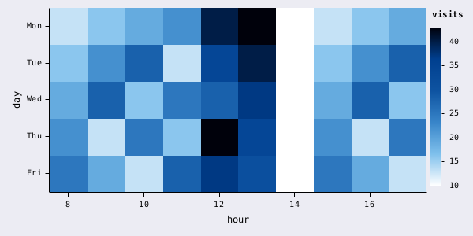
:::


This option writes the value in each cell, in the `:tile-value` text role; the cell shape and outline are the [Cell
style](reference.shared_options.html#cell-style) group. The panels below write the values, then a word above 30:


```{=html}
<dl class="options"><div class="option-card"><dt><code>:value-label</code><span class="option-default">Default: <code>false</code></span></dt><dd><div class="option-example"><code>(chart/tile {:value-label true})</code></div><div class="option-text">Writes a label in each cell, in the <code>:tile-value</code> text role: by default black or white by the fill under it.<ul><li><code>false</code> – No labels.</li><li><code>true</code> – The colour value; numbers to at most 2 decimals.</li><li><a href="reference.types.html#function">function</a> – A function of <code>{:value :x :y}</code> that returns the text; <code>nil</code> writes none.</li></ul></div></dd></div></dl>
```


::: {.sourceClojure}
```clojure
(plot/render-image (plot/arrange [{:data week-hours
                                   :mapping {:x :hour :y :day :color :visits}
                                   :charts [(chart/tile {:value-label true})]
                                   :scales {:y {:reverse true}}
                                   :labels {:title ":value-label true"}
                                   :legend false}
                                  {:data week-hours
                                   :mapping {:x :hour :y :day :color :visits}
                                   :charts [(chart/tile {:value-label #(when (< 30 (:value %)) "busy")})]
                                   :scales {:y {:reverse true}}
                                   :labels {:title "a function: \"busy\" above 30"}}]
                                 {:columns 2 :widths [1 1.15]})
                   {:width 1000 :height 300})
```
:::


::: {.clay-image}
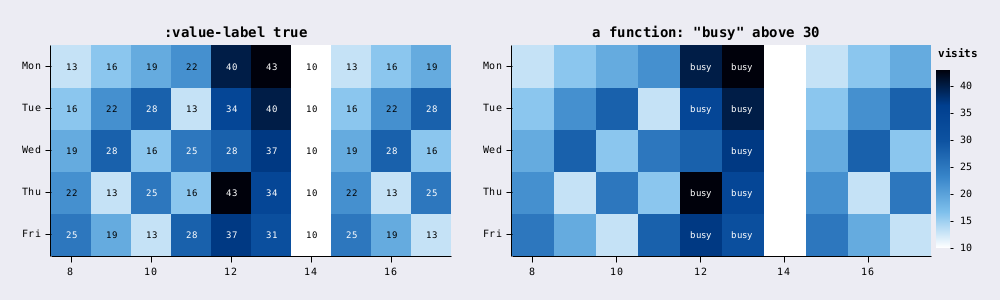
:::


A mapped `:size` shrinks each cell by its value. With the colour mapped to another variable, the size legend's keys
have no colour of their own: a theme key fills them. The plot below fills them orange:


```{=html}
<div class="mapping"><div class="mapping-title">Theme keys<span class="mapping-hint"> – set under <code>[:theme :chart :tile]</code>, not options</span></div><ul><li><code>:size-key-fill</code> (default <code>[180 180 180]</code>) – fill of a size legend key without a colour (theme only, not an option)</li></ul></div>
```


::: {.sourceClojure}
```clojure
(plot/render-image {:data week-hours
                    :mapping {:x :hour :y :day :color :day :size :visits}
                    :charts [(chart/tile)]
                    :scales {:y {:reverse true}}
                    :theme {:chart {:tile {:size-key-fill [200 120 60]}}}}
                   {:width 600 :height 300})
```
:::


::: {.clay-image}
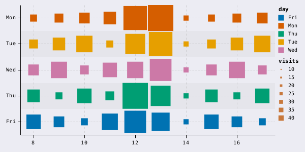
:::


## 2D bins

`chart/bin2d` counts points in cells, hexagons by default, and colours each cell by its count or another measure.
Use it when points are too many to draw: the colour shows where they crowd.


```{=html}
<div class="shared"><div class="shared-title">Shared options<span class="shared-hint"> – groups of options other charts take too</span></div><ul><li><a href="reference.shared_options.html#cell-style">Cell style</a> – <code>:cell</code> <code>:cell-scale</code> <code>:stroke-color</code> <code>:stroke-width</code> <code>:alpha-factor</code></li><li><a href="reference.shared_options.html#common-options">Common options</a> – <code>:data</code> <code>:mapping</code> <code>:legend</code></li><li><a href="reference.shared_options.html#named-theme-styles">Named theme styles</a> – <code>:theme-style</code></li></ul></div>
```


```{=html}
<div class="mapping"><div class="mapping-title">Mapping<span class="mapping-hint"> – the row values the chart reads, under <code>:mapping</code></span></div><ul><li><code>:x</code> <span class="required">required</span> – The x of each point, a number.</li><li><code>:y</code> <span class="required">required</span> – The y of each point, a number.</li><li><code>:color</code> – Must be <code>nil</code>: the cell colour shows <code>:measure</code>. Set <code>:color nil</code> in the chart's own mapping when the plot maps <code>:color</code>.</li></ul></div>
```


::: {.sourceClojure}
```clojure
(plot/render-image {:data faithful
                    :mapping {:x :eruptions :y :waiting}
                    :charts [(chart/bin2d)]
                    :labels {:x "eruption [min]" :y "waiting [min]"}}
                   {:width 600 :height 400})
```
:::


::: {.clay-image}
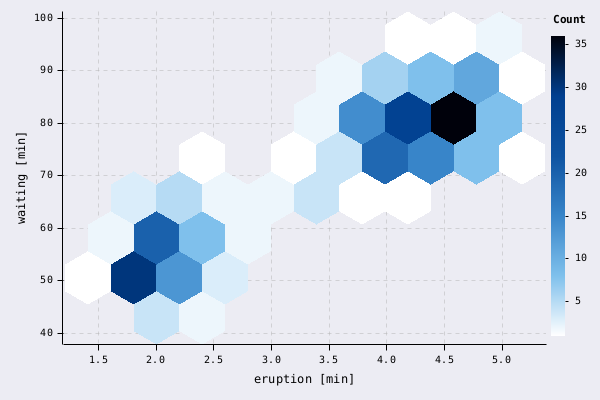
:::


These options set the cell size (by a rule, a count or a width), the shape of the binning space and what the colour
measures. The panels below use 10 cells across, a cell width in a flatter space, and percentages:


```{=html}
<dl class="options"><div class="option-card"><dt><code>:bins</code><span class="option-default">Default: <code>:scott-correlated</code></span></dt><dd><div class="option-example"><code>(chart/bin2d {:bins :scott})</code></div><div class="option-text">How big the cells are. The rules estimate a cell area from the points; <code>:binwidth</code> wins over this option.<ul><li><code>:scott-correlated</code> – The normal-reference rule taking the axes' correlation into account; smaller cells than <code>:scott</code> for correlated points.</li><li><code>:scott</code> – The normal-reference rule for uncorrelated points.</li><li><code>:freedman-diaconis</code> – <code>:scott</code> with each standard deviation replaced by <code>IQR / 1.349</code>; robust to outliers.</li><li><code>:cross-validation</code> – The cell size that minimises a cross-validated estimate of the error.</li><li><code>:shimazaki-shinomoto</code> – The cell size that minimises the Shimazaki-Shinomoto cost.</li><li><a href="reference.types.html#positive-integer">positive integer</a> – That many cells across the x range.</li></ul></div></dd></div><div class="option-card"><dt><code>:binwidth</code><span class="option-default">Default: None: <code>:bins</code> sizes the cells.</span></dt><dd><div class="option-example"><code>(chart/bin2d {:binwidth 1})</code></div><div class="option-text">The cell size in x data units, in log10 units on a <code>:log</code> axis; it wins over <code>:bins</code>.<ul><li><a href="reference.types.html#positive-finite-number">positive finite number</a></li></ul></div></dd></div><div class="option-card"><dt><code>:aspect</code><span class="option-default">Default: The panel's height over its width, estimated from the plot size and facet layout; with the plot's <code>:aspect :iso</code>, the y span over the x span.</span></dt><dd><div class="option-example"><code>(chart/bin2d {:aspect 3})</code></div><div class="option-text">The height-to-width ratio of the space the chart bins in; cells look regular when it matches the panel's.<ul><li><a href="reference.types.html#positive-finite-number">positive finite number</a></li></ul></div></dd></div><div class="option-card"><dt><code>:measure</code><span class="option-default">Default: <code>:count</code></span></dt><dd><div class="option-example"><code>(chart/bin2d {:measure :percent})</code></div><div class="option-text">What a cell's colour shows.<ul><li><code>:count</code> – The number of points in the cell.</li><li><code>:percent</code> – The cell's share of the panel's points in percent.</li><li><code>:pmf</code> – The cell's share of the panel's points as a fraction.</li><li><code>:density</code> – The share divided by the cell area, in log10 units on a <code>:log</code> axis.</li></ul></div></dd></div></dl>
```


::: {.sourceClojure}
```clojure
(plot/render-image (plot/arrange [{:data faithful
                                   :mapping {:x :eruptions :y :waiting}
                                   :charts [(chart/bin2d {:bins 10})]
                                   :labels {:title ":bins 10"}
                                   :legend false}
                                  {:data faithful
                                   :mapping {:x :eruptions :y :waiting}
                                   :charts [(chart/bin2d {:binwidth 0.25 :aspect 0.5})]
                                   :labels {:title ":binwidth 0.25 :aspect 0.5"}
                                   :legend false}
                                  {:data faithful
                                   :mapping {:x :eruptions :y :waiting}
                                   :charts [(chart/bin2d {:measure :percent})]
                                   :labels {:title ":measure :percent"}}]
                                 {:columns 3 :widths [1 1 1.3]})
                   {:width 1000 :height 320})
```
:::


::: {.clay-image}
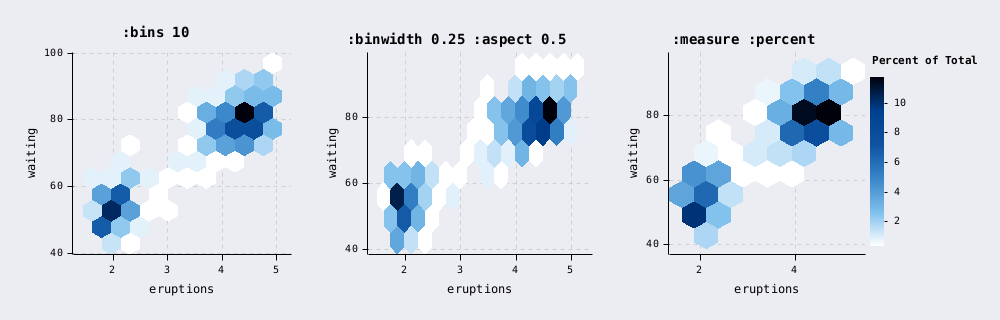
:::


The next panels compare the other rules (the default `:scott-correlated` is above); each picks its own cell size:


::: {.sourceClojure}
```clojure
(plot/render-image (plot/arrange [{:data faithful
                                   :mapping {:x :eruptions :y :waiting}
                                   :charts [(chart/bin2d {:bins :scott})]
                                   :labels {:title ":bins :scott"}
                                   :legend false}
                                  {:data faithful
                                   :mapping {:x :eruptions :y :waiting}
                                   :charts [(chart/bin2d {:bins :freedman-diaconis})]
                                   :labels {:title ":bins :freedman-diaconis"}
                                   :legend false}
                                  {:data faithful
                                   :mapping {:x :eruptions :y :waiting}
                                   :charts [(chart/bin2d {:bins :cross-validation})]
                                   :labels {:title ":bins :cross-validation"}
                                   :legend false}
                                  {:data faithful
                                   :mapping {:x :eruptions :y :waiting}
                                   :charts [(chart/bin2d {:bins :shimazaki-shinomoto})]
                                   :labels {:title ":bins :shimazaki-shinomoto"}
                                   :legend false}]
                                 {:columns 2})
                   {:width 900 :height 600})
```
:::


::: {.clay-image}
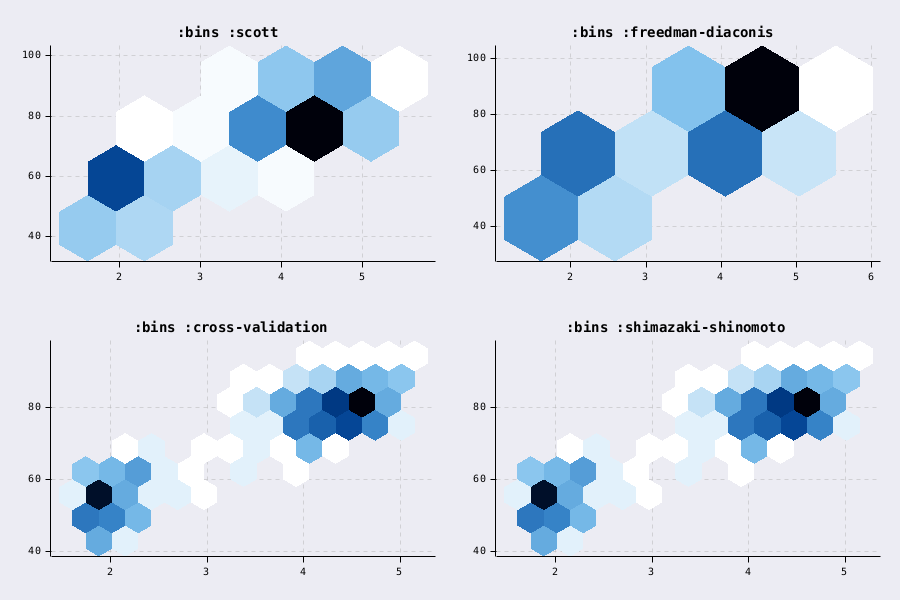
:::


The last panels colour by the share of the panel's points (`:pmf`) and by the density; their legends show the
scales:


::: {.sourceClojure}
```clojure
(plot/render-image (plot/arrange [{:data faithful
                                   :mapping {:x :eruptions :y :waiting}
                                   :charts [(chart/bin2d {:measure :pmf})]
                                   :labels {:title ":measure :pmf"}}
                                  {:data faithful
                                   :mapping {:x :eruptions :y :waiting}
                                   :charts [(chart/bin2d {:measure :density})]
                                   :labels {:title ":measure :density"}}]
                                 {:columns 2})
                   {:width 900 :height 340})
```
:::


::: {.clay-image}
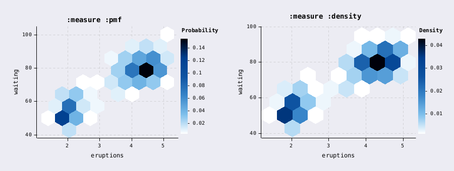
:::


## Raster fields

`chart/field` draws a scalar field as a raster: the density of mapped points, gridded values interpolated, or a
function of a point (the [Fields](reference.shared_options.html#fields) group). Use it to show a smooth value over
a plane, coloured through the colour scale.


```{=html}
<div class="shared"><div class="shared-title">Shared options<span class="shared-hint"> – groups of options other charts take too</span></div><ul><li><a href="reference.shared_options.html#fields">Fields</a> – <code>:f</code> <code>:domain</code> <code>:kernel</code> <code>:bandwidth</code> <code>:binned</code> <code>:cut</code> <code>:interpolation</code> <code>:n</code></li><li><a href="reference.shared_options.html#common-options">Common options</a> – <code>:data</code> <code>:mapping</code> <code>:legend</code></li><li><a href="reference.shared_options.html#named-theme-styles">Named theme styles</a> – <code>:theme-style</code></li></ul></div>
```


```{=html}
<div class="mapping"><div class="mapping-title">Mapping<span class="mapping-hint"> – the row values the chart reads, under <code>:mapping</code></span></div><ul><li><code>:x</code> – The x of the points whose density the chart estimates, or of the gridded values.</li><li><code>:y</code> – The y of the points whose density the chart estimates, or of the gridded values.</li><li><code>:value</code> – The field's value at each point of a full lattice of x and y, interpolated between them; unmapped, the field is the density of the points.</li><li><code>:color</code> – Must be <code>nil</code>: the colour shows the field's value. Set <code>:color nil</code> in the chart's own mapping when the plot maps <code>:color</code>.</li></ul></div>
```


::: {.sourceClojure}
```clojure
(plot/render-image (plot/arrange [{:data faithful
                                   :mapping {:x :eruptions :y :waiting}
                                   :charts [(chart/field)]
                                   :labels {:title "density of the points"}
                                   :legend false}
                                  {:data volcano
                                   :mapping {:x :column :y :row :value :height}
                                   :charts [(chart/field)]
                                   :labels {:title "gridded :value"}}]
                                 {:columns 2 :widths [1 1.2]})
                   {:width 1000 :height 380})
```
:::


::: {.clay-image}
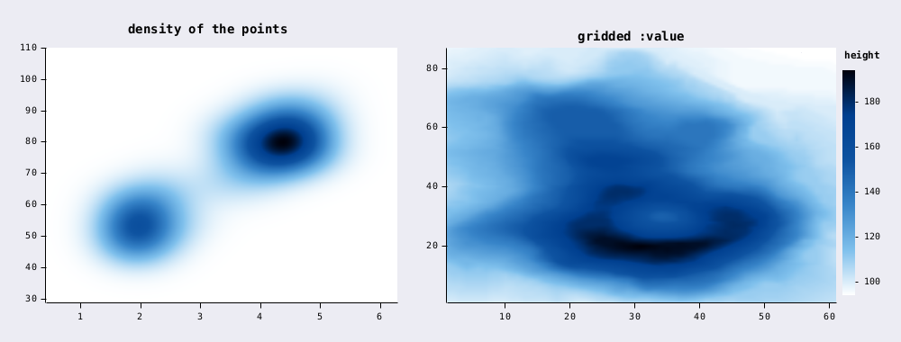
:::


These options set the raster's opacity, or colour each pixel by a function instead of a field. The panels below draw
a translucent density under the points, then a colour per point of a disc:


```{=html}
<dl class="options"><div class="option-card"><dt><code>:alpha-factor</code><span class="option-default">Default: <code>1.0</code> (theme)</span></dt><dd><div class="option-example"><code>(chart/field {:alpha-factor 0.4})</code></div><div class="option-text">How opaque the raster is: a factor on the colours' own alpha.<ul><li><a href="reference.types.html#fraction">fraction</a></li></ul></div></dd></div><div class="option-card"><dt><code>:pixel-color</code><span class="option-default">Default: None: the field's value colours the raster through the colour scale.</span></dt><dd><div class="option-example"><code>(chart/field {:domain {:x [-1 1], :y [-1 1]}, :pixel-color (fn [[x y]] (if (m/pos? (m/* x y)) :steelblue :orange))})</code></div><div class="option-text">Colours each pixel by a function of its point <code>[x y]</code> instead of a field, <code>nil</code> leaving it transparent: a raster over <code>:domain</code> (else the plot's x and y domains) with no colour scale or legend. A chart with <code>:f</code> rejects it.<ul><li><a href="reference.types.html#function">function</a></li></ul></div></dd></div></dl>
```


::: {.sourceClojure}
```clojure
(plot/render-image (plot/arrange [{:data faithful
                                   :mapping {:x :eruptions :y :waiting}
                                   :charts [(chart/field {:alpha-factor 0.5}) (chart/scatter {:size 3 :color :black})]
                                   :labels {:title ":alpha-factor 0.5, points over it"}
                                   :legend false}
                                  {:charts [(chart/field {:domain {:x [-2 2] :y [-2 2]}
                                                          :pixel-color (fn [[x y]]
                                                                         (when (< (+ (* x x) (* y y)) 3)
                                                                           [(int (* 60 (+ x 2))) 80 (int (* 60 (+ y 2)))]))})]
                                   :labels {:title ":pixel-color - a colour per point"}}]
                                 {:columns 2})
                   {:width 900 :height 380})
```
:::


::: {.clay-image}
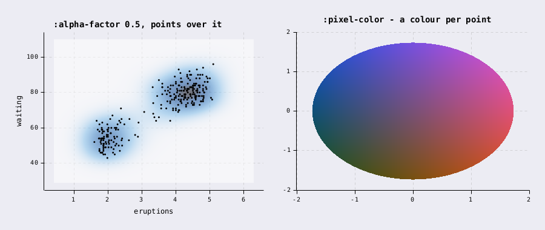
:::


### Field sources

The [Fields](reference.shared_options.html#fields) group gives the field. The panels below sample a function of a
point `[x y]` over a `:domain`, then on a coarse grid of 12 points per axis, which shows its cells:


::: {.sourceClojure}
```clojure
(plot/render-image (plot/arrange [{:charts [(chart/field {:f (fn [[x y]] (m/sin (+ (* x x) (* y y))))
                                                          :domain {:x [-2 2] :y [-2 2]}})]
                                   :labels {:title ":f over :domain"}
                                   :legend false}
                                  {:charts [(chart/field {:f (fn [[x y]] (m/sin (+ (* x x) (* y y))))
                                                          :domain {:x [-2 2] :y [-2 2]} :n 12})]
                                   :labels {:title ":n 12"}}]
                                 {:columns 2 :widths [1 1.2]})
                   {:width 900 :height 380})
```
:::


::: {.clay-image}
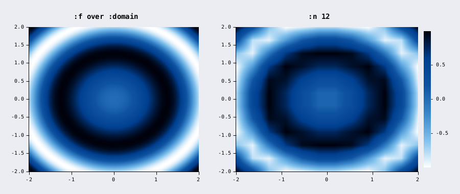
:::


The chart interpolates gridded values between the lattice points, here of a 5 x 5 lattice:


::: {.sourceClojure}
```clojure
(def lattice (for [x (range 5) y (range 5)] {:x x :y y :z (* (m/sin x) (m/cos (* 0.8 y)))}))
```
:::


```{=html}
<div class="data-table"><table class="table table-hover table-responsive clay-table"><thead><tr><th>x</th><th>y</th><th>z</th></tr></thead><tbody><tr><td>0</td><td>0</td><td>0.0</td></tr><tr><td>0</td><td>1</td><td>0.0</td></tr><tr><td>0</td><td>2</td><td>-0.0</td></tr><tr><td>0</td><td>3</td><td>-0.0</td></tr><tr><td>0</td><td>4</td><td>-0.0</td></tr><tr><td>1</td><td>0</td><td>0.8414709848078965</td></tr><tr><td>1</td><td>1</td><td>0.5862584808366281</td></tr><tr><td>1</td><td>2</td><td>-0.024570550786785637</td></tr><tr><td>1</td><td>3</td><td>-0.620495416007646</td></tr><tr><td>1</td><td>4</td><td>-0.8400360881165891</td></tr><tr><td>2</td><td>0</td><td>0.9092974268256817</td></tr><tr><td>2</td><td>1</td><td>0.6335136180615656</td></tr><tr><td>2</td><td>2</td><td>-0.02655105049310103</td></tr><tr><td>2</td><td>3</td><td>-0.6705102080990835</td></tr><tr><td>2</td><td>4</td><td>-0.9077468708436899</td></tr><tr><td>3</td><td>0</td><td>0.1411200080598672</td></tr><tr><td>3</td><td>1</td><td>0.09831925643843555</td></tr><tr><td>3</td><td>2</td><td>-0.00412063682250215</td></tr><tr><td>3</td><td>3</td><td>-0.10406100708047604</td></tr><tr><td>3</td><td>4</td><td>-0.14087936680627888</td></tr><tr><td>4</td><td>0</td><td>-0.7568024953079282</td></tr><tr><td>4</td><td>1</td><td>-0.5272693761317102</td></tr><tr><td>4</td><td>2</td><td>0.022098271339414874</td></tr><tr><td>4</td><td>3</td><td>0.5580614039459993</td></tr><tr><td>4</td><td>4</td><td>0.7555119773743378</td></tr></tbody></table></div>
```


::: {.sourceClojure}
```clojure
(plot/render-image (plot/arrange [{:data lattice
                                   :mapping {:x :x :y :y :value :z}
                                   :charts [(chart/field {:interpolation :bilinear})]
                                   :labels {:title ":interpolation :bilinear"}
                                   :legend false}
                                  {:data lattice
                                   :mapping {:x :x :y :y :value :z}
                                   :charts [(chart/field {:interpolation :bicubic})]
                                   :labels {:title ":interpolation :bicubic"}
                                   :legend false}
                                  {:data lattice
                                   :mapping {:x :x :y :y :value :z}
                                   :charts [(chart/field {:interpolation :cubic-2d})]
                                   :labels {:title ":interpolation :cubic-2d"}}]
                                 {:columns 3 :widths [1 1 1.25]})
                   {:width 1000 :height 320})
```
:::


::: {.clay-image}

:::


The next panels change the density estimate of mapped points: its kernel and bandwidth, a binned estimate (faster on many
points), and how far the domain reaches past the points (`:cut`, in bandwidths):


::: {.sourceClojure}
```clojure
(plot/render-image (plot/arrange [{:data faithful
                                   :mapping {:x :eruptions :y :waiting}
                                   :charts [(chart/field {:kernel :epanechnikov :bandwidth [0.2 4]})]
                                   :labels {:title "epanechnikov, bandwidth [0.2 4]"}
                                   :legend false}
                                  {:data faithful
                                   :mapping {:x :eruptions :y :waiting}
                                   :charts [(chart/field {:binned true})]
                                   :labels {:title ":binned true"}
                                   :legend false}
                                  {:data faithful
                                   :mapping {:x :eruptions :y :waiting}
                                   :charts [(chart/field {:cut 0})]
                                   :labels {:title ":cut 0"}
                                   :legend false}]
                                 {:columns 3})
                   {:width 1000 :height 320})
```
:::


::: {.clay-image}
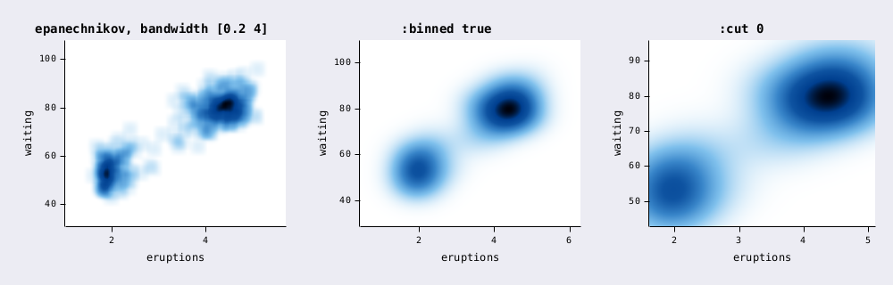
:::


## Contour lines

`chart/contour` draws the level lines, or filled bands, of a scalar field from the same sources as `chart/field`;
categorical groups give a field each. Use it to read heights off a field, or to compare the densities of groups.


```{=html}
<div class="shared"><div class="shared-title">Shared options<span class="shared-hint"> – groups of options other charts take too</span></div><ul><li><a href="reference.shared_options.html#line-style">Line style</a> – <code>:line-width</code> <code>:dash</code></li><li><a href="reference.shared_options.html#fields">Fields</a> – <code>:f</code> <code>:domain</code> <code>:kernel</code> <code>:bandwidth</code> <code>:binned</code> <code>:cut</code> <code>:interpolation</code> <code>:n</code></li><li><a href="reference.shared_options.html#common-options">Common options</a> – <code>:data</code> <code>:mapping</code> <code>:legend</code></li><li><a href="reference.shared_options.html#named-theme-styles">Named theme styles</a> – <code>:theme-style</code></li></ul></div>
```


```{=html}
<div class="mapping"><div class="mapping-title">Mapping<span class="mapping-hint"> – the row values the chart reads, under <code>:mapping</code></span></div><ul><li><code>:x</code> – The x of the points whose density the chart estimates, or of the gridded values.</li><li><code>:y</code> – The y of the points whose density the chart estimates, or of the gridded values.</li><li><code>:value</code> – The field's value at each point of a full lattice of x and y, interpolated between them; unmapped, the field is the density of the points.</li><li><code>:color</code> – Splits the rows into categorical groups, each its own field with lines in its colour; unmapped, the lines are coloured by level.</li><li><code>:dash</code> – Splits the rows into groups, each its own field with lines in its dash style.</li><li><code>:group</code> – Splits the rows into groups that look the same, each its own field.</li></ul></div>
```


::: {.sourceClojure}
```clojure
(plot/render-image (plot/arrange [{:data volcano
                                   :mapping {:x :column :y :row :value :height}
                                   :charts [(chart/contour)]
                                   :labels {:title "gridded :value"}
                                   :legend false}
                                  {:data iris
                                   :mapping {:x :sepal-length :y :sepal-width :color :species}
                                   :charts [(chart/contour {:levels 6})]
                                   :labels {:title "a density per :color group"}}]
                                 {:columns 2 :widths [1 1.25]})
                   {:width 1000 :height 380})
```
:::


::: {.clay-image}

:::


These options set the levels, filled bands instead of lines, labels on the lines, one line colour and the opacity.
The panels below label lines at given heights, then fill 8 bands:


```{=html}
<dl class="options"><div class="option-card"><dt><code>:color</code><span class="option-default">Default: <code>[0 114 178]</code> (theme); Lines coloured by level; grouped lines without a mapped colour take the theme's colour, lines grouped by <code>:color</code> their group's.</span></dt><dd><div class="option-example"><code>(chart/contour {:color :black})</code></div><div class="option-text">One colour for every line or band, instead of colouring them by level; a mapped <code>:color</code> wins.<ul><li><code>:none</code> – Nothing drawn, unless <code>:color</code> is mapped.</li><li><a href="reference.types.html#solid-colour">solid colour</a> – Any other colour, e.g. <code>:black</code>.</li></ul></div></dd></div><div class="option-card"><dt><code>:alpha-factor</code><span class="option-default">Default: <code>1.0</code> (theme); The theme's; grouped filled contours take half of it.</span></dt><dd><div class="option-example"><code>(chart/contour {:alpha-factor 0.3})</code></div><div class="option-text">How opaque the lines or bands are: a factor on the colours' own alpha.<ul><li><a href="reference.types.html#fraction">fraction</a></li></ul></div></dd></div><div class="option-card"><dt><code>:levels</code><span class="option-default">Default: <code>10</code></span></dt><dd><div class="option-example"><code>(chart/contour {:levels 4})</code></div><div class="option-text">The values at which the chart draws contours.<ul><li><span>integer at least 1 and at most 1000</span> – That many levels, evenly spread over the range of the sampled values, the ends left out.</li><li><span>vector of finite numbers</span> – The level values, e.g. <code>[0.1 0.2 0.4]</code>.</li></ul></div></dd></div><div class="option-card"><dt><code>:filled</code><span class="option-default">Default: <code>false</code></span></dt><dd><div class="option-example"><code>(chart/contour {:filled true})</code></div><div class="option-text">Whether the chart fills bands between levels instead of drawing lines.<ul><li><code>false</code> – Draws lines.</li><li><code>true</code> – Fills the region at or above each level; coloured by level, each band takes the colour of its middle value.</li></ul></div></dd></div><div class="option-card"><dt><code>:labels</code><span class="option-default">Default: <code>false</code></span></dt><dd><div class="option-example"><code>(chart/contour {:labels true})</code></div><div class="option-text">Writes its level on each line; filled contours reject the option.<ul><li><code>false</code> – No labels.</li><li><code>true</code> – The level as a number.</li><li><a href="reference.types.html#function">function</a> – A function of <code>{:level v}</code> that returns the text; <code>nil</code> writes none.</li></ul></div></dd></div></dl>
```


::: {.sourceClojure}
```clojure
(plot/render-image (plot/arrange [{:data volcano
                                   :mapping {:x :column :y :row :value :height}
                                   :charts [(chart/contour {:levels [100 120 140 160 180] :labels true
                                                            :color [40 40 40]})]
                                   :labels {:title ":levels vector, :labels true"}}
                                  {:data volcano
                                   :mapping {:x :column :y :row :value :height}
                                   :charts [(chart/contour {:filled true :levels 8 :alpha-factor 0.8})]
                                   :labels {:title ":filled true :levels 8"}}]
                                 {:columns 2 :widths [1 1.25]})
                   {:width 1000 :height 380})
```
:::


::: {.clay-image}
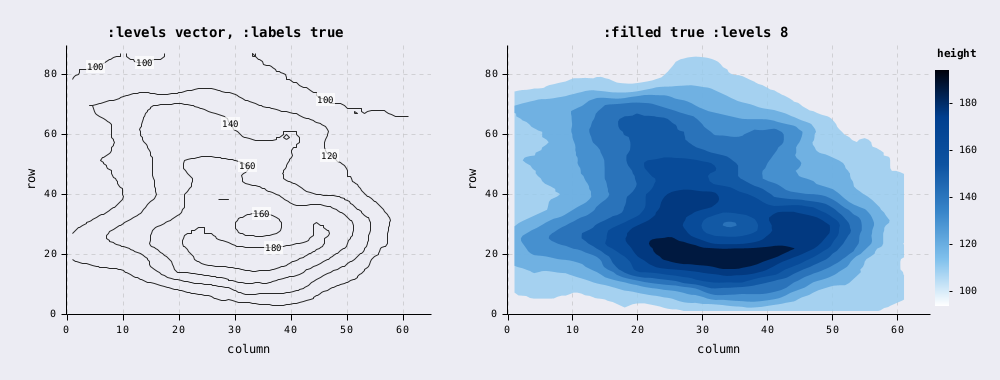
:::


### Contour sources

The panels below take the sources of `chart/field`: a function over a domain (its lines angular on a coarse grid),
interpolated gridded values and a density with its own bandwidth:


::: {.sourceClojure}
```clojure
(plot/render-image (plot/arrange [{:charts [(chart/contour {:f (fn [[x y]] (+ (* x x) (* 2 y y) (* x y)))
                                                            :domain {:x [-2 2] :y [-2 2]} :labels true})]
                                   :labels {:title ":f over :domain"}
                                   :legend false}
                                  {:charts [(chart/contour {:f (fn [[x y]] (+ (* x x) (* 2 y y) (* x y)))
                                                            :domain {:x [-2 2] :y [-2 2]} :n 6})]
                                   :labels {:title ":n 6"}
                                   :legend false}
                                  {:data lattice
                                   :mapping {:x :x :y :y :value :z}
                                   :charts [(chart/contour {:interpolation :bicubic :levels 8})]
                                   :labels {:title "5 x 5 lattice, :bicubic"}
                                   :legend false}
                                  {:data faithful
                                   :mapping {:x :eruptions :y :waiting}
                                   :charts [(chart/scatter {:size 3 :color [0 0 0 80]})
                                            (chart/contour {:bandwidth [0.15 3] :cut 1})]
                                   :labels {:title ":bandwidth [0.15 3] :cut 1"}}]
                                 {:columns 2 :widths [1 1.25]})
                   {:width 900 :height 640})
```
:::


::: {.clay-image}
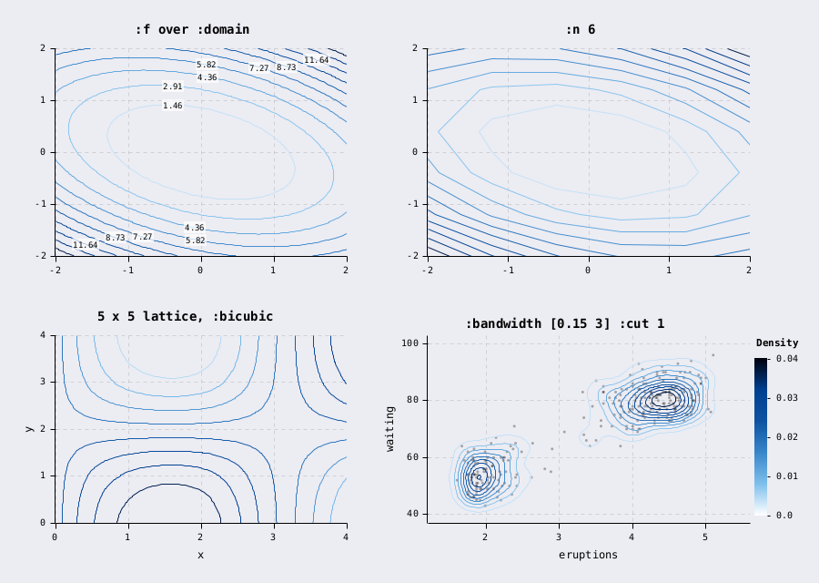
:::


```{=html}
<div style="background-color:grey;height:2px;width:100%;"></div>
```


```{=html}
<div><pre><small><small>source: notebooks/reference/charts_bins_fields.clj</small></small></pre></div>
```