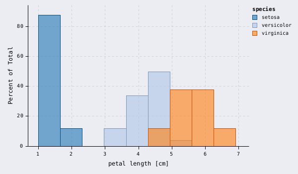
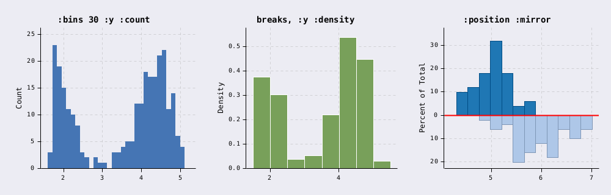
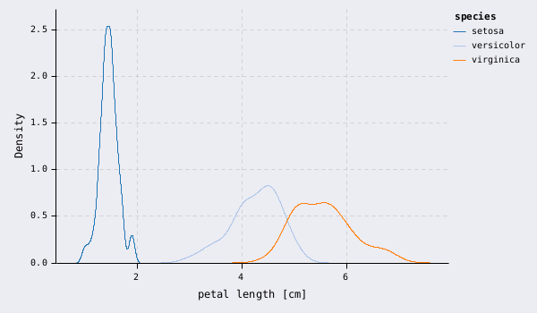
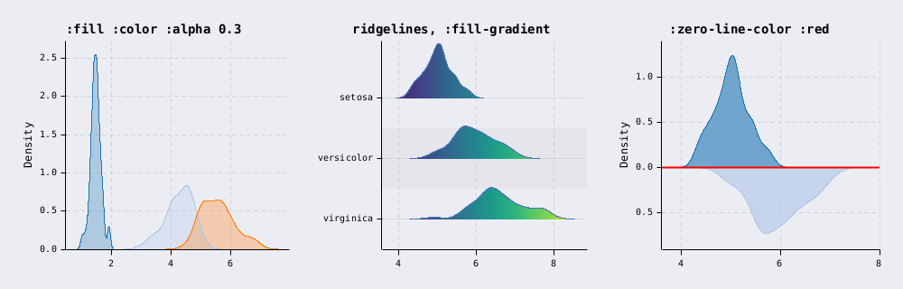
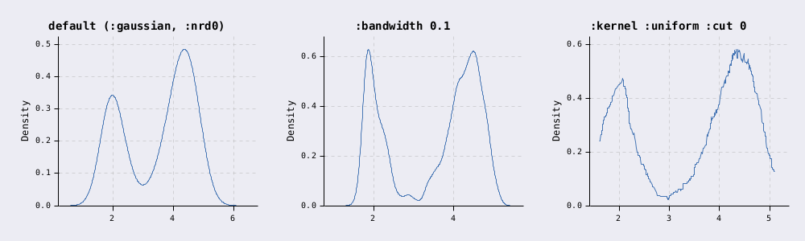
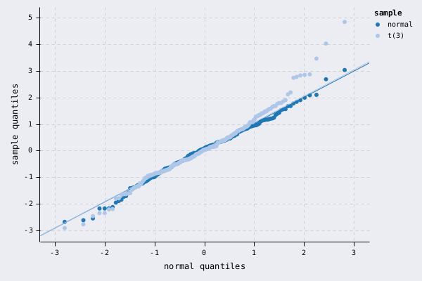
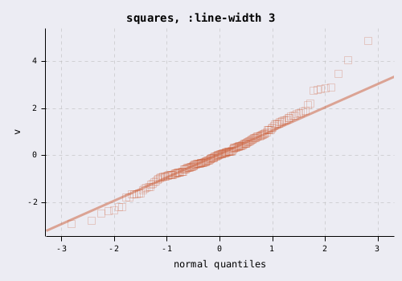
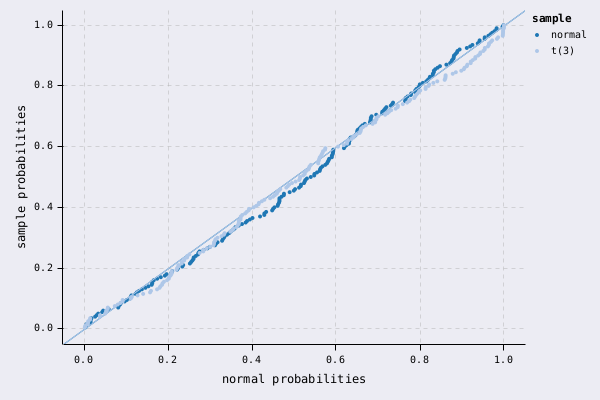
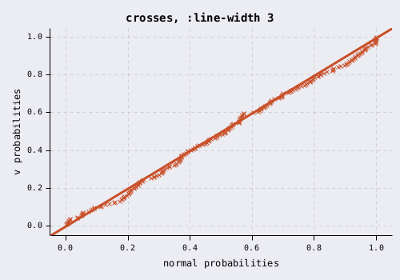
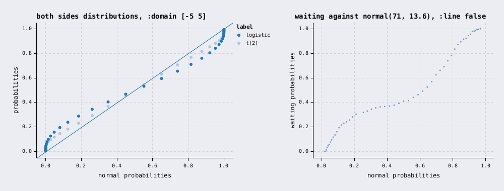

---
format:
  html: {toc: true, toc-location: right, toc-depth: 4, theme: cosmo}
code-block-background: true

---
<style></style><style>.printedClojure .sourceCode {
  background-color: transparent;
  border-style: none;
}
</style><style>.clay-limit-image-width .clay-image {max-width: 100%}
.clay-side-by-side .sourceCode {margin: 0}
.clay-side-by-side {margin: 1em 0}
</style>
<script src="https://code.jquery.com/jquery-3.6.0.min.js" type="text/javascript"></script><script src="https://code.jquery.com/ui/1.13.1/jquery-ui.min.js" type="text/javascript"></script>

# Charts: distribution statistics

Charts computing a statistic of the values on one axis: binned counts (`histogram`), kernel density curves
(`density`), the empirical distribution function (`ecdf`) and the comparison of two distributions by quantiles
(`qq`) or probabilities (`pp`).


::: {.sourceClojure}
```clojure
(ns reference.charts-distribution-stats
  (:require [fastmath.random :as r]
            [cljplot2.chart :as chart]
            [cljplot2.core :as plot]
            [cljplot2.describe :as describe]
            [notebook-utils :as nu]))
```
:::


Data: Edgar Anderson's iris measurements, R datasets package `iris` (Anderson 1935; Fisher 1936); licence: Part of R (GPL-2 | GPL-3).


::: {.sourceClojure}
```clojure
(def iris (nu/dataset :iris))
```
:::


::: {.clay-table}

```{=html}
<table class="table table-hover table-responsive clay-table"><thead><tr><th>sepal-length</th><th>sepal-width</th><th>petal-length</th><th>petal-width</th><th>species</th></tr></thead><tbody><tr><td>5.1</td><td>3.5</td><td>1.4</td><td>0.2</td><td>setosa</td></tr><tr><td>4.9</td><td>3</td><td>1.4</td><td>0.2</td><td>setosa</td></tr><tr><td>4.7</td><td>3.2</td><td>1.3</td><td>0.2</td><td>setosa</td></tr><tr><td>4.6</td><td>3.1</td><td>1.5</td><td>0.2</td><td>setosa</td></tr><tr><td>5</td><td>3.6</td><td>1.4</td><td>0.2</td><td>setosa</td></tr><tr><td>5.4</td><td>3.9</td><td>1.7</td><td>0.4</td><td>setosa</td></tr><tr><td>4.6</td><td>3.4</td><td>1.4</td><td>0.3</td><td>setosa</td></tr><tr><td>5</td><td>3.4</td><td>1.5</td><td>0.2</td><td>setosa</td></tr><tr><td>4.4</td><td>2.9</td><td>1.4</td><td>0.2</td><td>setosa</td></tr><tr><td>4.9</td><td>3.1</td><td>1.5</td><td>0.1</td><td>setosa</td></tr><tr><td>5.4</td><td>3.7</td><td>1.5</td><td>0.2</td><td>setosa</td></tr><tr><td>4.8</td><td>3.4</td><td>1.6</td><td>0.2</td><td>setosa</td></tr><tr><td>4.8</td><td>3</td><td>1.4</td><td>0.1</td><td>setosa</td></tr><tr><td>4.3</td><td>3</td><td>1.1</td><td>0.1</td><td>setosa</td></tr><tr><td>5.8</td><td>4</td><td>1.2</td><td>0.2</td><td>setosa</td></tr><tr><td>5.7</td><td>4.4</td><td>1.5</td><td>0.4</td><td>setosa</td></tr><tr><td>5.4</td><td>3.9</td><td>1.3</td><td>0.4</td><td>setosa</td></tr><tr><td>5.1</td><td>3.5</td><td>1.4</td><td>0.3</td><td>setosa</td></tr><tr><td>5.7</td><td>3.8</td><td>1.7</td><td>0.3</td><td>setosa</td></tr><tr><td>5.1</td><td>3.8</td><td>1.5</td><td>0.3</td><td>setosa</td></tr></tbody></table>
```

:::


Data: Old Faithful geyser eruptions, R datasets package `faithful` (Härdle 1991; Azzalini & Bowman 1990); licence: Part of R (GPL-2 | GPL-3).


::: {.sourceClojure}
```clojure
(def faithful (nu/dataset :faithful))
```
:::


::: {.clay-table}

```{=html}
<table class="table table-hover table-responsive clay-table"><thead><tr><th>eruptions</th><th>waiting</th></tr></thead><tbody><tr><td>3.6</td><td>79</td></tr><tr><td>1.8</td><td>54</td></tr><tr><td>3.333</td><td>74</td></tr><tr><td>2.283</td><td>62</td></tr><tr><td>4.533</td><td>85</td></tr><tr><td>2.883</td><td>55</td></tr><tr><td>4.7</td><td>88</td></tr><tr><td>3.6</td><td>85</td></tr><tr><td>1.95</td><td>51</td></tr><tr><td>4.35</td><td>85</td></tr><tr><td>1.833</td><td>54</td></tr><tr><td>3.917</td><td>84</td></tr><tr><td>4.2</td><td>78</td></tr><tr><td>1.75</td><td>47</td></tr><tr><td>4.7</td><td>83</td></tr><tr><td>2.167</td><td>52</td></tr><tr><td>1.75</td><td>62</td></tr><tr><td>4.8</td><td>84</td></tr><tr><td>1.6</td><td>52</td></tr><tr><td>4.25</td><td>79</td></tr></tbody></table>
```

:::


Two species only - for the charts drawing two groups against each other:


::: {.sourceClojure}
```clojure
(def two-species (filter #(#{"setosa" "versicolor"} (:species %)) iris))
```
:::


::: {.clay-table}

```{=html}
<table class="table table-hover table-responsive clay-table"><thead><tr><th>sepal-length</th><th>sepal-width</th><th>petal-length</th><th>petal-width</th><th>species</th></tr></thead><tbody><tr><td>5.1</td><td>3.5</td><td>1.4</td><td>0.2</td><td>setosa</td></tr><tr><td>4.9</td><td>3</td><td>1.4</td><td>0.2</td><td>setosa</td></tr><tr><td>4.7</td><td>3.2</td><td>1.3</td><td>0.2</td><td>setosa</td></tr><tr><td>4.6</td><td>3.1</td><td>1.5</td><td>0.2</td><td>setosa</td></tr><tr><td>5</td><td>3.6</td><td>1.4</td><td>0.2</td><td>setosa</td></tr><tr><td>5.4</td><td>3.9</td><td>1.7</td><td>0.4</td><td>setosa</td></tr><tr><td>4.6</td><td>3.4</td><td>1.4</td><td>0.3</td><td>setosa</td></tr><tr><td>5</td><td>3.4</td><td>1.5</td><td>0.2</td><td>setosa</td></tr><tr><td>4.4</td><td>2.9</td><td>1.4</td><td>0.2</td><td>setosa</td></tr><tr><td>4.9</td><td>3.1</td><td>1.5</td><td>0.1</td><td>setosa</td></tr><tr><td>5.4</td><td>3.7</td><td>1.5</td><td>0.2</td><td>setosa</td></tr><tr><td>4.8</td><td>3.4</td><td>1.6</td><td>0.2</td><td>setosa</td></tr><tr><td>4.8</td><td>3</td><td>1.4</td><td>0.1</td><td>setosa</td></tr><tr><td>4.3</td><td>3</td><td>1.1</td><td>0.1</td><td>setosa</td></tr><tr><td>5.8</td><td>4</td><td>1.2</td><td>0.2</td><td>setosa</td></tr><tr><td>5.7</td><td>4.4</td><td>1.5</td><td>0.4</td><td>setosa</td></tr><tr><td>5.4</td><td>3.9</td><td>1.3</td><td>0.4</td><td>setosa</td></tr><tr><td>5.1</td><td>3.5</td><td>1.4</td><td>0.3</td><td>setosa</td></tr><tr><td>5.7</td><td>3.8</td><td>1.7</td><td>0.3</td><td>setosa</td></tr><tr><td>5.1</td><td>3.8</td><td>1.5</td><td>0.3</td><td>setosa</td></tr></tbody></table>
```

:::


## histogram

Bars counting the values falling into each bin; groups overlay, dodge, stack or mirror, and a categorical `:y`
gives one histogram per level (ridgelines).

::: {.clay-table}

```{=html}
<table class="table table-hover table-responsive clay-table"><thead><tr><th>Option</th><th>Type</th><th>Default</th><th>Description</th></tr></thead><tbody><tr><td>:x (required)</td><td>a keyword, a function or a categorical marker of one</td><td></td><td>values to bin (data units)</td></tr><tr><td>:y</td><td>a keyword, a function or a categorical marker of one or nil</td><td></td><td>ridgeline levels: categorical or on a :bands scale, one histogram per level (a numeric :y otherwise is ignored)</td></tr><tr><td>:color</td><td>a keyword, a function or a categorical marker of one or nil</td><td></td><td>groups, each with its own bar fill colour</td></tr><tr><td>:pattern</td><td>a keyword, a function or a categorical marker of one or nil</td><td></td><td>groups, each with its own fill pattern</td></tr><tr><td>:group</td><td>a keyword, a function or a categorical marker of one or nil</td><td></td><td>groups without a visual aesthetic</td></tr></tbody></table>
```

:::


::: {.sourceClojure}
```clojure
(plot/render-image {:data iris
                    :mapping {:x :petal-length :color :species}
                    :charts [(chart/histogram)]
                    :labels {:x "petal length [cm]"}}
                   {:width 600 :height 350})
```
:::


::: {.clay-image}

:::


Its options: the bins (a method, a count or breaks), what a bar's height measures, how groups combine, the bar
style and the zero line of mirrored groups:

::: {.clay-table}

```{=html}
<table class="table table-hover table-responsive clay-table"><thead><tr><th>Option</th><th>Type</th><th>Default</th><th>Description</th></tr></thead><tbody><tr><td>:color</td><td>a clojure2d color</td><td>[69 117 180]</td><td>bar fill colour (a mapped :color wins)</td></tr><tr><td>:stroke-color</td><td>:darker or a clojure2d color or :none</td><td>:darker</td><td>outline colour: a colour, :none or :darker (the darkened fill)</td></tr><tr><td>:stroke-width</td><td>a non-negative number</td><td>1</td><td>outline width in pixels</td></tr><tr><td>:alpha</td><td>a number in [0 1]</td><td>0.6</td><td>fill opacity of grouped bars with :position :overlay (other bars are opaque)</td></tr><tr><td>:zero-line-color</td><td>a clojure2d color or :none</td><td>:black</td><td>colour of the y = 0 line drawn with :position :mirror</td></tr><tr><td>:zero-line-width</td><td>a non-negative number</td><td>1</td><td>width in pixels of the y = 0 line drawn with :position :mirror</td></tr><tr><td>:bins</td><td>keyword or vector of a finite number (at least 2) or quantile bins {:quantiles q :estimation e}: q a positive count or a vector of increasing probabilities strictly between 0 and 1, e one of [:legacy :r1 :r2 :r3 :r4 :r5 :r6 :r7 :r8 :r9] or a positive integer</td><td>:sturges</td><td>bins shared by all panels and groups: a fastmath estimation method (:sturges :sqrt :rice :doane :scott :freedman-diaconis), a bin count or increasing breaks (values outside dropped)</td></tr><tr><td>:y</td><td>one of :cumulative :percent :count :pmf :density</td><td>:percent</td><td>bar height: :percent (of the panel's or group's total), :count, :pmf (shares summing to 1), :density (area 1) or :cumulative (count of the bin and every bin before it)</td></tr><tr><td>:position</td><td>one of :dodge :mirror :normalize :overlay :stack</td><td>:overlay</td><td>grouped bars: :overlay (translucent), :dodge, :stack, :normalize (stacked to 1) or :mirror (two groups, the second downward); ridgelines: :overlay or :mirror</td></tr><tr><td>:symmetric</td><td>true or false or nil</td><td>false</td><td>with :position :mirror, tie both halves to one y range [-M M], M the tallest bar over all panels</td></tr><tr><td>:zero-line</td><td>true or false or nil</td><td>true</td><td>with :position :mirror, draw the y = 0 line over the bars</td></tr><tr><td>:padding</td><td>map of one of :x :y to [lo hi], non-negative numbers</td><td>{:x [0.05 0.05] :y [0 0.05]} (bars stand on the panel's bottom edge); y [0.05 0.05] with :position :mirror</td><td>padding of the data span per position axis, {:x [lo hi] :y [lo hi]} fractions of the span</td></tr></tbody></table>
```

:::


::: {.sourceClojure}
```clojure
(plot/render-image (plot/arrange [{:data faithful
                                   :mapping {:x :eruptions}
                                   :charts [(chart/histogram {:bins 30 :y :count :stroke-color :none})]
                                   :labels {:title ":bins 30 :y :count"}}
                                  {:data faithful
                                   :mapping {:x :eruptions}
                                   :charts [(chart/histogram {:bins [1.5 2 2.5 3 3.5 4 4.5 5 5.5] :y :density
                                                              :color [120 160 90] :stroke-color :white})]
                                   :labels {:title "breaks, :y :density"}}
                                  {:data two-species
                                   :mapping {:x :sepal-length :color :species}
                                   :charts [(chart/histogram {:position :mirror :bins 12 :zero-line-color :red
                                                              :zero-line-width 2})]
                                   :labels {:title ":position :mirror"}
                                   :legend false}]
                                 {:columns 3})
                   {:width 1000 :height 320})
```
:::


::: {.clay-image}

:::


Shared options: [Fill patterns](reference.shared_options.html#fill-patterns) (`:pattern` `:pattern-color`); [Data and mapping](reference.shared_options.html#data-and-mapping) (`:data` `:mapping`); [Rounded corners](reference.shared_options.html#rounded-corners) (`:corner-radius` `:corner-radius-end`); [Ridgelines](reference.shared_options.html#ridgelines) (`:overlap`).


## density

A kernel density estimate per group drawn as a curve, optionally filled; groups overlay, stack or mirror, and a
categorical `:y` gives ridgelines.

::: {.clay-table}

```{=html}
<table class="table table-hover table-responsive clay-table"><thead><tr><th>Option</th><th>Type</th><th>Default</th><th>Description</th></tr></thead><tbody><tr><td>:x (required)</td><td>a keyword, a function or a categorical marker of one</td><td></td><td>values whose density is estimated (data units)</td></tr><tr><td>:y</td><td>a keyword, a function or a categorical marker of one or nil</td><td></td><td>ridgeline levels: categorical or on a :bands scale, one curve per level (a numeric :y otherwise is ignored)</td></tr><tr><td>:color</td><td>a keyword, a function or a categorical marker of one or nil</td><td></td><td>groups, each a curve in its own colour</td></tr><tr><td>:dash</td><td>a keyword, a function or a categorical marker of one or nil</td><td></td><td>groups, each a curve with its own dash style</td></tr><tr><td>:pattern</td><td>a keyword, a function or a categorical marker of one or nil</td><td></td><td>groups, each area with its own fill pattern</td></tr><tr><td>:group</td><td>a keyword, a function or a categorical marker of one or nil</td><td></td><td>groups without a visual aesthetic, each its own curve</td></tr></tbody></table>
```

:::


::: {.sourceClojure}
```clojure
(plot/render-image {:data iris
                    :mapping {:x :petal-length :color :species}
                    :charts [(chart/density)]
                    :labels {:x "petal length [cm]"}}
                   {:width 600 :height 350})
```
:::


::: {.clay-image}

:::


### Style

The area under a curve, its opacity, a gradient fill of ridgelines and the zero line of mirrored curves:

::: {.clay-table}

```{=html}
<table class="table table-hover table-responsive clay-table"><thead><tr><th>Option</th><th>Type</th><th>Default</th><th>Description</th></tr></thead><tbody><tr><td>:fill</td><td>:color or a clojure2d color or :none</td><td>:none</td><td>area under the curve: a colour, :color (the curve's colour with opacity :alpha) or :none; stacked positions and ridgelines fill with the curve's colour unless set</td></tr><tr><td>:alpha</td><td>a number in [0 1]</td><td>0.6</td><td>fill opacity of areas in the curve's colour</td></tr><tr><td>:zero-line-color</td><td>a clojure2d color or :none</td><td>:black</td><td>colour of the y = 0 line drawn with :position :mirror</td></tr><tr><td>:zero-line-width</td><td>a non-negative number</td><td>1</td><td>width in pixels of the y = 0 line drawn with :position :mirror</td></tr><tr><td>:fill-gradient</td><td>a clojure2d gradient: a preset keyword, a colour list or a function</td><td></td><td>ridgelines only: fill colour along :fill-gradient-axis, a clojure2d gradient (preset keyword, colour list or function of t in [0 1]) (wins over :fill)</td></tr><tr><td>:fill-gradient-axis</td><td>one of :x :y</td><td>:x; only with ridgelines and :fill-gradient</td><td>axis of the :fill-gradient: :x (over the x scale's domain) or :y (from each ridge's baseline to the top of the tallest curve)</td></tr></tbody></table>
```

:::


::: {.sourceClojure}
```clojure
(plot/render-image (plot/arrange [{:data iris
                                   :mapping {:x :petal-length :color :species}
                                   :charts [(chart/density {:fill :color :alpha 0.3})]
                                   :labels {:title ":fill :color :alpha 0.3"}
                                   :legend false}
                                  {:data iris
                                   :mapping {:x :sepal-length :y :species}
                                   :charts [(chart/density {:fill-gradient :mpl/viridis})]
                                   :scales {:y {:reverse true}}
                                   :labels {:title "ridgelines, :fill-gradient"}}
                                  {:data two-species
                                   :mapping {:x :sepal-length :color :species}
                                   :charts [(chart/density {:position :mirror :fill :color
                                                            :zero-line-color :red :zero-line-width 2})]
                                   :labels {:title ":zero-line-color :red"}
                                   :legend false}]
                                 {:columns 3})
                   {:width 1000 :height 320})
```
:::


::: {.clay-image}

:::


### Estimate

The kernel, its bandwidth (in data units or a selector), the number of evaluation points and how far a curve
reaches past the data:

::: {.clay-table}

```{=html}
<table class="table table-hover table-responsive clay-table"><thead><tr><th>Option</th><th>Type</th><th>Default</th><th>Description</th></tr></thead><tbody><tr><td>:kernel</td><td>keyword</td><td>:gaussian</td><td>fastmath KDE kernel</td></tr><tr><td>:bandwidth</td><td>a positive number or keyword</td><td>:nrd0</td><td>kernel bandwidth in data units, or a fastmath bandwidth selector</td></tr><tr><td>:n</td><td>integer, >= 2 or nil</td><td>512</td><td>number of evaluation points of each curve</td></tr><tr><td>:cut</td><td>a non-negative number or nil</td><td>3</td><td>how many bandwidths the curve extends past the extreme values on each side</td></tr></tbody></table>
```

:::


::: {.sourceClojure}
```clojure
(plot/render-image (plot/arrange (for [[title opts] [["default (:gaussian, :nrd0)" {}]
                                                     [":bandwidth 0.1" {:bandwidth 0.1}]
                                                     [":kernel :uniform :cut 0" {:kernel :uniform :cut 0}]]]
                                   {:data faithful
                                    :mapping {:x :eruptions}
                                    :charts [(chart/density opts)]
                                    :labels {:title title}})
                                 {:columns 3})
                   {:width 1000 :height 300})
```
:::


::: {.clay-image}

:::


### Position

How groups combine (the Layering and position chapter shows the streamgraphs), a common y range of the mirrored
halves and the padding:

::: {.clay-table}

```{=html}
<table class="table table-hover table-responsive clay-table"><thead><tr><th>Option</th><th>Type</th><th>Default</th><th>Description</th></tr></thead><tbody><tr><td>:position</td><td>one of :mirror :normalize :overlay :silhouette :stack :wiggle</td><td>:overlay</td><td>grouped curves: :overlay, :stack, :normalize (stacked, summing to 1), streamgraphs :silhouette and :wiggle, or :mirror (two groups, the second drawn downward); ridgelines take :overlay or :mirror</td></tr><tr><td>:symmetric</td><td>true or false or nil</td><td>false</td><td>with :position :mirror, tie both halves to one y range [-M M], M the tallest curve over all panels</td></tr><tr><td>:zero-line</td><td>true or false or nil</td><td>true</td><td>with :position :mirror, draw the y = 0 line over the curves</td></tr><tr><td>:padding</td><td>map of one of :x :y to [lo hi], non-negative numbers</td><td>{:x [0.05 0.05] :y [0 0.05]} (curves stand on the panel's bottom edge); y [0.05 0.05] with :mirror, :silhouette and :wiggle</td><td>padding of the data span per position axis, {:x [lo hi] :y [lo hi]} fractions of the span</td></tr></tbody></table>
```

:::


::: {.sourceClojure}
```clojure
(plot/render-image (plot/arrange [{:data iris
                                   :mapping {:x :petal-length :color :species}
                                   :charts [(chart/density {:position :stack})]
                                   :labels {:title ":position :stack"}
                                   :legend false}
                                  {:data two-species
                                   :mapping {:x :petal-length :color :species}
                                   :charts [(chart/density {:position :mirror :fill :color})]
                                   :labels {:title ":position :mirror"}
                                   :legend false}
                                  {:data two-species
                                   :mapping {:x :petal-length :color :species}
                                   :charts [(chart/density {:position :mirror :fill :color :symmetric true})]
                                   :labels {:title ":symmetric true"}}]
                                 {:columns 3 :widths [1 1 1.4]})
                   {:width 1000 :height 320})
```
:::


::: {.clay-image}

:::


Shared options: [Line style](reference.shared_options.html#line-style) (`:color` `:width` `:dash`); [Fill patterns](reference.shared_options.html#fill-patterns) (`:pattern` `:pattern-color`); [Data and mapping](reference.shared_options.html#data-and-mapping) (`:data` `:mapping`); [Ridgelines](reference.shared_options.html#ridgelines) (`:overlap`).


## ecdf

A step line per group: the share of values at or below each x.

::: {.clay-table}

```{=html}
<table class="table table-hover table-responsive clay-table"><thead><tr><th>Option</th><th>Type</th><th>Default</th><th>Description</th></tr></thead><tbody><tr><td>:x (required)</td><td>a keyword, a function or a categorical marker of one</td><td></td><td>values whose empirical distribution is drawn (data units)</td></tr><tr><td>:color</td><td>a keyword, a function or a categorical marker of one or nil</td><td></td><td>groups, each a step line in its own colour</td></tr><tr><td>:dash</td><td>a keyword, a function or a categorical marker of one or nil</td><td></td><td>groups, each a step line with its own dash style</td></tr><tr><td>:group</td><td>a keyword, a function or a categorical marker of one or nil</td><td></td><td>groups without a visual aesthetic, each its own step line</td></tr></tbody></table>
```

:::


::: {.sourceClojure}
```clojure
(plot/render-image {:data iris
                    :mapping {:x :petal-length :color :species}
                    :charts [(chart/ecdf)]
                    :labels {:x "petal length [cm]" :y "share at or below"}}
                   {:width 600 :height 350})
```
:::


::: {.clay-image}

:::


Its only own option is the padding - here none on y, so the steps start and end at the panel's edges:

::: {.clay-table}

```{=html}
<table class="table table-hover table-responsive clay-table"><thead><tr><th>Option</th><th>Type</th><th>Default</th><th>Description</th></tr></thead><tbody><tr><td>:padding</td><td>map of one of :x :y to [lo hi], non-negative numbers</td><td>{:x [0.05 0.05] :y [0.05 0.05]}</td><td>padding of the data span per position axis, {:x [lo hi] :y [lo hi]} fractions of the span</td></tr></tbody></table>
```

:::


::: {.sourceClojure}
```clojure
(plot/render-image {:data faithful
                    :mapping {:x :eruptions}
                    :charts [(chart/ecdf {:padding {:y [0 0]}})]
                    :labels {:title ":padding {:y [0 0]}"}}
                   {:width 500 :height 300})
```
:::


::: {.clay-image}

:::


Shared options: [Line style](reference.shared_options.html#line-style) (`:color` `:width` `:dash`); [Data and mapping](reference.shared_options.html#data-and-mapping) (`:data` `:mapping`).


## qq

Quantiles of one side against the other's: two data columns, or data against a theoretical distribution. Points
on the reference line mean the same shape of distribution.

::: {.clay-table}

```{=html}
<table class="table table-hover table-responsive clay-table"><thead><tr><th>Option</th><th>Type</th><th>Default</th><th>Description</th></tr></thead><tbody><tr><td>:x</td><td>a keyword, a function or a categorical marker of one or nil</td><td></td><td>data of the x side (unless :x-distribution is given)</td></tr><tr><td>:y</td><td>a keyword, a function or a categorical marker of one or nil</td><td></td><td>data of the y side (unless :y-distribution is given)</td></tr><tr><td>:color</td><td>a keyword, a function or a categorical marker of one or nil</td><td></td><td>groups, each with its own point and line colour</td></tr><tr><td>:shape</td><td>a keyword, a function or a categorical marker of one or nil</td><td></td><td>groups, each with its own point shape</td></tr><tr><td>:size</td><td>a keyword, a function or a categorical marker of one or nil</td><td></td><td>groups, each with its own point size</td></tr><tr><td>:group</td><td>a keyword, a function or a categorical marker of one or nil</td><td></td><td>groups without a visual aesthetic</td></tr></tbody></table>
```

:::


::: {.sourceClojure}
```clojure
(def samples (let [g (r/rng :mersenne 11)
                   t3 (r/distribution :t {:degrees-of-freedom 3 :rng g})]
               (vec (concat (for [_ (range 200)] {:v (r/grandom g) :sample "normal"})
                            (for [_ (range 200)] {:v (r/sample t3) :sample "t(3)"})))))
```
:::


::: {.clay-table}

```{=html}
<table class="table table-hover table-responsive clay-table"><thead><tr><th>v</th><th>sample</th></tr></thead><tbody><tr><td>-1.9354135624386053</td><td>normal</td></tr><tr><td>-0.9842798332756787</td><td>normal</td></tr><tr><td>0.7692425297241978</td><td>normal</td></tr><tr><td>0.47520762766422164</td><td>normal</td></tr><tr><td>-0.07460401433466404</td><td>normal</td></tr><tr><td>0.386576340050147</td><td>normal</td></tr><tr><td>0.5740037801583956</td><td>normal</td></tr><tr><td>0.6304795444116987</td><td>normal</td></tr><tr><td>0.8658518672112061</td><td>normal</td></tr><tr><td>-0.6587155372039402</td><td>normal</td></tr><tr><td>1.1977369488812335</td><td>normal</td></tr><tr><td>1.3496814267379298</td><td>normal</td></tr><tr><td>0.33415045817805766</td><td>normal</td></tr><tr><td>-0.09540563325605536</td><td>normal</td></tr><tr><td>0.4202488095487268</td><td>normal</td></tr><tr><td>1.2157194832517149</td><td>normal</td></tr><tr><td>-0.06003547257265243</td><td>normal</td></tr><tr><td>0.31875404416652725</td><td>normal</td></tr><tr><td>-1.2696556154795149</td><td>normal</td></tr><tr><td>0.22783203772564486</td><td>normal</td></tr></tbody></table>
```

:::


::: {.sourceClojure}
```clojure
(plot/render-image {:data samples
                    :mapping {:y :v :color :sample}
                    :charts [(chart/qq {:x-distribution [:normal]})]
                    :labels {:x "normal quantiles" :y "sample quantiles"}}
                   {:width 600 :height 400})
```
:::


::: {.clay-image}

:::


### Style

The point style and the reference line's width:

::: {.clay-table}

```{=html}
<table class="table table-hover table-responsive clay-table"><thead><tr><th>Option</th><th>Type</th><th>Default</th><th>Description</th></tr></thead><tbody><tr><td>:size</td><td>a non-negative number</td><td>6</td><td>point size in pixels (a mapped :size wins)</td></tr><tr><td>:color</td><td>a clojure2d color or :none</td><td>[69 117 180 180]</td><td>point colour (a mapped :color wins)</td></tr><tr><td>:stroke-color</td><td>a clojure2d color or :none</td><td>:none</td><td>outline colour: a colour or :none</td></tr><tr><td>:stroke-width</td><td>a non-negative number</td><td>1</td><td>outline width in pixels</td></tr><tr><td>:shape</td><td>a shape character, keyword or shape map</td><td>\O</td><td>point shape (a mapped :shape wins)</td></tr><tr><td>:line-width</td><td>a non-negative number</td><td>1</td><td>reference line width in pixels</td></tr></tbody></table>
```

:::


::: {.sourceClojure}
```clojure
(plot/render-image {:data (filter #(= "t(3)" (:sample %)) samples)
                    :mapping {:y :v}
                    :charts [(chart/qq {:x-distribution [:normal] :size 9 :shape \s :color [200 80 40 120]
                                        :stroke-color :black :stroke-width 0.5 :line-width 3})]
                    :labels {:title "squares, :line-width 3"}}
                   {:width 500 :height 350})
```
:::


::: {.clay-image}

:::


### Distributions

Either side may be a distribution instead of data; with both sides distributions the chart draws `:points`
quantile pairs labelled by `:label`. The reference line through the quartiles may be turned off:

::: {.clay-table}

```{=html}
<table class="table table-hover table-responsive clay-table"><thead><tr><th>Option</th><th>Type</th><th>Default</th><th>Description</th></tr></thead><tbody><tr><td>:x-distribution</td><td>a fastmath distribution, [:name] or [:name params] or vector, [keyword, optional map] or nil</td><td></td><td>the :x side as a distribution instead of data: a fastmath distribution, [:name] or [:name params] (wins over the plot's mapping of :x)</td></tr><tr><td>:y-distribution</td><td>a fastmath distribution, [:name] or [:name params] or vector, [keyword, optional map] or nil</td><td></td><td>the :y side as a distribution instead of data: a fastmath distribution, [:name] or [:name params] (wins over the plot's mapping of :y)</td></tr><tr><td>:line</td><td>one of false :quartiles</td><td>:quartiles</td><td>reference line, one per group: :quartiles (through the first and third quartile pairs, R qqline) or false (none)</td></tr><tr><td>:points</td><td>integer (at least 2)</td><td>100; an error with a data side</td><td>both sides distributions only: the number of points (Q-Q plotting positions, P-P values over :domain)</td></tr><tr><td>:label</td><td>string or keyword or nil</td><td>"<y name> vs <x name>"; an error with a data side</td><td>both sides distributions only: the label of the chart's one row {:label l}, styled by the chart's own mapping of :label (e.g. {:color :label})</td></tr><tr><td>:padding</td><td>map of one of :x :y to [lo hi], non-negative numbers</td><td>{:x [0.05 0.05] :y [0.05 0.05]}</td><td>padding of the data span per position axis, {:x [lo hi] :y [lo hi]} fractions of the span</td></tr></tbody></table>
```

:::


::: {.sourceClojure}
```clojure
(plot/render-image (plot/arrange [{:charts [(chart/qq {:x-distribution [:normal] :y-distribution [:t {:degrees-of-freedom 3}]
                                                       :label "t(3)" :mapping {:color :label}})
                                            (chart/qq {:x-distribution [:normal] :y-distribution [:t {:degrees-of-freedom 30}]
                                                       :label "t(30)" :mapping {:color :label} :line false :points 30})]
                                   :labels {:title "both sides distributions"}}
                                  {:data faithful
                                   :mapping {:y :eruptions}
                                   :charts [(chart/qq {:x-distribution [:uniform-real {:lower 0 :upper 1}] :line false})]
                                   :labels {:title "eruptions against uniform, :line false"}}]
                                 {:columns 2 :widths [1.25 1]})
                   {:width 1000 :height 380})
```
:::


::: {.clay-image}

:::


Shared options: [Data and mapping](reference.shared_options.html#data-and-mapping) (`:data` `:mapping`).


## pp

Probabilities against probabilities: each value's empirical (or theoretical) CDF on one side against the other
side's at the same value; points on y = x mean the same distribution.

::: {.clay-table}

```{=html}
<table class="table table-hover table-responsive clay-table"><thead><tr><th>Option</th><th>Type</th><th>Default</th><th>Description</th></tr></thead><tbody><tr><td>:x</td><td>a keyword, a function or a categorical marker of one or nil</td><td></td><td>data of the x side (unless :x-distribution is given)</td></tr><tr><td>:y</td><td>a keyword, a function or a categorical marker of one or nil</td><td></td><td>data of the y side (unless :y-distribution is given)</td></tr><tr><td>:color</td><td>a keyword, a function or a categorical marker of one or nil</td><td></td><td>groups, each with its own point and line colour</td></tr><tr><td>:shape</td><td>a keyword, a function or a categorical marker of one or nil</td><td></td><td>groups, each with its own point shape</td></tr><tr><td>:size</td><td>a keyword, a function or a categorical marker of one or nil</td><td></td><td>groups, each with its own point size</td></tr><tr><td>:group</td><td>a keyword, a function or a categorical marker of one or nil</td><td></td><td>groups without a visual aesthetic</td></tr></tbody></table>
```

:::


::: {.sourceClojure}
```clojure
(plot/render-image {:data samples
                    :mapping {:y :v :color :sample}
                    :charts [(chart/pp {:x-distribution [:normal] :size 4})]
                    :labels {:x "normal probabilities" :y "sample probabilities"}}
                   {:width 600 :height 400})
```
:::


::: {.clay-image}

:::


### Style

The point style and the reference line's width:

::: {.clay-table}

```{=html}
<table class="table table-hover table-responsive clay-table"><thead><tr><th>Option</th><th>Type</th><th>Default</th><th>Description</th></tr></thead><tbody><tr><td>:size</td><td>a non-negative number</td><td>6</td><td>point size in pixels (a mapped :size wins)</td></tr><tr><td>:color</td><td>a clojure2d color or :none</td><td>[69 117 180 180]</td><td>point colour (a mapped :color wins)</td></tr><tr><td>:stroke-color</td><td>a clojure2d color or :none</td><td>:none</td><td>outline colour: a colour or :none</td></tr><tr><td>:stroke-width</td><td>a non-negative number</td><td>1</td><td>outline width in pixels</td></tr><tr><td>:shape</td><td>a shape character, keyword or shape map</td><td>\O</td><td>point shape (a mapped :shape wins)</td></tr><tr><td>:line-width</td><td>a non-negative number</td><td>1</td><td>reference line width in pixels</td></tr></tbody></table>
```

:::


::: {.sourceClojure}
```clojure
(plot/render-image {:data (filter #(= "t(3)" (:sample %)) samples)
                    :mapping {:y :v}
                    :charts [(chart/pp {:x-distribution [:normal] :size 5 :shape \x :color [200 80 40]
                                        :line-width 3})]
                    :labels {:title "crosses, :line-width 3"}}
                   {:width 500 :height 350})
```
:::


::: {.clay-image}

:::


### Distributions

Either side may be a distribution; with both sides distributions the chart evaluates both CDFs at `:points`
values over `:domain` (required then):

::: {.clay-table}

```{=html}
<table class="table table-hover table-responsive clay-table"><thead><tr><th>Option</th><th>Type</th><th>Default</th><th>Description</th></tr></thead><tbody><tr><td>:x-distribution</td><td>a fastmath distribution, [:name] or [:name params] or vector, [keyword, optional map] or nil</td><td></td><td>the :x side as a distribution instead of data: a fastmath distribution, [:name] or [:name params] (wins over the plot's mapping of :x)</td></tr><tr><td>:y-distribution</td><td>a fastmath distribution, [:name] or [:name params] or vector, [keyword, optional map] or nil</td><td></td><td>the :y side as a distribution instead of data: a fastmath distribution, [:name] or [:name params] (wins over the plot's mapping of :y)</td></tr><tr><td>:line</td><td>one of false :identity</td><td>:identity</td><td>reference line, one per group: :identity (y = x) or false (none)</td></tr><tr><td>:points</td><td>integer (at least 2)</td><td>100; an error with a data side</td><td>both sides distributions only: the number of points (Q-Q plotting positions, P-P values over :domain)</td></tr><tr><td>:label</td><td>string or keyword or nil</td><td>"<y name> vs <x name>"; an error with a data side</td><td>both sides distributions only: the label of the chart's one row {:label l}, styled by the chart's own mapping of :label (e.g. {:color :label})</td></tr><tr><td>:padding</td><td>map of one of :x :y to [lo hi], non-negative numbers</td><td>{:x [0.05 0.05] :y [0.05 0.05]}</td><td>padding of the data span per position axis, {:x [lo hi] :y [lo hi]} fractions of the span</td></tr><tr><td>:domain</td><td>[a finite number, a finite number]</td><td></td><td>both sides distributions only (then required): [lo hi] of the values the CDFs are evaluated at</td></tr></tbody></table>
```

:::


::: {.sourceClojure}
```clojure
(plot/render-image (plot/arrange [{:charts [(chart/pp {:x-distribution [:normal] :y-distribution [:t {:degrees-of-freedom 2}]
                                                       :domain [-5 5] :points 40 :label "t(2)" :mapping {:color :label}})
                                            (chart/pp {:x-distribution [:normal] :y-distribution [:logistic]
                                                       :domain [-5 5] :points 40 :label "logistic" :mapping {:color :label}})]
                                   :labels {:title "both sides distributions, :domain [-5 5]" :y "probabilities"}}
                                  {:data faithful
                                   :mapping {:y :waiting}
                                   :charts [(chart/pp {:x-distribution [:normal {:mu 71 :sd 13.6}] :line false :size 3})]
                                   :labels {:title "waiting against normal(71, 13.6), :line false"}}]
                                 {:columns 2 :widths [1.25 1]})
                   {:width 1000 :height 380})
```
:::


::: {.clay-image}

:::


Shared options: [Data and mapping](reference.shared_options.html#data-and-mapping) (`:data` `:mapping`).


```{=html}
<div style="background-color:grey;height:2px;width:100%;"></div>
```


```{=html}
<div><pre><small><small>source: notebooks/reference/charts_distribution_stats.clj</small></small></pre></div>
```