---
format:
  html:
    toc: true
    toc-location: right
    toc-depth: 4
    theme: cosmo
    include-in-header:
      text: |-
        <style>
        .data-table { width: fit-content; max-width: 100%; max-height: 15rem; overflow: auto; margin: 0 0 1rem 0; }
        .data-table .table-responsive { overflow: visible; }
        .data-table table { font-size: 0.75rem; width: auto; margin: 0; }
        .data-table th, .data-table td { padding: 0.1rem 0.45rem !important; white-space: nowrap; }
        .data-table thead th { position: sticky; top: 0; background: var(--bs-body-bg, #fff); }
        .options { margin: 0.5rem 0 1rem 0; }
        .options .option-card { margin: 0 0 0.9rem 0; border: 1px solid var(--bs-border-color, #dee2e6); border-radius: 0.375rem; overflow: hidden; }
        .options dt { display: flex; flex-wrap: wrap; align-items: baseline; gap: 0.1rem 1rem; margin: 0; padding: 0.4rem 0.75rem; background: #eef2f7; border-bottom: 1px solid var(--bs-border-color, #dee2e6); font-weight: normal; }
        .options dt > code { font-weight: 700; font-size: 1rem; background: none; padding: 0; }
        .options .option-default { font-size: 0.85rem; color: var(--bs-secondary-color, #6c757d); }
        .options dd { margin: 0; padding: 0.5rem 0.75rem; }
        .options .option-example { font-size: 0.85rem; padding: 0 0 0.45rem 0; margin-bottom: 0.45rem; border-bottom: 1px dashed var(--bs-border-color, #dee2e6); }
        .options .option-example code { background: none; padding: 0; }
        .options .option-text ul { margin: 0.3rem 0 0 0; padding-left: 1.25rem; }
        .options code, .mapping code { overflow-wrap: anywhere; }
        .options .option-default code, .options .option-example code { white-space: pre-wrap; }
        .mapping { margin: 0.5rem 0 1rem 0; padding: 0.5rem 0.75rem; border: 1px solid var(--bs-border-color, #dee2e6); border-left: 0.3rem solid #2780e3; border-radius: 0.375rem; background: #f5f8fc; }
        .mapping-title { font-weight: 700; margin-bottom: 0.25rem; }
        .mapping-hint { font-weight: normal; font-size: 0.85rem; color: var(--bs-secondary-color, #6c757d); }
        .mapping ul { margin: 0; padding-left: 1.25rem; }
        .mapping .required { font-size: 0.75rem; padding: 0 0.3rem; border: 1px solid currentColor; border-radius: 0.25rem; }
        .mapping-returns { margin-top: 0.25rem; }
        .mapping code { white-space: pre-wrap; }
        .shared { margin: 0.5rem 0 1rem 0; padding: 0.5rem 0.75rem; border: 1px solid var(--bs-border-color, #dee2e6); border-left: 0.3rem solid #6c757d; border-radius: 0.375rem; background: #f6f6f6; }
        .shared-title { font-weight: 700; margin-bottom: 0.25rem; }
        .shared-hint { font-weight: normal; font-size: 0.85rem; color: var(--bs-secondary-color, #6c757d); }
        .shared ul { margin: 0; padding-left: 1.25rem; }
        .shared code { overflow-wrap: anywhere; }
        p code, li code { white-space: pre-wrap; overflow-wrap: anywhere; }
        </style>
code-block-background: true

---
<style></style><style>.printedClojure .sourceCode {
  background-color: transparent;
  border-style: none;
}
</style><style>.clay-limit-image-width .clay-image {max-width: 100%}
.clay-side-by-side .sourceCode {margin: 0}
.clay-side-by-side {margin: 1em 0}
</style>
<script src="https://code.jquery.com/jquery-3.6.0.min.js" type="text/javascript"></script><script src="https://code.jquery.com/ui/1.13.1/jquery-ui.min.js" type="text/javascript"></script>

# Fitted and function curves

These charts draw curves: a trend fitted to scattered points (`smooth`, one per group with its uncertainty band)
and curves of given functions, y = f(x) or parametric (`function`).


::: {.sourceClojure}
```clojure
(ns reference.charts-fitted-curves
  (:require [fastmath.core :as m]
            [fastmath.random :as r]
            [cljplot2.chart :as chart]
            [cljplot2.core :as plot]
            [cljplot2.describe :as describe]
            [notebook-utils :as nu]))
```
:::


Data: Old Faithful geyser eruptions, R datasets package `faithful` (Härdle 1991; Azzalini & Bowman 1990); licence: Part of R (GPL-2 | GPL-3).


::: {.sourceClojure}
```clojure
(def faithful (nu/dataset :faithful))
```
:::


```{=html}
<div class="data-table"><table class="table table-hover table-responsive clay-table"><thead><tr><th>eruptions</th><th>waiting</th></tr></thead><tbody><tr><td>3.6</td><td>79</td></tr><tr><td>1.8</td><td>54</td></tr><tr><td>3.333</td><td>74</td></tr><tr><td>2.283</td><td>62</td></tr><tr><td>4.533</td><td>85</td></tr><tr><td>2.883</td><td>55</td></tr><tr><td>4.7</td><td>88</td></tr><tr><td>3.6</td><td>85</td></tr><tr><td>1.95</td><td>51</td></tr><tr><td>4.35</td><td>85</td></tr><tr><td>1.833</td><td>54</td></tr><tr><td>3.917</td><td>84</td></tr><tr><td>4.2</td><td>78</td></tr><tr><td>1.75</td><td>47</td></tr><tr><td>4.7</td><td>83</td></tr><tr><td>2.167</td><td>52</td></tr><tr><td>1.75</td><td>62</td></tr><tr><td>4.8</td><td>84</td></tr><tr><td>1.6</td><td>52</td></tr><tr><td>4.25</td><td>79</td></tr><tr><td>1.8</td><td>51</td></tr><tr><td>1.75</td><td>47</td></tr><tr><td>3.45</td><td>78</td></tr><tr><td>3.067</td><td>69</td></tr><tr><td>4.533</td><td>74</td></tr><tr><td>3.6</td><td>83</td></tr><tr><td>1.967</td><td>55</td></tr><tr><td>4.083</td><td>76</td></tr><tr><td>3.85</td><td>78</td></tr><tr><td>4.433</td><td>79</td></tr><tr><td>4.3</td><td>73</td></tr><tr><td>4.467</td><td>77</td></tr><tr><td>3.367</td><td>66</td></tr><tr><td>4.033</td><td>80</td></tr><tr><td>3.833</td><td>74</td></tr><tr><td>2.017</td><td>52</td></tr><tr><td>1.867</td><td>48</td></tr><tr><td>4.833</td><td>80</td></tr><tr><td>1.833</td><td>59</td></tr><tr><td>4.783</td><td>90</td></tr><tr><td>4.35</td><td>80</td></tr><tr><td>1.883</td><td>58</td></tr><tr><td>4.567</td><td>84</td></tr><tr><td>1.75</td><td>58</td></tr><tr><td>4.533</td><td>73</td></tr><tr><td>3.317</td><td>83</td></tr><tr><td>3.833</td><td>64</td></tr><tr><td>2.1</td><td>53</td></tr><tr><td>4.633</td><td>82</td></tr><tr><td>2</td><td>59</td></tr><tr><td>4.8</td><td>75</td></tr><tr><td>4.716</td><td>90</td></tr><tr><td>1.833</td><td>54</td></tr><tr><td>4.833</td><td>80</td></tr><tr><td>1.733</td><td>54</td></tr><tr><td>4.883</td><td>83</td></tr><tr><td>3.717</td><td>71</td></tr><tr><td>1.667</td><td>64</td></tr><tr><td>4.567</td><td>77</td></tr><tr><td>4.317</td><td>81</td></tr><tr><td>2.233</td><td>59</td></tr><tr><td>4.5</td><td>84</td></tr><tr><td>1.75</td><td>48</td></tr><tr><td>4.8</td><td>82</td></tr><tr><td>1.817</td><td>60</td></tr><tr><td>4.4</td><td>92</td></tr><tr><td>4.167</td><td>78</td></tr><tr><td>4.7</td><td>78</td></tr><tr><td>2.067</td><td>65</td></tr><tr><td>4.7</td><td>73</td></tr><tr><td>4.033</td><td>82</td></tr><tr><td>1.967</td><td>56</td></tr><tr><td>4.5</td><td>79</td></tr><tr><td>4</td><td>71</td></tr><tr><td>1.983</td><td>62</td></tr><tr><td>5.067</td><td>76</td></tr><tr><td>2.017</td><td>60</td></tr><tr><td>4.567</td><td>78</td></tr><tr><td>3.883</td><td>76</td></tr><tr><td>3.6</td><td>83</td></tr><tr><td>4.133</td><td>75</td></tr><tr><td>4.333</td><td>82</td></tr><tr><td>4.1</td><td>70</td></tr><tr><td>2.633</td><td>65</td></tr><tr><td>4.067</td><td>73</td></tr><tr><td>4.933</td><td>88</td></tr><tr><td>3.95</td><td>76</td></tr><tr><td>4.517</td><td>80</td></tr><tr><td>2.167</td><td>48</td></tr><tr><td>4</td><td>86</td></tr><tr><td>2.2</td><td>60</td></tr><tr><td>4.333</td><td>90</td></tr><tr><td>1.867</td><td>50</td></tr><tr><td>4.817</td><td>78</td></tr><tr><td>1.833</td><td>63</td></tr><tr><td>4.3</td><td>72</td></tr><tr><td>4.667</td><td>84</td></tr><tr><td>3.75</td><td>75</td></tr><tr><td>1.867</td><td>51</td></tr><tr><td>4.9</td><td>82</td></tr><tr><td>…</td><td>…</td></tr></tbody></table></div>
```


## Smoothing

`chart/smooth` fits a curve to each group's points, by default with a confidence band. Use it to show the trend
of scattered data.


```{=html}
<div class="shared"><div class="shared-title">Shared options<span class="shared-hint"> – groups of options other charts take too</span></div><ul><li><a href="reference.shared_options.html#line-style">Line style</a> – <code>:color</code> <code>:line-width</code> <code>:dash</code></li><li><a href="reference.shared_options.html#fill-patterns">Fill patterns</a> – <code>:pattern</code> <code>:pattern-color</code></li><li><a href="reference.shared_options.html#common-options">Common options</a> – <code>:data</code> <code>:mapping</code> <code>:legend</code></li><li><a href="reference.shared_options.html#named-theme-styles">Named theme styles</a> – <code>:theme-style</code></li></ul></div>
```


```{=html}
<div class="mapping"><div class="mapping-title">Mapping<span class="mapping-hint"> – the row values the chart reads, under <code>:mapping</code></span></div><ul><li><code>:x</code> <span class="required">required</span> – The x of the points, a number or a date.</li><li><code>:y</code> <span class="required">required</span> – The values the curve fits.</li><li><code>:color</code> – Splits the rows into groups, each with its own curve, band and colour.</li><li><code>:dash</code> – Splits the rows into groups, each curve with its own dash style.</li><li><code>:pattern</code> – Splits the rows into groups, each band with its own fill pattern.</li><li><code>:group</code> – Splits the rows into groups that look the same, each with its own fit.</li></ul></div>
```


::: {.sourceClojure}
```clojure
(plot/render-image {:data faithful
                    :mapping {:x :eruptions :y :waiting}
                    :charts [(chart/scatter) (chart/smooth)]
                    :labels {:x "eruptions [min]" :y "waiting [min]"}}
                   {:width 600 :height 360})
```
:::


::: {.clay-image}
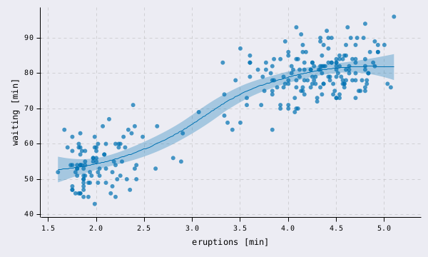
:::


### Fit

These options choose how the curve is fitted. Change them when the default loess curve is too wiggly or too stiff,
when you want a straight line or a polynomial, or when groups should share one x range.


```{=html}
<dl class="options"><div class="option-card"><dt><code>:method</code><span class="option-default">Default: <code>:loess</code></span></dt><dd><div class="option-example"><code>(chart/smooth {:method :lm})</code></div><div class="option-text">How the curve is fitted to each group's points.<ul><li><code>:loess</code> – Local regression: a quadratic fit around each x over the nearest 75% of the points (ggplot2's span and degree).</li><li><code>:glm</code> – A generalized linear model; <code>:method-params</code> sets its <code>:family</code>.</li><li><code>:gp</code> – A Gaussian process: its mean, with a band from its standard deviation.</li><li><code>:lm</code> – A least-squares polynomial: a straight line unless <code>:method-params</code> sets a <code>:degree</code>.</li><li class="option-other">Other fastmath 1D interpolation methods. They have no band of their own; <code>:band :bootstrap</code> adds one. <code>:akima</code>, <code>:b-spline</code>, <code>:barycentric</code>, <code>:cir</code>, <code>:cubic</code>, <code>:cubic-smoothing</code>, <code>:divided-difference</code>, <code>:kriging</code>, <code>:linear</code>, <code>:microsphere-projection</code>, <code>:monotone</code>, <code>:neville</code>, <code>:pava</code>, <code>:pchip</code>, <code>:polynomial</code>, <code>:rbf</code>, <code>:shepard</code>, <code>:sprague</code>, <code>:step</code>, <code>:step-after</code>, <code>:step-before</code></li><li><a href="reference.types.html#function">function</a> – Your own fit: a function of the points' <code>xs</code> and <code>ys</code> (and of <code>:method-params</code> as a third argument, when given) that returns the curve as a function from x to y. It has no band of its own.</li></ul></div></dd></div><div class="option-card"><dt><code>:method-params</code><span class="option-default">Default: The method's own defaults; <code>:loess</code> uses <code>{:bandwidth 0.75 :degree 2}</code>.</span></dt><dd><div class="option-example"><code>(chart/smooth {:method-params {:bandwidth 0.3}})</code></div><div class="option-text">Options of the fit method, e.g. the loess <code>:bandwidth</code> and <code>:iters</code> (robustness iterations, <code>0</code> for ggplot2's plain fit) or the <code>:lm</code> <code>:degree</code>. Other methods get it as an extra argument.<ul><li><span>map of keyword to any value</span></li></ul></div></dd></div><div class="option-card"><dt><code>:n</code><span class="option-default">Default: <code>200</code></span></dt><dd><div class="option-example"><code>(chart/smooth {:n 50})</code></div><div class="option-text">How many points along x the curve is evaluated at.<ul><li><span>integer at least 2</span></li></ul></div></dd></div><div class="option-card"><dt><code>:full-range</code><span class="option-default">Default: <code>false</code></span></dt><dd><div class="option-example"><code>(chart/smooth {:full-range true})</code></div><div class="option-text">Whether each group's curve spans a common x range instead of the group's own.<ul><li><code>false</code> – The group's own x range.</li><li><code>true</code> – The plot's x <code>:domain</code> when it's given, else the x range of all groups in the panel.</li></ul></div></dd></div><div class="option-card"><dt><code>:stat-space</code><span class="option-default">Default: <code>:scale</code></span></dt><dd><div class="option-example"><code>(chart/smooth {:stat-space :data})</code></div><div class="option-text">The space the curve is fitted in.<ul><li><code>:scale</code> – The axes' coordinates: on a <code>:log</code> axis the fit uses log10 values and leaves out zeros and negatives.</li><li><code>:data</code> – Data units, whatever the axes.</li></ul></div></dd></div><div class="option-card"><dt><code>:padding</code><span class="option-default">Default: <code>0.05</code> on every side.</span></dt><dd><div class="option-example"><code>(chart/smooth {:padding {:x [0 0]}})</code></div><div class="option-text">Room around the data on x and y, as fractions of the data span.<ul><li><span>map of <code>:x</code> or <code>:y</code> to padding</span></li></ul></div></dd></div></dl>
```


::: {.sourceClojure}
```clojure
(plot/render-image (plot/arrange [{:data faithful :mapping {:x :eruptions :y :waiting}
                                   :charts [(chart/scatter) (chart/smooth {:method :lm})]
                                   :labels {:title ":method :lm"}}
                                  {:data faithful :mapping {:x :eruptions :y :waiting}
                                   :charts [(chart/scatter) (chart/smooth {:method :lm :method-params {:degree 3}})]
                                   :labels {:title ":lm, :method-params {:degree 3}"}}
                                  {:data faithful :mapping {:x :eruptions :y :waiting}
                                   :charts [(chart/scatter) (chart/smooth {:method-params {:bandwidth 0.2}})]
                                   :labels {:title ":loess, :bandwidth 0.2"}}]
                                 {:columns 3})
                   {:width 1000 :height 320})
```
:::


::: {.clay-image}
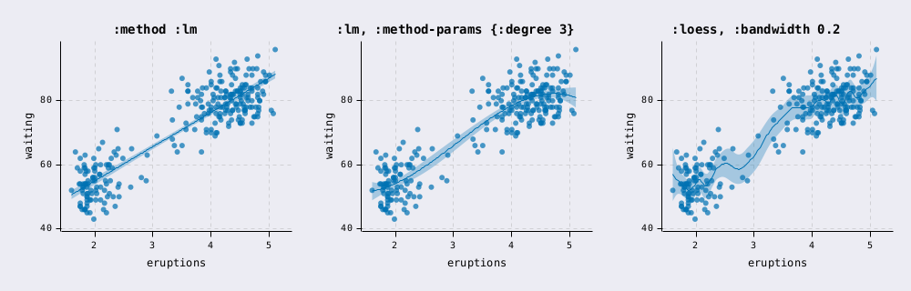
:::


With `:n 6` the curve is a polyline through six points. Short and long eruptions each fit over their own x range
unless `:full-range` is `true` (the right panel also drops the x padding):


::: {.sourceClojure}
```clojure
(plot/render-image (plot/arrange [{:data faithful :mapping {:x :eruptions :y :waiting}
                                   :charts [(chart/scatter) (chart/smooth {:n 6})]
                                   :labels {:title ":n 6"}}
                                  {:data faithful
                                   :mapping {:x :eruptions :y :waiting :color #(if (> (:eruptions %) 3) "long" "short")}
                                   :charts [(chart/scatter) (chart/smooth {:method :lm})]
                                   :labels {:title ":full-range false (default)"}
                                   :legend false}
                                  {:data faithful
                                   :mapping {:x :eruptions :y :waiting :color #(if (> (:eruptions %) 3) "long" "short")}
                                   :charts [(chart/scatter) (chart/smooth {:method :lm :full-range true :padding {:x [0 0]}})]
                                   :labels {:title ":full-range true, :padding x 0"}
                                   :legend false}]
                                 {:columns 3})
                   {:width 1000 :height 320})
```
:::


::: {.clay-image}
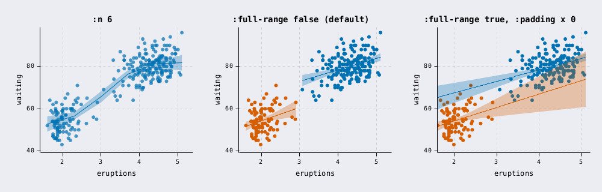
:::


These seeded random values grow with log x; x spreads evenly over three decades:


::: {.sourceClojure}
```clojure
(def log-growth (mapv (fn [^double u ^double e] {:x (m/pow 10.0 u) :y (+ (* 3.0 u) e)})
                      (m/slice-range 0.0 3.0 60)
                      (r/->seq (r/distribution :normal {:sd 0.5 :rng (r/rng :mersenne 11)}) 60)))
```
:::


```{=html}
<div class="data-table"><table class="table table-hover table-responsive clay-table"><thead><tr><th>x</th><th>y</th></tr></thead><tbody><tr><td>1.0</td><td>-0.9677067812193026</td></tr><tr><td>1.1242100350620865</td><td>-0.33959754375648343</td></tr><tr><td>1.263848202934298</td><td>0.6897060106248107</td></tr><tr><td>1.4208308325339223</td><td>0.6952309324761786</td></tr><tr><td>1.5973122800602544</td><td>0.5728674843580918</td></tr><tr><td>1.7957144943716399</td><td>0.9560000344318531</td></tr><tr><td>2.0187602546790386</td><td>1.2022561273673333</td></tr><tr><td>2.2695105366946686</td><td>1.3830363823753409</td></tr><tr><td>2.5514065200312888</td><td>1.6532649166564506</td></tr><tr><td>2.868316813342011</td><td>1.0435235873302333</td></tr><tr><td>3.2245905452963948</td><td>2.124292203254176</td></tr><tr><td>3.6251170499885332</td><td>2.3528068150638806</td></tr><tr><td>4.075392965871777</td><td>1.9975837036653</td></tr><tr><td>4.581597669054491</td><td>1.9353480308295994</td></tr><tr><td>5.1506780761681235</td><td>2.3457176251133465</td></tr><tr><td>5.790443980602486</td><td>2.8959953348461966</td></tr><tr><td>6.50967523045817</td><td>2.410660229815369</td></tr><tr><td>7.318242219076176</td><td>2.752597361066315</td></tr><tr><td>8.22724134170047</td><td>2.1109349041246492</td></tr><tr><td>9.24914727721733</td><td>3.0122211036085846</td></tr><tr><td>10.3979841848149</td><td>3.413471391783177</td></tr><tr><td>11.689518164985783</td><td>2.891164058699589</td></tr><tr><td>13.141473626117568</td><td>3.057144150244693</td></tr><tr><td>14.773776525985111</td><td>3.327300308961957</td></tr><tr><td>16.608827826277157</td><td>3.503266311770115</td></tr><tr><td>18.671810912919195</td><td>4.768358332694543</td></tr><tr><td>20.991037201085547</td><td>4.171596675308383</td></tr><tr><td>23.598334667821938</td><td>3.7155519974596007</td></tr><tr><td>26.52948464431896</td><td>5.324766852321342</td></tr><tr><td>29.824712862168912</td><td>4.060894946377007</td></tr><tr><td>33.529241492495565</td><td>5.419570168065395</td></tr><tr><td>37.69390975388364</td><td>3.6512159777560718</td></tr><tr><td>42.37587160604063</td><td>4.474888328759087</td></tr><tr><td>47.639380104013405</td><td>5.003485020410157</td></tr><tr><td>53.55666917706899</td><td>4.5101746465399195</td></tr><tr><td>60.20894493336129</td><td>5.452731526728738</td></tr><tr><td>67.68750009458535</td><td>6.491725895702693</td></tr><tr><td>76.09496685459875</td><td>6.045229081651237</td></tr><tr><td>85.54672535565676</td><td>5.43721678644992</td></tr><tr><td>96.17248711152965</td><td>5.265849631488806</td></tr><tr><td>108.11807510766077</td><td>6.680147238793859</td></tr><tr><td>121.54742500762872</td><td>6.075793172297352</td></tr><tr><td>136.64483492953258</td><td>6.8268133487209015</td></tr><tr><td>153.6174946671828</td><td>6.713290036880784</td></tr><tr><td>172.6983290659436</td><td>6.407576884843991</td></tr><tr><td>194.14919457438816</td><td>6.5934148444818925</td></tr><tr><td>218.26447283974872</td><td>8.535866041567777</td></tr><tr><td>245.37511066398167</td><td>7.230708571315785</td></tr><tr><td>275.85316176291843</td><td>7.102723222554722</td></tr><tr><td>310.1168926574779</td><td>7.641514653032799</td></tr><tr><td>348.6365227678084</td><td>6.298543696652105</td></tr><tr><td>391.94067748472213</td><td>6.702356682303348</td></tr><tr><td>440.6236427773573</td><td>7.86959747912834</td></tr><tr><td>495.353520895917</td><td>8.367502451473573</td></tr><tr><td>556.8813990945267</td><td>7.622970960702512</td></tr><tr><td>626.0516572014815</td><td>7.5460735790204865</td></tr><tr><td>703.8135554931555</td><td>7.892335611802074</td></tr><tr><td>791.2342618981319</td><td>8.932918994803277</td></tr><tr><td>889.5134973108236</td><td>8.14983759729005</td></tr><tr><td>1000.0</td><td>9.611446772440747</td></tr></tbody></table></div>
```


On a log axis the default `:stat-space :scale` gives a straight line; `:stat-space :data` fits data units, so the
axis bends it:


::: {.sourceClojure}
```clojure
(plot/render-image (plot/arrange [{:data log-growth :mapping {:x :x :y :y} :scales {:x {:kind :log}}
                                   :charts [(chart/scatter) (chart/smooth {:method :lm :stat-space :scale})]
                                   :labels {:title ":stat-space :scale (default)"}}
                                  {:data log-growth :mapping {:x :x :y :y} :scales {:x {:kind :log}}
                                   :charts [(chart/scatter) (chart/smooth {:method :lm :stat-space :data})]
                                   :labels {:title ":stat-space :data"}}]
                                 {:columns 2})
                   {:width 900 :height 320})
```
:::


::: {.clay-image}
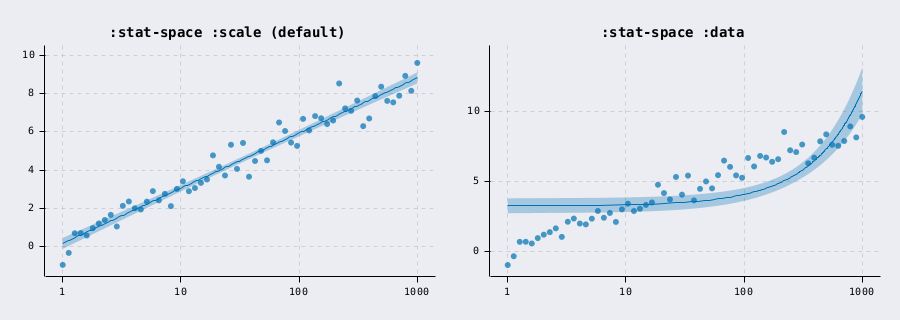
:::


### Band

These options shape the uncertainty band around the curve. Use them to show where the fitted curve may lie or
where new points may fall, to widen or nest the band, or to leave it out.


```{=html}
<dl class="options"><div class="option-card"><dt><code>:fill</code><span class="option-default">Default: <code>:color</code> (theme)</span></dt><dd><div class="option-example"><code>(chart/smooth {:fill :none})</code></div><div class="option-text">How the band is filled.<ul><li><code>:color</code> – The curve's colour, faded by <code>:alpha</code>.</li><li><code>:none</code> – No band, as with <code>:band :none</code>.</li><li><a href="reference.types.html#solid-colour">solid colour</a> – Any other colour, e.g. <code>:black</code>.</li></ul></div></dd></div><div class="option-card"><dt><code>:alpha</code><span class="option-default">Default: <code>0.3</code> (theme)</span></dt><dd><div class="option-example"><code>(chart/smooth {:alpha 0.5})</code></div><div class="option-text">How opaque the band is with <code>:fill :color</code>: a factor on the curve colour's alpha.<ul><li><a href="reference.types.html#fraction">fraction</a></li></ul></div></dd></div><div class="option-card"><dt><code>:band</code><span class="option-default">Default: <code>:confidence</code> for <code>:loess</code>, <code>:lm</code>, <code>:glm</code> and <code>:gp</code>; <code>:none</code> for the other methods.</span></dt><dd><div class="option-example"><code>(chart/smooth {:band :bootstrap})</code></div><div class="option-text">The band drawn around the curve.<ul><li><code>:confidence</code> – Where the fitted curve may lie, at the confidence <code>:level</code>.</li><li><code>:prediction</code> – Where new points may fall, at the confidence <code>:level</code> (only with <code>:method :lm</code>).</li><li><code>:bootstrap</code> – A band from refitting resampled points, for any method (see <code>:bootstrap</code>).</li><li><code>:none</code> – No band.</li></ul></div></dd></div><div class="option-card"><dt><code>:level</code><span class="option-default">Default: <code>0.95</code></span></dt><dd><div class="option-example"><code>(chart/smooth {:level [0.5 0.95]})</code></div><div class="option-text">The band's level.<ul><li><a href="reference.types.html#open-fraction">open fraction</a> – One band at this level.</li><li><span>vector of open fractions</span> – Nested bands, one per level; the widest is drawn first.</li></ul></div></dd></div><div class="option-card"><dt><code>:bootstrap</code></dt><dd><div class="option-text">Options of the bootstrap band; they apply with <code>:band :bootstrap</code>.</div></dd></div><div class="option-card"><dt><code>:bootstrap :samples</code><span class="option-default">Default: <code>200</code></span></dt><dd><div class="option-example"><code>(chart/smooth {:band :bootstrap, :bootstrap {:samples 500}})</code></div><div class="option-text">How many resampled fits make the band.<ul><li><a href="reference.types.html#positive-integer">positive integer</a></li></ul></div></dd></div><div class="option-card"><dt><code>:bootstrap :rng</code><span class="option-default">Default: An unseeded generator, so each build draws a different band.</span></dt><dd><div class="option-example"><code>(chart/smooth {:band :bootstrap, :bootstrap {:rng (r/rng :mersenne 7)}})</code></div><div class="option-text">The random generator that draws the samples. A seeded one gives the same band on every build.<ul><li><a href="reference.types.html#random-generator">random generator</a></li></ul></div></dd></div><div class="option-card"><dt><code>:bootstrap :ci</code><span class="option-default">Default: <code>:percentile</code></span></dt><dd><div class="option-example"><code>(chart/smooth {:band :bootstrap, :bootstrap {:ci :basic}})</code></div><div class="option-text">How the interval at each point of the band is computed from the samples.<ul><li><code>:percentile</code> – The samples' percentiles.</li><li><code>:basic</code> – The percentiles reflected around the fitted value.</li><li><code>:bc</code> – Percentiles corrected for the samples' bias.</li><li><code>:normal</code> – A normal interval from the samples' standard deviation.</li></ul></div></dd></div><div class="option-card"><dt><code>:bootstrap :estimation</code><span class="option-default">Default: <code>:legacy</code></span></dt><dd><div class="option-example"><code>(chart/smooth {:band :bootstrap, :bootstrap {:estimation :r7}})</code></div><div class="option-text">How the samples' percentiles are estimated: <code>:legacy</code> or one of R's quantile types <code>:r1</code> to <code>:r9</code>. <code>:ci :normal</code> doesn't use it.<ul><li><span>keyword</span></li></ul></div></dd></div></dl>
```


::: {.sourceClojure}
```clojure
(plot/render-image (plot/arrange [{:data faithful :mapping {:x :eruptions :y :waiting}
                                   :charts [(chart/scatter) (chart/smooth {:method :lm :band :prediction})]
                                   :labels {:title ":band :prediction"}}
                                  {:data faithful :mapping {:x :eruptions :y :waiting}
                                   :charts [(chart/scatter) (chart/smooth {:level [0.5 0.95 0.999] :alpha 0.2})]
                                   :labels {:title ":level [0.5 0.95 0.999]"}}
                                  {:data faithful :mapping {:x :eruptions :y :waiting}
                                   :charts [(chart/scatter)
                                            (chart/smooth {:band :bootstrap :fill [200 80 40 90]
                                                           :bootstrap {:samples 100 :rng (r/rng :mersenne 3)}})]
                                   :labels {:title ":band :bootstrap"}}]
                                 {:columns 3})
                   {:width 1000 :height 320})
```
:::


::: {.clay-image}
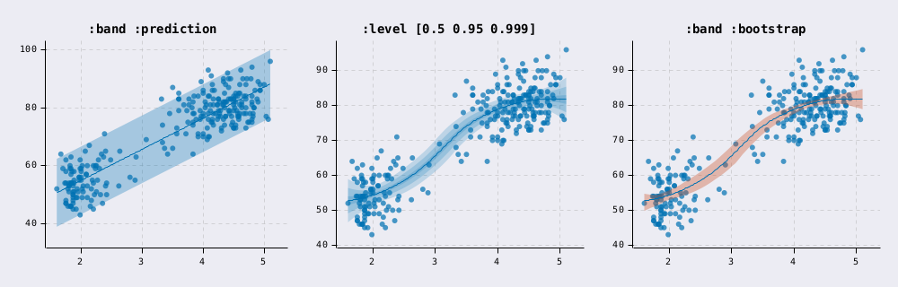
:::


A higher `:level` widens the confidence band, here in its own fill; `:band :none` leaves it out:


::: {.sourceClojure}
```clojure
(plot/render-image (plot/arrange [{:data faithful :mapping {:x :eruptions :y :waiting}
                                   :charts [(chart/scatter) (chart/smooth {:band :confidence :level 0.999 :fill [200 80 40 90]})]
                                   :labels {:title ":band :confidence, :level 0.999"}}
                                  {:data faithful :mapping {:x :eruptions :y :waiting}
                                   :charts [(chart/scatter) (chart/smooth {:band :none})]
                                   :labels {:title ":band :none"}}]
                                 {:columns 2})
                   {:width 800 :height 300})
```
:::


::: {.clay-image}
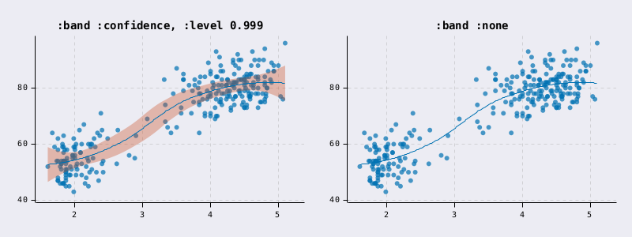
:::


## Function curves

`chart/function` draws curves of functions, y = f(x) or parametric [x y] = f(t), sampled over `:domain` (by
default the panel's x range) or, for parametric curves, over `:t`. It takes no data rows and, like an annotation,
draws in every panel. Its own mapping can colour or dash several functions by their labels. Use it for a known
curve, a model or a reference shape.


```{=html}
<div class="shared"><div class="shared-title">Shared options<span class="shared-hint"> – groups of options other charts take too</span></div><ul><li><a href="reference.shared_options.html#line-style">Line style</a> – <code>:color</code> <code>:line-width</code> <code>:dash</code></li><li><a href="reference.shared_options.html#named-theme-styles">Named theme styles</a> – <code>:theme-style</code></li><li><a href="reference.shared_options.html#common-options">Common options</a> – <code>:legend</code></li></ul></div>
```


```{=html}
<div class="mapping"><div class="mapping-title">Mapping<span class="mapping-hint"> – the row values the chart reads, under <code>:mapping</code></span></div><ul><li><code>:color</code> – Splits the rows, one per function, into groups, each with its own colour.</li><li><code>:dash</code> – Splits the rows, one per function, into groups, each with its own dash style.</li><li><code>:group</code> – Splits the rows into groups that look the same, one row per function.</li></ul></div>
```


::: {.sourceClojure}
```clojure
(plot/render-image {:charts [(chart/function {:f {"sin" #(m/sin %) "cos" #(m/cos %)}
                                              :domain [0 m/TWO_PI]
                                              :mapping {:color :function :dash :function}})]}
                   {:width 600 :height 320})
```
:::


::: {.clay-image}
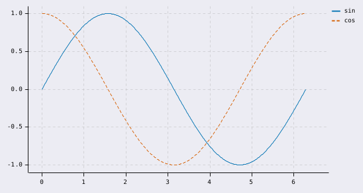
:::


### Curve

These options give the functions, the range they are sampled over and how densely, the fill and the chart's own
mapping:


```{=html}
<dl class="options"><div class="option-card"><dt><code>:fill</code><span class="option-default">Default: <code>:none</code> (theme)</span></dt><dd><div class="option-example"><code>(chart/function {:f (fn [x] (m/sin x)), :fill :lightblue})</code></div><div class="option-text">The fill of the area between the curve and y = 0, or of the shape a parametric curve closes.<ul><li><code>:none</code> – No fill.</li><li><a href="reference.types.html#solid-colour">solid colour</a> – Any other colour, e.g. <code>:black</code>.</li></ul></div></dd></div><div class="option-card"><dt><code>:mapping</code><span class="option-default">Default: No mapping: every function in the theme's style.</span></dt><dd><div class="option-example"><code>(chart/function {:f {"sin" (fn [x] (m/sin x)), "cos" (fn [x] (m/cos x))}, :mapping {:color :function}})</code></div><div class="option-text">The chart's own mapping of the functions, each a row <code>{:function label}</code>, e.g. <code>{:color :function}</code>. Of the plot's mapping only the facet keys apply.<ul><li><span>mapping</span></li></ul></div></dd></div><div class="option-card"><dt><code>:f</code><span class="option-default">Default: None; give <code>:f</code> or <code>:parametric</code>.</span></dt><dd><div class="option-example"><code>(chart/function {:f (fn [x] (m/sin x))})</code></div><div class="option-text">The functions y = f(x) to draw.<ul><li><a href="reference.types.html#functions">functions</a></li></ul></div></dd></div><div class="option-card"><dt><code>:parametric</code><span class="option-default">Default: None; give <code>:f</code> or <code>:parametric</code>.</span></dt><dd><div class="option-example"><code>(chart/function {:t [0 6.3], :parametric (fn [t] [(m/cos t) (m/sin t)])})</code></div><div class="option-text">The functions [x y] = f(t) to draw, each returning a point.<ul><li><a href="reference.types.html#functions">functions</a></li></ul></div></dd></div><div class="option-card"><dt><code>:domain</code><span class="option-default">Default: The plot's fixed x domain, else the panel's x range.</span></dt><dd><div class="option-example"><code>(chart/function {:f (fn [x] (m/sin x)), :domain [0 3]})</code></div><div class="option-text">The x range the <code>:f</code> functions are sampled over.<ul><li><a href="reference.types.html#span">span</a></li></ul></div></dd></div><div class="option-card"><dt><code>:t</code><span class="option-default">Default: None; <code>:parametric</code> needs it.</span></dt><dd><div class="option-example"><code>(chart/function {:parametric (fn [t] [(m/cos t) (m/sin t)]), :t [0 3.2]})</code></div><div class="option-text">The t range the <code>:parametric</code> functions are sampled over.<ul><li><a href="reference.types.html#span">span</a></li></ul></div></dd></div><div class="option-card"><dt><code>:sample-step</code><span class="option-default">Default: One pixel for <code>:f</code>, <code>{:count 500}</code> for <code>:parametric</code>.</span></dt><dd><div class="option-example"><code>(chart/function {:f (fn [x] (m/sin x)), :sample-step 25})</code></div><div class="option-text">How densely the functions are sampled: pixels between samples along x, or <code>{:count n}</code> samples. <code>:parametric</code> takes only a count.<ul><li><a href="reference.types.html#sample-step">sample step</a></li></ul></div></dd></div></dl>
```


::: {.sourceClojure}
```clojure
(plot/render-image (plot/arrange [{:charts [(chart/function {:f #(* % % 0.5) :domain [-2 2] :fill [0 114 178 60]})]
                                   :labels {:title ":f, :fill"}}
                                  {:charts [(chart/function {:parametric (fn [t] [(m/sin (* 3 t)) (m/sin (* 4 t))])
                                                             :t [0 m/TWO_PI] :fill [200 80 40 60]})]
                                   :aspect :iso
                                   :labels {:title ":parametric (Lissajous)"}}
                                  {:charts [(chart/function {:f #(m/sin %) :domain [0 10] :sample-step 25})]
                                   :labels {:title ":sample-step 25 px"}}]
                                 {:columns 3})
                   {:width 1000 :height 320})
```
:::


::: {.clay-image}
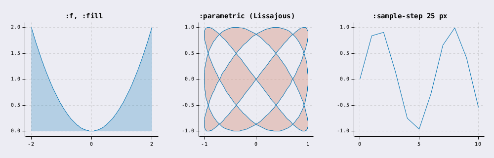
:::


### Gaps

These options handle a `nil` or non-finite result of a function:


```{=html}
<dl class="options"><div class="option-card"><dt><code>:bridge</code><span class="option-default">Default: <code>{:alpha-factor 0.3}</code> (theme)</span></dt><dd><div class="option-text">The style of the segments that bridge gaps with <code>:gaps :bridge</code>.</div></dd></div><div class="option-card"><dt><code>:bridge :alpha-factor</code><span class="option-default">Default: <code>0.3</code> (theme); passing <code>:bridge</code> replaces the theme's map entirely.</span></dt><dd><div class="option-example"><code>(chart/function {:gaps :bridge, :f (fn [x] (when-not (< 2 x 3) (m/sin x))), :bridge {:alpha-factor 0.5}})</code></div><div class="option-text">The bridge's opacity, as a fraction of the line's alpha.<ul><li><a href="reference.types.html#fraction">fraction</a></li></ul></div></dd></div><div class="option-card"><dt><code>:bridge :line-width</code><span class="option-default">Default: The line's width.</span></dt><dd><div class="option-example"><code>(chart/function {:gaps :bridge, :f (fn [x] (when-not (< 2 x 3) (m/sin x))), :bridge {:alpha-factor 0.3, :line-width 3}})</code></div><div class="option-text">The bridge's line width in pixels.<ul><li><a href="reference.types.html#non-negative-number">non-negative number</a></li></ul></div></dd></div><div class="option-card"><dt><code>:bridge :dash</code><span class="option-default">Default: The line's dash.</span></dt><dd><div class="option-example"><code>(chart/function {:gaps :bridge, :f (fn [x] (when-not (< 2 x 3) (m/sin x))), :bridge {:alpha-factor 0.3, :dash :dotted}})</code></div><div class="option-text">The bridge's dash style.<ul><li><a href="reference.types.html#dash">dash</a></li></ul></div></dd></div><div class="option-card"><dt><code>:gaps</code><span class="option-default">Default: <code>:break</code></span></dt><dd><div class="option-example"><code>(chart/function {:f (fn [x] (when-not (< 2 x 3) (m/sin x))), :gaps :bridge})</code></div><div class="option-text">How the curve handles a <code>nil</code> or non-finite result.<ul><li><code>:break</code> – Leaves empty space.</li><li><code>:bridge</code> – Joins the samples on both sides of the gap with a straight segment in the <code>:bridge</code> style.</li></ul></div></dd></div></dl>
```


::: {.sourceClojure}
```clojure
(plot/render-image (plot/arrange [{:charts [(chart/function {:f #(m/sqrt (- 1 (* % %))) :domain [-2 2]})]
                                   :labels {:title ":gaps :break (default)"}}
                                  {:charts [(chart/function {:f #(when-not (< 1 % 2) (m/sin %)) :domain [0 6]
                                                             :gaps :bridge :bridge {:alpha-factor 0.6 :dash :dotted}})]
                                   :labels {:title ":gaps :bridge"}}]
                                 {:columns 2})
                   {:width 800 :height 300})
```
:::


::: {.clay-image}
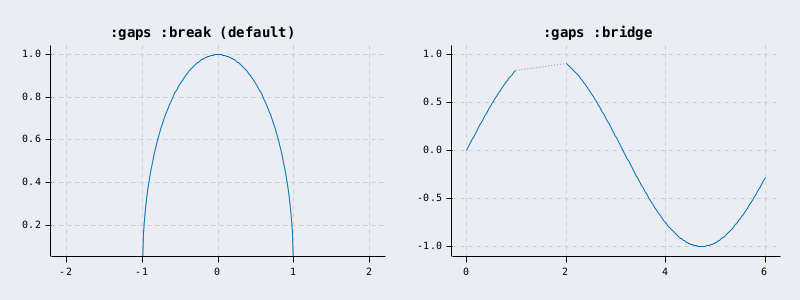
:::


### Extent

These options pick the samples that set the y axis and the room around the curve. Here `tan` has poles: the default
quantiles keep the axis readable, all samples stretch it, `:y-limits` sets it:


```{=html}
<dl class="options"><div class="option-card"><dt><code>:y-limits</code><span class="option-default">Default: No limits: <code>:y-extent</code> picks the samples.</span></dt><dd><div class="option-example"><code>(chart/function {:f (fn [x] (m/sin x)), :y-limits [-0.5 0.5]})</code></div><div class="option-text">Only samples within these limits count for the y extent; the panel's edge clips the rest of the curve.<ul><li><a href="reference.types.html#interval">interval</a></li></ul></div></dd></div><div class="option-card"><dt><code>:y-extent</code><span class="option-default">Default: <code>:quantiles</code></span></dt><dd><div class="option-example"><code>(chart/function {:f (fn [x] (m/sin x)), :y-extent {:quantiles [0.2 0.8]}})</code></div><div class="option-text">Which samples set the y extent when neither <code>:y-limits</code> nor a fixed y domain does.<ul><li><code>:quantiles</code> – The samples between the 1% and 99% quantiles, so a pole doesn't stretch the axis.</li><li><code>:min-max</code> – All samples.</li><li><code>:none</code> – None; other charts or the scale set the y range.</li><li><a href="reference.types.html#quantile-range">quantile range</a> – The samples between these quantiles.</li></ul></div></dd></div><div class="option-card"><dt><code>:padding</code><span class="option-default">Default: <code>0.05</code> on every side.</span></dt><dd><div class="option-example"><code>(chart/function {:f (fn [x] (m/sin x)), :domain [0 6], :padding {:x [0 0]}})</code></div><div class="option-text">Room around the sampled curve on x and y, as fractions of its span.<ul><li><span>map of <code>:x</code> or <code>:y</code> to padding</span></li></ul></div></dd></div></dl>
```


::: {.sourceClojure}
```clojure
(plot/render-image (plot/arrange [{:charts [(chart/function {:f #(m/tan %) :domain [0 3]})]
                                   :labels {:title ":y-extent :quantiles (default)"}}
                                  {:charts [(chart/function {:f #(m/tan %) :domain [0 3] :y-extent :min-max})]
                                   :labels {:title ":y-extent :min-max"}}
                                  {:charts [(chart/function {:f #(m/tan %) :domain [0 3] :y-limits [-5 5]})]
                                   :labels {:title ":y-limits [-5 5]"}}]
                                 {:columns 3})
                   {:width 1000 :height 300})
```
:::


::: {.clay-image}
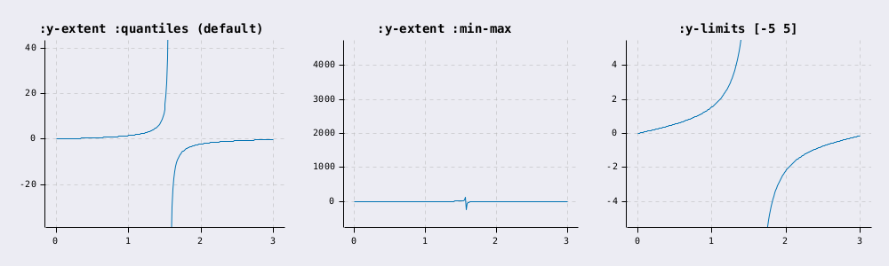
:::


With no padding on x the curve meets the panel's sides; a quarter of the span on y leaves room above and below:


::: {.sourceClojure}
```clojure
(plot/render-image {:charts [(chart/function {:f #(m/sin %) :domain [0 6.3] :padding {:x [0 0] :y [0.25 0.25]}})]
                    :labels {:title ":padding {:x [0 0] :y [0.25 0.25]}"}}
                   {:width 500 :height 280})
```
:::


::: {.clay-image}
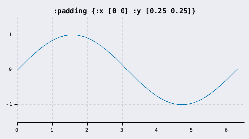
:::


```{=html}
<div style="background-color:grey;height:2px;width:100%;"></div>
```


```{=html}
<div><pre><small><small>source: notebooks/reference/charts_fitted_curves.clj</small></small></pre></div>
```