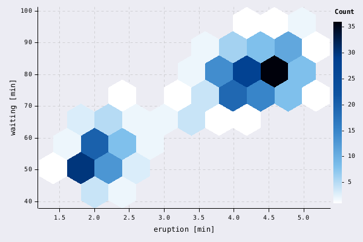
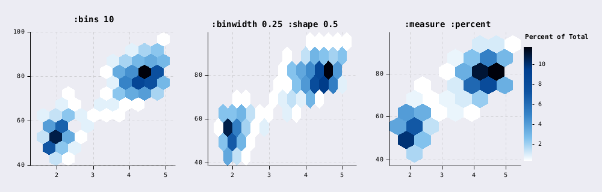
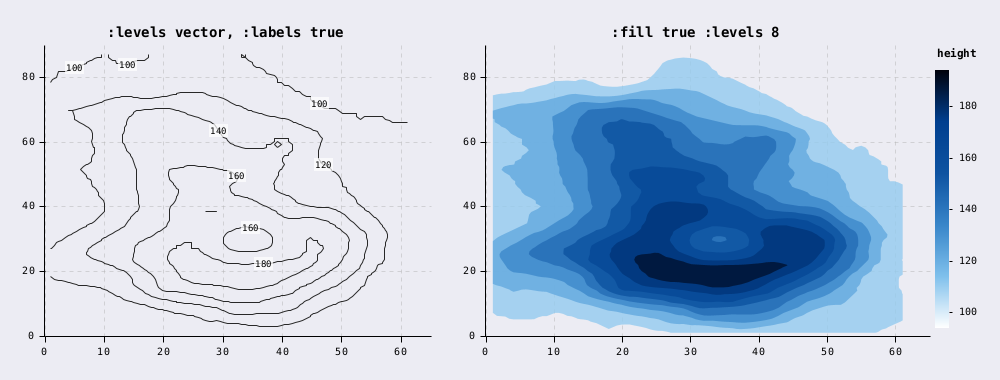

---
format:
  html: {toc: true, toc-location: right, toc-depth: 4, theme: cosmo}
code-block-background: true

---
<style></style><style>.printedClojure .sourceCode {
  background-color: transparent;
  border-style: none;
}
</style><style>.clay-limit-image-width .clay-image {max-width: 100%}
.clay-side-by-side .sourceCode {margin: 0}
.clay-side-by-side {margin: 1em 0}
</style>
<script src="https://code.jquery.com/jquery-3.6.0.min.js" type="text/javascript"></script><script src="https://code.jquery.com/ui/1.13.1/jquery-ui.min.js" type="text/javascript"></script>

# Charts: grids and fields

Charts colouring a plane: a cell per row (`tile`), a 2D histogram (`bin2d`), a scalar field drawn as a raster
(`field`) or as level lines (`contour`), and the correlation of two variables as one glyph (`correlation`).


::: {.sourceClojure}
```clojure
(ns reference.charts-grids-fields
  (:require [cljplot2.chart :as chart]
            [cljplot2.core :as plot]
            [cljplot2.describe :as describe]
            [notebook-utils :as nu]))
```
:::


Data: Old Faithful geyser eruptions, R datasets package `faithful` (Härdle 1991; Azzalini & Bowman 1990); licence: Part of R (GPL-2 | GPL-3).


::: {.sourceClojure}
```clojure
(def faithful (nu/dataset :faithful))
```
:::


::: {.clay-table}

```{=html}
<table class="table table-hover table-responsive clay-table"><thead><tr><th>eruptions</th><th>waiting</th></tr></thead><tbody><tr><td>3.6</td><td>79</td></tr><tr><td>1.8</td><td>54</td></tr><tr><td>3.333</td><td>74</td></tr><tr><td>2.283</td><td>62</td></tr><tr><td>4.533</td><td>85</td></tr><tr><td>2.883</td><td>55</td></tr><tr><td>4.7</td><td>88</td></tr><tr><td>3.6</td><td>85</td></tr><tr><td>1.95</td><td>51</td></tr><tr><td>4.35</td><td>85</td></tr><tr><td>1.833</td><td>54</td></tr><tr><td>3.917</td><td>84</td></tr><tr><td>4.2</td><td>78</td></tr><tr><td>1.75</td><td>47</td></tr><tr><td>4.7</td><td>83</td></tr><tr><td>2.167</td><td>52</td></tr><tr><td>1.75</td><td>62</td></tr><tr><td>4.8</td><td>84</td></tr><tr><td>1.6</td><td>52</td></tr><tr><td>4.25</td><td>79</td></tr></tbody></table>
```

:::


Data: Maunga Whau volcano topography, R datasets package `volcano` (Ross Ihaka); licence: Part of R (GPL-2 | GPL-3).


::: {.sourceClojure}
```clojure
(def volcano (nu/dataset :volcano))
```
:::


::: {.clay-table}

```{=html}
<table class="table table-hover table-responsive clay-table"><thead><tr><th>row</th><th>column</th><th>height</th></tr></thead><tbody><tr><td>1</td><td>1</td><td>100</td></tr><tr><td>2</td><td>1</td><td>101</td></tr><tr><td>3</td><td>1</td><td>102</td></tr><tr><td>4</td><td>1</td><td>103</td></tr><tr><td>5</td><td>1</td><td>104</td></tr><tr><td>6</td><td>1</td><td>105</td></tr><tr><td>7</td><td>1</td><td>105</td></tr><tr><td>8</td><td>1</td><td>106</td></tr><tr><td>9</td><td>1</td><td>107</td></tr><tr><td>10</td><td>1</td><td>108</td></tr><tr><td>11</td><td>1</td><td>109</td></tr><tr><td>12</td><td>1</td><td>110</td></tr><tr><td>13</td><td>1</td><td>110</td></tr><tr><td>14</td><td>1</td><td>111</td></tr><tr><td>15</td><td>1</td><td>114</td></tr><tr><td>16</td><td>1</td><td>116</td></tr><tr><td>17</td><td>1</td><td>118</td></tr><tr><td>18</td><td>1</td><td>120</td></tr><tr><td>19</td><td>1</td><td>120</td></tr><tr><td>20</td><td>1</td><td>121</td></tr></tbody></table>
```

:::


Data: Edgar Anderson's iris measurements, R datasets package `iris` (Anderson 1935; Fisher 1936); licence: Part of R (GPL-2 | GPL-3).


::: {.sourceClojure}
```clojure
(def iris (nu/dataset :iris))
```
:::


::: {.clay-table}

```{=html}
<table class="table table-hover table-responsive clay-table"><thead><tr><th>sepal-length</th><th>sepal-width</th><th>petal-length</th><th>petal-width</th><th>species</th></tr></thead><tbody><tr><td>5.1</td><td>3.5</td><td>1.4</td><td>0.2</td><td>setosa</td></tr><tr><td>4.9</td><td>3</td><td>1.4</td><td>0.2</td><td>setosa</td></tr><tr><td>4.7</td><td>3.2</td><td>1.3</td><td>0.2</td><td>setosa</td></tr><tr><td>4.6</td><td>3.1</td><td>1.5</td><td>0.2</td><td>setosa</td></tr><tr><td>5</td><td>3.6</td><td>1.4</td><td>0.2</td><td>setosa</td></tr><tr><td>5.4</td><td>3.9</td><td>1.7</td><td>0.4</td><td>setosa</td></tr><tr><td>4.6</td><td>3.4</td><td>1.4</td><td>0.3</td><td>setosa</td></tr><tr><td>5</td><td>3.4</td><td>1.5</td><td>0.2</td><td>setosa</td></tr><tr><td>4.4</td><td>2.9</td><td>1.4</td><td>0.2</td><td>setosa</td></tr><tr><td>4.9</td><td>3.1</td><td>1.5</td><td>0.1</td><td>setosa</td></tr><tr><td>5.4</td><td>3.7</td><td>1.5</td><td>0.2</td><td>setosa</td></tr><tr><td>4.8</td><td>3.4</td><td>1.6</td><td>0.2</td><td>setosa</td></tr><tr><td>4.8</td><td>3</td><td>1.4</td><td>0.1</td><td>setosa</td></tr><tr><td>4.3</td><td>3</td><td>1.1</td><td>0.1</td><td>setosa</td></tr><tr><td>5.8</td><td>4</td><td>1.2</td><td>0.2</td><td>setosa</td></tr><tr><td>5.7</td><td>4.4</td><td>1.5</td><td>0.4</td><td>setosa</td></tr><tr><td>5.4</td><td>3.9</td><td>1.3</td><td>0.4</td><td>setosa</td></tr><tr><td>5.1</td><td>3.5</td><td>1.4</td><td>0.3</td><td>setosa</td></tr><tr><td>5.7</td><td>3.8</td><td>1.7</td><td>0.3</td><td>setosa</td></tr><tr><td>5.1</td><td>3.8</td><td>1.5</td><td>0.3</td><td>setosa</td></tr></tbody></table>
```

:::


## tile

A cell per row at its x and y, filled by a mapped colour: numeric (a gradient) or categorical (a palette).

::: {.clay-table}

```{=html}
<table class="table table-hover table-responsive clay-table"><thead><tr><th>Option</th><th>Type</th><th>Default</th><th>Description</th></tr></thead><tbody><tr><td>:x (required)</td><td>a keyword, a function or a categorical marker of one</td><td></td><td>cell x position: categorical (a cell per level) or numeric (cells centred on the values, sized by the smallest gap)</td></tr><tr><td>:y (required)</td><td>a keyword, a function or a categorical marker of one</td><td></td><td>cell y position: categorical (a cell per level) or numeric (cells centred on the values, sized by the smallest gap)</td></tr><tr><td>:color (required)</td><td>a keyword, a function or a categorical marker of one</td><td></td><td>cell fill: numeric (a gradient and colour bar) or categorical (a palette and legend); nil - the NA colour</td></tr><tr><td>:size</td><td>a keyword, a function or a categorical marker of one or nil</td><td></td><td>cell size: each cell shrinks by :cell-scale times its size over the size scale's largest</td></tr></tbody></table>
```

:::


::: {.sourceClojure}
```clojure
(def week-hours (for [[i day] (map-indexed vector ["Mon" "Tue" "Wed" "Thu" "Fri"]) hour (range 8 18)]
                  {:day day :hour hour
                   :visits (+ 10 (* 3 (mod (* (inc i) hour) 7)) (if (< 11 hour 14) 15 0))}))
```
:::


::: {.clay-table}

```{=html}
<table class="table table-hover table-responsive clay-table"><thead><tr><th>day</th><th>hour</th><th>visits</th></tr></thead><tbody><tr><td>Mon</td><td>8</td><td>13</td></tr><tr><td>Mon</td><td>9</td><td>16</td></tr><tr><td>Mon</td><td>10</td><td>19</td></tr><tr><td>Mon</td><td>11</td><td>22</td></tr><tr><td>Mon</td><td>12</td><td>40</td></tr><tr><td>Mon</td><td>13</td><td>43</td></tr><tr><td>Mon</td><td>14</td><td>10</td></tr><tr><td>Mon</td><td>15</td><td>13</td></tr><tr><td>Mon</td><td>16</td><td>16</td></tr><tr><td>Mon</td><td>17</td><td>19</td></tr><tr><td>Tue</td><td>8</td><td>16</td></tr><tr><td>Tue</td><td>9</td><td>22</td></tr><tr><td>Tue</td><td>10</td><td>28</td></tr><tr><td>Tue</td><td>11</td><td>13</td></tr><tr><td>Tue</td><td>12</td><td>34</td></tr><tr><td>Tue</td><td>13</td><td>40</td></tr><tr><td>Tue</td><td>14</td><td>10</td></tr><tr><td>Tue</td><td>15</td><td>16</td></tr><tr><td>Tue</td><td>16</td><td>22</td></tr><tr><td>Tue</td><td>17</td><td>28</td></tr></tbody></table>
```

:::


::: {.sourceClojure}
```clojure
(plot/render-image {:data week-hours
                    :mapping {:x :hour :y :day :color :visits}
                    :charts [(chart/tile)]
                    :scales {:y {:reverse true}}}
                   {:width 600 :height 300})
```
:::


::: {.clay-image}

:::


Its own option writes the value in each cell (black or white by the fill, the `:tile-value` text role); the cell
shape and outline are the Cell style group:

::: {.clay-table}

```{=html}
<table class="table table-hover table-responsive clay-table"><thead><tr><th>Option</th><th>Type</th><th>Default</th><th>Description</th></tr></thead><tbody><tr><td>:value-label</td><td>true or false or a function</td><td>false</td><td>label in each cell: true (the colour value, numbers to 2 decimals) or a function of {:value :x :y} returning the text (nil - none), drawn in black or white by the fill under it</td></tr></tbody></table>
```

:::


::: {.sourceClojure}
```clojure
(plot/render-image (plot/arrange [{:data week-hours
                                   :mapping {:x :hour :y :day :color :visits}
                                   :charts [(chart/tile {:value-label true})]
                                   :scales {:y {:reverse true}}
                                   :labels {:title ":value-label true"}
                                   :legend false}
                                  {:data week-hours
                                   :mapping {:x :hour :y :day :color :visits}
                                   :charts [(chart/tile {:value-label #(when (< 30 (:value %)) "busy")})]
                                   :scales {:y {:reverse true}}
                                   :labels {:title "a function: \"busy\" above 30"}}]
                                 {:columns 2 :widths [1 1.15]})
                   {:width 1000 :height 300})
```
:::


::: {.clay-image}

:::


Shared options: [Cell style](reference.shared_options.html#cell-style) (`:cell` `:cell-scale` `:stroke-color` `:stroke-width` `:alpha`); [Data and mapping](reference.shared_options.html#data-and-mapping) (`:data` `:mapping`).


## bin2d

A 2D histogram: points counted in rectangular cells, the count (or another measure) as the cell colour.

::: {.clay-table}

```{=html}
<table class="table table-hover table-responsive clay-table"><thead><tr><th>Option</th><th>Type</th><th>Default</th><th>Description</th></tr></thead><tbody><tr><td>:x (required)</td><td>a keyword, a function or a categorical marker of one</td><td></td><td>point x positions (numbers)</td></tr><tr><td>:y (required)</td><td>a keyword, a function or a categorical marker of one</td><td></td><td>point y positions (numbers)</td></tr><tr><td>:color</td><td>nil</td><td></td><td>must be nil (the cell colour is the measure): set it so in the chart's mapping when the plot maps :color</td></tr></tbody></table>
```

:::


::: {.sourceClojure}
```clojure
(plot/render-image {:data faithful
                    :mapping {:x :eruptions :y :waiting}
                    :charts [(chart/bin2d)]
                    :labels {:x "eruption [min]" :y "waiting [min]"}}
                   {:width 600 :height 400})
```
:::


::: {.clay-image}

:::


Its options: the number of cells (or a fastmath estimate), a cell width in data units, the cells' height / width
ratio and what the colour measures:

::: {.clay-table}

```{=html}
<table class="table table-hover table-responsive clay-table"><thead><tr><th>Option</th><th>Type</th><th>Default</th><th>Description</th></tr></thead><tbody><tr><td>:bins</td><td>one of :scott-correlated :scott :freedman-diaconis :cross-validation :shimazaki-shinomoto or a positive integer</td><td>:scott-correlated</td><td>cells across the x range (a positive integer), or a fastmath estimate-grid-size method giving a cell area (:binwidth wins)</td></tr><tr><td>:binwidth</td><td>a positive finite number</td><td></td><td>cell size in x data units (log10 units on a :log axis); wins over :bins</td></tr><tr><td>:shape</td><td>a positive finite number</td><td>the panel's height / width (y span / x span with :aspect :iso), estimated from the plot size and facet layout</td><td>height / width ratio of the normalized binning space (cells are regular in pixels when it matches the panel)</td></tr><tr><td>:measure</td><td>one of :count :percent :pmf :density</td><td>:count</td><td>the cell colour: :count, :percent (of the panel's points), :pmf (share of the panel's points) or :density (count / (n * cell area in data units))</td></tr></tbody></table>
```

:::


::: {.sourceClojure}
```clojure
(plot/render-image (plot/arrange [{:data faithful
                                   :mapping {:x :eruptions :y :waiting}
                                   :charts [(chart/bin2d {:bins 10})]
                                   :labels {:title ":bins 10"}
                                   :legend false}
                                  {:data faithful
                                   :mapping {:x :eruptions :y :waiting}
                                   :charts [(chart/bin2d {:binwidth 0.25 :shape 0.5})]
                                   :labels {:title ":binwidth 0.25 :shape 0.5"}
                                   :legend false}
                                  {:data faithful
                                   :mapping {:x :eruptions :y :waiting}
                                   :charts [(chart/bin2d {:measure :percent})]
                                   :labels {:title ":measure :percent"}}]
                                 {:columns 3 :widths [1 1 1.3]})
                   {:width 1000 :height 320})
```
:::


::: {.clay-image}

:::


Shared options: [Cell style](reference.shared_options.html#cell-style) (`:cell` `:cell-scale` `:stroke-color` `:stroke-width` `:alpha`); [Data and mapping](reference.shared_options.html#data-and-mapping) (`:data` `:mapping`).


## field

A raster of a scalar field: the density of mapped points, gridded `:value`s interpolated, or a function of a
point (the Fields group).

::: {.clay-table}

```{=html}
<table class="table table-hover table-responsive clay-table"><thead><tr><th>Option</th><th>Type</th><th>Default</th><th>Description</th></tr></thead><tbody><tr><td>:x</td><td>a keyword, a function or a categorical marker of one or nil</td><td></td><td>x of the points (density) or of the gridded data</td></tr><tr><td>:y</td><td>a keyword, a function or a categorical marker of one or nil</td><td></td><td>y of the points (density) or of the gridded data</td></tr><tr><td>:value</td><td>a keyword, a function or a categorical marker of one or nil</td><td></td><td>the field's value at gridded (x, y) on a full lattice, interpolated (absent - a density of the points)</td></tr><tr><td>:color</td><td>nil</td><td></td><td>must be nil (the colour is the field's value): set it so in the chart's mapping when the plot maps :color</td></tr></tbody></table>
```

:::


::: {.sourceClojure}
```clojure
(plot/render-image (plot/arrange [{:data faithful
                                   :mapping {:x :eruptions :y :waiting}
                                   :charts [(chart/field)]
                                   :labels {:title "density of the points"}
                                   :legend false}
                                  {:data volcano
                                   :mapping {:x :column :y :row :value :height}
                                   :charts [(chart/field)]
                                   :labels {:title "gridded :value"}}]
                                 {:columns 2 :widths [1 1.2]})
                   {:width 1000 :height 380})
```
:::


::: {.clay-image}

:::


Its options: the raster's opacity, or a colour per pixel computed by a function (no field, no colour scale):

::: {.clay-table}

```{=html}
<table class="table table-hover table-responsive clay-table"><thead><tr><th>Option</th><th>Type</th><th>Default</th><th>Description</th></tr></thead><tbody><tr><td>:alpha</td><td>a number in [0 1]</td><td>1.0</td><td>opacity multiplying the colours' alpha</td></tr><tr><td>:pixel-color</td><td>a function</td><td></td><td>a function of a point [x y] returning each pixel's colour (nil - transparent): a raster over :domain, no grid, colour scale or legend; not with :f</td></tr></tbody></table>
```

:::


::: {.sourceClojure}
```clojure
(plot/render-image (plot/arrange [{:data faithful
                                   :mapping {:x :eruptions :y :waiting}
                                   :charts [(chart/field {:alpha 0.5}) (chart/scatter {:size 3 :color :black})]
                                   :labels {:title ":alpha 0.5, points over it"}
                                   :legend false}
                                  {:charts [(chart/field {:domain {:x [-2 2] :y [-2 2]}
                                                          :pixel-color (fn [[x y]]
                                                                         (when (< (+ (* x x) (* y y)) 3)
                                                                           [(int (* 60 (+ x 2))) 80 (int (* 60 (+ y 2)))]))})]
                                   :labels {:title ":pixel-color - a colour per point"}}]
                                 {:columns 2})
                   {:width 900 :height 380})
```
:::


::: {.clay-image}

:::


Shared options: [Fields](reference.shared_options.html#fields) (`:f` `:domain` `:kernel` `:bandwidth` `:binned?` `:cut` `:interpolation` `:n`); [Data and mapping](reference.shared_options.html#data-and-mapping) (`:data` `:mapping`).


## contour

Level lines (or filled bands) of a scalar field - the same sources as `field`; categorical groups give a field
each.

::: {.clay-table}

```{=html}
<table class="table table-hover table-responsive clay-table"><thead><tr><th>Option</th><th>Type</th><th>Default</th><th>Description</th></tr></thead><tbody><tr><td>:x</td><td>a keyword, a function or a categorical marker of one or nil</td><td></td><td>x of the points (density) or of the gridded data</td></tr><tr><td>:y</td><td>a keyword, a function or a categorical marker of one or nil</td><td></td><td>y of the points (density) or of the gridded data</td></tr><tr><td>:value</td><td>a keyword, a function or a categorical marker of one or nil</td><td></td><td>the field's value at gridded (x, y) on a full lattice, interpolated (absent - a density of the points)</td></tr><tr><td>:color</td><td>a keyword, a function or a categorical marker of one or nil</td><td></td><td>categorical groups, each its own field with lines in its colour (else the lines are coloured by level)</td></tr><tr><td>:dash</td><td>a keyword, a function or a categorical marker of one or nil</td><td></td><td>groups, each its own field with lines in its dash style</td></tr><tr><td>:group</td><td>a keyword, a function or a categorical marker of one or nil</td><td></td><td>groups without a visual aesthetic, each its own field</td></tr></tbody></table>
```

:::


::: {.sourceClojure}
```clojure
(plot/render-image (plot/arrange [{:data volcano
                                   :mapping {:x :column :y :row :value :height}
                                   :charts [(chart/contour)]
                                   :labels {:title "gridded :value"}
                                   :legend false}
                                  {:data iris
                                   :mapping {:x :sepal-length :y :sepal-width :color :species}
                                   :charts [(chart/contour {:levels 6})]
                                   :labels {:title "a density per :color group"}}]
                                 {:columns 2 :widths [1 1.25]})
                   {:width 1000 :height 380})
```
:::


::: {.clay-image}

:::


Its options: the levels (a count or the values), filled bands instead of lines, labels on the lines, one line
colour and the opacity:

::: {.clay-table}

```{=html}
<table class="table table-hover table-responsive clay-table"><thead><tr><th>Option</th><th>Type</th><th>Default</th><th>Description</th></tr></thead><tbody><tr><td>:color</td><td>a clojure2d color or :none</td><td>[69 117 180]; the theme's, for grouped lines without a mapped colour; ungrouped lines are coloured by level, lines grouped by :color take their group's colour</td><td>one colour for every line instead of colouring by level (contour's own :color, not the line style's)</td></tr><tr><td>:alpha</td><td>a number in [0 1]</td><td>1.0; the theme's; grouped filled contours take half of it</td><td>opacity multiplying the colours' alpha</td></tr><tr><td>:levels</td><td>integer (1..1000) or vector of a finite number (at least 1)</td><td>10</td><td>contour levels: a count evenly spread over the range of every sampled value (the ends left out), or a vector of level values</td></tr><tr><td>:fill</td><td>true or false</td><td>false</td><td>fill the region at or above each level, each band coloured by its middle value, instead of drawing lines</td></tr><tr><td>:labels</td><td>true or false or a function or nil</td><td>false</td><td>line contours only: label each line with its level - true (the number) or a function of {:level v} returning the text (nil - no label)</td></tr></tbody></table>
```

:::


::: {.sourceClojure}
```clojure
(plot/render-image (plot/arrange [{:data volcano
                                   :mapping {:x :column :y :row :value :height}
                                   :charts [(chart/contour {:levels [100 120 140 160 180] :labels true
                                                            :color [40 40 40]})]
                                   :labels {:title ":levels vector, :labels true"}}
                                  {:data volcano
                                   :mapping {:x :column :y :row :value :height}
                                   :charts [(chart/contour {:fill true :levels 8 :alpha 0.8})]
                                   :labels {:title ":fill true :levels 8"}}]
                                 {:columns 2 :widths [1 1.25]})
                   {:width 1000 :height 380})
```
:::


::: {.clay-image}

:::


Shared options: [Line style](reference.shared_options.html#line-style) (`:width` `:dash`); [Fields](reference.shared_options.html#fields) (`:f` `:domain` `:kernel` `:bandwidth` `:binned?` `:cut` `:interpolation` `:n`); [Data and mapping](reference.shared_options.html#data-and-mapping) (`:data` `:mapping`).


## correlation

The correlation coefficient r of two variables drawn as one glyph filling the panel - a cell of a correlogram
(`plot/pairs`). Alone it writes r, one line per group.

::: {.clay-table}

```{=html}
<table class="table table-hover table-responsive clay-table"><thead><tr><th>Option</th><th>Type</th><th>Default</th><th>Description</th></tr></thead><tbody><tr><td>:x (required)</td><td>a keyword, a function or a categorical marker of one</td><td></td><td>first variable (numbers)</td></tr><tr><td>:y (required)</td><td>a keyword, a function or a categorical marker of one</td><td></td><td>second variable (numbers)</td></tr><tr><td>:color</td><td>a keyword, a function or a categorical marker of one or nil</td><td></td><td>categorical groups, each a line of the :number glyph in its colour</td></tr><tr><td>:group</td><td>a keyword, a function or a categorical marker of one or nil</td><td></td><td>groups without a visual aesthetic, each a line of the :number glyph</td></tr></tbody></table>
```

:::


::: {.sourceClojure}
```clojure
(plot/render-image {:data iris
                    :mapping {:x :sepal-length :y :petal-length :color :species}
                    :charts [(chart/correlation)]}
                   {:width 450 :height 300})
```
:::


::: {.clay-image}

:::


Its options: the coefficient, the glyph and its colours (by default r on a diverging scale):

::: {.clay-table}

```{=html}
<table class="table table-hover table-responsive clay-table"><thead><tr><th>Option</th><th>Type</th><th>Default</th><th>Description</th></tr></thead><tbody><tr><td>:color</td><td>a clojure2d color or :none</td><td>[69 117 180]; grouped shape glyphs: the theme's; ungrouped: r on a diverging scale; :number: the :correlation text role's colour, group lines mapped or black</td><td>one fixed glyph colour, the :number text's too</td></tr><tr><td>:stroke-color</td><td>:darker or a clojure2d color or :none</td><td>:darker</td><td>outline colour: a colour, :none or :darker (the darkened fill)</td></tr><tr><td>:stroke-width</td><td>a non-negative number</td><td>1</td><td>outline width in pixels</td></tr><tr><td>:method</td><td>one of :pearson :spearman :kendall</td><td>:pearson</td><td>correlation coefficient: :pearson, :spearman or :kendall</td></tr><tr><td>:glyph</td><td>one of :number :shade :square :circle :ellipse :pie</td><td>:number</td><td>how r is drawn: :number (text, a line per group), :shade (the panel in r's colour), :square / :circle (area ~ |r|), :ellipse (normal contour) or :pie (a disk filled |r|)</td></tr></tbody></table>
```

:::


::: {.sourceClojure}
```clojure
(plot/render-image (plot/pairs iris {:variables [:sepal-length :sepal-width :petal-length :petal-width]
                                     :lower (chart/correlation {:glyph :ellipse :stroke-color :none})
                                     :upper (chart/correlation {:glyph :square :method :spearman})
                                     :diagonal :names
                                     :title "ellipses (Pearson) below, squares (Spearman) above"})
                   {:width 700 :height 620})
```
:::


::: {.clay-image}

:::


Shared options: [Data and mapping](reference.shared_options.html#data-and-mapping) (`:data` `:mapping`).


```{=html}
<div style="background-color:grey;height:2px;width:100%;"></div>
```


```{=html}
<div><pre><small><small>source: notebooks/reference/charts_grids_fields.clj</small></small></pre></div>
```