---
format:
  html:
    toc: true
    toc-location: right
    toc-depth: 4
    theme: cosmo
    include-in-header:
      text: |-
        <style>
        .data-table { width: fit-content; max-width: 100%; max-height: 15rem; overflow: auto; margin: 0 0 1rem 0; }
        .data-table .table-responsive { overflow: visible; }
        .data-table table { font-size: 0.75rem; width: auto; margin: 0; }
        .data-table th, .data-table td { padding: 0.1rem 0.45rem !important; white-space: nowrap; }
        .data-table thead th { position: sticky; top: 0; background: var(--bs-body-bg, #fff); }
        </style>
code-block-background: true

---
<style></style><style>.printedClojure .sourceCode {
  background-color: transparent;
  border-style: none;
}
</style><style>.clay-limit-image-width .clay-image {max-width: 100%}
.clay-side-by-side .sourceCode {margin: 0}
.clay-side-by-side {margin: 1em 0}
</style>
<script src="https://code.jquery.com/jquery-3.6.0.min.js" type="text/javascript"></script><script src="https://code.jquery.com/ui/1.13.1/jquery-ui.min.js" type="text/javascript"></script>

# Charts: grids and fields

Charts colouring a plane: a cell per row (`tile`), a 2D histogram (`bin2d`), a scalar field drawn as a raster
(`field`) or as level lines (`contour`), the correlation of two variables as one glyph (`correlation`), and any
other statistic of two variables as one cell (`pairwise`).


::: {.sourceClojure}
```clojure
(ns reference.charts-grids-fields
  (:require [fastmath.core :as m]
            [cljplot2.chart :as chart]
            [cljplot2.core :as plot]
            [cljplot2.describe :as describe]
            [notebook-utils :as nu]))
```
:::


Data: Old Faithful geyser eruptions, R datasets package `faithful` (Härdle 1991; Azzalini & Bowman 1990); licence: Part of R (GPL-2 | GPL-3).


::: {.sourceClojure}
```clojure
(def faithful (nu/dataset :faithful))
```
:::


```{=html}
<div class="data-table"><table class="table table-hover table-responsive clay-table"><thead><tr><th>eruptions</th><th>waiting</th></tr></thead><tbody><tr><td>3.6</td><td>79</td></tr><tr><td>1.8</td><td>54</td></tr><tr><td>3.333</td><td>74</td></tr><tr><td>2.283</td><td>62</td></tr><tr><td>4.533</td><td>85</td></tr><tr><td>2.883</td><td>55</td></tr><tr><td>4.7</td><td>88</td></tr><tr><td>3.6</td><td>85</td></tr><tr><td>1.95</td><td>51</td></tr><tr><td>4.35</td><td>85</td></tr><tr><td>1.833</td><td>54</td></tr><tr><td>3.917</td><td>84</td></tr><tr><td>4.2</td><td>78</td></tr><tr><td>1.75</td><td>47</td></tr><tr><td>4.7</td><td>83</td></tr><tr><td>2.167</td><td>52</td></tr><tr><td>1.75</td><td>62</td></tr><tr><td>4.8</td><td>84</td></tr><tr><td>1.6</td><td>52</td></tr><tr><td>4.25</td><td>79</td></tr><tr><td>1.8</td><td>51</td></tr><tr><td>1.75</td><td>47</td></tr><tr><td>3.45</td><td>78</td></tr><tr><td>3.067</td><td>69</td></tr><tr><td>4.533</td><td>74</td></tr><tr><td>3.6</td><td>83</td></tr><tr><td>1.967</td><td>55</td></tr><tr><td>4.083</td><td>76</td></tr><tr><td>3.85</td><td>78</td></tr><tr><td>4.433</td><td>79</td></tr><tr><td>4.3</td><td>73</td></tr><tr><td>4.467</td><td>77</td></tr><tr><td>3.367</td><td>66</td></tr><tr><td>4.033</td><td>80</td></tr><tr><td>3.833</td><td>74</td></tr><tr><td>2.017</td><td>52</td></tr><tr><td>1.867</td><td>48</td></tr><tr><td>4.833</td><td>80</td></tr><tr><td>1.833</td><td>59</td></tr><tr><td>4.783</td><td>90</td></tr><tr><td>4.35</td><td>80</td></tr><tr><td>1.883</td><td>58</td></tr><tr><td>4.567</td><td>84</td></tr><tr><td>1.75</td><td>58</td></tr><tr><td>4.533</td><td>73</td></tr><tr><td>3.317</td><td>83</td></tr><tr><td>3.833</td><td>64</td></tr><tr><td>2.1</td><td>53</td></tr><tr><td>4.633</td><td>82</td></tr><tr><td>2</td><td>59</td></tr><tr><td>4.8</td><td>75</td></tr><tr><td>4.716</td><td>90</td></tr><tr><td>1.833</td><td>54</td></tr><tr><td>4.833</td><td>80</td></tr><tr><td>1.733</td><td>54</td></tr><tr><td>4.883</td><td>83</td></tr><tr><td>3.717</td><td>71</td></tr><tr><td>1.667</td><td>64</td></tr><tr><td>4.567</td><td>77</td></tr><tr><td>4.317</td><td>81</td></tr><tr><td>2.233</td><td>59</td></tr><tr><td>4.5</td><td>84</td></tr><tr><td>1.75</td><td>48</td></tr><tr><td>4.8</td><td>82</td></tr><tr><td>1.817</td><td>60</td></tr><tr><td>4.4</td><td>92</td></tr><tr><td>4.167</td><td>78</td></tr><tr><td>4.7</td><td>78</td></tr><tr><td>2.067</td><td>65</td></tr><tr><td>4.7</td><td>73</td></tr><tr><td>4.033</td><td>82</td></tr><tr><td>1.967</td><td>56</td></tr><tr><td>4.5</td><td>79</td></tr><tr><td>4</td><td>71</td></tr><tr><td>1.983</td><td>62</td></tr><tr><td>5.067</td><td>76</td></tr><tr><td>2.017</td><td>60</td></tr><tr><td>4.567</td><td>78</td></tr><tr><td>3.883</td><td>76</td></tr><tr><td>3.6</td><td>83</td></tr><tr><td>4.133</td><td>75</td></tr><tr><td>4.333</td><td>82</td></tr><tr><td>4.1</td><td>70</td></tr><tr><td>2.633</td><td>65</td></tr><tr><td>4.067</td><td>73</td></tr><tr><td>4.933</td><td>88</td></tr><tr><td>3.95</td><td>76</td></tr><tr><td>4.517</td><td>80</td></tr><tr><td>2.167</td><td>48</td></tr><tr><td>4</td><td>86</td></tr><tr><td>2.2</td><td>60</td></tr><tr><td>4.333</td><td>90</td></tr><tr><td>1.867</td><td>50</td></tr><tr><td>4.817</td><td>78</td></tr><tr><td>1.833</td><td>63</td></tr><tr><td>4.3</td><td>72</td></tr><tr><td>4.667</td><td>84</td></tr><tr><td>3.75</td><td>75</td></tr><tr><td>1.867</td><td>51</td></tr><tr><td>4.9</td><td>82</td></tr><tr><td>…</td><td>…</td></tr></tbody></table></div>
```


Data: Maunga Whau volcano topography, R datasets package `volcano` (Ross Ihaka); licence: Part of R (GPL-2 | GPL-3).


::: {.sourceClojure}
```clojure
(def volcano (nu/dataset :volcano))
```
:::


```{=html}
<div class="data-table"><table class="table table-hover table-responsive clay-table"><thead><tr><th>row</th><th>column</th><th>height</th></tr></thead><tbody><tr><td>1</td><td>1</td><td>100</td></tr><tr><td>2</td><td>1</td><td>101</td></tr><tr><td>3</td><td>1</td><td>102</td></tr><tr><td>4</td><td>1</td><td>103</td></tr><tr><td>5</td><td>1</td><td>104</td></tr><tr><td>6</td><td>1</td><td>105</td></tr><tr><td>7</td><td>1</td><td>105</td></tr><tr><td>8</td><td>1</td><td>106</td></tr><tr><td>9</td><td>1</td><td>107</td></tr><tr><td>10</td><td>1</td><td>108</td></tr><tr><td>11</td><td>1</td><td>109</td></tr><tr><td>12</td><td>1</td><td>110</td></tr><tr><td>13</td><td>1</td><td>110</td></tr><tr><td>14</td><td>1</td><td>111</td></tr><tr><td>15</td><td>1</td><td>114</td></tr><tr><td>16</td><td>1</td><td>116</td></tr><tr><td>17</td><td>1</td><td>118</td></tr><tr><td>18</td><td>1</td><td>120</td></tr><tr><td>19</td><td>1</td><td>120</td></tr><tr><td>20</td><td>1</td><td>121</td></tr><tr><td>21</td><td>1</td><td>122</td></tr><tr><td>22</td><td>1</td><td>122</td></tr><tr><td>23</td><td>1</td><td>123</td></tr><tr><td>24</td><td>1</td><td>124</td></tr><tr><td>25</td><td>1</td><td>123</td></tr><tr><td>26</td><td>1</td><td>123</td></tr><tr><td>27</td><td>1</td><td>120</td></tr><tr><td>28</td><td>1</td><td>118</td></tr><tr><td>29</td><td>1</td><td>117</td></tr><tr><td>30</td><td>1</td><td>115</td></tr><tr><td>31</td><td>1</td><td>114</td></tr><tr><td>32</td><td>1</td><td>115</td></tr><tr><td>33</td><td>1</td><td>113</td></tr><tr><td>34</td><td>1</td><td>111</td></tr><tr><td>35</td><td>1</td><td>110</td></tr><tr><td>36</td><td>1</td><td>109</td></tr><tr><td>37</td><td>1</td><td>108</td></tr><tr><td>38</td><td>1</td><td>108</td></tr><tr><td>39</td><td>1</td><td>107</td></tr><tr><td>40</td><td>1</td><td>107</td></tr><tr><td>41</td><td>1</td><td>107</td></tr><tr><td>42</td><td>1</td><td>108</td></tr><tr><td>43</td><td>1</td><td>109</td></tr><tr><td>44</td><td>1</td><td>110</td></tr><tr><td>45</td><td>1</td><td>111</td></tr><tr><td>46</td><td>1</td><td>111</td></tr><tr><td>47</td><td>1</td><td>112</td></tr><tr><td>48</td><td>1</td><td>113</td></tr><tr><td>49</td><td>1</td><td>113</td></tr><tr><td>50</td><td>1</td><td>114</td></tr><tr><td>51</td><td>1</td><td>115</td></tr><tr><td>52</td><td>1</td><td>115</td></tr><tr><td>53</td><td>1</td><td>114</td></tr><tr><td>54</td><td>1</td><td>113</td></tr><tr><td>55</td><td>1</td><td>112</td></tr><tr><td>56</td><td>1</td><td>111</td></tr><tr><td>57</td><td>1</td><td>111</td></tr><tr><td>58</td><td>1</td><td>112</td></tr><tr><td>59</td><td>1</td><td>112</td></tr><tr><td>60</td><td>1</td><td>112</td></tr><tr><td>61</td><td>1</td><td>113</td></tr><tr><td>62</td><td>1</td><td>114</td></tr><tr><td>63</td><td>1</td><td>114</td></tr><tr><td>64</td><td>1</td><td>115</td></tr><tr><td>65</td><td>1</td><td>115</td></tr><tr><td>66</td><td>1</td><td>116</td></tr><tr><td>67</td><td>1</td><td>116</td></tr><tr><td>68</td><td>1</td><td>117</td></tr><tr><td>69</td><td>1</td><td>117</td></tr><tr><td>70</td><td>1</td><td>116</td></tr><tr><td>71</td><td>1</td><td>114</td></tr><tr><td>72</td><td>1</td><td>112</td></tr><tr><td>73</td><td>1</td><td>109</td></tr><tr><td>74</td><td>1</td><td>106</td></tr><tr><td>75</td><td>1</td><td>104</td></tr><tr><td>76</td><td>1</td><td>102</td></tr><tr><td>77</td><td>1</td><td>101</td></tr><tr><td>78</td><td>1</td><td>100</td></tr><tr><td>79</td><td>1</td><td>100</td></tr><tr><td>80</td><td>1</td><td>99</td></tr><tr><td>81</td><td>1</td><td>99</td></tr><tr><td>82</td><td>1</td><td>99</td></tr><tr><td>83</td><td>1</td><td>99</td></tr><tr><td>84</td><td>1</td><td>98</td></tr><tr><td>85</td><td>1</td><td>98</td></tr><tr><td>86</td><td>1</td><td>97</td></tr><tr><td>87</td><td>1</td><td>97</td></tr><tr><td>1</td><td>2</td><td>100</td></tr><tr><td>2</td><td>2</td><td>101</td></tr><tr><td>3</td><td>2</td><td>102</td></tr><tr><td>4</td><td>2</td><td>103</td></tr><tr><td>5</td><td>2</td><td>104</td></tr><tr><td>6</td><td>2</td><td>105</td></tr><tr><td>7</td><td>2</td><td>106</td></tr><tr><td>8</td><td>2</td><td>107</td></tr><tr><td>9</td><td>2</td><td>108</td></tr><tr><td>10</td><td>2</td><td>109</td></tr><tr><td>11</td><td>2</td><td>110</td></tr><tr><td>12</td><td>2</td><td>110</td></tr><tr><td>13</td><td>2</td><td>111</td></tr><tr><td>…</td><td>…</td><td>…</td></tr></tbody></table></div>
```


Data: Edgar Anderson's iris measurements, R datasets package `iris` (Anderson 1935; Fisher 1936); licence: Part of R (GPL-2 | GPL-3).


::: {.sourceClojure}
```clojure
(def iris (nu/dataset :iris))
```
:::


```{=html}
<div class="data-table"><table class="table table-hover table-responsive clay-table"><thead><tr><th>sepal-length</th><th>sepal-width</th><th>petal-length</th><th>petal-width</th><th>species</th></tr></thead><tbody><tr><td>5.1</td><td>3.5</td><td>1.4</td><td>0.2</td><td>setosa</td></tr><tr><td>4.9</td><td>3</td><td>1.4</td><td>0.2</td><td>setosa</td></tr><tr><td>4.7</td><td>3.2</td><td>1.3</td><td>0.2</td><td>setosa</td></tr><tr><td>4.6</td><td>3.1</td><td>1.5</td><td>0.2</td><td>setosa</td></tr><tr><td>5</td><td>3.6</td><td>1.4</td><td>0.2</td><td>setosa</td></tr><tr><td>5.4</td><td>3.9</td><td>1.7</td><td>0.4</td><td>setosa</td></tr><tr><td>4.6</td><td>3.4</td><td>1.4</td><td>0.3</td><td>setosa</td></tr><tr><td>5</td><td>3.4</td><td>1.5</td><td>0.2</td><td>setosa</td></tr><tr><td>4.4</td><td>2.9</td><td>1.4</td><td>0.2</td><td>setosa</td></tr><tr><td>4.9</td><td>3.1</td><td>1.5</td><td>0.1</td><td>setosa</td></tr><tr><td>5.4</td><td>3.7</td><td>1.5</td><td>0.2</td><td>setosa</td></tr><tr><td>4.8</td><td>3.4</td><td>1.6</td><td>0.2</td><td>setosa</td></tr><tr><td>4.8</td><td>3</td><td>1.4</td><td>0.1</td><td>setosa</td></tr><tr><td>4.3</td><td>3</td><td>1.1</td><td>0.1</td><td>setosa</td></tr><tr><td>5.8</td><td>4</td><td>1.2</td><td>0.2</td><td>setosa</td></tr><tr><td>5.7</td><td>4.4</td><td>1.5</td><td>0.4</td><td>setosa</td></tr><tr><td>5.4</td><td>3.9</td><td>1.3</td><td>0.4</td><td>setosa</td></tr><tr><td>5.1</td><td>3.5</td><td>1.4</td><td>0.3</td><td>setosa</td></tr><tr><td>5.7</td><td>3.8</td><td>1.7</td><td>0.3</td><td>setosa</td></tr><tr><td>5.1</td><td>3.8</td><td>1.5</td><td>0.3</td><td>setosa</td></tr><tr><td>5.4</td><td>3.4</td><td>1.7</td><td>0.2</td><td>setosa</td></tr><tr><td>5.1</td><td>3.7</td><td>1.5</td><td>0.4</td><td>setosa</td></tr><tr><td>4.6</td><td>3.6</td><td>1</td><td>0.2</td><td>setosa</td></tr><tr><td>5.1</td><td>3.3</td><td>1.7</td><td>0.5</td><td>setosa</td></tr><tr><td>4.8</td><td>3.4</td><td>1.9</td><td>0.2</td><td>setosa</td></tr><tr><td>5</td><td>3</td><td>1.6</td><td>0.2</td><td>setosa</td></tr><tr><td>5</td><td>3.4</td><td>1.6</td><td>0.4</td><td>setosa</td></tr><tr><td>5.2</td><td>3.5</td><td>1.5</td><td>0.2</td><td>setosa</td></tr><tr><td>5.2</td><td>3.4</td><td>1.4</td><td>0.2</td><td>setosa</td></tr><tr><td>4.7</td><td>3.2</td><td>1.6</td><td>0.2</td><td>setosa</td></tr><tr><td>4.8</td><td>3.1</td><td>1.6</td><td>0.2</td><td>setosa</td></tr><tr><td>5.4</td><td>3.4</td><td>1.5</td><td>0.4</td><td>setosa</td></tr><tr><td>5.2</td><td>4.1</td><td>1.5</td><td>0.1</td><td>setosa</td></tr><tr><td>5.5</td><td>4.2</td><td>1.4</td><td>0.2</td><td>setosa</td></tr><tr><td>4.9</td><td>3.1</td><td>1.5</td><td>0.2</td><td>setosa</td></tr><tr><td>5</td><td>3.2</td><td>1.2</td><td>0.2</td><td>setosa</td></tr><tr><td>5.5</td><td>3.5</td><td>1.3</td><td>0.2</td><td>setosa</td></tr><tr><td>4.9</td><td>3.6</td><td>1.4</td><td>0.1</td><td>setosa</td></tr><tr><td>4.4</td><td>3</td><td>1.3</td><td>0.2</td><td>setosa</td></tr><tr><td>5.1</td><td>3.4</td><td>1.5</td><td>0.2</td><td>setosa</td></tr><tr><td>5</td><td>3.5</td><td>1.3</td><td>0.3</td><td>setosa</td></tr><tr><td>4.5</td><td>2.3</td><td>1.3</td><td>0.3</td><td>setosa</td></tr><tr><td>4.4</td><td>3.2</td><td>1.3</td><td>0.2</td><td>setosa</td></tr><tr><td>5</td><td>3.5</td><td>1.6</td><td>0.6</td><td>setosa</td></tr><tr><td>5.1</td><td>3.8</td><td>1.9</td><td>0.4</td><td>setosa</td></tr><tr><td>4.8</td><td>3</td><td>1.4</td><td>0.3</td><td>setosa</td></tr><tr><td>5.1</td><td>3.8</td><td>1.6</td><td>0.2</td><td>setosa</td></tr><tr><td>4.6</td><td>3.2</td><td>1.4</td><td>0.2</td><td>setosa</td></tr><tr><td>5.3</td><td>3.7</td><td>1.5</td><td>0.2</td><td>setosa</td></tr><tr><td>5</td><td>3.3</td><td>1.4</td><td>0.2</td><td>setosa</td></tr><tr><td>7</td><td>3.2</td><td>4.7</td><td>1.4</td><td>versicolor</td></tr><tr><td>6.4</td><td>3.2</td><td>4.5</td><td>1.5</td><td>versicolor</td></tr><tr><td>6.9</td><td>3.1</td><td>4.9</td><td>1.5</td><td>versicolor</td></tr><tr><td>5.5</td><td>2.3</td><td>4</td><td>1.3</td><td>versicolor</td></tr><tr><td>6.5</td><td>2.8</td><td>4.6</td><td>1.5</td><td>versicolor</td></tr><tr><td>5.7</td><td>2.8</td><td>4.5</td><td>1.3</td><td>versicolor</td></tr><tr><td>6.3</td><td>3.3</td><td>4.7</td><td>1.6</td><td>versicolor</td></tr><tr><td>4.9</td><td>2.4</td><td>3.3</td><td>1</td><td>versicolor</td></tr><tr><td>6.6</td><td>2.9</td><td>4.6</td><td>1.3</td><td>versicolor</td></tr><tr><td>5.2</td><td>2.7</td><td>3.9</td><td>1.4</td><td>versicolor</td></tr><tr><td>5</td><td>2</td><td>3.5</td><td>1</td><td>versicolor</td></tr><tr><td>5.9</td><td>3</td><td>4.2</td><td>1.5</td><td>versicolor</td></tr><tr><td>6</td><td>2.2</td><td>4</td><td>1</td><td>versicolor</td></tr><tr><td>6.1</td><td>2.9</td><td>4.7</td><td>1.4</td><td>versicolor</td></tr><tr><td>5.6</td><td>2.9</td><td>3.6</td><td>1.3</td><td>versicolor</td></tr><tr><td>6.7</td><td>3.1</td><td>4.4</td><td>1.4</td><td>versicolor</td></tr><tr><td>5.6</td><td>3</td><td>4.5</td><td>1.5</td><td>versicolor</td></tr><tr><td>5.8</td><td>2.7</td><td>4.1</td><td>1</td><td>versicolor</td></tr><tr><td>6.2</td><td>2.2</td><td>4.5</td><td>1.5</td><td>versicolor</td></tr><tr><td>5.6</td><td>2.5</td><td>3.9</td><td>1.1</td><td>versicolor</td></tr><tr><td>5.9</td><td>3.2</td><td>4.8</td><td>1.8</td><td>versicolor</td></tr><tr><td>6.1</td><td>2.8</td><td>4</td><td>1.3</td><td>versicolor</td></tr><tr><td>6.3</td><td>2.5</td><td>4.9</td><td>1.5</td><td>versicolor</td></tr><tr><td>6.1</td><td>2.8</td><td>4.7</td><td>1.2</td><td>versicolor</td></tr><tr><td>6.4</td><td>2.9</td><td>4.3</td><td>1.3</td><td>versicolor</td></tr><tr><td>6.6</td><td>3</td><td>4.4</td><td>1.4</td><td>versicolor</td></tr><tr><td>6.8</td><td>2.8</td><td>4.8</td><td>1.4</td><td>versicolor</td></tr><tr><td>6.7</td><td>3</td><td>5</td><td>1.7</td><td>versicolor</td></tr><tr><td>6</td><td>2.9</td><td>4.5</td><td>1.5</td><td>versicolor</td></tr><tr><td>5.7</td><td>2.6</td><td>3.5</td><td>1</td><td>versicolor</td></tr><tr><td>5.5</td><td>2.4</td><td>3.8</td><td>1.1</td><td>versicolor</td></tr><tr><td>5.5</td><td>2.4</td><td>3.7</td><td>1</td><td>versicolor</td></tr><tr><td>5.8</td><td>2.7</td><td>3.9</td><td>1.2</td><td>versicolor</td></tr><tr><td>6</td><td>2.7</td><td>5.1</td><td>1.6</td><td>versicolor</td></tr><tr><td>5.4</td><td>3</td><td>4.5</td><td>1.5</td><td>versicolor</td></tr><tr><td>6</td><td>3.4</td><td>4.5</td><td>1.6</td><td>versicolor</td></tr><tr><td>6.7</td><td>3.1</td><td>4.7</td><td>1.5</td><td>versicolor</td></tr><tr><td>6.3</td><td>2.3</td><td>4.4</td><td>1.3</td><td>versicolor</td></tr><tr><td>5.6</td><td>3</td><td>4.1</td><td>1.3</td><td>versicolor</td></tr><tr><td>5.5</td><td>2.5</td><td>4</td><td>1.3</td><td>versicolor</td></tr><tr><td>5.5</td><td>2.6</td><td>4.4</td><td>1.2</td><td>versicolor</td></tr><tr><td>6.1</td><td>3</td><td>4.6</td><td>1.4</td><td>versicolor</td></tr><tr><td>5.8</td><td>2.6</td><td>4</td><td>1.2</td><td>versicolor</td></tr><tr><td>5</td><td>2.3</td><td>3.3</td><td>1</td><td>versicolor</td></tr><tr><td>5.6</td><td>2.7</td><td>4.2</td><td>1.3</td><td>versicolor</td></tr><tr><td>5.7</td><td>3</td><td>4.2</td><td>1.2</td><td>versicolor</td></tr><tr><td>5.7</td><td>2.9</td><td>4.2</td><td>1.3</td><td>versicolor</td></tr><tr><td>6.2</td><td>2.9</td><td>4.3</td><td>1.3</td><td>versicolor</td></tr><tr><td>5.1</td><td>2.5</td><td>3</td><td>1.1</td><td>versicolor</td></tr><tr><td>5.7</td><td>2.8</td><td>4.1</td><td>1.3</td><td>versicolor</td></tr><tr><td>…</td><td>…</td><td>…</td><td>…</td><td>…</td></tr></tbody></table></div>
```


## tile

A cell per row at its x and y, filled by a mapped colour: numeric (a gradient) or categorical (a palette).

::: {.clay-table}

```{=html}
<table class="table table-hover table-responsive clay-table"><thead><tr><th>Option</th><th>Type</th><th>Default</th><th>Description</th></tr></thead><tbody><tr><td>:x (required)</td><td>a keyword, a function or a categorical marker of one</td><td></td><td>cell x position: categorical (a cell per level) or numeric (cells centred on the values, sized by the smallest gap)</td></tr><tr><td>:y (required)</td><td>a keyword, a function or a categorical marker of one</td><td></td><td>cell y position: categorical (a cell per level) or numeric (cells centred on the values, sized by the smallest gap)</td></tr><tr><td>:color (required)</td><td>a keyword, a function or a categorical marker of one</td><td></td><td>cell fill: numeric (a gradient and colour bar) or categorical (a palette and legend); nil - the NA colour</td></tr><tr><td>:size</td><td>a keyword, a function or a categorical marker of one or nil</td><td></td><td>cell size: each cell shrinks by :cell-scale times its size over the size scale's largest</td></tr></tbody></table>
```

:::


::: {.sourceClojure}
```clojure
(def week-hours (for [[i day] (map-indexed vector ["Mon" "Tue" "Wed" "Thu" "Fri"]) hour (range 8 18)]
                  {:day day :hour hour
                   :visits (+ 10 (* 3 (mod (* (inc i) hour) 7)) (if (< 11 hour 14) 15 0))}))
```
:::


```{=html}
<div class="data-table"><table class="table table-hover table-responsive clay-table"><thead><tr><th>day</th><th>hour</th><th>visits</th></tr></thead><tbody><tr><td>Mon</td><td>8</td><td>13</td></tr><tr><td>Mon</td><td>9</td><td>16</td></tr><tr><td>Mon</td><td>10</td><td>19</td></tr><tr><td>Mon</td><td>11</td><td>22</td></tr><tr><td>Mon</td><td>12</td><td>40</td></tr><tr><td>Mon</td><td>13</td><td>43</td></tr><tr><td>Mon</td><td>14</td><td>10</td></tr><tr><td>Mon</td><td>15</td><td>13</td></tr><tr><td>Mon</td><td>16</td><td>16</td></tr><tr><td>Mon</td><td>17</td><td>19</td></tr><tr><td>Tue</td><td>8</td><td>16</td></tr><tr><td>Tue</td><td>9</td><td>22</td></tr><tr><td>Tue</td><td>10</td><td>28</td></tr><tr><td>Tue</td><td>11</td><td>13</td></tr><tr><td>Tue</td><td>12</td><td>34</td></tr><tr><td>Tue</td><td>13</td><td>40</td></tr><tr><td>Tue</td><td>14</td><td>10</td></tr><tr><td>Tue</td><td>15</td><td>16</td></tr><tr><td>Tue</td><td>16</td><td>22</td></tr><tr><td>Tue</td><td>17</td><td>28</td></tr><tr><td>Wed</td><td>8</td><td>19</td></tr><tr><td>Wed</td><td>9</td><td>28</td></tr><tr><td>Wed</td><td>10</td><td>16</td></tr><tr><td>Wed</td><td>11</td><td>25</td></tr><tr><td>Wed</td><td>12</td><td>28</td></tr><tr><td>Wed</td><td>13</td><td>37</td></tr><tr><td>Wed</td><td>14</td><td>10</td></tr><tr><td>Wed</td><td>15</td><td>19</td></tr><tr><td>Wed</td><td>16</td><td>28</td></tr><tr><td>Wed</td><td>17</td><td>16</td></tr><tr><td>Thu</td><td>8</td><td>22</td></tr><tr><td>Thu</td><td>9</td><td>13</td></tr><tr><td>Thu</td><td>10</td><td>25</td></tr><tr><td>Thu</td><td>11</td><td>16</td></tr><tr><td>Thu</td><td>12</td><td>43</td></tr><tr><td>Thu</td><td>13</td><td>34</td></tr><tr><td>Thu</td><td>14</td><td>10</td></tr><tr><td>Thu</td><td>15</td><td>22</td></tr><tr><td>Thu</td><td>16</td><td>13</td></tr><tr><td>Thu</td><td>17</td><td>25</td></tr><tr><td>Fri</td><td>8</td><td>25</td></tr><tr><td>Fri</td><td>9</td><td>19</td></tr><tr><td>Fri</td><td>10</td><td>13</td></tr><tr><td>Fri</td><td>11</td><td>28</td></tr><tr><td>Fri</td><td>12</td><td>37</td></tr><tr><td>Fri</td><td>13</td><td>31</td></tr><tr><td>Fri</td><td>14</td><td>10</td></tr><tr><td>Fri</td><td>15</td><td>25</td></tr><tr><td>Fri</td><td>16</td><td>19</td></tr><tr><td>Fri</td><td>17</td><td>13</td></tr></tbody></table></div>
```


::: {.sourceClojure}
```clojure
(plot/render-image {:data week-hours
                    :mapping {:x :hour :y :day :color :visits}
                    :charts [(chart/tile)]
                    :scales {:y {:reverse true}}}
                   {:width 600 :height 300})
```
:::


::: {.clay-image}
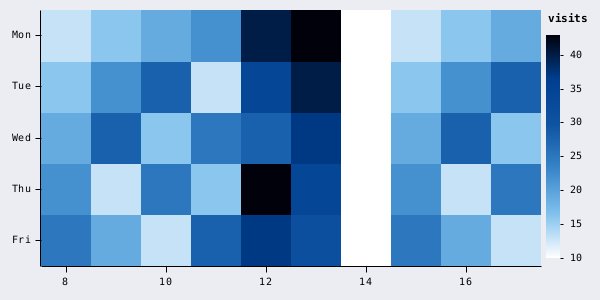
:::


Its own option writes the value in each cell (black or white by the fill, the `:tile-value` text role); the cell
shape and outline are the [Cell style](reference.shared_options.html#cell-style) group:

::: {.clay-table}

```{=html}
<table class="table table-hover table-responsive clay-table"><thead><tr><th>Option</th><th>Type</th><th>Default</th><th>Description</th></tr></thead><tbody><tr><td>:value-label</td><td>true or false or a function</td><td>false</td><td>label in each cell: true (the colour value, numbers to 2 decimals) or a function of {:value :x :y} returning the text (nil - none), drawn in black or white by the fill under it</td></tr></tbody></table>
```

:::


::: {.sourceClojure}
```clojure
(plot/render-image (plot/arrange [{:data week-hours
                                   :mapping {:x :hour :y :day :color :visits}
                                   :charts [(chart/tile {:value-label true})]
                                   :scales {:y {:reverse true}}
                                   :labels {:title ":value-label true"}
                                   :legend false}
                                  {:data week-hours
                                   :mapping {:x :hour :y :day :color :visits}
                                   :charts [(chart/tile {:value-label #(when (< 30 (:value %)) "busy")})]
                                   :scales {:y {:reverse true}}
                                   :labels {:title "a function: \"busy\" above 30"}}]
                                 {:columns 2 :widths [1 1.15]})
                   {:width 1000 :height 300})
```
:::


::: {.clay-image}
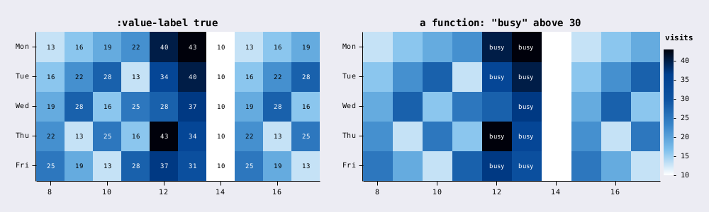
:::


A mapped `:size` shrinks each cell by its value; with the colour mapped to another variable the size legend's keys
have no colour of their own - their fill is a theme key of `[:chart :tile]`, not an option:

::: {.clay-table}

```{=html}
<table class="table table-hover table-responsive clay-table"><thead><tr><th>Option</th><th>Type</th><th>Default</th><th>Description</th></tr></thead><tbody><tr><td>:size-key-fill</td><td>a clojure2d color or :none</td><td>[110 110 110]</td><td>fill of a size legend key without a colour (theme only, not an option)</td></tr></tbody></table>
```

:::


::: {.sourceClojure}
```clojure
(plot/render-image {:data week-hours
                    :mapping {:x :hour :y :day :color :day :size :visits}
                    :charts [(chart/tile)]
                    :scales {:y {:reverse true}}
                    :theme {:chart {:tile {:size-key-fill [200 120 60]}}}}
                   {:width 600 :height 300})
```
:::


::: {.clay-image}

:::


Shared options: [Cell style](reference.shared_options.html#cell-style) (`:cell` `:cell-scale` `:stroke-color` `:stroke-width` `:alpha-factor`); [Data and mapping](reference.shared_options.html#data-and-mapping) (`:data` `:mapping`); [Named theme styles](reference.shared_options.html#named-theme-styles) (`:theme-style`).


## bin2d

A 2D histogram: points counted in rectangular cells, the count (or another measure) as the cell colour.

::: {.clay-table}

```{=html}
<table class="table table-hover table-responsive clay-table"><thead><tr><th>Option</th><th>Type</th><th>Default</th><th>Description</th></tr></thead><tbody><tr><td>:x (required)</td><td>a keyword, a function or a categorical marker of one</td><td></td><td>point x positions (numbers)</td></tr><tr><td>:y (required)</td><td>a keyword, a function or a categorical marker of one</td><td></td><td>point y positions (numbers)</td></tr><tr><td>:color</td><td>nil</td><td></td><td>must be nil (the cell colour is the measure): set it so in the chart's mapping when the plot maps :color</td></tr></tbody></table>
```

:::


::: {.sourceClojure}
```clojure
(plot/render-image {:data faithful
                    :mapping {:x :eruptions :y :waiting}
                    :charts [(chart/bin2d)]
                    :labels {:x "eruption [min]" :y "waiting [min]"}}
                   {:width 600 :height 400})
```
:::


::: {.clay-image}

:::


Its options: the number of cells (or a fastmath estimate), a cell width in data units, the cells' height / width
ratio and what the colour measures:

::: {.clay-table}

```{=html}
<table class="table table-hover table-responsive clay-table"><thead><tr><th>Option</th><th>Type</th><th>Default</th><th>Description</th></tr></thead><tbody><tr><td>:bins</td><td>one of :scott-correlated :scott :freedman-diaconis :cross-validation :shimazaki-shinomoto or a positive integer</td><td>:scott-correlated</td><td>cells across the x range (a positive integer), or a fastmath estimate-grid-size method giving a cell area (:binwidth wins)</td></tr><tr><td>:binwidth</td><td>a positive finite number</td><td></td><td>cell size in x data units (log10 units on a :log axis); wins over :bins</td></tr><tr><td>:aspect</td><td>a positive finite number</td><td>the panel's height / width (y span / x span with :aspect :iso), estimated from the plot size and facet layout</td><td>height / width ratio of the normalized binning space (cells are regular in pixels when it matches the panel)</td></tr><tr><td>:measure</td><td>one of :count :percent :pmf :density</td><td>:count</td><td>the cell colour: :count, :percent (of the panel's points), :pmf (share of the panel's points) or :density (count / (n * cell area in data units))</td></tr></tbody></table>
```

:::


::: {.sourceClojure}
```clojure
(plot/render-image (plot/arrange [{:data faithful
                                   :mapping {:x :eruptions :y :waiting}
                                   :charts [(chart/bin2d {:bins 10})]
                                   :labels {:title ":bins 10"}
                                   :legend false}
                                  {:data faithful
                                   :mapping {:x :eruptions :y :waiting}
                                   :charts [(chart/bin2d {:binwidth 0.25 :aspect 0.5})]
                                   :labels {:title ":binwidth 0.25 :aspect 0.5"}
                                   :legend false}
                                  {:data faithful
                                   :mapping {:x :eruptions :y :waiting}
                                   :charts [(chart/bin2d {:measure :percent})]
                                   :labels {:title ":measure :percent"}}]
                                 {:columns 3 :widths [1 1 1.3]})
                   {:width 1000 :height 320})
```
:::


::: {.clay-image}
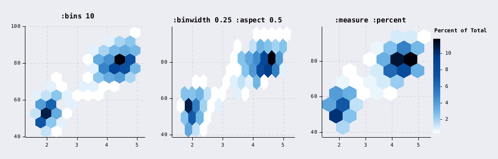
:::


The fastmath estimates of the grid (the default `:scott-correlated` above) - each picks its own cell count:


::: {.sourceClojure}
```clojure
(plot/render-image (plot/arrange [{:data faithful
                                   :mapping {:x :eruptions :y :waiting}
                                   :charts [(chart/bin2d {:bins :scott})]
                                   :labels {:title ":bins :scott"}
                                   :legend false}
                                  {:data faithful
                                   :mapping {:x :eruptions :y :waiting}
                                   :charts [(chart/bin2d {:bins :freedman-diaconis})]
                                   :labels {:title ":bins :freedman-diaconis"}
                                   :legend false}
                                  {:data faithful
                                   :mapping {:x :eruptions :y :waiting}
                                   :charts [(chart/bin2d {:bins :cross-validation})]
                                   :labels {:title ":bins :cross-validation"}
                                   :legend false}
                                  {:data faithful
                                   :mapping {:x :eruptions :y :waiting}
                                   :charts [(chart/bin2d {:bins :shimazaki-shinomoto})]
                                   :labels {:title ":bins :shimazaki-shinomoto"}
                                   :legend false}]
                                 {:columns 2})
                   {:width 900 :height 600})
```
:::


::: {.clay-image}
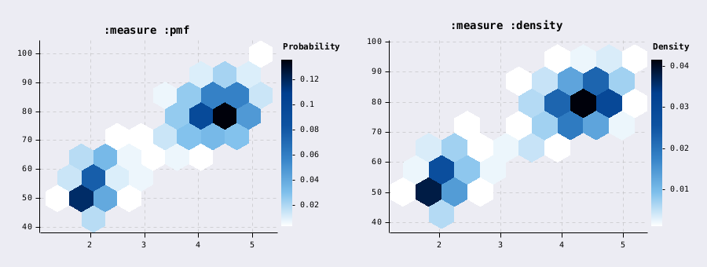
:::


The other measures: the share of the panel's points (`:pmf`) and the density - the count over n times the cell
area (the legend shows the scale):


::: {.sourceClojure}
```clojure
(plot/render-image (plot/arrange [{:data faithful
                                   :mapping {:x :eruptions :y :waiting}
                                   :charts [(chart/bin2d {:measure :pmf})]
                                   :labels {:title ":measure :pmf"}}
                                  {:data faithful
                                   :mapping {:x :eruptions :y :waiting}
                                   :charts [(chart/bin2d {:measure :density})]
                                   :labels {:title ":measure :density"}}]
                                 {:columns 2})
                   {:width 900 :height 340})
```
:::


::: {.clay-image}

:::


Shared options: [Cell style](reference.shared_options.html#cell-style) (`:cell` `:cell-scale` `:stroke-color` `:stroke-width` `:alpha-factor`); [Data and mapping](reference.shared_options.html#data-and-mapping) (`:data` `:mapping`); [Named theme styles](reference.shared_options.html#named-theme-styles) (`:theme-style`).


## field

A raster of a scalar field: the density of mapped points, gridded `:value`s interpolated, or a function of a
point (the [Fields](reference.shared_options.html#fields) group).

::: {.clay-table}

```{=html}
<table class="table table-hover table-responsive clay-table"><thead><tr><th>Option</th><th>Type</th><th>Default</th><th>Description</th></tr></thead><tbody><tr><td>:x</td><td>a keyword, a function or a categorical marker of one or nil</td><td></td><td>x of the points (density) or of the gridded data</td></tr><tr><td>:y</td><td>a keyword, a function or a categorical marker of one or nil</td><td></td><td>y of the points (density) or of the gridded data</td></tr><tr><td>:value</td><td>a keyword, a function or a categorical marker of one or nil</td><td></td><td>the field's value at gridded (x, y) on a full lattice, interpolated (absent - a density of the points)</td></tr><tr><td>:color</td><td>nil</td><td></td><td>must be nil (the colour is the field's value): set it so in the chart's mapping when the plot maps :color</td></tr></tbody></table>
```

:::


::: {.sourceClojure}
```clojure
(plot/render-image (plot/arrange [{:data faithful
                                   :mapping {:x :eruptions :y :waiting}
                                   :charts [(chart/field)]
                                   :labels {:title "density of the points"}
                                   :legend false}
                                  {:data volcano
                                   :mapping {:x :column :y :row :value :height}
                                   :charts [(chart/field)]
                                   :labels {:title "gridded :value"}}]
                                 {:columns 2 :widths [1 1.2]})
                   {:width 1000 :height 380})
```
:::


::: {.clay-image}

:::


Its options: the raster's opacity, or a colour per pixel computed by a function (no field, no colour scale):

::: {.clay-table}

```{=html}
<table class="table table-hover table-responsive clay-table"><thead><tr><th>Option</th><th>Type</th><th>Default</th><th>Description</th></tr></thead><tbody><tr><td>:alpha-factor</td><td>a number in [0 1]</td><td>1.0</td><td>factor multiplying the colours' alpha</td></tr><tr><td>:pixel-color</td><td>a function</td><td></td><td>a function of a point [x y] returning each pixel's colour (nil - transparent): a raster over :domain, no grid, colour scale or legend; not with :f</td></tr></tbody></table>
```

:::


::: {.sourceClojure}
```clojure
(plot/render-image (plot/arrange [{:data faithful
                                   :mapping {:x :eruptions :y :waiting}
                                   :charts [(chart/field {:alpha-factor 0.5}) (chart/scatter {:size 3 :color :black})]
                                   :labels {:title ":alpha-factor 0.5, points over it"}
                                   :legend false}
                                  {:charts [(chart/field {:domain {:x [-2 2] :y [-2 2]}
                                                          :pixel-color (fn [[x y]]
                                                                         (when (< (+ (* x x) (* y y)) 3)
                                                                           [(int (* 60 (+ x 2))) 80 (int (* 60 (+ y 2)))]))})]
                                   :labels {:title ":pixel-color - a colour per point"}}]
                                 {:columns 2})
                   {:width 900 :height 380})
```
:::


::: {.clay-image}

:::


### Field sources

The [Fields](reference.shared_options.html#fields) group gives the field. A function of a point `[x y]` sampled
over a `:domain` on a grid of `:n` points per axis (a coarse grid shows its cells):


::: {.sourceClojure}
```clojure
(plot/render-image (plot/arrange [{:charts [(chart/field {:f (fn [[x y]] (m/sin (+ (* x x) (* y y))))
                                                          :domain {:x [-2 2] :y [-2 2]}})]
                                   :labels {:title ":f over :domain"}
                                   :legend false}
                                  {:charts [(chart/field {:f (fn [[x y]] (m/sin (+ (* x x) (* y y))))
                                                          :domain {:x [-2 2] :y [-2 2]} :n 12})]
                                   :labels {:title ":n 12"}}]
                                 {:columns 2 :widths [1 1.2]})
                   {:width 900 :height 380})
```
:::


::: {.clay-image}
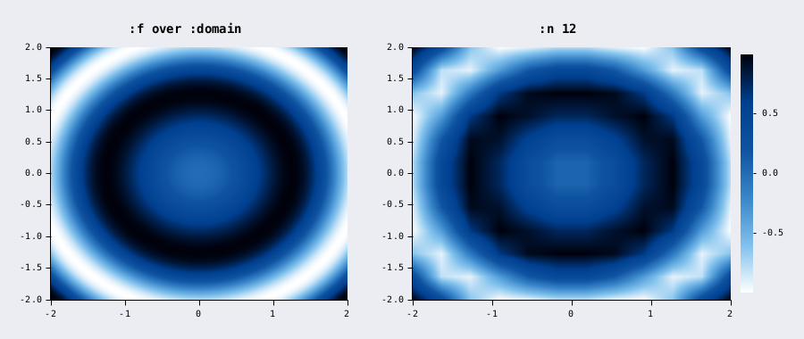
:::


Gridded values are interpolated between the lattice points - here a 5 x 5 lattice:


::: {.sourceClojure}
```clojure
(def lattice (for [x (range 5) y (range 5)] {:x x :y y :z (* (m/sin x) (m/cos (* 0.8 y)))}))
```
:::


```{=html}
<div class="data-table"><table class="table table-hover table-responsive clay-table"><thead><tr><th>x</th><th>y</th><th>z</th></tr></thead><tbody><tr><td>0</td><td>0</td><td>0.0</td></tr><tr><td>0</td><td>1</td><td>0.0</td></tr><tr><td>0</td><td>2</td><td>-0.0</td></tr><tr><td>0</td><td>3</td><td>-0.0</td></tr><tr><td>0</td><td>4</td><td>-0.0</td></tr><tr><td>1</td><td>0</td><td>0.8414709848078965</td></tr><tr><td>1</td><td>1</td><td>0.5862584808366281</td></tr><tr><td>1</td><td>2</td><td>-0.024570550786785637</td></tr><tr><td>1</td><td>3</td><td>-0.620495416007646</td></tr><tr><td>1</td><td>4</td><td>-0.8400360881165891</td></tr><tr><td>2</td><td>0</td><td>0.9092974268256817</td></tr><tr><td>2</td><td>1</td><td>0.6335136180615656</td></tr><tr><td>2</td><td>2</td><td>-0.02655105049310103</td></tr><tr><td>2</td><td>3</td><td>-0.6705102080990835</td></tr><tr><td>2</td><td>4</td><td>-0.9077468708436899</td></tr><tr><td>3</td><td>0</td><td>0.1411200080598672</td></tr><tr><td>3</td><td>1</td><td>0.09831925643843555</td></tr><tr><td>3</td><td>2</td><td>-0.00412063682250215</td></tr><tr><td>3</td><td>3</td><td>-0.10406100708047604</td></tr><tr><td>3</td><td>4</td><td>-0.14087936680627888</td></tr><tr><td>4</td><td>0</td><td>-0.7568024953079282</td></tr><tr><td>4</td><td>1</td><td>-0.5272693761317102</td></tr><tr><td>4</td><td>2</td><td>0.022098271339414874</td></tr><tr><td>4</td><td>3</td><td>0.5580614039459993</td></tr><tr><td>4</td><td>4</td><td>0.7555119773743378</td></tr></tbody></table></div>
```


::: {.sourceClojure}
```clojure
(plot/render-image (plot/arrange [{:data lattice
                                   :mapping {:x :x :y :y :value :z}
                                   :charts [(chart/field {:interpolation :bilinear})]
                                   :labels {:title ":interpolation :bilinear"}
                                   :legend false}
                                  {:data lattice
                                   :mapping {:x :x :y :y :value :z}
                                   :charts [(chart/field {:interpolation :bicubic})]
                                   :labels {:title ":interpolation :bicubic"}
                                   :legend false}
                                  {:data lattice
                                   :mapping {:x :x :y :y :value :z}
                                   :charts [(chart/field {:interpolation :cubic-2d})]
                                   :labels {:title ":interpolation :cubic-2d"}}]
                                 {:columns 3 :widths [1 1 1.25]})
                   {:width 1000 :height 320})
```
:::


::: {.clay-image}
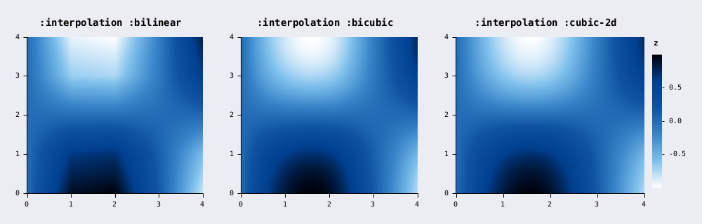
:::


The density of mapped points: its kernel and bandwidth, a binned estimate (faster on many points), and how far
the domain reaches past the points (`:cut`, in bandwidths):


::: {.sourceClojure}
```clojure
(plot/render-image (plot/arrange [{:data faithful
                                   :mapping {:x :eruptions :y :waiting}
                                   :charts [(chart/field {:kernel :epanechnikov :bandwidth [0.2 4]})]
                                   :labels {:title "epanechnikov, bandwidth [0.2 4]"}
                                   :legend false}
                                  {:data faithful
                                   :mapping {:x :eruptions :y :waiting}
                                   :charts [(chart/field {:binned true})]
                                   :labels {:title ":binned true"}
                                   :legend false}
                                  {:data faithful
                                   :mapping {:x :eruptions :y :waiting}
                                   :charts [(chart/field {:cut 0})]
                                   :labels {:title ":cut 0"}
                                   :legend false}]
                                 {:columns 3})
                   {:width 1000 :height 320})
```
:::


::: {.clay-image}
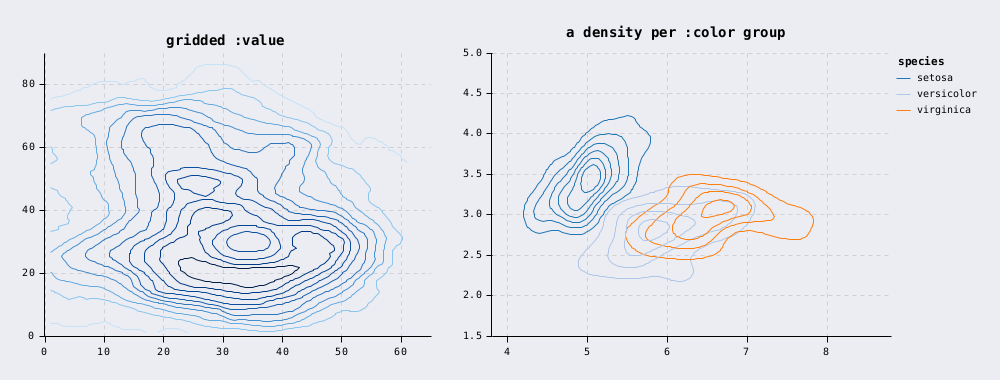
:::


Shared options: [Fields](reference.shared_options.html#fields) (`:f` `:domain` `:kernel` `:bandwidth` `:binned` `:cut` `:interpolation` `:n`); [Data and mapping](reference.shared_options.html#data-and-mapping) (`:data` `:mapping`); [Named theme styles](reference.shared_options.html#named-theme-styles) (`:theme-style`).


## contour

Level lines (or filled bands) of a scalar field - the same sources as `field`; categorical groups give a field
each.

::: {.clay-table}

```{=html}
<table class="table table-hover table-responsive clay-table"><thead><tr><th>Option</th><th>Type</th><th>Default</th><th>Description</th></tr></thead><tbody><tr><td>:x</td><td>a keyword, a function or a categorical marker of one or nil</td><td></td><td>x of the points (density) or of the gridded data</td></tr><tr><td>:y</td><td>a keyword, a function or a categorical marker of one or nil</td><td></td><td>y of the points (density) or of the gridded data</td></tr><tr><td>:value</td><td>a keyword, a function or a categorical marker of one or nil</td><td></td><td>the field's value at gridded (x, y) on a full lattice, interpolated (absent - a density of the points)</td></tr><tr><td>:color</td><td>a keyword, a function or a categorical marker of one or nil</td><td></td><td>categorical groups, each its own field with lines in its colour (else the lines are coloured by level)</td></tr><tr><td>:dash</td><td>a keyword, a function or a categorical marker of one or nil</td><td></td><td>groups, each its own field with lines in its dash style</td></tr><tr><td>:group</td><td>a keyword, a function or a categorical marker of one or nil</td><td></td><td>groups without a visual aesthetic, each its own field</td></tr></tbody></table>
```

:::


::: {.sourceClojure}
```clojure
(plot/render-image (plot/arrange [{:data volcano
                                   :mapping {:x :column :y :row :value :height}
                                   :charts [(chart/contour)]
                                   :labels {:title "gridded :value"}
                                   :legend false}
                                  {:data iris
                                   :mapping {:x :sepal-length :y :sepal-width :color :species}
                                   :charts [(chart/contour {:levels 6})]
                                   :labels {:title "a density per :color group"}}]
                                 {:columns 2 :widths [1 1.25]})
                   {:width 1000 :height 380})
```
:::


::: {.clay-image}

:::


Its options: the levels (a count or the values), filled bands instead of lines, labels on the lines, one line
colour and the opacity:

::: {.clay-table}

```{=html}
<table class="table table-hover table-responsive clay-table"><thead><tr><th>Option</th><th>Type</th><th>Default</th><th>Description</th></tr></thead><tbody><tr><td>:color</td><td>a clojure2d color or :none</td><td>[69 117 180]; the theme's, for grouped lines without a mapped colour; ungrouped lines are coloured by level, lines grouped by :color take their group's colour</td><td>one colour for every line instead of colouring by level (contour's own :color, not the line style's)</td></tr><tr><td>:alpha-factor</td><td>a number in [0 1]</td><td>1.0; the theme's; grouped filled contours take half of it</td><td>factor multiplying the colours' alpha</td></tr><tr><td>:levels</td><td>integer (1..1000) or vector of a finite number (at least 1)</td><td>10</td><td>contour levels: a count evenly spread over the range of every sampled value (the ends left out), or a vector of level values</td></tr><tr><td>:filled</td><td>true or false</td><td>false</td><td>fill the region at or above each level, each band coloured by its middle value, instead of drawing lines</td></tr><tr><td>:labels</td><td>true or false or a function or nil</td><td>false</td><td>line contours only: label each line with its level - true (the number) or a function of {:level v} returning the text (nil - no label)</td></tr></tbody></table>
```

:::


::: {.sourceClojure}
```clojure
(plot/render-image (plot/arrange [{:data volcano
                                   :mapping {:x :column :y :row :value :height}
                                   :charts [(chart/contour {:levels [100 120 140 160 180] :labels true
                                                            :color [40 40 40]})]
                                   :labels {:title ":levels vector, :labels true"}}
                                  {:data volcano
                                   :mapping {:x :column :y :row :value :height}
                                   :charts [(chart/contour {:filled true :levels 8 :alpha-factor 0.8})]
                                   :labels {:title ":filled true :levels 8"}}]
                                 {:columns 2 :widths [1 1.25]})
                   {:width 1000 :height 380})
```
:::


::: {.clay-image}
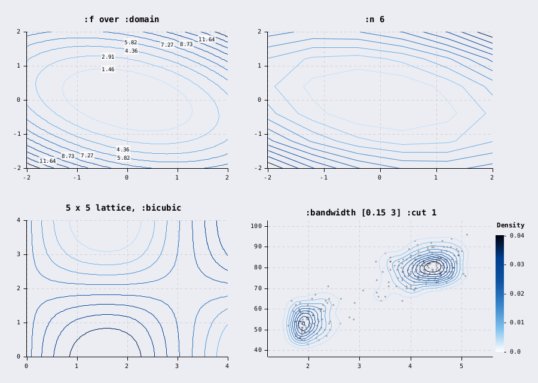
:::


### Contour sources

The same sources as `field`: a function over a domain (lines on a coarse grid are angular), interpolated gridded
values and a density with its own bandwidth:


::: {.sourceClojure}
```clojure
(plot/render-image (plot/arrange [{:charts [(chart/contour {:f (fn [[x y]] (+ (* x x) (* 2 y y) (* x y)))
                                                            :domain {:x [-2 2] :y [-2 2]} :labels true})]
                                   :labels {:title ":f over :domain"}
                                   :legend false}
                                  {:charts [(chart/contour {:f (fn [[x y]] (+ (* x x) (* 2 y y) (* x y)))
                                                            :domain {:x [-2 2] :y [-2 2]} :n 6})]
                                   :labels {:title ":n 6"}
                                   :legend false}
                                  {:data lattice
                                   :mapping {:x :x :y :y :value :z}
                                   :charts [(chart/contour {:interpolation :bicubic :levels 8})]
                                   :labels {:title "5 x 5 lattice, :bicubic"}
                                   :legend false}
                                  {:data faithful
                                   :mapping {:x :eruptions :y :waiting}
                                   :charts [(chart/scatter {:size 3 :color [0 0 0 80]})
                                            (chart/contour {:bandwidth [0.15 3] :cut 1})]
                                   :labels {:title ":bandwidth [0.15 3] :cut 1"}}]
                                 {:columns 2 :widths [1 1.25]})
                   {:width 900 :height 640})
```
:::


::: {.clay-image}

:::


Shared options: [Line style](reference.shared_options.html#line-style) (`:line-width` `:dash`); [Fields](reference.shared_options.html#fields) (`:f` `:domain` `:kernel` `:bandwidth` `:binned` `:cut` `:interpolation` `:n`); [Data and mapping](reference.shared_options.html#data-and-mapping) (`:data` `:mapping`); [Named theme styles](reference.shared_options.html#named-theme-styles) (`:theme-style`).


## correlation

The correlation coefficient r of two variables drawn as one glyph filling the panel - a cell of a correlogram
(`plot/pairs`). Alone it writes r, one line per group.

::: {.clay-table}

```{=html}
<table class="table table-hover table-responsive clay-table"><thead><tr><th>Option</th><th>Type</th><th>Default</th><th>Description</th></tr></thead><tbody><tr><td>:x (required)</td><td>a keyword, a function or a categorical marker of one</td><td></td><td>first variable (numbers)</td></tr><tr><td>:y (required)</td><td>a keyword, a function or a categorical marker of one</td><td></td><td>second variable (numbers)</td></tr><tr><td>:color</td><td>a keyword, a function or a categorical marker of one or nil</td><td></td><td>categorical groups, each a line of the :number glyph in its colour</td></tr><tr><td>:group</td><td>a keyword, a function or a categorical marker of one or nil</td><td></td><td>groups without a visual aesthetic, each a line of the :number glyph</td></tr></tbody></table>
```

:::


::: {.sourceClojure}
```clojure
(plot/render-image {:data iris
                    :mapping {:x :sepal-length :y :petal-length :color :species}
                    :charts [(chart/correlation)]}
                   {:width 450 :height 300})
```
:::


::: {.clay-image}
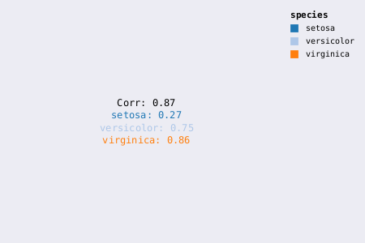
:::


Its options: the coefficient, the glyph and its colours (by default r on a diverging scale):

::: {.clay-table}

```{=html}
<table class="table table-hover table-responsive clay-table"><thead><tr><th>Option</th><th>Type</th><th>Default</th><th>Description</th></tr></thead><tbody><tr><td>:color</td><td>a clojure2d color or :none</td><td>[69 117 180]; grouped shape glyphs: the theme's; ungrouped: r on a diverging scale; :number: the :correlation text role's colour, group lines mapped or black</td><td>one fixed glyph colour, the :number text's too</td></tr><tr><td>:stroke-color</td><td>:darker or a clojure2d color or :none</td><td>:darker</td><td>outline colour: a colour, :none or :darker (the darkened fill)</td></tr><tr><td>:stroke-width</td><td>a non-negative number</td><td>1</td><td>outline width in pixels</td></tr><tr><td>:method</td><td>one of :pearson :spearman :kendall</td><td>:pearson</td><td>correlation coefficient: :pearson, :spearman or :kendall</td></tr><tr><td>:glyph</td><td>one of :number :shade :square :circle :ellipse :pie</td><td>:number</td><td>how r is drawn: :number (text, a line per group), :shade (the panel in r's colour), :square / :circle (area ~ |r|), :ellipse (normal contour) or :pie (a disk filled |r|)</td></tr><tr><td>:glyph-size</td><td>a number in [0 1]</td><td>0.9</td><td>glyph side (:square, :circle, :ellipse, :pie) as a fraction of the panel's shorter side</td></tr></tbody></table>
```

:::


Every glyph, for one pair of variables (r about 0.82):


::: {.sourceClojure}
```clojure
(plot/render-image (plot/arrange [{:data iris :mapping {:x :sepal-length :y :petal-width}
                                   :charts [(chart/correlation {:glyph :number})] :labels {:title ":glyph :number"}}
                                  {:data iris :mapping {:x :sepal-length :y :petal-width}
                                   :charts [(chart/correlation {:glyph :shade})] :labels {:title ":glyph :shade"}}
                                  {:data iris :mapping {:x :sepal-length :y :petal-width}
                                   :charts [(chart/correlation {:glyph :square})] :labels {:title ":glyph :square"}}
                                  {:data iris :mapping {:x :sepal-length :y :petal-width}
                                   :charts [(chart/correlation {:glyph :circle})] :labels {:title ":glyph :circle"}}
                                  {:data iris :mapping {:x :sepal-length :y :petal-width}
                                   :charts [(chart/correlation {:glyph :ellipse})] :labels {:title ":glyph :ellipse"}}
                                  {:data iris :mapping {:x :sepal-length :y :petal-width}
                                   :charts [(chart/correlation {:glyph :pie})] :labels {:title ":glyph :pie"}}]
                                 {:columns 3})
                   {:width 900 :height 560})
```
:::


::: {.clay-image}
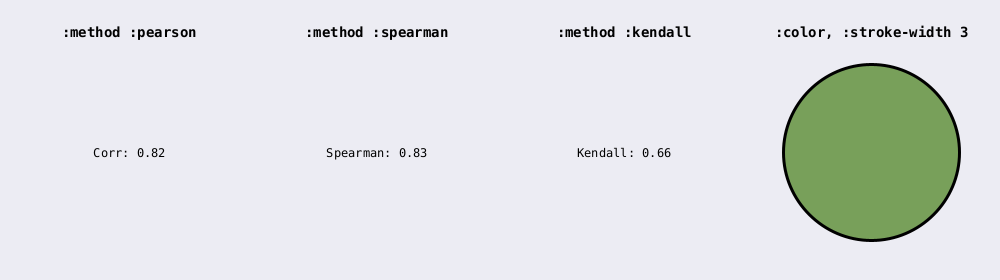
:::


The three coefficients of the same pair (Kendall's tau, counting concordant pairs, is the lowest), and a smaller
glyph in one fixed colour with a thick outline:


::: {.sourceClojure}
```clojure
(plot/render-image (plot/arrange [{:data iris :mapping {:x :sepal-length :y :petal-width}
                                   :charts [(chart/correlation {:method :pearson})] :labels {:title ":method :pearson"}}
                                  {:data iris :mapping {:x :sepal-length :y :petal-width}
                                   :charts [(chart/correlation {:method :spearman})] :labels {:title ":method :spearman"}}
                                  {:data iris :mapping {:x :sepal-length :y :petal-width}
                                   :charts [(chart/correlation {:method :kendall})] :labels {:title ":method :kendall"}}
                                  {:data iris :mapping {:x :sepal-length :y :petal-width}
                                   :charts [(chart/correlation {:glyph :circle :glyph-size 0.6 :color [120 160 90]
                                                                :stroke-color :black :stroke-width 3})]
                                   :labels {:title ":glyph-size 0.6"}}]
                                 {:columns 4})
                   {:width 1000 :height 280})
```
:::


::: {.clay-image}
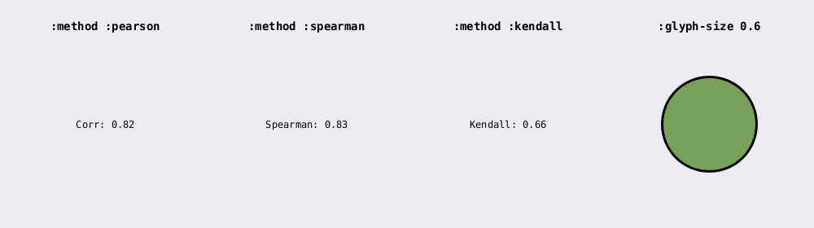
:::


In a correlogram - a [`plot/pairs`](reference.facets_arrange.html#scatter-plot-matrix) matrix with correlation
glyphs below (`:lower`) and above (`:upper`) the diagonal, and the variables' names on it (`:diagonal :names`):


::: {.sourceClojure}
```clojure
(plot/render-image (plot/pairs iris {:variables [:sepal-length :sepal-width :petal-length :petal-width]
                                     :lower (chart/correlation {:glyph :ellipse :stroke-color :none})
                                     :upper (chart/correlation {:glyph :square :method :spearman})
                                     :diagonal :names
                                     :title "ellipses (Pearson) below, squares (Spearman) above"})
                   {:width 700 :height 620})
```
:::


::: {.clay-image}
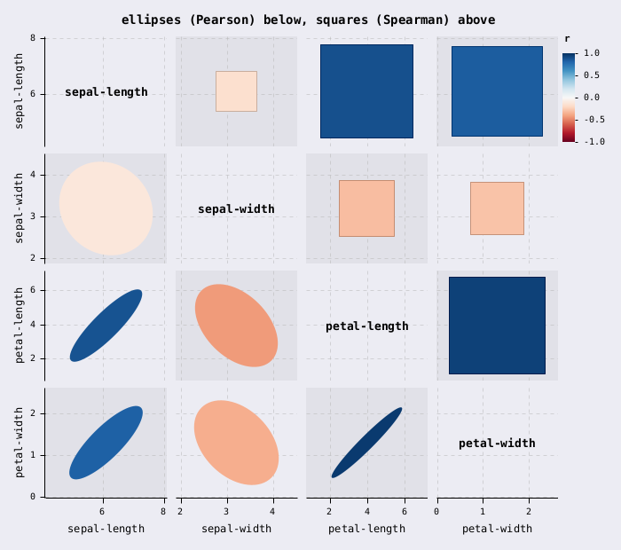
:::


Shared options: [Data and mapping](reference.shared_options.html#data-and-mapping) (`:data` `:mapping`); [Named theme styles](reference.shared_options.html#named-theme-styles) (`:theme-style`).


## pairwise

Any statistic of two variables drawn as one cell filling the panel: an error, an association, an effect size,
a distance (the keys of `cljplot2.data.pairwise/statistics`, listed with
[`pairwise/matrix-rows`](reference.data_sets_series.html#pairwisematrix-rows) in the Data functions part) or a function of the two samples - always of the x sample against the y sample. Unlike r the
values have no fixed range. Alone it writes the value, one line per group.

::: {.clay-table}

```{=html}
<table class="table table-hover table-responsive clay-table"><thead><tr><th>Option</th><th>Type</th><th>Default</th><th>Description</th></tr></thead><tbody><tr><td>:x (required)</td><td>a keyword, a function or a categorical marker of one</td><td></td><td>first sample, the statistic's xs (numbers)</td></tr><tr><td>:y (required)</td><td>a keyword, a function or a categorical marker of one</td><td></td><td>second sample, the statistic's ys (numbers)</td></tr><tr><td>:color</td><td>a keyword, a function or a categorical marker of one or nil</td><td></td><td>categorical groups, each a line of the :number glyph in its colour</td></tr><tr><td>:group</td><td>a keyword, a function or a categorical marker of one or nil</td><td></td><td>groups without a visual aesthetic, each a line of the :number glyph</td></tr></tbody></table>
```

:::


::: {.sourceClojure}
```clojure
(plot/render-image {:data iris
                    :mapping {:x :sepal-length :y :petal-length :color :species}
                    :charts [(chart/pairwise {:method :cohens-d})]}
                   {:width 450 :height 300})
```
:::


::: {.clay-image}

:::


Its options: the statistic and its label, the glyph (by default `:number` - the text alone; a shade colours the
value on the colour scale over the panels' range, symmetric around 0 on a diverging palette for a signed
statistic), and the number format:

::: {.clay-table}

```{=html}
<table class="table table-hover table-responsive clay-table"><thead><tr><th>Option</th><th>Type</th><th>Default</th><th>Description</th></tr></thead><tbody><tr><td>:color</td><td>a clojure2d color or :none</td><td>[69 117 180]; ungrouped shades: the value on the colour scale; grouped shades: the theme's; :number: the :pairwise text role's colour, group lines mapped</td><td>one fixed colour: the shade's (text over it by contrast), the :number text's</td></tr><tr><td>:method</td><td>one of :ameasure :canberra :chebyshev :cliffs-delta :cohens-d :cosine :covariance :euclidean :glass-delta :hedges-g :kendall :mae :manhattan :mape :me :means-ratio :mse :pearson :r2 :rmse :spearman or a function</td><td>:pearson</td><td>the statistic: a key of pairwise/statistics or a function of two samples (f xs ys)</td></tr><tr><td>:label</td><td>string or nil</td><td>the statistic's label, value for a function</td><td>the statistic's label (text, colour bar title)</td></tr><tr><td>:glyph</td><td>one of :number :shade :shade-number</td><td>:number</td><td>how the value is drawn: :number (text, a line per group), :shade (the panel in the value's colour) or :shade-number (both)</td></tr><tr><td>:value-format</td><td>a number format string or a function or nil</td><td>at most 2 decimals, whole numbers without them</td><td>the text of a value: a format string or a function of the number (a throw or nil - NA)</td></tr></tbody></table>
```

:::


The glyphs for one pair (sepal against petal length): the mean absolute error as text, shaded and both, the signed
mean error shaded on the diverging palette, a user function with its label and format, and one fixed colour (the
text over a shade is black or white by the fill):


::: {.sourceClojure}
```clojure
(plot/render-image (plot/arrange [{:data iris :mapping {:x :sepal-length :y :petal-length}
                                   :charts [(chart/pairwise {:method :mae :glyph :number})] :labels {:title ":number"}}
                                  {:data iris :mapping {:x :sepal-length :y :petal-length}
                                   :charts [(chart/pairwise {:method :mae :glyph :shade})] :labels {:title ":shade"}}
                                  {:data iris :mapping {:x :sepal-length :y :petal-length}
                                   :charts [(chart/pairwise {:method :mae :glyph :shade-number})] :labels {:title ":shade-number"}}
                                  {:data iris :mapping {:x :sepal-length :y :petal-length}
                                   :charts [(chart/pairwise {:method :me :glyph :shade-number})] :labels {:title "signed :me"}}
                                  {:data iris :mapping {:x :sepal-length :y :petal-length}
                                   :charts [(chart/pairwise {:method (fn [xs ys] (- (apply max xs) (apply max ys)))
                                                             :label "max diff" :value-format #(format "%+.1f cm" %)})]
                                   :labels {:title "function, :value-format"}}
                                  {:data iris :mapping {:x :sepal-length :y :petal-length}
                                   :charts [(chart/pairwise {:method :rmse :glyph :shade-number :color [120 160 90]})]
                                   :labels {:title ":color"}}]
                                 {:columns 3})
                   {:width 1000 :height 520})
```
:::


::: {.clay-image}
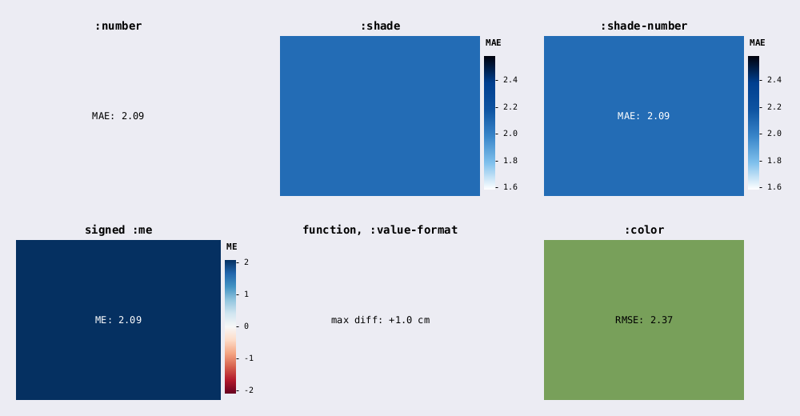
:::


In a [`plot/pairs`](reference.facets_arrange.html#scatter-plot-matrix) matrix every cell shows the statistic of
its column variable against its row variable, so the mirrored cells of the asymmetric mean error have opposite
signs - shaded below, as text above, the names on the diagonal (`:diagonal :names`). The statistic is computed
once for the matrix: every shaded cell is coloured on its range (symmetric around 0 for the signed mean error) and
the one colour bar agrees; the cells share one text size:


::: {.sourceClojure}
```clojure
(plot/render-image (plot/pairs iris {:variables [:sepal-length :sepal-width :petal-length :petal-width]
                                     :lower (chart/pairwise {:method :me :glyph :shade-number})
                                     :upper (chart/pairwise {:method :me})
                                     :diagonal :names
                                     :title "mean error: shaded below, text above"})
                   {:width 700 :height 620})
```
:::


::: {.clay-image}

:::


Shared options: [Data and mapping](reference.shared_options.html#data-and-mapping) (`:data` `:mapping`); [Named theme styles](reference.shared_options.html#named-theme-styles) (`:theme-style`).


```{=html}
<div style="background-color:grey;height:2px;width:100%;"></div>
```


```{=html}
<div><pre><small><small>source: notebooks/reference/charts_grids_fields.clj</small></small></pre></div>
```