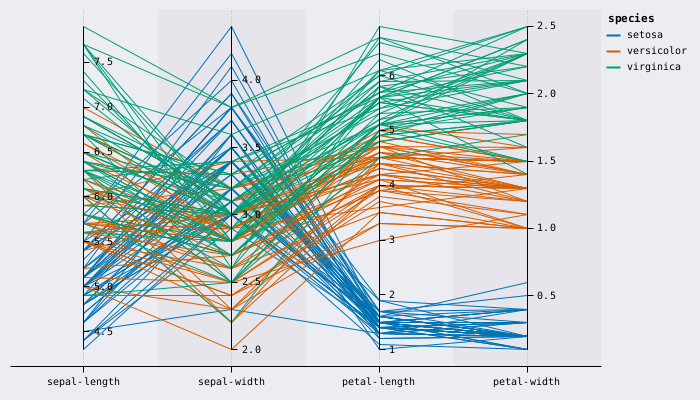
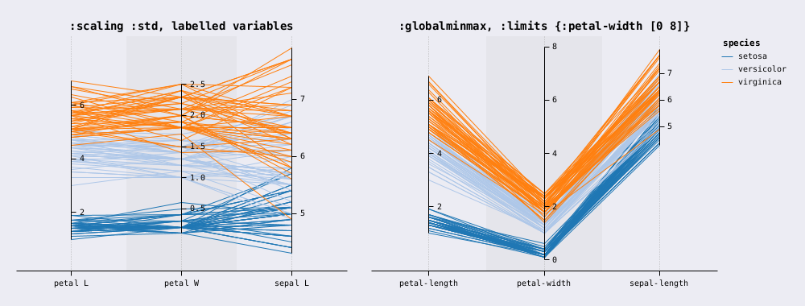
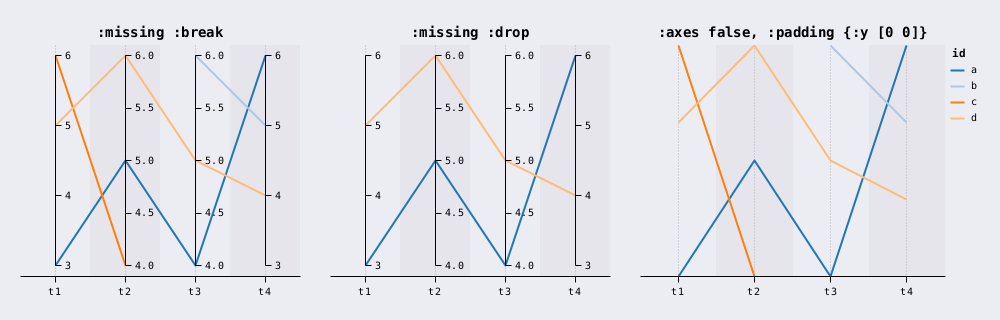
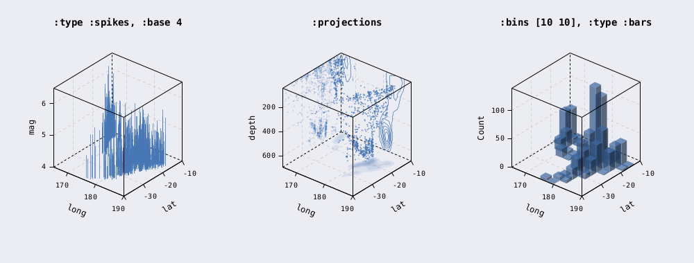
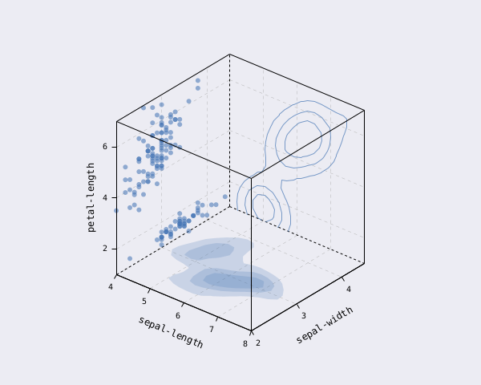
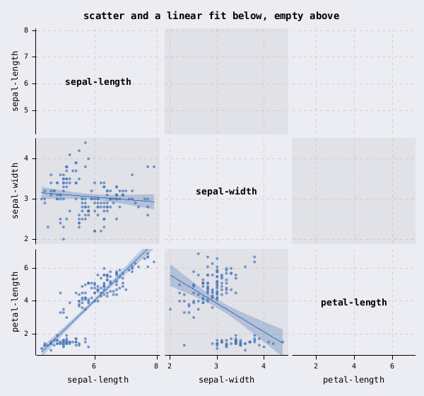

---
format:
  html:
    toc: true
    toc-location: right
    toc-depth: 4
    theme: cosmo
    include-in-header:
      text: |-
        <style>
        .data-table { width: fit-content; max-width: 100%; max-height: 15rem; overflow: auto; margin: 0 0 1rem 0; }
        .data-table .table-responsive { overflow: visible; }
        .data-table table { font-size: 0.75rem; width: auto; margin: 0; }
        .data-table th, .data-table td { padding: 0.1rem 0.45rem !important; white-space: nowrap; }
        .data-table thead th { position: sticky; top: 0; background: var(--bs-body-bg, #fff); }
        .options { margin: 0.5rem 0 1rem 0; }
        .options .option-card { margin: 0 0 0.9rem 0; border: 1px solid var(--bs-border-color, #dee2e6); border-radius: 0.375rem; overflow: hidden; }
        .options dt { display: flex; flex-wrap: wrap; align-items: baseline; gap: 0.1rem 1rem; margin: 0; padding: 0.4rem 0.75rem; background: #eef2f7; border-bottom: 1px solid var(--bs-border-color, #dee2e6); font-weight: normal; }
        .options dt > code { font-weight: 700; font-size: 1rem; background: none; padding: 0; }
        .options .option-default { font-size: 0.85rem; color: var(--bs-secondary-color, #6c757d); }
        .options dd { margin: 0; padding: 0.5rem 0.75rem; }
        .options .option-example { font-size: 0.85rem; padding: 0 0 0.45rem 0; margin-bottom: 0.45rem; border-bottom: 1px dashed var(--bs-border-color, #dee2e6); }
        .options .option-example code { background: none; padding: 0; }
        .options .option-text ul { margin: 0.3rem 0 0 0; padding-left: 1.25rem; }
        .options code, .mapping code { overflow-wrap: anywhere; }
        .mapping { margin: 0.5rem 0 1rem 0; padding: 0.5rem 0.75rem; border: 1px solid var(--bs-border-color, #dee2e6); border-left: 0.3rem solid #2780e3; border-radius: 0.375rem; background: #f5f8fc; }
        .mapping-title { font-weight: 700; margin-bottom: 0.25rem; }
        .mapping-hint { font-weight: normal; font-size: 0.85rem; color: var(--bs-secondary-color, #6c757d); }
        .mapping ul { margin: 0; padding-left: 1.25rem; }
        .mapping .required { font-size: 0.75rem; padding: 0 0.3rem; border: 1px solid currentColor; border-radius: 0.25rem; }
        </style>
code-block-background: true

---
<style></style><style>.printedClojure .sourceCode {
  background-color: transparent;
  border-style: none;
}
</style><style>.clay-limit-image-width .clay-image {max-width: 100%}
.clay-side-by-side .sourceCode {margin: 0}
.clay-side-by-side {margin: 1em 0}
</style>
<script src="https://code.jquery.com/jquery-3.6.0.min.js" type="text/javascript"></script><script src="https://code.jquery.com/ui/1.13.1/jquery-ui.min.js" type="text/javascript"></script>

# Multivariate and 3D

For more variables than two axes hold: a line per row across one axis per variable (`parallel`, a radar in polar
coordinates), points in a 3D box (`cloud`) and surfaces over a grid (`surface`). For a matrix of plots of every
pair of variables see [`plot/pairs`](reference.facets_arrange.html#scatter-plot-matrix).


::: {.sourceClojure}
```clojure
(ns reference.charts-multivariate-3d
  (:require [fastmath.core :as m]
            [cljplot2.chart :as chart]
            [cljplot2.core :as plot]
            [cljplot2.describe :as describe]
            [notebook-utils :as nu]))
```
:::


Data: Edgar Anderson's iris measurements, R datasets package `iris` (Anderson 1935; Fisher 1936); licence: Part of R (GPL-2 | GPL-3).


::: {.sourceClojure}
```clojure
(def iris (nu/dataset :iris))
```
:::


```{=html}
<div class="data-table"><table class="table table-hover table-responsive clay-table"><thead><tr><th>sepal-length</th><th>sepal-width</th><th>petal-length</th><th>petal-width</th><th>species</th></tr></thead><tbody><tr><td>5.1</td><td>3.5</td><td>1.4</td><td>0.2</td><td>setosa</td></tr><tr><td>4.9</td><td>3</td><td>1.4</td><td>0.2</td><td>setosa</td></tr><tr><td>4.7</td><td>3.2</td><td>1.3</td><td>0.2</td><td>setosa</td></tr><tr><td>4.6</td><td>3.1</td><td>1.5</td><td>0.2</td><td>setosa</td></tr><tr><td>5</td><td>3.6</td><td>1.4</td><td>0.2</td><td>setosa</td></tr><tr><td>5.4</td><td>3.9</td><td>1.7</td><td>0.4</td><td>setosa</td></tr><tr><td>4.6</td><td>3.4</td><td>1.4</td><td>0.3</td><td>setosa</td></tr><tr><td>5</td><td>3.4</td><td>1.5</td><td>0.2</td><td>setosa</td></tr><tr><td>4.4</td><td>2.9</td><td>1.4</td><td>0.2</td><td>setosa</td></tr><tr><td>4.9</td><td>3.1</td><td>1.5</td><td>0.1</td><td>setosa</td></tr><tr><td>5.4</td><td>3.7</td><td>1.5</td><td>0.2</td><td>setosa</td></tr><tr><td>4.8</td><td>3.4</td><td>1.6</td><td>0.2</td><td>setosa</td></tr><tr><td>4.8</td><td>3</td><td>1.4</td><td>0.1</td><td>setosa</td></tr><tr><td>4.3</td><td>3</td><td>1.1</td><td>0.1</td><td>setosa</td></tr><tr><td>5.8</td><td>4</td><td>1.2</td><td>0.2</td><td>setosa</td></tr><tr><td>5.7</td><td>4.4</td><td>1.5</td><td>0.4</td><td>setosa</td></tr><tr><td>5.4</td><td>3.9</td><td>1.3</td><td>0.4</td><td>setosa</td></tr><tr><td>5.1</td><td>3.5</td><td>1.4</td><td>0.3</td><td>setosa</td></tr><tr><td>5.7</td><td>3.8</td><td>1.7</td><td>0.3</td><td>setosa</td></tr><tr><td>5.1</td><td>3.8</td><td>1.5</td><td>0.3</td><td>setosa</td></tr><tr><td>5.4</td><td>3.4</td><td>1.7</td><td>0.2</td><td>setosa</td></tr><tr><td>5.1</td><td>3.7</td><td>1.5</td><td>0.4</td><td>setosa</td></tr><tr><td>4.6</td><td>3.6</td><td>1</td><td>0.2</td><td>setosa</td></tr><tr><td>5.1</td><td>3.3</td><td>1.7</td><td>0.5</td><td>setosa</td></tr><tr><td>4.8</td><td>3.4</td><td>1.9</td><td>0.2</td><td>setosa</td></tr><tr><td>5</td><td>3</td><td>1.6</td><td>0.2</td><td>setosa</td></tr><tr><td>5</td><td>3.4</td><td>1.6</td><td>0.4</td><td>setosa</td></tr><tr><td>5.2</td><td>3.5</td><td>1.5</td><td>0.2</td><td>setosa</td></tr><tr><td>5.2</td><td>3.4</td><td>1.4</td><td>0.2</td><td>setosa</td></tr><tr><td>4.7</td><td>3.2</td><td>1.6</td><td>0.2</td><td>setosa</td></tr><tr><td>4.8</td><td>3.1</td><td>1.6</td><td>0.2</td><td>setosa</td></tr><tr><td>5.4</td><td>3.4</td><td>1.5</td><td>0.4</td><td>setosa</td></tr><tr><td>5.2</td><td>4.1</td><td>1.5</td><td>0.1</td><td>setosa</td></tr><tr><td>5.5</td><td>4.2</td><td>1.4</td><td>0.2</td><td>setosa</td></tr><tr><td>4.9</td><td>3.1</td><td>1.5</td><td>0.2</td><td>setosa</td></tr><tr><td>5</td><td>3.2</td><td>1.2</td><td>0.2</td><td>setosa</td></tr><tr><td>5.5</td><td>3.5</td><td>1.3</td><td>0.2</td><td>setosa</td></tr><tr><td>4.9</td><td>3.6</td><td>1.4</td><td>0.1</td><td>setosa</td></tr><tr><td>4.4</td><td>3</td><td>1.3</td><td>0.2</td><td>setosa</td></tr><tr><td>5.1</td><td>3.4</td><td>1.5</td><td>0.2</td><td>setosa</td></tr><tr><td>5</td><td>3.5</td><td>1.3</td><td>0.3</td><td>setosa</td></tr><tr><td>4.5</td><td>2.3</td><td>1.3</td><td>0.3</td><td>setosa</td></tr><tr><td>4.4</td><td>3.2</td><td>1.3</td><td>0.2</td><td>setosa</td></tr><tr><td>5</td><td>3.5</td><td>1.6</td><td>0.6</td><td>setosa</td></tr><tr><td>5.1</td><td>3.8</td><td>1.9</td><td>0.4</td><td>setosa</td></tr><tr><td>4.8</td><td>3</td><td>1.4</td><td>0.3</td><td>setosa</td></tr><tr><td>5.1</td><td>3.8</td><td>1.6</td><td>0.2</td><td>setosa</td></tr><tr><td>4.6</td><td>3.2</td><td>1.4</td><td>0.2</td><td>setosa</td></tr><tr><td>5.3</td><td>3.7</td><td>1.5</td><td>0.2</td><td>setosa</td></tr><tr><td>5</td><td>3.3</td><td>1.4</td><td>0.2</td><td>setosa</td></tr><tr><td>7</td><td>3.2</td><td>4.7</td><td>1.4</td><td>versicolor</td></tr><tr><td>6.4</td><td>3.2</td><td>4.5</td><td>1.5</td><td>versicolor</td></tr><tr><td>6.9</td><td>3.1</td><td>4.9</td><td>1.5</td><td>versicolor</td></tr><tr><td>5.5</td><td>2.3</td><td>4</td><td>1.3</td><td>versicolor</td></tr><tr><td>6.5</td><td>2.8</td><td>4.6</td><td>1.5</td><td>versicolor</td></tr><tr><td>5.7</td><td>2.8</td><td>4.5</td><td>1.3</td><td>versicolor</td></tr><tr><td>6.3</td><td>3.3</td><td>4.7</td><td>1.6</td><td>versicolor</td></tr><tr><td>4.9</td><td>2.4</td><td>3.3</td><td>1</td><td>versicolor</td></tr><tr><td>6.6</td><td>2.9</td><td>4.6</td><td>1.3</td><td>versicolor</td></tr><tr><td>5.2</td><td>2.7</td><td>3.9</td><td>1.4</td><td>versicolor</td></tr><tr><td>5</td><td>2</td><td>3.5</td><td>1</td><td>versicolor</td></tr><tr><td>5.9</td><td>3</td><td>4.2</td><td>1.5</td><td>versicolor</td></tr><tr><td>6</td><td>2.2</td><td>4</td><td>1</td><td>versicolor</td></tr><tr><td>6.1</td><td>2.9</td><td>4.7</td><td>1.4</td><td>versicolor</td></tr><tr><td>5.6</td><td>2.9</td><td>3.6</td><td>1.3</td><td>versicolor</td></tr><tr><td>6.7</td><td>3.1</td><td>4.4</td><td>1.4</td><td>versicolor</td></tr><tr><td>5.6</td><td>3</td><td>4.5</td><td>1.5</td><td>versicolor</td></tr><tr><td>5.8</td><td>2.7</td><td>4.1</td><td>1</td><td>versicolor</td></tr><tr><td>6.2</td><td>2.2</td><td>4.5</td><td>1.5</td><td>versicolor</td></tr><tr><td>5.6</td><td>2.5</td><td>3.9</td><td>1.1</td><td>versicolor</td></tr><tr><td>5.9</td><td>3.2</td><td>4.8</td><td>1.8</td><td>versicolor</td></tr><tr><td>6.1</td><td>2.8</td><td>4</td><td>1.3</td><td>versicolor</td></tr><tr><td>6.3</td><td>2.5</td><td>4.9</td><td>1.5</td><td>versicolor</td></tr><tr><td>6.1</td><td>2.8</td><td>4.7</td><td>1.2</td><td>versicolor</td></tr><tr><td>6.4</td><td>2.9</td><td>4.3</td><td>1.3</td><td>versicolor</td></tr><tr><td>6.6</td><td>3</td><td>4.4</td><td>1.4</td><td>versicolor</td></tr><tr><td>6.8</td><td>2.8</td><td>4.8</td><td>1.4</td><td>versicolor</td></tr><tr><td>6.7</td><td>3</td><td>5</td><td>1.7</td><td>versicolor</td></tr><tr><td>6</td><td>2.9</td><td>4.5</td><td>1.5</td><td>versicolor</td></tr><tr><td>5.7</td><td>2.6</td><td>3.5</td><td>1</td><td>versicolor</td></tr><tr><td>5.5</td><td>2.4</td><td>3.8</td><td>1.1</td><td>versicolor</td></tr><tr><td>5.5</td><td>2.4</td><td>3.7</td><td>1</td><td>versicolor</td></tr><tr><td>5.8</td><td>2.7</td><td>3.9</td><td>1.2</td><td>versicolor</td></tr><tr><td>6</td><td>2.7</td><td>5.1</td><td>1.6</td><td>versicolor</td></tr><tr><td>5.4</td><td>3</td><td>4.5</td><td>1.5</td><td>versicolor</td></tr><tr><td>6</td><td>3.4</td><td>4.5</td><td>1.6</td><td>versicolor</td></tr><tr><td>6.7</td><td>3.1</td><td>4.7</td><td>1.5</td><td>versicolor</td></tr><tr><td>6.3</td><td>2.3</td><td>4.4</td><td>1.3</td><td>versicolor</td></tr><tr><td>5.6</td><td>3</td><td>4.1</td><td>1.3</td><td>versicolor</td></tr><tr><td>5.5</td><td>2.5</td><td>4</td><td>1.3</td><td>versicolor</td></tr><tr><td>5.5</td><td>2.6</td><td>4.4</td><td>1.2</td><td>versicolor</td></tr><tr><td>6.1</td><td>3</td><td>4.6</td><td>1.4</td><td>versicolor</td></tr><tr><td>5.8</td><td>2.6</td><td>4</td><td>1.2</td><td>versicolor</td></tr><tr><td>5</td><td>2.3</td><td>3.3</td><td>1</td><td>versicolor</td></tr><tr><td>5.6</td><td>2.7</td><td>4.2</td><td>1.3</td><td>versicolor</td></tr><tr><td>5.7</td><td>3</td><td>4.2</td><td>1.2</td><td>versicolor</td></tr><tr><td>5.7</td><td>2.9</td><td>4.2</td><td>1.3</td><td>versicolor</td></tr><tr><td>6.2</td><td>2.9</td><td>4.3</td><td>1.3</td><td>versicolor</td></tr><tr><td>5.1</td><td>2.5</td><td>3</td><td>1.1</td><td>versicolor</td></tr><tr><td>5.7</td><td>2.8</td><td>4.1</td><td>1.3</td><td>versicolor</td></tr><tr><td>…</td><td>…</td><td>…</td><td>…</td><td>…</td></tr></tbody></table></div>
```


Data: Earthquakes off Fiji since 1964, R datasets package `quakes` (Harvard PRIM-H project); licence: Part of R (GPL-2 | GPL-3).


::: {.sourceClojure}
```clojure
(def quakes (nu/dataset :quakes))
```
:::


```{=html}
<div class="data-table"><table class="table table-hover table-responsive clay-table"><thead><tr><th>lat</th><th>long</th><th>depth</th><th>mag</th><th>stations</th></tr></thead><tbody><tr><td>-20.42</td><td>181.62</td><td>562</td><td>4.8</td><td>41</td></tr><tr><td>-20.62</td><td>181.03</td><td>650</td><td>4.2</td><td>15</td></tr><tr><td>-26</td><td>184.1</td><td>42</td><td>5.4</td><td>43</td></tr><tr><td>-17.97</td><td>181.66</td><td>626</td><td>4.1</td><td>19</td></tr><tr><td>-20.42</td><td>181.96</td><td>649</td><td>4</td><td>11</td></tr><tr><td>-19.68</td><td>184.31</td><td>195</td><td>4</td><td>12</td></tr><tr><td>-11.7</td><td>166.1</td><td>82</td><td>4.8</td><td>43</td></tr><tr><td>-28.11</td><td>181.93</td><td>194</td><td>4.4</td><td>15</td></tr><tr><td>-28.74</td><td>181.74</td><td>211</td><td>4.7</td><td>35</td></tr><tr><td>-17.47</td><td>179.59</td><td>622</td><td>4.3</td><td>19</td></tr><tr><td>-21.44</td><td>180.69</td><td>583</td><td>4.4</td><td>13</td></tr><tr><td>-12.26</td><td>167</td><td>249</td><td>4.6</td><td>16</td></tr><tr><td>-18.54</td><td>182.11</td><td>554</td><td>4.4</td><td>19</td></tr><tr><td>-21</td><td>181.66</td><td>600</td><td>4.4</td><td>10</td></tr><tr><td>-20.7</td><td>169.92</td><td>139</td><td>6.1</td><td>94</td></tr><tr><td>-15.94</td><td>184.95</td><td>306</td><td>4.3</td><td>11</td></tr><tr><td>-13.64</td><td>165.96</td><td>50</td><td>6</td><td>83</td></tr><tr><td>-17.83</td><td>181.5</td><td>590</td><td>4.5</td><td>21</td></tr><tr><td>-23.5</td><td>179.78</td><td>570</td><td>4.4</td><td>13</td></tr><tr><td>-22.63</td><td>180.31</td><td>598</td><td>4.4</td><td>18</td></tr><tr><td>-20.84</td><td>181.16</td><td>576</td><td>4.5</td><td>17</td></tr><tr><td>-10.98</td><td>166.32</td><td>211</td><td>4.2</td><td>12</td></tr><tr><td>-23.3</td><td>180.16</td><td>512</td><td>4.4</td><td>18</td></tr><tr><td>-30.2</td><td>182</td><td>125</td><td>4.7</td><td>22</td></tr><tr><td>-19.66</td><td>180.28</td><td>431</td><td>5.4</td><td>57</td></tr><tr><td>-17.94</td><td>181.49</td><td>537</td><td>4</td><td>15</td></tr><tr><td>-14.72</td><td>167.51</td><td>155</td><td>4.6</td><td>18</td></tr><tr><td>-16.46</td><td>180.79</td><td>498</td><td>5.2</td><td>79</td></tr><tr><td>-20.97</td><td>181.47</td><td>582</td><td>4.5</td><td>25</td></tr><tr><td>-19.84</td><td>182.37</td><td>328</td><td>4.4</td><td>17</td></tr><tr><td>-22.58</td><td>179.24</td><td>553</td><td>4.6</td><td>21</td></tr><tr><td>-16.32</td><td>166.74</td><td>50</td><td>4.7</td><td>30</td></tr><tr><td>-15.55</td><td>185.05</td><td>292</td><td>4.8</td><td>42</td></tr><tr><td>-23.55</td><td>180.8</td><td>349</td><td>4</td><td>10</td></tr><tr><td>-16.3</td><td>186</td><td>48</td><td>4.5</td><td>10</td></tr><tr><td>-25.82</td><td>179.33</td><td>600</td><td>4.3</td><td>13</td></tr><tr><td>-18.73</td><td>169.23</td><td>206</td><td>4.5</td><td>17</td></tr><tr><td>-17.64</td><td>181.28</td><td>574</td><td>4.6</td><td>17</td></tr><tr><td>-17.66</td><td>181.4</td><td>585</td><td>4.1</td><td>17</td></tr><tr><td>-18.82</td><td>169.33</td><td>230</td><td>4.4</td><td>11</td></tr><tr><td>-37.37</td><td>176.78</td><td>263</td><td>4.7</td><td>34</td></tr><tr><td>-15.31</td><td>186.1</td><td>96</td><td>4.6</td><td>32</td></tr><tr><td>-24.97</td><td>179.82</td><td>511</td><td>4.4</td><td>23</td></tr><tr><td>-15.49</td><td>186.04</td><td>94</td><td>4.3</td><td>26</td></tr><tr><td>-19.23</td><td>169.41</td><td>246</td><td>4.6</td><td>27</td></tr><tr><td>-30.1</td><td>182.3</td><td>56</td><td>4.9</td><td>34</td></tr><tr><td>-26.4</td><td>181.7</td><td>329</td><td>4.5</td><td>24</td></tr><tr><td>-11.77</td><td>166.32</td><td>70</td><td>4.4</td><td>18</td></tr><tr><td>-24.12</td><td>180.08</td><td>493</td><td>4.3</td><td>21</td></tr><tr><td>-18.97</td><td>185.25</td><td>129</td><td>5.1</td><td>73</td></tr><tr><td>-18.75</td><td>182.35</td><td>554</td><td>4.2</td><td>13</td></tr><tr><td>-19.26</td><td>184.42</td><td>223</td><td>4</td><td>15</td></tr><tr><td>-22.75</td><td>173.2</td><td>46</td><td>4.6</td><td>26</td></tr><tr><td>-21.37</td><td>180.67</td><td>593</td><td>4.3</td><td>13</td></tr><tr><td>-20.1</td><td>182.16</td><td>489</td><td>4.2</td><td>16</td></tr><tr><td>-19.85</td><td>182.13</td><td>562</td><td>4.4</td><td>31</td></tr><tr><td>-22.7</td><td>181</td><td>445</td><td>4.5</td><td>17</td></tr><tr><td>-22.06</td><td>180.6</td><td>584</td><td>4</td><td>11</td></tr><tr><td>-17.8</td><td>181.35</td><td>535</td><td>4.4</td><td>23</td></tr><tr><td>-24.2</td><td>179.2</td><td>530</td><td>4.3</td><td>12</td></tr><tr><td>-20.69</td><td>181.55</td><td>582</td><td>4.7</td><td>35</td></tr><tr><td>-21.16</td><td>182.4</td><td>260</td><td>4.1</td><td>12</td></tr><tr><td>-13.82</td><td>172.38</td><td>613</td><td>5</td><td>61</td></tr><tr><td>-11.49</td><td>166.22</td><td>84</td><td>4.6</td><td>32</td></tr><tr><td>-20.68</td><td>181.41</td><td>593</td><td>4.9</td><td>40</td></tr><tr><td>-17.1</td><td>184.93</td><td>286</td><td>4.7</td><td>25</td></tr><tr><td>-20.14</td><td>181.6</td><td>587</td><td>4.1</td><td>13</td></tr><tr><td>-21.96</td><td>179.62</td><td>627</td><td>5</td><td>45</td></tr><tr><td>-20.42</td><td>181.86</td><td>530</td><td>4.5</td><td>27</td></tr><tr><td>-15.46</td><td>187.81</td><td>40</td><td>5.5</td><td>91</td></tr><tr><td>-15.31</td><td>185.8</td><td>152</td><td>4</td><td>11</td></tr><tr><td>-19.86</td><td>184.35</td><td>201</td><td>4.5</td><td>30</td></tr><tr><td>-11.55</td><td>166.2</td><td>96</td><td>4.3</td><td>14</td></tr><tr><td>-23.74</td><td>179.99</td><td>506</td><td>5.2</td><td>75</td></tr><tr><td>-17.7</td><td>181.23</td><td>546</td><td>4.4</td><td>35</td></tr><tr><td>-23.54</td><td>180.04</td><td>564</td><td>4.3</td><td>15</td></tr><tr><td>-19.21</td><td>184.7</td><td>197</td><td>4.1</td><td>11</td></tr><tr><td>-12.11</td><td>167.06</td><td>265</td><td>4.5</td><td>23</td></tr><tr><td>-21.81</td><td>181.71</td><td>323</td><td>4.2</td><td>15</td></tr><tr><td>-28.98</td><td>181.11</td><td>304</td><td>5.3</td><td>60</td></tr><tr><td>-34.02</td><td>180.21</td><td>75</td><td>5.2</td><td>65</td></tr><tr><td>-23.84</td><td>180.99</td><td>367</td><td>4.5</td><td>27</td></tr><tr><td>-19.57</td><td>182.38</td><td>579</td><td>4.6</td><td>38</td></tr><tr><td>-20.12</td><td>183.4</td><td>284</td><td>4.3</td><td>15</td></tr><tr><td>-17.7</td><td>181.7</td><td>450</td><td>4</td><td>11</td></tr><tr><td>-19.66</td><td>184.31</td><td>170</td><td>4.3</td><td>15</td></tr><tr><td>-21.5</td><td>170.5</td><td>117</td><td>4.7</td><td>32</td></tr><tr><td>-23.64</td><td>179.96</td><td>538</td><td>4.5</td><td>26</td></tr><tr><td>-15.43</td><td>186.3</td><td>123</td><td>4.2</td><td>16</td></tr><tr><td>-15.41</td><td>186.44</td><td>69</td><td>4.3</td><td>42</td></tr><tr><td>-15.48</td><td>167.53</td><td>128</td><td>5.1</td><td>61</td></tr><tr><td>-13.36</td><td>167.06</td><td>236</td><td>4.7</td><td>22</td></tr><tr><td>-20.64</td><td>182.02</td><td>497</td><td>5.2</td><td>64</td></tr><tr><td>-19.72</td><td>169.71</td><td>271</td><td>4.2</td><td>14</td></tr><tr><td>-15.44</td><td>185.26</td><td>224</td><td>4.2</td><td>21</td></tr><tr><td>-19.73</td><td>182.4</td><td>375</td><td>4</td><td>18</td></tr><tr><td>-27.24</td><td>181.11</td><td>365</td><td>4.5</td><td>21</td></tr><tr><td>-18.16</td><td>183.41</td><td>306</td><td>5.2</td><td>54</td></tr><tr><td>-13.66</td><td>166.54</td><td>50</td><td>5.1</td><td>45</td></tr><tr><td>-24.57</td><td>179.92</td><td>484</td><td>4.7</td><td>33</td></tr><tr><td>…</td><td>…</td><td>…</td><td>…</td><td>…</td></tr></tbody></table></div>
```


## parallel

A line per row across one vertical axis per variable, each axis scaled on its own; the variables come from the
`:variables` option, the mapping only groups the rows.

::: {.clay-table}

```{=html}
<table class="table table-hover table-responsive clay-table"><thead><tr><th>Option</th><th>Type</th><th>Default</th><th>Description</th></tr></thead><tbody><tr><td>:color</td><td>a keyword, a function or a categorical marker of one or nil</td><td></td><td>line colour, grouping the rows</td></tr><tr><td>:dash</td><td>a keyword, a function or a categorical marker of one or nil</td><td></td><td>line dash style, grouping the rows</td></tr><tr><td>:pattern</td><td>a keyword, a function or a categorical marker of one or nil</td><td></td><td>radar fill pattern, grouping the rows</td></tr><tr><td>:group</td><td>a keyword, a function or a categorical marker of one or nil</td><td></td><td>groups without a visual aesthetic</td></tr></tbody></table>
```

:::


::: {.sourceClojure}
```clojure
(plot/render-image {:data iris
                    :mapping {:color :species}
                    :charts [(chart/parallel {:variables [:sepal-length :sepal-width :petal-length :petal-width]})]
                    :labels {:x nil :y nil}}
                   {:width 700 :height 400})
```
:::


::: {.clay-image}

:::


### Axes

Which variables and in what order (a `[label accessor]` pair renames one), how each is scaled - every axis to
0..1 (`:uniminmax`), to standard scores, robustly, centred, or all on one common range - explicit limits, the
axes themselves and what a missing value does:

::: {.clay-table}

```{=html}
<table class="table table-hover table-responsive clay-table"><thead><tr><th>Option</th><th>Type</th><th>Default</th><th>Description</th></tr></thead><tbody><tr><td>:variables (required)</td><td>vector of a keyword or a [label accessor] pair (a string and a keyword or function)</td><td></td><td>the variables in axis order: keywords or [label accessor] pairs (2 or more)</td></tr><tr><td>:scaling</td><td>one of :center :globalminmax :robust :std :uniminmax</td><td>:uniminmax</td><td>per variable scaling: :uniminmax (0..1), :std, :robust, :center or :globalminmax</td></tr><tr><td>:limits</td><td>map of any value to [lo hi], finite numbers, lo < hi</td><td>each variable's finite data range</td><td>explicit variable domains {key [lo hi]}, key - the keyword or the pair's label</td></tr><tr><td>:axes</td><td>true or false or nil</td><td>true</td><td>draw each variable's axis with ticks and labels</td></tr><tr><td>:missing</td><td>one of :break :drop</td><td>:break</td><td>a missing value: :break (the line breaks there) or :drop (the row is dropped)</td></tr><tr><td>:robust-center</td><td>one of :median :mean</td><td>:median (only with :scaling :robust)</td><td>centre of :scaling :robust: :median or :mean</td></tr><tr><td>:robust-spread</td><td>one of [:biweight :gini :iqr :mad :meanad :qn :sn :stddev :tukey] or a quantile p, 0 < p < 0.5</td><td>:mad (only with :scaling :robust)</td><td>spread of :scaling :robust: a fastmath.stats/robust-stddev estimator (:mad, :iqr, :sn, :qn, ...) or a quantile p in (0 0.5)</td></tr><tr><td>:padding</td><td>map</td><td></td><td>padding of the scaled values' span, {:y [lo hi]} fractions of the span</td></tr><tr><td>:padding :y</td><td>[lo hi], non-negative numbers</td><td>[0.05 0.05]</td><td>padding of the value axis [lo hi], fractions of the span</td></tr></tbody></table>
```

:::


::: {.sourceClojure}
```clojure
(plot/render-image (plot/arrange [{:data iris
                                   :mapping {:color :species}
                                   :charts [(chart/parallel {:variables [["petal L" :petal-length] ["petal W" :petal-width]
                                                                         ["sepal L" :sepal-length]]
                                                             :scaling :std})]
                                   :labels {:title ":scaling :std, labelled variables" :x nil :y nil}
                                   :legend false}
                                  {:data iris
                                   :mapping {:color :species}
                                   :charts [(chart/parallel {:variables [:petal-length :petal-width :sepal-length]
                                                             :scaling :globalminmax :limits {:petal-width [0 8]}})]
                                   :labels {:title ":globalminmax, :limits {:petal-width [0 8]}" :x nil :y nil}}]
                                 {:columns 2 :widths [1 1.25]})
                   {:width 1000 :height 380})
```
:::


::: {.clay-image}

:::


The scalings side by side: centred values (`:center`, original units less each variable's mean) and the robust
scaling - values less a centre over a spread, the median over the median absolute deviation by default, here also
the mean over a quantile spread (`:robust-spread 0.25` - the interquartile half-range). Every variable name is
drawn, also when the names collide; long names in narrow plots turn with the theme's
`[:axis :x :label-rotation]`:


::: {.sourceClojure}
```clojure
(plot/render-image (plot/arrange [{:data iris
                                   :mapping {:color :species}
                                   :charts [(chart/parallel {:variables [:sepal-length :sepal-width :petal-length :petal-width]
                                                             :scaling :center})]
                                   :labels {:title ":scaling :center" :x nil :y nil}
                                   :theme {:axis {:x {:label-rotation -30}}}
                                   :legend false}
                                  {:data iris
                                   :mapping {:color :species}
                                   :charts [(chart/parallel {:variables [:sepal-length :sepal-width :petal-length :petal-width]
                                                             :scaling :robust :robust-center :median :robust-spread :mad})]
                                   :labels {:title ":robust, :median / :mad" :x nil :y nil}
                                   :theme {:axis {:x {:label-rotation -30}}}
                                   :legend false}
                                  {:data iris
                                   :mapping {:color :species}
                                   :charts [(chart/parallel {:variables [:sepal-length :sepal-width :petal-length :petal-width]
                                                             :scaling :robust :robust-center :mean :robust-spread 0.25})]
                                   :labels {:title ":robust, :mean / 0.25" :x nil :y nil}
                                   :theme {:axis {:x {:label-rotation -30}}}}]
                                 {:columns 3 :widths [1 1 1.3]})
                   {:width 1000 :height 360})
```
:::


::: {.clay-image}

:::


A missing value breaks a row's line there (`:break`) or drops the row (`:drop`); without `:axes` only the lines
are drawn, here also without padding:


::: {.sourceClojure}
```clojure
(def readings [{:id "a" :t1 3 :t2 5 :t3 4 :t4 6} {:id "b" :t1 4 :t2 nil :t3 6 :t4 5}
               {:id "c" :t1 6 :t2 4 :t3 nil :t4 3} {:id "d" :t1 5 :t2 6 :t3 5 :t4 4}])
```
:::


```{=html}
<div class="data-table"><table class="table table-hover table-responsive clay-table"><thead><tr><th>id</th><th>t1</th><th>t2</th><th>t3</th><th>t4</th></tr></thead><tbody><tr><td>a</td><td>3</td><td>5</td><td>4</td><td>6</td></tr><tr><td>b</td><td>4</td><td></td><td>6</td><td>5</td></tr><tr><td>c</td><td>6</td><td>4</td><td></td><td>3</td></tr><tr><td>d</td><td>5</td><td>6</td><td>5</td><td>4</td></tr></tbody></table></div>
```


::: {.sourceClojure}
```clojure
(plot/render-image (plot/arrange [{:data readings
                                   :mapping {:color :id}
                                   :charts [(chart/parallel {:variables [:t1 :t2 :t3 :t4] :missing :break :line-width 2})]
                                   :labels {:title ":missing :break" :x nil :y nil}
                                   :legend false}
                                  {:data readings
                                   :mapping {:color :id}
                                   :charts [(chart/parallel {:variables [:t1 :t2 :t3 :t4] :missing :drop :line-width 2})]
                                   :labels {:title ":missing :drop" :x nil :y nil}
                                   :legend false}
                                  {:data readings
                                   :mapping {:color :id}
                                   :charts [(chart/parallel {:variables [:t1 :t2 :t3 :t4] :axes false :padding {:y [0 0]}
                                                             :line-width 2})]
                                   :labels {:title ":axes false, :padding {:y [0 0]}" :x nil :y nil}}]
                                 {:columns 3 :widths [1 1 1.2]})
                   {:width 1000 :height 320})
```
:::


::: {.clay-image}

:::


### Style

Smooth curves between the axes, and - in polar coordinates, where the axes become spokes of a radar - a fill of
each row's polygon (a value every spoke starts at, here 0 at the centre, is labelled once):

::: {.clay-table}

```{=html}
<table class="table table-hover table-responsive clay-table"><thead><tr><th>Option</th><th>Type</th><th>Default</th><th>Description</th></tr></thead><tbody><tr><td>:fill</td><td>:color or a clojure2d color or :none</td><td>:none</td><td>radar polygon fill (polar only): :none, :color (the line's colour, its own alpha times :alpha) or a colour</td></tr><tr><td>:alpha</td><td>a number in [0 1]</td><td>0.25</td><td>factor of the line colour's alpha filling :fill :color</td></tr><tr><td>:curve</td><td>one of :smooth</td><td>straight segments</td><td>join consecutive axes with smooth curves (:smooth)</td></tr><tr><td>:smoothness</td><td>a finite number, > 0, <= 1</td><td>1 (only with :curve :smooth)</td><td>how far the smooth bend spreads over the gap between axes, (0 1]</td></tr></tbody></table>
```

:::


::: {.sourceClojure}
```clojure
(def athletes [{:name "Ann" :speed 8 :strength 5 :stamina 9 :skill 6 :reach 4}
               {:name "Bo" :speed 5 :strength 9 :stamina 6 :skill 4 :reach 8}
               {:name "Cy" :speed 6 :strength 6 :stamina 5 :skill 9 :reach 6}])
```
:::


```{=html}
<div class="data-table"><table class="table table-hover table-responsive clay-table"><thead><tr><th>name</th><th>speed</th><th>strength</th><th>stamina</th><th>skill</th><th>reach</th></tr></thead><tbody><tr><td>Ann</td><td>8</td><td>5</td><td>9</td><td>6</td><td>4</td></tr><tr><td>Bo</td><td>5</td><td>9</td><td>6</td><td>4</td><td>8</td></tr><tr><td>Cy</td><td>6</td><td>6</td><td>5</td><td>9</td><td>6</td></tr></tbody></table></div>
```


::: {.sourceClojure}
```clojure
(plot/render-image (plot/arrange [{:data iris
                                   :mapping {:color :species}
                                   :charts [(chart/parallel {:variables [:sepal-length :sepal-width :petal-length :petal-width]
                                                             :curve :smooth :smoothness 0.6})]
                                   :labels {:title ":curve :smooth" :x nil :y nil}
                                   :legend false}
                                  {:data athletes
                                   :mapping {:color :name}
                                   :charts [(chart/parallel {:variables [:speed :strength :stamina :skill :reach]
                                                             :scaling :globalminmax :limits {:speed [0 10] :strength [0 10]
                                                                                             :stamina [0 10] :skill [0 10]
                                                                                             :reach [0 10]}
                                                             :fill :color :alpha 0.2})]
                                   :coord {:kind :polar}
                                   :labels {:title "polar, :fill :color" :x nil :y nil}}]
                                 {:columns 2 :widths [1.2 1]})
                   {:width 1000 :height 420})
```
:::


::: {.clay-image}

:::


Spokes on their own ranges (the default `:uniminmax`) start at different values, their first ticks close to the
centre where the spokes meet; a tick label there crossing another spoke is dropped (here 3.0 of the drat axis):

Data: Motor Trend car road tests (1974), R datasets package `mtcars` (Henderson & Velleman 1981); licence: Part of R (GPL-2 | GPL-3).


::: {.sourceClojure}
```clojure
(def mtcars (nu/dataset :mtcars))
```
:::


```{=html}
<div class="data-table"><table class="table table-hover table-responsive clay-table"><thead><tr><th>model</th><th>mpg</th><th>cyl</th><th>disp</th><th>hp</th><th>drat</th><th>wt</th><th>qsec</th><th>vs</th><th>am</th><th>gear</th><th>carb</th></tr></thead><tbody><tr><td>Mazda RX4</td><td>21</td><td>6</td><td>160</td><td>110</td><td>3.9</td><td>2.62</td><td>16.46</td><td>0</td><td>1</td><td>4</td><td>4</td></tr><tr><td>Mazda RX4 Wag</td><td>21</td><td>6</td><td>160</td><td>110</td><td>3.9</td><td>2.875</td><td>17.02</td><td>0</td><td>1</td><td>4</td><td>4</td></tr><tr><td>Datsun 710</td><td>22.8</td><td>4</td><td>108</td><td>93</td><td>3.85</td><td>2.32</td><td>18.61</td><td>1</td><td>1</td><td>4</td><td>1</td></tr><tr><td>Hornet 4 Drive</td><td>21.4</td><td>6</td><td>258</td><td>110</td><td>3.08</td><td>3.215</td><td>19.44</td><td>1</td><td>0</td><td>3</td><td>1</td></tr><tr><td>Hornet Sportabout</td><td>18.7</td><td>8</td><td>360</td><td>175</td><td>3.15</td><td>3.44</td><td>17.02</td><td>0</td><td>0</td><td>3</td><td>2</td></tr><tr><td>Valiant</td><td>18.1</td><td>6</td><td>225</td><td>105</td><td>2.76</td><td>3.46</td><td>20.22</td><td>1</td><td>0</td><td>3</td><td>1</td></tr><tr><td>Duster 360</td><td>14.3</td><td>8</td><td>360</td><td>245</td><td>3.21</td><td>3.57</td><td>15.84</td><td>0</td><td>0</td><td>3</td><td>4</td></tr><tr><td>Merc 240D</td><td>24.4</td><td>4</td><td>146.7</td><td>62</td><td>3.69</td><td>3.19</td><td>20</td><td>1</td><td>0</td><td>4</td><td>2</td></tr><tr><td>Merc 230</td><td>22.8</td><td>4</td><td>140.8</td><td>95</td><td>3.92</td><td>3.15</td><td>22.9</td><td>1</td><td>0</td><td>4</td><td>2</td></tr><tr><td>Merc 280</td><td>19.2</td><td>6</td><td>167.6</td><td>123</td><td>3.92</td><td>3.44</td><td>18.3</td><td>1</td><td>0</td><td>4</td><td>4</td></tr><tr><td>Merc 280C</td><td>17.8</td><td>6</td><td>167.6</td><td>123</td><td>3.92</td><td>3.44</td><td>18.9</td><td>1</td><td>0</td><td>4</td><td>4</td></tr><tr><td>Merc 450SE</td><td>16.4</td><td>8</td><td>275.8</td><td>180</td><td>3.07</td><td>4.07</td><td>17.4</td><td>0</td><td>0</td><td>3</td><td>3</td></tr><tr><td>Merc 450SL</td><td>17.3</td><td>8</td><td>275.8</td><td>180</td><td>3.07</td><td>3.73</td><td>17.6</td><td>0</td><td>0</td><td>3</td><td>3</td></tr><tr><td>Merc 450SLC</td><td>15.2</td><td>8</td><td>275.8</td><td>180</td><td>3.07</td><td>3.78</td><td>18</td><td>0</td><td>0</td><td>3</td><td>3</td></tr><tr><td>Cadillac Fleetwood</td><td>10.4</td><td>8</td><td>472</td><td>205</td><td>2.93</td><td>5.25</td><td>17.98</td><td>0</td><td>0</td><td>3</td><td>4</td></tr><tr><td>Lincoln Continental</td><td>10.4</td><td>8</td><td>460</td><td>215</td><td>3</td><td>5.424</td><td>17.82</td><td>0</td><td>0</td><td>3</td><td>4</td></tr><tr><td>Chrysler Imperial</td><td>14.7</td><td>8</td><td>440</td><td>230</td><td>3.23</td><td>5.345</td><td>17.42</td><td>0</td><td>0</td><td>3</td><td>4</td></tr><tr><td>Fiat 128</td><td>32.4</td><td>4</td><td>78.7</td><td>66</td><td>4.08</td><td>2.2</td><td>19.47</td><td>1</td><td>1</td><td>4</td><td>1</td></tr><tr><td>Honda Civic</td><td>30.4</td><td>4</td><td>75.7</td><td>52</td><td>4.93</td><td>1.615</td><td>18.52</td><td>1</td><td>1</td><td>4</td><td>2</td></tr><tr><td>Toyota Corolla</td><td>33.9</td><td>4</td><td>71.1</td><td>65</td><td>4.22</td><td>1.835</td><td>19.9</td><td>1</td><td>1</td><td>4</td><td>1</td></tr><tr><td>Toyota Corona</td><td>21.5</td><td>4</td><td>120.1</td><td>97</td><td>3.7</td><td>2.465</td><td>20.01</td><td>1</td><td>0</td><td>3</td><td>1</td></tr><tr><td>Dodge Challenger</td><td>15.5</td><td>8</td><td>318</td><td>150</td><td>2.76</td><td>3.52</td><td>16.87</td><td>0</td><td>0</td><td>3</td><td>2</td></tr><tr><td>AMC Javelin</td><td>15.2</td><td>8</td><td>304</td><td>150</td><td>3.15</td><td>3.435</td><td>17.3</td><td>0</td><td>0</td><td>3</td><td>2</td></tr><tr><td>Camaro Z28</td><td>13.3</td><td>8</td><td>350</td><td>245</td><td>3.73</td><td>3.84</td><td>15.41</td><td>0</td><td>0</td><td>3</td><td>4</td></tr><tr><td>Pontiac Firebird</td><td>19.2</td><td>8</td><td>400</td><td>175</td><td>3.08</td><td>3.845</td><td>17.05</td><td>0</td><td>0</td><td>3</td><td>2</td></tr><tr><td>Fiat X1-9</td><td>27.3</td><td>4</td><td>79</td><td>66</td><td>4.08</td><td>1.935</td><td>18.9</td><td>1</td><td>1</td><td>4</td><td>1</td></tr><tr><td>Porsche 914-2</td><td>26</td><td>4</td><td>120.3</td><td>91</td><td>4.43</td><td>2.14</td><td>16.7</td><td>0</td><td>1</td><td>5</td><td>2</td></tr><tr><td>Lotus Europa</td><td>30.4</td><td>4</td><td>95.1</td><td>113</td><td>3.77</td><td>1.513</td><td>16.9</td><td>1</td><td>1</td><td>5</td><td>2</td></tr><tr><td>Ford Pantera L</td><td>15.8</td><td>8</td><td>351</td><td>264</td><td>4.22</td><td>3.17</td><td>14.5</td><td>0</td><td>1</td><td>5</td><td>4</td></tr><tr><td>Ferrari Dino</td><td>19.7</td><td>6</td><td>145</td><td>175</td><td>3.62</td><td>2.77</td><td>15.5</td><td>0</td><td>1</td><td>5</td><td>6</td></tr><tr><td>Maserati Bora</td><td>15</td><td>8</td><td>301</td><td>335</td><td>3.54</td><td>3.57</td><td>14.6</td><td>0</td><td>1</td><td>5</td><td>8</td></tr><tr><td>Volvo 142E</td><td>21.4</td><td>4</td><td>121</td><td>109</td><td>4.11</td><td>2.78</td><td>18.6</td><td>1</td><td>1</td><td>4</td><td>2</td></tr></tbody></table></div>
```


::: {.sourceClojure}
```clojure
(plot/render-image {:data (filter #(#{"Mazda RX4" "Merc 240D" "Lotus Europa" "Cadillac Fleetwood"} (:model %)) mtcars)
                    :mapping {:color :model}
                    :charts [(chart/parallel {:variables [:mpg :hp :wt :qsec :drat :disp] :fill :color})]
                    :coord {:kind :polar}
                    :labels {:x nil :y nil}}
                   {:width 640 :height 420})
```
:::


::: {.clay-image}

:::


Shared options: [Line style](reference.shared_options.html#line-style) (`:color` `:line-width` `:dash`); [Fill patterns](reference.shared_options.html#fill-patterns) (`:pattern` `:pattern-color`); [Common options](reference.shared_options.html#common-options) (`:data` `:mapping` `:legend`); [Named theme styles](reference.shared_options.html#named-theme-styles) (`:theme-style`).


## cloud

Points in a 3D box at their x, y and z, seen in perspective; colour, size and shape may come from the data.

::: {.clay-table}

```{=html}
<table class="table table-hover table-responsive clay-table"><thead><tr><th>Option</th><th>Type</th><th>Default</th><th>Description</th></tr></thead><tbody><tr><td>:x (required)</td><td>a keyword, a function or a categorical marker of one</td><td></td><td>x coordinate: numbers or categories</td></tr><tr><td>:y (required)</td><td>a keyword, a function or a categorical marker of one</td><td></td><td>y coordinate: numbers or categories</td></tr><tr><td>:z</td><td>a keyword, a function or a categorical marker of one</td><td></td><td>z coordinate, numeric (not read with :bins)</td></tr><tr><td>:color</td><td>a keyword, a function or a categorical marker of one or nil</td><td></td><td>point colour</td></tr><tr><td>:size</td><td>a keyword, a function or a categorical marker of one or nil</td><td></td><td>point size</td></tr><tr><td>:shape</td><td>a keyword, a function or a categorical marker of one or nil</td><td></td><td>point shape</td></tr><tr><td>:group</td><td>a keyword, a function or a categorical marker of one or nil</td><td></td><td>groups without a visual aesthetic, each its own line with :type :lines (not read by other types)</td></tr></tbody></table>
```

:::


::: {.sourceClojure}
```clojure
(plot/render-image {:data iris
                    :mapping {:x :sepal-length :y :sepal-width :z :petal-length :color :species}
                    :charts [(chart/cloud)]}
                   {:width 600 :height 480})
```
:::


::: {.clay-image}

:::


### Style

The point style used when nothing is mapped (`:alpha` - the opacity of every mark's colour, mapped or not;
`:line-width` - of spikes and lines):

::: {.clay-table}

```{=html}
<table class="table table-hover table-responsive clay-table"><thead><tr><th>Option</th><th>Type</th><th>Default</th><th>Description</th></tr></thead><tbody><tr><td>:size</td><td>a non-negative number</td><td>6</td><td>point size in pixels (a mapped :size wins)</td></tr><tr><td>:color</td><td>a clojure2d color or :none</td><td>[0 114 178 180]</td><td>point colour (a mapped :color wins)</td></tr><tr><td>:stroke-color</td><td>a clojure2d color or :none</td><td>:none</td><td>outline colour: a colour or :none</td></tr><tr><td>:stroke-width</td><td>a non-negative number</td><td>1</td><td>outline width in pixels</td></tr><tr><td>:shape</td><td>a shape character or shape map</td><td>\O</td><td>point shape (a mapped :shape wins)</td></tr><tr><td>:alpha</td><td>a number in [0 1] or nil</td><td>the colours' own alpha</td><td>opacity of every point colour, mapped, NA or not, and of the legend keys (the outline keeps its own)</td></tr><tr><td>:line-width</td><td>a non-negative number</td><td>1</td><td>width in pixels of spikes and lines</td></tr></tbody></table>
```

:::


::: {.sourceClojure}
```clojure
(plot/render-image {:data quakes
                    :mapping {:x :long :y :lat :z :depth}
                    :charts [(chart/cloud {:size 5 :shape \S :color [200 80 40] :alpha 0.85 :stroke-color :black
                                           :stroke-width 0.3 :domain {:z [690 40]}
                                           :axis-titles {:x "longitude" :y "latitude" :z "depth"}})]}
                   {:width 600 :height 480})
```
:::


::: {.clay-image}

:::


### Marks

Points, spikes from a base, bars, or nothing but the side projections of the points on the far walls; with
`:bins` the rows are counted on an x / y grid and the counts are the heights - a 2D histogram:

::: {.clay-table}

```{=html}
<table class="table table-hover table-responsive clay-table"><thead><tr><th>Option</th><th>Type</th><th>Default</th><th>Description</th></tr></thead><tbody><tr><td>:type</td><td>one of :points :spikes :lines :bars :none</td><td>:points</td><td>marks: :points, :spikes (a line from :base to each point), :lines (points joined in data order per :group), :bars (a box per row from :base to z) or :none (only :projections)</td></tr><tr><td>:base</td><td>a finite number</td><td>the low z limit (0 with :bins)</td><td>z where spikes and bars start (kept within an explicit z domain)</td></tr><tr><td>:bar-size</td><td>[a number in [0 1], a number in [0 1]]</td><td>[0.8 0.8]</td><td>bar footprint [fx fy], fractions of the x / y resolution (of a cell with :bins)</td></tr><tr><td>:projections</td><td>map</td><td></td><td>side projections of the points on the far walls, per plane</td></tr><tr><td>:projections :xy</td><td>one of :points :density :contour</td><td></td><td>xy wall: :points, :density (KDE bands) or :contour (KDE lines)</td></tr><tr><td>:projections :xz</td><td>one of :points :density :contour</td><td></td><td>xz wall: :points, :density (KDE bands) or :contour (KDE lines)</td></tr><tr><td>:projections :yz</td><td>one of :points :density :contour</td><td></td><td>yz wall: :points, :density (KDE bands) or :contour (KDE lines)</td></tr><tr><td>:projection-grid</td><td>integer (2..500)</td><td>50</td><td>grid points per axis of a :density / :contour projection</td></tr><tr><td>:projection-levels</td><td>integer (1..100)</td><td>6</td><td>levels of the :density bands / :contour lines of the projections</td></tr><tr><td>:bins</td><td>[integer (1..1000), integer (1..1000)]</td><td></td><td>a 2D histogram: rows counted on an [nx ny] grid over x / y, counts as z</td></tr></tbody></table>
```

:::


::: {.sourceClojure}
```clojure
(plot/render-image (plot/arrange [{:data quakes
                                   :mapping {:x :long :y :lat :z :mag}
                                   :charts [(chart/cloud {:type :spikes :base 4 :size 3})]
                                   :labels {:title ":type :spikes, :base 4"}}
                                  {:data quakes
                                   :mapping {:x :long :y :lat :z :depth}
                                   :charts [(chart/cloud {:size 2 :domain {:z [690 40]}
                                                          :projections {:xy :density :xz :contour :yz :points}})]
                                   :labels {:title ":projections"}}
                                  {:data quakes
                                   :mapping {:x :long :y :lat}
                                   :charts [(chart/cloud {:bins [10 10] :type :bars :bar-size [0.9 0.9]})]
                                   :labels {:title ":bins [10 10], :type :bars"}}]
                                 {:columns 3})
                   {:width 1000 :height 380})
```
:::


::: {.clay-image}

:::


`:type :lines` joins a panel's points in data order - one line per value of the mapped `:group` (one line
without it); each segment takes its first point's colour and is drawn at its own depth among the other marks.
Three spirals, and profiles of a surface - a line along y for every x, coloured by height:


::: {.sourceClojure}
```clojure
(def spirals (for [g ["a" "b" "c"] t (range 0 12.6 0.3)
                   :let [phase (* 2.0944 (count (take-while #(not= g %) ["a" "b" "c"])))]]
               {:spiral g :x (* (+ 1.0 (* 0.1 t)) (m/cos (+ t phase))) :y (* (+ 1.0 (* 0.1 t)) (m/sin (+ t phase))) :z t}))
```
:::


```{=html}
<div class="data-table"><table class="table table-hover table-responsive clay-table"><thead><tr><th>spiral</th><th>x</th><th>y</th><th>z</th></tr></thead><tbody><tr><td>a</td><td>1.0</td><td>0.0</td><td>0</td></tr><tr><td>a</td><td>0.9839965837993742</td><td>0.3043858128611797</td><td>0.3</td></tr><tr><td>a</td><td>0.8748557518042591</td><td>0.5985210217987376</td><td>0.6</td></tr><tr><td>a</td><td>0.6775548654150244</td><td>0.8538263314939568</td><td>0.8999999999999999</td></tr><tr><td>a</td><td>0.4058406850138745</td><td>1.0438837762832935</td><td>1.2</td></tr><tr><td>a</td><td>0.08134778191785834</td><td>1.1471192345946626</td><td>1.5</td></tr><tr><td>a</td><td>-0.2680984717378428</td><td>1.1491402044362702</td><td>1.8</td></tr><tr><td>a</td><td>-0.6108637865658276</td><td>1.0444833336451371</td><td>2.1</td></tr><tr><td>a</td><td>-0.9143682072711443</td><td>0.8375743438834272</td><td>2.4</td></tr><tr><td>a</td><td>-1.1481716203616674</td><td>0.5427724478969643</td><td>2.6999999999999997</td></tr><tr><td>a</td><td>-1.286990245580579</td><td>0.18345601047782797</td><td>2.9999999999999996</td></tr><tr><td>a</td><td>-1.3133480939787905</td><td>-0.20980177321051954</td><td>3.2999999999999994</td></tr><tr><td>a</td><td>-1.2195914462144402</td><td>-0.6018278028809982</td><td>3.599999999999999</td></tr><tr><td>a</td><td>-1.0090459028381955</td><td>-0.9559949612657226</td><td>3.899999999999999</td></tr><tr><td>a</td><td>-0.6961703663037943</td><td>-1.2376375968272946</td><td>4.199999999999999</td></tr><tr><td>a</td><td>-0.3056539091746318</td><td>-1.4174186706143905</td><td>4.499999999999999</td></tr><tr><td>a</td><td>0.12949849549037937</td><td>-1.4743236210770443</td><td>4.799999999999999</td></tr><tr><td>a</td><td>0.5707463914965988</td><td>-1.3979801703148762</td><td>5.099999999999999</td></tr><tr><td>a</td><td>0.9774270289516552</td><td>-1.190057310836222</td><td>5.399999999999999</td></tr><tr><td>a</td><td>1.3104990721974792</td><td>-0.8645763018782934</td><td>5.699999999999998</td></tr><tr><td>a</td><td>1.5362724586405847</td><td>-0.4470647971182841</td><td>5.999999999999998</td></tr><tr><td>a</td><td>1.6297695773049667</td><td>0.027406657789487136</td><td>6.299999999999998</td></tr><tr><td>a</td><td>1.5773861026511597</td><td>0.5171586634322043</td><td>6.599999999999998</td></tr><tr><td>a</td><td>1.3785754192118556</td><td>0.9775632018160546</td><td>6.899999999999998</td></tr><tr><td>a</td><td>1.0463642609954813</td><td>1.3651087258205405</td><td>7.1999999999999975</td></tr><tr><td>a</td><td>0.6066118062112995</td><td>1.641499959355791</td><td>7.499999999999997</td></tr><tr><td>a</td><td>0.09604064860152127</td><td>1.7774071547667962</td><td>7.799999999999997</td></tr><tr><td>a</td><td>-0.44081491826177877</td><td>1.7555005576296068</td><td>8.099999999999998</td></tr><tr><td>a</td><td>-0.9554911235746987</td><td>1.5724619908824378</td><td>8.399999999999999</td></tr><tr><td>a</td><td>-1.3999692272671356</td><td>1.239752460253683</td><td>8.7</td></tr><tr><td>a</td><td>-1.731147497580886</td><td>0.7830251219593375</td><td>9.0</td></tr><tr><td>a</td><td>-1.9149948781235249</td><td>0.2401970373686291</td><td>9.3</td></tr><tr><td>a</td><td>-1.9299881973564885</td><td>-0.3416804911970436</td><td>9.600000000000001</td></tr><tr><td>a</td><td>-1.7694903937244668</td><td>-0.9104964286128927</td><td>9.900000000000002</td></tr><tr><td>a</td><td>-1.4428166170949397</td><td>-1.413746868938961</td><td>10.200000000000003</td></tr><tr><td>a</td><td>-0.9748507023917786</td><td>-1.8033763079419278</td><td>10.500000000000004</td></tr><tr><td>a</td><td>-0.40420620542708924</td><td>-2.0403473585383045</td><td>10.800000000000004</td></tr><tr><td>a</td><td>0.21993801668663163</td><td>-2.0985059611104164</td><td>11.100000000000005</td></tr><tr><td>a</td><td>0.8420704539844973</td><td>-1.967363044922402</td><td>11.400000000000006</td></tr><tr><td>a</td><td>1.405284054878923</td><td>-1.6535043771042928</td><td>11.700000000000006</td></tr><tr><td>a</td><td>1.8564787092114918</td><td>-1.1804604196009443</td><td>12.000000000000007</td></tr><tr><td>a</td><td>2.151353737887145</td><td>-0.5870068947457211</td><td>12.300000000000008</td></tr><tr><td>b</td><td>-0.5000042414459136</td><td>0.86602295497065</td><td>0</td></tr><tr><td>b</td><td>-0.7556075665731585</td><td>0.6999694317164071</td><td>0.3</td></tr><tr><td>b</td><td>-0.9557645304656786</td><td>0.45838211385668304</td><td>0.6</td></tr><tr><td>b</td><td>-1.0782135091519736</td><td>0.15986127949627738</td><td>0.8999999999999999</td></tr><tr><td>b</td><td>-1.1069493764410312</td><td>-0.1704789664351954</td><td>1.2</td></tr><tr><td>b</td><td>-1.0341058252384863</td><td>-0.5031154362647096</td><td>1.5</td></tr><tr><td>b</td><td>-0.8611314225273867</td><td>-0.8067544069516815</td><td>1.8</td></tr><tr><td>b</td><td>-0.599112058792332</td><td>-1.0512681584684345</td><td>2.1</td></tr><tr><td>b</td><td>-0.2681706264186606</td><td>-1.2106545812601641</td><td>2.4</td></tr><tr><td>b</td><td>0.1040372808842789</td><td>-1.265731505567514</td><td>2.6999999999999997</td></tr><tr><td>b</td><td>0.48462346518867244</td><td>-1.2062918788537556</td><td>2.9999999999999996</td></tr><tr><td>b</td><td>0.8383727690781579</td><td>-1.0324878207844497</td><td>3.2999999999999994</td></tr><tr><td>b</td><td>1.130997588172872</td><td>-0.7552777340469838</td><td>3.599999999999999</td></tr><tr><td>b</td><td>1.3324408125251122</td><td>-0.39585537904317836</td><td>3.899999999999999</td></tr><tr><td>b</td><td>1.419910704708</td><td>0.015924529997163775</td><td>4.199999999999999</td></tr><tr><td>b</td><td>1.380345356557885</td><td>0.4440120455900777</td><td>4.499999999999999</td></tr><tr><td>b</td><td>1.2120483019021162</td><td>0.8493167335312525</td><td>4.799999999999999</td></tr><tr><td>b</td><td>0.9253073015482128</td><td>1.1932754911174384</td><td>5.099999999999999</td></tr><tr><td>b</td><td>0.5418992887351042</td><td>1.4415079468627248</td><td>5.399999999999999</td></tr><tr><td>b</td><td>0.09348782924056281</td><td>1.5672140969835253</td><td>5.699999999999998</td></tr><tr><td>b</td><td>-0.38097436867310447</td><td>1.5539815090322437</td><td>5.999999999999998</td></tr><tr><td>b</td><td>-0.8386264959967175</td><td>1.3977144201203147</td><td>6.299999999999998</td></tr><tr><td>b</td><td>-1.2365710156176493</td><td>1.107471048530992</td><td>6.599999999999998</td></tr><tr><td>b</td><td>-1.5358857294663153</td><td>0.7050922110062796</td><td>6.899999999999998</td></tr><tr><td>b</td><td>-1.705402061186483</td><td>0.2236153163378894</td><td>7.1999999999999975</td></tr><tr><td>b</td><td>-1.7248851214023206</td><td>-0.2954171930759968</td><td>7.499999999999997</td></tr><tr><td>b</td><td>-1.5872961280090934</td><td>-0.8055377098605251</td><td>7.799999999999997</td></tr><tr><td>b</td><td>-1.2998944515474922</td><td>-1.2595135627836818</td><td>8.099999999999998</td></tr><tr><td>b</td><td>-0.8840385654717684</td><td>-1.613714911240092</td><td>8.399999999999999</td></tr><tr><td>b</td><td>-0.3736635375337009</td><td>-1.8322869755357103</td><td>8.7</td></tr><tr><td>b</td><td>0.1874633614234444</td><td>-1.8907293534834178</td><td>9.0</td></tr><tr><td>b</td><td>0.7494894133317879</td><td>-1.7785290605732516</td><td>9.3</td></tr><tr><td>b</td><td>1.2609054332610847</td><td>-1.5005723869152987</td><td>9.600000000000001</td></tr><tr><td>b</td><td>1.6732635096575945</td><td>-1.0771672234376382</td><td>9.900000000000002</td></tr><tr><td>b</td><td>1.945751669195138</td><td>-0.542632879416955</td><td>10.200000000000003</td></tr><tr><td>b</td><td>2.0491947651003466</td><td>0.057452716953495034</td><td>10.500000000000004</td></tr><tr><td>b</td><td>1.9690924657402054</td><td>0.670130480850678</td><td>10.800000000000004</td></tr><tr><td>b</td><td>1.7073843922658483</td><td>1.2397332523760831</td><td>11.100000000000005</td></tr><tr><td>b</td><td>1.282742759075219</td><td>1.7129422097782803</td><td>11.400000000000006</td></tr><tr><td>b</td><td>0.7293247588409892</td><td>2.0437674515809126</td><td>11.700000000000006</td></tr><tr><td>b</td><td>0.09405859204892134</td><td>2.1979883942509297</td><td>12.000000000000007</td></tr><tr><td>b</td><td>-0.5673245482182591</td><td>2.1566276584030337</td><td>12.300000000000008</td></tr><tr><td>c</td><td>-0.49999151707219297</td><td>-0.8660303013496969</td><td>0</td></tr><tr><td>c</td><td>-0.2283826074889646</td><td>-1.0043611823425582</td><td>0.3</td></tr><tr><td>c</td><td>0.08091688630854339</td><td>-1.056907024061308</td><td>0.6</td></tr><tr><td>c</td><td>0.40066779010551373</td><td>-1.0136889670761757</td><td>0.8999999999999999</td></tr><tr><td>c</td><td>0.7011180815589755</td><td>-0.8734033636934667</td><td>1.2</td></tr><tr><td>c</td><td>0.9527668155284814</td><td>-0.6439995304561305</td><td>1.5</td></tr><tr><td>c</td><td>1.129237199149936</td><td>-0.3423789538742238</td><td>1.8</td></tr><tr><td>c</td><td>1.2099809275609466</td><td>0.006793742617367516</td><td>2.1</td></tr><tr><td>c</td><td>1.1825411085522202</td><td>0.37309050722858933</td><td>2.4</td></tr><tr><td>c</td><td>1.0441334569403886</td><td>0.7229697947339943</td><td>2.6999999999999997</td></tr><tr><td>c</td><td>0.802362669383475</td><td>1.0228461012194476</td><td>2.9999999999999996</td></tr><tr><td>c</td><td>0.474968213075121</td><td>1.2422983524774662</td><td>3.2999999999999994</td></tr><tr><td>c</td><td>0.08858426391137156</td><td>1.3571119438672994</td><td>3.599999999999999</td></tr><tr><td>c</td><td>-0.3234062126381961</td><td>1.3518536983072607</td><td>3.899999999999999</td></tr><tr><td>c</td><td>-0.7237523833531193</td><td>1.2217129317440654</td><td>4.199999999999999</td></tr><tr><td>c</td><td>-1.074703156703597</td><td>0.9734028585181594</td><td>4.499999999999999</td></tr><tr><td>…</td><td>…</td><td>…</td><td>…</td></tr></tbody></table></div>
```


::: {.sourceClojure}
```clojure
(def profiles (for [x (range -2 2.01 0.4) y (range -2 2.01 0.1)]
                {:x x :y y :z (* x (m/exp (- (+ (* x x) (* y y)))))}))
```
:::


```{=html}
<div class="data-table"><table class="table table-hover table-responsive clay-table"><thead><tr><th>x</th><th>y</th><th>z</th></tr></thead><tbody><tr><td>-2</td><td>-2</td><td>-6.709252558050237E-4</td></tr><tr><td>-2</td><td>-1.9</td><td>-9.909437169548195E-4</td></tr><tr><td>-2</td><td>-1.7999999999999998</td><td>-0.0014346235202186283</td></tr><tr><td>-2</td><td>-1.6999999999999997</td><td>-0.002035827681990879</td></tr><tr><td>-2</td><td>-1.5999999999999996</td><td>-0.0028317714206936087</td></tr><tr><td>-2</td><td>-1.4999999999999996</td><td>-0.003860908272455425</td></tr><tr><td>-2</td><td>-1.3999999999999995</td><td>-0.005159823944054369</td></tr><tr><td>-2</td><td>-1.2999999999999994</td><td>-0.006759185938753439</td></tr><tr><td>-2</td><td>-1.1999999999999993</td><td>-0.008678966541477803</td></tr><tr><td>-2</td><td>-1.0999999999999992</td><td>-0.010923347375281575</td></tr><tr><td>-2</td><td>-0.9999999999999992</td><td>-0.013475893998170958</td></tr><tr><td>-2</td><td>-0.8999999999999992</td><td>-0.01629571939535999</td></tr><tr><td>-2</td><td>-0.7999999999999993</td><td>-0.01931539525507557</td></tr><tr><td>-2</td><td>-0.6999999999999993</td><td>-0.022441287619178185</td></tr><tr><td>-2</td><td>-0.5999999999999993</td><td>-0.025556775299071542</td></tr><tr><td>-2</td><td>-0.49999999999999933</td><td>-0.028528467817998532</td></tr><tr><td>-2</td><td>-0.39999999999999936</td><td>-0.03121511583996569</td></tr><tr><td>-2</td><td>-0.2999999999999994</td><td>-0.033478467117161265</td></tr><tr><td>-2</td><td>-0.19999999999999937</td><td>-0.035194944831246786</td></tr><tr><td>-2</td><td>-0.09999999999999937</td><td>-0.03626679047360215</td></tr><tr><td>-2</td><td>6.38378239159465E-16</td><td>-0.03663127777746836</td></tr><tr><td>-2</td><td>0.10000000000000064</td><td>-0.03626679047360215</td></tr><tr><td>-2</td><td>0.20000000000000065</td><td>-0.035194944831246786</td></tr><tr><td>-2</td><td>0.30000000000000066</td><td>-0.03347846711716123</td></tr><tr><td>-2</td><td>0.4000000000000007</td><td>-0.031215115839965658</td></tr><tr><td>-2</td><td>0.5000000000000007</td><td>-0.028528467817998483</td></tr><tr><td>-2</td><td>0.6000000000000006</td><td>-0.025556775299071494</td></tr><tr><td>-2</td><td>0.7000000000000006</td><td>-0.022441287619178144</td></tr><tr><td>-2</td><td>0.8000000000000006</td><td>-0.019315395255075533</td></tr><tr><td>-2</td><td>0.9000000000000006</td><td>-0.016295719395359946</td></tr><tr><td>-2</td><td>1.0000000000000007</td><td>-0.01347589399817091</td></tr><tr><td>-2</td><td>1.1000000000000008</td><td>-0.010923347375281537</td></tr><tr><td>-2</td><td>1.2000000000000008</td><td>-0.008678966541477774</td></tr><tr><td>-2</td><td>1.300000000000001</td><td>-0.006759185938753414</td></tr><tr><td>-2</td><td>1.400000000000001</td><td>-0.005159823944054346</td></tr><tr><td>-2</td><td>1.500000000000001</td><td>-0.0038609082724554047</td></tr><tr><td>-2</td><td>1.6000000000000012</td><td>-0.002831771420693594</td></tr><tr><td>-2</td><td>1.7000000000000013</td><td>-0.0020358276819908683</td></tr><tr><td>-2</td><td>1.8000000000000014</td><td>-0.0014346235202186194</td></tr><tr><td>-2</td><td>1.9000000000000015</td><td>-9.909437169548134E-4</td></tr><tr><td>-2</td><td>2.0000000000000013</td><td>-6.709252558050201E-4</td></tr><tr><td>-1.6</td><td>-2</td><td>-0.0022654171365548833</td></tr><tr><td>-1.6</td><td>-1.9</td><td>-0.003345977600824177</td></tr><tr><td>-1.6</td><td>-1.7999999999999998</td><td>-0.004844087592601305</td></tr><tr><td>-1.6</td><td>-1.6999999999999997</td><td>-0.00687408750520375</td></tr><tr><td>-1.6</td><td>-1.5999999999999996</td><td>-0.009561636632009518</td></tr><tr><td>-1.6</td><td>-1.4999999999999996</td><td>-0.013036575516287993</td></tr><tr><td>-1.6</td><td>-1.3999999999999995</td><td>-0.017422437869687134</td></tr><tr><td>-1.6</td><td>-1.2999999999999994</td><td>-0.022822774254398825</td></tr><tr><td>-1.6</td><td>-1.1999999999999993</td><td>-0.02930502222197472</td></tr><tr><td>-1.6</td><td>-1.0999999999999992</td><td>-0.03688330125956096</td></tr><tr><td>-1.6</td><td>-0.9999999999999992</td><td>-0.045502119542695264</td></tr><tr><td>-1.6</td><td>-0.8999999999999992</td><td>-0.05502341974955639</td></tr><tr><td>-1.6</td><td>-0.7999999999999993</td><td>-0.065219526365386</td></tr><tr><td>-1.6</td><td>-0.6999999999999993</td><td>-0.07577427902582552</td></tr><tr><td>-1.6</td><td>-0.5999999999999993</td><td>-0.08629389968056968</td></tr><tr><td>-1.6</td><td>-0.49999999999999933</td><td>-0.09632798782779772</td></tr><tr><td>-1.6</td><td>-0.39999999999999936</td><td>-0.10539960708224479</td></tr><tr><td>-1.6</td><td>-0.2999999999999994</td><td>-0.11304194089668738</td></tr><tr><td>-1.6</td><td>-0.19999999999999937</td><td>-0.11883772514293421</td></tr><tr><td>-1.6</td><td>-0.09999999999999937</td><td>-0.12245687267825839</td></tr><tr><td>-1.6</td><td>6.38378239159465E-16</td><td>-0.12368758470927953</td></tr><tr><td>-1.6</td><td>0.10000000000000064</td><td>-0.12245687267825833</td></tr><tr><td>-1.6</td><td>0.20000000000000065</td><td>-0.11883772514293417</td></tr><tr><td>-1.6</td><td>0.30000000000000066</td><td>-0.11304194089668725</td></tr><tr><td>-1.6</td><td>0.4000000000000007</td><td>-0.10539960708224463</td></tr><tr><td>-1.6</td><td>0.5000000000000007</td><td>-0.09632798782779754</td></tr><tr><td>-1.6</td><td>0.6000000000000006</td><td>-0.08629389968056952</td></tr><tr><td>-1.6</td><td>0.7000000000000006</td><td>-0.07577427902582536</td></tr><tr><td>-1.6</td><td>0.8000000000000006</td><td>-0.06521952636538585</td></tr><tr><td>-1.6</td><td>0.9000000000000006</td><td>-0.05502341974955627</td></tr><tr><td>-1.6</td><td>1.0000000000000007</td><td>-0.045502119542695126</td></tr><tr><td>-1.6</td><td>1.1000000000000008</td><td>-0.03688330125956083</td></tr><tr><td>-1.6</td><td>1.2000000000000008</td><td>-0.02930502222197461</td></tr><tr><td>-1.6</td><td>1.300000000000001</td><td>-0.022822774254398746</td></tr><tr><td>-1.6</td><td>1.400000000000001</td><td>-0.017422437869687057</td></tr><tr><td>-1.6</td><td>1.500000000000001</td><td>-0.013036575516287922</td></tr><tr><td>-1.6</td><td>1.6000000000000012</td><td>-0.009561636632009466</td></tr><tr><td>-1.6</td><td>1.7000000000000013</td><td>-0.006874087505203713</td></tr><tr><td>-1.6</td><td>1.8000000000000014</td><td>-0.004844087592601275</td></tr><tr><td>-1.6</td><td>1.9000000000000015</td><td>-0.003345977600824156</td></tr><tr><td>-1.6</td><td>2.0000000000000013</td><td>-0.0022654171365548716</td></tr><tr><td>-1.2000000000000002</td><td>-2</td><td>-0.005207379924886674</td></tr><tr><td>-1.2000000000000002</td><td>-1.9</td><td>-0.007691200135507653</td></tr><tr><td>-1.2000000000000002</td><td>-1.7999999999999998</td><td>-0.011134816664477692</td></tr><tr><td>-1.2000000000000002</td><td>-1.6999999999999997</td><td>-0.015801056988095703</td></tr><tr><td>-1.2000000000000002</td><td>-1.5999999999999996</td><td>-0.021978766666481044</td></tr><tr><td>-1.2000000000000002</td><td>-1.4999999999999996</td><td>-0.029966402450731424</td></tr><tr><td>-1.2000000000000002</td><td>-1.3999999999999995</td><td>-0.04004792395239136</td></tr><tr><td>-1.2000000000000002</td><td>-1.2999999999999994</td><td>-0.05246135670330119</td></tr><tr><td>-1.2000000000000002</td><td>-1.1999999999999993</td><td>-0.06736171540096055</td></tr><tr><td>-1.2000000000000002</td><td>-1.0999999999999992</td><td>-0.08478145567251565</td></tr><tr><td>-1.2000000000000002</td><td>-0.9999999999999992</td><td>-0.10459302175437771</td></tr><tr><td>-1.2000000000000002</td><td>-0.8999999999999992</td><td>-0.12647906947423734</td></tr><tr><td>-1.2000000000000002</td><td>-0.7999999999999993</td><td>-0.14991625463829908</td></tr><tr><td>-1.2000000000000002</td><td>-0.6999999999999993</td><td>-0.17417783818034863</td></tr><tr><td>-1.2000000000000002</td><td>-0.5999999999999993</td><td>-0.19835866586590398</td></tr><tr><td>-1.2000000000000002</td><td>-0.49999999999999933</td><td>-0.22142342879158727</td></tr><tr><td>-1.2000000000000002</td><td>-0.39999999999999936</td><td>-0.24227582159358657</td></tr><tr><td>-1.2000000000000002</td><td>-0.2999999999999994</td><td>-0.25984280077920846</td></tr><tr><td>…</td><td>…</td><td>…</td></tr></tbody></table></div>
```


::: {.sourceClojure}
```clojure
(plot/render-image (plot/arrange [{:data spirals
                                   :mapping {:x :x :y :y :z :z :color :spiral :group :spiral}
                                   :charts [(chart/cloud {:type :lines :line-width 2})]
                                   :labels {:title ":type :lines, :group :spiral"}}
                                  {:data profiles
                                   :mapping {:x :x :y :y :z :z :color :z :group :x}
                                   :charts [(chart/cloud {:type :lines :line-width 1.5 :view {:azimuth 30 :elevation 25}})]
                                   :labels {:title "profiles, :group :x"}}]
                                 {:columns 2})
                   {:width 1000 :height 420})
```
:::


::: {.clay-image}

:::


`:type :none` leaves only the projections - the point cloud's shadows on the three walls:


::: {.sourceClojure}
```clojure
(plot/render-image {:data iris
                    :mapping {:x :sepal-length :y :sepal-width :z :petal-length :color :species}
                    :charts [(chart/cloud {:type :none :projections {:xy :points :xz :points :yz :points}})]}
                   {:width 600 :height 480})
```
:::


::: {.clay-image}

:::


A coarser density grid with fewer levels (`:projection-grid`, `:projection-levels`); how strongly projected points
and density bands are faded is a theme key of `[:chart :cloud]`, not an option:

::: {.clay-table}

```{=html}
<table class="table table-hover table-responsive clay-table"><thead><tr><th>Option</th><th>Type</th><th>Default</th><th>Description</th></tr></thead><tbody><tr><td>:projection-alpha-factor</td><td>a number in [0 1]</td><td>0.35</td><td>alpha factor of projected points (their style's colour)</td></tr><tr><td>:band-alpha-factor</td><td>a number in [0 1]</td><td>0.15</td><td>alpha factor of a projected density band (the chart's colour)</td></tr></tbody></table>
```

:::


::: {.sourceClojure}
```clojure
(plot/render-image {:data iris
                    :mapping {:x :sepal-length :y :sepal-width :z :petal-length}
                    :charts [(chart/cloud {:type :none :projections {:xy :density :xz :contour :yz :points}
                                           :projection-grid 20 :projection-levels 3})]
                    :theme {:chart {:cloud {:projection-alpha-factor 0.8 :band-alpha-factor 0.3}}}}
                   {:width 600 :height 480})
```
:::


::: {.clay-image}

:::


The 3D frame (Shared options) on the same points: the eye moved round and up, the box flattened and the x axis
reversed, the box and axes left out:


::: {.sourceClojure}
```clojure
(plot/render-image (plot/arrange [{:data iris
                                   :mapping {:x :sepal-length :y :sepal-width :z :petal-length :color :species}
                                   :charts [(chart/cloud {:view {:azimuth 120 :elevation 45}})]
                                   :labels {:title ":azimuth 120 :elevation 45"}
                                   :legend false}
                                  {:data iris
                                   :mapping {:x :sepal-length :y :sepal-width :z :petal-length :color :species}
                                   :charts [(chart/cloud {:aspect [1 1 0.4] :reverse #{:x}})]
                                   :labels {:title ":aspect, :reverse #{:x}"}
                                   :legend false}
                                  {:data iris
                                   :mapping {:x :sepal-length :y :sepal-width :z :petal-length :color :species}
                                   :charts [(chart/cloud {:box false :axes false})]
                                   :labels {:title ":box false, :axes false"}}]
                                 {:columns 3 :widths [1 1 1.3]})
                   {:width 1000 :height 360})
```
:::


::: {.clay-image}

:::


Shared options: [Common options](reference.shared_options.html#common-options) (`:data` `:mapping` `:legend`); [Named theme styles](reference.shared_options.html#named-theme-styles) (`:theme-style`); [3D frame](reference.shared_options.html#d-frame) (`:view` `:aspect` `:box` `:axes` `:axis-titles` `:domain` `:reverse`); [3D shading](reference.shared_options.html#d-shading) (`:ambient` `:light`).


## surface

A mesh of quads over a grid: gridded data (x, y, z per lattice node), a function of [x y] sampled over a domain,
a parametric surface, or the 2D density of mapped points; heights coloured through the colour scale.

::: {.clay-table}

```{=html}
<table class="table table-hover table-responsive clay-table"><thead><tr><th>Option</th><th>Type</th><th>Default</th><th>Description</th></tr></thead><tbody><tr><td>:x</td><td>a keyword, a function or a categorical marker of one or nil</td><td></td><td>x of a lattice node (gridded) or of a point (:density)</td></tr><tr><td>:y</td><td>a keyword, a function or a categorical marker of one or nil</td><td></td><td>y of a lattice node (gridded) or of a point (:density)</td></tr><tr><td>:z</td><td>a keyword, a function or a categorical marker of one or nil</td><td></td><td>height of a lattice node (gridded source)</td></tr></tbody></table>
```

:::


::: {.sourceClojure}
```clojure
(def lattice (for [x (range -2 2.01 0.25) y (range -2 2.01 0.25)]
               {:x x :y y :z (* x (m/exp (- (+ (* x x) (* y y)))))}))
```
:::


```{=html}
<div class="data-table"><table class="table table-hover table-responsive clay-table"><thead><tr><th>x</th><th>y</th><th>z</th></tr></thead><tbody><tr><td>-2</td><td>-2</td><td>-6.709252558050237E-4</td></tr><tr><td>-2</td><td>-1.75</td><td>-0.0017132676603718812</td></tr><tr><td>-2</td><td>-1.5</td><td>-0.0038609082724554186</td></tr><tr><td>-2</td><td>-1.25</td><td>-0.007678332948052326</td></tr><tr><td>-2</td><td>-1.0</td><td>-0.013475893998170934</td></tr><tr><td>-2</td><td>-0.75</td><td>-0.02087187292554901</td></tr><tr><td>-2</td><td>-0.5</td><td>-0.028528467817998508</td></tr><tr><td>-2</td><td>-0.25</td><td>-0.03441190085170276</td></tr><tr><td>-2</td><td>0.0</td><td>-0.03663127777746836</td></tr><tr><td>-2</td><td>0.25</td><td>-0.03441190085170276</td></tr><tr><td>-2</td><td>0.5</td><td>-0.028528467817998508</td></tr><tr><td>-2</td><td>0.75</td><td>-0.02087187292554901</td></tr><tr><td>-2</td><td>1.0</td><td>-0.013475893998170934</td></tr><tr><td>-2</td><td>1.25</td><td>-0.007678332948052326</td></tr><tr><td>-2</td><td>1.5</td><td>-0.0038609082724554186</td></tr><tr><td>-2</td><td>1.75</td><td>-0.0017132676603718812</td></tr><tr><td>-2</td><td>2.0</td><td>-6.709252558050237E-4</td></tr><tr><td>-1.75</td><td>-2</td><td>-0.001499109202825396</td></tr><tr><td>-1.75</td><td>-1.75</td><td>-0.0038281094568200498</td></tr><tr><td>-1.75</td><td>-1.5</td><td>-0.00862677783020384</td></tr><tr><td>-1.75</td><td>-1.25</td><td>-0.0171563963126882</td></tr><tr><td>-1.75</td><td>-1.0</td><td>-0.030110413245239914</td></tr><tr><td>-1.75</td><td>-0.75</td><td>-0.04663592033862211</td></tr><tr><td>-1.75</td><td>-0.5</td><td>-0.0637437453403874</td></tr><tr><td>-1.75</td><td>-0.25</td><td>-0.07688963384096298</td></tr><tr><td>-1.75</td><td>0.0</td><td>-0.08184858917192822</td></tr><tr><td>-1.75</td><td>0.25</td><td>-0.07688963384096298</td></tr><tr><td>-1.75</td><td>0.5</td><td>-0.0637437453403874</td></tr><tr><td>-1.75</td><td>0.75</td><td>-0.04663592033862211</td></tr><tr><td>-1.75</td><td>1.0</td><td>-0.030110413245239914</td></tr><tr><td>-1.75</td><td>1.25</td><td>-0.0171563963126882</td></tr><tr><td>-1.75</td><td>1.5</td><td>-0.00862677783020384</td></tr><tr><td>-1.75</td><td>1.75</td><td>-0.0038281094568200498</td></tr><tr><td>-1.75</td><td>2.0</td><td>-0.001499109202825396</td></tr><tr><td>-1.5</td><td>-2</td><td>-0.002895681204341564</td></tr><tr><td>-1.5</td><td>-1.75</td><td>-0.007394380997317578</td></tr><tr><td>-1.5</td><td>-1.5</td><td>-0.016663494807363458</td></tr><tr><td>-1.5</td><td>-1.25</td><td>-0.03313931649759367</td></tr><tr><td>-1.5</td><td>-1.0</td><td>-0.05816131174758302</td></tr><tr><td>-1.5</td><td>-0.75</td><td>-0.09008200184296192</td></tr><tr><td>-1.5</td><td>-0.5</td><td>-0.1231274979358482</td></tr><tr><td>-1.5</td><td>-0.25</td><td>-0.14852011254573946</td></tr><tr><td>-1.5</td><td>0.0</td><td>-0.15809883684279652</td></tr><tr><td>-1.5</td><td>0.25</td><td>-0.14852011254573946</td></tr><tr><td>-1.5</td><td>0.5</td><td>-0.1231274979358482</td></tr><tr><td>-1.5</td><td>0.75</td><td>-0.09008200184296192</td></tr><tr><td>-1.5</td><td>1.0</td><td>-0.05816131174758302</td></tr><tr><td>-1.5</td><td>1.25</td><td>-0.03313931649759367</td></tr><tr><td>-1.5</td><td>1.5</td><td>-0.016663494807363458</td></tr><tr><td>-1.5</td><td>1.75</td><td>-0.007394380997317578</td></tr><tr><td>-1.5</td><td>2.0</td><td>-0.002895681204341564</td></tr><tr><td>-1.25</td><td>-2</td><td>-0.004798958092532704</td></tr><tr><td>-1.25</td><td>-1.75</td><td>-0.012254568794777284</td></tr><tr><td>-1.25</td><td>-1.5</td><td>-0.027616097081328058</td></tr><tr><td>-1.25</td><td>-1.25</td><td>-0.054921167029259275</td></tr><tr><td>-1.25</td><td>-1.0</td><td>-0.0963896499603959</td></tr><tr><td>-1.25</td><td>-0.75</td><td>-0.14929121033339954</td></tr><tr><td>-1.25</td><td>-0.5</td><td>-0.20405689056744802</td></tr><tr><td>-1.25</td><td>-0.25</td><td>-0.24613959400524257</td></tr><tr><td>-1.25</td><td>0.0</td><td>-0.2620142339388723</td></tr><tr><td>-1.25</td><td>0.25</td><td>-0.24613959400524257</td></tr><tr><td>-1.25</td><td>0.5</td><td>-0.20405689056744802</td></tr><tr><td>-1.25</td><td>0.75</td><td>-0.14929121033339954</td></tr><tr><td>-1.25</td><td>1.0</td><td>-0.0963896499603959</td></tr><tr><td>-1.25</td><td>1.25</td><td>-0.054921167029259275</td></tr><tr><td>-1.25</td><td>1.5</td><td>-0.027616097081328058</td></tr><tr><td>-1.25</td><td>1.75</td><td>-0.012254568794777284</td></tr><tr><td>-1.25</td><td>2.0</td><td>-0.004798958092532704</td></tr><tr><td>-1.0</td><td>-2</td><td>-0.006737946999085467</td></tr><tr><td>-1.0</td><td>-1.75</td><td>-0.01720595042585138</td></tr><tr><td>-1.0</td><td>-1.5</td><td>-0.03877420783172201</td></tr><tr><td>-1.0</td><td>-1.25</td><td>-0.07711171996831671</td></tr><tr><td>-1.0</td><td>-1.0</td><td>-0.1353352832366127</td></tr><tr><td>-1.0</td><td>-0.75</td><td>-0.20961138715109784</td></tr><tr><td>-1.0</td><td>-0.5</td><td>-0.2865047968601901</td></tr><tr><td>-1.0</td><td>-0.25</td><td>-0.3455907525769745</td></tr><tr><td>-1.0</td><td>0.0</td><td>-0.36787944117144233</td></tr><tr><td>-1.0</td><td>0.25</td><td>-0.3455907525769745</td></tr><tr><td>-1.0</td><td>0.5</td><td>-0.2865047968601901</td></tr><tr><td>-1.0</td><td>0.75</td><td>-0.20961138715109784</td></tr><tr><td>-1.0</td><td>1.0</td><td>-0.1353352832366127</td></tr><tr><td>-1.0</td><td>1.25</td><td>-0.07711171996831671</td></tr><tr><td>-1.0</td><td>1.5</td><td>-0.03877420783172201</td></tr><tr><td>-1.0</td><td>1.75</td><td>-0.01720595042585138</td></tr><tr><td>-1.0</td><td>2.0</td><td>-0.006737946999085467</td></tr><tr><td>-0.75</td><td>-2</td><td>-0.007826952347080878</td></tr><tr><td>-0.75</td><td>-1.75</td><td>-0.019986823002266618</td></tr><tr><td>-0.75</td><td>-1.5</td><td>-0.04504100092148096</td></tr><tr><td>-0.75</td><td>-1.25</td><td>-0.08957472620003973</td></tr><tr><td>-0.75</td><td>-1.0</td><td>-0.15720854036332338</td></tr><tr><td>-0.75</td><td>-0.75</td><td>-0.2434893505187623</td></tr><tr><td>-0.75</td><td>-0.5</td><td>-0.3328104825608099</td></tr><tr><td>-0.75</td><td>-0.25</td><td>-0.4014460713892427</td></tr><tr><td>-0.75</td><td>0.0</td><td>-0.42733711854819223</td></tr><tr><td>-0.75</td><td>0.25</td><td>-0.4014460713892427</td></tr><tr><td>-0.75</td><td>0.5</td><td>-0.3328104825608099</td></tr><tr><td>-0.75</td><td>0.75</td><td>-0.2434893505187623</td></tr><tr><td>-0.75</td><td>1.0</td><td>-0.15720854036332338</td></tr><tr><td>-0.75</td><td>1.25</td><td>-0.08957472620003973</td></tr><tr><td>-0.75</td><td>1.5</td><td>-0.04504100092148096</td></tr><tr><td>…</td><td>…</td><td>…</td></tr></tbody></table></div>
```


::: {.sourceClojure}
```clojure
(plot/render-image {:data lattice
                    :mapping {:x :x :y :y :z :z}
                    :charts [(chart/surface)]}
                   {:width 600 :height 480})
```
:::


::: {.clay-image}

:::


Its options: the source (`:f` with the 3D frame's `:domain`, `:fu` over `:u` / `:v`, or `:density`), the grid
size, and the drawing - filled, wireframe (value-coloured lines) or both, shaded, in one colour:

::: {.clay-table}

```{=html}
<table class="table table-hover table-responsive clay-table"><thead><tr><th>Option</th><th>Type</th><th>Default</th><th>Description</th></tr></thead><tbody><tr><td>:stroke-color</td><td>a clojure2d color or :none</td><td>[60 60 60]</td><td>quad outline colour of :style :both</td></tr><tr><td>:stroke-width</td><td>a non-negative number</td><td>0.5</td><td>quad outline width in pixels (:style :both and :wireframe)</td></tr><tr><td>:style</td><td>one of :surface :wireframe :both</td><td>:surface</td><td>mesh drawing: :surface (filled quads), :wireframe (quad outlines) or :both</td></tr><tr><td>:color</td><td>a clojure2d color or :none</td><td>each quad's mean height (or c of [z c]) through the plot's color scale</td><td>one colour for all quads (no color scale)</td></tr><tr><td>:shade</td><td>true or false or nil</td><td>true</td><td>shading of filled quads by their angle to the light (Lambert; false - the colour itself, as :ambient 1)</td></tr><tr><td>:f</td><td>a function</td><td></td><td>source: a function of [x y] returning z or [z c], sampled over :domain :x / :y</td></tr><tr><td>:density</td><td>true or false or nil</td><td>false</td><td>source: the 2D kernel density of the mapped :x, :y</td></tr><tr><td>:fu</td><td>a function</td><td></td><td>source: a parametric surface, a function of [u v] returning [x y z]</td></tr><tr><td>:u</td><td>[a finite number, a finite number]</td><td></td><td>the u range [lo hi] of :fu</td></tr><tr><td>:v</td><td>[a finite number, a finite number]</td><td></td><td>the v range [lo hi] of :fu</td></tr><tr><td>:n</td><td>integer (2..2000) or [integer (2..2000), integer (2..2000)]</td><td>30</td><td>grid points per axis of :f, :fu, :density: n or [nx ny]</td></tr><tr><td>:cut</td><td>a non-negative finite number</td><td>3 (only with :density)</td><td>how many bandwidths the density domain extends past the points on each side</td></tr></tbody></table>
```

:::


::: {.sourceClojure}
```clojure
(plot/render-image (plot/arrange [{:charts [(chart/surface {:f (fn [[x y]] (m/sin (m/hypot x y)))
                                                            :domain {:x [-6 6] :y [-6 6]} :n 25 :style :both})]
                                   :labels {:title ":f, :style :both"}
                                   :legend false}
                                  {:charts [(chart/surface {:fu (fn [[u v]] [(* (+ 2.0 (m/cos v)) (m/cos u))
                                                                             (* (+ 2.0 (m/cos v)) (m/sin u))
                                                                             (m/sin v)])
                                                            :u [0.0 m/TWO_PI] :v [0.0 m/TWO_PI] :n [36 18]
                                                            :aspect [1 1 0.35] :color [120 170 210] :shade true})]
                                   :labels {:title ":fu (a torus), one colour"}}
                                  {:data iris
                                   :mapping {:x :sepal-length :y :sepal-width}
                                   :charts [(chart/surface {:density true :n 30 :style :wireframe})]
                                   :labels {:title ":density, :wireframe"}
                                   :legend false}]
                                 {:columns 3})
                   {:width 1000 :height 380})
```
:::


::: {.clay-image}

:::


A density surface reaching past the points by `:cut` bandwidths (0 - the points' range only, the edges cut off
high), and the quad outlines' colour and width (outlines of `:style :both`):


::: {.sourceClojure}
```clojure
(plot/render-image (plot/arrange [{:data iris
                                   :mapping {:x :sepal-length :y :sepal-width}
                                   :charts [(chart/surface {:density true :cut 0})]
                                   :labels {:title ":density, :cut 0"}
                                   :legend false}
                                  {:data iris
                                   :mapping {:x :sepal-length :y :sepal-width}
                                   :charts [(chart/surface {:density true :cut 3})]
                                   :labels {:title ":cut 3 (default)"}
                                   :legend false}
                                  {:data lattice
                                   :mapping {:x :x :y :y :z :z}
                                   :charts [(chart/surface {:style :both :stroke-color [40 40 40] :stroke-width 2})]
                                   :labels {:title ":stroke-color, :stroke-width 2"}}]
                                 {:columns 3 :widths [1 1 1.25]})
                   {:width 1000 :height 360})
```
:::


::: {.clay-image}

:::


The [3D frame](reference.shared_options.html#d-frame) (Shared options) on a surface: seen from another side and from above, and with y reversed:


::: {.sourceClojure}
```clojure
(plot/render-image (plot/arrange [{:data lattice
                                   :mapping {:x :x :y :y :z :z}
                                   :charts [(chart/surface {:view {:azimuth -60 :elevation 60}})]
                                   :labels {:title ":view {:azimuth -60 :elevation 60}"}
                                   :legend false}
                                  {:data lattice
                                   :mapping {:x :x :y :y :z :z}
                                   :charts [(chart/surface {:reverse #{:y} :axis-titles {:x "x" :y "y (reversed)" :z "height"}})]
                                   :labels {:title ":reverse #{:y}"}
                                   :legend false}]
                                 {:columns 2})
                   {:width 900 :height 380})
```
:::


::: {.clay-image}

:::


Shared options: [Common options](reference.shared_options.html#common-options) (`:data` `:mapping` `:legend`); [Named theme styles](reference.shared_options.html#named-theme-styles) (`:theme-style`); [3D frame](reference.shared_options.html#d-frame) (`:view` `:aspect` `:box` `:axes` `:axis-titles` `:domain` `:reverse`); [3D shading](reference.shared_options.html#d-shading) (`:ambient` `:light`).


```{=html}
<div style="background-color:grey;height:2px;width:100%;"></div>
```


```{=html}
<div><pre><small><small>source: notebooks/reference/charts_multivariate_3d.clj</small></small></pre></div>
```