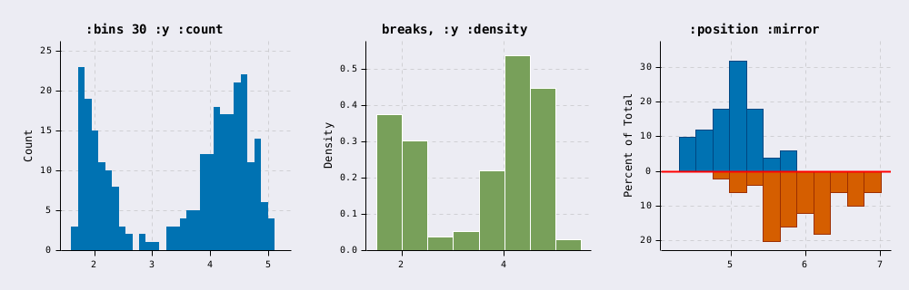
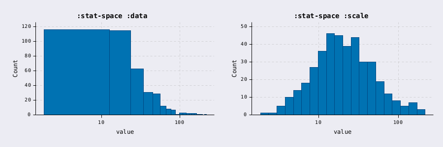
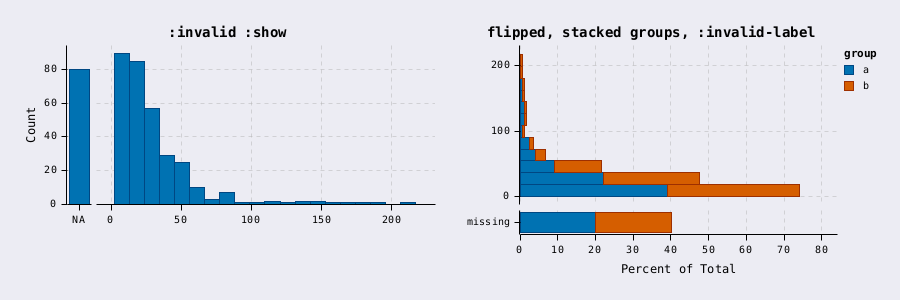
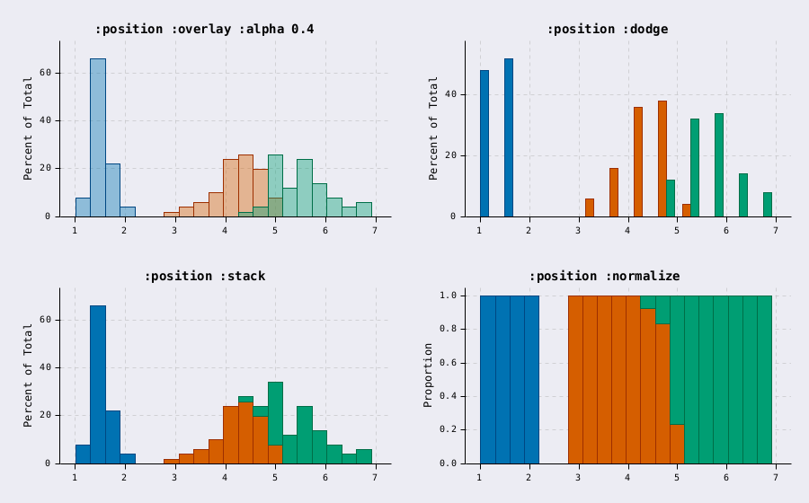
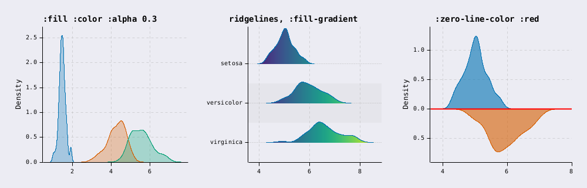
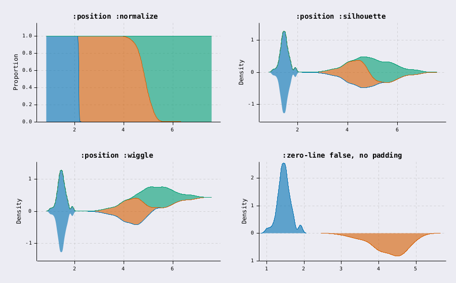
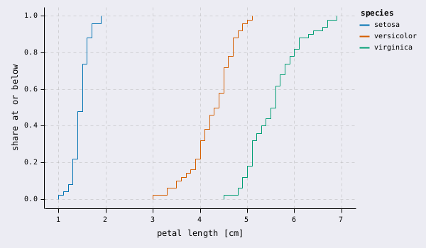
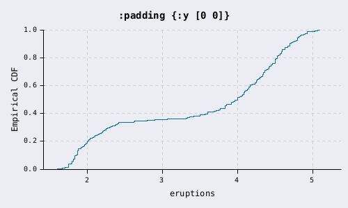
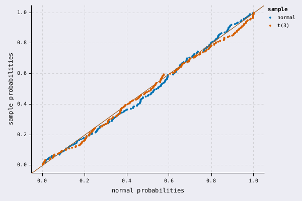
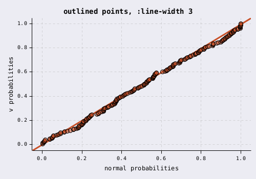

---
format:
  html:
    toc: true
    toc-location: right
    toc-depth: 4
    theme: cosmo
    include-in-header:
      text: |-
        <style>
        .data-table { width: fit-content; max-width: 100%; max-height: 15rem; overflow: auto; margin: 0 0 1rem 0; }
        .data-table .table-responsive { overflow: visible; }
        .data-table table { font-size: 0.75rem; width: auto; margin: 0; }
        .data-table th, .data-table td { padding: 0.1rem 0.45rem !important; white-space: nowrap; }
        .data-table thead th { position: sticky; top: 0; background: var(--bs-body-bg, #fff); }
        .options { margin: 0.5rem 0 1rem 0; }
        .options .option-card { margin: 0 0 0.9rem 0; border: 1px solid var(--bs-border-color, #dee2e6); border-radius: 0.375rem; overflow: hidden; }
        .options dt { display: flex; flex-wrap: wrap; align-items: baseline; gap: 0.1rem 1rem; margin: 0; padding: 0.4rem 0.75rem; background: #eef2f7; border-bottom: 1px solid var(--bs-border-color, #dee2e6); font-weight: normal; }
        .options dt > code { font-weight: 700; font-size: 1rem; background: none; padding: 0; }
        .options .option-default { font-size: 0.85rem; color: var(--bs-secondary-color, #6c757d); }
        .options dd { margin: 0; padding: 0.5rem 0.75rem; }
        .options .option-example { font-size: 0.85rem; padding: 0 0 0.45rem 0; margin-bottom: 0.45rem; border-bottom: 1px dashed var(--bs-border-color, #dee2e6); }
        .options .option-example code { background: none; padding: 0; }
        .options .option-text ul { margin: 0.3rem 0 0 0; padding-left: 1.25rem; }
        .options code, .mapping code { overflow-wrap: anywhere; }
        .options .option-default code, .options .option-example code { white-space: pre-wrap; }
        .mapping { margin: 0.5rem 0 1rem 0; padding: 0.5rem 0.75rem; border: 1px solid var(--bs-border-color, #dee2e6); border-left: 0.3rem solid #2780e3; border-radius: 0.375rem; background: #f5f8fc; }
        .mapping-title { font-weight: 700; margin-bottom: 0.25rem; }
        .mapping-hint { font-weight: normal; font-size: 0.85rem; color: var(--bs-secondary-color, #6c757d); }
        .mapping ul { margin: 0; padding-left: 1.25rem; }
        .mapping .required { font-size: 0.75rem; padding: 0 0.3rem; border: 1px solid currentColor; border-radius: 0.25rem; }
        .mapping-returns { margin-top: 0.25rem; }
        .mapping code { white-space: pre-wrap; }
        .shared { margin: 0.5rem 0 1rem 0; padding: 0.5rem 0.75rem; border: 1px solid var(--bs-border-color, #dee2e6); border-left: 0.3rem solid #6c757d; border-radius: 0.375rem; background: #f6f6f6; }
        .shared-title { font-weight: 700; margin-bottom: 0.25rem; }
        .shared-hint { font-weight: normal; font-size: 0.85rem; color: var(--bs-secondary-color, #6c757d); }
        .shared ul { margin: 0; padding-left: 1.25rem; }
        .shared code { overflow-wrap: anywhere; }
        </style>
code-block-background: true

---
<style></style><style>.printedClojure .sourceCode {
  background-color: transparent;
  border-style: none;
}
</style><style>.clay-limit-image-width .clay-image {max-width: 100%}
.clay-side-by-side .sourceCode {margin: 0}
.clay-side-by-side {margin: 1em 0}
</style>
<script src="https://code.jquery.com/jquery-3.6.0.min.js" type="text/javascript"></script><script src="https://code.jquery.com/ui/1.13.1/jquery-ui.min.js" type="text/javascript"></script>

# Distribution of one variable

These charts draw how the values of one variable are spread: binned counts (`histogram`), a kernel density
(`density`) and the empirical distribution function (`ecdf`). Use them to see the shape of a distribution; `qq` and
`pp` compare two distributions by quantiles or by probabilities.


::: {.sourceClojure}
```clojure
(ns reference.charts-one-variable
  (:require [fastmath.random :as r]
            [cljplot2.chart :as chart]
            [cljplot2.core :as plot]
            [cljplot2.describe :as describe]
            [notebook-utils :as nu]))
```
:::


Data: Edgar Anderson's iris measurements, R datasets package `iris` (Anderson 1935; Fisher 1936); licence: Part of R (GPL-2 | GPL-3).


::: {.sourceClojure}
```clojure
(def iris (nu/dataset :iris))
```
:::


```{=html}
<div class="data-table"><table class="table table-hover table-responsive clay-table"><thead><tr><th>sepal-length</th><th>sepal-width</th><th>petal-length</th><th>petal-width</th><th>species</th></tr></thead><tbody><tr><td>5.1</td><td>3.5</td><td>1.4</td><td>0.2</td><td>setosa</td></tr><tr><td>4.9</td><td>3</td><td>1.4</td><td>0.2</td><td>setosa</td></tr><tr><td>4.7</td><td>3.2</td><td>1.3</td><td>0.2</td><td>setosa</td></tr><tr><td>4.6</td><td>3.1</td><td>1.5</td><td>0.2</td><td>setosa</td></tr><tr><td>5</td><td>3.6</td><td>1.4</td><td>0.2</td><td>setosa</td></tr><tr><td>5.4</td><td>3.9</td><td>1.7</td><td>0.4</td><td>setosa</td></tr><tr><td>4.6</td><td>3.4</td><td>1.4</td><td>0.3</td><td>setosa</td></tr><tr><td>5</td><td>3.4</td><td>1.5</td><td>0.2</td><td>setosa</td></tr><tr><td>4.4</td><td>2.9</td><td>1.4</td><td>0.2</td><td>setosa</td></tr><tr><td>4.9</td><td>3.1</td><td>1.5</td><td>0.1</td><td>setosa</td></tr><tr><td>5.4</td><td>3.7</td><td>1.5</td><td>0.2</td><td>setosa</td></tr><tr><td>4.8</td><td>3.4</td><td>1.6</td><td>0.2</td><td>setosa</td></tr><tr><td>4.8</td><td>3</td><td>1.4</td><td>0.1</td><td>setosa</td></tr><tr><td>4.3</td><td>3</td><td>1.1</td><td>0.1</td><td>setosa</td></tr><tr><td>5.8</td><td>4</td><td>1.2</td><td>0.2</td><td>setosa</td></tr><tr><td>5.7</td><td>4.4</td><td>1.5</td><td>0.4</td><td>setosa</td></tr><tr><td>5.4</td><td>3.9</td><td>1.3</td><td>0.4</td><td>setosa</td></tr><tr><td>5.1</td><td>3.5</td><td>1.4</td><td>0.3</td><td>setosa</td></tr><tr><td>5.7</td><td>3.8</td><td>1.7</td><td>0.3</td><td>setosa</td></tr><tr><td>5.1</td><td>3.8</td><td>1.5</td><td>0.3</td><td>setosa</td></tr><tr><td>5.4</td><td>3.4</td><td>1.7</td><td>0.2</td><td>setosa</td></tr><tr><td>5.1</td><td>3.7</td><td>1.5</td><td>0.4</td><td>setosa</td></tr><tr><td>4.6</td><td>3.6</td><td>1</td><td>0.2</td><td>setosa</td></tr><tr><td>5.1</td><td>3.3</td><td>1.7</td><td>0.5</td><td>setosa</td></tr><tr><td>4.8</td><td>3.4</td><td>1.9</td><td>0.2</td><td>setosa</td></tr><tr><td>5</td><td>3</td><td>1.6</td><td>0.2</td><td>setosa</td></tr><tr><td>5</td><td>3.4</td><td>1.6</td><td>0.4</td><td>setosa</td></tr><tr><td>5.2</td><td>3.5</td><td>1.5</td><td>0.2</td><td>setosa</td></tr><tr><td>5.2</td><td>3.4</td><td>1.4</td><td>0.2</td><td>setosa</td></tr><tr><td>4.7</td><td>3.2</td><td>1.6</td><td>0.2</td><td>setosa</td></tr><tr><td>4.8</td><td>3.1</td><td>1.6</td><td>0.2</td><td>setosa</td></tr><tr><td>5.4</td><td>3.4</td><td>1.5</td><td>0.4</td><td>setosa</td></tr><tr><td>5.2</td><td>4.1</td><td>1.5</td><td>0.1</td><td>setosa</td></tr><tr><td>5.5</td><td>4.2</td><td>1.4</td><td>0.2</td><td>setosa</td></tr><tr><td>4.9</td><td>3.1</td><td>1.5</td><td>0.2</td><td>setosa</td></tr><tr><td>5</td><td>3.2</td><td>1.2</td><td>0.2</td><td>setosa</td></tr><tr><td>5.5</td><td>3.5</td><td>1.3</td><td>0.2</td><td>setosa</td></tr><tr><td>4.9</td><td>3.6</td><td>1.4</td><td>0.1</td><td>setosa</td></tr><tr><td>4.4</td><td>3</td><td>1.3</td><td>0.2</td><td>setosa</td></tr><tr><td>5.1</td><td>3.4</td><td>1.5</td><td>0.2</td><td>setosa</td></tr><tr><td>5</td><td>3.5</td><td>1.3</td><td>0.3</td><td>setosa</td></tr><tr><td>4.5</td><td>2.3</td><td>1.3</td><td>0.3</td><td>setosa</td></tr><tr><td>4.4</td><td>3.2</td><td>1.3</td><td>0.2</td><td>setosa</td></tr><tr><td>5</td><td>3.5</td><td>1.6</td><td>0.6</td><td>setosa</td></tr><tr><td>5.1</td><td>3.8</td><td>1.9</td><td>0.4</td><td>setosa</td></tr><tr><td>4.8</td><td>3</td><td>1.4</td><td>0.3</td><td>setosa</td></tr><tr><td>5.1</td><td>3.8</td><td>1.6</td><td>0.2</td><td>setosa</td></tr><tr><td>4.6</td><td>3.2</td><td>1.4</td><td>0.2</td><td>setosa</td></tr><tr><td>5.3</td><td>3.7</td><td>1.5</td><td>0.2</td><td>setosa</td></tr><tr><td>5</td><td>3.3</td><td>1.4</td><td>0.2</td><td>setosa</td></tr><tr><td>7</td><td>3.2</td><td>4.7</td><td>1.4</td><td>versicolor</td></tr><tr><td>6.4</td><td>3.2</td><td>4.5</td><td>1.5</td><td>versicolor</td></tr><tr><td>6.9</td><td>3.1</td><td>4.9</td><td>1.5</td><td>versicolor</td></tr><tr><td>5.5</td><td>2.3</td><td>4</td><td>1.3</td><td>versicolor</td></tr><tr><td>6.5</td><td>2.8</td><td>4.6</td><td>1.5</td><td>versicolor</td></tr><tr><td>5.7</td><td>2.8</td><td>4.5</td><td>1.3</td><td>versicolor</td></tr><tr><td>6.3</td><td>3.3</td><td>4.7</td><td>1.6</td><td>versicolor</td></tr><tr><td>4.9</td><td>2.4</td><td>3.3</td><td>1</td><td>versicolor</td></tr><tr><td>6.6</td><td>2.9</td><td>4.6</td><td>1.3</td><td>versicolor</td></tr><tr><td>5.2</td><td>2.7</td><td>3.9</td><td>1.4</td><td>versicolor</td></tr><tr><td>5</td><td>2</td><td>3.5</td><td>1</td><td>versicolor</td></tr><tr><td>5.9</td><td>3</td><td>4.2</td><td>1.5</td><td>versicolor</td></tr><tr><td>6</td><td>2.2</td><td>4</td><td>1</td><td>versicolor</td></tr><tr><td>6.1</td><td>2.9</td><td>4.7</td><td>1.4</td><td>versicolor</td></tr><tr><td>5.6</td><td>2.9</td><td>3.6</td><td>1.3</td><td>versicolor</td></tr><tr><td>6.7</td><td>3.1</td><td>4.4</td><td>1.4</td><td>versicolor</td></tr><tr><td>5.6</td><td>3</td><td>4.5</td><td>1.5</td><td>versicolor</td></tr><tr><td>5.8</td><td>2.7</td><td>4.1</td><td>1</td><td>versicolor</td></tr><tr><td>6.2</td><td>2.2</td><td>4.5</td><td>1.5</td><td>versicolor</td></tr><tr><td>5.6</td><td>2.5</td><td>3.9</td><td>1.1</td><td>versicolor</td></tr><tr><td>5.9</td><td>3.2</td><td>4.8</td><td>1.8</td><td>versicolor</td></tr><tr><td>6.1</td><td>2.8</td><td>4</td><td>1.3</td><td>versicolor</td></tr><tr><td>6.3</td><td>2.5</td><td>4.9</td><td>1.5</td><td>versicolor</td></tr><tr><td>6.1</td><td>2.8</td><td>4.7</td><td>1.2</td><td>versicolor</td></tr><tr><td>6.4</td><td>2.9</td><td>4.3</td><td>1.3</td><td>versicolor</td></tr><tr><td>6.6</td><td>3</td><td>4.4</td><td>1.4</td><td>versicolor</td></tr><tr><td>6.8</td><td>2.8</td><td>4.8</td><td>1.4</td><td>versicolor</td></tr><tr><td>6.7</td><td>3</td><td>5</td><td>1.7</td><td>versicolor</td></tr><tr><td>6</td><td>2.9</td><td>4.5</td><td>1.5</td><td>versicolor</td></tr><tr><td>5.7</td><td>2.6</td><td>3.5</td><td>1</td><td>versicolor</td></tr><tr><td>5.5</td><td>2.4</td><td>3.8</td><td>1.1</td><td>versicolor</td></tr><tr><td>5.5</td><td>2.4</td><td>3.7</td><td>1</td><td>versicolor</td></tr><tr><td>5.8</td><td>2.7</td><td>3.9</td><td>1.2</td><td>versicolor</td></tr><tr><td>6</td><td>2.7</td><td>5.1</td><td>1.6</td><td>versicolor</td></tr><tr><td>5.4</td><td>3</td><td>4.5</td><td>1.5</td><td>versicolor</td></tr><tr><td>6</td><td>3.4</td><td>4.5</td><td>1.6</td><td>versicolor</td></tr><tr><td>6.7</td><td>3.1</td><td>4.7</td><td>1.5</td><td>versicolor</td></tr><tr><td>6.3</td><td>2.3</td><td>4.4</td><td>1.3</td><td>versicolor</td></tr><tr><td>5.6</td><td>3</td><td>4.1</td><td>1.3</td><td>versicolor</td></tr><tr><td>5.5</td><td>2.5</td><td>4</td><td>1.3</td><td>versicolor</td></tr><tr><td>5.5</td><td>2.6</td><td>4.4</td><td>1.2</td><td>versicolor</td></tr><tr><td>6.1</td><td>3</td><td>4.6</td><td>1.4</td><td>versicolor</td></tr><tr><td>5.8</td><td>2.6</td><td>4</td><td>1.2</td><td>versicolor</td></tr><tr><td>5</td><td>2.3</td><td>3.3</td><td>1</td><td>versicolor</td></tr><tr><td>5.6</td><td>2.7</td><td>4.2</td><td>1.3</td><td>versicolor</td></tr><tr><td>5.7</td><td>3</td><td>4.2</td><td>1.2</td><td>versicolor</td></tr><tr><td>5.7</td><td>2.9</td><td>4.2</td><td>1.3</td><td>versicolor</td></tr><tr><td>6.2</td><td>2.9</td><td>4.3</td><td>1.3</td><td>versicolor</td></tr><tr><td>5.1</td><td>2.5</td><td>3</td><td>1.1</td><td>versicolor</td></tr><tr><td>5.7</td><td>2.8</td><td>4.1</td><td>1.3</td><td>versicolor</td></tr><tr><td>…</td><td>…</td><td>…</td><td>…</td><td>…</td></tr></tbody></table></div>
```


Data: Old Faithful geyser eruptions, R datasets package `faithful` (Härdle 1991; Azzalini & Bowman 1990); licence: Part of R (GPL-2 | GPL-3).


::: {.sourceClojure}
```clojure
(def faithful (nu/dataset :faithful))
```
:::


```{=html}
<div class="data-table"><table class="table table-hover table-responsive clay-table"><thead><tr><th>eruptions</th><th>waiting</th></tr></thead><tbody><tr><td>3.6</td><td>79</td></tr><tr><td>1.8</td><td>54</td></tr><tr><td>3.333</td><td>74</td></tr><tr><td>2.283</td><td>62</td></tr><tr><td>4.533</td><td>85</td></tr><tr><td>2.883</td><td>55</td></tr><tr><td>4.7</td><td>88</td></tr><tr><td>3.6</td><td>85</td></tr><tr><td>1.95</td><td>51</td></tr><tr><td>4.35</td><td>85</td></tr><tr><td>1.833</td><td>54</td></tr><tr><td>3.917</td><td>84</td></tr><tr><td>4.2</td><td>78</td></tr><tr><td>1.75</td><td>47</td></tr><tr><td>4.7</td><td>83</td></tr><tr><td>2.167</td><td>52</td></tr><tr><td>1.75</td><td>62</td></tr><tr><td>4.8</td><td>84</td></tr><tr><td>1.6</td><td>52</td></tr><tr><td>4.25</td><td>79</td></tr><tr><td>1.8</td><td>51</td></tr><tr><td>1.75</td><td>47</td></tr><tr><td>3.45</td><td>78</td></tr><tr><td>3.067</td><td>69</td></tr><tr><td>4.533</td><td>74</td></tr><tr><td>3.6</td><td>83</td></tr><tr><td>1.967</td><td>55</td></tr><tr><td>4.083</td><td>76</td></tr><tr><td>3.85</td><td>78</td></tr><tr><td>4.433</td><td>79</td></tr><tr><td>4.3</td><td>73</td></tr><tr><td>4.467</td><td>77</td></tr><tr><td>3.367</td><td>66</td></tr><tr><td>4.033</td><td>80</td></tr><tr><td>3.833</td><td>74</td></tr><tr><td>2.017</td><td>52</td></tr><tr><td>1.867</td><td>48</td></tr><tr><td>4.833</td><td>80</td></tr><tr><td>1.833</td><td>59</td></tr><tr><td>4.783</td><td>90</td></tr><tr><td>4.35</td><td>80</td></tr><tr><td>1.883</td><td>58</td></tr><tr><td>4.567</td><td>84</td></tr><tr><td>1.75</td><td>58</td></tr><tr><td>4.533</td><td>73</td></tr><tr><td>3.317</td><td>83</td></tr><tr><td>3.833</td><td>64</td></tr><tr><td>2.1</td><td>53</td></tr><tr><td>4.633</td><td>82</td></tr><tr><td>2</td><td>59</td></tr><tr><td>4.8</td><td>75</td></tr><tr><td>4.716</td><td>90</td></tr><tr><td>1.833</td><td>54</td></tr><tr><td>4.833</td><td>80</td></tr><tr><td>1.733</td><td>54</td></tr><tr><td>4.883</td><td>83</td></tr><tr><td>3.717</td><td>71</td></tr><tr><td>1.667</td><td>64</td></tr><tr><td>4.567</td><td>77</td></tr><tr><td>4.317</td><td>81</td></tr><tr><td>2.233</td><td>59</td></tr><tr><td>4.5</td><td>84</td></tr><tr><td>1.75</td><td>48</td></tr><tr><td>4.8</td><td>82</td></tr><tr><td>1.817</td><td>60</td></tr><tr><td>4.4</td><td>92</td></tr><tr><td>4.167</td><td>78</td></tr><tr><td>4.7</td><td>78</td></tr><tr><td>2.067</td><td>65</td></tr><tr><td>4.7</td><td>73</td></tr><tr><td>4.033</td><td>82</td></tr><tr><td>1.967</td><td>56</td></tr><tr><td>4.5</td><td>79</td></tr><tr><td>4</td><td>71</td></tr><tr><td>1.983</td><td>62</td></tr><tr><td>5.067</td><td>76</td></tr><tr><td>2.017</td><td>60</td></tr><tr><td>4.567</td><td>78</td></tr><tr><td>3.883</td><td>76</td></tr><tr><td>3.6</td><td>83</td></tr><tr><td>4.133</td><td>75</td></tr><tr><td>4.333</td><td>82</td></tr><tr><td>4.1</td><td>70</td></tr><tr><td>2.633</td><td>65</td></tr><tr><td>4.067</td><td>73</td></tr><tr><td>4.933</td><td>88</td></tr><tr><td>3.95</td><td>76</td></tr><tr><td>4.517</td><td>80</td></tr><tr><td>2.167</td><td>48</td></tr><tr><td>4</td><td>86</td></tr><tr><td>2.2</td><td>60</td></tr><tr><td>4.333</td><td>90</td></tr><tr><td>1.867</td><td>50</td></tr><tr><td>4.817</td><td>78</td></tr><tr><td>1.833</td><td>63</td></tr><tr><td>4.3</td><td>72</td></tr><tr><td>4.667</td><td>84</td></tr><tr><td>3.75</td><td>75</td></tr><tr><td>1.867</td><td>51</td></tr><tr><td>4.9</td><td>82</td></tr><tr><td>…</td><td>…</td></tr></tbody></table></div>
```


The table below holds seeded log-normal values, skewed in data units and even on a log axis:


::: {.sourceClojure}
```clojure
(def skewed (mapv (fn [v] {:value v})
                  (r/->seq (r/distribution :log-normal {:scale 3.0 :shape 0.8 :rng (r/rng :mersenne 7)}) 400)))
```
:::


```{=html}
<div class="data-table"><table class="table table-hover table-responsive clay-table"><thead><tr><th>value</th></tr></thead><tbody><tr><td>33.128152887509515</td></tr><tr><td>5.432377544402306</td></tr><tr><td>14.669090820378228</td></tr><tr><td>40.82584739222101</td></tr><tr><td>13.078354465398991</td></tr><tr><td>14.137822374468604</td></tr><tr><td>13.037364020437549</td></tr><tr><td>19.17019582641185</td></tr><tr><td>14.824310847812232</td></tr><tr><td>10.690099015595523</td></tr><tr><td>28.60331090106137</td></tr><tr><td>9.116331220344927</td></tr><tr><td>37.37365506923162</td></tr><tr><td>27.21872176296663</td></tr><tr><td>19.75950164215408</td></tr><tr><td>14.018899728241257</td></tr><tr><td>43.681297034474724</td></tr><tr><td>16.52126012111423</td></tr><tr><td>27.24652538177213</td></tr><tr><td>6.4971111669608455</td></tr><tr><td>3.303464060771845</td></tr><tr><td>9.365691651907682</td></tr><tr><td>6.188200963581874</td></tr><tr><td>16.794077648589806</td></tr><tr><td>25.789767430154466</td></tr><tr><td>13.861968409711336</td></tr><tr><td>85.36707392832939</td></tr><tr><td>48.84903146693207</td></tr><tr><td>51.55975501397397</td></tr><tr><td>25.704128454393658</td></tr><tr><td>3.9608020259103474</td></tr><tr><td>28.26387556508628</td></tr><tr><td>22.808671145321608</td></tr><tr><td>164.8899896412492</td></tr><tr><td>8.933440707802696</td></tr><tr><td>12.566973359370992</td></tr><tr><td>8.563517526210143</td></tr><tr><td>38.80970744392038</td></tr><tr><td>179.32381325305346</td></tr><tr><td>6.217944013232817</td></tr><tr><td>7.580410593798208</td></tr><tr><td>16.783626566789373</td></tr><tr><td>6.715239831870871</td></tr><tr><td>11.072318196362922</td></tr><tr><td>65.70609084809114</td></tr><tr><td>21.766558881873173</td></tr><tr><td>149.62207161829264</td></tr><tr><td>17.373753114171812</td></tr><tr><td>35.29825370703353</td></tr><tr><td>15.446465117661427</td></tr><tr><td>35.863211106116644</td></tr><tr><td>27.428097151688846</td></tr><tr><td>7.216136515948157</td></tr><tr><td>20.57565015914731</td></tr><tr><td>25.518123500974436</td></tr><tr><td>9.69779422077072</td></tr><tr><td>4.228718478717844</td></tr><tr><td>26.31527384871188</td></tr><tr><td>84.31669956408959</td></tr><tr><td>48.99138258302952</td></tr><tr><td>7.8788325408130255</td></tr><tr><td>31.327608920151476</td></tr><tr><td>4.077815388301838</td></tr><tr><td>160.37141507976867</td></tr><tr><td>56.31767112909131</td></tr><tr><td>4.818642831209657</td></tr><tr><td>42.110789296459096</td></tr><tr><td>4.128142803815318</td></tr><tr><td>26.91053755932542</td></tr><tr><td>84.52901899102923</td></tr><tr><td>3.13088006801464</td></tr><tr><td>92.49406406232194</td></tr><tr><td>31.514898759565355</td></tr><tr><td>5.461635954077979</td></tr><tr><td>12.832204409857043</td></tr><tr><td>6.483204842307178</td></tr><tr><td>12.89047062750862</td></tr><tr><td>31.88639252472308</td></tr><tr><td>18.914979500602723</td></tr><tr><td>50.774172175453174</td></tr><tr><td>5.993744956441829</td></tr><tr><td>9.818920929752553</td></tr><tr><td>33.32035183391212</td></tr><tr><td>36.987383832918766</td></tr><tr><td>5.699193114963241</td></tr><tr><td>15.24625241736026</td></tr><tr><td>11.266728129740004</td></tr><tr><td>14.659160419530002</td></tr><tr><td>54.65931643728897</td></tr><tr><td>12.296033715416334</td></tr><tr><td>45.90589021728169</td></tr><tr><td>33.76854746628196</td></tr><tr><td>5.9756042226117865</td></tr><tr><td>50.58182962125001</td></tr><tr><td>72.20097526648814</td></tr><tr><td>19.670696515563076</td></tr><tr><td>37.80002676289402</td></tr><tr><td>54.01200626555873</td></tr><tr><td>71.1527041325656</td></tr><tr><td>9.751836705852464</td></tr><tr><td>…</td></tr></tbody></table></div>
```


The table below holds seeded normal samples and samples of t with 3 degrees of freedom; the Q-Q and P-P plots use it:


::: {.sourceClojure}
```clojure
(def samples (let [g (r/rng :mersenne 11)
                   t3 (r/distribution :t {:degrees-of-freedom 3 :rng g})]
               (vec (concat (for [_ (range 200)] {:v (r/grandom g) :sample "normal"})
                            (for [_ (range 200)] {:v (r/sample t3) :sample "t(3)"})))))
```
:::


```{=html}
<div class="data-table"><table class="table table-hover table-responsive clay-table"><thead><tr><th>v</th><th>sample</th></tr></thead><tbody><tr><td>-1.9354135624386053</td><td>normal</td></tr><tr><td>-0.9842798332756787</td><td>normal</td></tr><tr><td>0.7692425297241978</td><td>normal</td></tr><tr><td>0.47520762766422164</td><td>normal</td></tr><tr><td>-0.07460401433466404</td><td>normal</td></tr><tr><td>0.386576340050147</td><td>normal</td></tr><tr><td>0.5740037801583956</td><td>normal</td></tr><tr><td>0.6304795444116987</td><td>normal</td></tr><tr><td>0.8658518672112061</td><td>normal</td></tr><tr><td>-0.6587155372039402</td><td>normal</td></tr><tr><td>1.1977369488812335</td><td>normal</td></tr><tr><td>1.3496814267379298</td><td>normal</td></tr><tr><td>0.33415045817805766</td><td>normal</td></tr><tr><td>-0.09540563325605536</td><td>normal</td></tr><tr><td>0.4202488095487268</td><td>normal</td></tr><tr><td>1.2157194832517149</td><td>normal</td></tr><tr><td>-0.06003547257265243</td><td>normal</td></tr><tr><td>0.31875404416652725</td><td>normal</td></tr><tr><td>-1.2696556154795149</td><td>normal</td></tr><tr><td>0.22783203772564486</td><td>normal</td></tr><tr><td>0.7252478683121171</td><td>normal</td></tr><tr><td>-0.6244515436177719</td><td>normal</td></tr><tr><td>-0.5975761062902751</td><td>normal</td></tr><tr><td>-0.3623485346184586</td><td>normal</td></tr><tr><td>-0.31550127476485473</td><td>normal</td></tr><tr><td>1.9095980213212904</td><td>normal</td></tr><tr><td>0.41098996078625705</td><td>normal</td></tr><tr><td>-0.8061841406740187</td><td>normal</td></tr><tr><td>2.1071608232867507</td><td>normal</td></tr><tr><td>-0.7256677343646285</td><td>normal</td></tr><tr><td>1.6865979632494321</td><td>normal</td></tr><tr><td>-2.1551951631319257</td><td>normal</td></tr><tr><td>-0.8129352068886067</td><td>normal</td></tr><tr><td>-0.06082656934917857</td><td>normal</td></tr><tr><td>-1.3525320628523652</td><td>normal</td></tr><tr><td>0.22749695176256018</td><td>normal</td></tr><tr><td>2.00040094394776</td><td>normal</td></tr><tr><td>0.8023225700821351</td><td>normal</td></tr><tr><td>-0.7187867660832096</td><td>normal</td></tr><tr><td>-1.3666058217681498</td><td>normal</td></tr><tr><td>1.1569046470792448</td><td>normal</td></tr><tr><td>-0.35688823167648287</td><td>normal</td></tr><tr><td>0.8400673754079033</td><td>normal</td></tr><tr><td>0.3079360059649594</td><td>normal</td></tr><tr><td>-0.6085750438713416</td><td>normal</td></tr><tr><td>-0.54198387035825</td><td>normal</td></tr><tr><td>3.0378337780508096</td><td>normal</td></tr><tr><td>0.1224340917841133</td><td>normal</td></tr><tr><td>-0.438621351500724</td><td>normal</td></tr><tr><td>0.3338767636927164</td><td>normal</td></tr><tr><td>-2.65714989483138</td><td>normal</td></tr><tr><td>-2.1546086692916107</td><td>normal</td></tr><tr><td>-0.12521182140433756</td><td>normal</td></tr><tr><td>0.5655133775234155</td><td>normal</td></tr><tr><td>-1.2286343497814154</td><td>normal</td></tr><tr><td>-1.6875138589081766</td><td>normal</td></tr><tr><td>-1.3000745391077166</td><td>normal</td></tr><tr><td>0.47600748113197855</td><td>normal</td></tr><tr><td>-1.3952400596571857</td><td>normal</td></tr><tr><td>1.222893544881492</td><td>normal</td></tr><tr><td>-1.564668551993953</td><td>normal</td></tr><tr><td>0.38596082112326074</td><td>normal</td></tr><tr><td>0.3026726977215286</td><td>normal</td></tr><tr><td>2.6917350088128495</td><td>normal</td></tr><tr><td>0.47346375499232296</td><td>normal</td></tr><tr><td>0.9564010031630503</td><td>normal</td></tr><tr><td>-0.28400848879695406</td><td>normal</td></tr><tr><td>0.12087876478748225</td><td>normal</td></tr><tr><td>-0.39749999013144105</td><td>normal</td></tr><tr><td>-1.0528216283209995</td><td>normal</td></tr><tr><td>0.21158371484421143</td><td>normal</td></tr><tr><td>-0.9837375530978842</td><td>normal</td></tr><tr><td>1.6831486569359688</td><td>normal</td></tr><tr><td>-0.473300154181772</td><td>normal</td></tr><tr><td>1.1796989962144864</td><td>normal</td></tr><tr><td>1.1764595433604714</td><td>normal</td></tr><tr><td>0.4810565023449482</td><td>normal</td></tr><tr><td>0.23256596526418555</td><td>normal</td></tr><tr><td>-0.8687361114901867</td><td>normal</td></tr><tr><td>-0.6054534100157256</td><td>normal</td></tr><tr><td>0.3447467365944367</td><td>normal</td></tr><tr><td>0.5529152521718022</td><td>normal</td></tr><tr><td>1.5715512150048214</td><td>normal</td></tr><tr><td>-0.08980591289398993</td><td>normal</td></tr><tr><td>-0.0868956668739789</td><td>normal</td></tr><tr><td>0.8117764588472456</td><td>normal</td></tr><tr><td>-0.41100479532618145</td><td>normal</td></tr><tr><td>0.338499013268407</td><td>normal</td></tr><tr><td>0.5543343363973507</td><td>normal</td></tr><tr><td>0.2077980844271687</td><td>normal</td></tr><tr><td>-2.102473149613918</td><td>normal</td></tr><tr><td>-0.2928182390683161</td><td>normal</td></tr><tr><td>-1.2108365699643666</td><td>normal</td></tr><tr><td>0.37019209556872373</td><td>normal</td></tr><tr><td>-0.2040663562304196</td><td>normal</td></tr><tr><td>-1.7148007169486439</td><td>normal</td></tr><tr><td>1.0931052827177286</td><td>normal</td></tr><tr><td>-0.6679527482299739</td><td>normal</td></tr><tr><td>0.8004514534901619</td><td>normal</td></tr><tr><td>0.23659189951770057</td><td>normal</td></tr><tr><td>…</td><td>…</td></tr></tbody></table></div>
```


Two species only - for the charts drawing two groups against each other:


::: {.sourceClojure}
```clojure
(def two-species (filter #(#{"setosa" "versicolor"} (:species %)) iris))
```
:::


```{=html}
<div class="data-table"><table class="table table-hover table-responsive clay-table"><thead><tr><th>sepal-length</th><th>sepal-width</th><th>petal-length</th><th>petal-width</th><th>species</th></tr></thead><tbody><tr><td>5.1</td><td>3.5</td><td>1.4</td><td>0.2</td><td>setosa</td></tr><tr><td>4.9</td><td>3</td><td>1.4</td><td>0.2</td><td>setosa</td></tr><tr><td>4.7</td><td>3.2</td><td>1.3</td><td>0.2</td><td>setosa</td></tr><tr><td>4.6</td><td>3.1</td><td>1.5</td><td>0.2</td><td>setosa</td></tr><tr><td>5</td><td>3.6</td><td>1.4</td><td>0.2</td><td>setosa</td></tr><tr><td>5.4</td><td>3.9</td><td>1.7</td><td>0.4</td><td>setosa</td></tr><tr><td>4.6</td><td>3.4</td><td>1.4</td><td>0.3</td><td>setosa</td></tr><tr><td>5</td><td>3.4</td><td>1.5</td><td>0.2</td><td>setosa</td></tr><tr><td>4.4</td><td>2.9</td><td>1.4</td><td>0.2</td><td>setosa</td></tr><tr><td>4.9</td><td>3.1</td><td>1.5</td><td>0.1</td><td>setosa</td></tr><tr><td>5.4</td><td>3.7</td><td>1.5</td><td>0.2</td><td>setosa</td></tr><tr><td>4.8</td><td>3.4</td><td>1.6</td><td>0.2</td><td>setosa</td></tr><tr><td>4.8</td><td>3</td><td>1.4</td><td>0.1</td><td>setosa</td></tr><tr><td>4.3</td><td>3</td><td>1.1</td><td>0.1</td><td>setosa</td></tr><tr><td>5.8</td><td>4</td><td>1.2</td><td>0.2</td><td>setosa</td></tr><tr><td>5.7</td><td>4.4</td><td>1.5</td><td>0.4</td><td>setosa</td></tr><tr><td>5.4</td><td>3.9</td><td>1.3</td><td>0.4</td><td>setosa</td></tr><tr><td>5.1</td><td>3.5</td><td>1.4</td><td>0.3</td><td>setosa</td></tr><tr><td>5.7</td><td>3.8</td><td>1.7</td><td>0.3</td><td>setosa</td></tr><tr><td>5.1</td><td>3.8</td><td>1.5</td><td>0.3</td><td>setosa</td></tr><tr><td>5.4</td><td>3.4</td><td>1.7</td><td>0.2</td><td>setosa</td></tr><tr><td>5.1</td><td>3.7</td><td>1.5</td><td>0.4</td><td>setosa</td></tr><tr><td>4.6</td><td>3.6</td><td>1</td><td>0.2</td><td>setosa</td></tr><tr><td>5.1</td><td>3.3</td><td>1.7</td><td>0.5</td><td>setosa</td></tr><tr><td>4.8</td><td>3.4</td><td>1.9</td><td>0.2</td><td>setosa</td></tr><tr><td>5</td><td>3</td><td>1.6</td><td>0.2</td><td>setosa</td></tr><tr><td>5</td><td>3.4</td><td>1.6</td><td>0.4</td><td>setosa</td></tr><tr><td>5.2</td><td>3.5</td><td>1.5</td><td>0.2</td><td>setosa</td></tr><tr><td>5.2</td><td>3.4</td><td>1.4</td><td>0.2</td><td>setosa</td></tr><tr><td>4.7</td><td>3.2</td><td>1.6</td><td>0.2</td><td>setosa</td></tr><tr><td>4.8</td><td>3.1</td><td>1.6</td><td>0.2</td><td>setosa</td></tr><tr><td>5.4</td><td>3.4</td><td>1.5</td><td>0.4</td><td>setosa</td></tr><tr><td>5.2</td><td>4.1</td><td>1.5</td><td>0.1</td><td>setosa</td></tr><tr><td>5.5</td><td>4.2</td><td>1.4</td><td>0.2</td><td>setosa</td></tr><tr><td>4.9</td><td>3.1</td><td>1.5</td><td>0.2</td><td>setosa</td></tr><tr><td>5</td><td>3.2</td><td>1.2</td><td>0.2</td><td>setosa</td></tr><tr><td>5.5</td><td>3.5</td><td>1.3</td><td>0.2</td><td>setosa</td></tr><tr><td>4.9</td><td>3.6</td><td>1.4</td><td>0.1</td><td>setosa</td></tr><tr><td>4.4</td><td>3</td><td>1.3</td><td>0.2</td><td>setosa</td></tr><tr><td>5.1</td><td>3.4</td><td>1.5</td><td>0.2</td><td>setosa</td></tr><tr><td>5</td><td>3.5</td><td>1.3</td><td>0.3</td><td>setosa</td></tr><tr><td>4.5</td><td>2.3</td><td>1.3</td><td>0.3</td><td>setosa</td></tr><tr><td>4.4</td><td>3.2</td><td>1.3</td><td>0.2</td><td>setosa</td></tr><tr><td>5</td><td>3.5</td><td>1.6</td><td>0.6</td><td>setosa</td></tr><tr><td>5.1</td><td>3.8</td><td>1.9</td><td>0.4</td><td>setosa</td></tr><tr><td>4.8</td><td>3</td><td>1.4</td><td>0.3</td><td>setosa</td></tr><tr><td>5.1</td><td>3.8</td><td>1.6</td><td>0.2</td><td>setosa</td></tr><tr><td>4.6</td><td>3.2</td><td>1.4</td><td>0.2</td><td>setosa</td></tr><tr><td>5.3</td><td>3.7</td><td>1.5</td><td>0.2</td><td>setosa</td></tr><tr><td>5</td><td>3.3</td><td>1.4</td><td>0.2</td><td>setosa</td></tr><tr><td>7</td><td>3.2</td><td>4.7</td><td>1.4</td><td>versicolor</td></tr><tr><td>6.4</td><td>3.2</td><td>4.5</td><td>1.5</td><td>versicolor</td></tr><tr><td>6.9</td><td>3.1</td><td>4.9</td><td>1.5</td><td>versicolor</td></tr><tr><td>5.5</td><td>2.3</td><td>4</td><td>1.3</td><td>versicolor</td></tr><tr><td>6.5</td><td>2.8</td><td>4.6</td><td>1.5</td><td>versicolor</td></tr><tr><td>5.7</td><td>2.8</td><td>4.5</td><td>1.3</td><td>versicolor</td></tr><tr><td>6.3</td><td>3.3</td><td>4.7</td><td>1.6</td><td>versicolor</td></tr><tr><td>4.9</td><td>2.4</td><td>3.3</td><td>1</td><td>versicolor</td></tr><tr><td>6.6</td><td>2.9</td><td>4.6</td><td>1.3</td><td>versicolor</td></tr><tr><td>5.2</td><td>2.7</td><td>3.9</td><td>1.4</td><td>versicolor</td></tr><tr><td>5</td><td>2</td><td>3.5</td><td>1</td><td>versicolor</td></tr><tr><td>5.9</td><td>3</td><td>4.2</td><td>1.5</td><td>versicolor</td></tr><tr><td>6</td><td>2.2</td><td>4</td><td>1</td><td>versicolor</td></tr><tr><td>6.1</td><td>2.9</td><td>4.7</td><td>1.4</td><td>versicolor</td></tr><tr><td>5.6</td><td>2.9</td><td>3.6</td><td>1.3</td><td>versicolor</td></tr><tr><td>6.7</td><td>3.1</td><td>4.4</td><td>1.4</td><td>versicolor</td></tr><tr><td>5.6</td><td>3</td><td>4.5</td><td>1.5</td><td>versicolor</td></tr><tr><td>5.8</td><td>2.7</td><td>4.1</td><td>1</td><td>versicolor</td></tr><tr><td>6.2</td><td>2.2</td><td>4.5</td><td>1.5</td><td>versicolor</td></tr><tr><td>5.6</td><td>2.5</td><td>3.9</td><td>1.1</td><td>versicolor</td></tr><tr><td>5.9</td><td>3.2</td><td>4.8</td><td>1.8</td><td>versicolor</td></tr><tr><td>6.1</td><td>2.8</td><td>4</td><td>1.3</td><td>versicolor</td></tr><tr><td>6.3</td><td>2.5</td><td>4.9</td><td>1.5</td><td>versicolor</td></tr><tr><td>6.1</td><td>2.8</td><td>4.7</td><td>1.2</td><td>versicolor</td></tr><tr><td>6.4</td><td>2.9</td><td>4.3</td><td>1.3</td><td>versicolor</td></tr><tr><td>6.6</td><td>3</td><td>4.4</td><td>1.4</td><td>versicolor</td></tr><tr><td>6.8</td><td>2.8</td><td>4.8</td><td>1.4</td><td>versicolor</td></tr><tr><td>6.7</td><td>3</td><td>5</td><td>1.7</td><td>versicolor</td></tr><tr><td>6</td><td>2.9</td><td>4.5</td><td>1.5</td><td>versicolor</td></tr><tr><td>5.7</td><td>2.6</td><td>3.5</td><td>1</td><td>versicolor</td></tr><tr><td>5.5</td><td>2.4</td><td>3.8</td><td>1.1</td><td>versicolor</td></tr><tr><td>5.5</td><td>2.4</td><td>3.7</td><td>1</td><td>versicolor</td></tr><tr><td>5.8</td><td>2.7</td><td>3.9</td><td>1.2</td><td>versicolor</td></tr><tr><td>6</td><td>2.7</td><td>5.1</td><td>1.6</td><td>versicolor</td></tr><tr><td>5.4</td><td>3</td><td>4.5</td><td>1.5</td><td>versicolor</td></tr><tr><td>6</td><td>3.4</td><td>4.5</td><td>1.6</td><td>versicolor</td></tr><tr><td>6.7</td><td>3.1</td><td>4.7</td><td>1.5</td><td>versicolor</td></tr><tr><td>6.3</td><td>2.3</td><td>4.4</td><td>1.3</td><td>versicolor</td></tr><tr><td>5.6</td><td>3</td><td>4.1</td><td>1.3</td><td>versicolor</td></tr><tr><td>5.5</td><td>2.5</td><td>4</td><td>1.3</td><td>versicolor</td></tr><tr><td>5.5</td><td>2.6</td><td>4.4</td><td>1.2</td><td>versicolor</td></tr><tr><td>6.1</td><td>3</td><td>4.6</td><td>1.4</td><td>versicolor</td></tr><tr><td>5.8</td><td>2.6</td><td>4</td><td>1.2</td><td>versicolor</td></tr><tr><td>5</td><td>2.3</td><td>3.3</td><td>1</td><td>versicolor</td></tr><tr><td>5.6</td><td>2.7</td><td>4.2</td><td>1.3</td><td>versicolor</td></tr><tr><td>5.7</td><td>3</td><td>4.2</td><td>1.2</td><td>versicolor</td></tr><tr><td>5.7</td><td>2.9</td><td>4.2</td><td>1.3</td><td>versicolor</td></tr><tr><td>6.2</td><td>2.9</td><td>4.3</td><td>1.3</td><td>versicolor</td></tr><tr><td>5.1</td><td>2.5</td><td>3</td><td>1.1</td><td>versicolor</td></tr><tr><td>5.7</td><td>2.8</td><td>4.1</td><td>1.3</td><td>versicolor</td></tr></tbody></table></div>
```


## Histograms

`chart/histogram` cuts the x values into bins and draws a bar per bin, its height the bin's count or share. Use it
to see the shape of a distribution at a glance. Groups overlay, dodge, stack or mirror, and a categorical `:y`
draws one histogram per level (ridgelines).


```{=html}
<div class="shared"><div class="shared-title">Shared options<span class="shared-hint"> – groups of options other charts take too</span></div><ul><li><a href="reference.shared_options.html#fill-patterns">Fill patterns</a> – <code>:pattern</code> <code>:pattern-color</code></li><li><a href="reference.shared_options.html#common-options">Common options</a> – <code>:data</code> <code>:mapping</code> <code>:legend</code></li><li><a href="reference.shared_options.html#named-theme-styles">Named theme styles</a> – <code>:theme-style</code></li><li><a href="reference.shared_options.html#rounded-corners">Rounded corners</a> – <code>:corner-radius</code> <code>:corner-radius-end</code></li><li><a href="reference.shared_options.html#ridgelines">Ridgelines</a> – <code>:overlap</code></li></ul></div>
```


```{=html}
<div class="mapping"><div class="mapping-title">Mapping<span class="mapping-hint"> – the row values the chart reads, under <code>:mapping</code></span></div><ul><li><code>:x</code> <span class="required">required</span> – The values to bin.</li><li><code>:y</code> – The ridgeline levels: the chart draws one histogram per categorical level, or per level of a <code>:bands</code> scale, and ignores a numeric <code>:y</code> on any other scale.</li><li><code>:color</code> – Splits the rows into groups, each with its own fill colour.</li><li><code>:pattern</code> – Splits the rows into groups, each with its own fill pattern.</li><li><code>:group</code> – Splits the rows into groups that look the same, overlaid, dodged, stacked or mirrored as other groups.</li></ul></div>
```


::: {.sourceClojure}
```clojure
(plot/render-image {:data iris
                    :mapping {:x :petal-length :color :species}
                    :charts [(chart/histogram)]
                    :labels {:x "petal length [cm]"}}
                   {:width 600 :height 350})
```
:::


::: {.clay-image}

:::


### Bins

These options set the bins, what a bar's height measures and the space the bins are made in. The first panels
below use 30 bins of counts, explicit breaks measured as `:density` and two mirrored groups:


```{=html}
<dl class="options"><div class="option-card"><dt><code>:bins</code><span class="option-default">Default: <code>:sturges</code></span></dt><dd><div class="option-example"><code>(chart/histogram {:bins 20})</code></div><div class="option-text">How the chart cuts the x values into bins. Panels share the bins, except under a free or sliced facet x scale: there the panels sharing an x scale (a wrap panel, a grid column or row) get bins over their own values.<ul><li><code>:sturges</code> – <code>ceil(log2(n)) + 1</code> bins; suits roughly normal samples but gives too few bins for large ones.</li><li><code>:sqrt</code> – <code>ceil(sqrt(n))</code> bins.</li><li><code>:rice</code> – <code>ceil(2 * cbrt(n))</code> bins.</li><li><code>:doane</code> – Sturges' rule corrected for skewed samples.</li><li><code>:scott</code> – Bins of width <code>3.5 * sd / cbrt(n)</code>, <code>sd</code> the standard deviation; suits roughly normal samples.</li><li><code>:freedman-diaconis</code> – Bins of width <code>2 * IQR / cbrt(n)</code>, <code>IQR</code> the interquartile range; robust to outliers.</li><li class="option-other">Other fastmath methods: one more rule of thumb and two that pick the bin count by minimising an estimated error. <code>:terrell-scott</code>, <code>:cross-validation</code>, <code>:shimazaki-shinomoto</code></li><li><a href="reference.types.html#breaks">breaks</a> – The bin edges, shared by every panel; the chart drops values outside them.</li><li><a href="reference.types.html#positive-integer">positive integer</a> – That many equal-width bins over the values' range.</li></ul></div></dd></div><div class="option-card"><dt><code>:y</code><span class="option-default">Default: <code>:percent</code></span></dt><dd><div class="option-example"><code>(chart/histogram {:y :cumulative})</code></div><div class="option-text">What a bar's height measures. Shares are of the values in the bins, the panel's or the group's when grouped; with <code>:invalid :show</code> the invalid rows count too.<ul><li><code>:percent</code> – The bin's share in percent.</li><li><code>:cumulative</code> – The count of the bin and of every bin before it.</li><li><code>:count</code> – The number of values in the bin.</li><li><code>:pmf</code> – The bin's share as a fraction; the bars sum to 1.</li><li><code>:density</code> – The share divided by the bin width; the bars have area 1.</li></ul></div></dd></div><div class="option-card"><dt><code>:stat-space</code><span class="option-default">Default: <code>:data</code></span></dt><dd><div class="option-example"><code>(chart/histogram {:stat-space :scale})</code></div><div class="option-text">The space the bins are made in. Explicit breaks stay in data units.<ul><li><code>:data</code> – Data units, whatever the axes.</li><li><code>:scale</code> – The x axis's coordinates: on a <code>:log</code> axis the chart makes equal-width log10 bins and leaves out zeros and negatives; <code>:density</code> is per log10 unit.</li></ul></div></dd></div></dl>
```


::: {.sourceClojure}
```clojure
(plot/render-image (plot/arrange [{:data faithful
                                   :mapping {:x :eruptions}
                                   :charts [(chart/histogram {:bins 30 :y :count :stroke-color :none})]
                                   :labels {:title ":bins 30 :y :count"}}
                                  {:data faithful
                                   :mapping {:x :eruptions}
                                   :charts [(chart/histogram {:bins [1.5 2 2.5 3 3.5 4 4.5 5 5.5] :y :density
                                                              :color [120 160 90] :stroke-color :white})]
                                   :labels {:title "breaks, :y :density"}}
                                  {:data two-species
                                   :mapping {:x :sepal-length :color :species}
                                   :charts [(chart/histogram {:position :mirror :bins 12 :zero-line-color :red
                                                              :zero-line-width 2})]
                                   :labels {:title ":position :mirror"}
                                   :legend false}]
                                 {:columns 3})
                   {:width 1000 :height 320})
```
:::


::: {.clay-image}

:::


The next panels measure the same bins as shares summing to 1 (`:pmf`, the default `:percent` divided by 100) and
as a running count (`:cumulative`):


::: {.sourceClojure}
```clojure
(plot/render-image (plot/arrange [{:data faithful
                                   :mapping {:x :eruptions}
                                   :charts [(chart/histogram {:bins 20 :y :pmf})]
                                   :labels {:title ":y :pmf"}}
                                  {:data faithful
                                   :mapping {:x :eruptions}
                                   :charts [(chart/histogram {:bins 20 :y :cumulative})]
                                   :labels {:title ":y :cumulative"}}]
                                 {:columns 2})
                   {:width 900 :height 300})
```
:::


::: {.clay-image}

:::


On a log axis, bins of equal width in data units crowd into the last decades. `:stat-space :scale` makes the bins
in the axis's log10 coordinates instead, so they are equally wide on screen. In either space the values must be
numbers: the chart takes no dates.


::: {.sourceClojure}
```clojure
(plot/render-image (plot/arrange [{:data skewed
                                   :mapping {:x :value}
                                   :scales {:x {:kind :log}}
                                   :charts [(chart/histogram {:bins 20 :y :count :stat-space :data})]
                                   :labels {:title ":stat-space :data"}}
                                  {:data skewed
                                   :mapping {:x :value}
                                   :scales {:x {:kind :log}}
                                   :charts [(chart/histogram {:bins 20 :y :count :stat-space :scale})]
                                   :labels {:title ":stat-space :scale"}}]
                                 {:columns 2})
                   {:width 900 :height 300})
```
:::


::: {.clay-image}

:::


Facet panels share the bins, so they compare bar by bar. Under a free or sliced facet x scale, the chart bins the
panels sharing an x scale over their own range instead (each panel of a wrap layout, a column or row of a grid): a
bin count (here 8) or a rule applies per panel, while explicit breaks stay shared. Margin histograms follow their panel's scale the same way.


::: {.sourceClojure}
```clojure
(plot/render-image {:data iris
                    :mapping {:x :petal-length :facet :species}
                    :facets {:scales {:x :free}}
                    :charts [(chart/histogram {:bins 8 :y :count})]
                    :labels {:x "petal length [cm]"}}
                   {:width 900 :height 300})
```
:::


::: {.clay-image}

:::


### Invalid values

These options draw the rows whose x is missing or not a number, which the chart drops by default, in a band beside
the x axis. With `:invalid :show`, shares (`:percent`, `:pmf`) count all rows, the invalid ones included. Groups
stack or dodge in the band as in the bins, and every facet panel has its own band. A margin chart or a
`:custom-grid` plot has no band, so `:invalid :show` there is an error. The panels below show every fifth value
missing, then stack two groups in a flipped plot with their own label:


```{=html}
<dl class="options"><div class="option-card"><dt><code>:invalid</code><span class="option-default">Default: <code>:drop</code></span></dt><dd><div class="option-example"><code>(chart/histogram {:invalid :show})</code></div><div class="option-text">What the chart does with rows whose x is missing, NaN or not a number, or which <code>:stat-space :scale</code> can't place. <code>:show</code> doesn't work with <code>:y :density</code> or <code>:y :cumulative</code>.<ul><li><code>:drop</code> – Leaves them out and counts them as dropped.</li><li><code>:show</code> – Draws them as a bar in a band beside the x axis's start, measured by <code>:y</code> like the bins.</li></ul></div></dd></div><div class="option-card"><dt><code>:invalid-label</code><span class="option-default">Default: <code>"NA"</code>.</span></dt><dd><div class="option-example"><code>(chart/histogram {:invalid :show, :invalid-label "missing"})</code></div><div class="option-text">The label of the band of invalid values; it needs <code>:invalid :show</code>.<ul><li><span>string</span></li></ul></div></dd></div></dl>
```


::: {.sourceClojure}
```clojure
(def gappy (mapv (fn [i {:keys [value]}] {:value (when-not (zero? (mod i 5)) value) :group (if (even? i) "a" "b")})
                 (range) skewed))
```
:::


```{=html}
<div class="data-table"><table class="table table-hover table-responsive clay-table"><thead><tr><th>value</th><th>group</th></tr></thead><tbody><tr><td></td><td>a</td></tr><tr><td>5.432377544402306</td><td>b</td></tr><tr><td>14.669090820378228</td><td>a</td></tr><tr><td>40.82584739222101</td><td>b</td></tr><tr><td>13.078354465398991</td><td>a</td></tr><tr><td></td><td>b</td></tr><tr><td>13.037364020437549</td><td>a</td></tr><tr><td>19.17019582641185</td><td>b</td></tr><tr><td>14.824310847812232</td><td>a</td></tr><tr><td>10.690099015595523</td><td>b</td></tr><tr><td></td><td>a</td></tr><tr><td>9.116331220344927</td><td>b</td></tr><tr><td>37.37365506923162</td><td>a</td></tr><tr><td>27.21872176296663</td><td>b</td></tr><tr><td>19.75950164215408</td><td>a</td></tr><tr><td></td><td>b</td></tr><tr><td>43.681297034474724</td><td>a</td></tr><tr><td>16.52126012111423</td><td>b</td></tr><tr><td>27.24652538177213</td><td>a</td></tr><tr><td>6.4971111669608455</td><td>b</td></tr><tr><td></td><td>a</td></tr><tr><td>9.365691651907682</td><td>b</td></tr><tr><td>6.188200963581874</td><td>a</td></tr><tr><td>16.794077648589806</td><td>b</td></tr><tr><td>25.789767430154466</td><td>a</td></tr><tr><td></td><td>b</td></tr><tr><td>85.36707392832939</td><td>a</td></tr><tr><td>48.84903146693207</td><td>b</td></tr><tr><td>51.55975501397397</td><td>a</td></tr><tr><td>25.704128454393658</td><td>b</td></tr><tr><td></td><td>a</td></tr><tr><td>28.26387556508628</td><td>b</td></tr><tr><td>22.808671145321608</td><td>a</td></tr><tr><td>164.8899896412492</td><td>b</td></tr><tr><td>8.933440707802696</td><td>a</td></tr><tr><td></td><td>b</td></tr><tr><td>8.563517526210143</td><td>a</td></tr><tr><td>38.80970744392038</td><td>b</td></tr><tr><td>179.32381325305346</td><td>a</td></tr><tr><td>6.217944013232817</td><td>b</td></tr><tr><td></td><td>a</td></tr><tr><td>16.783626566789373</td><td>b</td></tr><tr><td>6.715239831870871</td><td>a</td></tr><tr><td>11.072318196362922</td><td>b</td></tr><tr><td>65.70609084809114</td><td>a</td></tr><tr><td></td><td>b</td></tr><tr><td>149.62207161829264</td><td>a</td></tr><tr><td>17.373753114171812</td><td>b</td></tr><tr><td>35.29825370703353</td><td>a</td></tr><tr><td>15.446465117661427</td><td>b</td></tr><tr><td></td><td>a</td></tr><tr><td>27.428097151688846</td><td>b</td></tr><tr><td>7.216136515948157</td><td>a</td></tr><tr><td>20.57565015914731</td><td>b</td></tr><tr><td>25.518123500974436</td><td>a</td></tr><tr><td></td><td>b</td></tr><tr><td>4.228718478717844</td><td>a</td></tr><tr><td>26.31527384871188</td><td>b</td></tr><tr><td>84.31669956408959</td><td>a</td></tr><tr><td>48.99138258302952</td><td>b</td></tr><tr><td></td><td>a</td></tr><tr><td>31.327608920151476</td><td>b</td></tr><tr><td>4.077815388301838</td><td>a</td></tr><tr><td>160.37141507976867</td><td>b</td></tr><tr><td>56.31767112909131</td><td>a</td></tr><tr><td></td><td>b</td></tr><tr><td>42.110789296459096</td><td>a</td></tr><tr><td>4.128142803815318</td><td>b</td></tr><tr><td>26.91053755932542</td><td>a</td></tr><tr><td>84.52901899102923</td><td>b</td></tr><tr><td></td><td>a</td></tr><tr><td>92.49406406232194</td><td>b</td></tr><tr><td>31.514898759565355</td><td>a</td></tr><tr><td>5.461635954077979</td><td>b</td></tr><tr><td>12.832204409857043</td><td>a</td></tr><tr><td></td><td>b</td></tr><tr><td>12.89047062750862</td><td>a</td></tr><tr><td>31.88639252472308</td><td>b</td></tr><tr><td>18.914979500602723</td><td>a</td></tr><tr><td>50.774172175453174</td><td>b</td></tr><tr><td></td><td>a</td></tr><tr><td>9.818920929752553</td><td>b</td></tr><tr><td>33.32035183391212</td><td>a</td></tr><tr><td>36.987383832918766</td><td>b</td></tr><tr><td>5.699193114963241</td><td>a</td></tr><tr><td></td><td>b</td></tr><tr><td>11.266728129740004</td><td>a</td></tr><tr><td>14.659160419530002</td><td>b</td></tr><tr><td>54.65931643728897</td><td>a</td></tr><tr><td>12.296033715416334</td><td>b</td></tr><tr><td></td><td>a</td></tr><tr><td>33.76854746628196</td><td>b</td></tr><tr><td>5.9756042226117865</td><td>a</td></tr><tr><td>50.58182962125001</td><td>b</td></tr><tr><td>72.20097526648814</td><td>a</td></tr><tr><td></td><td>b</td></tr><tr><td>37.80002676289402</td><td>a</td></tr><tr><td>54.01200626555873</td><td>b</td></tr><tr><td>71.1527041325656</td><td>a</td></tr><tr><td>9.751836705852464</td><td>b</td></tr><tr><td>…</td><td>…</td></tr></tbody></table></div>
```


::: {.sourceClojure}
```clojure
(plot/render-image (plot/arrange [{:data gappy
                                   :mapping {:x :value}
                                   :charts [(chart/histogram {:bins 20 :y :count :invalid :show})]
                                   :labels {:title ":invalid :show"}}
                                  {:data gappy
                                   :mapping {:x :value :color :group}
                                   :flip true
                                   :charts [(chart/histogram {:bins 12 :position :stack :invalid :show :invalid-label "missing"})]
                                   :labels {:title "flipped, stacked groups, :invalid-label"}}]
                                 {:columns 2})
                   {:width 900 :height 300})
```
:::


::: {.clay-image}

:::


### Position

These options set how groups share the bins, the 0 line and y range of mirrored groups, and the padding. The
first panels below overlay the species translucently, dodge them, stack them and stack them to 1 - the share of
each species in every bin:


```{=html}
<dl class="options"><div class="option-card"><dt><code>:position</code><span class="option-default">Default: <code>:overlay</code></span></dt><dd><div class="option-example"><code>(chart/histogram {:position :dodge})</code></div><div class="option-text">How groups share the bins. Ridgelines take <code>:overlay</code> or <code>:mirror</code>.<ul><li><code>:overlay</code> – On top of each other, see-through by <code>:alpha</code>.</li><li><code>:dodge</code> – Side by side within each bin.</li><li><code>:mirror</code> – Two groups, the second drawn downward from 0.</li><li><code>:normalize</code> – End to end, each bin summing to 1.</li><li><code>:stack</code> – End to end, in group order.</li></ul></div></dd></div><div class="option-card"><dt><code>:symmetric</code><span class="option-default">Default: <code>false</code></span></dt><dd><div class="option-example"><code>(chart/histogram {:position :mirror, :symmetric true})</code></div><div class="option-text">Whether mirrored halves share one y range <code>[-M M]</code>, <code>M</code> the tallest bar of either group over all panels.<ul><li><code>false</code> – Each half reaches its own tallest bar.</li><li><code>true</code> – One range, so the halves compare by height.</li></ul></div></dd></div><div class="option-card"><dt><code>:zero-line</code><span class="option-default">Default: <code>true</code></span></dt><dd><div class="option-example"><code>(chart/histogram {:position :mirror, :zero-line false})</code></div><div class="option-text">Draws the 0 line over mirrored bars; ridgelines draw none.<ul><li><code>true</code> – Draws the line.</li><li><code>false</code> – Draws no line.</li></ul></div></dd></div><div class="option-card"><dt><code>:padding</code><span class="option-default">Default: <code>0.05</code> on x; y <code>[0 0.05]</code>, so the bars stand on the panel's bottom edge; y <code>0.05</code> on both ends with <code>:position :mirror</code>; ridgelines take only the x padding.</span></dt><dd><div class="option-example"><code>(chart/histogram {:padding {:y [0 0]}})</code></div><div class="option-text">Room around the data on x and y, as fractions of the data span.<ul><li><span>map of <code>:x</code> or <code>:y</code> to padding</span></li></ul></div></dd></div></dl>
```


::: {.sourceClojure}
```clojure
(plot/render-image (plot/arrange [{:data iris
                                   :mapping {:x :petal-length :color :species}
                                   :charts [(chart/histogram {:position :overlay :alpha 0.4 :bins 20})]
                                   :labels {:title ":position :overlay :alpha 0.4"}
                                   :legend false}
                                  {:data iris
                                   :mapping {:x :petal-length :color :species}
                                   :charts [(chart/histogram {:position :dodge :bins 12})]
                                   :labels {:title ":position :dodge"}
                                   :legend false}
                                  {:data iris
                                   :mapping {:x :petal-length :color :species}
                                   :charts [(chart/histogram {:position :stack :bins 20})]
                                   :labels {:title ":position :stack"}
                                   :legend false}
                                  {:data iris
                                   :mapping {:x :petal-length :color :species}
                                   :charts [(chart/histogram {:position :normalize :bins 20})]
                                   :labels {:title ":position :normalize"}
                                   :legend false}]
                                 {:columns 2})
                   {:width 900 :height 560})
```
:::


::: {.clay-image}

:::


The next panels mirror two species on one y range `[-M M]` (`:symmetric`) and on their own ranges without the 0
line; the last one draws thick outlines and no padding above the bars:


::: {.sourceClojure}
```clojure
(plot/render-image (plot/arrange [{:data two-species
                                   :mapping {:x :sepal-length :color :species}
                                   :charts [(chart/histogram {:position :mirror :bins 12 :symmetric true})]
                                   :labels {:title ":symmetric true"}
                                   :legend false}
                                  {:data two-species
                                   :mapping {:x :sepal-length :color :species}
                                   :charts [(chart/histogram {:position :mirror :bins 12 :symmetric false :zero-line false})]
                                   :labels {:title ":symmetric false :zero-line false"}
                                   :legend false}
                                  {:data faithful
                                   :mapping {:x :eruptions}
                                   :charts [(chart/histogram {:bins 15 :stroke-color :black :stroke-width 2
                                                              :padding {:y [0 0]}})]
                                   :labels {:title ":stroke-width 2 :padding {:y [0 0]}"}}]
                                 {:columns 3})
                   {:width 1000 :height 320})
```
:::


::: {.clay-image}

:::


### Style

These options set the bar fill, outline and opacity, and the 0 line of mirrored groups. The panels below set a fill
without outlines, then translucent groups with wider outlines:


```{=html}
<dl class="options"><div class="option-card"><dt><code>:color</code><span class="option-default">Default: <code>[0 114 178]</code> (theme)</span></dt><dd><div class="option-example"><code>(chart/histogram {:color :darkorange})</code></div><div class="option-text">The fill colour of the bars; a mapped <code>:color</code> wins.<ul><li><a href="reference.types.html#solid-colour">solid colour</a></li></ul></div></dd></div><div class="option-card"><dt><code>:stroke-color</code><span class="option-default">Default: <code>:darker</code> (theme)</span></dt><dd><div class="option-example"><code>(chart/histogram {:stroke-color :black})</code></div><div class="option-text">The outline colour of the bars.<ul><li><code>:darker</code> – The fill colour, darkened.</li><li><code>:none</code> – No outline.</li><li><a href="reference.types.html#solid-colour">solid colour</a> – Any other colour, e.g. <code>:black</code>.</li></ul></div></dd></div><div class="option-card"><dt><code>:stroke-width</code><span class="option-default">Default: <code>1</code> (theme)</span></dt><dd><div class="option-example"><code>(chart/histogram {:stroke-width 3})</code></div><div class="option-text">The outline width in pixels; <code>0</code> draws no outline.<ul><li><a href="reference.types.html#non-negative-number">non-negative number</a></li></ul></div></dd></div><div class="option-card"><dt><code>:alpha</code><span class="option-default">Default: <code>0.6</code> (theme)</span></dt><dd><div class="option-example"><code>(chart/histogram {:alpha 0.2})</code></div><div class="option-text">The opacity of the fill with <code>:position :overlay</code> when the plot holds two or more groups, so overlapping bars show through; a single group stays opaque.<ul><li><a href="reference.types.html#fraction">fraction</a></li></ul></div></dd></div><div class="option-card"><dt><code>:zero-line-color</code><span class="option-default">Default: <code>:black</code> (theme)</span></dt><dd><div class="option-example"><code>(chart/histogram {:position :mirror, :zero-line-color :none})</code></div><div class="option-text">The colour of the 0 line drawn over mirrored bars; ridgelines draw no 0 line.<ul><li><code>:none</code> – No line.</li><li><a href="reference.types.html#solid-colour">solid colour</a> – Any other colour, e.g. <code>:black</code>.</li></ul></div></dd></div><div class="option-card"><dt><code>:zero-line-width</code><span class="option-default">Default: <code>1</code> (theme)</span></dt><dd><div class="option-example"><code>(chart/histogram {:position :mirror, :zero-line-width 4})</code></div><div class="option-text">The width of the 0 line over mirrored bars, in pixels; ridgelines draw no 0 line.<ul><li><a href="reference.types.html#non-negative-number">non-negative number</a></li></ul></div></dd></div></dl>
```


::: {.sourceClojure}
```clojure
(plot/render-image (plot/arrange [{:data faithful
                                   :mapping {:x :eruptions}
                                   :charts [(chart/histogram {:bins 20 :color [200 120 60] :stroke-color :none})]
                                   :labels {:title ":color, :stroke-color :none"}}
                                  {:data two-species
                                   :mapping {:x :sepal-length :color :species}
                                   :charts [(chart/histogram {:bins 12 :alpha 0.3 :stroke-color :darker :stroke-width 1.5})]
                                   :labels {:title ":alpha 0.3 :stroke-width 1.5"}
                                   :legend false}]
                                 {:columns 2})
                   {:width 900 :height 300})
```
:::


::: {.clay-image}

:::


## Density curves

`chart/density` estimates the density of the x values with a kernel and draws it as a curve, optionally filled.
Use it for a smooth picture of a distribution that doesn't hang on bin edges. Groups overlay, stack or mirror, and
a categorical `:y` draws ridgelines.


```{=html}
<div class="shared"><div class="shared-title">Shared options<span class="shared-hint"> – groups of options other charts take too</span></div><ul><li><a href="reference.shared_options.html#line-style">Line style</a> – <code>:color</code> <code>:line-width</code> <code>:dash</code></li><li><a href="reference.shared_options.html#fill-patterns">Fill patterns</a> – <code>:pattern</code> <code>:pattern-color</code></li><li><a href="reference.shared_options.html#common-options">Common options</a> – <code>:data</code> <code>:mapping</code> <code>:legend</code></li><li><a href="reference.shared_options.html#named-theme-styles">Named theme styles</a> – <code>:theme-style</code></li><li><a href="reference.shared_options.html#ridgelines">Ridgelines</a> – <code>:overlap</code></li></ul></div>
```


```{=html}
<div class="mapping"><div class="mapping-title">Mapping<span class="mapping-hint"> – the row values the chart reads, under <code>:mapping</code></span></div><ul><li><code>:x</code> <span class="required">required</span> – The values whose density the chart estimates.</li><li><code>:y</code> – The ridgeline levels: the chart draws one curve per categorical level, or per level of a <code>:bands</code> scale, and ignores a numeric <code>:y</code> on any other scale.</li><li><code>:color</code> – Splits the rows into groups, each curve in its own colour.</li><li><code>:dash</code> – Splits the rows into groups, each curve with its own dash style.</li><li><code>:pattern</code> – Splits the rows into groups, each area with its own fill pattern.</li><li><code>:group</code> – Splits the rows into groups that look the same, each its own curve.</li></ul></div>
```


::: {.sourceClojure}
```clojure
(plot/render-image {:data iris
                    :mapping {:x :petal-length :color :species}
                    :charts [(chart/density)]
                    :labels {:x "petal length [cm]"}}
                   {:width 600 :height 350})
```
:::


::: {.clay-image}

:::


### Style

These options fill the area under each curve, set its opacity, colour ridgelines with a gradient and style the 0
line of mirrored curves. The first panels below fill the species' curves, colour ridgelines along x and draw a red
0 line:


```{=html}
<dl class="options"><div class="option-card"><dt><code>:fill</code><span class="option-default">Default: <code>:none</code> (theme)</span></dt><dd><div class="option-example"><code>(chart/density {:fill :color})</code></div><div class="option-text">Fills the area under each curve.<ul><li><code>:none</code> – No area; stacked curves and ridgelines still fill with the curve's colour, faded by <code>:alpha</code>.</li><li><code>:color</code> – The curve's colour, faded by <code>:alpha</code>.</li><li><a href="reference.types.html#solid-colour">solid colour</a> – Any other colour, e.g. <code>:black</code>.</li></ul></div></dd></div><div class="option-card"><dt><code>:alpha</code><span class="option-default">Default: <code>0.6</code> (theme)</span></dt><dd><div class="option-example"><code>(chart/density {:fill :color, :alpha 0.2})</code></div><div class="option-text">How opaque the areas are with <code>:fill :color</code>, and in stacked curves and ridgelines without a fill colour; it multiplies the curve colour's alpha.<ul><li><a href="reference.types.html#fraction">fraction</a></li></ul></div></dd></div><div class="option-card"><dt><code>:zero-line-color</code><span class="option-default">Default: <code>:black</code> (theme)</span></dt><dd><div class="option-example"><code>(chart/density {:position :mirror, :zero-line-color :none})</code></div><div class="option-text">The colour of the 0 line drawn over mirrored curves; ridgelines draw no 0 line.<ul><li><code>:none</code> – No line.</li><li><a href="reference.types.html#solid-colour">solid colour</a> – Any other colour, e.g. <code>:black</code>.</li></ul></div></dd></div><div class="option-card"><dt><code>:zero-line-width</code><span class="option-default">Default: <code>1</code> (theme)</span></dt><dd><div class="option-example"><code>(chart/density {:position :mirror, :zero-line-width 4})</code></div><div class="option-text">The width of the 0 line over mirrored curves, in pixels; ridgelines draw no 0 line.<ul><li><a href="reference.types.html#non-negative-number">non-negative number</a></li></ul></div></dd></div><div class="option-card"><dt><code>:fill-gradient</code><span class="option-default">Default: No gradient; <code>:fill</code> colours the areas.</span></dt><dd><div class="option-example"><code>(chart/density {:mapping {:y :level}, :fill-gradient :mpl/viridis})</code></div><div class="option-text">A gradient that colours the ridgelines' areas instead of <code>:fill</code>; a density without ridgelines rejects it.<ul><li><a href="reference.types.html#gradient">gradient</a></li></ul></div></dd></div><div class="option-card"><dt><code>:fill-gradient-axis</code><span class="option-default">Default: <code>:x</code>.</span></dt><dd><div class="option-example"><code>(chart/density {:fill-gradient :mpl/viridis, :mapping {:y :level}, :fill-gradient-axis :y})</code></div><div class="option-text">The axis the gradient runs along; it needs <code>:fill-gradient</code>.<ul><li><code>:x</code> – Colours change with x, over the x scale's domain.</li><li><code>:y</code> – Colours change from each ridge's baseline to the top of the tallest curve.</li></ul></div></dd></div></dl>
```


::: {.sourceClojure}
```clojure
(plot/render-image (plot/arrange [{:data iris
                                   :mapping {:x :petal-length :color :species}
                                   :charts [(chart/density {:fill :color :alpha 0.3})]
                                   :labels {:title ":fill :color :alpha 0.3"}
                                   :legend false}
                                  {:data iris
                                   :mapping {:x :sepal-length :y :species}
                                   :charts [(chart/density {:fill-gradient :mpl/viridis})]
                                   :scales {:y {:reverse true}}
                                   :labels {:title "ridgelines, :fill-gradient"}}
                                  {:data two-species
                                   :mapping {:x :sepal-length :color :species}
                                   :charts [(chart/density {:position :mirror :fill :color
                                                            :zero-line-color :red :zero-line-width 2})]
                                   :labels {:title ":zero-line-color :red"}
                                   :legend false}]
                                 {:columns 3})
                   {:width 1000 :height 320})
```
:::


::: {.clay-image}

:::


The next panels run the ridgelines' gradient along x over the x domain, then along y from each ridge's baseline
up:


::: {.sourceClojure}
```clojure
(plot/render-image (plot/arrange [{:data iris
                                   :mapping {:x :sepal-length :y :species}
                                   :charts [(chart/density {:fill-gradient :mpl/plasma :fill-gradient-axis :x})]
                                   :scales {:y {:reverse true}}
                                   :labels {:title ":fill-gradient-axis :x"}}
                                  {:data iris
                                   :mapping {:x :sepal-length :y :species}
                                   :charts [(chart/density {:fill-gradient :mpl/plasma :fill-gradient-axis :y})]
                                   :scales {:y {:reverse true}}
                                   :labels {:title ":fill-gradient-axis :y"}}]
                                 {:columns 2})
                   {:width 900 :height 320})
```
:::


::: {.clay-image}

:::


### Estimate

These options set the estimate: the kernel, its bandwidth, the number of evaluation points, how far a curve reaches
past the data and the space of the estimate. The first panels below compare the default with a narrow bandwidth
and a uniform kernel cut at the data:


```{=html}
<dl class="options"><div class="option-card"><dt><code>:kernel</code><span class="option-default">Default: <code>:gaussian</code></span></dt><dd><div class="option-example"><code>(chart/density {:kernel :epanechnikov})</code></div><div class="option-text">The kernel of the density estimate.<ul><li><code>:gaussian</code> – The normal curve; smooth, with long tails.</li><li><code>:epanechnikov</code> – A parabola, the most efficient kernel in theory.</li><li><code>:triangular</code> – A triangle.</li><li><code>:uniform</code> – A flat step: a moving count.</li><li class="option-other">Other fastmath kernels. <code>:cauchy</code>, <code>:cosine</code>, <code>:laplace</code>, <code>:logistic</code>, <code>:quartic</code>, <code>:sigmoid</code>, <code>:silverman</code>, <code>:tricube</code>, <code>:triweight</code>, <code>:wigner</code></li></ul></div></dd></div><div class="option-card"><dt><code>:bandwidth</code><span class="option-default">Default: <code>:nrd0</code></span></dt><dd><div class="option-example"><code>(chart/density {:bandwidth 0.2})</code></div><div class="option-text">The bandwidth of the density estimate: how far each value's kernel spreads.<ul><li><code>:nrd0</code> – Silverman's rule of thumb, R's default.</li><li><code>:nrd</code> – Scott's rule of thumb, wider than <code>:nrd0</code>.</li><li><code>:sj</code> – Sheather and Jones' plug-in selector, good for multimodal data.</li><li class="option-other">Other fastmath selectors: rule-of-thumb, plug-in and cross-validation variants. <code>:nrd-adjust</code>, <code>:sj-dpi</code>, <code>:lscv</code>, <code>:lcv</code>, <code>:rlcv</code></li><li><a href="reference.types.html#positive-finite-number">positive finite number</a> – A bandwidth in data units, e.g. <code>0.3</code>; in log10 units with <code>:stat-space :scale</code> on a <code>:log</code> axis.</li></ul></div></dd></div><div class="option-card"><dt><code>:n</code><span class="option-default">Default: <code>512</code></span></dt><dd><div class="option-example"><code>(chart/density {:n 6})</code></div><div class="option-text">The number of points at which the chart evaluates each curve.<ul><li><span>integer at least 2</span></li></ul></div></dd></div><div class="option-card"><dt><code>:cut</code><span class="option-default">Default: <code>3</code></span></dt><dd><div class="option-example"><code>(chart/density {:cut 0})</code></div><div class="option-text">How far each curve reaches past its values' range, in bandwidths; <code>0</code> stops at the range.<ul><li><a href="reference.types.html#non-negative-number">non-negative number</a></li></ul></div></dd></div><div class="option-card"><dt><code>:stat-space</code><span class="option-default">Default: <code>:data</code></span></dt><dd><div class="option-example"><code>(chart/density {:stat-space :scale})</code></div><div class="option-text">The space the density is estimated in.<ul><li><code>:data</code> – Data units, whatever the axes.</li><li><code>:scale</code> – The x axis's coordinates: on a <code>:log</code> axis the chart estimates the density of the log10 values, per log10 unit, and leaves out zeros and negatives.</li></ul></div></dd></div></dl>
```


::: {.sourceClojure}
```clojure
(plot/render-image (plot/arrange [{:data faithful
                                   :mapping {:x :eruptions}
                                   :charts [(chart/density)]
                                   :labels {:title "default (:gaussian, :nrd0)"}}
                                  {:data faithful
                                   :mapping {:x :eruptions}
                                   :charts [(chart/density {:bandwidth 0.1})]
                                   :labels {:title ":bandwidth 0.1"}}
                                  {:data faithful
                                   :mapping {:x :eruptions}
                                   :charts [(chart/density {:kernel :uniform :cut 0})]
                                   :labels {:title ":kernel :uniform :cut 0"}}]
                                 {:columns 3})
                   {:width 1000 :height 300})
```
:::


::: {.clay-image}

:::


The next panels pick the bandwidth with a selector, evaluate the curve at only 8 points and stop it 1 bandwidth
past the data (3 by default):


::: {.sourceClojure}
```clojure
(plot/render-image (plot/arrange [{:data faithful
                                   :mapping {:x :eruptions}
                                   :charts [(chart/density {:bandwidth :sj})]
                                   :labels {:title ":bandwidth :sj"}}
                                  {:data faithful
                                   :mapping {:x :eruptions}
                                   :charts [(chart/density {:n 8})]
                                   :labels {:title ":n 8"}}
                                  {:data faithful
                                   :mapping {:x :eruptions}
                                   :charts [(chart/density {:cut 1})]
                                   :labels {:title ":cut 1"}}]
                                 {:columns 3})
                   {:width 1000 :height 300})
```
:::


::: {.clay-image}

:::


For skewed values, the curve estimated in data units (the default) is lopsided and its tail passes 0, which a log
axis can't show. `:stat-space :scale` estimates the density of the log10 values on a log axis and draws it back
on the axis:


::: {.sourceClojure}
```clojure
(plot/render-image (plot/arrange [{:data skewed
                                   :mapping {:x :value}
                                   :charts [(chart/density {:stat-space :data :fill :color})]
                                   :labels {:title ":stat-space :data"}}
                                  {:data skewed
                                   :mapping {:x :value}
                                   :scales {:x {:kind :log}}
                                   :charts [(chart/density {:stat-space :scale :fill :color})]
                                   :labels {:title ":stat-space :scale, a log x axis"}}]
                                 {:columns 2})
                   {:width 900 :height 300})
```
:::


::: {.clay-image}

:::


### Position

These options set how groups combine, the 0 line and y range of mirrored halves, and the padding. The first panels
below stack the species, mirror two of them and tie the mirrored halves to one range:


```{=html}
<dl class="options"><div class="option-card"><dt><code>:position</code><span class="option-default">Default: <code>:overlay</code></span></dt><dd><div class="option-example"><code>(chart/density {:position :mirror})</code></div><div class="option-text">How groups combine. Ridgelines take <code>:overlay</code> or <code>:mirror</code>.<ul><li><code>:overlay</code> – Each curve on its own.</li><li><code>:mirror</code> – Two groups, the second drawn downward from 0.</li><li><code>:normalize</code> – Stacked as shares: at each x the groups sum to 1.</li><li><code>:silhouette</code> – A streamgraph centred on y = 0.</li><li><code>:stack</code> – Stacked on top of each other, areas filled.</li><li><code>:wiggle</code> – A streamgraph whose layers slope as little as possible.</li></ul></div></dd></div><div class="option-card"><dt><code>:symmetric</code><span class="option-default">Default: <code>false</code></span></dt><dd><div class="option-example"><code>(chart/density {:position :mirror, :symmetric true})</code></div><div class="option-text">Whether mirrored halves share one y range <code>[-M M]</code>, <code>M</code> the tallest curve of either group over all panels.<ul><li><code>false</code> – Each half reaches its own tallest curve.</li><li><code>true</code> – One range, so the halves compare by height.</li></ul></div></dd></div><div class="option-card"><dt><code>:zero-line</code><span class="option-default">Default: <code>true</code></span></dt><dd><div class="option-example"><code>(chart/density {:position :mirror, :zero-line false})</code></div><div class="option-text">Draws the 0 line over mirrored curves; ridgelines draw none.<ul><li><code>true</code> – Draws the line.</li><li><code>false</code> – Draws no line.</li></ul></div></dd></div><div class="option-card"><dt><code>:padding</code><span class="option-default">Default: <code>0.05</code> on x; y <code>[0 0.05]</code>, so the curves stand on the panel's bottom edge; y <code>0.05</code> on both ends with <code>:mirror</code>, <code>:silhouette</code> and <code>:wiggle</code>; ridgelines take only the x padding.</span></dt><dd><div class="option-example"><code>(chart/density {:padding {:y [0 0]}})</code></div><div class="option-text">Room around the data on x and y, as fractions of the data span.<ul><li><span>map of <code>:x</code> or <code>:y</code> to padding</span></li></ul></div></dd></div></dl>
```


::: {.sourceClojure}
```clojure
(plot/render-image (plot/arrange [{:data iris
                                   :mapping {:x :petal-length :color :species}
                                   :charts [(chart/density {:position :stack})]
                                   :labels {:title ":position :stack"}
                                   :legend false}
                                  {:data two-species
                                   :mapping {:x :petal-length :color :species}
                                   :charts [(chart/density {:position :mirror :fill :color})]
                                   :labels {:title ":position :mirror"}
                                   :legend false}
                                  {:data two-species
                                   :mapping {:x :petal-length :color :species}
                                   :charts [(chart/density {:position :mirror :fill :color :symmetric true})]
                                   :labels {:title ":symmetric true"}}]
                                 {:columns 3 :widths [1 1 1.4]})
                   {:width 1000 :height 320})
```
:::


::: {.clay-image}

:::


The next panels stack the curves to 1 (each species' share of the density at every x), draw the two streamgraphs
and mirror a pair without the 0 line or padding:


::: {.sourceClojure}
```clojure
(plot/render-image (plot/arrange [{:data iris
                                   :mapping {:x :petal-length :color :species}
                                   :charts [(chart/density {:position :normalize})]
                                   :labels {:title ":position :normalize"}
                                   :legend false}
                                  {:data iris
                                   :mapping {:x :petal-length :color :species}
                                   :charts [(chart/density {:position :silhouette})]
                                   :labels {:title ":position :silhouette"}
                                   :legend false}
                                  {:data iris
                                   :mapping {:x :petal-length :color :species}
                                   :charts [(chart/density {:position :wiggle})]
                                   :labels {:title ":position :wiggle"}
                                   :legend false}
                                  {:data two-species
                                   :mapping {:x :petal-length :color :species}
                                   :charts [(chart/density {:position :mirror :fill :color :zero-line false
                                                            :padding {:x [0 0] :y [0 0]}})]
                                   :labels {:title ":zero-line false, no padding"}
                                   :legend false}]
                                 {:columns 2})
                   {:width 900 :height 560})
```
:::


::: {.clay-image}

:::


## Empirical CDFs

`chart/ecdf` draws a step line per group: the share of values at or below each x. Use it to read medians and
percentiles off a distribution, or to compare groups without choosing bins or a bandwidth.


```{=html}
<div class="shared"><div class="shared-title">Shared options<span class="shared-hint"> – groups of options other charts take too</span></div><ul><li><a href="reference.shared_options.html#line-style">Line style</a> – <code>:color</code> <code>:line-width</code> <code>:dash</code></li><li><a href="reference.shared_options.html#common-options">Common options</a> – <code>:data</code> <code>:mapping</code> <code>:legend</code></li><li><a href="reference.shared_options.html#named-theme-styles">Named theme styles</a> – <code>:theme-style</code></li></ul></div>
```


```{=html}
<div class="mapping"><div class="mapping-title">Mapping<span class="mapping-hint"> – the row values the chart reads, under <code>:mapping</code></span></div><ul><li><code>:x</code> <span class="required">required</span> – The values whose empirical distribution the chart draws.</li><li><code>:color</code> – Splits the rows into groups, each step line in its own colour.</li><li><code>:dash</code> – Splits the rows into groups, each step line with its own dash style.</li><li><code>:group</code> – Splits the rows into groups that look the same, each its own step line.</li></ul></div>
```


::: {.sourceClojure}
```clojure
(plot/render-image {:data iris
                    :mapping {:x :petal-length :color :species}
                    :charts [(chart/ecdf)]
                    :labels {:x "petal length [cm]" :y "share at or below"}}
                   {:width 600 :height 350})
```
:::


::: {.clay-image}

:::


This option sets the padding. The example below has none on y, so the steps start and end at the panel's edges:


```{=html}
<dl class="options"><div class="option-card"><dt><code>:padding</code><span class="option-default">Default: <code>0.05</code> on every side.</span></dt><dd><div class="option-example"><code>(chart/ecdf {:padding {:y [0 0]}})</code></div><div class="option-text">Room around the data on x and y, as fractions of the data span.<ul><li><span>map of <code>:x</code> or <code>:y</code> to padding</span></li></ul></div></dd></div></dl>
```


::: {.sourceClojure}
```clojure
(plot/render-image {:data faithful
                    :mapping {:x :eruptions}
                    :charts [(chart/ecdf {:padding {:y [0 0]}})]
                    :labels {:title ":padding {:y [0 0]}"}}
                   {:width 500 :height 300})
```
:::


::: {.clay-image}

:::


## Q-Q plots

`chart/qq` draws the quantiles of one side against the other's: two data columns, or data against a theoretical
distribution. Use it to check whether a sample follows a distribution: points on the reference line mean the same
shape.


```{=html}
<div class="shared"><div class="shared-title">Shared options<span class="shared-hint"> – groups of options other charts take too</span></div><ul><li><a href="reference.shared_options.html#common-options">Common options</a> – <code>:data</code> <code>:mapping</code> <code>:legend</code></li><li><a href="reference.shared_options.html#named-theme-styles">Named theme styles</a> – <code>:theme-style</code></li></ul></div>
```


```{=html}
<div class="mapping"><div class="mapping-title">Mapping<span class="mapping-hint"> – the row values the chart reads, under <code>:mapping</code></span></div><ul><li><code>:x</code> – The data of the x side, unless <code>:x-distribution</code> is given.</li><li><code>:y</code> – The data of the y side, unless <code>:y-distribution</code> is given.</li><li><code>:color</code> – Splits the rows into groups, each with its own point and line colour.</li><li><code>:shape</code> – Splits the rows into groups, each with its own point shape.</li><li><code>:size</code> – Splits the rows into groups, each with its own point size.</li><li><code>:group</code> – Splits the rows into groups that look the same, each with its own reference line.</li></ul></div>
```


::: {.sourceClojure}
```clojure
(plot/render-image {:data samples
                    :mapping {:y :v :color :sample}
                    :charts [(chart/qq {:x-distribution [:normal]})]
                    :labels {:x "normal quantiles" :y "sample quantiles"}}
                   {:width 600 :height 400})
```
:::


::: {.clay-image}

:::


### Style

These options style the points and set the reference line's width. The example below draws translucent outlined
squares and a thick line:


```{=html}
<dl class="options"><div class="option-card"><dt><code>:size</code><span class="option-default">Default: <code>6</code> (theme)</span></dt><dd><div class="option-example"><code>(chart/qq {:size 10})</code></div><div class="option-text">The point size in pixels; a mapped <code>:size</code> wins.<ul><li><a href="reference.types.html#non-negative-number">non-negative number</a></li></ul></div></dd></div><div class="option-card"><dt><code>:color</code><span class="option-default">Default: <code>[0 114 178 180]</code> (theme)</span></dt><dd><div class="option-example"><code>(chart/qq {:color :steelblue})</code></div><div class="option-text">The colour of the points (in a 3D cloud, of every mark); a mapped <code>:color</code> wins.<ul><li><code>:none</code> – Draws nothing.</li><li><a href="reference.types.html#solid-colour">solid colour</a> – Any other colour, e.g. <code>:black</code>.</li></ul></div></dd></div><div class="option-card"><dt><code>:stroke-color</code><span class="option-default">Default: <code>:none</code> (theme)</span></dt><dd><div class="option-example"><code>(chart/qq {:stroke-color :black})</code></div><div class="option-text">The colour of each point's outline.<ul><li><code>:none</code> – No outline.</li><li><a href="reference.types.html#solid-colour">solid colour</a> – Any other colour, e.g. <code>:black</code>.</li></ul></div></dd></div><div class="option-card"><dt><code>:stroke-width</code><span class="option-default">Default: <code>1</code> (theme)</span></dt><dd><div class="option-example"><code>(chart/qq {:stroke-color :black, :stroke-width 2})</code></div><div class="option-text">The width of the outline in pixels; <code>0</code> draws no outline.<ul><li><a href="reference.types.html#non-negative-number">non-negative number</a></li></ul></div></dd></div><div class="option-card"><dt><code>:shape</code><span class="option-default">Default: <code>\O</code> (theme)</span></dt><dd><div class="option-example"><code>(chart/qq {:shape \s})</code></div><div class="option-text">The shape of every point; a mapped <code>:shape</code> wins.<ul><li><a href="reference.types.html#point-shape">point shape</a></li></ul></div></dd></div><div class="option-card"><dt><code>:alpha</code><span class="option-default">Default: The colours' own alpha.</span></dt><dd><div class="option-example"><code>(chart/qq {:alpha 0.5})</code></div><div class="option-text">The opacity of every point (in a 3D cloud, of every mark) and its legend key; the outline keeps its own.<ul><li><a href="reference.types.html#fraction">fraction</a></li></ul></div></dd></div><div class="option-card"><dt><code>:line-width</code><span class="option-default">Default: <code>1</code> (theme)</span></dt><dd><div class="option-example"><code>(chart/qq {:line-width 4})</code></div><div class="option-text">The width of the reference line in pixels.<ul><li><a href="reference.types.html#non-negative-number">non-negative number</a></li></ul></div></dd></div></dl>
```


::: {.sourceClojure}
```clojure
(plot/render-image {:data (filter #(= "t(3)" (:sample %)) samples)
                    :mapping {:y :v}
                    :charts [(chart/qq {:x-distribution [:normal] :size 9 :shape \S :color [200 80 40] :alpha 0.47
                                        :stroke-color :black :stroke-width 0.5 :line-width 3})]
                    :labels {:title "squares, :line-width 3"}}
                   {:width 500 :height 350})
```
:::


::: {.clay-image}

:::


### Distributions

These options turn either side into a distribution and set the reference line and the padding; with two
distributions they also set the number of points and the label. The left panel below draws two pairs of distributions, the right one a sample against
a uniform distribution without the line or padding:


```{=html}
<dl class="options"><div class="option-card"><dt><code>:x-distribution</code><span class="option-default">Default: The mapped <code>:x</code> values.</span></dt><dd><div class="option-example"><code>(chart/qq {:x-distribution [:exponential]})</code></div><div class="option-text">A distribution that takes the place of the <code>:x</code> data; it wins over the plot's mapping of <code>:x</code>.<ul><li><a href="reference.types.html#distribution">distribution</a></li></ul></div></dd></div><div class="option-card"><dt><code>:y-distribution</code><span class="option-default">Default: The mapped <code>:y</code> values.</span></dt><dd><div class="option-example"><code>(chart/qq {:y-distribution [:t {:degrees-of-freedom 3}]})</code></div><div class="option-text">A distribution that takes the place of the <code>:y</code> data; it wins over the plot's mapping of <code>:y</code>.<ul><li><a href="reference.types.html#distribution">distribution</a></li></ul></div></dd></div><div class="option-card"><dt><code>:line</code><span class="option-default">Default: <code>:quartiles</code></span></dt><dd><div class="option-example"><code>(chart/qq {:line false})</code></div><div class="option-text">The reference line, one per group.<ul><li><code>:quartiles</code> – Through the first and the third quartile pairs, as R's <code>qqline</code>.</li><li><code>false</code> – No line.</li></ul></div></dd></div><div class="option-card"><dt><code>:n</code><span class="option-default">Default: <code>100</code>.</span></dt><dd><div class="option-example"><code>(chart/qq {:x-distribution [:normal], :y-distribution [:t {:degrees-of-freedom 3}], :n 10})</code></div><div class="option-text">The number of plotting positions when both sides are distributions; the chart rejects it with a data side.<ul><li><span>integer at least 2</span></li></ul></div></dd></div><div class="option-card"><dt><code>:label</code><span class="option-default">Default: <code>"<y name> vs <x name>"</code>.</span></dt><dd><div class="option-example"><code>(chart/qq {:x-distribution [:normal], :y-distribution [:t {:degrees-of-freedom 3}], :mapping {:color :label}, :label "t(3)"})</code></div><div class="option-text">The label of the chart's points when both sides are distributions; the chart's own mapping of <code>:label</code>, e.g. <code>{:color :label}</code>, styles the points by it. The chart rejects it with a data side.<ul><li><span>string</span> – The label text.</li><li><span>keyword</span> – A keyword, kept as the label value.</li></ul></div></dd></div><div class="option-card"><dt><code>:padding</code><span class="option-default">Default: <code>0.05</code> on every side.</span></dt><dd><div class="option-example"><code>(chart/qq {:padding {:x [0 0]}})</code></div><div class="option-text">Room around the data on x and y, as fractions of the data span.<ul><li><span>map of <code>:x</code> or <code>:y</code> to padding</span></li></ul></div></dd></div></dl>
```


::: {.sourceClojure}
```clojure
(plot/render-image (plot/arrange [{:charts [(chart/qq {:x-distribution [:normal] :y-distribution [:t {:degrees-of-freedom 3}]
                                                       :label "t(3)" :mapping {:color :label}})
                                            (chart/qq {:x-distribution [:normal] :y-distribution [:t {:degrees-of-freedom 30}]
                                                       :label "t(30)" :mapping {:color :label} :line false :n 30})]
                                   :labels {:title "both sides distributions"}}
                                  {:data faithful
                                   :mapping {:y :eruptions}
                                   :charts [(chart/qq {:x-distribution [:uniform-real {:lower 0 :upper 1}] :line false
                                                       :padding {:x [0 0] :y [0 0]}})]
                                   :labels {:title "uniform, no line, no padding"}}]
                                 {:columns 2 :widths [1.25 1]})
                   {:width 1000 :height 380})
```
:::


::: {.clay-image}

:::


## P-P plots

`chart/pp` draws probabilities against probabilities: one side's empirical or theoretical CDF against the other
side's at the same values. Use it to compare distributions near their centres, where a Q-Q plot crowds its points;
points on y = x mean the same distribution.


```{=html}
<div class="shared"><div class="shared-title">Shared options<span class="shared-hint"> – groups of options other charts take too</span></div><ul><li><a href="reference.shared_options.html#common-options">Common options</a> – <code>:data</code> <code>:mapping</code> <code>:legend</code></li><li><a href="reference.shared_options.html#named-theme-styles">Named theme styles</a> – <code>:theme-style</code></li></ul></div>
```


```{=html}
<div class="mapping"><div class="mapping-title">Mapping<span class="mapping-hint"> – the row values the chart reads, under <code>:mapping</code></span></div><ul><li><code>:x</code> – The data of the x side, unless <code>:x-distribution</code> is given.</li><li><code>:y</code> – The data of the y side, unless <code>:y-distribution</code> is given.</li><li><code>:color</code> – Splits the rows into groups, each with its own point and line colour.</li><li><code>:shape</code> – Splits the rows into groups, each with its own point shape.</li><li><code>:size</code> – Splits the rows into groups, each with its own point size.</li><li><code>:group</code> – Splits the rows into groups that look the same, each with its own reference line.</li></ul></div>
```


::: {.sourceClojure}
```clojure
(plot/render-image {:data samples
                    :mapping {:y :v :color :sample}
                    :charts [(chart/pp {:x-distribution [:normal] :size 4})]
                    :labels {:x "normal probabilities" :y "sample probabilities"}}
                   {:width 600 :height 400})
```
:::


::: {.clay-image}

:::


### Style

These options style the points and set the reference line's width. The example below draws translucent outlined
circles and a thick line:


```{=html}
<dl class="options"><div class="option-card"><dt><code>:size</code><span class="option-default">Default: <code>6</code> (theme)</span></dt><dd><div class="option-example"><code>(chart/pp {:size 10})</code></div><div class="option-text">The point size in pixels; a mapped <code>:size</code> wins.<ul><li><a href="reference.types.html#non-negative-number">non-negative number</a></li></ul></div></dd></div><div class="option-card"><dt><code>:color</code><span class="option-default">Default: <code>[0 114 178 180]</code> (theme)</span></dt><dd><div class="option-example"><code>(chart/pp {:color :steelblue})</code></div><div class="option-text">The colour of the points (in a 3D cloud, of every mark); a mapped <code>:color</code> wins.<ul><li><code>:none</code> – Draws nothing.</li><li><a href="reference.types.html#solid-colour">solid colour</a> – Any other colour, e.g. <code>:black</code>.</li></ul></div></dd></div><div class="option-card"><dt><code>:stroke-color</code><span class="option-default">Default: <code>:none</code> (theme)</span></dt><dd><div class="option-example"><code>(chart/pp {:stroke-color :black})</code></div><div class="option-text">The colour of each point's outline.<ul><li><code>:none</code> – No outline.</li><li><a href="reference.types.html#solid-colour">solid colour</a> – Any other colour, e.g. <code>:black</code>.</li></ul></div></dd></div><div class="option-card"><dt><code>:stroke-width</code><span class="option-default">Default: <code>1</code> (theme)</span></dt><dd><div class="option-example"><code>(chart/pp {:stroke-color :black, :stroke-width 2})</code></div><div class="option-text">The width of the outline in pixels; <code>0</code> draws no outline.<ul><li><a href="reference.types.html#non-negative-number">non-negative number</a></li></ul></div></dd></div><div class="option-card"><dt><code>:shape</code><span class="option-default">Default: <code>\O</code> (theme)</span></dt><dd><div class="option-example"><code>(chart/pp {:shape \s})</code></div><div class="option-text">The shape of every point; a mapped <code>:shape</code> wins.<ul><li><a href="reference.types.html#point-shape">point shape</a></li></ul></div></dd></div><div class="option-card"><dt><code>:alpha</code><span class="option-default">Default: The colours' own alpha.</span></dt><dd><div class="option-example"><code>(chart/pp {:alpha 0.5})</code></div><div class="option-text">The opacity of every point (in a 3D cloud, of every mark) and its legend key; the outline keeps its own.<ul><li><a href="reference.types.html#fraction">fraction</a></li></ul></div></dd></div><div class="option-card"><dt><code>:line-width</code><span class="option-default">Default: <code>1</code> (theme)</span></dt><dd><div class="option-example"><code>(chart/pp {:line-width 4})</code></div><div class="option-text">The width of the reference line in pixels.<ul><li><a href="reference.types.html#non-negative-number">non-negative number</a></li></ul></div></dd></div></dl>
```


::: {.sourceClojure}
```clojure
(plot/render-image {:data (filter #(= "t(3)" (:sample %)) samples)
                    :mapping {:y :v}
                    :charts [(chart/pp {:x-distribution [:normal] :size 8 :shape \O :color [200 80 40] :alpha 0.55
                                        :stroke-color :black :stroke-width 1 :line-width 3})]
                    :labels {:title "outlined points, :line-width 3"}}
                   {:width 500 :height 350})
```
:::


::: {.clay-image}

:::


### Distributions

These options turn either side into a distribution and set the reference line and the padding; with two
distributions they also set the number of points, the domain and the label. The left panel below compares two pairs of distributions over `[-5 5]`, the
right one a sample against a fitted normal without the line and with wide padding:


```{=html}
<dl class="options"><div class="option-card"><dt><code>:x-distribution</code><span class="option-default">Default: The mapped <code>:x</code> values.</span></dt><dd><div class="option-example"><code>(chart/pp {:x-distribution [:exponential]})</code></div><div class="option-text">A distribution that takes the place of the <code>:x</code> data; it wins over the plot's mapping of <code>:x</code>.<ul><li><a href="reference.types.html#distribution">distribution</a></li></ul></div></dd></div><div class="option-card"><dt><code>:y-distribution</code><span class="option-default">Default: The mapped <code>:y</code> values.</span></dt><dd><div class="option-example"><code>(chart/pp {:y-distribution [:t {:degrees-of-freedom 3}]})</code></div><div class="option-text">A distribution that takes the place of the <code>:y</code> data; it wins over the plot's mapping of <code>:y</code>.<ul><li><a href="reference.types.html#distribution">distribution</a></li></ul></div></dd></div><div class="option-card"><dt><code>:line</code><span class="option-default">Default: <code>:identity</code></span></dt><dd><div class="option-example"><code>(chart/pp {:line false})</code></div><div class="option-text">The reference line, one per group.<ul><li><code>:identity</code> – The line y = x.</li><li><code>false</code> – No line.</li></ul></div></dd></div><div class="option-card"><dt><code>:n</code><span class="option-default">Default: <code>100</code>.</span></dt><dd><div class="option-example"><code>(chart/pp {:x-distribution [:normal], :y-distribution [:t {:degrees-of-freedom 3}], :domain [-4 4], :n 10})</code></div><div class="option-text">The number of values over <code>:domain</code> at which the chart compares the CDFs when both sides are distributions; the chart rejects it with a data side.<ul><li><span>integer at least 2</span></li></ul></div></dd></div><div class="option-card"><dt><code>:label</code><span class="option-default">Default: <code>"<y name> vs <x name>"</code>.</span></dt><dd><div class="option-example"><code>(chart/pp {:x-distribution [:normal], :y-distribution [:t {:degrees-of-freedom 3}], :domain [-4 4], :mapping {:color :label}, :label "t(3)"})</code></div><div class="option-text">The label of the chart's points when both sides are distributions; the chart's own mapping of <code>:label</code>, e.g. <code>{:color :label}</code>, styles the points by it. The chart rejects it with a data side.<ul><li><span>string</span> – The label text.</li><li><span>keyword</span> – A keyword, kept as the label value.</li></ul></div></dd></div><div class="option-card"><dt><code>:padding</code><span class="option-default">Default: <code>0.05</code> on every side.</span></dt><dd><div class="option-example"><code>(chart/pp {:padding {:x [0 0]}})</code></div><div class="option-text">Room around the data on x and y, as fractions of the data span.<ul><li><span>map of <code>:x</code> or <code>:y</code> to padding</span></li></ul></div></dd></div><div class="option-card"><dt><code>:domain</code><span class="option-default">Default: None: required when both sides are distributions.</span></dt><dd><div class="option-example"><code>(chart/pp {:x-distribution [:normal], :y-distribution [:t {:degrees-of-freedom 3}], :domain [-2 2]})</code></div><div class="option-text">The interval over which the chart evaluates both CDFs when both sides are distributions; the chart rejects it with a data side.<ul><li><a href="reference.types.html#interval">interval</a></li></ul></div></dd></div></dl>
```


::: {.sourceClojure}
```clojure
(plot/render-image (plot/arrange [{:charts [(chart/pp {:x-distribution [:normal] :y-distribution [:t {:degrees-of-freedom 2}]
                                                       :domain [-5 5] :n 40 :label "t(2)" :mapping {:color :label}})
                                            (chart/pp {:x-distribution [:normal] :y-distribution [:logistic]
                                                       :domain [-5 5] :n 40 :label "logistic" :mapping {:color :label}})]
                                   :labels {:title "both sides distributions, :domain [-5 5]" :y "probabilities"}}
                                  {:data faithful
                                   :mapping {:y :waiting}
                                   :charts [(chart/pp {:x-distribution [:normal {:mu 71 :sd 13.6}] :line false :size 3
                                                       :padding {:x [0.2 0.2] :y [0.2 0.2]}})]
                                   :labels {:title "normal(71, 13.6), no line, padding 0.2"}}]
                                 {:columns 2 :widths [1.25 1]})
                   {:width 1000 :height 380})
```
:::


::: {.clay-image}

:::


```{=html}
<div style="background-color:grey;height:2px;width:100%;"></div>
```


```{=html}
<div><pre><small><small>source: notebooks/reference/charts_one_variable.clj</small></small></pre></div>
```