---
format:
  html:
    toc: true
    toc-location: right
    toc-depth: 4
    theme: cosmo
    include-in-header:
      text: |-
        <style>
        .data-table { width: fit-content; max-width: 100%; max-height: 15rem; overflow: auto; margin: 0 0 1rem 0; }
        .data-table .table-responsive { overflow: visible; }
        .data-table table { font-size: 0.75rem; width: auto; margin: 0; }
        .data-table th, .data-table td { padding: 0.1rem 0.45rem !important; white-space: nowrap; }
        .data-table thead th { position: sticky; top: 0; background: var(--bs-body-bg, #fff); }
        .options { margin: 0.5rem 0 1rem 0; }
        .options .option-card { margin: 0 0 0.9rem 0; border: 1px solid var(--bs-border-color, #dee2e6); border-radius: 0.375rem; overflow: hidden; }
        .options dt { display: flex; flex-wrap: wrap; align-items: baseline; gap: 0.1rem 1rem; margin: 0; padding: 0.4rem 0.75rem; background: #eef2f7; border-bottom: 1px solid var(--bs-border-color, #dee2e6); font-weight: normal; }
        .options dt > code { font-weight: 700; font-size: 1rem; background: none; padding: 0; }
        .options .option-default { font-size: 0.85rem; color: var(--bs-secondary-color, #6c757d); }
        .options dd { margin: 0; padding: 0.5rem 0.75rem; }
        .options .option-example { font-size: 0.85rem; padding: 0 0 0.45rem 0; margin-bottom: 0.45rem; border-bottom: 1px dashed var(--bs-border-color, #dee2e6); }
        .options .option-example code { background: none; padding: 0; }
        .options .option-text ul { margin: 0.3rem 0 0 0; padding-left: 1.25rem; }
        .options code, .mapping code { overflow-wrap: anywhere; }
        .mapping { margin: 0.5rem 0 1rem 0; padding: 0.5rem 0.75rem; border: 1px solid var(--bs-border-color, #dee2e6); border-left: 0.3rem solid #2780e3; border-radius: 0.375rem; background: #f5f8fc; }
        .mapping-title { font-weight: 700; margin-bottom: 0.25rem; }
        .mapping-hint { font-weight: normal; font-size: 0.85rem; color: var(--bs-secondary-color, #6c757d); }
        .mapping ul { margin: 0; padding-left: 1.25rem; }
        .mapping .required { font-size: 0.75rem; padding: 0 0.3rem; border: 1px solid currentColor; border-radius: 0.25rem; }
        </style>
code-block-background: true

---
<style></style><style>.printedClojure .sourceCode {
  background-color: transparent;
  border-style: none;
}
</style><style>.clay-limit-image-width .clay-image {max-width: 100%}
.clay-side-by-side .sourceCode {margin: 0}
.clay-side-by-side {margin: 1em 0}
</style>
<script src="https://code.jquery.com/jquery-3.6.0.min.js" type="text/javascript"></script><script src="https://code.jquery.com/ui/1.13.1/jquery-ui.min.js" type="text/javascript"></script>

# Distribution of one variable

Charts of how one variable's values are spread: binned counts (`histogram`), a kernel density (`density`) and
the empirical distribution function (`ecdf`). `qq` and `pp` compare two distributions by quantiles or
probabilities.


::: {.sourceClojure}
```clojure
(ns reference.charts-one-variable
  (:require [fastmath.random :as r]
            [cljplot2.chart :as chart]
            [cljplot2.core :as plot]
            [cljplot2.describe :as describe]
            [notebook-utils :as nu]))
```
:::


Data: Edgar Anderson's iris measurements, R datasets package `iris` (Anderson 1935; Fisher 1936); licence: Part of R (GPL-2 | GPL-3).


::: {.sourceClojure}
```clojure
(def iris (nu/dataset :iris))
```
:::


```{=html}
<div class="data-table"><table class="table table-hover table-responsive clay-table"><thead><tr><th>sepal-length</th><th>sepal-width</th><th>petal-length</th><th>petal-width</th><th>species</th></tr></thead><tbody><tr><td>5.1</td><td>3.5</td><td>1.4</td><td>0.2</td><td>setosa</td></tr><tr><td>4.9</td><td>3</td><td>1.4</td><td>0.2</td><td>setosa</td></tr><tr><td>4.7</td><td>3.2</td><td>1.3</td><td>0.2</td><td>setosa</td></tr><tr><td>4.6</td><td>3.1</td><td>1.5</td><td>0.2</td><td>setosa</td></tr><tr><td>5</td><td>3.6</td><td>1.4</td><td>0.2</td><td>setosa</td></tr><tr><td>5.4</td><td>3.9</td><td>1.7</td><td>0.4</td><td>setosa</td></tr><tr><td>4.6</td><td>3.4</td><td>1.4</td><td>0.3</td><td>setosa</td></tr><tr><td>5</td><td>3.4</td><td>1.5</td><td>0.2</td><td>setosa</td></tr><tr><td>4.4</td><td>2.9</td><td>1.4</td><td>0.2</td><td>setosa</td></tr><tr><td>4.9</td><td>3.1</td><td>1.5</td><td>0.1</td><td>setosa</td></tr><tr><td>5.4</td><td>3.7</td><td>1.5</td><td>0.2</td><td>setosa</td></tr><tr><td>4.8</td><td>3.4</td><td>1.6</td><td>0.2</td><td>setosa</td></tr><tr><td>4.8</td><td>3</td><td>1.4</td><td>0.1</td><td>setosa</td></tr><tr><td>4.3</td><td>3</td><td>1.1</td><td>0.1</td><td>setosa</td></tr><tr><td>5.8</td><td>4</td><td>1.2</td><td>0.2</td><td>setosa</td></tr><tr><td>5.7</td><td>4.4</td><td>1.5</td><td>0.4</td><td>setosa</td></tr><tr><td>5.4</td><td>3.9</td><td>1.3</td><td>0.4</td><td>setosa</td></tr><tr><td>5.1</td><td>3.5</td><td>1.4</td><td>0.3</td><td>setosa</td></tr><tr><td>5.7</td><td>3.8</td><td>1.7</td><td>0.3</td><td>setosa</td></tr><tr><td>5.1</td><td>3.8</td><td>1.5</td><td>0.3</td><td>setosa</td></tr><tr><td>5.4</td><td>3.4</td><td>1.7</td><td>0.2</td><td>setosa</td></tr><tr><td>5.1</td><td>3.7</td><td>1.5</td><td>0.4</td><td>setosa</td></tr><tr><td>4.6</td><td>3.6</td><td>1</td><td>0.2</td><td>setosa</td></tr><tr><td>5.1</td><td>3.3</td><td>1.7</td><td>0.5</td><td>setosa</td></tr><tr><td>4.8</td><td>3.4</td><td>1.9</td><td>0.2</td><td>setosa</td></tr><tr><td>5</td><td>3</td><td>1.6</td><td>0.2</td><td>setosa</td></tr><tr><td>5</td><td>3.4</td><td>1.6</td><td>0.4</td><td>setosa</td></tr><tr><td>5.2</td><td>3.5</td><td>1.5</td><td>0.2</td><td>setosa</td></tr><tr><td>5.2</td><td>3.4</td><td>1.4</td><td>0.2</td><td>setosa</td></tr><tr><td>4.7</td><td>3.2</td><td>1.6</td><td>0.2</td><td>setosa</td></tr><tr><td>4.8</td><td>3.1</td><td>1.6</td><td>0.2</td><td>setosa</td></tr><tr><td>5.4</td><td>3.4</td><td>1.5</td><td>0.4</td><td>setosa</td></tr><tr><td>5.2</td><td>4.1</td><td>1.5</td><td>0.1</td><td>setosa</td></tr><tr><td>5.5</td><td>4.2</td><td>1.4</td><td>0.2</td><td>setosa</td></tr><tr><td>4.9</td><td>3.1</td><td>1.5</td><td>0.2</td><td>setosa</td></tr><tr><td>5</td><td>3.2</td><td>1.2</td><td>0.2</td><td>setosa</td></tr><tr><td>5.5</td><td>3.5</td><td>1.3</td><td>0.2</td><td>setosa</td></tr><tr><td>4.9</td><td>3.6</td><td>1.4</td><td>0.1</td><td>setosa</td></tr><tr><td>4.4</td><td>3</td><td>1.3</td><td>0.2</td><td>setosa</td></tr><tr><td>5.1</td><td>3.4</td><td>1.5</td><td>0.2</td><td>setosa</td></tr><tr><td>5</td><td>3.5</td><td>1.3</td><td>0.3</td><td>setosa</td></tr><tr><td>4.5</td><td>2.3</td><td>1.3</td><td>0.3</td><td>setosa</td></tr><tr><td>4.4</td><td>3.2</td><td>1.3</td><td>0.2</td><td>setosa</td></tr><tr><td>5</td><td>3.5</td><td>1.6</td><td>0.6</td><td>setosa</td></tr><tr><td>5.1</td><td>3.8</td><td>1.9</td><td>0.4</td><td>setosa</td></tr><tr><td>4.8</td><td>3</td><td>1.4</td><td>0.3</td><td>setosa</td></tr><tr><td>5.1</td><td>3.8</td><td>1.6</td><td>0.2</td><td>setosa</td></tr><tr><td>4.6</td><td>3.2</td><td>1.4</td><td>0.2</td><td>setosa</td></tr><tr><td>5.3</td><td>3.7</td><td>1.5</td><td>0.2</td><td>setosa</td></tr><tr><td>5</td><td>3.3</td><td>1.4</td><td>0.2</td><td>setosa</td></tr><tr><td>7</td><td>3.2</td><td>4.7</td><td>1.4</td><td>versicolor</td></tr><tr><td>6.4</td><td>3.2</td><td>4.5</td><td>1.5</td><td>versicolor</td></tr><tr><td>6.9</td><td>3.1</td><td>4.9</td><td>1.5</td><td>versicolor</td></tr><tr><td>5.5</td><td>2.3</td><td>4</td><td>1.3</td><td>versicolor</td></tr><tr><td>6.5</td><td>2.8</td><td>4.6</td><td>1.5</td><td>versicolor</td></tr><tr><td>5.7</td><td>2.8</td><td>4.5</td><td>1.3</td><td>versicolor</td></tr><tr><td>6.3</td><td>3.3</td><td>4.7</td><td>1.6</td><td>versicolor</td></tr><tr><td>4.9</td><td>2.4</td><td>3.3</td><td>1</td><td>versicolor</td></tr><tr><td>6.6</td><td>2.9</td><td>4.6</td><td>1.3</td><td>versicolor</td></tr><tr><td>5.2</td><td>2.7</td><td>3.9</td><td>1.4</td><td>versicolor</td></tr><tr><td>5</td><td>2</td><td>3.5</td><td>1</td><td>versicolor</td></tr><tr><td>5.9</td><td>3</td><td>4.2</td><td>1.5</td><td>versicolor</td></tr><tr><td>6</td><td>2.2</td><td>4</td><td>1</td><td>versicolor</td></tr><tr><td>6.1</td><td>2.9</td><td>4.7</td><td>1.4</td><td>versicolor</td></tr><tr><td>5.6</td><td>2.9</td><td>3.6</td><td>1.3</td><td>versicolor</td></tr><tr><td>6.7</td><td>3.1</td><td>4.4</td><td>1.4</td><td>versicolor</td></tr><tr><td>5.6</td><td>3</td><td>4.5</td><td>1.5</td><td>versicolor</td></tr><tr><td>5.8</td><td>2.7</td><td>4.1</td><td>1</td><td>versicolor</td></tr><tr><td>6.2</td><td>2.2</td><td>4.5</td><td>1.5</td><td>versicolor</td></tr><tr><td>5.6</td><td>2.5</td><td>3.9</td><td>1.1</td><td>versicolor</td></tr><tr><td>5.9</td><td>3.2</td><td>4.8</td><td>1.8</td><td>versicolor</td></tr><tr><td>6.1</td><td>2.8</td><td>4</td><td>1.3</td><td>versicolor</td></tr><tr><td>6.3</td><td>2.5</td><td>4.9</td><td>1.5</td><td>versicolor</td></tr><tr><td>6.1</td><td>2.8</td><td>4.7</td><td>1.2</td><td>versicolor</td></tr><tr><td>6.4</td><td>2.9</td><td>4.3</td><td>1.3</td><td>versicolor</td></tr><tr><td>6.6</td><td>3</td><td>4.4</td><td>1.4</td><td>versicolor</td></tr><tr><td>6.8</td><td>2.8</td><td>4.8</td><td>1.4</td><td>versicolor</td></tr><tr><td>6.7</td><td>3</td><td>5</td><td>1.7</td><td>versicolor</td></tr><tr><td>6</td><td>2.9</td><td>4.5</td><td>1.5</td><td>versicolor</td></tr><tr><td>5.7</td><td>2.6</td><td>3.5</td><td>1</td><td>versicolor</td></tr><tr><td>5.5</td><td>2.4</td><td>3.8</td><td>1.1</td><td>versicolor</td></tr><tr><td>5.5</td><td>2.4</td><td>3.7</td><td>1</td><td>versicolor</td></tr><tr><td>5.8</td><td>2.7</td><td>3.9</td><td>1.2</td><td>versicolor</td></tr><tr><td>6</td><td>2.7</td><td>5.1</td><td>1.6</td><td>versicolor</td></tr><tr><td>5.4</td><td>3</td><td>4.5</td><td>1.5</td><td>versicolor</td></tr><tr><td>6</td><td>3.4</td><td>4.5</td><td>1.6</td><td>versicolor</td></tr><tr><td>6.7</td><td>3.1</td><td>4.7</td><td>1.5</td><td>versicolor</td></tr><tr><td>6.3</td><td>2.3</td><td>4.4</td><td>1.3</td><td>versicolor</td></tr><tr><td>5.6</td><td>3</td><td>4.1</td><td>1.3</td><td>versicolor</td></tr><tr><td>5.5</td><td>2.5</td><td>4</td><td>1.3</td><td>versicolor</td></tr><tr><td>5.5</td><td>2.6</td><td>4.4</td><td>1.2</td><td>versicolor</td></tr><tr><td>6.1</td><td>3</td><td>4.6</td><td>1.4</td><td>versicolor</td></tr><tr><td>5.8</td><td>2.6</td><td>4</td><td>1.2</td><td>versicolor</td></tr><tr><td>5</td><td>2.3</td><td>3.3</td><td>1</td><td>versicolor</td></tr><tr><td>5.6</td><td>2.7</td><td>4.2</td><td>1.3</td><td>versicolor</td></tr><tr><td>5.7</td><td>3</td><td>4.2</td><td>1.2</td><td>versicolor</td></tr><tr><td>5.7</td><td>2.9</td><td>4.2</td><td>1.3</td><td>versicolor</td></tr><tr><td>6.2</td><td>2.9</td><td>4.3</td><td>1.3</td><td>versicolor</td></tr><tr><td>5.1</td><td>2.5</td><td>3</td><td>1.1</td><td>versicolor</td></tr><tr><td>5.7</td><td>2.8</td><td>4.1</td><td>1.3</td><td>versicolor</td></tr><tr><td>…</td><td>…</td><td>…</td><td>…</td><td>…</td></tr></tbody></table></div>
```


Data: Old Faithful geyser eruptions, R datasets package `faithful` (Härdle 1991; Azzalini & Bowman 1990); licence: Part of R (GPL-2 | GPL-3).


::: {.sourceClojure}
```clojure
(def faithful (nu/dataset :faithful))
```
:::


```{=html}
<div class="data-table"><table class="table table-hover table-responsive clay-table"><thead><tr><th>eruptions</th><th>waiting</th></tr></thead><tbody><tr><td>3.6</td><td>79</td></tr><tr><td>1.8</td><td>54</td></tr><tr><td>3.333</td><td>74</td></tr><tr><td>2.283</td><td>62</td></tr><tr><td>4.533</td><td>85</td></tr><tr><td>2.883</td><td>55</td></tr><tr><td>4.7</td><td>88</td></tr><tr><td>3.6</td><td>85</td></tr><tr><td>1.95</td><td>51</td></tr><tr><td>4.35</td><td>85</td></tr><tr><td>1.833</td><td>54</td></tr><tr><td>3.917</td><td>84</td></tr><tr><td>4.2</td><td>78</td></tr><tr><td>1.75</td><td>47</td></tr><tr><td>4.7</td><td>83</td></tr><tr><td>2.167</td><td>52</td></tr><tr><td>1.75</td><td>62</td></tr><tr><td>4.8</td><td>84</td></tr><tr><td>1.6</td><td>52</td></tr><tr><td>4.25</td><td>79</td></tr><tr><td>1.8</td><td>51</td></tr><tr><td>1.75</td><td>47</td></tr><tr><td>3.45</td><td>78</td></tr><tr><td>3.067</td><td>69</td></tr><tr><td>4.533</td><td>74</td></tr><tr><td>3.6</td><td>83</td></tr><tr><td>1.967</td><td>55</td></tr><tr><td>4.083</td><td>76</td></tr><tr><td>3.85</td><td>78</td></tr><tr><td>4.433</td><td>79</td></tr><tr><td>4.3</td><td>73</td></tr><tr><td>4.467</td><td>77</td></tr><tr><td>3.367</td><td>66</td></tr><tr><td>4.033</td><td>80</td></tr><tr><td>3.833</td><td>74</td></tr><tr><td>2.017</td><td>52</td></tr><tr><td>1.867</td><td>48</td></tr><tr><td>4.833</td><td>80</td></tr><tr><td>1.833</td><td>59</td></tr><tr><td>4.783</td><td>90</td></tr><tr><td>4.35</td><td>80</td></tr><tr><td>1.883</td><td>58</td></tr><tr><td>4.567</td><td>84</td></tr><tr><td>1.75</td><td>58</td></tr><tr><td>4.533</td><td>73</td></tr><tr><td>3.317</td><td>83</td></tr><tr><td>3.833</td><td>64</td></tr><tr><td>2.1</td><td>53</td></tr><tr><td>4.633</td><td>82</td></tr><tr><td>2</td><td>59</td></tr><tr><td>4.8</td><td>75</td></tr><tr><td>4.716</td><td>90</td></tr><tr><td>1.833</td><td>54</td></tr><tr><td>4.833</td><td>80</td></tr><tr><td>1.733</td><td>54</td></tr><tr><td>4.883</td><td>83</td></tr><tr><td>3.717</td><td>71</td></tr><tr><td>1.667</td><td>64</td></tr><tr><td>4.567</td><td>77</td></tr><tr><td>4.317</td><td>81</td></tr><tr><td>2.233</td><td>59</td></tr><tr><td>4.5</td><td>84</td></tr><tr><td>1.75</td><td>48</td></tr><tr><td>4.8</td><td>82</td></tr><tr><td>1.817</td><td>60</td></tr><tr><td>4.4</td><td>92</td></tr><tr><td>4.167</td><td>78</td></tr><tr><td>4.7</td><td>78</td></tr><tr><td>2.067</td><td>65</td></tr><tr><td>4.7</td><td>73</td></tr><tr><td>4.033</td><td>82</td></tr><tr><td>1.967</td><td>56</td></tr><tr><td>4.5</td><td>79</td></tr><tr><td>4</td><td>71</td></tr><tr><td>1.983</td><td>62</td></tr><tr><td>5.067</td><td>76</td></tr><tr><td>2.017</td><td>60</td></tr><tr><td>4.567</td><td>78</td></tr><tr><td>3.883</td><td>76</td></tr><tr><td>3.6</td><td>83</td></tr><tr><td>4.133</td><td>75</td></tr><tr><td>4.333</td><td>82</td></tr><tr><td>4.1</td><td>70</td></tr><tr><td>2.633</td><td>65</td></tr><tr><td>4.067</td><td>73</td></tr><tr><td>4.933</td><td>88</td></tr><tr><td>3.95</td><td>76</td></tr><tr><td>4.517</td><td>80</td></tr><tr><td>2.167</td><td>48</td></tr><tr><td>4</td><td>86</td></tr><tr><td>2.2</td><td>60</td></tr><tr><td>4.333</td><td>90</td></tr><tr><td>1.867</td><td>50</td></tr><tr><td>4.817</td><td>78</td></tr><tr><td>1.833</td><td>63</td></tr><tr><td>4.3</td><td>72</td></tr><tr><td>4.667</td><td>84</td></tr><tr><td>3.75</td><td>75</td></tr><tr><td>1.867</td><td>51</td></tr><tr><td>4.9</td><td>82</td></tr><tr><td>…</td><td>…</td></tr></tbody></table></div>
```


Random log-normal values (seeded) - skewed in data units, even on a log axis:


::: {.sourceClojure}
```clojure
(def skewed (mapv (fn [v] {:value v})
                  (r/->seq (r/distribution :log-normal {:scale 3.0 :shape 0.8 :rng (r/rng :mersenne 7)}) 400)))
```
:::


```{=html}
<div class="data-table"><table class="table table-hover table-responsive clay-table"><thead><tr><th>value</th></tr></thead><tbody><tr><td>33.128152887509515</td></tr><tr><td>5.432377544402306</td></tr><tr><td>14.669090820378228</td></tr><tr><td>40.82584739222101</td></tr><tr><td>13.078354465398991</td></tr><tr><td>14.137822374468604</td></tr><tr><td>13.037364020437549</td></tr><tr><td>19.17019582641185</td></tr><tr><td>14.824310847812232</td></tr><tr><td>10.690099015595523</td></tr><tr><td>28.60331090106137</td></tr><tr><td>9.116331220344927</td></tr><tr><td>37.37365506923162</td></tr><tr><td>27.21872176296663</td></tr><tr><td>19.75950164215408</td></tr><tr><td>14.018899728241257</td></tr><tr><td>43.681297034474724</td></tr><tr><td>16.52126012111423</td></tr><tr><td>27.24652538177213</td></tr><tr><td>6.4971111669608455</td></tr><tr><td>3.303464060771845</td></tr><tr><td>9.365691651907682</td></tr><tr><td>6.188200963581874</td></tr><tr><td>16.794077648589806</td></tr><tr><td>25.789767430154466</td></tr><tr><td>13.861968409711336</td></tr><tr><td>85.36707392832939</td></tr><tr><td>48.84903146693207</td></tr><tr><td>51.55975501397397</td></tr><tr><td>25.704128454393658</td></tr><tr><td>3.9608020259103474</td></tr><tr><td>28.26387556508628</td></tr><tr><td>22.808671145321608</td></tr><tr><td>164.8899896412492</td></tr><tr><td>8.933440707802696</td></tr><tr><td>12.566973359370992</td></tr><tr><td>8.563517526210143</td></tr><tr><td>38.80970744392038</td></tr><tr><td>179.32381325305346</td></tr><tr><td>6.217944013232817</td></tr><tr><td>7.580410593798208</td></tr><tr><td>16.783626566789373</td></tr><tr><td>6.715239831870871</td></tr><tr><td>11.072318196362922</td></tr><tr><td>65.70609084809114</td></tr><tr><td>21.766558881873173</td></tr><tr><td>149.62207161829264</td></tr><tr><td>17.373753114171812</td></tr><tr><td>35.29825370703353</td></tr><tr><td>15.446465117661427</td></tr><tr><td>35.863211106116644</td></tr><tr><td>27.428097151688846</td></tr><tr><td>7.216136515948157</td></tr><tr><td>20.57565015914731</td></tr><tr><td>25.518123500974436</td></tr><tr><td>9.69779422077072</td></tr><tr><td>4.228718478717844</td></tr><tr><td>26.31527384871188</td></tr><tr><td>84.31669956408959</td></tr><tr><td>48.99138258302952</td></tr><tr><td>7.8788325408130255</td></tr><tr><td>31.327608920151476</td></tr><tr><td>4.077815388301838</td></tr><tr><td>160.37141507976867</td></tr><tr><td>56.31767112909131</td></tr><tr><td>4.818642831209657</td></tr><tr><td>42.110789296459096</td></tr><tr><td>4.128142803815318</td></tr><tr><td>26.91053755932542</td></tr><tr><td>84.52901899102923</td></tr><tr><td>3.13088006801464</td></tr><tr><td>92.49406406232194</td></tr><tr><td>31.514898759565355</td></tr><tr><td>5.461635954077979</td></tr><tr><td>12.832204409857043</td></tr><tr><td>6.483204842307178</td></tr><tr><td>12.89047062750862</td></tr><tr><td>31.88639252472308</td></tr><tr><td>18.914979500602723</td></tr><tr><td>50.774172175453174</td></tr><tr><td>5.993744956441829</td></tr><tr><td>9.818920929752553</td></tr><tr><td>33.32035183391212</td></tr><tr><td>36.987383832918766</td></tr><tr><td>5.699193114963241</td></tr><tr><td>15.24625241736026</td></tr><tr><td>11.266728129740004</td></tr><tr><td>14.659160419530002</td></tr><tr><td>54.65931643728897</td></tr><tr><td>12.296033715416334</td></tr><tr><td>45.90589021728169</td></tr><tr><td>33.76854746628196</td></tr><tr><td>5.9756042226117865</td></tr><tr><td>50.58182962125001</td></tr><tr><td>72.20097526648814</td></tr><tr><td>19.670696515563076</td></tr><tr><td>37.80002676289402</td></tr><tr><td>54.01200626555873</td></tr><tr><td>71.1527041325656</td></tr><tr><td>9.751836705852464</td></tr><tr><td>…</td></tr></tbody></table></div>
```


Two species only - for the charts drawing two groups against each other:


::: {.sourceClojure}
```clojure
(def two-species (filter #(#{"setosa" "versicolor"} (:species %)) iris))
```
:::


```{=html}
<div class="data-table"><table class="table table-hover table-responsive clay-table"><thead><tr><th>sepal-length</th><th>sepal-width</th><th>petal-length</th><th>petal-width</th><th>species</th></tr></thead><tbody><tr><td>5.1</td><td>3.5</td><td>1.4</td><td>0.2</td><td>setosa</td></tr><tr><td>4.9</td><td>3</td><td>1.4</td><td>0.2</td><td>setosa</td></tr><tr><td>4.7</td><td>3.2</td><td>1.3</td><td>0.2</td><td>setosa</td></tr><tr><td>4.6</td><td>3.1</td><td>1.5</td><td>0.2</td><td>setosa</td></tr><tr><td>5</td><td>3.6</td><td>1.4</td><td>0.2</td><td>setosa</td></tr><tr><td>5.4</td><td>3.9</td><td>1.7</td><td>0.4</td><td>setosa</td></tr><tr><td>4.6</td><td>3.4</td><td>1.4</td><td>0.3</td><td>setosa</td></tr><tr><td>5</td><td>3.4</td><td>1.5</td><td>0.2</td><td>setosa</td></tr><tr><td>4.4</td><td>2.9</td><td>1.4</td><td>0.2</td><td>setosa</td></tr><tr><td>4.9</td><td>3.1</td><td>1.5</td><td>0.1</td><td>setosa</td></tr><tr><td>5.4</td><td>3.7</td><td>1.5</td><td>0.2</td><td>setosa</td></tr><tr><td>4.8</td><td>3.4</td><td>1.6</td><td>0.2</td><td>setosa</td></tr><tr><td>4.8</td><td>3</td><td>1.4</td><td>0.1</td><td>setosa</td></tr><tr><td>4.3</td><td>3</td><td>1.1</td><td>0.1</td><td>setosa</td></tr><tr><td>5.8</td><td>4</td><td>1.2</td><td>0.2</td><td>setosa</td></tr><tr><td>5.7</td><td>4.4</td><td>1.5</td><td>0.4</td><td>setosa</td></tr><tr><td>5.4</td><td>3.9</td><td>1.3</td><td>0.4</td><td>setosa</td></tr><tr><td>5.1</td><td>3.5</td><td>1.4</td><td>0.3</td><td>setosa</td></tr><tr><td>5.7</td><td>3.8</td><td>1.7</td><td>0.3</td><td>setosa</td></tr><tr><td>5.1</td><td>3.8</td><td>1.5</td><td>0.3</td><td>setosa</td></tr><tr><td>5.4</td><td>3.4</td><td>1.7</td><td>0.2</td><td>setosa</td></tr><tr><td>5.1</td><td>3.7</td><td>1.5</td><td>0.4</td><td>setosa</td></tr><tr><td>4.6</td><td>3.6</td><td>1</td><td>0.2</td><td>setosa</td></tr><tr><td>5.1</td><td>3.3</td><td>1.7</td><td>0.5</td><td>setosa</td></tr><tr><td>4.8</td><td>3.4</td><td>1.9</td><td>0.2</td><td>setosa</td></tr><tr><td>5</td><td>3</td><td>1.6</td><td>0.2</td><td>setosa</td></tr><tr><td>5</td><td>3.4</td><td>1.6</td><td>0.4</td><td>setosa</td></tr><tr><td>5.2</td><td>3.5</td><td>1.5</td><td>0.2</td><td>setosa</td></tr><tr><td>5.2</td><td>3.4</td><td>1.4</td><td>0.2</td><td>setosa</td></tr><tr><td>4.7</td><td>3.2</td><td>1.6</td><td>0.2</td><td>setosa</td></tr><tr><td>4.8</td><td>3.1</td><td>1.6</td><td>0.2</td><td>setosa</td></tr><tr><td>5.4</td><td>3.4</td><td>1.5</td><td>0.4</td><td>setosa</td></tr><tr><td>5.2</td><td>4.1</td><td>1.5</td><td>0.1</td><td>setosa</td></tr><tr><td>5.5</td><td>4.2</td><td>1.4</td><td>0.2</td><td>setosa</td></tr><tr><td>4.9</td><td>3.1</td><td>1.5</td><td>0.2</td><td>setosa</td></tr><tr><td>5</td><td>3.2</td><td>1.2</td><td>0.2</td><td>setosa</td></tr><tr><td>5.5</td><td>3.5</td><td>1.3</td><td>0.2</td><td>setosa</td></tr><tr><td>4.9</td><td>3.6</td><td>1.4</td><td>0.1</td><td>setosa</td></tr><tr><td>4.4</td><td>3</td><td>1.3</td><td>0.2</td><td>setosa</td></tr><tr><td>5.1</td><td>3.4</td><td>1.5</td><td>0.2</td><td>setosa</td></tr><tr><td>5</td><td>3.5</td><td>1.3</td><td>0.3</td><td>setosa</td></tr><tr><td>4.5</td><td>2.3</td><td>1.3</td><td>0.3</td><td>setosa</td></tr><tr><td>4.4</td><td>3.2</td><td>1.3</td><td>0.2</td><td>setosa</td></tr><tr><td>5</td><td>3.5</td><td>1.6</td><td>0.6</td><td>setosa</td></tr><tr><td>5.1</td><td>3.8</td><td>1.9</td><td>0.4</td><td>setosa</td></tr><tr><td>4.8</td><td>3</td><td>1.4</td><td>0.3</td><td>setosa</td></tr><tr><td>5.1</td><td>3.8</td><td>1.6</td><td>0.2</td><td>setosa</td></tr><tr><td>4.6</td><td>3.2</td><td>1.4</td><td>0.2</td><td>setosa</td></tr><tr><td>5.3</td><td>3.7</td><td>1.5</td><td>0.2</td><td>setosa</td></tr><tr><td>5</td><td>3.3</td><td>1.4</td><td>0.2</td><td>setosa</td></tr><tr><td>7</td><td>3.2</td><td>4.7</td><td>1.4</td><td>versicolor</td></tr><tr><td>6.4</td><td>3.2</td><td>4.5</td><td>1.5</td><td>versicolor</td></tr><tr><td>6.9</td><td>3.1</td><td>4.9</td><td>1.5</td><td>versicolor</td></tr><tr><td>5.5</td><td>2.3</td><td>4</td><td>1.3</td><td>versicolor</td></tr><tr><td>6.5</td><td>2.8</td><td>4.6</td><td>1.5</td><td>versicolor</td></tr><tr><td>5.7</td><td>2.8</td><td>4.5</td><td>1.3</td><td>versicolor</td></tr><tr><td>6.3</td><td>3.3</td><td>4.7</td><td>1.6</td><td>versicolor</td></tr><tr><td>4.9</td><td>2.4</td><td>3.3</td><td>1</td><td>versicolor</td></tr><tr><td>6.6</td><td>2.9</td><td>4.6</td><td>1.3</td><td>versicolor</td></tr><tr><td>5.2</td><td>2.7</td><td>3.9</td><td>1.4</td><td>versicolor</td></tr><tr><td>5</td><td>2</td><td>3.5</td><td>1</td><td>versicolor</td></tr><tr><td>5.9</td><td>3</td><td>4.2</td><td>1.5</td><td>versicolor</td></tr><tr><td>6</td><td>2.2</td><td>4</td><td>1</td><td>versicolor</td></tr><tr><td>6.1</td><td>2.9</td><td>4.7</td><td>1.4</td><td>versicolor</td></tr><tr><td>5.6</td><td>2.9</td><td>3.6</td><td>1.3</td><td>versicolor</td></tr><tr><td>6.7</td><td>3.1</td><td>4.4</td><td>1.4</td><td>versicolor</td></tr><tr><td>5.6</td><td>3</td><td>4.5</td><td>1.5</td><td>versicolor</td></tr><tr><td>5.8</td><td>2.7</td><td>4.1</td><td>1</td><td>versicolor</td></tr><tr><td>6.2</td><td>2.2</td><td>4.5</td><td>1.5</td><td>versicolor</td></tr><tr><td>5.6</td><td>2.5</td><td>3.9</td><td>1.1</td><td>versicolor</td></tr><tr><td>5.9</td><td>3.2</td><td>4.8</td><td>1.8</td><td>versicolor</td></tr><tr><td>6.1</td><td>2.8</td><td>4</td><td>1.3</td><td>versicolor</td></tr><tr><td>6.3</td><td>2.5</td><td>4.9</td><td>1.5</td><td>versicolor</td></tr><tr><td>6.1</td><td>2.8</td><td>4.7</td><td>1.2</td><td>versicolor</td></tr><tr><td>6.4</td><td>2.9</td><td>4.3</td><td>1.3</td><td>versicolor</td></tr><tr><td>6.6</td><td>3</td><td>4.4</td><td>1.4</td><td>versicolor</td></tr><tr><td>6.8</td><td>2.8</td><td>4.8</td><td>1.4</td><td>versicolor</td></tr><tr><td>6.7</td><td>3</td><td>5</td><td>1.7</td><td>versicolor</td></tr><tr><td>6</td><td>2.9</td><td>4.5</td><td>1.5</td><td>versicolor</td></tr><tr><td>5.7</td><td>2.6</td><td>3.5</td><td>1</td><td>versicolor</td></tr><tr><td>5.5</td><td>2.4</td><td>3.8</td><td>1.1</td><td>versicolor</td></tr><tr><td>5.5</td><td>2.4</td><td>3.7</td><td>1</td><td>versicolor</td></tr><tr><td>5.8</td><td>2.7</td><td>3.9</td><td>1.2</td><td>versicolor</td></tr><tr><td>6</td><td>2.7</td><td>5.1</td><td>1.6</td><td>versicolor</td></tr><tr><td>5.4</td><td>3</td><td>4.5</td><td>1.5</td><td>versicolor</td></tr><tr><td>6</td><td>3.4</td><td>4.5</td><td>1.6</td><td>versicolor</td></tr><tr><td>6.7</td><td>3.1</td><td>4.7</td><td>1.5</td><td>versicolor</td></tr><tr><td>6.3</td><td>2.3</td><td>4.4</td><td>1.3</td><td>versicolor</td></tr><tr><td>5.6</td><td>3</td><td>4.1</td><td>1.3</td><td>versicolor</td></tr><tr><td>5.5</td><td>2.5</td><td>4</td><td>1.3</td><td>versicolor</td></tr><tr><td>5.5</td><td>2.6</td><td>4.4</td><td>1.2</td><td>versicolor</td></tr><tr><td>6.1</td><td>3</td><td>4.6</td><td>1.4</td><td>versicolor</td></tr><tr><td>5.8</td><td>2.6</td><td>4</td><td>1.2</td><td>versicolor</td></tr><tr><td>5</td><td>2.3</td><td>3.3</td><td>1</td><td>versicolor</td></tr><tr><td>5.6</td><td>2.7</td><td>4.2</td><td>1.3</td><td>versicolor</td></tr><tr><td>5.7</td><td>3</td><td>4.2</td><td>1.2</td><td>versicolor</td></tr><tr><td>5.7</td><td>2.9</td><td>4.2</td><td>1.3</td><td>versicolor</td></tr><tr><td>6.2</td><td>2.9</td><td>4.3</td><td>1.3</td><td>versicolor</td></tr><tr><td>5.1</td><td>2.5</td><td>3</td><td>1.1</td><td>versicolor</td></tr><tr><td>5.7</td><td>2.8</td><td>4.1</td><td>1.3</td><td>versicolor</td></tr></tbody></table></div>
```


## histogram

Bars counting the values falling into each bin; groups overlay, dodge, stack or mirror, and a categorical `:y`
gives one histogram per level (ridgelines).

::: {.clay-table}

```{=html}
<table class="table table-hover table-responsive clay-table"><thead><tr><th>Option</th><th>Type</th><th>Default</th><th>Description</th></tr></thead><tbody><tr><td>:x (required)</td><td>a keyword, a function or a categorical marker of one</td><td></td><td>values to bin (data units)</td></tr><tr><td>:y</td><td>a keyword, a function or a categorical marker of one or nil</td><td></td><td>ridgeline levels: categorical or on a :bands scale, one histogram per level (a numeric :y otherwise is ignored)</td></tr><tr><td>:color</td><td>a keyword, a function or a categorical marker of one or nil</td><td></td><td>groups, each with its own bar fill colour</td></tr><tr><td>:pattern</td><td>a keyword, a function or a categorical marker of one or nil</td><td></td><td>groups, each with its own fill pattern</td></tr><tr><td>:group</td><td>a keyword, a function or a categorical marker of one or nil</td><td></td><td>groups without a visual aesthetic</td></tr></tbody></table>
```

:::


::: {.sourceClojure}
```clojure
(plot/render-image {:data iris
                    :mapping {:x :petal-length :color :species}
                    :charts [(chart/histogram)]
                    :labels {:x "petal length [cm]"}}
                   {:width 600 :height 350})
```
:::


::: {.clay-image}
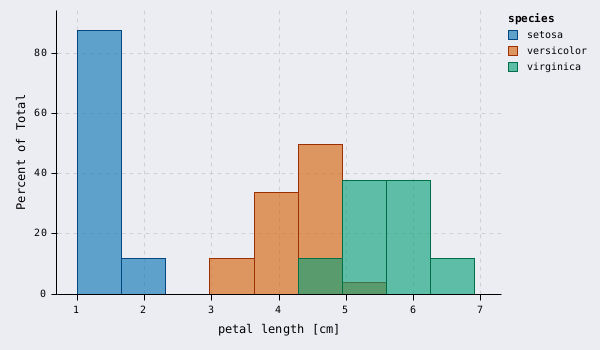
:::


### Bins

The bins (a method, a count or breaks), what a bar's height measures and the space the bins are made in:

::: {.clay-table}

```{=html}
<table class="table table-hover table-responsive clay-table"><thead><tr><th>Option</th><th>Type</th><th>Default</th><th>Description</th></tr></thead><tbody><tr><td>:bins</td><td>keyword or vector of a finite number (at least 2) or quantile bins {:quantiles q :estimation e}: q a positive count or a vector of increasing probabilities strictly between 0 and 1, e one of [:legacy :r1 :r2 :r3 :r4 :r5 :r6 :r7 :r8 :r9] or a positive integer</td><td>:sturges</td><td>bins (per panel under free or sliced facet x scales): an estimation method (:sturges :sqrt :rice :doane :scott :freedman-diaconis), a bin count or increasing breaks (shared, values outside dropped)</td></tr><tr><td>:y</td><td>one of :cumulative :percent :count :pmf :density</td><td>:percent</td><td>bar height: :percent (of the panel's or group's total), :count, :pmf (shares summing to 1), :density (area 1) or :cumulative (count of the bin and every bin before it)</td></tr><tr><td>:stat-space</td><td>one of :data :scale or nil</td><td>:data</td><td>space the bins are made in: :data (data units) or :scale (the x scale's coordinates - equal-width log10 bins on a :log axis, values it can't place dropped; :density per transformed unit)</td></tr></tbody></table>
```

:::


::: {.sourceClojure}
```clojure
(plot/render-image (plot/arrange [{:data faithful
                                   :mapping {:x :eruptions}
                                   :charts [(chart/histogram {:bins 30 :y :count :stroke-color :none})]
                                   :labels {:title ":bins 30 :y :count"}}
                                  {:data faithful
                                   :mapping {:x :eruptions}
                                   :charts [(chart/histogram {:bins [1.5 2 2.5 3 3.5 4 4.5 5 5.5] :y :density
                                                              :color [120 160 90] :stroke-color :white})]
                                   :labels {:title "breaks, :y :density"}}
                                  {:data two-species
                                   :mapping {:x :sepal-length :color :species}
                                   :charts [(chart/histogram {:position :mirror :bins 12 :zero-line-color :red
                                                              :zero-line-width 2})]
                                   :labels {:title ":position :mirror"}
                                   :legend false}]
                                 {:columns 3})
                   {:width 1000 :height 320})
```
:::


::: {.clay-image}

:::


What a bar's height measures - the same bins as shares summing to 1 (`:pmf`, the default `:percent` scaled to
100), and the running count (`:cumulative`):


::: {.sourceClojure}
```clojure
(plot/render-image (plot/arrange [{:data faithful
                                   :mapping {:x :eruptions}
                                   :charts [(chart/histogram {:bins 20 :y :pmf})]
                                   :labels {:title ":y :pmf"}}
                                  {:data faithful
                                   :mapping {:x :eruptions}
                                   :charts [(chart/histogram {:bins 20 :y :cumulative})]
                                   :labels {:title ":y :cumulative"}}]
                                 {:columns 2})
                   {:width 900 :height 300})
```
:::


::: {.clay-image}
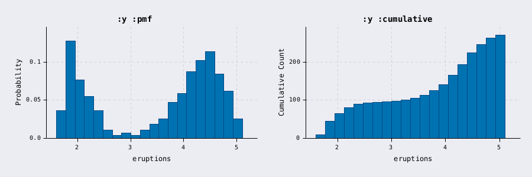
:::


On a log axis bins of equal width in data units crowd into the last decades; `:stat-space :scale` makes them in
the axis's log10 coordinates - equal-width on screen, `:density` per log10 unit (values a log axis can't place, 0
and negatives, are dropped and counted). In either space the values are numbers: histogram and density take no
dates.


::: {.sourceClojure}
```clojure
(plot/render-image (plot/arrange [{:data skewed
                                   :mapping {:x :value}
                                   :scales {:x {:kind :log}}
                                   :charts [(chart/histogram {:bins 20 :y :count :stat-space :data})]
                                   :labels {:title ":stat-space :data"}}
                                  {:data skewed
                                   :mapping {:x :value}
                                   :scales {:x {:kind :log}}
                                   :charts [(chart/histogram {:bins 20 :y :count :stat-space :scale})]
                                   :labels {:title ":stat-space :scale"}}]
                                 {:columns 2})
                   {:width 900 :height 300})
```
:::


::: {.clay-image}

:::


Bins are shared by every facet panel, so panels compare bar by bar. Under a free (or sliced) facet x scale each
panel gets bins over its own range instead - a count of bins (here 8) or a method applies per panel, so the bars
fill each panel's own axis; explicit breaks stay shared. Margin histograms follow their panel's scale the same way.


::: {.sourceClojure}
```clojure
(plot/render-image {:data iris
                    :mapping {:x :petal-length :facet :species}
                    :facets {:scales {:x :free}}
                    :charts [(chart/histogram {:bins 8 :y :count})]
                    :labels {:x "petal length [cm]"}}
                   {:width 900 :height 300})
```
:::


::: {.clay-image}
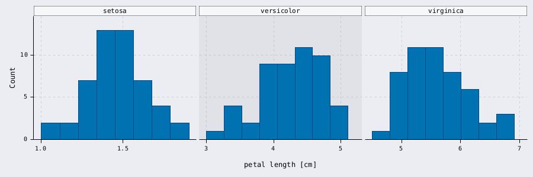
:::


### Invalid values

Rows whose x is missing, NaN or not a number (or a value the stat space can't place) are dropped and counted;
`:invalid :show` draws their count as a bar in a band beside the x axis's start, outside the axis line, on the
same y scale, in the chart's own fill (or the mapped one), labelled by `:invalid-label` (which needs `:invalid
:show`). Shares (`:percent`, `:pmf`) are then of all rows, the invalid ones included; groups stack or dodge in the
band as in the bins, every facet panel has its own band and a flipped plot puts it under the panel. Only the main
charts of a generated grid draw a band: `:invalid :show` in a margin chart or a `:custom-grid` plot is an error.

::: {.clay-table}

```{=html}
<table class="table table-hover table-responsive clay-table"><thead><tr><th>Option</th><th>Type</th><th>Default</th><th>Description</th></tr></thead><tbody><tr><td>:invalid</td><td>one of :drop :show or nil</td><td>:drop</td><td>rows with a missing, NaN, non-numeric or unplaceable x: :drop (counted in :dropped) or :show (a bar of their count in a band beside the x axis's start)</td></tr><tr><td>:invalid-label</td><td>string or nil</td><td>"NA"</td><td>label of the band of invalid values (needs :invalid :show)</td></tr></tbody></table>
```

:::


::: {.sourceClojure}
```clojure
(def gappy (mapv (fn [i {:keys [value]}] {:value (when-not (zero? (mod i 5)) value) :group (if (even? i) "a" "b")})
                 (range) skewed))
```
:::


```{=html}
<div class="data-table"><table class="table table-hover table-responsive clay-table"><thead><tr><th>value</th><th>group</th></tr></thead><tbody><tr><td></td><td>a</td></tr><tr><td>5.432377544402306</td><td>b</td></tr><tr><td>14.669090820378228</td><td>a</td></tr><tr><td>40.82584739222101</td><td>b</td></tr><tr><td>13.078354465398991</td><td>a</td></tr><tr><td></td><td>b</td></tr><tr><td>13.037364020437549</td><td>a</td></tr><tr><td>19.17019582641185</td><td>b</td></tr><tr><td>14.824310847812232</td><td>a</td></tr><tr><td>10.690099015595523</td><td>b</td></tr><tr><td></td><td>a</td></tr><tr><td>9.116331220344927</td><td>b</td></tr><tr><td>37.37365506923162</td><td>a</td></tr><tr><td>27.21872176296663</td><td>b</td></tr><tr><td>19.75950164215408</td><td>a</td></tr><tr><td></td><td>b</td></tr><tr><td>43.681297034474724</td><td>a</td></tr><tr><td>16.52126012111423</td><td>b</td></tr><tr><td>27.24652538177213</td><td>a</td></tr><tr><td>6.4971111669608455</td><td>b</td></tr><tr><td></td><td>a</td></tr><tr><td>9.365691651907682</td><td>b</td></tr><tr><td>6.188200963581874</td><td>a</td></tr><tr><td>16.794077648589806</td><td>b</td></tr><tr><td>25.789767430154466</td><td>a</td></tr><tr><td></td><td>b</td></tr><tr><td>85.36707392832939</td><td>a</td></tr><tr><td>48.84903146693207</td><td>b</td></tr><tr><td>51.55975501397397</td><td>a</td></tr><tr><td>25.704128454393658</td><td>b</td></tr><tr><td></td><td>a</td></tr><tr><td>28.26387556508628</td><td>b</td></tr><tr><td>22.808671145321608</td><td>a</td></tr><tr><td>164.8899896412492</td><td>b</td></tr><tr><td>8.933440707802696</td><td>a</td></tr><tr><td></td><td>b</td></tr><tr><td>8.563517526210143</td><td>a</td></tr><tr><td>38.80970744392038</td><td>b</td></tr><tr><td>179.32381325305346</td><td>a</td></tr><tr><td>6.217944013232817</td><td>b</td></tr><tr><td></td><td>a</td></tr><tr><td>16.783626566789373</td><td>b</td></tr><tr><td>6.715239831870871</td><td>a</td></tr><tr><td>11.072318196362922</td><td>b</td></tr><tr><td>65.70609084809114</td><td>a</td></tr><tr><td></td><td>b</td></tr><tr><td>149.62207161829264</td><td>a</td></tr><tr><td>17.373753114171812</td><td>b</td></tr><tr><td>35.29825370703353</td><td>a</td></tr><tr><td>15.446465117661427</td><td>b</td></tr><tr><td></td><td>a</td></tr><tr><td>27.428097151688846</td><td>b</td></tr><tr><td>7.216136515948157</td><td>a</td></tr><tr><td>20.57565015914731</td><td>b</td></tr><tr><td>25.518123500974436</td><td>a</td></tr><tr><td></td><td>b</td></tr><tr><td>4.228718478717844</td><td>a</td></tr><tr><td>26.31527384871188</td><td>b</td></tr><tr><td>84.31669956408959</td><td>a</td></tr><tr><td>48.99138258302952</td><td>b</td></tr><tr><td></td><td>a</td></tr><tr><td>31.327608920151476</td><td>b</td></tr><tr><td>4.077815388301838</td><td>a</td></tr><tr><td>160.37141507976867</td><td>b</td></tr><tr><td>56.31767112909131</td><td>a</td></tr><tr><td></td><td>b</td></tr><tr><td>42.110789296459096</td><td>a</td></tr><tr><td>4.128142803815318</td><td>b</td></tr><tr><td>26.91053755932542</td><td>a</td></tr><tr><td>84.52901899102923</td><td>b</td></tr><tr><td></td><td>a</td></tr><tr><td>92.49406406232194</td><td>b</td></tr><tr><td>31.514898759565355</td><td>a</td></tr><tr><td>5.461635954077979</td><td>b</td></tr><tr><td>12.832204409857043</td><td>a</td></tr><tr><td></td><td>b</td></tr><tr><td>12.89047062750862</td><td>a</td></tr><tr><td>31.88639252472308</td><td>b</td></tr><tr><td>18.914979500602723</td><td>a</td></tr><tr><td>50.774172175453174</td><td>b</td></tr><tr><td></td><td>a</td></tr><tr><td>9.818920929752553</td><td>b</td></tr><tr><td>33.32035183391212</td><td>a</td></tr><tr><td>36.987383832918766</td><td>b</td></tr><tr><td>5.699193114963241</td><td>a</td></tr><tr><td></td><td>b</td></tr><tr><td>11.266728129740004</td><td>a</td></tr><tr><td>14.659160419530002</td><td>b</td></tr><tr><td>54.65931643728897</td><td>a</td></tr><tr><td>12.296033715416334</td><td>b</td></tr><tr><td></td><td>a</td></tr><tr><td>33.76854746628196</td><td>b</td></tr><tr><td>5.9756042226117865</td><td>a</td></tr><tr><td>50.58182962125001</td><td>b</td></tr><tr><td>72.20097526648814</td><td>a</td></tr><tr><td></td><td>b</td></tr><tr><td>37.80002676289402</td><td>a</td></tr><tr><td>54.01200626555873</td><td>b</td></tr><tr><td>71.1527041325656</td><td>a</td></tr><tr><td>9.751836705852464</td><td>b</td></tr><tr><td>…</td><td>…</td></tr></tbody></table></div>
```


::: {.sourceClojure}
```clojure
(plot/render-image (plot/arrange [{:data gappy
                                   :mapping {:x :value}
                                   :charts [(chart/histogram {:bins 20 :y :count :invalid :show})]
                                   :labels {:title ":invalid :show"}}
                                  {:data gappy
                                   :mapping {:x :value :color :group}
                                   :flip true
                                   :charts [(chart/histogram {:bins 12 :position :stack :invalid :show :invalid-label "missing"})]
                                   :labels {:title "flipped, stacked groups, :invalid-label"}}]
                                 {:columns 2})
                   {:width 900 :height 300})
```
:::


::: {.clay-image}

:::


### Position

How groups combine and the zero line and y range of mirrored groups:

::: {.clay-table}

```{=html}
<table class="table table-hover table-responsive clay-table"><thead><tr><th>Option</th><th>Type</th><th>Default</th><th>Description</th></tr></thead><tbody><tr><td>:position</td><td>one of :dodge :mirror :normalize :overlay :stack</td><td>:overlay</td><td>grouped bars: :overlay (translucent), :dodge, :stack, :normalize (stacked to 1) or :mirror (two groups, the second downward); ridgelines: :overlay or :mirror</td></tr><tr><td>:symmetric</td><td>true or false or nil</td><td>false</td><td>with :position :mirror, tie both halves to one y range [-M M], M the tallest bar over all panels</td></tr><tr><td>:zero-line</td><td>true or false or nil</td><td>true</td><td>with :position :mirror, draw the y = 0 line over the bars</td></tr><tr><td>:padding</td><td>map of one of :x :y to [lo hi], non-negative numbers</td><td>{:x [0.05 0.05] :y [0 0.05]} (bars stand on the panel's bottom edge); y [0.05 0.05] with :position :mirror</td><td>padding of the data span per position axis, {:x [lo hi] :y [lo hi]} fractions of the span</td></tr></tbody></table>
```

:::


How groups share the bins: translucent over each other (`:alpha` of `:overlay`), side by side, stacked, or
stacked to 1 - the share of each species in every bin:


::: {.sourceClojure}
```clojure
(plot/render-image (plot/arrange [{:data iris
                                   :mapping {:x :petal-length :color :species}
                                   :charts [(chart/histogram {:position :overlay :alpha 0.4 :bins 20})]
                                   :labels {:title ":position :overlay :alpha 0.4"}
                                   :legend false}
                                  {:data iris
                                   :mapping {:x :petal-length :color :species}
                                   :charts [(chart/histogram {:position :dodge :bins 12})]
                                   :labels {:title ":position :dodge"}
                                   :legend false}
                                  {:data iris
                                   :mapping {:x :petal-length :color :species}
                                   :charts [(chart/histogram {:position :stack :bins 20})]
                                   :labels {:title ":position :stack"}
                                   :legend false}
                                  {:data iris
                                   :mapping {:x :petal-length :color :species}
                                   :charts [(chart/histogram {:position :normalize :bins 20})]
                                   :labels {:title ":position :normalize"}
                                   :legend false}]
                                 {:columns 2})
                   {:width 900 :height 560})
```
:::


::: {.clay-image}

:::


Mirrored groups: halves tied to one y range [-M M] (`:symmetric`) or each fitted to its own tallest bar, the zero
line off; thick outlines and no padding above the bars:


::: {.sourceClojure}
```clojure
(plot/render-image (plot/arrange [{:data two-species
                                   :mapping {:x :sepal-length :color :species}
                                   :charts [(chart/histogram {:position :mirror :bins 12 :symmetric true})]
                                   :labels {:title ":symmetric true"}
                                   :legend false}
                                  {:data two-species
                                   :mapping {:x :sepal-length :color :species}
                                   :charts [(chart/histogram {:position :mirror :bins 12 :symmetric false :zero-line false})]
                                   :labels {:title ":symmetric false :zero-line false"}
                                   :legend false}
                                  {:data faithful
                                   :mapping {:x :eruptions}
                                   :charts [(chart/histogram {:bins 15 :stroke-color :black :stroke-width 2
                                                              :padding {:y [0 0]}})]
                                   :labels {:title ":stroke-width 2 :padding {:y [0 0]}"}}]
                                 {:columns 3})
                   {:width 1000 :height 320})
```
:::


::: {.clay-image}
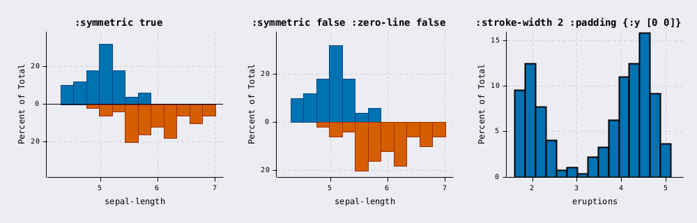
:::


### Style

The bar fill, outline and translucency, and the zero line of mirrored groups:

::: {.clay-table}

```{=html}
<table class="table table-hover table-responsive clay-table"><thead><tr><th>Option</th><th>Type</th><th>Default</th><th>Description</th></tr></thead><tbody><tr><td>:color</td><td>a clojure2d color</td><td>[0 114 178]</td><td>bar fill colour (a mapped :color wins)</td></tr><tr><td>:stroke-color</td><td>:darker or a clojure2d color or :none</td><td>:darker</td><td>outline colour: a colour, :none or :darker (the darkened fill)</td></tr><tr><td>:stroke-width</td><td>a non-negative number</td><td>1</td><td>outline width in pixels</td></tr><tr><td>:alpha</td><td>a number in [0 1]</td><td>0.6</td><td>fill opacity of grouped bars with :position :overlay (other bars are opaque)</td></tr><tr><td>:zero-line-color</td><td>a clojure2d color or :none</td><td>:black</td><td>colour of the y = 0 line drawn with :position :mirror</td></tr><tr><td>:zero-line-width</td><td>a non-negative number</td><td>1</td><td>width in pixels of the y = 0 line drawn with :position :mirror</td></tr></tbody></table>
```

:::


::: {.sourceClojure}
```clojure
(plot/render-image (plot/arrange [{:data faithful
                                   :mapping {:x :eruptions}
                                   :charts [(chart/histogram {:bins 20 :color [200 120 60] :stroke-color :none})]
                                   :labels {:title ":color, :stroke-color :none"}}
                                  {:data two-species
                                   :mapping {:x :sepal-length :color :species}
                                   :charts [(chart/histogram {:bins 12 :alpha 0.3 :stroke-color :darker :stroke-width 1.5})]
                                   :labels {:title ":alpha 0.3 :stroke-width 1.5"}
                                   :legend false}]
                                 {:columns 2})
                   {:width 900 :height 300})
```
:::


::: {.clay-image}
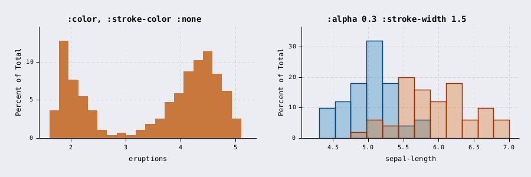
:::


Shared options: [Fill patterns](reference.shared_options.html#fill-patterns) (`:pattern` `:pattern-color`); [Common options](reference.shared_options.html#common-options) (`:data` `:mapping` `:legend`); [Named theme styles](reference.shared_options.html#named-theme-styles) (`:theme-style`); [Rounded corners](reference.shared_options.html#rounded-corners) (`:corner-radius` `:corner-radius-end`); [Ridgelines](reference.shared_options.html#ridgelines) (`:overlap`).


## density

A kernel density estimate per group drawn as a curve, optionally filled; groups overlay, stack or mirror, and a
categorical `:y` gives ridgelines.

::: {.clay-table}

```{=html}
<table class="table table-hover table-responsive clay-table"><thead><tr><th>Option</th><th>Type</th><th>Default</th><th>Description</th></tr></thead><tbody><tr><td>:x (required)</td><td>a keyword, a function or a categorical marker of one</td><td></td><td>values whose density is estimated (data units)</td></tr><tr><td>:y</td><td>a keyword, a function or a categorical marker of one or nil</td><td></td><td>ridgeline levels: categorical or on a :bands scale, one curve per level (a numeric :y otherwise is ignored)</td></tr><tr><td>:color</td><td>a keyword, a function or a categorical marker of one or nil</td><td></td><td>groups, each a curve in its own colour</td></tr><tr><td>:dash</td><td>a keyword, a function or a categorical marker of one or nil</td><td></td><td>groups, each a curve with its own dash style</td></tr><tr><td>:pattern</td><td>a keyword, a function or a categorical marker of one or nil</td><td></td><td>groups, each area with its own fill pattern</td></tr><tr><td>:group</td><td>a keyword, a function or a categorical marker of one or nil</td><td></td><td>groups without a visual aesthetic, each its own curve</td></tr></tbody></table>
```

:::


::: {.sourceClojure}
```clojure
(plot/render-image {:data iris
                    :mapping {:x :petal-length :color :species}
                    :charts [(chart/density)]
                    :labels {:x "petal length [cm]"}}
                   {:width 600 :height 350})
```
:::


::: {.clay-image}
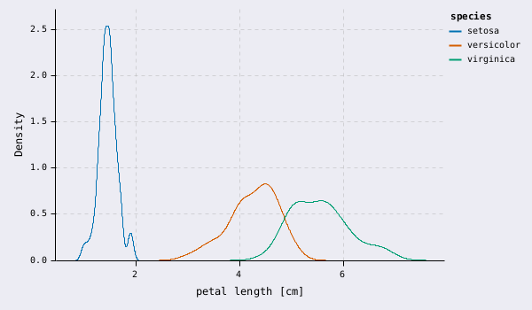
:::


### Style

The area under a curve, its opacity, a gradient fill of ridgelines and the zero line of mirrored curves:

::: {.clay-table}

```{=html}
<table class="table table-hover table-responsive clay-table"><thead><tr><th>Option</th><th>Type</th><th>Default</th><th>Description</th></tr></thead><tbody><tr><td>:fill</td><td>:color or a clojure2d color or :none</td><td>:none</td><td>area under the curve: a colour, :color (the curve's colour, its own alpha times :alpha) or :none; stacked positions and ridgelines fill with the curve's colour unless set</td></tr><tr><td>:alpha</td><td>a number in [0 1]</td><td>0.6</td><td>factor of the curve colour's alpha filling areas in the curve's colour</td></tr><tr><td>:zero-line-color</td><td>a clojure2d color or :none</td><td>:black</td><td>colour of the y = 0 line drawn with :position :mirror</td></tr><tr><td>:zero-line-width</td><td>a non-negative number</td><td>1</td><td>width in pixels of the y = 0 line drawn with :position :mirror</td></tr><tr><td>:fill-gradient</td><td>a clojure2d gradient: a preset keyword, a colour list or a function</td><td></td><td>ridgelines only: fill colour along :fill-gradient-axis, a clojure2d gradient (preset keyword, colour list or function of t in [0 1]) (wins over :fill)</td></tr><tr><td>:fill-gradient-axis</td><td>one of :x :y</td><td>:x; only with ridgelines and :fill-gradient</td><td>axis of the :fill-gradient: :x (over the x scale's domain) or :y (from each ridge's baseline to the top of the tallest curve)</td></tr></tbody></table>
```

:::


::: {.sourceClojure}
```clojure
(plot/render-image (plot/arrange [{:data iris
                                   :mapping {:x :petal-length :color :species}
                                   :charts [(chart/density {:fill :color :alpha 0.3})]
                                   :labels {:title ":fill :color :alpha 0.3"}
                                   :legend false}
                                  {:data iris
                                   :mapping {:x :sepal-length :y :species}
                                   :charts [(chart/density {:fill-gradient :mpl/viridis})]
                                   :scales {:y {:reverse true}}
                                   :labels {:title "ridgelines, :fill-gradient"}}
                                  {:data two-species
                                   :mapping {:x :sepal-length :color :species}
                                   :charts [(chart/density {:position :mirror :fill :color
                                                            :zero-line-color :red :zero-line-width 2})]
                                   :labels {:title ":zero-line-color :red"}
                                   :legend false}]
                                 {:columns 3})
                   {:width 1000 :height 320})
```
:::


::: {.clay-image}

:::


The ridgelines' gradient along x (over the x domain) or along y (from each ridge's baseline up):


::: {.sourceClojure}
```clojure
(plot/render-image (plot/arrange [{:data iris
                                   :mapping {:x :sepal-length :y :species}
                                   :charts [(chart/density {:fill-gradient :mpl/plasma :fill-gradient-axis :x})]
                                   :scales {:y {:reverse true}}
                                   :labels {:title ":fill-gradient-axis :x"}}
                                  {:data iris
                                   :mapping {:x :sepal-length :y :species}
                                   :charts [(chart/density {:fill-gradient :mpl/plasma :fill-gradient-axis :y})]
                                   :scales {:y {:reverse true}}
                                   :labels {:title ":fill-gradient-axis :y"}}]
                                 {:columns 2})
                   {:width 900 :height 320})
```
:::


::: {.clay-image}
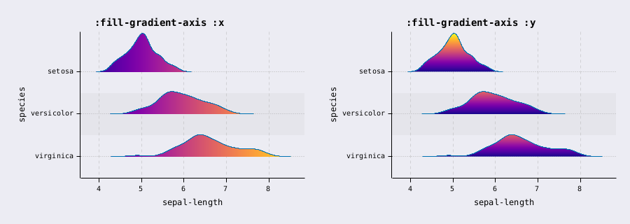
:::


### Estimate

The kernel, its bandwidth (in data units or a selector), the number of evaluation points and how far a curve
reaches past the data:

::: {.clay-table}

```{=html}
<table class="table table-hover table-responsive clay-table"><thead><tr><th>Option</th><th>Type</th><th>Default</th><th>Description</th></tr></thead><tbody><tr><td>:kernel</td><td>keyword</td><td>:gaussian</td><td>fastmath KDE kernel</td></tr><tr><td>:bandwidth</td><td>a positive number or keyword</td><td>:nrd0</td><td>kernel bandwidth in data units, or a fastmath bandwidth selector</td></tr><tr><td>:n</td><td>integer, >= 2 or nil</td><td>512</td><td>number of evaluation points of each curve</td></tr><tr><td>:cut</td><td>a non-negative number or nil</td><td>3</td><td>how many bandwidths the curve extends past the extreme values on each side</td></tr><tr><td>:stat-space</td><td>one of :data :scale or nil</td><td>:data</td><td>space the density is estimated in: :data (data units) or :scale (the x scale's coordinates - log10 on a :log axis, values it can't place dropped; a numeric :bandwidth in those units)</td></tr></tbody></table>
```

:::


::: {.sourceClojure}
```clojure
(plot/render-image (plot/arrange [{:data faithful
                                   :mapping {:x :eruptions}
                                   :charts [(chart/density)]
                                   :labels {:title "default (:gaussian, :nrd0)"}}
                                  {:data faithful
                                   :mapping {:x :eruptions}
                                   :charts [(chart/density {:bandwidth 0.1})]
                                   :labels {:title ":bandwidth 0.1"}}
                                  {:data faithful
                                   :mapping {:x :eruptions}
                                   :charts [(chart/density {:kernel :uniform :cut 0})]
                                   :labels {:title ":kernel :uniform :cut 0"}}]
                                 {:columns 3})
                   {:width 1000 :height 300})
```
:::


::: {.clay-image}
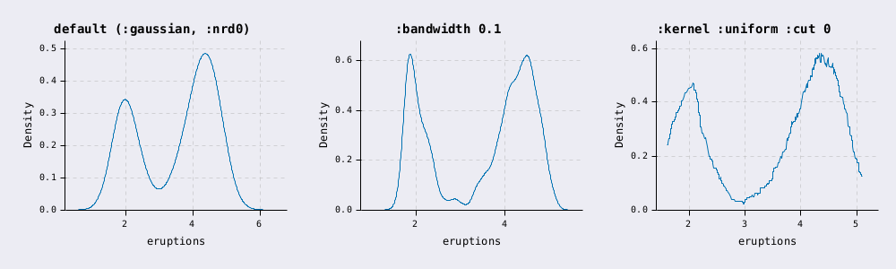
:::


A bandwidth selector instead of a number, few evaluation points (the curve drawn through 8 points), and a curve
reaching 1 bandwidth past the data (3 by default):


::: {.sourceClojure}
```clojure
(plot/render-image (plot/arrange [{:data faithful
                                   :mapping {:x :eruptions}
                                   :charts [(chart/density {:bandwidth :sj})]
                                   :labels {:title ":bandwidth :sj"}}
                                  {:data faithful
                                   :mapping {:x :eruptions}
                                   :charts [(chart/density {:n 8})]
                                   :labels {:title ":n 8"}}
                                  {:data faithful
                                   :mapping {:x :eruptions}
                                   :charts [(chart/density {:cut 1})]
                                   :labels {:title ":cut 1"}}]
                                 {:columns 3})
                   {:width 1000 :height 300})
```
:::


::: {.clay-image}
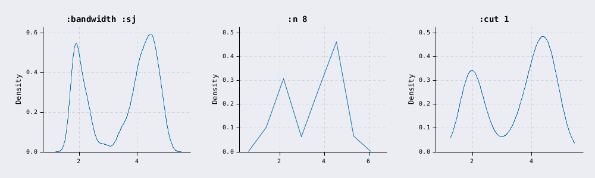
:::


Skewed values: estimated in data units (the default) the curve is lopsided and its tail passes 0 - a log axis
can't show it; `:stat-space :scale` estimates the density of the log10 values on a log axis (per log10 unit, a
numeric `:bandwidth` in log10 units) and draws it back on the axis:


::: {.sourceClojure}
```clojure
(plot/render-image (plot/arrange [{:data skewed
                                   :mapping {:x :value}
                                   :charts [(chart/density {:stat-space :data :fill :color})]
                                   :labels {:title ":stat-space :data"}}
                                  {:data skewed
                                   :mapping {:x :value}
                                   :scales {:x {:kind :log}}
                                   :charts [(chart/density {:stat-space :scale :fill :color})]
                                   :labels {:title ":stat-space :scale, a log x axis"}}]
                                 {:columns 2})
                   {:width 900 :height 300})
```
:::


::: {.clay-image}
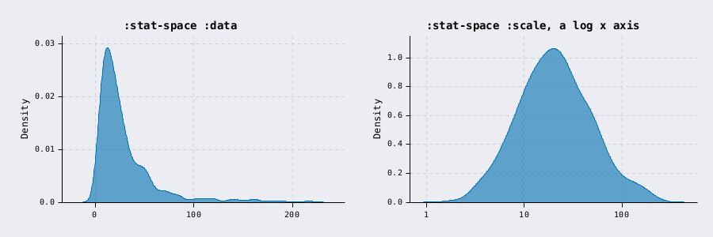
:::


### Position

How groups combine (the Layering and position chapter shows the streamgraphs), a common y range of the mirrored
halves and the padding:

::: {.clay-table}

```{=html}
<table class="table table-hover table-responsive clay-table"><thead><tr><th>Option</th><th>Type</th><th>Default</th><th>Description</th></tr></thead><tbody><tr><td>:position</td><td>one of :mirror :normalize :overlay :silhouette :stack :wiggle</td><td>:overlay</td><td>grouped curves: :overlay, :stack, :normalize (stacked, summing to 1), streamgraphs :silhouette and :wiggle, or :mirror (two groups, the second drawn downward); ridgelines take :overlay or :mirror</td></tr><tr><td>:symmetric</td><td>true or false or nil</td><td>false</td><td>with :position :mirror, tie both halves to one y range [-M M], M the tallest curve over all panels</td></tr><tr><td>:zero-line</td><td>true or false or nil</td><td>true</td><td>with :position :mirror, draw the y = 0 line over the curves</td></tr><tr><td>:padding</td><td>map of one of :x :y to [lo hi], non-negative numbers</td><td>{:x [0.05 0.05] :y [0 0.05]} (curves stand on the panel's bottom edge); y [0.05 0.05] with :mirror, :silhouette and :wiggle</td><td>padding of the data span per position axis, {:x [lo hi] :y [lo hi]} fractions of the span</td></tr></tbody></table>
```

:::


::: {.sourceClojure}
```clojure
(plot/render-image (plot/arrange [{:data iris
                                   :mapping {:x :petal-length :color :species}
                                   :charts [(chart/density {:position :stack})]
                                   :labels {:title ":position :stack"}
                                   :legend false}
                                  {:data two-species
                                   :mapping {:x :petal-length :color :species}
                                   :charts [(chart/density {:position :mirror :fill :color})]
                                   :labels {:title ":position :mirror"}
                                   :legend false}
                                  {:data two-species
                                   :mapping {:x :petal-length :color :species}
                                   :charts [(chart/density {:position :mirror :fill :color :symmetric true})]
                                   :labels {:title ":symmetric true"}}]
                                 {:columns 3 :widths [1 1 1.4]})
                   {:width 1000 :height 320})
```
:::


::: {.clay-image}
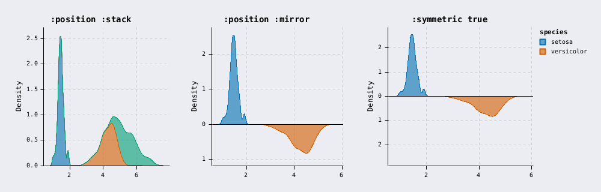
:::


Stacked to 1 (each species' share of the density at every x), the streamgraphs, and a mirrored pair without the
zero line and with no padding:


::: {.sourceClojure}
```clojure
(plot/render-image (plot/arrange [{:data iris
                                   :mapping {:x :petal-length :color :species}
                                   :charts [(chart/density {:position :normalize})]
                                   :labels {:title ":position :normalize"}
                                   :legend false}
                                  {:data iris
                                   :mapping {:x :petal-length :color :species}
                                   :charts [(chart/density {:position :silhouette})]
                                   :labels {:title ":position :silhouette"}
                                   :legend false}
                                  {:data iris
                                   :mapping {:x :petal-length :color :species}
                                   :charts [(chart/density {:position :wiggle})]
                                   :labels {:title ":position :wiggle"}
                                   :legend false}
                                  {:data two-species
                                   :mapping {:x :petal-length :color :species}
                                   :charts [(chart/density {:position :mirror :fill :color :zero-line false
                                                            :padding {:x [0 0] :y [0 0]}})]
                                   :labels {:title ":zero-line false, no padding"}
                                   :legend false}]
                                 {:columns 2})
                   {:width 900 :height 560})
```
:::


::: {.clay-image}

:::


Shared options: [Line style](reference.shared_options.html#line-style) (`:color` `:line-width` `:dash`); [Fill patterns](reference.shared_options.html#fill-patterns) (`:pattern` `:pattern-color`); [Common options](reference.shared_options.html#common-options) (`:data` `:mapping` `:legend`); [Named theme styles](reference.shared_options.html#named-theme-styles) (`:theme-style`); [Ridgelines](reference.shared_options.html#ridgelines) (`:overlap`).


## ecdf

A step line per group: the share of values at or below each x.

::: {.clay-table}

```{=html}
<table class="table table-hover table-responsive clay-table"><thead><tr><th>Option</th><th>Type</th><th>Default</th><th>Description</th></tr></thead><tbody><tr><td>:x (required)</td><td>a keyword, a function or a categorical marker of one</td><td></td><td>values whose empirical distribution is drawn (data units)</td></tr><tr><td>:color</td><td>a keyword, a function or a categorical marker of one or nil</td><td></td><td>groups, each a step line in its own colour</td></tr><tr><td>:dash</td><td>a keyword, a function or a categorical marker of one or nil</td><td></td><td>groups, each a step line with its own dash style</td></tr><tr><td>:group</td><td>a keyword, a function or a categorical marker of one or nil</td><td></td><td>groups without a visual aesthetic, each its own step line</td></tr></tbody></table>
```

:::


::: {.sourceClojure}
```clojure
(plot/render-image {:data iris
                    :mapping {:x :petal-length :color :species}
                    :charts [(chart/ecdf)]
                    :labels {:x "petal length [cm]" :y "share at or below"}}
                   {:width 600 :height 350})
```
:::


::: {.clay-image}

:::


Its only own option is the padding - here none on y, so the steps start and end at the panel's edges:

::: {.clay-table}

```{=html}
<table class="table table-hover table-responsive clay-table"><thead><tr><th>Option</th><th>Type</th><th>Default</th><th>Description</th></tr></thead><tbody><tr><td>:padding</td><td>map of one of :x :y to [lo hi], non-negative numbers</td><td>{:x [0.05 0.05] :y [0.05 0.05]}</td><td>padding of the data span per position axis, {:x [lo hi] :y [lo hi]} fractions of the span</td></tr></tbody></table>
```

:::


::: {.sourceClojure}
```clojure
(plot/render-image {:data faithful
                    :mapping {:x :eruptions}
                    :charts [(chart/ecdf {:padding {:y [0 0]}})]
                    :labels {:title ":padding {:y [0 0]}"}}
                   {:width 500 :height 300})
```
:::


::: {.clay-image}

:::


Shared options: [Line style](reference.shared_options.html#line-style) (`:color` `:line-width` `:dash`); [Common options](reference.shared_options.html#common-options) (`:data` `:mapping` `:legend`); [Named theme styles](reference.shared_options.html#named-theme-styles) (`:theme-style`).


## qq

Quantiles of one side against the other's: two data columns, or data against a theoretical distribution. Points
on the reference line mean the same shape of distribution.

::: {.clay-table}

```{=html}
<table class="table table-hover table-responsive clay-table"><thead><tr><th>Option</th><th>Type</th><th>Default</th><th>Description</th></tr></thead><tbody><tr><td>:x</td><td>a keyword, a function or a categorical marker of one or nil</td><td></td><td>data of the x side (unless :x-distribution is given)</td></tr><tr><td>:y</td><td>a keyword, a function or a categorical marker of one or nil</td><td></td><td>data of the y side (unless :y-distribution is given)</td></tr><tr><td>:color</td><td>a keyword, a function or a categorical marker of one or nil</td><td></td><td>groups, each with its own point and line colour</td></tr><tr><td>:shape</td><td>a keyword, a function or a categorical marker of one or nil</td><td></td><td>groups, each with its own point shape</td></tr><tr><td>:size</td><td>a keyword, a function or a categorical marker of one or nil</td><td></td><td>groups, each with its own point size</td></tr><tr><td>:group</td><td>a keyword, a function or a categorical marker of one or nil</td><td></td><td>groups without a visual aesthetic</td></tr></tbody></table>
```

:::


::: {.sourceClojure}
```clojure
(def samples (let [g (r/rng :mersenne 11)
                   t3 (r/distribution :t {:degrees-of-freedom 3 :rng g})]
               (vec (concat (for [_ (range 200)] {:v (r/grandom g) :sample "normal"})
                            (for [_ (range 200)] {:v (r/sample t3) :sample "t(3)"})))))
```
:::


```{=html}
<div class="data-table"><table class="table table-hover table-responsive clay-table"><thead><tr><th>v</th><th>sample</th></tr></thead><tbody><tr><td>-1.9354135624386053</td><td>normal</td></tr><tr><td>-0.9842798332756787</td><td>normal</td></tr><tr><td>0.7692425297241978</td><td>normal</td></tr><tr><td>0.47520762766422164</td><td>normal</td></tr><tr><td>-0.07460401433466404</td><td>normal</td></tr><tr><td>0.386576340050147</td><td>normal</td></tr><tr><td>0.5740037801583956</td><td>normal</td></tr><tr><td>0.6304795444116987</td><td>normal</td></tr><tr><td>0.8658518672112061</td><td>normal</td></tr><tr><td>-0.6587155372039402</td><td>normal</td></tr><tr><td>1.1977369488812335</td><td>normal</td></tr><tr><td>1.3496814267379298</td><td>normal</td></tr><tr><td>0.33415045817805766</td><td>normal</td></tr><tr><td>-0.09540563325605536</td><td>normal</td></tr><tr><td>0.4202488095487268</td><td>normal</td></tr><tr><td>1.2157194832517149</td><td>normal</td></tr><tr><td>-0.06003547257265243</td><td>normal</td></tr><tr><td>0.31875404416652725</td><td>normal</td></tr><tr><td>-1.2696556154795149</td><td>normal</td></tr><tr><td>0.22783203772564486</td><td>normal</td></tr><tr><td>0.7252478683121171</td><td>normal</td></tr><tr><td>-0.6244515436177719</td><td>normal</td></tr><tr><td>-0.5975761062902751</td><td>normal</td></tr><tr><td>-0.3623485346184586</td><td>normal</td></tr><tr><td>-0.31550127476485473</td><td>normal</td></tr><tr><td>1.9095980213212904</td><td>normal</td></tr><tr><td>0.41098996078625705</td><td>normal</td></tr><tr><td>-0.8061841406740187</td><td>normal</td></tr><tr><td>2.1071608232867507</td><td>normal</td></tr><tr><td>-0.7256677343646285</td><td>normal</td></tr><tr><td>1.6865979632494321</td><td>normal</td></tr><tr><td>-2.1551951631319257</td><td>normal</td></tr><tr><td>-0.8129352068886067</td><td>normal</td></tr><tr><td>-0.06082656934917857</td><td>normal</td></tr><tr><td>-1.3525320628523652</td><td>normal</td></tr><tr><td>0.22749695176256018</td><td>normal</td></tr><tr><td>2.00040094394776</td><td>normal</td></tr><tr><td>0.8023225700821351</td><td>normal</td></tr><tr><td>-0.7187867660832096</td><td>normal</td></tr><tr><td>-1.3666058217681498</td><td>normal</td></tr><tr><td>1.1569046470792448</td><td>normal</td></tr><tr><td>-0.35688823167648287</td><td>normal</td></tr><tr><td>0.8400673754079033</td><td>normal</td></tr><tr><td>0.3079360059649594</td><td>normal</td></tr><tr><td>-0.6085750438713416</td><td>normal</td></tr><tr><td>-0.54198387035825</td><td>normal</td></tr><tr><td>3.0378337780508096</td><td>normal</td></tr><tr><td>0.1224340917841133</td><td>normal</td></tr><tr><td>-0.438621351500724</td><td>normal</td></tr><tr><td>0.3338767636927164</td><td>normal</td></tr><tr><td>-2.65714989483138</td><td>normal</td></tr><tr><td>-2.1546086692916107</td><td>normal</td></tr><tr><td>-0.12521182140433756</td><td>normal</td></tr><tr><td>0.5655133775234155</td><td>normal</td></tr><tr><td>-1.2286343497814154</td><td>normal</td></tr><tr><td>-1.6875138589081766</td><td>normal</td></tr><tr><td>-1.3000745391077166</td><td>normal</td></tr><tr><td>0.47600748113197855</td><td>normal</td></tr><tr><td>-1.3952400596571857</td><td>normal</td></tr><tr><td>1.222893544881492</td><td>normal</td></tr><tr><td>-1.564668551993953</td><td>normal</td></tr><tr><td>0.38596082112326074</td><td>normal</td></tr><tr><td>0.3026726977215286</td><td>normal</td></tr><tr><td>2.6917350088128495</td><td>normal</td></tr><tr><td>0.47346375499232296</td><td>normal</td></tr><tr><td>0.9564010031630503</td><td>normal</td></tr><tr><td>-0.28400848879695406</td><td>normal</td></tr><tr><td>0.12087876478748225</td><td>normal</td></tr><tr><td>-0.39749999013144105</td><td>normal</td></tr><tr><td>-1.0528216283209995</td><td>normal</td></tr><tr><td>0.21158371484421143</td><td>normal</td></tr><tr><td>-0.9837375530978842</td><td>normal</td></tr><tr><td>1.6831486569359688</td><td>normal</td></tr><tr><td>-0.473300154181772</td><td>normal</td></tr><tr><td>1.1796989962144864</td><td>normal</td></tr><tr><td>1.1764595433604714</td><td>normal</td></tr><tr><td>0.4810565023449482</td><td>normal</td></tr><tr><td>0.23256596526418555</td><td>normal</td></tr><tr><td>-0.8687361114901867</td><td>normal</td></tr><tr><td>-0.6054534100157256</td><td>normal</td></tr><tr><td>0.3447467365944367</td><td>normal</td></tr><tr><td>0.5529152521718022</td><td>normal</td></tr><tr><td>1.5715512150048214</td><td>normal</td></tr><tr><td>-0.08980591289398993</td><td>normal</td></tr><tr><td>-0.0868956668739789</td><td>normal</td></tr><tr><td>0.8117764588472456</td><td>normal</td></tr><tr><td>-0.41100479532618145</td><td>normal</td></tr><tr><td>0.338499013268407</td><td>normal</td></tr><tr><td>0.5543343363973507</td><td>normal</td></tr><tr><td>0.2077980844271687</td><td>normal</td></tr><tr><td>-2.102473149613918</td><td>normal</td></tr><tr><td>-0.2928182390683161</td><td>normal</td></tr><tr><td>-1.2108365699643666</td><td>normal</td></tr><tr><td>0.37019209556872373</td><td>normal</td></tr><tr><td>-0.2040663562304196</td><td>normal</td></tr><tr><td>-1.7148007169486439</td><td>normal</td></tr><tr><td>1.0931052827177286</td><td>normal</td></tr><tr><td>-0.6679527482299739</td><td>normal</td></tr><tr><td>0.8004514534901619</td><td>normal</td></tr><tr><td>0.23659189951770057</td><td>normal</td></tr><tr><td>…</td><td>…</td></tr></tbody></table></div>
```


::: {.sourceClojure}
```clojure
(plot/render-image {:data samples
                    :mapping {:y :v :color :sample}
                    :charts [(chart/qq {:x-distribution [:normal]})]
                    :labels {:x "normal quantiles" :y "sample quantiles"}}
                   {:width 600 :height 400})
```
:::


::: {.clay-image}
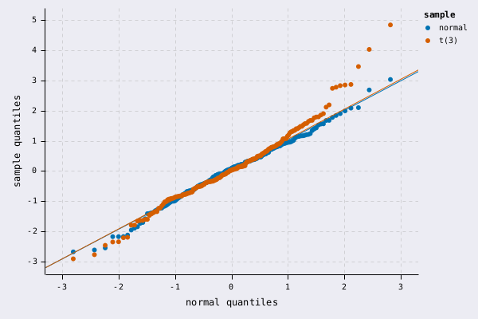
:::


### Style

The point style (`:alpha` - the points' opacity, not the line's) and the reference line's width:

::: {.clay-table}

```{=html}
<table class="table table-hover table-responsive clay-table"><thead><tr><th>Option</th><th>Type</th><th>Default</th><th>Description</th></tr></thead><tbody><tr><td>:size</td><td>a non-negative number</td><td>6</td><td>The point size in pixels; a mapped `:size` wins.</td></tr><tr><td>:color</td><td>a clojure2d color or :none</td><td>[0 114 178 180]</td><td>The colour of the points (in a 3D cloud, of every mark); a mapped `:color` wins.</td></tr><tr><td>:stroke-color</td><td>a clojure2d color or :none</td><td>:none</td><td>The colour of each point's outline.</td></tr><tr><td>:stroke-width</td><td>a non-negative number</td><td>1</td><td>The width of the outline in pixels.</td></tr><tr><td>:shape</td><td>a shape character or shape map</td><td>\O</td><td>The shape of every point; a mapped `:shape` wins.</td></tr><tr><td>:alpha</td><td>a number in [0 1] or nil</td><td>The colours' own alpha.</td><td>The opacity of every point and its legend key; the outline keeps its own.</td></tr><tr><td>:line-width</td><td>a non-negative number</td><td>1</td><td>reference line width in pixels</td></tr></tbody></table>
```

:::


::: {.sourceClojure}
```clojure
(plot/render-image {:data (filter #(= "t(3)" (:sample %)) samples)
                    :mapping {:y :v}
                    :charts [(chart/qq {:x-distribution [:normal] :size 9 :shape \S :color [200 80 40] :alpha 0.47
                                        :stroke-color :black :stroke-width 0.5 :line-width 3})]
                    :labels {:title "squares, :line-width 3"}}
                   {:width 500 :height 350})
```
:::


::: {.clay-image}
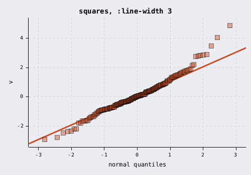
:::


### Distributions

Either side may be a distribution instead of data; with both sides distributions the chart draws `:n`
quantile pairs labelled by `:label`. The reference line through the quartiles may be turned off, and the padding
set (none on the right):

::: {.clay-table}

```{=html}
<table class="table table-hover table-responsive clay-table"><thead><tr><th>Option</th><th>Type</th><th>Default</th><th>Description</th></tr></thead><tbody><tr><td>:x-distribution</td><td>a fastmath distribution, [:name] or [:name params] or vector, [keyword, optional map] or nil</td><td></td><td>the :x side as a distribution instead of data: a fastmath distribution, [:name] or [:name params] (wins over the plot's mapping of :x)</td></tr><tr><td>:y-distribution</td><td>a fastmath distribution, [:name] or [:name params] or vector, [keyword, optional map] or nil</td><td></td><td>the :y side as a distribution instead of data: a fastmath distribution, [:name] or [:name params] (wins over the plot's mapping of :y)</td></tr><tr><td>:line</td><td>one of false :quartiles</td><td>:quartiles</td><td>reference line, one per group: :quartiles (through the first and third quartile pairs, R qqline) or false (none)</td></tr><tr><td>:n</td><td>integer (at least 2)</td><td>100; an error with a data side</td><td>both sides distributions only: the number of points (Q-Q plotting positions, P-P values over :domain)</td></tr><tr><td>:label</td><td>string or keyword or nil</td><td>"<y name> vs <x name>"; an error with a data side</td><td>both sides distributions only: the label of the chart's one row {:label l}, styled by the chart's own mapping of :label (e.g. {:color :label})</td></tr><tr><td>:padding</td><td>map of one of :x :y to [lo hi], non-negative numbers</td><td>{:x [0.05 0.05] :y [0.05 0.05]}</td><td>padding of the data span per position axis, {:x [lo hi] :y [lo hi]} fractions of the span</td></tr></tbody></table>
```

:::


::: {.sourceClojure}
```clojure
(plot/render-image (plot/arrange [{:charts [(chart/qq {:x-distribution [:normal] :y-distribution [:t {:degrees-of-freedom 3}]
                                                       :label "t(3)" :mapping {:color :label}})
                                            (chart/qq {:x-distribution [:normal] :y-distribution [:t {:degrees-of-freedom 30}]
                                                       :label "t(30)" :mapping {:color :label} :line false :n 30})]
                                   :labels {:title "both sides distributions"}}
                                  {:data faithful
                                   :mapping {:y :eruptions}
                                   :charts [(chart/qq {:x-distribution [:uniform-real {:lower 0 :upper 1}] :line false
                                                       :padding {:x [0 0] :y [0 0]}})]
                                   :labels {:title "uniform, no line, no padding"}}]
                                 {:columns 2 :widths [1.25 1]})
                   {:width 1000 :height 380})
```
:::


::: {.clay-image}
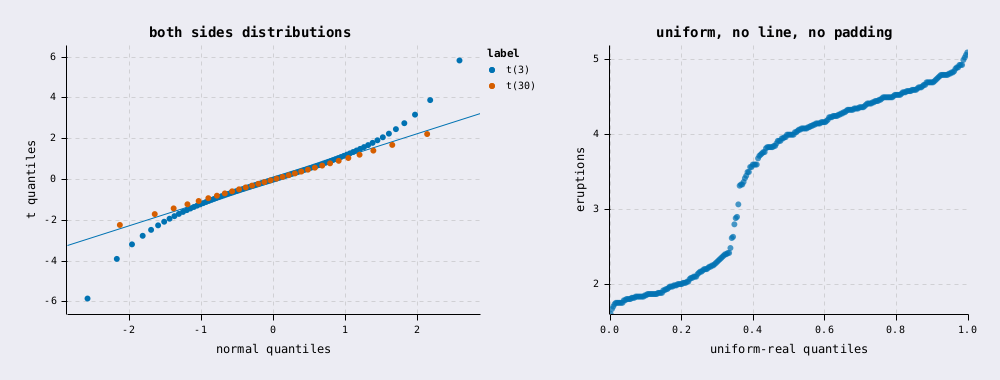
:::


Shared options: [Common options](reference.shared_options.html#common-options) (`:data` `:mapping` `:legend`); [Named theme styles](reference.shared_options.html#named-theme-styles) (`:theme-style`).


## pp

Probabilities against probabilities: each value's empirical (or theoretical) CDF on one side against the other
side's at the same value; points on y = x mean the same distribution.

::: {.clay-table}

```{=html}
<table class="table table-hover table-responsive clay-table"><thead><tr><th>Option</th><th>Type</th><th>Default</th><th>Description</th></tr></thead><tbody><tr><td>:x</td><td>a keyword, a function or a categorical marker of one or nil</td><td></td><td>data of the x side (unless :x-distribution is given)</td></tr><tr><td>:y</td><td>a keyword, a function or a categorical marker of one or nil</td><td></td><td>data of the y side (unless :y-distribution is given)</td></tr><tr><td>:color</td><td>a keyword, a function or a categorical marker of one or nil</td><td></td><td>groups, each with its own point and line colour</td></tr><tr><td>:shape</td><td>a keyword, a function or a categorical marker of one or nil</td><td></td><td>groups, each with its own point shape</td></tr><tr><td>:size</td><td>a keyword, a function or a categorical marker of one or nil</td><td></td><td>groups, each with its own point size</td></tr><tr><td>:group</td><td>a keyword, a function or a categorical marker of one or nil</td><td></td><td>groups without a visual aesthetic</td></tr></tbody></table>
```

:::


::: {.sourceClojure}
```clojure
(plot/render-image {:data samples
                    :mapping {:y :v :color :sample}
                    :charts [(chart/pp {:x-distribution [:normal] :size 4})]
                    :labels {:x "normal probabilities" :y "sample probabilities"}}
                   {:width 600 :height 400})
```
:::


::: {.clay-image}

:::


### Style

The point style and the reference line's width:

::: {.clay-table}

```{=html}
<table class="table table-hover table-responsive clay-table"><thead><tr><th>Option</th><th>Type</th><th>Default</th><th>Description</th></tr></thead><tbody><tr><td>:size</td><td>a non-negative number</td><td>6</td><td>The point size in pixels; a mapped `:size` wins.</td></tr><tr><td>:color</td><td>a clojure2d color or :none</td><td>[0 114 178 180]</td><td>The colour of the points (in a 3D cloud, of every mark); a mapped `:color` wins.</td></tr><tr><td>:stroke-color</td><td>a clojure2d color or :none</td><td>:none</td><td>The colour of each point's outline.</td></tr><tr><td>:stroke-width</td><td>a non-negative number</td><td>1</td><td>The width of the outline in pixels.</td></tr><tr><td>:shape</td><td>a shape character or shape map</td><td>\O</td><td>The shape of every point; a mapped `:shape` wins.</td></tr><tr><td>:alpha</td><td>a number in [0 1] or nil</td><td>The colours' own alpha.</td><td>The opacity of every point and its legend key; the outline keeps its own.</td></tr><tr><td>:line-width</td><td>a non-negative number</td><td>1</td><td>reference line width in pixels</td></tr></tbody></table>
```

:::


::: {.sourceClojure}
```clojure
(plot/render-image {:data (filter #(= "t(3)" (:sample %)) samples)
                    :mapping {:y :v}
                    :charts [(chart/pp {:x-distribution [:normal] :size 8 :shape \O :color [200 80 40] :alpha 0.55
                                        :stroke-color :black :stroke-width 1 :line-width 3})]
                    :labels {:title "outlined points, :line-width 3"}}
                   {:width 500 :height 350})
```
:::


::: {.clay-image}

:::


### Distributions

Either side may be a distribution; with both sides distributions the chart evaluates both CDFs at `:n`
values over `:domain` (required then); the right panel has no line and wide padding:

::: {.clay-table}

```{=html}
<table class="table table-hover table-responsive clay-table"><thead><tr><th>Option</th><th>Type</th><th>Default</th><th>Description</th></tr></thead><tbody><tr><td>:x-distribution</td><td>a fastmath distribution, [:name] or [:name params] or vector, [keyword, optional map] or nil</td><td></td><td>the :x side as a distribution instead of data: a fastmath distribution, [:name] or [:name params] (wins over the plot's mapping of :x)</td></tr><tr><td>:y-distribution</td><td>a fastmath distribution, [:name] or [:name params] or vector, [keyword, optional map] or nil</td><td></td><td>the :y side as a distribution instead of data: a fastmath distribution, [:name] or [:name params] (wins over the plot's mapping of :y)</td></tr><tr><td>:line</td><td>one of false :identity</td><td>:identity</td><td>reference line, one per group: :identity (y = x) or false (none)</td></tr><tr><td>:n</td><td>integer (at least 2)</td><td>100; an error with a data side</td><td>both sides distributions only: the number of points (Q-Q plotting positions, P-P values over :domain)</td></tr><tr><td>:label</td><td>string or keyword or nil</td><td>"<y name> vs <x name>"; an error with a data side</td><td>both sides distributions only: the label of the chart's one row {:label l}, styled by the chart's own mapping of :label (e.g. {:color :label})</td></tr><tr><td>:padding</td><td>map of one of :x :y to [lo hi], non-negative numbers</td><td>{:x [0.05 0.05] :y [0.05 0.05]}</td><td>padding of the data span per position axis, {:x [lo hi] :y [lo hi]} fractions of the span</td></tr><tr><td>:domain</td><td>[a finite number, a finite number]</td><td></td><td>both sides distributions only (then required): [lo hi] of the values the CDFs are evaluated at</td></tr></tbody></table>
```

:::


::: {.sourceClojure}
```clojure
(plot/render-image (plot/arrange [{:charts [(chart/pp {:x-distribution [:normal] :y-distribution [:t {:degrees-of-freedom 2}]
                                                       :domain [-5 5] :n 40 :label "t(2)" :mapping {:color :label}})
                                            (chart/pp {:x-distribution [:normal] :y-distribution [:logistic]
                                                       :domain [-5 5] :n 40 :label "logistic" :mapping {:color :label}})]
                                   :labels {:title "both sides distributions, :domain [-5 5]" :y "probabilities"}}
                                  {:data faithful
                                   :mapping {:y :waiting}
                                   :charts [(chart/pp {:x-distribution [:normal {:mu 71 :sd 13.6}] :line false :size 3
                                                       :padding {:x [0.2 0.2] :y [0.2 0.2]}})]
                                   :labels {:title "normal(71, 13.6), no line, padding 0.2"}}]
                                 {:columns 2 :widths [1.25 1]})
                   {:width 1000 :height 380})
```
:::


::: {.clay-image}
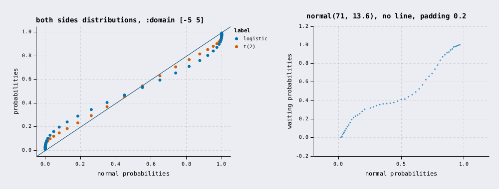
:::


Shared options: [Common options](reference.shared_options.html#common-options) (`:data` `:mapping` `:legend`); [Named theme styles](reference.shared_options.html#named-theme-styles) (`:theme-style`).


```{=html}
<div style="background-color:grey;height:2px;width:100%;"></div>
```


```{=html}
<div><pre><small><small>source: notebooks/reference/charts_one_variable.clj</small></small></pre></div>
```