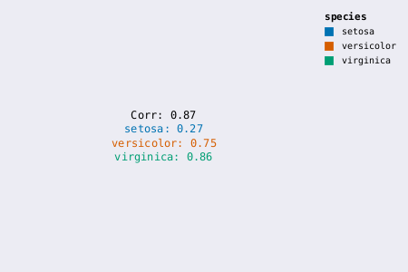
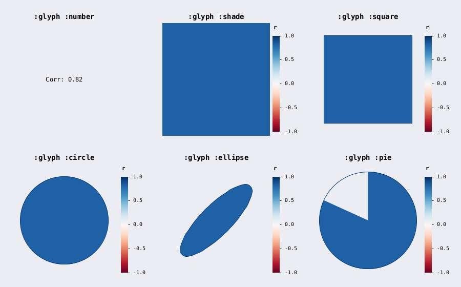
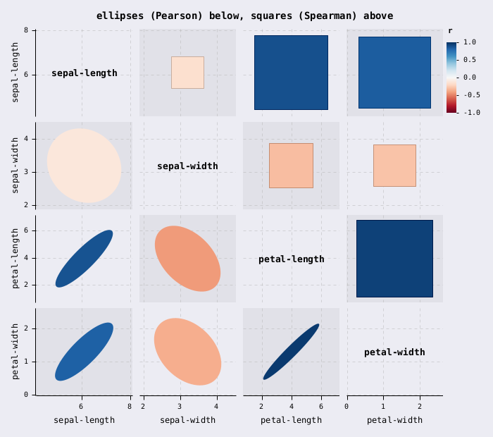
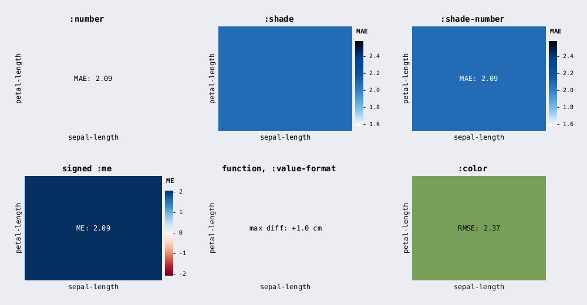

---
format:
  html:
    toc: true
    toc-location: right
    toc-depth: 4
    theme: cosmo
    include-in-header:
      text: |-
        <style>
        .data-table { width: fit-content; max-width: 100%; max-height: 15rem; overflow: auto; margin: 0 0 1rem 0; }
        .data-table .table-responsive { overflow: visible; }
        .data-table table { font-size: 0.75rem; width: auto; margin: 0; }
        .data-table th, .data-table td { padding: 0.1rem 0.45rem !important; white-space: nowrap; }
        .data-table thead th { position: sticky; top: 0; background: var(--bs-body-bg, #fff); }
        .options { margin: 0.5rem 0 1rem 0; }
        .options .option-card { margin: 0 0 0.9rem 0; border: 1px solid var(--bs-border-color, #dee2e6); border-radius: 0.375rem; overflow: hidden; }
        .options dt { display: flex; flex-wrap: wrap; align-items: baseline; gap: 0.1rem 1rem; margin: 0; padding: 0.4rem 0.75rem; background: #eef2f7; border-bottom: 1px solid var(--bs-border-color, #dee2e6); font-weight: normal; }
        .options dt > code { font-weight: 700; font-size: 1rem; background: none; padding: 0; }
        .options .option-default { font-size: 0.85rem; color: var(--bs-secondary-color, #6c757d); }
        .options dd { margin: 0; padding: 0.5rem 0.75rem; }
        .options .option-example { font-size: 0.85rem; padding: 0 0 0.45rem 0; margin-bottom: 0.45rem; border-bottom: 1px dashed var(--bs-border-color, #dee2e6); }
        .options .option-example code { background: none; padding: 0; }
        .options .option-text ul { margin: 0.3rem 0 0 0; padding-left: 1.25rem; }
        .options code, .mapping code { overflow-wrap: anywhere; }
        .mapping { margin: 0.5rem 0 1rem 0; padding: 0.5rem 0.75rem; border: 1px solid var(--bs-border-color, #dee2e6); border-left: 0.3rem solid #2780e3; border-radius: 0.375rem; background: #f5f8fc; }
        .mapping-title { font-weight: 700; margin-bottom: 0.25rem; }
        .mapping-hint { font-weight: normal; font-size: 0.85rem; color: var(--bs-secondary-color, #6c757d); }
        .mapping ul { margin: 0; padding-left: 1.25rem; }
        .mapping .required { font-size: 0.75rem; padding: 0 0.3rem; border: 1px solid currentColor; border-radius: 0.25rem; }
        .shared { margin: 0.5rem 0 1rem 0; padding: 0.5rem 0.75rem; border: 1px solid var(--bs-border-color, #dee2e6); border-left: 0.3rem solid #6c757d; border-radius: 0.375rem; background: #f6f6f6; }
        .shared-title { font-weight: 700; margin-bottom: 0.25rem; }
        .shared-hint { font-weight: normal; font-size: 0.85rem; color: var(--bs-secondary-color, #6c757d); }
        .shared ul { margin: 0; padding-left: 1.25rem; }
        .shared code { overflow-wrap: anywhere; }
        </style>
code-block-background: true

---
<style></style><style>.printedClojure .sourceCode {
  background-color: transparent;
  border-style: none;
}
</style><style>.clay-limit-image-width .clay-image {max-width: 100%}
.clay-side-by-side .sourceCode {margin: 0}
.clay-side-by-side {margin: 1em 0}
</style>
<script src="https://code.jquery.com/jquery-3.6.0.min.js" type="text/javascript"></script><script src="https://code.jquery.com/ui/1.13.1/jquery-ui.min.js" type="text/javascript"></script>

# Pairwise statistics

Charts that draw one statistic of two variables as a single glyph or cell filling the panel: the correlation
(`correlation`) or any other pairwise statistic (`pairwise`). They're the cells of a scatter-plot matrix
([`plot/pairs`](reference.facets_arrange.html#scatter-plot-matrix)).


::: {.sourceClojure}
```clojure
(ns reference.charts-pairwise
  (:require [cljplot2.chart :as chart]
            [cljplot2.core :as plot]
            [cljplot2.describe :as describe]
            [notebook-utils :as nu]))
```
:::


Data: Edgar Anderson's iris measurements, R datasets package `iris` (Anderson 1935; Fisher 1936); licence: Part of R (GPL-2 | GPL-3).


::: {.sourceClojure}
```clojure
(def iris (nu/dataset :iris))
```
:::


```{=html}
<div class="data-table"><table class="table table-hover table-responsive clay-table"><thead><tr><th>sepal-length</th><th>sepal-width</th><th>petal-length</th><th>petal-width</th><th>species</th></tr></thead><tbody><tr><td>5.1</td><td>3.5</td><td>1.4</td><td>0.2</td><td>setosa</td></tr><tr><td>4.9</td><td>3</td><td>1.4</td><td>0.2</td><td>setosa</td></tr><tr><td>4.7</td><td>3.2</td><td>1.3</td><td>0.2</td><td>setosa</td></tr><tr><td>4.6</td><td>3.1</td><td>1.5</td><td>0.2</td><td>setosa</td></tr><tr><td>5</td><td>3.6</td><td>1.4</td><td>0.2</td><td>setosa</td></tr><tr><td>5.4</td><td>3.9</td><td>1.7</td><td>0.4</td><td>setosa</td></tr><tr><td>4.6</td><td>3.4</td><td>1.4</td><td>0.3</td><td>setosa</td></tr><tr><td>5</td><td>3.4</td><td>1.5</td><td>0.2</td><td>setosa</td></tr><tr><td>4.4</td><td>2.9</td><td>1.4</td><td>0.2</td><td>setosa</td></tr><tr><td>4.9</td><td>3.1</td><td>1.5</td><td>0.1</td><td>setosa</td></tr><tr><td>5.4</td><td>3.7</td><td>1.5</td><td>0.2</td><td>setosa</td></tr><tr><td>4.8</td><td>3.4</td><td>1.6</td><td>0.2</td><td>setosa</td></tr><tr><td>4.8</td><td>3</td><td>1.4</td><td>0.1</td><td>setosa</td></tr><tr><td>4.3</td><td>3</td><td>1.1</td><td>0.1</td><td>setosa</td></tr><tr><td>5.8</td><td>4</td><td>1.2</td><td>0.2</td><td>setosa</td></tr><tr><td>5.7</td><td>4.4</td><td>1.5</td><td>0.4</td><td>setosa</td></tr><tr><td>5.4</td><td>3.9</td><td>1.3</td><td>0.4</td><td>setosa</td></tr><tr><td>5.1</td><td>3.5</td><td>1.4</td><td>0.3</td><td>setosa</td></tr><tr><td>5.7</td><td>3.8</td><td>1.7</td><td>0.3</td><td>setosa</td></tr><tr><td>5.1</td><td>3.8</td><td>1.5</td><td>0.3</td><td>setosa</td></tr><tr><td>5.4</td><td>3.4</td><td>1.7</td><td>0.2</td><td>setosa</td></tr><tr><td>5.1</td><td>3.7</td><td>1.5</td><td>0.4</td><td>setosa</td></tr><tr><td>4.6</td><td>3.6</td><td>1</td><td>0.2</td><td>setosa</td></tr><tr><td>5.1</td><td>3.3</td><td>1.7</td><td>0.5</td><td>setosa</td></tr><tr><td>4.8</td><td>3.4</td><td>1.9</td><td>0.2</td><td>setosa</td></tr><tr><td>5</td><td>3</td><td>1.6</td><td>0.2</td><td>setosa</td></tr><tr><td>5</td><td>3.4</td><td>1.6</td><td>0.4</td><td>setosa</td></tr><tr><td>5.2</td><td>3.5</td><td>1.5</td><td>0.2</td><td>setosa</td></tr><tr><td>5.2</td><td>3.4</td><td>1.4</td><td>0.2</td><td>setosa</td></tr><tr><td>4.7</td><td>3.2</td><td>1.6</td><td>0.2</td><td>setosa</td></tr><tr><td>4.8</td><td>3.1</td><td>1.6</td><td>0.2</td><td>setosa</td></tr><tr><td>5.4</td><td>3.4</td><td>1.5</td><td>0.4</td><td>setosa</td></tr><tr><td>5.2</td><td>4.1</td><td>1.5</td><td>0.1</td><td>setosa</td></tr><tr><td>5.5</td><td>4.2</td><td>1.4</td><td>0.2</td><td>setosa</td></tr><tr><td>4.9</td><td>3.1</td><td>1.5</td><td>0.2</td><td>setosa</td></tr><tr><td>5</td><td>3.2</td><td>1.2</td><td>0.2</td><td>setosa</td></tr><tr><td>5.5</td><td>3.5</td><td>1.3</td><td>0.2</td><td>setosa</td></tr><tr><td>4.9</td><td>3.6</td><td>1.4</td><td>0.1</td><td>setosa</td></tr><tr><td>4.4</td><td>3</td><td>1.3</td><td>0.2</td><td>setosa</td></tr><tr><td>5.1</td><td>3.4</td><td>1.5</td><td>0.2</td><td>setosa</td></tr><tr><td>5</td><td>3.5</td><td>1.3</td><td>0.3</td><td>setosa</td></tr><tr><td>4.5</td><td>2.3</td><td>1.3</td><td>0.3</td><td>setosa</td></tr><tr><td>4.4</td><td>3.2</td><td>1.3</td><td>0.2</td><td>setosa</td></tr><tr><td>5</td><td>3.5</td><td>1.6</td><td>0.6</td><td>setosa</td></tr><tr><td>5.1</td><td>3.8</td><td>1.9</td><td>0.4</td><td>setosa</td></tr><tr><td>4.8</td><td>3</td><td>1.4</td><td>0.3</td><td>setosa</td></tr><tr><td>5.1</td><td>3.8</td><td>1.6</td><td>0.2</td><td>setosa</td></tr><tr><td>4.6</td><td>3.2</td><td>1.4</td><td>0.2</td><td>setosa</td></tr><tr><td>5.3</td><td>3.7</td><td>1.5</td><td>0.2</td><td>setosa</td></tr><tr><td>5</td><td>3.3</td><td>1.4</td><td>0.2</td><td>setosa</td></tr><tr><td>7</td><td>3.2</td><td>4.7</td><td>1.4</td><td>versicolor</td></tr><tr><td>6.4</td><td>3.2</td><td>4.5</td><td>1.5</td><td>versicolor</td></tr><tr><td>6.9</td><td>3.1</td><td>4.9</td><td>1.5</td><td>versicolor</td></tr><tr><td>5.5</td><td>2.3</td><td>4</td><td>1.3</td><td>versicolor</td></tr><tr><td>6.5</td><td>2.8</td><td>4.6</td><td>1.5</td><td>versicolor</td></tr><tr><td>5.7</td><td>2.8</td><td>4.5</td><td>1.3</td><td>versicolor</td></tr><tr><td>6.3</td><td>3.3</td><td>4.7</td><td>1.6</td><td>versicolor</td></tr><tr><td>4.9</td><td>2.4</td><td>3.3</td><td>1</td><td>versicolor</td></tr><tr><td>6.6</td><td>2.9</td><td>4.6</td><td>1.3</td><td>versicolor</td></tr><tr><td>5.2</td><td>2.7</td><td>3.9</td><td>1.4</td><td>versicolor</td></tr><tr><td>5</td><td>2</td><td>3.5</td><td>1</td><td>versicolor</td></tr><tr><td>5.9</td><td>3</td><td>4.2</td><td>1.5</td><td>versicolor</td></tr><tr><td>6</td><td>2.2</td><td>4</td><td>1</td><td>versicolor</td></tr><tr><td>6.1</td><td>2.9</td><td>4.7</td><td>1.4</td><td>versicolor</td></tr><tr><td>5.6</td><td>2.9</td><td>3.6</td><td>1.3</td><td>versicolor</td></tr><tr><td>6.7</td><td>3.1</td><td>4.4</td><td>1.4</td><td>versicolor</td></tr><tr><td>5.6</td><td>3</td><td>4.5</td><td>1.5</td><td>versicolor</td></tr><tr><td>5.8</td><td>2.7</td><td>4.1</td><td>1</td><td>versicolor</td></tr><tr><td>6.2</td><td>2.2</td><td>4.5</td><td>1.5</td><td>versicolor</td></tr><tr><td>5.6</td><td>2.5</td><td>3.9</td><td>1.1</td><td>versicolor</td></tr><tr><td>5.9</td><td>3.2</td><td>4.8</td><td>1.8</td><td>versicolor</td></tr><tr><td>6.1</td><td>2.8</td><td>4</td><td>1.3</td><td>versicolor</td></tr><tr><td>6.3</td><td>2.5</td><td>4.9</td><td>1.5</td><td>versicolor</td></tr><tr><td>6.1</td><td>2.8</td><td>4.7</td><td>1.2</td><td>versicolor</td></tr><tr><td>6.4</td><td>2.9</td><td>4.3</td><td>1.3</td><td>versicolor</td></tr><tr><td>6.6</td><td>3</td><td>4.4</td><td>1.4</td><td>versicolor</td></tr><tr><td>6.8</td><td>2.8</td><td>4.8</td><td>1.4</td><td>versicolor</td></tr><tr><td>6.7</td><td>3</td><td>5</td><td>1.7</td><td>versicolor</td></tr><tr><td>6</td><td>2.9</td><td>4.5</td><td>1.5</td><td>versicolor</td></tr><tr><td>5.7</td><td>2.6</td><td>3.5</td><td>1</td><td>versicolor</td></tr><tr><td>5.5</td><td>2.4</td><td>3.8</td><td>1.1</td><td>versicolor</td></tr><tr><td>5.5</td><td>2.4</td><td>3.7</td><td>1</td><td>versicolor</td></tr><tr><td>5.8</td><td>2.7</td><td>3.9</td><td>1.2</td><td>versicolor</td></tr><tr><td>6</td><td>2.7</td><td>5.1</td><td>1.6</td><td>versicolor</td></tr><tr><td>5.4</td><td>3</td><td>4.5</td><td>1.5</td><td>versicolor</td></tr><tr><td>6</td><td>3.4</td><td>4.5</td><td>1.6</td><td>versicolor</td></tr><tr><td>6.7</td><td>3.1</td><td>4.7</td><td>1.5</td><td>versicolor</td></tr><tr><td>6.3</td><td>2.3</td><td>4.4</td><td>1.3</td><td>versicolor</td></tr><tr><td>5.6</td><td>3</td><td>4.1</td><td>1.3</td><td>versicolor</td></tr><tr><td>5.5</td><td>2.5</td><td>4</td><td>1.3</td><td>versicolor</td></tr><tr><td>5.5</td><td>2.6</td><td>4.4</td><td>1.2</td><td>versicolor</td></tr><tr><td>6.1</td><td>3</td><td>4.6</td><td>1.4</td><td>versicolor</td></tr><tr><td>5.8</td><td>2.6</td><td>4</td><td>1.2</td><td>versicolor</td></tr><tr><td>5</td><td>2.3</td><td>3.3</td><td>1</td><td>versicolor</td></tr><tr><td>5.6</td><td>2.7</td><td>4.2</td><td>1.3</td><td>versicolor</td></tr><tr><td>5.7</td><td>3</td><td>4.2</td><td>1.2</td><td>versicolor</td></tr><tr><td>5.7</td><td>2.9</td><td>4.2</td><td>1.3</td><td>versicolor</td></tr><tr><td>6.2</td><td>2.9</td><td>4.3</td><td>1.3</td><td>versicolor</td></tr><tr><td>5.1</td><td>2.5</td><td>3</td><td>1.1</td><td>versicolor</td></tr><tr><td>5.7</td><td>2.8</td><td>4.1</td><td>1.3</td><td>versicolor</td></tr><tr><td>…</td><td>…</td><td>…</td><td>…</td><td>…</td></tr></tbody></table></div>
```


## correlation

The correlation coefficient r of two variables drawn as one glyph filling the panel - a cell of a correlogram
(`plot/pairs`). Alone it writes r, one line per group.

::: {.clay-table}

```{=html}
<table class="table table-hover table-responsive clay-table"><thead><tr><th>Option</th><th>Type</th><th>Default</th><th>Description</th></tr></thead><tbody><tr><td>:x (required)</td><td>a keyword, a function or a categorical marker of one</td><td></td><td>first variable (numbers)</td></tr><tr><td>:y (required)</td><td>a keyword, a function or a categorical marker of one</td><td></td><td>second variable (numbers)</td></tr><tr><td>:color</td><td>a keyword, a function or a categorical marker of one or nil</td><td></td><td>categorical groups, each a line of the :number glyph in its colour</td></tr><tr><td>:group</td><td>a keyword, a function or a categorical marker of one or nil</td><td></td><td>groups without a visual aesthetic, each a line of the :number glyph</td></tr></tbody></table>
```

:::


::: {.sourceClojure}
```clojure
(plot/render-image {:data iris
                    :mapping {:x :sepal-length :y :petal-length :color :species}
                    :charts [(chart/correlation)]}
                   {:width 450 :height 300})
```
:::


::: {.clay-image}

:::


Its options: the coefficient, the glyph and its colours (by default r on a diverging scale):

::: {.clay-table}

```{=html}
<table class="table table-hover table-responsive clay-table"><thead><tr><th>Option</th><th>Type</th><th>Default</th><th>Description</th></tr></thead><tbody><tr><td>:color</td><td>a clojure2d color or :none</td><td>[0 114 178]; grouped shape glyphs: the theme's; ungrouped: r on a diverging scale; :number: the :correlation text role's colour, group lines mapped or black</td><td>one fixed glyph colour, the :number text's too</td></tr><tr><td>:stroke-color</td><td>:darker or a clojure2d color or :none</td><td>:darker</td><td>outline colour: a colour, :none or :darker (the darkened fill)</td></tr><tr><td>:stroke-width</td><td>a non-negative number</td><td>1</td><td>outline width in pixels</td></tr><tr><td>:method</td><td>one of :pearson :spearman :kendall</td><td>:pearson</td><td>correlation coefficient: :pearson, :spearman or :kendall</td></tr><tr><td>:glyph</td><td>one of :number :shade :square :circle :ellipse :pie</td><td>:number</td><td>how r is drawn: :number (text, a line per group), :shade (the panel in r's colour), :square / :circle (area ~ |r|), :ellipse (normal contour) or :pie (a disk filled |r|)</td></tr><tr><td>:glyph-size</td><td>a number in [0 1]</td><td>0.9</td><td>glyph side (:square, :circle, :ellipse, :pie) as a fraction of the panel's shorter side</td></tr></tbody></table>
```

:::


Every glyph, for one pair of variables (r about 0.82):


::: {.sourceClojure}
```clojure
(plot/render-image (plot/arrange [{:data iris :mapping {:x :sepal-length :y :petal-width}
                                   :charts [(chart/correlation {:glyph :number})] :labels {:title ":glyph :number"}}
                                  {:data iris :mapping {:x :sepal-length :y :petal-width}
                                   :charts [(chart/correlation {:glyph :shade})] :labels {:title ":glyph :shade"}}
                                  {:data iris :mapping {:x :sepal-length :y :petal-width}
                                   :charts [(chart/correlation {:glyph :square})] :labels {:title ":glyph :square"}}
                                  {:data iris :mapping {:x :sepal-length :y :petal-width}
                                   :charts [(chart/correlation {:glyph :circle})] :labels {:title ":glyph :circle"}}
                                  {:data iris :mapping {:x :sepal-length :y :petal-width}
                                   :charts [(chart/correlation {:glyph :ellipse})] :labels {:title ":glyph :ellipse"}}
                                  {:data iris :mapping {:x :sepal-length :y :petal-width}
                                   :charts [(chart/correlation {:glyph :pie})] :labels {:title ":glyph :pie"}}]
                                 {:columns 3})
                   {:width 900 :height 560})
```
:::


::: {.clay-image}

:::


The three coefficients of the same pair (Kendall's tau, counting concordant pairs, is the lowest), and a smaller
glyph in one fixed colour with a thick outline:


::: {.sourceClojure}
```clojure
(plot/render-image (plot/arrange [{:data iris :mapping {:x :sepal-length :y :petal-width}
                                   :charts [(chart/correlation {:method :pearson})] :labels {:title ":method :pearson"}}
                                  {:data iris :mapping {:x :sepal-length :y :petal-width}
                                   :charts [(chart/correlation {:method :spearman})] :labels {:title ":method :spearman"}}
                                  {:data iris :mapping {:x :sepal-length :y :petal-width}
                                   :charts [(chart/correlation {:method :kendall})] :labels {:title ":method :kendall"}}
                                  {:data iris :mapping {:x :sepal-length :y :petal-width}
                                   :charts [(chart/correlation {:glyph :circle :glyph-size 0.6 :color [120 160 90]
                                                                :stroke-color :black :stroke-width 3})]
                                   :labels {:title ":glyph-size 0.6"}}]
                                 {:columns 4})
                   {:width 1000 :height 280})
```
:::


::: {.clay-image}

:::


In a correlogram - a [`plot/pairs`](reference.facets_arrange.html#scatter-plot-matrix) matrix with correlation
glyphs below (`:lower`) and above (`:upper`) the diagonal, and the variables' names on it (`:diagonal :names`):


::: {.sourceClojure}
```clojure
(plot/render-image (plot/pairs iris {:variables [:sepal-length :sepal-width :petal-length :petal-width]
                                     :lower (chart/correlation {:glyph :ellipse :stroke-color :none})
                                     :upper (chart/correlation {:glyph :square :method :spearman})
                                     :diagonal :names
                                     :title "ellipses (Pearson) below, squares (Spearman) above"})
                   {:width 700 :height 620})
```
:::


::: {.clay-image}

:::


```{=html}
<div class="shared"><div class="shared-title">Shared options<span class="shared-hint"> – groups of options other charts take too</span></div><ul><li><a href="reference.shared_options.html#common-options">Common options</a> – <code>:data</code> <code>:mapping</code> <code>:legend</code></li><li><a href="reference.shared_options.html#named-theme-styles">Named theme styles</a> – <code>:theme-style</code></li></ul></div>
```


## pairwise

Any statistic of two variables drawn as one cell filling the panel: an error, an association, an effect size,
a distance (the keys of `cljplot2.data.pairwise/statistics`, listed with
[`pairwise/matrix-rows`](reference.data_sets_series.html#pairwisematrix-rows) in the Data functions part) or a function of the two samples - always of the x sample against the y sample. Unlike r the
values have no fixed range. Alone it writes the value, one line per group.

::: {.clay-table}

```{=html}
<table class="table table-hover table-responsive clay-table"><thead><tr><th>Option</th><th>Type</th><th>Default</th><th>Description</th></tr></thead><tbody><tr><td>:x (required)</td><td>a keyword, a function or a categorical marker of one</td><td></td><td>first sample, the statistic's xs (numbers)</td></tr><tr><td>:y (required)</td><td>a keyword, a function or a categorical marker of one</td><td></td><td>second sample, the statistic's ys (numbers)</td></tr><tr><td>:color</td><td>a keyword, a function or a categorical marker of one or nil</td><td></td><td>categorical groups, each a line of the :number glyph in its colour</td></tr><tr><td>:group</td><td>a keyword, a function or a categorical marker of one or nil</td><td></td><td>groups without a visual aesthetic, each a line of the :number glyph</td></tr></tbody></table>
```

:::


::: {.sourceClojure}
```clojure
(plot/render-image {:data iris
                    :mapping {:x :sepal-length :y :petal-length :color :species}
                    :charts [(chart/pairwise {:method :cohens-d})]}
                   {:width 450 :height 300})
```
:::


::: {.clay-image}

:::


Its options: the statistic and its label, the glyph (by default `:number` - the text alone; a shade colours the
value on the colour scale over the panels' range, symmetric around 0 on a diverging palette for a signed
statistic), and the number format:

::: {.clay-table}

```{=html}
<table class="table table-hover table-responsive clay-table"><thead><tr><th>Option</th><th>Type</th><th>Default</th><th>Description</th></tr></thead><tbody><tr><td>:color</td><td>a clojure2d color or :none</td><td>[0 114 178]; ungrouped shades: the value on the colour scale; grouped shades: the theme's; :number: the :pairwise text role's colour, group lines mapped</td><td>one fixed colour: the shade's (text over it by contrast), the :number text's</td></tr><tr><td>:method</td><td>one of :ameasure :canberra :chebyshev :cliffs-delta :cohens-d :cosine :covariance :euclidean :glass-delta :hedges-g :kendall :mae :manhattan :mape :me :means-ratio :mse :pearson :r2 :rmse :spearman or a function</td><td>:pearson</td><td>the statistic: a key of pairwise/statistics or a function of two samples (f xs ys)</td></tr><tr><td>:label</td><td>string or nil</td><td>the statistic's label, value for a function</td><td>the statistic's label (text, colour bar title)</td></tr><tr><td>:glyph</td><td>one of :number :shade :shade-number</td><td>:number</td><td>how the value is drawn: :number (text, a line per group), :shade (the panel in the value's colour) or :shade-number (both)</td></tr><tr><td>:value-format</td><td>a number format string or a function or nil</td><td>at most 2 decimals, whole numbers without them</td><td>the text of a value: a format string or a function of the number (a throw or nil - NA)</td></tr></tbody></table>
```

:::


The glyphs for one pair (sepal against petal length): the mean absolute error as text, shaded and both, the signed
mean error shaded on the diverging palette, a user function with its label and format, and one fixed colour (the
text over a shade is black or white by the fill):


::: {.sourceClojure}
```clojure
(plot/render-image (plot/arrange [{:data iris :mapping {:x :sepal-length :y :petal-length}
                                   :charts [(chart/pairwise {:method :mae :glyph :number})] :labels {:title ":number"}}
                                  {:data iris :mapping {:x :sepal-length :y :petal-length}
                                   :charts [(chart/pairwise {:method :mae :glyph :shade})] :labels {:title ":shade"}}
                                  {:data iris :mapping {:x :sepal-length :y :petal-length}
                                   :charts [(chart/pairwise {:method :mae :glyph :shade-number})] :labels {:title ":shade-number"}}
                                  {:data iris :mapping {:x :sepal-length :y :petal-length}
                                   :charts [(chart/pairwise {:method :me :glyph :shade-number})] :labels {:title "signed :me"}}
                                  {:data iris :mapping {:x :sepal-length :y :petal-length}
                                   :charts [(chart/pairwise {:method (fn [xs ys] (- (apply max xs) (apply max ys)))
                                                             :label "max diff" :value-format #(format "%+.1f cm" %)})]
                                   :labels {:title "function, :value-format"}}
                                  {:data iris :mapping {:x :sepal-length :y :petal-length}
                                   :charts [(chart/pairwise {:method :rmse :glyph :shade-number :color [120 160 90]})]
                                   :labels {:title ":color"}}]
                                 {:columns 3})
                   {:width 1000 :height 520})
```
:::


::: {.clay-image}

:::


In a [`plot/pairs`](reference.facets_arrange.html#scatter-plot-matrix) matrix every cell shows the statistic of
its column variable against its row variable, so the mirrored cells of the asymmetric mean error have opposite
signs - shaded below, as text above, the names on the diagonal (`:diagonal :names`). The statistic is computed
once for the matrix: every shaded cell is coloured on its range (symmetric around 0 for the signed mean error) and
the one colour bar agrees; the cells share one text size:


::: {.sourceClojure}
```clojure
(plot/render-image (plot/pairs iris {:variables [:sepal-length :sepal-width :petal-length :petal-width]
                                     :lower (chart/pairwise {:method :me :glyph :shade-number})
                                     :upper (chart/pairwise {:method :me})
                                     :diagonal :names
                                     :title "mean error: shaded below, text above"})
                   {:width 700 :height 620})
```
:::


::: {.clay-image}

:::


```{=html}
<div class="shared"><div class="shared-title">Shared options<span class="shared-hint"> – groups of options other charts take too</span></div><ul><li><a href="reference.shared_options.html#common-options">Common options</a> – <code>:data</code> <code>:mapping</code> <code>:legend</code></li><li><a href="reference.shared_options.html#named-theme-styles">Named theme styles</a> – <code>:theme-style</code></li></ul></div>
```


```{=html}
<div style="background-color:grey;height:2px;width:100%;"></div>
```


```{=html}
<div><pre><small><small>source: notebooks/reference/charts_pairwise.clj</small></small></pre></div>
```