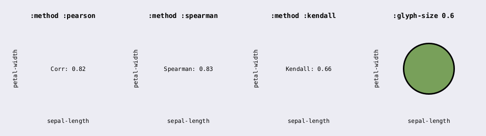
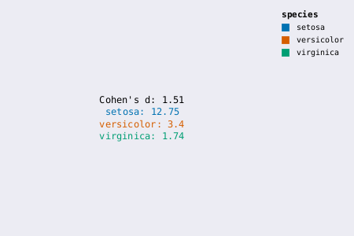
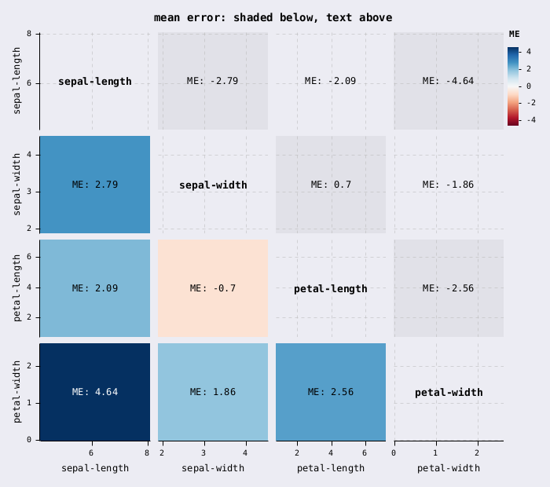

---
format:
  html:
    toc: true
    toc-location: right
    toc-depth: 4
    theme: cosmo
    include-in-header:
      text: |-
        <style>
        .data-table { width: fit-content; max-width: 100%; max-height: 15rem; overflow: auto; margin: 0 0 1rem 0; }
        .data-table .table-responsive { overflow: visible; }
        .data-table table { font-size: 0.75rem; width: auto; margin: 0; }
        .data-table th, .data-table td { padding: 0.1rem 0.45rem !important; white-space: nowrap; }
        .data-table thead th { position: sticky; top: 0; background: var(--bs-body-bg, #fff); }
        .options { margin: 0.5rem 0 1rem 0; }
        .options .option-card { margin: 0 0 0.9rem 0; border: 1px solid var(--bs-border-color, #dee2e6); border-radius: 0.375rem; overflow: hidden; }
        .options dt { display: flex; flex-wrap: wrap; align-items: baseline; gap: 0.1rem 1rem; margin: 0; padding: 0.4rem 0.75rem; background: #eef2f7; border-bottom: 1px solid var(--bs-border-color, #dee2e6); font-weight: normal; }
        .options dt > code { font-weight: 700; font-size: 1rem; background: none; padding: 0; }
        .options .option-default { font-size: 0.85rem; color: var(--bs-secondary-color, #6c757d); }
        .options dd { margin: 0; padding: 0.5rem 0.75rem; }
        .options .option-example { font-size: 0.85rem; padding: 0 0 0.45rem 0; margin-bottom: 0.45rem; border-bottom: 1px dashed var(--bs-border-color, #dee2e6); }
        .options .option-example code { background: none; padding: 0; }
        .options .option-text ul { margin: 0.3rem 0 0 0; padding-left: 1.25rem; }
        .options code, .mapping code { overflow-wrap: anywhere; }
        .mapping { margin: 0.5rem 0 1rem 0; padding: 0.5rem 0.75rem; border: 1px solid var(--bs-border-color, #dee2e6); border-left: 0.3rem solid #2780e3; border-radius: 0.375rem; background: #f5f8fc; }
        .mapping-title { font-weight: 700; margin-bottom: 0.25rem; }
        .mapping-hint { font-weight: normal; font-size: 0.85rem; color: var(--bs-secondary-color, #6c757d); }
        .mapping ul { margin: 0; padding-left: 1.25rem; }
        .mapping .required { font-size: 0.75rem; padding: 0 0.3rem; border: 1px solid currentColor; border-radius: 0.25rem; }
        .shared { margin: 0.5rem 0 1rem 0; padding: 0.5rem 0.75rem; border: 1px solid var(--bs-border-color, #dee2e6); border-left: 0.3rem solid #6c757d; border-radius: 0.375rem; background: #f6f6f6; }
        .shared-title { font-weight: 700; margin-bottom: 0.25rem; }
        .shared-hint { font-weight: normal; font-size: 0.85rem; color: var(--bs-secondary-color, #6c757d); }
        .shared ul { margin: 0; padding-left: 1.25rem; }
        .shared code { overflow-wrap: anywhere; }
        </style>
code-block-background: true

---
<style></style><style>.printedClojure .sourceCode {
  background-color: transparent;
  border-style: none;
}
</style><style>.clay-limit-image-width .clay-image {max-width: 100%}
.clay-side-by-side .sourceCode {margin: 0}
.clay-side-by-side {margin: 1em 0}
</style>
<script src="https://code.jquery.com/jquery-3.6.0.min.js" type="text/javascript"></script><script src="https://code.jquery.com/ui/1.13.1/jquery-ui.min.js" type="text/javascript"></script>

# Pairwise statistics

These charts draw one statistic of two variables as a single glyph or cell filling the panel: the correlation
(`correlation`) or any other pairwise statistic (`pairwise`). They're the cells of a scatter-plot matrix
([`plot/pairs`](reference.facets_arrange.html#scatter-plot-matrix)).


::: {.sourceClojure}
```clojure
(ns reference.charts-pairwise
  (:require [cljplot2.chart :as chart]
            [cljplot2.core :as plot]
            [cljplot2.describe :as describe]
            [notebook-utils :as nu]))
```
:::


Data: Edgar Anderson's iris measurements, R datasets package `iris` (Anderson 1935; Fisher 1936); licence: Part of R (GPL-2 | GPL-3).


::: {.sourceClojure}
```clojure
(def iris (nu/dataset :iris))
```
:::


```{=html}
<div class="data-table"><table class="table table-hover table-responsive clay-table"><thead><tr><th>sepal-length</th><th>sepal-width</th><th>petal-length</th><th>petal-width</th><th>species</th></tr></thead><tbody><tr><td>5.1</td><td>3.5</td><td>1.4</td><td>0.2</td><td>setosa</td></tr><tr><td>4.9</td><td>3</td><td>1.4</td><td>0.2</td><td>setosa</td></tr><tr><td>4.7</td><td>3.2</td><td>1.3</td><td>0.2</td><td>setosa</td></tr><tr><td>4.6</td><td>3.1</td><td>1.5</td><td>0.2</td><td>setosa</td></tr><tr><td>5</td><td>3.6</td><td>1.4</td><td>0.2</td><td>setosa</td></tr><tr><td>5.4</td><td>3.9</td><td>1.7</td><td>0.4</td><td>setosa</td></tr><tr><td>4.6</td><td>3.4</td><td>1.4</td><td>0.3</td><td>setosa</td></tr><tr><td>5</td><td>3.4</td><td>1.5</td><td>0.2</td><td>setosa</td></tr><tr><td>4.4</td><td>2.9</td><td>1.4</td><td>0.2</td><td>setosa</td></tr><tr><td>4.9</td><td>3.1</td><td>1.5</td><td>0.1</td><td>setosa</td></tr><tr><td>5.4</td><td>3.7</td><td>1.5</td><td>0.2</td><td>setosa</td></tr><tr><td>4.8</td><td>3.4</td><td>1.6</td><td>0.2</td><td>setosa</td></tr><tr><td>4.8</td><td>3</td><td>1.4</td><td>0.1</td><td>setosa</td></tr><tr><td>4.3</td><td>3</td><td>1.1</td><td>0.1</td><td>setosa</td></tr><tr><td>5.8</td><td>4</td><td>1.2</td><td>0.2</td><td>setosa</td></tr><tr><td>5.7</td><td>4.4</td><td>1.5</td><td>0.4</td><td>setosa</td></tr><tr><td>5.4</td><td>3.9</td><td>1.3</td><td>0.4</td><td>setosa</td></tr><tr><td>5.1</td><td>3.5</td><td>1.4</td><td>0.3</td><td>setosa</td></tr><tr><td>5.7</td><td>3.8</td><td>1.7</td><td>0.3</td><td>setosa</td></tr><tr><td>5.1</td><td>3.8</td><td>1.5</td><td>0.3</td><td>setosa</td></tr><tr><td>5.4</td><td>3.4</td><td>1.7</td><td>0.2</td><td>setosa</td></tr><tr><td>5.1</td><td>3.7</td><td>1.5</td><td>0.4</td><td>setosa</td></tr><tr><td>4.6</td><td>3.6</td><td>1</td><td>0.2</td><td>setosa</td></tr><tr><td>5.1</td><td>3.3</td><td>1.7</td><td>0.5</td><td>setosa</td></tr><tr><td>4.8</td><td>3.4</td><td>1.9</td><td>0.2</td><td>setosa</td></tr><tr><td>5</td><td>3</td><td>1.6</td><td>0.2</td><td>setosa</td></tr><tr><td>5</td><td>3.4</td><td>1.6</td><td>0.4</td><td>setosa</td></tr><tr><td>5.2</td><td>3.5</td><td>1.5</td><td>0.2</td><td>setosa</td></tr><tr><td>5.2</td><td>3.4</td><td>1.4</td><td>0.2</td><td>setosa</td></tr><tr><td>4.7</td><td>3.2</td><td>1.6</td><td>0.2</td><td>setosa</td></tr><tr><td>4.8</td><td>3.1</td><td>1.6</td><td>0.2</td><td>setosa</td></tr><tr><td>5.4</td><td>3.4</td><td>1.5</td><td>0.4</td><td>setosa</td></tr><tr><td>5.2</td><td>4.1</td><td>1.5</td><td>0.1</td><td>setosa</td></tr><tr><td>5.5</td><td>4.2</td><td>1.4</td><td>0.2</td><td>setosa</td></tr><tr><td>4.9</td><td>3.1</td><td>1.5</td><td>0.2</td><td>setosa</td></tr><tr><td>5</td><td>3.2</td><td>1.2</td><td>0.2</td><td>setosa</td></tr><tr><td>5.5</td><td>3.5</td><td>1.3</td><td>0.2</td><td>setosa</td></tr><tr><td>4.9</td><td>3.6</td><td>1.4</td><td>0.1</td><td>setosa</td></tr><tr><td>4.4</td><td>3</td><td>1.3</td><td>0.2</td><td>setosa</td></tr><tr><td>5.1</td><td>3.4</td><td>1.5</td><td>0.2</td><td>setosa</td></tr><tr><td>5</td><td>3.5</td><td>1.3</td><td>0.3</td><td>setosa</td></tr><tr><td>4.5</td><td>2.3</td><td>1.3</td><td>0.3</td><td>setosa</td></tr><tr><td>4.4</td><td>3.2</td><td>1.3</td><td>0.2</td><td>setosa</td></tr><tr><td>5</td><td>3.5</td><td>1.6</td><td>0.6</td><td>setosa</td></tr><tr><td>5.1</td><td>3.8</td><td>1.9</td><td>0.4</td><td>setosa</td></tr><tr><td>4.8</td><td>3</td><td>1.4</td><td>0.3</td><td>setosa</td></tr><tr><td>5.1</td><td>3.8</td><td>1.6</td><td>0.2</td><td>setosa</td></tr><tr><td>4.6</td><td>3.2</td><td>1.4</td><td>0.2</td><td>setosa</td></tr><tr><td>5.3</td><td>3.7</td><td>1.5</td><td>0.2</td><td>setosa</td></tr><tr><td>5</td><td>3.3</td><td>1.4</td><td>0.2</td><td>setosa</td></tr><tr><td>7</td><td>3.2</td><td>4.7</td><td>1.4</td><td>versicolor</td></tr><tr><td>6.4</td><td>3.2</td><td>4.5</td><td>1.5</td><td>versicolor</td></tr><tr><td>6.9</td><td>3.1</td><td>4.9</td><td>1.5</td><td>versicolor</td></tr><tr><td>5.5</td><td>2.3</td><td>4</td><td>1.3</td><td>versicolor</td></tr><tr><td>6.5</td><td>2.8</td><td>4.6</td><td>1.5</td><td>versicolor</td></tr><tr><td>5.7</td><td>2.8</td><td>4.5</td><td>1.3</td><td>versicolor</td></tr><tr><td>6.3</td><td>3.3</td><td>4.7</td><td>1.6</td><td>versicolor</td></tr><tr><td>4.9</td><td>2.4</td><td>3.3</td><td>1</td><td>versicolor</td></tr><tr><td>6.6</td><td>2.9</td><td>4.6</td><td>1.3</td><td>versicolor</td></tr><tr><td>5.2</td><td>2.7</td><td>3.9</td><td>1.4</td><td>versicolor</td></tr><tr><td>5</td><td>2</td><td>3.5</td><td>1</td><td>versicolor</td></tr><tr><td>5.9</td><td>3</td><td>4.2</td><td>1.5</td><td>versicolor</td></tr><tr><td>6</td><td>2.2</td><td>4</td><td>1</td><td>versicolor</td></tr><tr><td>6.1</td><td>2.9</td><td>4.7</td><td>1.4</td><td>versicolor</td></tr><tr><td>5.6</td><td>2.9</td><td>3.6</td><td>1.3</td><td>versicolor</td></tr><tr><td>6.7</td><td>3.1</td><td>4.4</td><td>1.4</td><td>versicolor</td></tr><tr><td>5.6</td><td>3</td><td>4.5</td><td>1.5</td><td>versicolor</td></tr><tr><td>5.8</td><td>2.7</td><td>4.1</td><td>1</td><td>versicolor</td></tr><tr><td>6.2</td><td>2.2</td><td>4.5</td><td>1.5</td><td>versicolor</td></tr><tr><td>5.6</td><td>2.5</td><td>3.9</td><td>1.1</td><td>versicolor</td></tr><tr><td>5.9</td><td>3.2</td><td>4.8</td><td>1.8</td><td>versicolor</td></tr><tr><td>6.1</td><td>2.8</td><td>4</td><td>1.3</td><td>versicolor</td></tr><tr><td>6.3</td><td>2.5</td><td>4.9</td><td>1.5</td><td>versicolor</td></tr><tr><td>6.1</td><td>2.8</td><td>4.7</td><td>1.2</td><td>versicolor</td></tr><tr><td>6.4</td><td>2.9</td><td>4.3</td><td>1.3</td><td>versicolor</td></tr><tr><td>6.6</td><td>3</td><td>4.4</td><td>1.4</td><td>versicolor</td></tr><tr><td>6.8</td><td>2.8</td><td>4.8</td><td>1.4</td><td>versicolor</td></tr><tr><td>6.7</td><td>3</td><td>5</td><td>1.7</td><td>versicolor</td></tr><tr><td>6</td><td>2.9</td><td>4.5</td><td>1.5</td><td>versicolor</td></tr><tr><td>5.7</td><td>2.6</td><td>3.5</td><td>1</td><td>versicolor</td></tr><tr><td>5.5</td><td>2.4</td><td>3.8</td><td>1.1</td><td>versicolor</td></tr><tr><td>5.5</td><td>2.4</td><td>3.7</td><td>1</td><td>versicolor</td></tr><tr><td>5.8</td><td>2.7</td><td>3.9</td><td>1.2</td><td>versicolor</td></tr><tr><td>6</td><td>2.7</td><td>5.1</td><td>1.6</td><td>versicolor</td></tr><tr><td>5.4</td><td>3</td><td>4.5</td><td>1.5</td><td>versicolor</td></tr><tr><td>6</td><td>3.4</td><td>4.5</td><td>1.6</td><td>versicolor</td></tr><tr><td>6.7</td><td>3.1</td><td>4.7</td><td>1.5</td><td>versicolor</td></tr><tr><td>6.3</td><td>2.3</td><td>4.4</td><td>1.3</td><td>versicolor</td></tr><tr><td>5.6</td><td>3</td><td>4.1</td><td>1.3</td><td>versicolor</td></tr><tr><td>5.5</td><td>2.5</td><td>4</td><td>1.3</td><td>versicolor</td></tr><tr><td>5.5</td><td>2.6</td><td>4.4</td><td>1.2</td><td>versicolor</td></tr><tr><td>6.1</td><td>3</td><td>4.6</td><td>1.4</td><td>versicolor</td></tr><tr><td>5.8</td><td>2.6</td><td>4</td><td>1.2</td><td>versicolor</td></tr><tr><td>5</td><td>2.3</td><td>3.3</td><td>1</td><td>versicolor</td></tr><tr><td>5.6</td><td>2.7</td><td>4.2</td><td>1.3</td><td>versicolor</td></tr><tr><td>5.7</td><td>3</td><td>4.2</td><td>1.2</td><td>versicolor</td></tr><tr><td>5.7</td><td>2.9</td><td>4.2</td><td>1.3</td><td>versicolor</td></tr><tr><td>6.2</td><td>2.9</td><td>4.3</td><td>1.3</td><td>versicolor</td></tr><tr><td>5.1</td><td>2.5</td><td>3</td><td>1.1</td><td>versicolor</td></tr><tr><td>5.7</td><td>2.8</td><td>4.1</td><td>1.3</td><td>versicolor</td></tr><tr><td>…</td><td>…</td><td>…</td><td>…</td><td>…</td></tr></tbody></table></div>
```


## Correlation cells

`chart/correlation` draws the correlation coefficient r of two variables as one glyph filling the panel. Use it as
the cell of a correlogram (`plot/pairs`); by default it writes r, a line per group.


```{=html}
<div class="shared"><div class="shared-title">Shared options<span class="shared-hint"> – groups of options other charts take too</span></div><ul><li><a href="reference.shared_options.html#common-options">Common options</a> – <code>:data</code> <code>:mapping</code> <code>:legend</code></li><li><a href="reference.shared_options.html#named-theme-styles">Named theme styles</a> – <code>:theme-style</code></li></ul></div>
```


```{=html}
<div class="mapping"><div class="mapping-title">Mapping<span class="mapping-hint"> – the row values the chart reads, under <code>:mapping</code></span></div><ul><li><code>:x</code> <span class="required">required</span> – The first variable's values.</li><li><code>:y</code> <span class="required">required</span> – The second variable's values.</li><li><code>:color</code> – Splits the rows into groups, each a line of the <code>:number</code> text in its own colour.</li><li><code>:group</code> – Splits the rows into groups that look the same, each a line of the <code>:number</code> text.</li></ul></div>
```


::: {.sourceClojure}
```clojure
(plot/render-image {:data iris
                    :mapping {:x :sepal-length :y :petal-length :color :species}
                    :charts [(chart/correlation)]}
                   {:width 450 :height 300})
```
:::


::: {.clay-image}

:::


Its options pick the coefficient and how the chart draws it:


```{=html}
<dl class="options"><div class="option-card"><dt><code>:color</code><span class="option-default">Default: <code>[0 114 178]</code> (theme); The theme's colour only for a glyph when the plot maps an aesthetic; otherwise a glyph shows r on a diverging colour scale. <code>:number</code> takes the <code>:correlation</code> text role's colour, a group line its group's colour (the text's colour for <code>:group</code>).</span></dt><dd><div class="option-example"><code>(chart/correlation {:glyph :circle, :color :orange})</code></div><div class="option-text">One fixed colour for the glyph or the <code>:number</code> text, in place of the colour scale.<ul><li><a href="reference.types.html#solid-colour">solid colour</a></li></ul></div></dd></div><div class="option-card"><dt><code>:stroke-color</code><span class="option-default">Default: <code>:darker</code> (theme)</span></dt><dd><div class="option-example"><code>(chart/correlation {:glyph :circle, :stroke-color :none})</code></div><div class="option-text">The outline colour of the <code>:square</code>, <code>:circle</code>, <code>:ellipse</code> and <code>:pie</code> glyphs.<ul><li><code>:darker</code> – The fill colour, darkened.</li><li><code>:none</code> – No outline.</li><li><a href="reference.types.html#solid-colour">solid colour</a> – Any other colour, e.g. <code>:black</code>.</li></ul></div></dd></div><div class="option-card"><dt><code>:stroke-width</code><span class="option-default">Default: <code>1</code> (theme)</span></dt><dd><div class="option-example"><code>(chart/correlation {:glyph :circle, :stroke-width 4})</code></div><div class="option-text">The outline width of the <code>:square</code>, <code>:circle</code>, <code>:ellipse</code> and <code>:pie</code> glyphs in pixels; <code>0</code> draws no outline.<ul><li><a href="reference.types.html#non-negative-number">non-negative number</a></li></ul></div></dd></div><div class="option-card"><dt><code>:method</code><span class="option-default">Default: <code>:pearson</code></span></dt><dd><div class="option-example"><code>(chart/correlation {:method :spearman})</code></div><div class="option-text">Which correlation coefficient the chart computes as r.<ul><li><code>:pearson</code> – Pearson correlation.</li><li><code>:spearman</code> – Spearman rank correlation.</li><li><code>:kendall</code> – Kendall rank correlation (tau).</li></ul></div></dd></div><div class="option-card"><dt><code>:glyph</code><span class="option-default">Default: <code>:number</code></span></dt><dd><div class="option-example"><code>(chart/correlation {:glyph :shade})</code></div><div class="option-text">How the chart draws r.<ul><li><code>:number</code> – As text, the method and r, a line per group.</li><li><code>:shade</code> – The whole panel in r's colour.</li><li><code>:square</code> – A square with its area proportional to |r|.</li><li><code>:circle</code> – A circle with its area proportional to |r|.</li><li><code>:ellipse</code> – The normal contour of r: a circle at 0, narrower towards ±1, rising for a positive r.</li><li><code>:pie</code> – A disk filled |r| of the way round, clockwise for a positive r.</li></ul></div></dd></div><div class="option-card"><dt><code>:glyph-size</code><span class="option-default">Default: <code>0.9</code></span></dt><dd><div class="option-example"><code>(chart/correlation {:glyph :circle, :glyph-size 0.5})</code></div><div class="option-text">The size of the <code>:square</code>, <code>:circle</code>, <code>:ellipse</code> and <code>:pie</code> glyphs, as a fraction of the panel's shorter side.<ul><li><a href="reference.types.html#fraction">fraction</a></li></ul></div></dd></div></dl>
```


Each of the six glyphs shows the same pair of variables (r about 0.82):


::: {.sourceClojure}
```clojure
(plot/render-image (plot/arrange [{:data iris :mapping {:x :sepal-length :y :petal-width}
                                   :charts [(chart/correlation {:glyph :number})] :labels {:title ":glyph :number"}}
                                  {:data iris :mapping {:x :sepal-length :y :petal-width}
                                   :charts [(chart/correlation {:glyph :shade})] :labels {:title ":glyph :shade"}}
                                  {:data iris :mapping {:x :sepal-length :y :petal-width}
                                   :charts [(chart/correlation {:glyph :square})] :labels {:title ":glyph :square"}}
                                  {:data iris :mapping {:x :sepal-length :y :petal-width}
                                   :charts [(chart/correlation {:glyph :circle})] :labels {:title ":glyph :circle"}}
                                  {:data iris :mapping {:x :sepal-length :y :petal-width}
                                   :charts [(chart/correlation {:glyph :ellipse})] :labels {:title ":glyph :ellipse"}}
                                  {:data iris :mapping {:x :sepal-length :y :petal-width}
                                   :charts [(chart/correlation {:glyph :pie})] :labels {:title ":glyph :pie"}}]
                                 {:columns 3})
                   {:width 900 :height 560})
```
:::


::: {.clay-image}

:::


The three coefficients differ for the same pair (Kendall's tau, which compares concordant with discordant pairs,
is the lowest). On the right a smaller glyph has one fixed colour and a thick outline:


::: {.sourceClojure}
```clojure
(plot/render-image (plot/arrange [{:data iris :mapping {:x :sepal-length :y :petal-width}
                                   :charts [(chart/correlation {:method :pearson})] :labels {:title ":method :pearson"}}
                                  {:data iris :mapping {:x :sepal-length :y :petal-width}
                                   :charts [(chart/correlation {:method :spearman})] :labels {:title ":method :spearman"}}
                                  {:data iris :mapping {:x :sepal-length :y :petal-width}
                                   :charts [(chart/correlation {:method :kendall})] :labels {:title ":method :kendall"}}
                                  {:data iris :mapping {:x :sepal-length :y :petal-width}
                                   :charts [(chart/correlation {:glyph :circle :glyph-size 0.6 :color [120 160 90]
                                                                :stroke-color :black :stroke-width 3})]
                                   :labels {:title ":glyph-size 0.6"}}]
                                 {:columns 4})
                   {:width 1000 :height 280})
```
:::


::: {.clay-image}

:::


A correlogram is a [`plot/pairs`](reference.facets_arrange.html#scatter-plot-matrix) matrix of these cells: here
ellipses below the diagonal (`:lower`), Spearman squares above it (`:upper`) and the variables' names on it
(`:diagonal :names`):


::: {.sourceClojure}
```clojure
(plot/render-image (plot/pairs iris {:variables [:sepal-length :sepal-width :petal-length :petal-width]
                                     :lower (chart/correlation {:glyph :ellipse :stroke-color :none})
                                     :upper (chart/correlation {:glyph :square :method :spearman})
                                     :diagonal :names
                                     :title "ellipses (Pearson) below, squares (Spearman) above"})
                   {:width 700 :height 620})
```
:::


::: {.clay-image}

:::


## Statistic cells

`chart/pairwise` draws a statistic of two variables as one cell filling the panel: an error, an association, an
effect size, a distance or a function of the two samples, always of the x sample against the y sample. Use it as
the cell of a `plot/pairs` matrix; by default it writes the value, a line per group. Unlike r the values have no fixed
range. The [`pairwise/matrix-rows`](reference.data_sets_series.html#pairwisematrix-rows) section lists the built-in
statistics.


```{=html}
<div class="shared"><div class="shared-title">Shared options<span class="shared-hint"> – groups of options other charts take too</span></div><ul><li><a href="reference.shared_options.html#common-options">Common options</a> – <code>:data</code> <code>:mapping</code> <code>:legend</code></li><li><a href="reference.shared_options.html#named-theme-styles">Named theme styles</a> – <code>:theme-style</code></li></ul></div>
```


```{=html}
<div class="mapping"><div class="mapping-title">Mapping<span class="mapping-hint"> – the row values the chart reads, under <code>:mapping</code></span></div><ul><li><code>:x</code> <span class="required">required</span> – The x sample, the statistic's <code>xs</code>.</li><li><code>:y</code> <span class="required">required</span> – The y sample, the statistic's <code>ys</code>.</li><li><code>:color</code> – Splits the rows into groups, each a line of the <code>:number</code> text in its own colour.</li><li><code>:group</code> – Splits the rows into groups that look the same, each a line of the <code>:number</code> text.</li></ul></div>
```


::: {.sourceClojure}
```clojure
(plot/render-image {:data iris
                    :mapping {:x :sepal-length :y :petal-length :color :species}
                    :charts [(chart/pairwise {:method :cohens-d})]}
                   {:width 450 :height 300})
```
:::


::: {.clay-image}

:::


Its options pick the statistic and how the chart draws and writes it. The chart colours a shade by its value on a
colour scale over the panels' values; a signed statistic takes a diverging palette centred on 0:


```{=html}
<dl class="options"><div class="option-card"><dt><code>:color</code><span class="option-default">Default: <code>[0 114 178]</code> (theme); The theme's colour only for a shade when the plot maps an aesthetic; otherwise a shade shows the value on the colour scale. <code>:number</code> takes the <code>:pairwise</code> text role's colour, a group line its group's colour (the text's colour for <code>:group</code>).</span></dt><dd><div class="option-example"><code>(chart/pairwise {:glyph :shade, :color :orange})</code></div><div class="option-text">One fixed colour for the shade or the <code>:number</code> text, in place of the colour scale. Text over a shade takes the <code>:pairwise</code> text role's colour, black or white by default.<ul><li><a href="reference.types.html#solid-colour">solid colour</a></li></ul></div></dd></div><div class="option-card"><dt><code>:method</code><span class="option-default">Default: <code>:pearson</code></span></dt><dd><div class="option-example"><code>(chart/pairwise {:method :cohens-d})</code></div><div class="option-text">Which statistic the chart computes, of the x sample against the y sample.<ul><li><code>:pearson</code> – Pearson correlation.</li><li><code>:cohens-d</code> – Standardised mean difference over the pooled standard deviation.</li><li><code>:kendall</code> – Kendall rank correlation (tau).</li><li><code>:rmse</code> – Root mean squared error.</li><li><code>:spearman</code> – Spearman rank correlation.</li><li class="option-other">Other statistics of <code>pairwise/statistics</code>; the <code>pairwise/matrix-rows</code> section lists them all with what they measure. <code>:ameasure</code>, <code>:canberra</code>, <code>:chebyshev</code>, <code>:cliffs-delta</code>, <code>:cosine</code>, <code>:covariance</code>, <code>:euclidean</code>, <code>:glass-delta</code>, <code>:hedges-g</code>, <code>:mae</code>, <code>:manhattan</code>, <code>:mape</code>, <code>:me</code>, <code>:means-ratio</code>, <code>:mse</code>, <code>:r2</code></li><li><a href="reference.types.html#function">function</a> – A function of the two samples <code>(f xs ys)</code> that returns a number.</li></ul></div></dd></div><div class="option-card"><dt><code>:label</code><span class="option-default">Default: The statistic's label, e.g. <code>Pearson</code>; <code>value</code> for a function.</span></dt><dd><div class="option-example"><code>(chart/pairwise {:label "r"})</code></div><div class="option-text">The statistic's name in the text and the colour bar title; <code>$...$</code> in it and <code>plot/math</code> values draw as formulas.<ul><li><span>string</span> – A text, e.g. <code>r</code>.</li><li><span>formula value</span> – A <code>plot/math</code> or <code>plot/runs</code> value.</li></ul></div></dd></div><div class="option-card"><dt><code>:glyph</code><span class="option-default">Default: <code>:number</code></span></dt><dd><div class="option-example"><code>(chart/pairwise {:glyph :shade})</code></div><div class="option-text">How the chart draws the value.<ul><li><code>:number</code> – As text, the label and the value, a line per group.</li><li><code>:shade</code> – The whole panel in the value's colour.</li><li><code>:shade-number</code> – Both: the text over the shade.</li></ul></div></dd></div><div class="option-card"><dt><code>:value-format</code><span class="option-default">Default: At most 2 decimals, whole numbers without them.</span></dt><dd><div class="option-example"><code>(chart/pairwise {:value-format "%.4f"})</code></div><div class="option-text">The text of a value: a format string or a function of the number; a function that throws or returns <code>nil</code> shows <code>NA</code>.<ul><li><a href="reference.types.html#number-format">number format</a></li></ul></div></dd></div></dl>
```


For one pair (sepal against petal length) the first three panels show the mean absolute error as text, as a
shade and as both. The last three show the signed mean error on the diverging palette, a user function with its
label and format, and one fixed colour:


::: {.sourceClojure}
```clojure
(plot/render-image (plot/arrange [{:data iris :mapping {:x :sepal-length :y :petal-length}
                                   :charts [(chart/pairwise {:method :mae :glyph :number})] :labels {:title ":number"}}
                                  {:data iris :mapping {:x :sepal-length :y :petal-length}
                                   :charts [(chart/pairwise {:method :mae :glyph :shade})] :labels {:title ":shade"}}
                                  {:data iris :mapping {:x :sepal-length :y :petal-length}
                                   :charts [(chart/pairwise {:method :mae :glyph :shade-number})] :labels {:title ":shade-number"}}
                                  {:data iris :mapping {:x :sepal-length :y :petal-length}
                                   :charts [(chart/pairwise {:method :me :glyph :shade-number})] :labels {:title "signed :me"}}
                                  {:data iris :mapping {:x :sepal-length :y :petal-length}
                                   :charts [(chart/pairwise {:method (fn [xs ys] (- (apply max xs) (apply max ys)))
                                                             :label "max diff" :value-format #(format "%+.1f cm" %)})]
                                   :labels {:title "function, :value-format"}}
                                  {:data iris :mapping {:x :sepal-length :y :petal-length}
                                   :charts [(chart/pairwise {:method :rmse :glyph :shade-number :color [120 160 90]})]
                                   :labels {:title ":color"}}]
                                 {:columns 3})
                   {:width 1000 :height 520})
```
:::


::: {.clay-image}

:::


In a [`plot/pairs`](reference.facets_arrange.html#scatter-plot-matrix) matrix every cell shows the statistic of
its column variable against its row variable, so the mirrored cells of the antisymmetric mean error have opposite
signs - shaded below, as text above, the names on the diagonal (`:diagonal :names`). `plot/pairs` computes the
statistic once for the matrix, so every shaded cell and the single colour bar use its range; the cells share one
text size:


::: {.sourceClojure}
```clojure
(plot/render-image (plot/pairs iris {:variables [:sepal-length :sepal-width :petal-length :petal-width]
                                     :lower (chart/pairwise {:method :me :glyph :shade-number})
                                     :upper (chart/pairwise {:method :me})
                                     :diagonal :names
                                     :title "mean error: shaded below, text above"})
                   {:width 700 :height 620})
```
:::


::: {.clay-image}

:::


```{=html}
<div style="background-color:grey;height:2px;width:100%;"></div>
```


```{=html}
<div><pre><small><small>source: notebooks/reference/charts_pairwise.clj</small></small></pre></div>
```