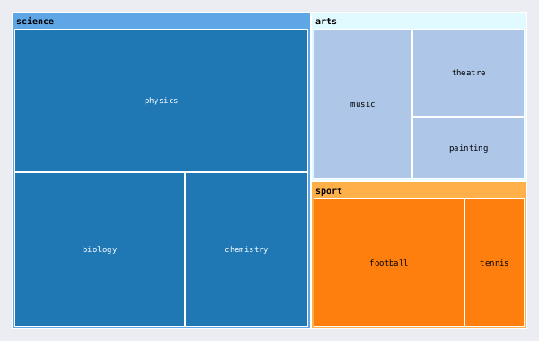
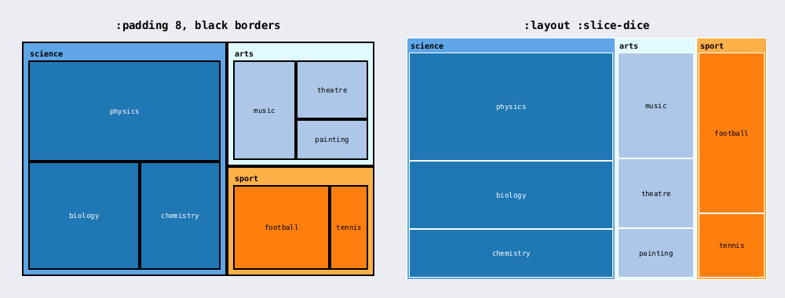
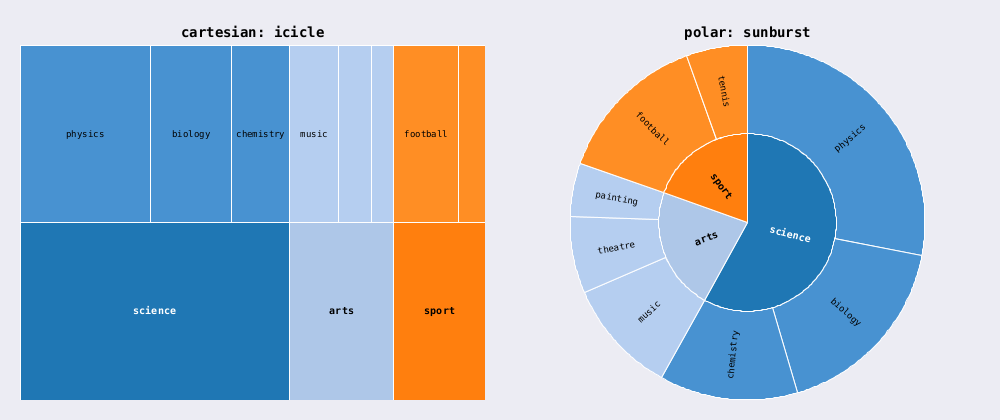
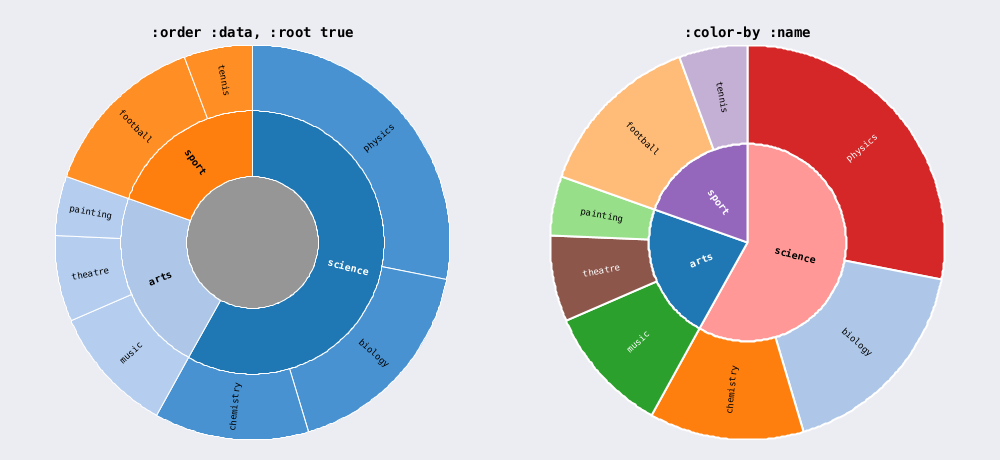
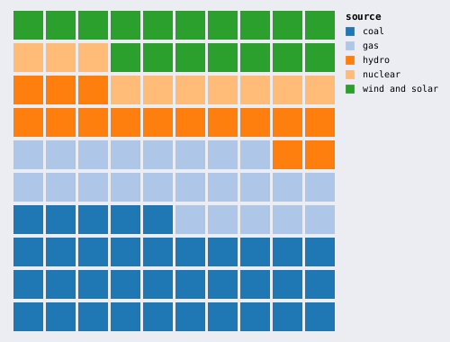
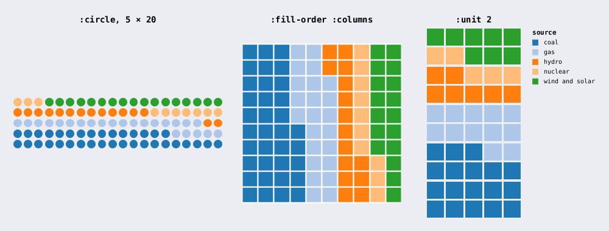
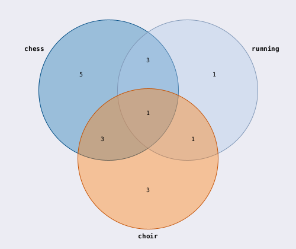

---
format:
  html: {toc: true, toc-location: right, toc-depth: 4, theme: cosmo}
code-block-background: true

---
<style></style><style>.printedClojure .sourceCode {
  background-color: transparent;
  border-style: none;
}
</style><style>.clay-limit-image-width .clay-image {max-width: 100%}
.clay-side-by-side .sourceCode {margin: 0}
.clay-side-by-side {margin: 1em 0}
</style>
<script src="https://code.jquery.com/jquery-3.6.0.min.js" type="text/javascript"></script><script src="https://code.jquery.com/ui/1.13.1/jquery-ui.min.js" type="text/javascript"></script>

# Charts: part of a whole

Shares of a total as areas: nested rectangles (`treemap`), adjacent bands or rings (`partition`), nested circles
(`pack`), a grid of cells (`waffle`) and overlapping sets (`venn`). Each chart lists the mapping keys it reads,
its own options and the shared option groups it takes (documented once in the Shared options chapter).


::: {.sourceClojure}
```clojure
(ns reference.charts-part-of-whole
  (:require [cljplot2.chart :as chart]
            [cljplot2.core :as plot]
            [cljplot2.describe :as describe]
            [notebook-utils :as nu]))
```
:::


::: {.sourceClojure}
```clojure
(def budget [{:dept "science" :team "physics" :cost 40} {:dept "science" :team "biology" :cost 25}
             {:dept "science" :team "chemistry" :cost 18} {:dept "arts" :team "music" :cost 15}
             {:dept "arts" :team "theatre" :cost 10} {:dept "arts" :team "painting" :cost 7}
             {:dept "sport" :team "football" :cost 20} {:dept "sport" :team "tennis" :cost 8}])
```
:::


::: {.clay-table}

```{=html}
<table class="table table-hover table-responsive clay-table"><thead><tr><th>dept</th><th>team</th><th>cost</th></tr></thead><tbody><tr><td>science</td><td>physics</td><td>40</td></tr><tr><td>science</td><td>biology</td><td>25</td></tr><tr><td>science</td><td>chemistry</td><td>18</td></tr><tr><td>arts</td><td>music</td><td>15</td></tr><tr><td>arts</td><td>theatre</td><td>10</td></tr><tr><td>arts</td><td>painting</td><td>7</td></tr><tr><td>sport</td><td>football</td><td>20</td></tr><tr><td>sport</td><td>tennis</td><td>8</td></tr></tbody></table>
```

:::


## treemap

Each leaf a rectangle of area proportional to its value, nested inside the rectangle of its group; the levels
come from `:hierarchy`, outer level first.

::: {.clay-table}

```{=html}
<table class="table table-hover table-responsive clay-table"><thead><tr><th>Option</th><th>Type</th><th>Default</th><th>Description</th></tr></thead><tbody><tr><td>:value (required)</td><td>a keyword, a function or a categorical marker of one</td><td></td><td>node size: a positive finite number per row (other rows are dropped)</td></tr><tr><td>:hierarchy (required)</td><td>vector of a keyword, a function or a categorical marker of one (at least 1)</td><td></td><td>the levels of the tree, outer level first (a row's path ends at its first nil or "")</td></tr><tr><td>:color</td><td>a keyword, a function or a categorical marker of one or nil</td><td></td><td>leaf colour (rows with the same path but different colours stay separate leaves)</td></tr></tbody></table>
```

:::


::: {.sourceClojure}
```clojure
(plot/render-image {:data budget
                    :mapping {:hierarchy [:dept :team] :value :cost}
                    :charts [(chart/treemap)]}
                   {:width 600 :height 380})
```
:::


::: {.clay-image}

:::


Its options: the gap inside a group, the cell borders and the layout - near-square cells or slices turning
direction at each depth:

::: {.clay-table}

```{=html}
<table class="table table-hover table-responsive clay-table"><thead><tr><th>Option</th><th>Type</th><th>Default</th><th>Description</th></tr></thead><tbody><tr><td>:padding</td><td>a non-negative number</td><td>3</td><td>gap inside every group around its header and children, in pixels</td></tr><tr><td>:border-color</td><td>a clojure2d color or :none</td><td>:white</td><td>cell border colour</td></tr><tr><td>:border-width</td><td>a non-negative number</td><td>1</td><td>cell border width in pixels</td></tr><tr><td>:layout</td><td>one of :squarify :slice-dice</td><td>:squarify</td><td>rectangle layout: :squarify (near-square cells) or :slice-dice (slices turning by depth)</td></tr></tbody></table>
```

:::


::: {.sourceClojure}
```clojure
(plot/render-image (plot/arrange [{:data budget
                                   :mapping {:hierarchy [:dept :team] :value :cost}
                                   :charts [(chart/treemap {:padding 8 :border-color :black :border-width 2})]
                                   :labels {:title ":padding 8, black borders"}}
                                  {:data budget
                                   :mapping {:hierarchy [:dept :team] :value :cost}
                                   :charts [(chart/treemap {:layout :slice-dice})]
                                   :labels {:title ":layout :slice-dice"}}]
                                 {:columns 2})
                   {:width 1000 :height 380})
```
:::


::: {.clay-image}

:::


Shared options: [Fill patterns](reference.shared_options.html#fill-patterns) (`:pattern` `:pattern-color`); [Data and mapping](reference.shared_options.html#data-and-mapping) (`:data` `:mapping`); [Hierarchy labels](reference.shared_options.html#hierarchy-labels) (`:group-labels` `:leaf-labels`).


## partition

The hierarchy as adjacent bands, one per level, each node as wide as its value - an icicle plot; in polar
coordinates the bands become rings (a sunburst).

::: {.clay-table}

```{=html}
<table class="table table-hover table-responsive clay-table"><thead><tr><th>Option</th><th>Type</th><th>Default</th><th>Description</th></tr></thead><tbody><tr><td>:value (required)</td><td>a keyword, a function or a categorical marker of one</td><td></td><td>node size: a positive finite number per row (other rows are dropped)</td></tr><tr><td>:hierarchy (required)</td><td>vector of a keyword, a function or a categorical marker of one (at least 1)</td><td></td><td>the levels of the tree, outer level first (a row's path ends at its first nil or "")</td></tr><tr><td>:color</td><td>a keyword, a function or a categorical marker of one or nil</td><td></td><td>leaf colour (rows with the same path but different colours stay separate leaves)</td></tr></tbody></table>
```

:::


::: {.sourceClojure}
```clojure
(plot/render-image (plot/arrange [{:data budget
                                   :mapping {:hierarchy [:dept :team] :value :cost}
                                   :charts [(chart/partition)]
                                   :labels {:title "cartesian: icicle"}}
                                  {:data budget
                                   :mapping {:hierarchy [:dept :team] :value :cost}
                                   :charts [(chart/partition)]
                                   :coord {:kind :polar}
                                   :labels {:title "polar: sunburst"}}]
                                 {:columns 2})
                   {:width 1000 :height 420})
```
:::


::: {.clay-image}

:::


Its options: borders, the order of siblings, how nodes are coloured (by their top-level node, lighter by depth,
or each by its name) and whether the root is drawn:

::: {.clay-table}

```{=html}
<table class="table table-hover table-responsive clay-table"><thead><tr><th>Option</th><th>Type</th><th>Default</th><th>Description</th></tr></thead><tbody><tr><td>:border-color</td><td>a clojure2d color or :none</td><td>:white</td><td>cell border colour</td></tr><tr><td>:border-width</td><td>a non-negative number</td><td>1</td><td>cell border width in pixels</td></tr><tr><td>:order</td><td>one of :value :data</td><td>:value</td><td>order of siblings: :value (descending) or :data (first appearance)</td></tr><tr><td>:color-by</td><td>one of :top :name</td><td>:top</td><td>node colours: :top - each top-level node's palette colour, lighter by depth; :name - every node by its name through the color scale</td></tr><tr><td>:root</td><td>true or false or nil</td><td>false</td><td>draw the root too, every level one up</td></tr></tbody></table>
```

:::


::: {.sourceClojure}
```clojure
(plot/render-image (plot/arrange [{:data budget
                                   :mapping {:hierarchy [:dept :team] :value :cost}
                                   :charts [(chart/partition {:order :data :root true})]
                                   :coord {:kind :polar}
                                   :labels {:title ":order :data, :root true"}}
                                  {:data budget
                                   :mapping {:hierarchy [:dept :team] :value :cost}
                                   :charts [(chart/partition {:color-by :name :border-width 2})]
                                   :coord {:kind :polar}
                                   :labels {:title ":color-by :name"}
                                   :legend false}]
                                 {:columns 2})
                   {:width 1000 :height 460})
```
:::


::: {.clay-image}

:::


Shared options: [Fill patterns](reference.shared_options.html#fill-patterns) (`:pattern` `:pattern-color`); [Data and mapping](reference.shared_options.html#data-and-mapping) (`:data` `:mapping`); [Hierarchy labels](reference.shared_options.html#hierarchy-labels) (`:group-labels` `:leaf-labels`).


## pack

Each leaf a circle of area proportional to its value, packed inside the circle of its group.

::: {.clay-table}

```{=html}
<table class="table table-hover table-responsive clay-table"><thead><tr><th>Option</th><th>Type</th><th>Default</th><th>Description</th></tr></thead><tbody><tr><td>:value (required)</td><td>a keyword, a function or a categorical marker of one</td><td></td><td>node size: a positive finite number per row (other rows are dropped)</td></tr><tr><td>:hierarchy (required)</td><td>vector of a keyword, a function or a categorical marker of one (at least 1)</td><td></td><td>the levels of the tree, outer level first (a row's path ends at its first nil or "")</td></tr><tr><td>:color</td><td>a keyword, a function or a categorical marker of one or nil</td><td></td><td>leaf colour (rows with the same path but different colours stay separate leaves)</td></tr></tbody></table>
```

:::


::: {.sourceClojure}
```clojure
(plot/render-image {:data budget
                    :mapping {:hierarchy [:dept :team] :value :cost}
                    :charts [(chart/pack)]}
                   {:width 500 :height 450})
```
:::


::: {.clay-image}

:::


Its options: the gap between circles, borders, the packing order, the root circle and the depths left out of the
drawing (the layout unchanged - here the group circles, depth 1):

::: {.clay-table}

```{=html}
<table class="table table-hover table-responsive clay-table"><thead><tr><th>Option</th><th>Type</th><th>Default</th><th>Description</th></tr></thead><tbody><tr><td>:padding</td><td>a non-negative number</td><td>3</td><td>gap between siblings and between a child and its parent's edge, in pixels</td></tr><tr><td>:border-color</td><td>a clojure2d color or :none</td><td>:white</td><td>circle border colour</td></tr><tr><td>:border-width</td><td>a non-negative number</td><td>1</td><td>circle border width in pixels</td></tr><tr><td>:order</td><td>one of :value :data</td><td>:value</td><td>packing order of siblings: :value (descending, largest near the centre) or :data</td></tr><tr><td>:root</td><td>true or false or nil</td><td>false</td><td>draw the root circle too</td></tr><tr><td>:hidden-levels</td><td>set of integer (at least 0) or nil</td><td>#{}</td><td>depths (root 0, top level 1) not drawn, the layout unchanged</td></tr></tbody></table>
```

:::


::: {.sourceClojure}
```clojure
(plot/render-image (plot/arrange [{:data budget
                                   :mapping {:hierarchy [:dept :team] :value :cost}
                                   :charts [(chart/pack {:padding 10 :root true :border-color :black})]
                                   :labels {:title ":padding 10, :root true"}}
                                  {:data budget
                                   :mapping {:hierarchy [:dept :team] :value :cost}
                                   :charts [(chart/pack {:hidden-levels #{1}})]
                                   :labels {:title ":hidden-levels #{1}"}}]
                                 {:columns 2})
                   {:width 1000 :height 480})
```
:::


::: {.clay-image}

:::


Shared options: [Fill patterns](reference.shared_options.html#fill-patterns) (`:pattern` `:pattern-color`); [Data and mapping](reference.shared_options.html#data-and-mapping) (`:data` `:mapping`); [Hierarchy labels](reference.shared_options.html#hierarchy-labels) (`:group-labels` `:leaf-labels`).


## waffle

A grid of cells (10 × 10 by default), each category taking a share of the cells proportional to its value.

::: {.clay-table}

```{=html}
<table class="table table-hover table-responsive clay-table"><thead><tr><th>Option</th><th>Type</th><th>Default</th><th>Description</th></tr></thead><tbody><tr><td>:color (required)</td><td>a keyword, a function or a categorical marker of one</td><td></td><td>the category: one colour and a share of the cells per category</td></tr><tr><td>:value</td><td>a keyword, a function or a categorical marker of one or nil</td><td>every row counts 1</td><td>weight per row, a non-negative finite number (other rows are dropped)</td></tr><tr><td>:pattern</td><td>a keyword, a function or a categorical marker of one or nil</td><td></td><td>fill pattern, splitting categories too</td></tr></tbody></table>
```

:::


::: {.sourceClojure}
```clojure
(def energy-mix [{:source "coal" :share 35} {:source "gas" :share 23} {:source "nuclear" :share 10}
                 {:source "hydro" :share 15} {:source "wind and solar" :share 17}])
```
:::


::: {.clay-table}

```{=html}
<table class="table table-hover table-responsive clay-table"><thead><tr><th>source</th><th>share</th></tr></thead><tbody><tr><td>coal</td><td>35</td></tr><tr><td>gas</td><td>23</td></tr><tr><td>nuclear</td><td>10</td></tr><tr><td>hydro</td><td>15</td></tr><tr><td>wind and solar</td><td>17</td></tr></tbody></table>
```

:::


::: {.sourceClojure}
```clojure
(plot/render-image {:data energy-mix
                    :mapping {:color :source :value :share}
                    :charts [(chart/waffle)]}
                   {:width 500 :height 380})
```
:::


::: {.clay-image}

:::


Its options: the cell shape, gap and border; the grid size and fill order; or `:unit` - the value of one cell,
so the cell count follows the values (here one cell per 2 units, 5 columns wide):

::: {.clay-table}

```{=html}
<table class="table table-hover table-responsive clay-table"><thead><tr><th>Option</th><th>Type</th><th>Default</th><th>Description</th></tr></thead><tbody><tr><td>:gap</td><td>a finite number, >= 0, < 1</td><td>0.1</td><td>space between cells, a fraction of a cell</td></tr><tr><td>:shape</td><td>one of :square :circle</td><td>:square</td><td>cell shape: :square or :circle</td></tr><tr><td>:border-color</td><td>a clojure2d color or :none</td><td>:none</td><td>cell border colour</td></tr><tr><td>:border-width</td><td>a non-negative number</td><td>1</td><td>cell border width in pixels</td></tr><tr><td>:rows</td><td>integer (1..10000)</td><td>10</td><td>grid rows (ignored with :unit)</td></tr><tr><td>:columns</td><td>integer (1..10000)</td><td>10</td><td>grid columns</td></tr><tr><td>:unit</td><td>a positive finite number</td><td>none - the categories share the :rows x :columns grid</td><td>the value of one cell: a category gets value / unit cells, the grid :columns wide</td></tr><tr><td>:fill-order</td><td>one of :rows :columns</td><td>:rows</td><td>fill from the bottom-left cell: :rows (row by row, upwards) or :columns (column by column)</td></tr></tbody></table>
```

:::


::: {.sourceClojure}
```clojure
(plot/render-image (plot/arrange [{:data energy-mix
                                   :mapping {:color :source :value :share}
                                   :charts [(chart/waffle {:shape :circle :gap 0.2 :rows 5 :columns 20})]
                                   :labels {:title ":circle, 5 × 20"}
                                   :legend false}
                                  {:data energy-mix
                                   :mapping {:color :source :value :share}
                                   :charts [(chart/waffle {:fill-order :columns :border-color :white :border-width 2
                                                           :gap 0})]
                                   :labels {:title ":fill-order :columns"}
                                   :legend false}
                                  {:data energy-mix
                                   :mapping {:color :source :value :share}
                                   :charts [(chart/waffle {:unit 2 :columns 5})]
                                   :labels {:title ":unit 2"}}]
                                 {:columns 3 :widths [1.3 1 1.1]})
                   {:width 1000 :height 380})
```
:::


::: {.clay-image}

:::


Shared options: [Fill patterns](reference.shared_options.html#fill-patterns) (`:pattern` `:pattern-color`); [Data and mapping](reference.shared_options.html#data-and-mapping) (`:data` `:mapping`).


## venn

Two or three sets as overlapping circles, each region labelled with the number of items it holds; a row names
an item and a set it belongs to.

::: {.clay-table}

```{=html}
<table class="table table-hover table-responsive clay-table"><thead><tr><th>Option</th><th>Type</th><th>Default</th><th>Description</th></tr></thead><tbody><tr><td>:set (required)</td><td>a keyword, a function or a categorical marker of one</td><td></td><td>the set a row's item belongs to</td></tr><tr><td>:item (required)</td><td>a keyword, a function or a categorical marker of one</td><td></td><td>the item (repeated rows count once)</td></tr></tbody></table>
```

:::


::: {.sourceClojure}
```clojure
(def memberships (concat (for [i (range 12)] {:club "chess" :member (str "p" i)})
                         (for [i (range 8 14)] {:club "running" :member (str "p" i)})
                         (for [i (range 0 24 3)] {:club "choir" :member (str "p" i)})))
```
:::


::: {.clay-table}

```{=html}
<table class="table table-hover table-responsive clay-table"><thead><tr><th>club</th><th>member</th></tr></thead><tbody><tr><td>chess</td><td>p0</td></tr><tr><td>chess</td><td>p1</td></tr><tr><td>chess</td><td>p2</td></tr><tr><td>chess</td><td>p3</td></tr><tr><td>chess</td><td>p4</td></tr><tr><td>chess</td><td>p5</td></tr><tr><td>chess</td><td>p6</td></tr><tr><td>chess</td><td>p7</td></tr><tr><td>chess</td><td>p8</td></tr><tr><td>chess</td><td>p9</td></tr><tr><td>chess</td><td>p10</td></tr><tr><td>chess</td><td>p11</td></tr><tr><td>running</td><td>p8</td></tr><tr><td>running</td><td>p9</td></tr><tr><td>running</td><td>p10</td></tr><tr><td>running</td><td>p11</td></tr><tr><td>running</td><td>p12</td></tr><tr><td>running</td><td>p13</td></tr><tr><td>choir</td><td>p0</td></tr><tr><td>choir</td><td>p3</td></tr></tbody></table>
```

:::


::: {.sourceClojure}
```clojure
(plot/render-image {:data memberships
                    :mapping {:set :club :item :member}
                    :charts [(chart/venn)]}
                   {:width 500 :height 420})
```
:::


::: {.clay-image}

:::


Its options: the fill and outline, which sets are shown, proportional areas (two sets), and the set and region
labels - a function of `{:sets :size :share}` writes a region's text:

::: {.clay-table}

```{=html}
<table class="table table-hover table-responsive clay-table"><thead><tr><th>Option</th><th>Type</th><th>Default</th><th>Description</th></tr></thead><tbody><tr><td>:alpha</td><td>a number in [0 1]</td><td>0.4</td><td>fill opacity</td></tr><tr><td>:border-color</td><td>:darker or a clojure2d color or :none</td><td>:darker</td><td>circle outline colour: a colour, :none or :darker (the darkened set colour)</td></tr><tr><td>:border-width</td><td>a non-negative number</td><td>1</td><td>circle outline width in pixels</td></tr><tr><td>:sets</td><td>vector of any value (at least 1)</td><td>every set, in first-appearance order</td><td>the sets shown (2 or 3), in order</td></tr><tr><td>:proportional</td><td>true or false or nil</td><td>true</td><td>2 sets: circle and overlap areas proportional to the counts (false - equal circles)</td></tr><tr><td>:set-labels</td><td>true or false or nil</td><td>true</td><td>write the set names outside their circles</td></tr><tr><td>:region-labels</td><td>true or false or a function or nil</td><td>true</td><td>region labels: true - the item count, false - none, or a function of {:sets :size :share} returning the text</td></tr></tbody></table>
```

:::


::: {.sourceClojure}
```clojure
(plot/render-image (plot/arrange [{:data memberships
                                   :mapping {:set :club :item :member}
                                   :charts [(chart/venn {:sets ["chess" "running"]})]
                                   :labels {:title "two sets, proportional"}}
                                  {:data memberships
                                   :mapping {:set :club :item :member}
                                   :charts [(chart/venn {:sets ["chess" "running"] :proportional false :alpha 0.6
                                                         :border-color :none})]
                                   :labels {:title ":proportional false"}}
                                  {:data memberships
                                   :mapping {:set :club :item :member}
                                   :charts [(chart/venn {:region-labels #(format "%.0f%%" (* 100.0 (double (:share %))))})]
                                   :labels {:title ":region-labels - shares"}}]
                                 {:columns 3})
                   {:width 1000 :height 380})
```
:::


::: {.clay-image}

:::


Shared options: [Data and mapping](reference.shared_options.html#data-and-mapping) (`:data` `:mapping`).


```{=html}
<div style="background-color:grey;height:2px;width:100%;"></div>
```


```{=html}
<div><pre><small><small>source: notebooks/reference/charts_part_of_whole.clj</small></small></pre></div>
```