---
format:
  html:
    toc: true
    toc-location: right
    toc-depth: 4
    theme: cosmo
    include-in-header:
      text: |-
        <style>
        .data-table { width: fit-content; max-width: 100%; max-height: 15rem; overflow: auto; margin: 0 0 1rem 0; }
        .data-table .table-responsive { overflow: visible; }
        .data-table table { font-size: 0.75rem; width: auto; margin: 0; }
        .data-table th, .data-table td { padding: 0.1rem 0.45rem !important; white-space: nowrap; }
        .data-table thead th { position: sticky; top: 0; background: var(--bs-body-bg, #fff); }
        .options { margin: 0.5rem 0 1rem 0; }
        .options .option-card { margin: 0 0 0.9rem 0; border: 1px solid var(--bs-border-color, #dee2e6); border-radius: 0.375rem; overflow: hidden; }
        .options dt { display: flex; flex-wrap: wrap; align-items: baseline; gap: 0.1rem 1rem; margin: 0; padding: 0.4rem 0.75rem; background: #eef2f7; border-bottom: 1px solid var(--bs-border-color, #dee2e6); font-weight: normal; }
        .options dt > code { font-weight: 700; font-size: 1rem; background: none; padding: 0; }
        .options .option-default { font-size: 0.85rem; color: var(--bs-secondary-color, #6c757d); }
        .options dd { margin: 0; padding: 0.5rem 0.75rem; }
        .options .option-example { font-size: 0.85rem; padding: 0 0 0.45rem 0; margin-bottom: 0.45rem; border-bottom: 1px dashed var(--bs-border-color, #dee2e6); }
        .options .option-example code { background: none; padding: 0; }
        .options .option-text ul { margin: 0.3rem 0 0 0; padding-left: 1.25rem; }
        .options code, .mapping code { overflow-wrap: anywhere; }
        .options .option-default code, .options .option-example code { white-space: pre-wrap; }
        .mapping { margin: 0.5rem 0 1rem 0; padding: 0.5rem 0.75rem; border: 1px solid var(--bs-border-color, #dee2e6); border-left: 0.3rem solid #2780e3; border-radius: 0.375rem; background: #f5f8fc; }
        .mapping-title { font-weight: 700; margin-bottom: 0.25rem; }
        .mapping-hint { font-weight: normal; font-size: 0.85rem; color: var(--bs-secondary-color, #6c757d); }
        .mapping ul { margin: 0; padding-left: 1.25rem; }
        .mapping .required { font-size: 0.75rem; padding: 0 0.3rem; border: 1px solid currentColor; border-radius: 0.25rem; }
        .mapping-returns { margin-top: 0.25rem; }
        .mapping code { white-space: pre-wrap; }
        .shared { margin: 0.5rem 0 1rem 0; padding: 0.5rem 0.75rem; border: 1px solid var(--bs-border-color, #dee2e6); border-left: 0.3rem solid #6c757d; border-radius: 0.375rem; background: #f6f6f6; }
        .shared-title { font-weight: 700; margin-bottom: 0.25rem; }
        .shared-hint { font-weight: normal; font-size: 0.85rem; color: var(--bs-secondary-color, #6c757d); }
        .shared ul { margin: 0; padding-left: 1.25rem; }
        .shared code { overflow-wrap: anywhere; }
        p code, li code { white-space: pre-wrap; overflow-wrap: anywhere; }
        </style>
code-block-background: true

---
<style></style><style>.printedClojure .sourceCode {
  background-color: transparent;
  border-style: none;
}
</style><style>.clay-limit-image-width .clay-image {max-width: 100%}
.clay-side-by-side .sourceCode {margin: 0}
.clay-side-by-side {margin: 1em 0}
</style>
<script src="https://code.jquery.com/jquery-3.6.0.min.js" type="text/javascript"></script><script src="https://code.jquery.com/ui/1.13.1/jquery-ui.min.js" type="text/javascript"></script>

# Distribution per level

These charts draw how the values of each level are spread: summaries (`box`, `violin`, `extent`) and the values
themselves (`stripplot`, `beeswarm`, `dotplot`, `rug`). Use them to compare spreads across levels; they all take
the [Strip options](reference.shared_options.html#strip-options) for placement, width and grouping.


::: {.sourceClojure}
```clojure
(ns reference.charts-per-level
  (:require [fastmath.random :as r]
            [fastmath.stats :as stats]
            [cljplot2.chart :as chart]
            [cljplot2.core :as plot]
            [cljplot2.describe :as describe]
            [notebook-utils :as nu]))
```
:::


Data: Edgar Anderson's iris measurements, R datasets package `iris` (Anderson 1935; Fisher 1936); licence: Part of R (GPL-2 | GPL-3).


::: {.sourceClojure}
```clojure
(def iris (nu/dataset :iris))
```
:::


```{=html}
<div class="data-table"><table class="table table-hover table-responsive clay-table"><thead><tr><th>sepal-length</th><th>sepal-width</th><th>petal-length</th><th>petal-width</th><th>species</th></tr></thead><tbody><tr><td>5.1</td><td>3.5</td><td>1.4</td><td>0.2</td><td>setosa</td></tr><tr><td>4.9</td><td>3</td><td>1.4</td><td>0.2</td><td>setosa</td></tr><tr><td>4.7</td><td>3.2</td><td>1.3</td><td>0.2</td><td>setosa</td></tr><tr><td>4.6</td><td>3.1</td><td>1.5</td><td>0.2</td><td>setosa</td></tr><tr><td>5</td><td>3.6</td><td>1.4</td><td>0.2</td><td>setosa</td></tr><tr><td>5.4</td><td>3.9</td><td>1.7</td><td>0.4</td><td>setosa</td></tr><tr><td>4.6</td><td>3.4</td><td>1.4</td><td>0.3</td><td>setosa</td></tr><tr><td>5</td><td>3.4</td><td>1.5</td><td>0.2</td><td>setosa</td></tr><tr><td>4.4</td><td>2.9</td><td>1.4</td><td>0.2</td><td>setosa</td></tr><tr><td>4.9</td><td>3.1</td><td>1.5</td><td>0.1</td><td>setosa</td></tr><tr><td>5.4</td><td>3.7</td><td>1.5</td><td>0.2</td><td>setosa</td></tr><tr><td>4.8</td><td>3.4</td><td>1.6</td><td>0.2</td><td>setosa</td></tr><tr><td>4.8</td><td>3</td><td>1.4</td><td>0.1</td><td>setosa</td></tr><tr><td>4.3</td><td>3</td><td>1.1</td><td>0.1</td><td>setosa</td></tr><tr><td>5.8</td><td>4</td><td>1.2</td><td>0.2</td><td>setosa</td></tr><tr><td>5.7</td><td>4.4</td><td>1.5</td><td>0.4</td><td>setosa</td></tr><tr><td>5.4</td><td>3.9</td><td>1.3</td><td>0.4</td><td>setosa</td></tr><tr><td>5.1</td><td>3.5</td><td>1.4</td><td>0.3</td><td>setosa</td></tr><tr><td>5.7</td><td>3.8</td><td>1.7</td><td>0.3</td><td>setosa</td></tr><tr><td>5.1</td><td>3.8</td><td>1.5</td><td>0.3</td><td>setosa</td></tr><tr><td>5.4</td><td>3.4</td><td>1.7</td><td>0.2</td><td>setosa</td></tr><tr><td>5.1</td><td>3.7</td><td>1.5</td><td>0.4</td><td>setosa</td></tr><tr><td>4.6</td><td>3.6</td><td>1</td><td>0.2</td><td>setosa</td></tr><tr><td>5.1</td><td>3.3</td><td>1.7</td><td>0.5</td><td>setosa</td></tr><tr><td>4.8</td><td>3.4</td><td>1.9</td><td>0.2</td><td>setosa</td></tr><tr><td>5</td><td>3</td><td>1.6</td><td>0.2</td><td>setosa</td></tr><tr><td>5</td><td>3.4</td><td>1.6</td><td>0.4</td><td>setosa</td></tr><tr><td>5.2</td><td>3.5</td><td>1.5</td><td>0.2</td><td>setosa</td></tr><tr><td>5.2</td><td>3.4</td><td>1.4</td><td>0.2</td><td>setosa</td></tr><tr><td>4.7</td><td>3.2</td><td>1.6</td><td>0.2</td><td>setosa</td></tr><tr><td>4.8</td><td>3.1</td><td>1.6</td><td>0.2</td><td>setosa</td></tr><tr><td>5.4</td><td>3.4</td><td>1.5</td><td>0.4</td><td>setosa</td></tr><tr><td>5.2</td><td>4.1</td><td>1.5</td><td>0.1</td><td>setosa</td></tr><tr><td>5.5</td><td>4.2</td><td>1.4</td><td>0.2</td><td>setosa</td></tr><tr><td>4.9</td><td>3.1</td><td>1.5</td><td>0.2</td><td>setosa</td></tr><tr><td>5</td><td>3.2</td><td>1.2</td><td>0.2</td><td>setosa</td></tr><tr><td>5.5</td><td>3.5</td><td>1.3</td><td>0.2</td><td>setosa</td></tr><tr><td>4.9</td><td>3.6</td><td>1.4</td><td>0.1</td><td>setosa</td></tr><tr><td>4.4</td><td>3</td><td>1.3</td><td>0.2</td><td>setosa</td></tr><tr><td>5.1</td><td>3.4</td><td>1.5</td><td>0.2</td><td>setosa</td></tr><tr><td>5</td><td>3.5</td><td>1.3</td><td>0.3</td><td>setosa</td></tr><tr><td>4.5</td><td>2.3</td><td>1.3</td><td>0.3</td><td>setosa</td></tr><tr><td>4.4</td><td>3.2</td><td>1.3</td><td>0.2</td><td>setosa</td></tr><tr><td>5</td><td>3.5</td><td>1.6</td><td>0.6</td><td>setosa</td></tr><tr><td>5.1</td><td>3.8</td><td>1.9</td><td>0.4</td><td>setosa</td></tr><tr><td>4.8</td><td>3</td><td>1.4</td><td>0.3</td><td>setosa</td></tr><tr><td>5.1</td><td>3.8</td><td>1.6</td><td>0.2</td><td>setosa</td></tr><tr><td>4.6</td><td>3.2</td><td>1.4</td><td>0.2</td><td>setosa</td></tr><tr><td>5.3</td><td>3.7</td><td>1.5</td><td>0.2</td><td>setosa</td></tr><tr><td>5</td><td>3.3</td><td>1.4</td><td>0.2</td><td>setosa</td></tr><tr><td>7</td><td>3.2</td><td>4.7</td><td>1.4</td><td>versicolor</td></tr><tr><td>6.4</td><td>3.2</td><td>4.5</td><td>1.5</td><td>versicolor</td></tr><tr><td>6.9</td><td>3.1</td><td>4.9</td><td>1.5</td><td>versicolor</td></tr><tr><td>5.5</td><td>2.3</td><td>4</td><td>1.3</td><td>versicolor</td></tr><tr><td>6.5</td><td>2.8</td><td>4.6</td><td>1.5</td><td>versicolor</td></tr><tr><td>5.7</td><td>2.8</td><td>4.5</td><td>1.3</td><td>versicolor</td></tr><tr><td>6.3</td><td>3.3</td><td>4.7</td><td>1.6</td><td>versicolor</td></tr><tr><td>4.9</td><td>2.4</td><td>3.3</td><td>1</td><td>versicolor</td></tr><tr><td>6.6</td><td>2.9</td><td>4.6</td><td>1.3</td><td>versicolor</td></tr><tr><td>5.2</td><td>2.7</td><td>3.9</td><td>1.4</td><td>versicolor</td></tr><tr><td>5</td><td>2</td><td>3.5</td><td>1</td><td>versicolor</td></tr><tr><td>5.9</td><td>3</td><td>4.2</td><td>1.5</td><td>versicolor</td></tr><tr><td>6</td><td>2.2</td><td>4</td><td>1</td><td>versicolor</td></tr><tr><td>6.1</td><td>2.9</td><td>4.7</td><td>1.4</td><td>versicolor</td></tr><tr><td>5.6</td><td>2.9</td><td>3.6</td><td>1.3</td><td>versicolor</td></tr><tr><td>6.7</td><td>3.1</td><td>4.4</td><td>1.4</td><td>versicolor</td></tr><tr><td>5.6</td><td>3</td><td>4.5</td><td>1.5</td><td>versicolor</td></tr><tr><td>5.8</td><td>2.7</td><td>4.1</td><td>1</td><td>versicolor</td></tr><tr><td>6.2</td><td>2.2</td><td>4.5</td><td>1.5</td><td>versicolor</td></tr><tr><td>5.6</td><td>2.5</td><td>3.9</td><td>1.1</td><td>versicolor</td></tr><tr><td>5.9</td><td>3.2</td><td>4.8</td><td>1.8</td><td>versicolor</td></tr><tr><td>6.1</td><td>2.8</td><td>4</td><td>1.3</td><td>versicolor</td></tr><tr><td>6.3</td><td>2.5</td><td>4.9</td><td>1.5</td><td>versicolor</td></tr><tr><td>6.1</td><td>2.8</td><td>4.7</td><td>1.2</td><td>versicolor</td></tr><tr><td>6.4</td><td>2.9</td><td>4.3</td><td>1.3</td><td>versicolor</td></tr><tr><td>6.6</td><td>3</td><td>4.4</td><td>1.4</td><td>versicolor</td></tr><tr><td>6.8</td><td>2.8</td><td>4.8</td><td>1.4</td><td>versicolor</td></tr><tr><td>6.7</td><td>3</td><td>5</td><td>1.7</td><td>versicolor</td></tr><tr><td>6</td><td>2.9</td><td>4.5</td><td>1.5</td><td>versicolor</td></tr><tr><td>5.7</td><td>2.6</td><td>3.5</td><td>1</td><td>versicolor</td></tr><tr><td>5.5</td><td>2.4</td><td>3.8</td><td>1.1</td><td>versicolor</td></tr><tr><td>5.5</td><td>2.4</td><td>3.7</td><td>1</td><td>versicolor</td></tr><tr><td>5.8</td><td>2.7</td><td>3.9</td><td>1.2</td><td>versicolor</td></tr><tr><td>6</td><td>2.7</td><td>5.1</td><td>1.6</td><td>versicolor</td></tr><tr><td>5.4</td><td>3</td><td>4.5</td><td>1.5</td><td>versicolor</td></tr><tr><td>6</td><td>3.4</td><td>4.5</td><td>1.6</td><td>versicolor</td></tr><tr><td>6.7</td><td>3.1</td><td>4.7</td><td>1.5</td><td>versicolor</td></tr><tr><td>6.3</td><td>2.3</td><td>4.4</td><td>1.3</td><td>versicolor</td></tr><tr><td>5.6</td><td>3</td><td>4.1</td><td>1.3</td><td>versicolor</td></tr><tr><td>5.5</td><td>2.5</td><td>4</td><td>1.3</td><td>versicolor</td></tr><tr><td>5.5</td><td>2.6</td><td>4.4</td><td>1.2</td><td>versicolor</td></tr><tr><td>6.1</td><td>3</td><td>4.6</td><td>1.4</td><td>versicolor</td></tr><tr><td>5.8</td><td>2.6</td><td>4</td><td>1.2</td><td>versicolor</td></tr><tr><td>5</td><td>2.3</td><td>3.3</td><td>1</td><td>versicolor</td></tr><tr><td>5.6</td><td>2.7</td><td>4.2</td><td>1.3</td><td>versicolor</td></tr><tr><td>5.7</td><td>3</td><td>4.2</td><td>1.2</td><td>versicolor</td></tr><tr><td>5.7</td><td>2.9</td><td>4.2</td><td>1.3</td><td>versicolor</td></tr><tr><td>6.2</td><td>2.9</td><td>4.3</td><td>1.3</td><td>versicolor</td></tr><tr><td>5.1</td><td>2.5</td><td>3</td><td>1.1</td><td>versicolor</td></tr><tr><td>5.7</td><td>2.8</td><td>4.1</td><td>1.3</td><td>versicolor</td></tr><tr><td>…</td><td>…</td><td>…</td><td>…</td><td>…</td></tr></tbody></table></div>
```


Data: Motor Trend car road tests (1974), R datasets package `mtcars` (Henderson & Velleman 1981); licence: Part of R (GPL-2 | GPL-3).


::: {.sourceClojure}
```clojure
(def mtcars (nu/dataset :mtcars))
```
:::


```{=html}
<div class="data-table"><table class="table table-hover table-responsive clay-table"><thead><tr><th>model</th><th>mpg</th><th>cyl</th><th>disp</th><th>hp</th><th>drat</th><th>wt</th><th>qsec</th><th>vs</th><th>am</th><th>gear</th><th>carb</th></tr></thead><tbody><tr><td>Mazda RX4</td><td>21</td><td>6</td><td>160</td><td>110</td><td>3.9</td><td>2.62</td><td>16.46</td><td>0</td><td>1</td><td>4</td><td>4</td></tr><tr><td>Mazda RX4 Wag</td><td>21</td><td>6</td><td>160</td><td>110</td><td>3.9</td><td>2.875</td><td>17.02</td><td>0</td><td>1</td><td>4</td><td>4</td></tr><tr><td>Datsun 710</td><td>22.8</td><td>4</td><td>108</td><td>93</td><td>3.85</td><td>2.32</td><td>18.61</td><td>1</td><td>1</td><td>4</td><td>1</td></tr><tr><td>Hornet 4 Drive</td><td>21.4</td><td>6</td><td>258</td><td>110</td><td>3.08</td><td>3.215</td><td>19.44</td><td>1</td><td>0</td><td>3</td><td>1</td></tr><tr><td>Hornet Sportabout</td><td>18.7</td><td>8</td><td>360</td><td>175</td><td>3.15</td><td>3.44</td><td>17.02</td><td>0</td><td>0</td><td>3</td><td>2</td></tr><tr><td>Valiant</td><td>18.1</td><td>6</td><td>225</td><td>105</td><td>2.76</td><td>3.46</td><td>20.22</td><td>1</td><td>0</td><td>3</td><td>1</td></tr><tr><td>Duster 360</td><td>14.3</td><td>8</td><td>360</td><td>245</td><td>3.21</td><td>3.57</td><td>15.84</td><td>0</td><td>0</td><td>3</td><td>4</td></tr><tr><td>Merc 240D</td><td>24.4</td><td>4</td><td>146.7</td><td>62</td><td>3.69</td><td>3.19</td><td>20</td><td>1</td><td>0</td><td>4</td><td>2</td></tr><tr><td>Merc 230</td><td>22.8</td><td>4</td><td>140.8</td><td>95</td><td>3.92</td><td>3.15</td><td>22.9</td><td>1</td><td>0</td><td>4</td><td>2</td></tr><tr><td>Merc 280</td><td>19.2</td><td>6</td><td>167.6</td><td>123</td><td>3.92</td><td>3.44</td><td>18.3</td><td>1</td><td>0</td><td>4</td><td>4</td></tr><tr><td>Merc 280C</td><td>17.8</td><td>6</td><td>167.6</td><td>123</td><td>3.92</td><td>3.44</td><td>18.9</td><td>1</td><td>0</td><td>4</td><td>4</td></tr><tr><td>Merc 450SE</td><td>16.4</td><td>8</td><td>275.8</td><td>180</td><td>3.07</td><td>4.07</td><td>17.4</td><td>0</td><td>0</td><td>3</td><td>3</td></tr><tr><td>Merc 450SL</td><td>17.3</td><td>8</td><td>275.8</td><td>180</td><td>3.07</td><td>3.73</td><td>17.6</td><td>0</td><td>0</td><td>3</td><td>3</td></tr><tr><td>Merc 450SLC</td><td>15.2</td><td>8</td><td>275.8</td><td>180</td><td>3.07</td><td>3.78</td><td>18</td><td>0</td><td>0</td><td>3</td><td>3</td></tr><tr><td>Cadillac Fleetwood</td><td>10.4</td><td>8</td><td>472</td><td>205</td><td>2.93</td><td>5.25</td><td>17.98</td><td>0</td><td>0</td><td>3</td><td>4</td></tr><tr><td>Lincoln Continental</td><td>10.4</td><td>8</td><td>460</td><td>215</td><td>3</td><td>5.424</td><td>17.82</td><td>0</td><td>0</td><td>3</td><td>4</td></tr><tr><td>Chrysler Imperial</td><td>14.7</td><td>8</td><td>440</td><td>230</td><td>3.23</td><td>5.345</td><td>17.42</td><td>0</td><td>0</td><td>3</td><td>4</td></tr><tr><td>Fiat 128</td><td>32.4</td><td>4</td><td>78.7</td><td>66</td><td>4.08</td><td>2.2</td><td>19.47</td><td>1</td><td>1</td><td>4</td><td>1</td></tr><tr><td>Honda Civic</td><td>30.4</td><td>4</td><td>75.7</td><td>52</td><td>4.93</td><td>1.615</td><td>18.52</td><td>1</td><td>1</td><td>4</td><td>2</td></tr><tr><td>Toyota Corolla</td><td>33.9</td><td>4</td><td>71.1</td><td>65</td><td>4.22</td><td>1.835</td><td>19.9</td><td>1</td><td>1</td><td>4</td><td>1</td></tr><tr><td>Toyota Corona</td><td>21.5</td><td>4</td><td>120.1</td><td>97</td><td>3.7</td><td>2.465</td><td>20.01</td><td>1</td><td>0</td><td>3</td><td>1</td></tr><tr><td>Dodge Challenger</td><td>15.5</td><td>8</td><td>318</td><td>150</td><td>2.76</td><td>3.52</td><td>16.87</td><td>0</td><td>0</td><td>3</td><td>2</td></tr><tr><td>AMC Javelin</td><td>15.2</td><td>8</td><td>304</td><td>150</td><td>3.15</td><td>3.435</td><td>17.3</td><td>0</td><td>0</td><td>3</td><td>2</td></tr><tr><td>Camaro Z28</td><td>13.3</td><td>8</td><td>350</td><td>245</td><td>3.73</td><td>3.84</td><td>15.41</td><td>0</td><td>0</td><td>3</td><td>4</td></tr><tr><td>Pontiac Firebird</td><td>19.2</td><td>8</td><td>400</td><td>175</td><td>3.08</td><td>3.845</td><td>17.05</td><td>0</td><td>0</td><td>3</td><td>2</td></tr><tr><td>Fiat X1-9</td><td>27.3</td><td>4</td><td>79</td><td>66</td><td>4.08</td><td>1.935</td><td>18.9</td><td>1</td><td>1</td><td>4</td><td>1</td></tr><tr><td>Porsche 914-2</td><td>26</td><td>4</td><td>120.3</td><td>91</td><td>4.43</td><td>2.14</td><td>16.7</td><td>0</td><td>1</td><td>5</td><td>2</td></tr><tr><td>Lotus Europa</td><td>30.4</td><td>4</td><td>95.1</td><td>113</td><td>3.77</td><td>1.513</td><td>16.9</td><td>1</td><td>1</td><td>5</td><td>2</td></tr><tr><td>Ford Pantera L</td><td>15.8</td><td>8</td><td>351</td><td>264</td><td>4.22</td><td>3.17</td><td>14.5</td><td>0</td><td>1</td><td>5</td><td>4</td></tr><tr><td>Ferrari Dino</td><td>19.7</td><td>6</td><td>145</td><td>175</td><td>3.62</td><td>2.77</td><td>15.5</td><td>0</td><td>1</td><td>5</td><td>6</td></tr><tr><td>Maserati Bora</td><td>15</td><td>8</td><td>301</td><td>335</td><td>3.54</td><td>3.57</td><td>14.6</td><td>0</td><td>1</td><td>5</td><td>8</td></tr><tr><td>Volvo 142E</td><td>21.4</td><td>4</td><td>121</td><td>109</td><td>4.11</td><td>2.78</td><td>18.6</td><td>1</td><td>1</td><td>4</td><td>2</td></tr></tbody></table></div>
```


## Box plots

`chart/box` draws a box per level and group: the quartiles, the median, whiskers and outliers. Use it to compare
the spread of many levels at a glance. By default the chart computes the statistics from the values:


```{=html}
<div class="shared"><div class="shared-title">Shared options<span class="shared-hint"> – groups of options other charts take too</span></div><ul><li><a href="reference.shared_options.html#fill-patterns">Fill patterns</a> – <code>:pattern</code> <code>:pattern-color</code></li><li><a href="reference.shared_options.html#common-options">Common options</a> – <code>:data</code> <code>:mapping</code> <code>:legend</code></li><li><a href="reference.shared_options.html#named-theme-styles">Named theme styles</a> – <code>:theme-style</code></li><li><a href="reference.shared_options.html#strip-options">Strip options</a> – <code>:place</code> <code>:width</code> <code>:thickness</code> <code>:position</code> <code>:dodge-gap</code> <code>:bottom-share</code> <code>:n-label</code> <code>:n-format</code> <code>:level-axis</code></li></ul></div>
```


```{=html}
<div class="mapping"><div class="mapping-title">Mapping<span class="mapping-hint"> – the row values the chart reads, under <code>:mapping</code></span></div><ul><li><code>:x</code> – The values of horizontal boxes, or the levels of vertical ones; <code>:stat :identity</code> reads no values.</li><li><code>:y</code> – The levels of horizontal boxes, or the values of vertical ones; with no levels the chart draws one box.</li><li><code>:color</code> – Splits the rows into groups, each a box in its own fill colour.</li><li><code>:pattern</code> – Splits the rows into groups, each a box with its own fill pattern.</li><li><code>:shape</code> – Splits the rows into groups, each with its own outlier shape.</li><li><code>:size</code> – Splits the rows into groups, each with its own outlier size.</li><li><code>:group</code> – Splits the rows into groups that look the same, each its own box.</li></ul></div>
```


::: {.sourceClojure}
```clojure
(plot/render-image {:data iris
                    :mapping {:x :sepal-width :y :species :color :species}
                    :charts [(chart/box)]
                    :scales {:y {:reverse true}}
                    :legend false}
                   {:width 600 :height 300})
```
:::


::: {.clay-image}
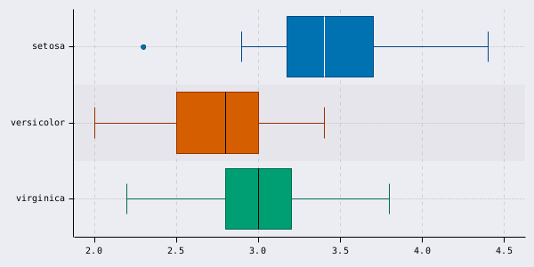
:::


With `:stat :identity` the chart reads the statistics from one row per level and group instead:


```{=html}
<div class="mapping"><div class="mapping-title">Mapping<span class="mapping-hint"> – the row values the chart reads, under <code>:mapping</code></span></div><ul><li><code>:lower</code> – With <code>:stat :identity</code>, a row's statistic of its level and group: the lower whisker end.</li><li><code>:q1</code> – With <code>:stat :identity</code>, a row's statistic of its level and group: the first quartile.</li><li><code>:median</code> – With <code>:stat :identity</code>, a row's statistic of its level and group: the median.</li><li><code>:q3</code> – With <code>:stat :identity</code>, a row's statistic of its level and group: the third quartile.</li><li><code>:upper</code> – With <code>:stat :identity</code>, a row's statistic of its level and group: the upper whisker end.</li><li><code>:outliers</code> – With <code>:stat :identity</code>, a row's statistic of its level and group: a collection of outlier values, optional.</li><li><code>:mean</code> – With <code>:stat :identity</code>, a row's statistic of its level and group: the mean, which the <code>:mean</code> option needs.</li><li><code>:n</code> – With <code>:stat :identity</code>, a row's statistic of its level and group: the count, which <code>:varwidth</code> and <code>:n-label</code> need.</li></ul></div>
```


::: {.sourceClojure}
```clojure
(def summaries [{:site "north" :lower 2.1 :q1 3.4 :median 4.0 :q3 4.9 :upper 6.3 :outliers [7.4 8.0] :mean 4.3 :n 40}
                {:site "south" :lower 1.0 :q1 2.2 :median 2.9 :q3 3.3 :upper 4.4 :outliers [0.2] :mean 2.8 :n 15}
                {:site "east" :lower 3.0 :q1 4.1 :median 5.2 :q3 5.8 :upper 7.0 :outliers [] :mean 5.0 :n 90}])
```
:::


```{=html}
<div class="data-table"><table class="table table-hover table-responsive clay-table"><thead><tr><th>upper</th><th>q1</th><th>q3</th><th>mean</th><th>site</th><th>n</th><th>outliers</th><th>median</th><th>lower</th></tr></thead><tbody><tr><td>6.3</td><td>3.4</td><td>4.9</td><td>4.3</td><td>north</td><td>40</td><td>[7.4 8.0]</td><td>4.0</td><td>2.1</td></tr><tr><td>4.4</td><td>2.2</td><td>3.3</td><td>2.8</td><td>south</td><td>15</td><td>[0.2]</td><td>2.9</td><td>1.0</td></tr><tr><td>7.0</td><td>4.1</td><td>5.8</td><td>5.0</td><td>east</td><td>90</td><td>[]</td><td>5.2</td><td>3.0</td></tr></tbody></table></div>
```


::: {.sourceClojure}
```clojure
(plot/render-image {:data summaries
                    :mapping {:y :site :lower :lower :q1 :q1 :median :median :q3 :q3 :upper :upper
                              :outliers :outliers :mean :mean :n :n}
                    :charts [(chart/box {:stat :identity :mean true :varwidth true})]
                    :scales {:y {:reverse true}}
                    :labels {:x "value"}}
                   {:width 600 :height 280})
```
:::


::: {.clay-image}
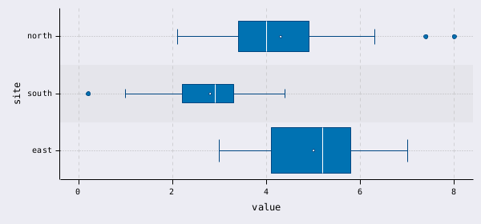
:::


These options style the boxes and outliers and pick what the chart draws. The plots below show rear axle ratios,
where the 4- and 8-cylinder groups have outliers: a custom style with the mean marker, no outliers with widths by
count, and the Tufte variant:


```{=html}
<dl class="options"><div class="option-card"><dt><code>:color</code><span class="option-default">Default: <code>[0 114 178]</code> (theme)</span></dt><dd><div class="option-example"><code>(chart/box {:color :orange})</code></div><div class="option-text">The fill colour of the boxes, and of the <code>:tufte</code> median point and mean marker; a mapped <code>:color</code> wins.<ul><li><a href="reference.types.html#solid-colour">solid colour</a></li></ul></div></dd></div><div class="option-card"><dt><code>:stroke-color</code><span class="option-default">Default: <code>:darker</code> (theme)</span></dt><dd><div class="option-example"><code>(chart/box {:stroke-color :none})</code></div><div class="option-text">The colour of the box outline, the whiskers and the outlier outlines.<ul><li><code>:darker</code> – The fill colour, darkened.</li><li><code>:none</code> – No box outline; the whiskers take the darkened fill.</li><li><a href="reference.types.html#solid-colour">solid colour</a> – Any other colour, e.g. <code>:black</code>.</li></ul></div></dd></div><div class="option-card"><dt><code>:stroke-width</code><span class="option-default">Default: <code>1</code> (theme)</span></dt><dd><div class="option-example"><code>(chart/box {:stroke-width 3})</code></div><div class="option-text">The width of the box outline, the whiskers and the median line in pixels; <code>0</code> draws no box outline.<ul><li><a href="reference.types.html#non-negative-number">non-negative number</a></li></ul></div></dd></div><div class="option-card"><dt><code>:shape</code><span class="option-default">Default: <code>\O</code> (theme)</span></dt><dd><div class="option-example"><code>(chart/box {:shape \s})</code></div><div class="option-text">The shape of the outlier points and of the <code>:tufte</code> median point; a mapped <code>:shape</code> wins.<ul><li><a href="reference.types.html#point-shape">point shape</a></li></ul></div></dd></div><div class="option-card"><dt><code>:size</code><span class="option-default">Default: <code>5</code> (theme)</span></dt><dd><div class="option-example"><code>(chart/box {:size 12})</code></div><div class="option-text">The size of the outlier points and of the <code>:tufte</code> median point in pixels; the mean marker is half of it, at least 3 pixels. A mapped <code>:size</code> wins.<ul><li><a href="reference.types.html#non-negative-number">non-negative number</a></li></ul></div></dd></div><div class="option-card"><dt><code>:stat</code><span class="option-default">Default: <code>:tukey</code></span></dt><dd><div class="option-example"><code>(chart/box {:data [{:l "a", :lo 1, :a 2, :m 3, :b 4, :hi 6}], :mapping {:x nil, :y :l, :lower :lo, :q1 :a, :median :m, :q3 :b, :upper :hi}, :stat :identity})</code></div><div class="option-text">Where the box statistics come from.<ul><li><code>:tukey</code> – Computed from the values: quartiles, whiskers to the most extreme values within 1.5 IQR, outliers beyond.</li><li><code>:identity</code> – Read from one row per level and group, through the mapping keys <code>:lower</code>, <code>:q1</code>, <code>:median</code>, <code>:q3</code>, <code>:upper</code>.</li></ul></div></dd></div><div class="option-card"><dt><code>:outliers</code><span class="option-default">Default: <code>true</code></span></dt><dd><div class="option-example"><code>(chart/box {:outliers false})</code></div><div class="option-text">Whether the chart draws the outliers; drawn outliers also widen the value axis.<ul><li><code>true</code> – Draws them.</li><li><code>false</code> – Draws none.</li></ul></div></dd></div><div class="option-card"><dt><code>:mean</code><span class="option-default">Default: <code>false</code></span></dt><dd><div class="option-example"><code>(chart/box {:mean true})</code></div><div class="option-text">Draws a mean marker; with <code>:stat :identity</code> it needs <code>:mean</code> mapped.<ul><li><code>false</code> – Draws none.</li><li><code>true</code> – Draws it.</li></ul></div></dd></div><div class="option-card"><dt><code>:varwidth</code><span class="option-default">Default: <code>false</code></span></dt><dd><div class="option-example"><code>(chart/box {:varwidth true})</code></div><div class="option-text">How wide each box is relative to the widest one; with <code>:stat :identity</code> it needs <code>:n</code> mapped.<ul><li><code>false</code> – Every box equally wide.</li><li><code>true</code> – By the square root of each box's count of values.</li></ul></div></dd></div><div class="option-card"><dt><code>:variant</code><span class="option-default">Default: <code>:classic</code></span></dt><dd><div class="option-example"><code>(chart/box {:variant :tufte})</code></div><div class="option-text">How the chart draws each box.<ul><li><code>:classic</code> – A box with a median line and whiskers with caps.</li><li><code>:tufte</code> – Tufte's quartile plot: no box, a median point and a line from each whisker end to its quartile.</li></ul></div></dd></div><div class="option-card"><dt><code>:padding</code><span class="option-default">Default: <code>0.05</code> at both ends of the value axis; with <code>:place :bottom</code>, also the <code>:bottom-share</code> below the data.</span></dt><dd><div class="option-example"><code>(chart/box {:padding {:x [0.3 0.3]}})</code></div><div class="option-text">Room around the data on x and y, as fractions of the data span.<ul><li><span>map of <code>:x</code> or <code>:y</code> to padding</span></li></ul></div></dd></div></dl>
```


::: {.sourceClojure}
```clojure
(plot/render-image (plot/arrange [{:data mtcars
                                   :mapping {:x :drat :y :cyl}
                                   :charts [(chart/box {:color [230 160 60] :stroke-color :black :stroke-width 2 :shape \x :size 9
                                                        :mean true})]
                                   :scales {:y {:type :categorical :reverse true}}
                                   :labels {:title "style, :mean true"}}
                                  {:data mtcars
                                   :mapping {:x :drat :y :cyl}
                                   :charts [(chart/box {:outliers false :varwidth true})]
                                   :scales {:y {:type :categorical :reverse true}}
                                   :labels {:title ":outliers false, :varwidth"}}
                                  {:data mtcars
                                   :mapping {:x :drat :y :cyl}
                                   :charts [(chart/box {:variant :tufte})]
                                   :scales {:y {:type :categorical :reverse true}}
                                   :labels {:title ":variant :tufte"}}]
                                 {:columns 3})
                   {:width 1000 :height 300})
```
:::


::: {.clay-image}
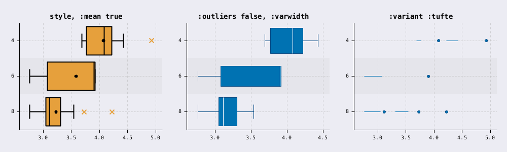
:::


On the right `:padding` widens the value axis by 40% of the values' span on each side; the left panel keeps the
default:


::: {.sourceClojure}
```clojure
(plot/render-image (plot/arrange [{:data mtcars
                                   :mapping {:x :drat :y :cyl}
                                   :charts [(chart/box)]
                                   :scales {:y {:type :categorical :reverse true}}
                                   :labels {:title "default padding"}}
                                  {:data mtcars
                                   :mapping {:x :drat :y :cyl}
                                   :charts [(chart/box {:padding {:x [0.4 0.4]}})]
                                   :scales {:y {:type :categorical :reverse true}}
                                   :labels {:title ":padding {:x [0.4 0.4]}"}}]
                                 {:columns 2})
                   {:width 900 :height 280})
```
:::


::: {.clay-image}
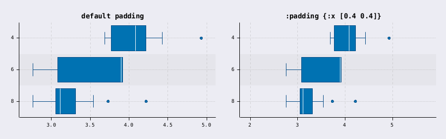
:::


## Violin plots

`chart/violin` draws a kernel density estimate of each level's values, mirrored around its centre line, with inner
marks, a small box by default. Use it to see the shape of a distribution, e.g. two peaks a box plot hides.


```{=html}
<div class="shared"><div class="shared-title">Shared options<span class="shared-hint"> – groups of options other charts take too</span></div><ul><li><a href="reference.shared_options.html#fill-patterns">Fill patterns</a> – <code>:pattern</code> <code>:pattern-color</code></li><li><a href="reference.shared_options.html#common-options">Common options</a> – <code>:data</code> <code>:mapping</code> <code>:legend</code></li><li><a href="reference.shared_options.html#named-theme-styles">Named theme styles</a> – <code>:theme-style</code></li><li><a href="reference.shared_options.html#strip-options">Strip options</a> – <code>:place</code> <code>:width</code> <code>:thickness</code> <code>:position</code> <code>:dodge-gap</code> <code>:bottom-share</code> <code>:n-label</code> <code>:n-format</code> <code>:level-axis</code></li></ul></div>
```


```{=html}
<div class="mapping"><div class="mapping-title">Mapping<span class="mapping-hint"> – the row values the chart reads, under <code>:mapping</code></span></div><ul><li><code>:x</code> – The values of horizontal violins, or the levels of vertical ones.</li><li><code>:y</code> – The levels of horizontal violins, or the values of vertical ones; with no levels the chart draws one violin.</li><li><code>:color</code> – Splits the rows into groups, each a violin in its own fill colour.</li><li><code>:pattern</code> – Splits the rows into groups, each a violin with its own fill pattern.</li><li><code>:group</code> – Splits the rows into groups that look the same, each its own violin.</li></ul></div>
```


::: {.sourceClojure}
```clojure
(plot/render-image {:data iris
                    :mapping {:x :species :y :petal-length :color :species}
                    :charts [(chart/violin)]
                    :legend false}
                   {:width 600 :height 320})
```
:::


::: {.clay-image}
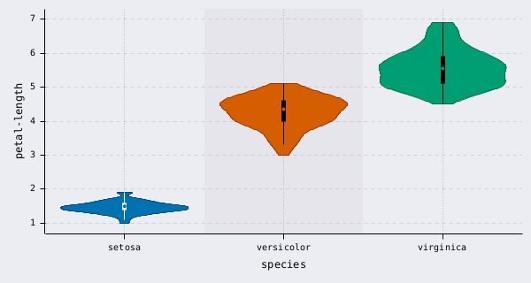
:::


These options style the violins and set the density estimate, the widths and the inner marks. The panels below
pair a bandwidth, a reach past the data and a width scale with three inner marks:


```{=html}
<dl class="options"><div class="option-card"><dt><code>:color</code><span class="option-default">Default: <code>[0 114 178]</code> (theme)</span></dt><dd><div class="option-example"><code>(chart/violin {:color :orange})</code></div><div class="option-text">The fill colour of the violins; a mapped <code>:color</code> wins.<ul><li><a href="reference.types.html#solid-colour">solid colour</a></li></ul></div></dd></div><div class="option-card"><dt><code>:stroke-color</code><span class="option-default">Default: <code>:darker</code> (theme)</span></dt><dd><div class="option-example"><code>(chart/violin {:stroke-color :none})</code></div><div class="option-text">The outline colour of the violins.<ul><li><code>:darker</code> – The fill colour, darkened.</li><li><code>:none</code> – No outline.</li><li><a href="reference.types.html#solid-colour">solid colour</a> – Any other colour, e.g. <code>:black</code>.</li></ul></div></dd></div><div class="option-card"><dt><code>:stroke-width</code><span class="option-default">Default: <code>1</code> (theme)</span></dt><dd><div class="option-example"><code>(chart/violin {:stroke-width 3})</code></div><div class="option-text">The outline width in pixels; <code>0</code> draws no outline.<ul><li><a href="reference.types.html#non-negative-number">non-negative number</a></li></ul></div></dd></div><div class="option-card"><dt><code>:inner-color</code><span class="option-default">Default: <code>:contrast</code> (theme)</span></dt><dd><div class="option-example"><code>(chart/violin {:inner-color :none})</code></div><div class="option-text">The colour of the inner marks.<ul><li><code>:contrast</code> – Black or white, whichever reads better on the fill.</li><li><code>:none</code> – No inner marks.</li><li><a href="reference.types.html#solid-colour">solid colour</a> – Any other colour, e.g. <code>:black</code>.</li></ul></div></dd></div><div class="option-card"><dt><code>:kernel</code><span class="option-default">Default: <code>:gaussian</code></span></dt><dd><div class="option-example"><code>(chart/violin {:kernel :epanechnikov})</code></div><div class="option-text">The kernel of the density estimate.<ul><li><code>:gaussian</code> – The normal curve; smooth, with long tails.</li><li><code>:epanechnikov</code> – A parabola, the most efficient kernel in theory.</li><li><code>:triangular</code> – A triangle.</li><li><code>:uniform</code> – A flat step: a moving count.</li><li class="option-other">Other fastmath kernels. <code>:cauchy</code>, <code>:cosine</code>, <code>:laplace</code>, <code>:logistic</code>, <code>:quartic</code>, <code>:sigmoid</code>, <code>:silverman</code>, <code>:tricube</code>, <code>:triweight</code>, <code>:wigner</code></li></ul></div></dd></div><div class="option-card"><dt><code>:bandwidth</code><span class="option-default">Default: <code>:nrd0</code></span></dt><dd><div class="option-example"><code>(chart/violin {:bandwidth 0.2})</code></div><div class="option-text">The bandwidth of the density estimate: how far each value's kernel spreads.<ul><li><code>:nrd0</code> – Silverman's rule of thumb, R's default.</li><li><code>:nrd</code> – Scott's rule of thumb, wider than <code>:nrd0</code>.</li><li><code>:sj</code> – Sheather and Jones' plug-in selector, good for multimodal data.</li><li class="option-other">Other fastmath selectors: rule-of-thumb, plug-in and cross-validation variants. <code>:nrd-adjust</code>, <code>:sj-dpi</code>, <code>:lscv</code>, <code>:lcv</code>, <code>:rlcv</code></li><li><a href="reference.types.html#positive-finite-number">positive finite number</a> – A bandwidth in data units, e.g. <code>0.3</code>.</li></ul></div></dd></div><div class="option-card"><dt><code>:n</code><span class="option-default">Default: <code>100</code></span></dt><dd><div class="option-example"><code>(chart/violin {:n 4})</code></div><div class="option-text">The number of points at which the chart evaluates each violin's density.<ul><li><span>integer at least 2</span></li></ul></div></dd></div><div class="option-card"><dt><code>:cut</code><span class="option-default">Default: <code>0.0</code></span></dt><dd><div class="option-example"><code>(chart/violin {:cut 3})</code></div><div class="option-text">How far each violin reaches past its values' range, in bandwidths; <code>0</code> stops at the range.<ul><li><a href="reference.types.html#non-negative-number">non-negative number</a></li></ul></div></dd></div><div class="option-card"><dt><code>:scale</code><span class="option-default">Default: <code>:width</code></span></dt><dd><div class="option-example"><code>(chart/violin {:scale :area})</code></div><div class="option-text">How the chart scales the violins' widths.<ul><li><code>:width</code> – Every violin as wide as its slot.</li><li><code>:area</code> – Equal areas: the densities on one scale.</li><li><code>:count</code> – Areas proportional to the counts of values.</li></ul></div></dd></div><div class="option-card"><dt><code>:varwidth</code><span class="option-default">Default: <code>false</code></span></dt><dd><div class="option-example"><code>(chart/violin {:varwidth true})</code></div><div class="option-text">How wide each violin is relative to the widest one; it multiplies the width <code>:scale</code> gives.<ul><li><code>false</code> – Every violin as wide as <code>:scale</code> makes it.</li><li><code>true</code> – By the square root of each violin's count of values.</li></ul></div></dd></div><div class="option-card"><dt><code>:inner</code><span class="option-default">Default: <code>:box</code></span></dt><dd><div class="option-example"><code>(chart/violin {:inner :quartiles})</code></div><div class="option-text">The marks the chart draws inside each violin.<ul><li><code>:box</code> – A thin interquartile bar, a whisker line and a median dot.</li><li><code>:quartiles</code> – Dashed lines across at the quartiles and a line at the median.</li><li><code>:rug</code> – A tick per value.</li><li><code>:points</code> – The values on the centre line.</li><li><code>:none</code> – No inner marks.</li></ul></div></dd></div><div class="option-card"><dt><code>:padding</code><span class="option-default">Default: <code>0.05</code> at both ends of the value axis; with <code>:place :bottom</code>, also the <code>:bottom-share</code> below the data.</span></dt><dd><div class="option-example"><code>(chart/violin {:padding {:x [0.3 0.3]}})</code></div><div class="option-text">Room around the data on x and y, as fractions of the data span.<ul><li><span>map of <code>:x</code> or <code>:y</code> to padding</span></li></ul></div></dd></div></dl>
```


::: {.sourceClojure}
```clojure
(plot/render-image (plot/arrange [{:data iris
                                   :mapping {:x :species :y :petal-length}
                                   :charts [(chart/violin {:bandwidth 0.1 :inner :quartiles})]
                                   :labels {:title ":bandwidth 0.1, :inner :quartiles"}}
                                  {:data iris
                                   :mapping {:x :species :y :petal-length}
                                   :charts [(chart/violin {:cut 2 :inner :rug :inner-color [200 40 40]})]
                                   :labels {:title ":cut 2, :inner :rug"}}
                                  {:data mtcars
                                   :mapping {:x :cyl :y :mpg}
                                   :charts [(chart/violin {:scale :count :inner :points})]
                                   :scales {:x {:type :categorical}}
                                   :labels {:title ":scale :count, :inner :points"}}]
                                 {:columns 3})
                   {:width 1000 :height 320})
```
:::


::: {.clay-image}
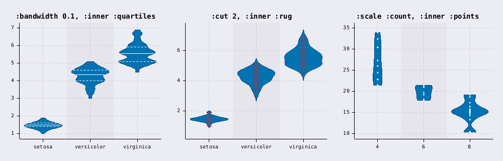
:::


A theme sets the inner marks' sizes and the quartile dash; below, a wider inner box with a bigger median and
dotted quartiles:


```{=html}
<div class="mapping"><div class="mapping-title">Theme keys<span class="mapping-hint"> – set under <code>[:theme :chart :violin]</code>, not options</span></div><ul><li><code>:inner-box-width</code> (default <code>5.0</code>) – The width of the inner box, the quartile bar of <code>:inner :box</code>, in pixels.</li><li><code>:inner-median-size</code> (default <code>4.0</code>) – The diameter of the median dot of <code>:inner :box</code>, in pixels.</li><li><code>:inner-quartile-dash</code> (default <code>[4.0 3.0]</code>) – The dash style of the quartile lines of <code>:inner :quartiles</code>.</li><li><code>:inner-rug-width</code> (default <code>1.0</code>) – The line width of the ticks of <code>:inner :rug</code>, in pixels.</li><li><code>:inner-point-size</code> (default <code>3.0</code>) – The diameter of the points of <code>:inner :points</code>, in pixels.</li></ul></div>
```


::: {.sourceClojure}
```clojure
(plot/render-image (plot/arrange [{:data iris
                                   :mapping {:x :species :y :petal-length}
                                   :charts [(chart/violin)]
                                   :theme {:chart {:violin {:inner-box-width 10 :inner-median-size 8}}}
                                   :labels {:title "wider inner box, bigger median"}}
                                  {:data iris
                                   :mapping {:x :species :y :petal-length}
                                   :charts [(chart/violin {:inner :quartiles})]
                                   :theme {:chart {:violin {:inner-quartile-dash [1.0 2.0]}}}
                                   :labels {:title "dotted quartiles"}}]
                                 {:columns 2})
                   {:width 800 :height 320})
```
:::


::: {.clay-image}
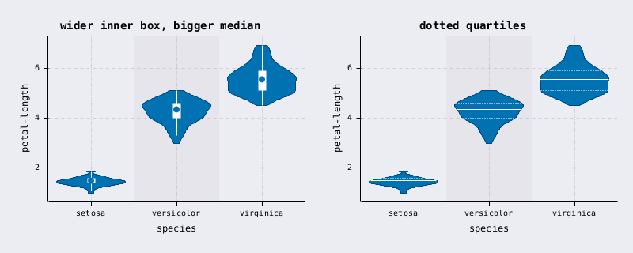
:::


The left panel sets a fill and outline. The middle one evaluates the Epanechnikov kernel at only 8 points, so its
outline is coarse. The right one, on mtcars by cylinders, sets `:varwidth` and `:padding`:


::: {.sourceClojure}
```clojure
(plot/render-image (plot/arrange [{:data iris
                                   :mapping {:x :species :y :petal-length}
                                   :charts [(chart/violin {:color [230 160 60] :stroke-color :black :stroke-width 2})]
                                   :labels {:title "fill and outline"}}
                                  {:data iris
                                   :mapping {:x :species :y :petal-length}
                                   :charts [(chart/violin {:kernel :epanechnikov :n 8})]
                                   :labels {:title ":kernel :epanechnikov, :n 8"}}
                                  {:data mtcars
                                   :mapping {:x :cyl :y :mpg}
                                   :charts [(chart/violin {:varwidth true :padding {:y [0.3 0.3]}})]
                                   :scales {:x {:type :categorical}}
                                   :labels {:title ":varwidth, :padding"}}]
                                 {:columns 3})
                   {:width 1000 :height 320})
```
:::


::: {.clay-image}
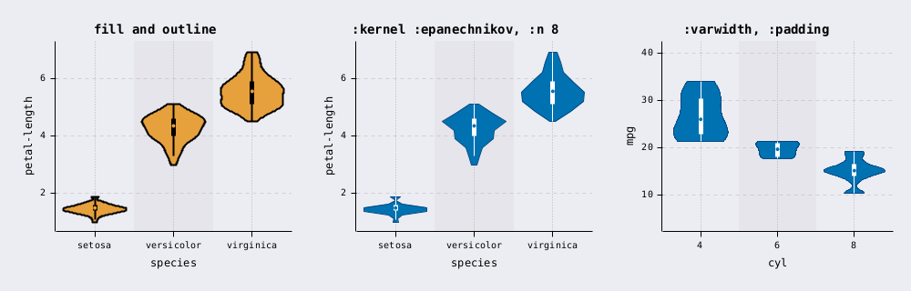
:::


The panels show each `:scale` on mtcars by gears (15, 12 and 5 cars). With areas by count the five-gear violin
shrinks:


::: {.sourceClojure}
```clojure
(plot/render-image (plot/arrange [{:data mtcars
                                   :mapping {:x :gear :y :mpg}
                                   :charts [(chart/violin {:scale :width})]
                                   :scales {:x {:type :categorical}}
                                   :labels {:title ":scale :width"}}
                                  {:data mtcars
                                   :mapping {:x :gear :y :mpg}
                                   :charts [(chart/violin {:scale :area})]
                                   :scales {:x {:type :categorical}}
                                   :labels {:title ":scale :area"}}
                                  {:data mtcars
                                   :mapping {:x :gear :y :mpg}
                                   :charts [(chart/violin {:scale :count})]
                                   :scales {:x {:type :categorical}}
                                   :labels {:title ":scale :count"}}]
                                 {:columns 3})
                   {:width 1000 :height 300})
```
:::


::: {.clay-image}
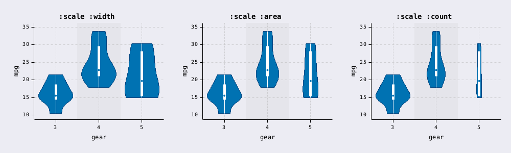
:::


The panels show each `:inner` mark in turn:


::: {.sourceClojure}
```clojure
(plot/render-image (plot/arrange [{:data iris :mapping {:x :species :y :petal-length}
                                   :charts [(chart/violin {:inner :box})] :labels {:title ":inner :box"}}
                                  {:data iris :mapping {:x :species :y :petal-length}
                                   :charts [(chart/violin {:inner :quartiles})] :labels {:title ":quartiles"}}
                                  {:data iris :mapping {:x :species :y :petal-length}
                                   :charts [(chart/violin {:inner :rug})] :labels {:title ":rug"}}
                                  {:data iris :mapping {:x :species :y :petal-length}
                                   :charts [(chart/violin {:inner :points})] :labels {:title ":points"}}
                                  {:data iris :mapping {:x :species :y :petal-length}
                                   :charts [(chart/violin {:inner :none})] :labels {:title ":none"}}]
                                 {:columns 5})
                   {:width 1000 :height 300})
```
:::


::: {.clay-image}
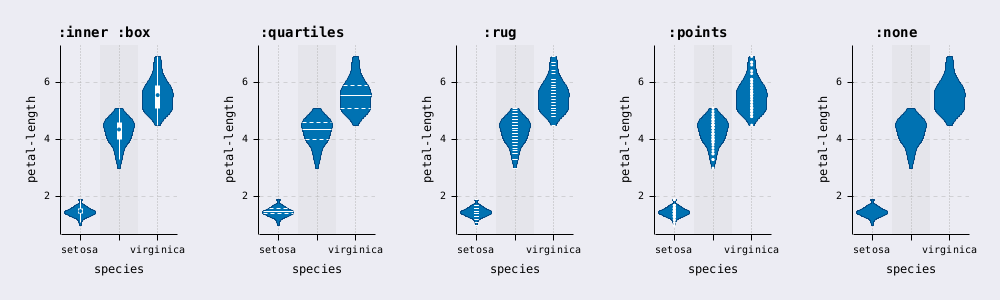
:::


## Error bars

`chart/extent` draws an interval per level and group, computed from the values - their range, a confidence
interval, quantiles or a bootstrap estimate - with a mark at its centre. Use it for error bars, alone or over bars and
points.


```{=html}
<div class="shared"><div class="shared-title">Shared options<span class="shared-hint"> – groups of options other charts take too</span></div><ul><li><a href="reference.shared_options.html#common-options">Common options</a> – <code>:data</code> <code>:mapping</code> <code>:legend</code></li><li><a href="reference.shared_options.html#named-theme-styles">Named theme styles</a> – <code>:theme-style</code></li><li><a href="reference.shared_options.html#strip-options">Strip options</a> – <code>:place</code> <code>:width</code> <code>:thickness</code> <code>:position</code> <code>:dodge-gap</code> <code>:bottom-share</code> <code>:n-label</code> <code>:n-format</code> <code>:level-axis</code></li><li><a href="reference.shared_options.html#mirrored-strips">Mirrored strips</a> – <code>:mirror</code></li></ul></div>
```


```{=html}
<div class="mapping"><div class="mapping-title">Mapping<span class="mapping-hint"> – the row values the chart reads, under <code>:mapping</code></span></div><ul><li><code>:x</code> – The values of horizontal intervals, or the levels of vertical ones.</li><li><code>:y</code> – The levels of horizontal intervals, or the values of vertical ones; with no levels the chart draws one interval.</li><li><code>:color</code> – Splits the rows into groups, each with its own interval colour.</li><li><code>:shape</code> – Splits the rows into groups, each with its own centre mark shape.</li><li><code>:size</code> – Splits the rows into groups, each with its own centre mark size.</li><li><code>:group</code> – Splits the rows into groups that look the same, each its own interval beside the others of its level.</li></ul></div>
```


::: {.sourceClojure}
```clojure
(plot/render-image {:data iris
                    :mapping {:x :sepal-length :y :species}
                    :charts [(chart/extent)]
                    :scales {:y {:reverse true}}}
                   {:width 600 :height 280})
```
:::


::: {.clay-image}
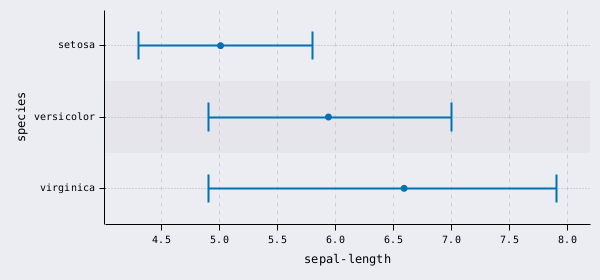
:::


These options style the intervals and pick the method that computes them. The panels show `:stddev` in a custom
style, the 10th to 90th percentiles without a centre, and a seeded bootstrap of the mean:


```{=html}
<dl class="options"><div class="option-card"><dt><code>:color</code><span class="option-default">Default: <code>[0 114 178]</code> (theme)</span></dt><dd><div class="option-example"><code>(chart/extent {:color :orange})</code></div><div class="option-text">The colour of the intervals; a mapped <code>:color</code> wins.<ul><li><a href="reference.types.html#solid-colour">solid colour</a></li></ul></div></dd></div><div class="option-card"><dt><code>:line-width</code><span class="option-default">Default: <code>2</code> (theme)</span></dt><dd><div class="option-example"><code>(chart/extent {:line-width 5})</code></div><div class="option-text">The width of the interval lines in pixels.<ul><li><a href="reference.types.html#non-negative-number">non-negative number</a></li></ul></div></dd></div><div class="option-card"><dt><code>:shape</code><span class="option-default">Default: <code>\O</code> (theme)</span></dt><dd><div class="option-example"><code>(chart/extent {:shape \s})</code></div><div class="option-text">The shape of the centre mark; a mapped <code>:shape</code> wins.<ul><li><a href="reference.types.html#point-shape">point shape</a></li></ul></div></dd></div><div class="option-card"><dt><code>:size</code><span class="option-default">Default: <code>7</code> (theme)</span></dt><dd><div class="option-example"><code>(chart/extent {:size 14})</code></div><div class="option-text">The size of the centre mark in pixels; a mapped <code>:size</code> wins.<ul><li><a href="reference.types.html#non-negative-number">non-negative number</a></li></ul></div></dd></div><div class="option-card"><dt><code>:method</code><span class="option-default">Default: <code>:min-max</code></span></dt><dd><div class="option-example"><code>(chart/extent {:method :stddev})</code></div><div class="option-text">How the chart computes each interval from the values.<ul><li><code>:min-max</code> – The smallest and the largest value.</li><li><code>:bootstrap-percentile</code> – The percentile bootstrap interval of <code>:statistic</code>, by default 95% of 500 resamples.</li><li><code>:ci</code> – The t-based confidence interval of the mean, by default 95%.</li><li><code>:percentile</code> – Two percentiles around the median, by default the 25th and 75th.</li><li><code>:sem</code> – The mean plus and minus its standard error.</li><li><code>:stddev</code> – The mean plus and minus one standard deviation.</li><li class="option-other">Other fastmath extents and bootstrap intervals; the bootstrap ones resample <code>:statistic</code>. <code>:adjacent</code>, <code>:bootstrap-basic</code>, <code>:bootstrap-bc</code>, <code>:bootstrap-bca</code>, <code>:bootstrap-mad-median</code>, <code>:bootstrap-normal</code>, <code>:bootstrap-studentized</code>, <code>:bootstrap-t</code>, <code>:hpdi</code>, <code>:inner-fence</code>, <code>:mad</code>, <code>:outer-fence</code>, <code>:percentile-bc</code>, <code>:percentile-bca</code>, <code>:pi</code>, <code>:quantile</code></li><li><a href="reference.types.html#function">function</a> – A function of the values that returns <code>[lo hi]</code> or <code>[lo hi centre]</code>.</li></ul></div></dd></div><div class="option-card"><dt><code>:statistic</code><span class="option-default">Default: The mean.</span></dt><dd><div class="option-example"><code>(chart/extent {:method :bootstrap-percentile, :rng (r/rng :mersenne 7), :statistic (fn [vs] (stats/median vs))})</code></div><div class="option-text">The statistic the bootstrap methods compute on each resample, a function of the values.<ul><li><a href="reference.types.html#function">function</a></li></ul></div></dd></div><div class="option-card"><dt><code>:method-args</code><span class="option-default">Default: None: the method's defaults.</span></dt><dd><div class="option-example"><code>(chart/extent {:method :percentile, :method-args [10.0 90.0]})</code></div><div class="option-text">Extra arguments the method takes after the values, e.g. <code>[10.0 90.0]</code> for <code>:percentile</code>, <code>[0.01]</code> (alpha) for a 99% <code>:ci</code>, <code>[alpha samples]</code> for a bootstrap method.<ul><li><span>sequence of any values</span></li></ul></div></dd></div><div class="option-card"><dt><code>:rng</code><span class="option-default">Default: An unseeded generator, so each build resamples differently.</span></dt><dd><div class="option-example"><code>(chart/extent {:method :bootstrap-percentile, :rng (r/rng :mersenne 7)})</code></div><div class="option-text">The random generator the bootstrap methods resample with. A seeded one gives the same intervals on every build.<ul><li><a href="reference.types.html#random-generator">random generator</a></li></ul></div></dd></div><div class="option-card"><dt><code>:center</code><span class="option-default">Default: <code>:method</code></span></dt><dd><div class="option-example"><code>(chart/extent {:center :none})</code></div><div class="option-text">What the chart marks at each interval's centre.<ul><li><code>:method</code> – The method's centre, e.g. the mean or median.</li><li><code>:none</code> – No centre mark.</li></ul></div></dd></div><div class="option-card"><dt><code>:padding</code><span class="option-default">Default: <code>0.05</code> at both ends of the value axis; with <code>:place :bottom</code>, also the <code>:bottom-share</code> below the data.</span></dt><dd><div class="option-example"><code>(chart/extent {:padding {:x [0.3 0.3]}})</code></div><div class="option-text">Room around the data on x and y, as fractions of the data span.<ul><li><span>map of <code>:x</code> or <code>:y</code> to padding</span></li></ul></div></dd></div></dl>
```


::: {.sourceClojure}
```clojure
(plot/render-image (plot/arrange [{:data iris
                                   :mapping {:x :sepal-length :y :species}
                                   :charts [(chart/extent {:method :stddev :color [200 80 40] :line-width 4 :shape \s})]
                                   :scales {:y {:reverse true}}
                                   :labels {:title ":method :stddev"}}
                                  {:data iris
                                   :mapping {:x :sepal-length :y :species}
                                   :charts [(chart/extent {:method :percentile :method-args [10.0 90.0] :center :none})]
                                   :scales {:y {:reverse true}}
                                   :labels {:title "10-90 percentiles, no centre"}}
                                  {:data iris
                                   :mapping {:x :sepal-length :y :species}
                                   :charts [(chart/extent {:method :bootstrap-percentile :rng (r/rng :mersenne 3)})]
                                   :scales {:y {:reverse true}}
                                   :labels {:title "bootstrap mean"}}]
                                 {:columns 3})
                   {:width 1000 :height 300})
```
:::


::: {.clay-image}
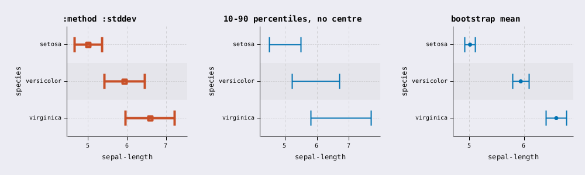
:::


The plot below draws every method on setosa sepal lengths, a level each: the range, spreads around the mean
(`:mad` around the median), quantile intervals, Tukey's whisker ends and fences, the mean's confidence interval
and seeded bootstrap intervals:


::: {.sourceClojure}
```clojure
(def setosa (filter #(= "setosa" (:species %)) iris))
```
:::


```{=html}
<div class="data-table"><table class="table table-hover table-responsive clay-table"><thead><tr><th>sepal-length</th><th>sepal-width</th><th>petal-length</th><th>petal-width</th><th>species</th></tr></thead><tbody><tr><td>5.1</td><td>3.5</td><td>1.4</td><td>0.2</td><td>setosa</td></tr><tr><td>4.9</td><td>3</td><td>1.4</td><td>0.2</td><td>setosa</td></tr><tr><td>4.7</td><td>3.2</td><td>1.3</td><td>0.2</td><td>setosa</td></tr><tr><td>4.6</td><td>3.1</td><td>1.5</td><td>0.2</td><td>setosa</td></tr><tr><td>5</td><td>3.6</td><td>1.4</td><td>0.2</td><td>setosa</td></tr><tr><td>5.4</td><td>3.9</td><td>1.7</td><td>0.4</td><td>setosa</td></tr><tr><td>4.6</td><td>3.4</td><td>1.4</td><td>0.3</td><td>setosa</td></tr><tr><td>5</td><td>3.4</td><td>1.5</td><td>0.2</td><td>setosa</td></tr><tr><td>4.4</td><td>2.9</td><td>1.4</td><td>0.2</td><td>setosa</td></tr><tr><td>4.9</td><td>3.1</td><td>1.5</td><td>0.1</td><td>setosa</td></tr><tr><td>5.4</td><td>3.7</td><td>1.5</td><td>0.2</td><td>setosa</td></tr><tr><td>4.8</td><td>3.4</td><td>1.6</td><td>0.2</td><td>setosa</td></tr><tr><td>4.8</td><td>3</td><td>1.4</td><td>0.1</td><td>setosa</td></tr><tr><td>4.3</td><td>3</td><td>1.1</td><td>0.1</td><td>setosa</td></tr><tr><td>5.8</td><td>4</td><td>1.2</td><td>0.2</td><td>setosa</td></tr><tr><td>5.7</td><td>4.4</td><td>1.5</td><td>0.4</td><td>setosa</td></tr><tr><td>5.4</td><td>3.9</td><td>1.3</td><td>0.4</td><td>setosa</td></tr><tr><td>5.1</td><td>3.5</td><td>1.4</td><td>0.3</td><td>setosa</td></tr><tr><td>5.7</td><td>3.8</td><td>1.7</td><td>0.3</td><td>setosa</td></tr><tr><td>5.1</td><td>3.8</td><td>1.5</td><td>0.3</td><td>setosa</td></tr><tr><td>5.4</td><td>3.4</td><td>1.7</td><td>0.2</td><td>setosa</td></tr><tr><td>5.1</td><td>3.7</td><td>1.5</td><td>0.4</td><td>setosa</td></tr><tr><td>4.6</td><td>3.6</td><td>1</td><td>0.2</td><td>setosa</td></tr><tr><td>5.1</td><td>3.3</td><td>1.7</td><td>0.5</td><td>setosa</td></tr><tr><td>4.8</td><td>3.4</td><td>1.9</td><td>0.2</td><td>setosa</td></tr><tr><td>5</td><td>3</td><td>1.6</td><td>0.2</td><td>setosa</td></tr><tr><td>5</td><td>3.4</td><td>1.6</td><td>0.4</td><td>setosa</td></tr><tr><td>5.2</td><td>3.5</td><td>1.5</td><td>0.2</td><td>setosa</td></tr><tr><td>5.2</td><td>3.4</td><td>1.4</td><td>0.2</td><td>setosa</td></tr><tr><td>4.7</td><td>3.2</td><td>1.6</td><td>0.2</td><td>setosa</td></tr><tr><td>4.8</td><td>3.1</td><td>1.6</td><td>0.2</td><td>setosa</td></tr><tr><td>5.4</td><td>3.4</td><td>1.5</td><td>0.4</td><td>setosa</td></tr><tr><td>5.2</td><td>4.1</td><td>1.5</td><td>0.1</td><td>setosa</td></tr><tr><td>5.5</td><td>4.2</td><td>1.4</td><td>0.2</td><td>setosa</td></tr><tr><td>4.9</td><td>3.1</td><td>1.5</td><td>0.2</td><td>setosa</td></tr><tr><td>5</td><td>3.2</td><td>1.2</td><td>0.2</td><td>setosa</td></tr><tr><td>5.5</td><td>3.5</td><td>1.3</td><td>0.2</td><td>setosa</td></tr><tr><td>4.9</td><td>3.6</td><td>1.4</td><td>0.1</td><td>setosa</td></tr><tr><td>4.4</td><td>3</td><td>1.3</td><td>0.2</td><td>setosa</td></tr><tr><td>5.1</td><td>3.4</td><td>1.5</td><td>0.2</td><td>setosa</td></tr><tr><td>5</td><td>3.5</td><td>1.3</td><td>0.3</td><td>setosa</td></tr><tr><td>4.5</td><td>2.3</td><td>1.3</td><td>0.3</td><td>setosa</td></tr><tr><td>4.4</td><td>3.2</td><td>1.3</td><td>0.2</td><td>setosa</td></tr><tr><td>5</td><td>3.5</td><td>1.6</td><td>0.6</td><td>setosa</td></tr><tr><td>5.1</td><td>3.8</td><td>1.9</td><td>0.4</td><td>setosa</td></tr><tr><td>4.8</td><td>3</td><td>1.4</td><td>0.3</td><td>setosa</td></tr><tr><td>5.1</td><td>3.8</td><td>1.6</td><td>0.2</td><td>setosa</td></tr><tr><td>4.6</td><td>3.2</td><td>1.4</td><td>0.2</td><td>setosa</td></tr><tr><td>5.3</td><td>3.7</td><td>1.5</td><td>0.2</td><td>setosa</td></tr><tr><td>5</td><td>3.3</td><td>1.4</td><td>0.2</td><td>setosa</td></tr></tbody></table></div>
```


::: {.sourceClojure}
```clojure
(plot/render-image {:data setosa
                    :mapping {:x :sepal-length}
                    :charts (vec (for [m [:min-max :stddev :sem :mad :percentile :quantile :pi :hpdi :percentile-bc
                                     :percentile-bca :adjacent :inner-fence :outer-fence :ci :bootstrap-normal
                                     :bootstrap-percentile :bootstrap-basic :bootstrap-bc :bootstrap-bca
                                     :bootstrap-studentized :bootstrap-t :bootstrap-mad-median]]
                              (chart/extent {:method m :rng (r/rng :mersenne 5)
                                             :mapping {:y (constantly (name m))}})))
                    :scales {:y {:reverse true}}
                    :labels {:x "sepal length [cm]"}}
                   {:width 700 :height 600})
```
:::


::: {.clay-image}
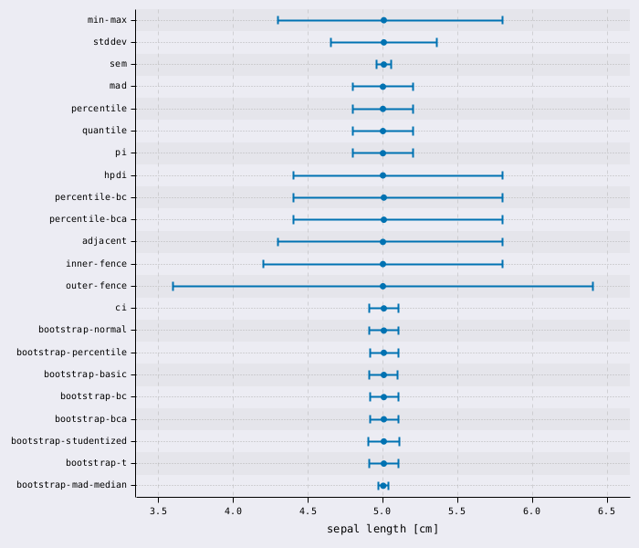
:::


On the left the bootstrap resamples the median instead of the mean (compare the "bootstrap mean" panel above), and
`:size` enlarges its centre mark. On the right `:padding` widens the value axis:


::: {.sourceClojure}
```clojure
(plot/render-image (plot/arrange [{:data iris
                                   :mapping {:x :sepal-length :y :species}
                                   :charts [(chart/extent {:method :bootstrap-percentile :rng (r/rng :mersenne 3)
                                                           :statistic stats/median :size 12})]
                                   :scales {:y {:reverse true}}
                                   :labels {:title ":statistic stats/median"}}
                                  {:data iris
                                   :mapping {:x :sepal-length :y :species}
                                   :charts [(chart/extent {:padding {:x [0.5 0.5]}})]
                                   :scales {:y {:reverse true}}
                                   :labels {:title ":padding {:x [0.5 0.5]}"}}]
                                 {:columns 2})
                   {:width 800 :height 300})
```
:::


::: {.clay-image}
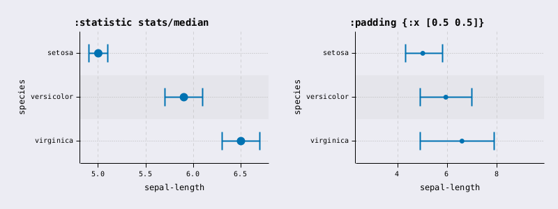
:::


## Strip plots

`chart/stripplot` draws every value as a point across its level's strip, jittered so equal values don't hide each
other. Use it for small samples, where each value counts.


```{=html}
<div class="shared"><div class="shared-title">Shared options<span class="shared-hint"> – groups of options other charts take too</span></div><ul><li><a href="reference.shared_options.html#common-options">Common options</a> – <code>:data</code> <code>:mapping</code> <code>:legend</code></li><li><a href="reference.shared_options.html#named-theme-styles">Named theme styles</a> – <code>:theme-style</code></li><li><a href="reference.shared_options.html#strip-options">Strip options</a> – <code>:place</code> <code>:width</code> <code>:thickness</code> <code>:position</code> <code>:dodge-gap</code> <code>:bottom-share</code> <code>:n-label</code> <code>:n-format</code> <code>:level-axis</code></li></ul></div>
```


```{=html}
<div class="mapping"><div class="mapping-title">Mapping<span class="mapping-hint"> – the row values the chart reads, under <code>:mapping</code></span></div><ul><li><code>:x</code> – The values of horizontal strips, or the levels of vertical ones.</li><li><code>:y</code> – The levels of horizontal strips, or the values of vertical ones; with no levels the chart draws one strip.</li><li><code>:color</code> – Splits the rows into groups, each in its own point colour.</li><li><code>:shape</code> – Splits the rows into groups, each with its own point shape.</li><li><code>:size</code> – Splits the rows into groups, each with its own point size.</li><li><code>:group</code> – Splits the rows into groups that look the same, dodged as other groups.</li></ul></div>
```


::: {.sourceClojure}
```clojure
(plot/render-image {:data iris
                    :mapping {:x :sepal-length :y :species :color :species}
                    :charts [(chart/stripplot {:rng (r/rng :mersenne 1)})]
                    :scales {:y {:reverse true}}
                    :legend false}
                   {:width 600 :height 280})
```
:::


::: {.clay-image}
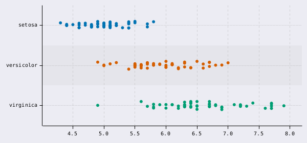
:::


These options style the points and set the jitter, seeded here so every build draws the same image. The panels
show no jitter, a wide jitter of outlined squares, and `:padding`:


```{=html}
<dl class="options"><div class="option-card"><dt><code>:size</code><span class="option-default">Default: <code>6</code> (theme)</span></dt><dd><div class="option-example"><code>(chart/stripplot {:size 12})</code></div><div class="option-text">The point size in pixels; a mapped <code>:size</code> wins.<ul><li><a href="reference.types.html#non-negative-number">non-negative number</a></li></ul></div></dd></div><div class="option-card"><dt><code>:color</code><span class="option-default">Default: <code>[0 114 178 100]</code> (theme)</span></dt><dd><div class="option-example"><code>(chart/stripplot {:color :orange})</code></div><div class="option-text">The colour of the points; a mapped <code>:color</code> wins.<ul><li><code>:none</code> – No fill.</li><li><a href="reference.types.html#solid-colour">solid colour</a> – Any other colour, e.g. <code>:black</code>.</li></ul></div></dd></div><div class="option-card"><dt><code>:stroke-color</code><span class="option-default">Default: <code>:none</code> (theme)</span></dt><dd><div class="option-example"><code>(chart/stripplot {:stroke-color :black})</code></div><div class="option-text">The colour of each point's outline.<ul><li><code>:none</code> – No outline.</li><li><a href="reference.types.html#solid-colour">solid colour</a> – Any other colour, e.g. <code>:black</code>.</li></ul></div></dd></div><div class="option-card"><dt><code>:stroke-width</code><span class="option-default">Default: <code>1</code> (theme)</span></dt><dd><div class="option-example"><code>(chart/stripplot {:stroke-color :black, :stroke-width 3})</code></div><div class="option-text">The width of the outline in pixels; <code>0</code> draws no outline.<ul><li><a href="reference.types.html#non-negative-number">non-negative number</a></li></ul></div></dd></div><div class="option-card"><dt><code>:shape</code><span class="option-default">Default: <code>\O</code> (theme)</span></dt><dd><div class="option-example"><code>(chart/stripplot {:shape \s})</code></div><div class="option-text">The shape of every point; a mapped <code>:shape</code> wins.<ul><li><a href="reference.types.html#point-shape">point shape</a></li></ul></div></dd></div><div class="option-card"><dt><code>:jitter</code><span class="option-default">Default: <code>0.25</code></span></dt><dd><div class="option-example"><code>(chart/stripplot {:rng (r/rng :mersenne 7), :jitter 0.8})</code></div><div class="option-text">How far the chart scatters the points across their strip, as a fraction of its width: Gaussian offsets with a standard deviation of a quarter of <code>:jitter</code>, cut off at half of it. <code>0</code> puts the points on the centre line.<ul><li><a href="reference.types.html#fraction">fraction</a></li></ul></div></dd></div><div class="option-card"><dt><code>:rng</code><span class="option-default">Default: An unseeded generator, so each build jitters differently.</span></dt><dd><div class="option-example"><code>(chart/stripplot {:rng (r/rng :mersenne 7)})</code></div><div class="option-text">The random generator of the jitter. A seeded one gives the same jitter on every build.<ul><li><a href="reference.types.html#random-generator">random generator</a></li></ul></div></dd></div><div class="option-card"><dt><code>:padding</code><span class="option-default">Default: <code>0.05</code> at both ends of the value axis; with <code>:place :bottom</code>, also the <code>:bottom-share</code> below the data.</span></dt><dd><div class="option-example"><code>(chart/stripplot {:padding {:x [0.3 0.3]}})</code></div><div class="option-text">Room around the data on x and y, as fractions of the data span.<ul><li><span>map of <code>:x</code> or <code>:y</code> to padding</span></li></ul></div></dd></div></dl>
```


::: {.sourceClojure}
```clojure
(plot/render-image (plot/arrange [{:data iris
                                   :mapping {:x :sepal-length :y :species}
                                   :charts [(chart/stripplot {:jitter 0})]
                                   :scales {:y {:reverse true}}
                                   :labels {:title ":jitter 0"}}
                                  {:data iris
                                   :mapping {:x :sepal-length :y :species}
                                   :charts [(chart/stripplot {:jitter 0.8 :size 8 :shape \S :color [200 80 40 90]
                                                              :stroke-color [120 40 20] :stroke-width 1.5
                                                              :rng (r/rng :mersenne 1)})]
                                   :scales {:y {:reverse true}}
                                   :labels {:title ":jitter 0.8, outlined squares"}}
                                  {:data iris
                                   :mapping {:x :sepal-length :y :species}
                                   :charts [(chart/stripplot {:padding {:x [0.3 0.3]} :rng (r/rng :mersenne 1)})]
                                   :scales {:y {:reverse true}}
                                   :labels {:title ":padding {:x [0.3 0.3]}"}}]
                                 {:columns 3})
                   {:width 1000 :height 280})
```
:::


::: {.clay-image}
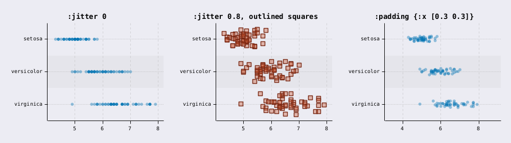
:::


## Beeswarm plots

`chart/beeswarm` draws every value as a point, packed across the strip so points don't overlap where the slot has
room. Use it when each value counts and the swarm's width should show the density.


```{=html}
<div class="shared"><div class="shared-title">Shared options<span class="shared-hint"> – groups of options other charts take too</span></div><ul><li><a href="reference.shared_options.html#common-options">Common options</a> – <code>:data</code> <code>:mapping</code> <code>:legend</code></li><li><a href="reference.shared_options.html#named-theme-styles">Named theme styles</a> – <code>:theme-style</code></li><li><a href="reference.shared_options.html#strip-options">Strip options</a> – <code>:place</code> <code>:width</code> <code>:thickness</code> <code>:position</code> <code>:dodge-gap</code> <code>:bottom-share</code> <code>:n-label</code> <code>:n-format</code> <code>:level-axis</code></li></ul></div>
```


```{=html}
<div class="mapping"><div class="mapping-title">Mapping<span class="mapping-hint"> – the row values the chart reads, under <code>:mapping</code></span></div><ul><li><code>:x</code> – The values of horizontal swarms, or the levels of vertical ones.</li><li><code>:y</code> – The levels of horizontal swarms, or the values of vertical ones; with no levels the chart draws one swarm.</li><li><code>:color</code> – Splits the rows into groups, each in its own point colour.</li><li><code>:shape</code> – Splits the rows into groups, each with its own point shape.</li><li><code>:size</code> – Splits the rows into groups, each with its own point size.</li><li><code>:group</code> – Splits the rows into groups that look the same, dodged as other groups.</li></ul></div>
```


::: {.sourceClojure}
```clojure
(plot/render-image {:data iris
                    :mapping {:x :species :y :petal-length :color :species}
                    :charts [(chart/beeswarm)]
                    :legend false}
                   {:width 600 :height 320})
```
:::


::: {.clay-image}
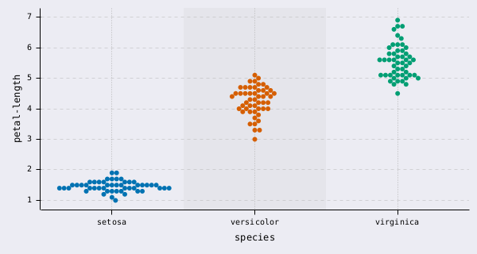
:::


These options style the points and set how the chart packs them. The panels show large points left to overflow
their slot and squeezed into it, and the packing around their values:


```{=html}
<dl class="options"><div class="option-card"><dt><code>:size</code><span class="option-default">Default: <code>6</code> (theme)</span></dt><dd><div class="option-example"><code>(chart/beeswarm {:size 12})</code></div><div class="option-text">The point size in pixels, also the diameter the packing keeps apart; a mapped <code>:size</code> wins.<ul><li><a href="reference.types.html#non-negative-number">non-negative number</a></li></ul></div></dd></div><div class="option-card"><dt><code>:color</code><span class="option-default">Default: <code>[0 114 178 180]</code> (theme)</span></dt><dd><div class="option-example"><code>(chart/beeswarm {:color :orange})</code></div><div class="option-text">The colour of the points; a mapped <code>:color</code> wins.<ul><li><code>:none</code> – No fill.</li><li><a href="reference.types.html#solid-colour">solid colour</a> – Any other colour, e.g. <code>:black</code>.</li></ul></div></dd></div><div class="option-card"><dt><code>:stroke-color</code><span class="option-default">Default: <code>:none</code> (theme)</span></dt><dd><div class="option-example"><code>(chart/beeswarm {:stroke-color :black})</code></div><div class="option-text">The colour of each point's outline.<ul><li><code>:none</code> – No outline.</li><li><a href="reference.types.html#solid-colour">solid colour</a> – Any other colour, e.g. <code>:black</code>.</li></ul></div></dd></div><div class="option-card"><dt><code>:stroke-width</code><span class="option-default">Default: <code>1</code> (theme)</span></dt><dd><div class="option-example"><code>(chart/beeswarm {:stroke-color :black, :stroke-width 3})</code></div><div class="option-text">The width of the outline in pixels; <code>0</code> draws no outline.<ul><li><a href="reference.types.html#non-negative-number">non-negative number</a></li></ul></div></dd></div><div class="option-card"><dt><code>:shape</code><span class="option-default">Default: <code>\O</code> (theme)</span></dt><dd><div class="option-example"><code>(chart/beeswarm {:shape \s})</code></div><div class="option-text">The shape of every point; a mapped <code>:shape</code> wins.<ul><li><a href="reference.types.html#point-shape">point shape</a></li></ul></div></dd></div><div class="option-card"><dt><code>:fit</code><span class="option-default">Default: <code>true</code></span></dt><dd><div class="option-example"><code>(chart/beeswarm {:size 40, :fit false})</code></div><div class="option-text">Whether the chart squeezes a swarm wider than its slot into it; the points may then overlap.<ul><li><code>true</code> – Squeezes the swarm into its slot.</li><li><code>false</code> – Keeps the packing; the swarm may leave its slot.</li></ul></div></dd></div><div class="option-card"><dt><code>:pack</code><span class="option-default">Default: <code>:across</code></span></dt><dd><div class="option-example"><code>(chart/beeswarm {:pack :around})</code></div><div class="option-text">How the chart packs the points.<ul><li><code>:across</code> – Across the value axis only, so equal values form a line.</li><li><code>:around</code> – In both directions: close values form round clusters, the points up to a few diameters off their value.</li></ul></div></dd></div><div class="option-card"><dt><code>:padding</code><span class="option-default">Default: <code>0.05</code> at both ends of the value axis; with <code>:place :bottom</code>, also the <code>:bottom-share</code> below the data.</span></dt><dd><div class="option-example"><code>(chart/beeswarm {:padding {:x [0.3 0.3]}})</code></div><div class="option-text">Room around the data on x and y, as fractions of the data span.<ul><li><span>map of <code>:x</code> or <code>:y</code> to padding</span></li></ul></div></dd></div></dl>
```


::: {.sourceClojure}
```clojure
(plot/render-image (plot/arrange [{:data iris
                                   :mapping {:x :species :y :sepal-width}
                                   :charts [(chart/beeswarm {:size 14 :fit false})]
                                   :labels {:title ":size 14, :fit false"}}
                                  {:data iris
                                   :mapping {:x :species :y :sepal-width}
                                   :charts [(chart/beeswarm {:size 14})]
                                   :labels {:title ":size 14, :fit true"}}
                                  {:data iris
                                   :mapping {:x :species :y :sepal-width}
                                   :charts [(chart/beeswarm {:pack :around :stroke-color :white})]
                                   :labels {:title ":pack :around"}}]
                                 {:columns 3})
                   {:width 1000 :height 320})
```
:::


::: {.clay-image}
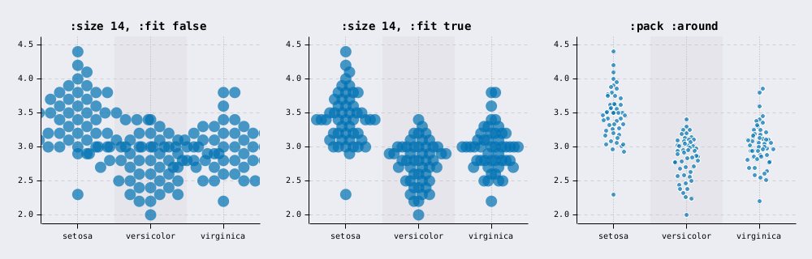
:::


The left panel draws outlined triangles in the default packing, where points move only across the value axis; the
right one sets `:padding`:


::: {.sourceClojure}
```clojure
(plot/render-image (plot/arrange [{:data iris
                                   :mapping {:x :species :y :sepal-width}
                                   :charts [(chart/beeswarm {:color [200 80 40 160] :shape \^ :stroke-color :black
                                                             :stroke-width 0.5 :pack :across})]
                                   :labels {:title "triangles, outlined, :pack :across"}}
                                  {:data iris
                                   :mapping {:x :species :y :sepal-width}
                                   :charts [(chart/beeswarm {:padding {:y [0.4 0.4]}})]
                                   :labels {:title ":padding {:y [0.4 0.4]}"}}]
                                 {:columns 2})
                   {:width 900 :height 320})
```
:::


::: {.clay-image}
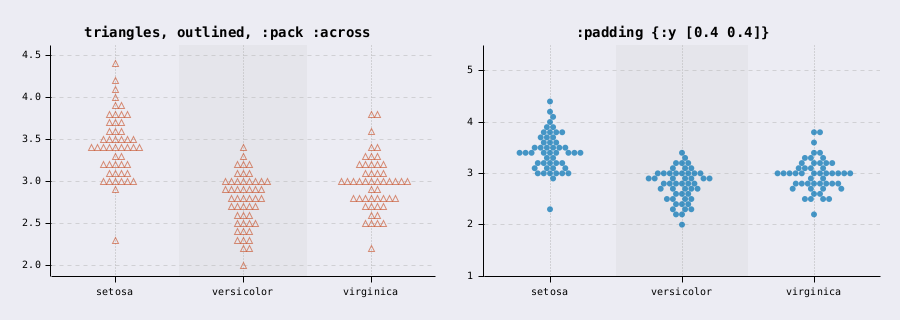
:::


## Dot plots

`chart/dotplot` bins the values along the value axis and stacks a dot per value in its bin (Wilkinson's dot plot).
Use it to show a distribution's shape while every value stays countable.


```{=html}
<div class="shared"><div class="shared-title">Shared options<span class="shared-hint"> – groups of options other charts take too</span></div><ul><li><a href="reference.shared_options.html#common-options">Common options</a> – <code>:data</code> <code>:mapping</code> <code>:legend</code></li><li><a href="reference.shared_options.html#named-theme-styles">Named theme styles</a> – <code>:theme-style</code></li><li><a href="reference.shared_options.html#strip-options">Strip options</a> – <code>:place</code> <code>:width</code> <code>:thickness</code> <code>:position</code> <code>:dodge-gap</code> <code>:bottom-share</code> <code>:n-label</code> <code>:n-format</code> <code>:level-axis</code></li></ul></div>
```


```{=html}
<div class="mapping"><div class="mapping-title">Mapping<span class="mapping-hint"> – the row values the chart reads, under <code>:mapping</code></span></div><ul><li><code>:x</code> – The values of horizontal dot plots, or the levels of vertical ones.</li><li><code>:y</code> – The levels of horizontal dot plots, or the values of vertical ones; with no levels the chart draws one dot plot.</li><li><code>:color</code> – Splits the rows into groups, each in its own point colour.</li><li><code>:shape</code> – Splits the rows into groups, each with its own point shape.</li><li><code>:size</code> – Splits the rows into groups, each with its own point size.</li><li><code>:group</code> – Splits the rows into groups that look the same, sharing stacks unless dodged.</li></ul></div>
```


::: {.sourceClojure}
```clojure
(plot/render-image {:data mtcars
                    :mapping {:x :mpg}
                    :charts [(chart/dotplot {:binwidth 1.5})]}
                   {:width 600 :height 280})
```
:::


::: {.clay-image}
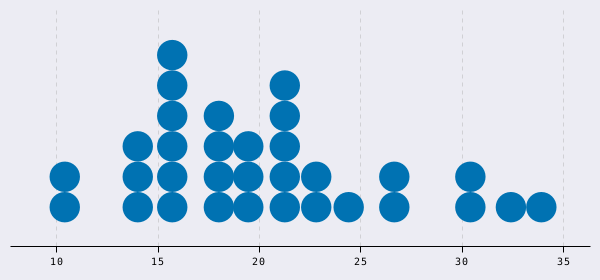
:::


These options style the dots and set how the chart bins and stacks them. The panels show fixed bins, stacks
centred on their slots, and each dot at its own value:


```{=html}
<dl class="options"><div class="option-card"><dt><code>:size</code><span class="option-default">Default: The stacking diameter: the bin width in pixels, shrunk so the tallest stack fits its slot.</span></dt><dd><div class="option-example"><code>(chart/dotplot {:size 4})</code></div><div class="option-text">The drawn size of the dots in pixels; a mapped <code>:size</code> wins.<ul><li><a href="reference.types.html#non-negative-number">non-negative number</a></li></ul></div></dd></div><div class="option-card"><dt><code>:color</code><span class="option-default">Default: <code>[0 114 178]</code> (theme)</span></dt><dd><div class="option-example"><code>(chart/dotplot {:color :orange})</code></div><div class="option-text">The colour of the dots; a mapped <code>:color</code> wins.<ul><li><code>:none</code> – No fill.</li><li><a href="reference.types.html#solid-colour">solid colour</a> – Any other colour, e.g. <code>:black</code>.</li></ul></div></dd></div><div class="option-card"><dt><code>:stroke-color</code><span class="option-default">Default: <code>:none</code> (theme)</span></dt><dd><div class="option-example"><code>(chart/dotplot {:stroke-color :black})</code></div><div class="option-text">The colour of each dot's outline.<ul><li><code>:none</code> – No outline.</li><li><a href="reference.types.html#solid-colour">solid colour</a> – Any other colour, e.g. <code>:black</code>.</li></ul></div></dd></div><div class="option-card"><dt><code>:stroke-width</code><span class="option-default">Default: <code>1</code> (theme)</span></dt><dd><div class="option-example"><code>(chart/dotplot {:stroke-color :black, :stroke-width 3})</code></div><div class="option-text">The width of the outline in pixels; <code>0</code> draws no outline.<ul><li><a href="reference.types.html#non-negative-number">non-negative number</a></li></ul></div></dd></div><div class="option-card"><dt><code>:shape</code><span class="option-default">Default: <code>\O</code> (theme)</span></dt><dd><div class="option-example"><code>(chart/dotplot {:shape \s})</code></div><div class="option-text">The shape of every dot; a mapped <code>:shape</code> wins.<ul><li><a href="reference.types.html#point-shape">point shape</a></li></ul></div></dd></div><div class="option-card"><dt><code>:method</code><span class="option-default">Default: <code>:dot-density</code></span></dt><dd><div class="option-example"><code>(chart/dotplot {:method :histogram})</code></div><div class="option-text">How the chart bins the values.<ul><li><code>:dot-density</code> – Wilkinson's dot density bins, each centred between its smallest and largest value.</li><li><code>:histogram</code> – Fixed bins from <code>:origin</code>.</li></ul></div></dd></div><div class="option-card"><dt><code>:binwidth</code><span class="option-default">Default: The range of all values over 30, or <code>1</code> for a single distinct value.</span></dt><dd><div class="option-example"><code>(chart/dotplot {:binwidth 1})</code></div><div class="option-text">The width of a bin in data units.<ul><li><a href="reference.types.html#positive-finite-number">positive finite number</a></li></ul></div></dd></div><div class="option-card"><dt><code>:origin</code><span class="option-default">Default: The smallest value.</span></dt><dd><div class="option-example"><code>(chart/dotplot {:method :histogram, :binwidth 1, :origin 0.25})</code></div><div class="option-text">The low edge of the first fixed bin in data units; it needs <code>:method :histogram</code>.<ul><li><a href="reference.types.html#finite-number">finite number</a></li></ul></div></dd></div><div class="option-card"><dt><code>:at</code><span class="option-default">Default: <code>:center</code></span></dt><dd><div class="option-example"><code>(chart/dotplot {:at :value})</code></div><div class="option-text">Where a bin's dots sit along the value axis.<ul><li><code>:center</code> – At the bin's centre.</li><li><code>:value</code> – Each dot at its own value, as in a wheat plot.</li></ul></div></dd></div><div class="option-card"><dt><code>:stack-dir</code><span class="option-default">Default: <code>:up</code></span></dt><dd><div class="option-example"><code>(chart/dotplot {:stack-dir :center})</code></div><div class="option-text">Which way the stacks grow.<ul><li><code>:up</code> – From the slot's low edge towards the next level.</li><li><code>:center</code> – Both ways from the slot's centre line.</li></ul></div></dd></div><div class="option-card"><dt><code>:padding</code><span class="option-default">Default: <code>0.05</code> at both ends of the value axis; with <code>:place :bottom</code>, also the <code>:bottom-share</code> below the data.</span></dt><dd><div class="option-example"><code>(chart/dotplot {:padding {:x [0.3 0.3]}})</code></div><div class="option-text">Room around the data on x and y, as fractions of the data span.<ul><li><span>map of <code>:x</code> or <code>:y</code> to padding</span></li></ul></div></dd></div></dl>
```


::: {.sourceClojure}
```clojure
(plot/render-image (plot/arrange [{:data mtcars
                                   :mapping {:x :mpg}
                                   :charts [(chart/dotplot {:method :histogram :binwidth 2 :origin 10})]
                                   :labels {:title ":method :histogram"}}
                                  {:data mtcars
                                   :mapping {:x :mpg}
                                   :charts [(chart/dotplot {:binwidth 1.5 :stack-dir :center :color [200 80 40]})]
                                   :labels {:title ":stack-dir :center"}}
                                  {:data mtcars
                                   :mapping {:x :mpg}
                                   :charts [(chart/dotplot {:binwidth 1.5 :at :value})]
                                   :labels {:title ":at :value"}}]
                                 {:columns 3})
                   {:width 1000 :height 280})
```
:::


::: {.clay-image}
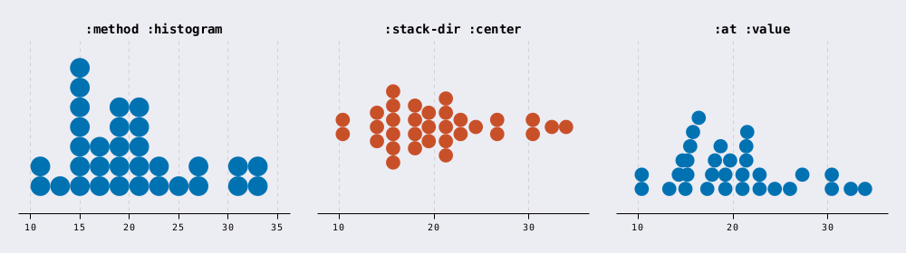
:::


The left panel sets a fixed dot size and outlined squares; the right one sets `:padding`:


::: {.sourceClojure}
```clojure
(plot/render-image (plot/arrange [{:data mtcars
                                   :mapping {:x :mpg}
                                   :charts [(chart/dotplot {:binwidth 1.5 :size 7 :shape \S :color [230 160 60]
                                                            :stroke-color :black :stroke-width 1})]
                                   :labels {:title ":size 7, outlined squares"}}
                                  {:data mtcars
                                   :mapping {:x :mpg}
                                   :charts [(chart/dotplot {:binwidth 1.5 :padding {:x [0.3 0.3]}})]
                                   :labels {:title ":padding {:x [0.3 0.3]}"}}]
                                 {:columns 2})
                   {:width 800 :height 280})
```
:::


::: {.clay-image}
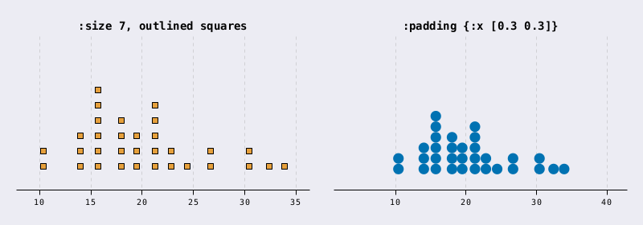
:::


## Rug plots

`chart/rug` draws a short line per value, along the panel's edge or in one strip per level. Use it beside another
chart to show where the values lie.


```{=html}
<div class="shared"><div class="shared-title">Shared options<span class="shared-hint"> – groups of options other charts take too</span></div><ul><li><a href="reference.shared_options.html#common-options">Common options</a> – <code>:data</code> <code>:mapping</code> <code>:legend</code></li><li><a href="reference.shared_options.html#named-theme-styles">Named theme styles</a> – <code>:theme-style</code></li><li><a href="reference.shared_options.html#strip-options">Strip options</a> – <code>:place</code> <code>:width</code> <code>:thickness</code> <code>:position</code> <code>:dodge-gap</code> <code>:bottom-share</code> <code>:n-label</code> <code>:n-format</code> <code>:level-axis</code></li></ul></div>
```


```{=html}
<div class="mapping"><div class="mapping-title">Mapping<span class="mapping-hint"> – the row values the chart reads, under <code>:mapping</code></span></div><ul><li><code>:x</code> – The values of horizontal rugs, or the levels of vertical ones.</li><li><code>:y</code> – The levels of horizontal rugs, or the values of vertical ones; with no levels the chart draws one rug along the panel edge.</li><li><code>:color</code> – Splits the rows into groups, each in its own line colour.</li><li><code>:group</code> – Splits the rows into groups that look the same, dodged as other groups.</li></ul></div>
```


::: {.sourceClojure}
```clojure
(plot/render-image {:data iris
                    :mapping {:x :sepal-length :y :sepal-width}
                    :charts [(chart/scatter) (chart/rug {:mapping {:y nil}})]}
                   {:width 600 :height 320})
```
:::


::: {.clay-image}
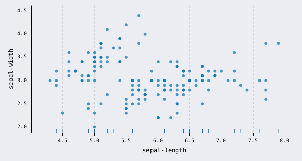
:::


These options set the lines' colour and width. The panels show the defaults with a rug per level, wider lines,
and `:padding`:


```{=html}
<dl class="options"><div class="option-card"><dt><code>:color</code><span class="option-default">Default: <code>[0 114 178 100]</code> (theme)</span></dt><dd><div class="option-example"><code>(chart/rug {:color :orange})</code></div><div class="option-text">The colour of the rug lines; a mapped <code>:color</code> wins.<ul><li><a href="reference.types.html#solid-colour">solid colour</a></li></ul></div></dd></div><div class="option-card"><dt><code>:line-width</code><span class="option-default">Default: <code>1</code> (theme)</span></dt><dd><div class="option-example"><code>(chart/rug {:line-width 3})</code></div><div class="option-text">The width of the rug lines in pixels; <code>0</code> draws nothing.<ul><li><a href="reference.types.html#non-negative-number">non-negative number</a></li></ul></div></dd></div><div class="option-card"><dt><code>:padding</code><span class="option-default">Default: <code>0.05</code> at both ends of the value axis; with <code>:place :bottom</code>, also the <code>:bottom-share</code> below the data.</span></dt><dd><div class="option-example"><code>(chart/rug {:padding {:x [0.3 0.3]}})</code></div><div class="option-text">Room around the data on x and y, as fractions of the data span.<ul><li><span>map of <code>:x</code> or <code>:y</code> to padding</span></li></ul></div></dd></div></dl>
```


::: {.sourceClojure}
```clojure
(plot/render-image (plot/arrange [{:data iris
                                   :mapping {:x :petal-length :y :species}
                                   :charts [(chart/rug)]
                                   :scales {:y {:reverse true}}
                                   :labels {:title "defaults, a rug per level"}}
                                  {:data iris
                                   :mapping {:x :petal-length :y :species}
                                   :charts [(chart/rug {:color [200 40 40 60] :line-width 3})]
                                   :scales {:y {:reverse true}}
                                   :labels {:title ":line-width 3"}}
                                  {:data iris
                                   :mapping {:x :petal-length :y :species}
                                   :charts [(chart/rug {:padding {:x [0.3 0.3]}})]
                                   :scales {:y {:reverse true}}
                                   :labels {:title ":padding {:x [0.3 0.3]}"}}]
                                 {:columns 3})
                   {:width 1000 :height 260})
```
:::


::: {.clay-image}
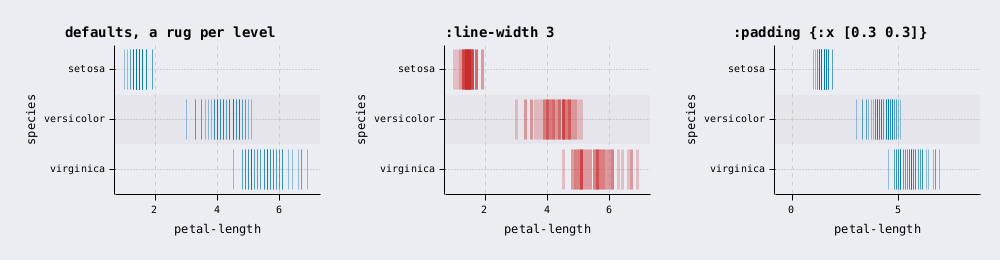
:::


```{=html}
<div style="background-color:grey;height:2px;width:100%;"></div>
```


```{=html}
<div><pre><small><small>source: notebooks/reference/charts_per_level.clj</small></small></pre></div>
```