---
format:
  html:
    toc: true
    toc-location: right
    toc-depth: 4
    theme: cosmo
    include-in-header:
      text: |-
        <style>
        .data-table { width: fit-content; max-width: 100%; max-height: 15rem; overflow: auto; margin: 0 0 1rem 0; }
        .data-table .table-responsive { overflow: visible; }
        .data-table table { font-size: 0.75rem; width: auto; margin: 0; }
        .data-table th, .data-table td { padding: 0.1rem 0.45rem !important; white-space: nowrap; }
        .data-table thead th { position: sticky; top: 0; background: var(--bs-body-bg, #fff); }
        .options { margin: 0.5rem 0 1rem 0; }
        .options .option-card { margin: 0 0 0.9rem 0; border: 1px solid var(--bs-border-color, #dee2e6); border-radius: 0.375rem; overflow: hidden; }
        .options dt { display: flex; flex-wrap: wrap; align-items: baseline; gap: 0.1rem 1rem; margin: 0; padding: 0.4rem 0.75rem; background: #eef2f7; border-bottom: 1px solid var(--bs-border-color, #dee2e6); font-weight: normal; }
        .options dt > code { font-weight: 700; font-size: 1rem; background: none; padding: 0; }
        .options .option-default { font-size: 0.85rem; color: var(--bs-secondary-color, #6c757d); }
        .options dd { margin: 0; padding: 0.5rem 0.75rem; }
        .options .option-example { font-size: 0.85rem; padding: 0 0 0.45rem 0; margin-bottom: 0.45rem; border-bottom: 1px dashed var(--bs-border-color, #dee2e6); }
        .options .option-example code { background: none; padding: 0; }
        .options .option-text ul { margin: 0.3rem 0 0 0; padding-left: 1.25rem; }
        .options code, .mapping code { overflow-wrap: anywhere; }
        .mapping { margin: 0.5rem 0 1rem 0; padding: 0.5rem 0.75rem; border: 1px solid var(--bs-border-color, #dee2e6); border-left: 0.3rem solid #2780e3; border-radius: 0.375rem; background: #f5f8fc; }
        .mapping-title { font-weight: 700; margin-bottom: 0.25rem; }
        .mapping-hint { font-weight: normal; font-size: 0.85rem; color: var(--bs-secondary-color, #6c757d); }
        .mapping ul { margin: 0; padding-left: 1.25rem; }
        .mapping .required { font-size: 0.75rem; padding: 0 0.3rem; border: 1px solid currentColor; border-radius: 0.25rem; }
        .shared { margin: 0.5rem 0 1rem 0; padding: 0.5rem 0.75rem; border: 1px solid var(--bs-border-color, #dee2e6); border-left: 0.3rem solid #6c757d; border-radius: 0.375rem; background: #f6f6f6; }
        .shared-title { font-weight: 700; margin-bottom: 0.25rem; }
        .shared-hint { font-weight: normal; font-size: 0.85rem; color: var(--bs-secondary-color, #6c757d); }
        .shared ul { margin: 0; padding-left: 1.25rem; }
        .shared code { overflow-wrap: anywhere; }
        </style>
code-block-background: true

---
<style></style><style>.printedClojure .sourceCode {
  background-color: transparent;
  border-style: none;
}
</style><style>.clay-limit-image-width .clay-image {max-width: 100%}
.clay-side-by-side .sourceCode {margin: 0}
.clay-side-by-side {margin: 1em 0}
</style>
<script src="https://code.jquery.com/jquery-3.6.0.min.js" type="text/javascript"></script><script src="https://code.jquery.com/ui/1.13.1/jquery-ui.min.js" type="text/javascript"></script>

# Points, lines and areas

These charts draw the data where it lies: points (`scatter`), lines through them (`line`), line segments between
two points (`segment`), filled shapes (`polygon`), bands between two bounds (`ribbon`) and price candles
(`candlestick`). Start here for raw data in two dimensions.


::: {.sourceClojure}
```clojure
(ns reference.charts-points-lines
  (:require [fastmath.core :as m]
            [fastmath.random :as r]
            [cljplot2.chart :as chart]
            [cljplot2.core :as plot]
            [cljplot2.data.levels :as levels]
            [cljplot2.describe :as describe]
            [notebook-utils :as nu]))
```
:::


Data: Motor Trend car road tests (1974), R datasets package `mtcars` (Henderson & Velleman 1981); licence: Part of R (GPL-2 | GPL-3).


::: {.sourceClojure}
```clojure
(def mtcars (nu/dataset :mtcars))
```
:::


```{=html}
<div class="data-table"><table class="table table-hover table-responsive clay-table"><thead><tr><th>model</th><th>mpg</th><th>cyl</th><th>disp</th><th>hp</th><th>drat</th><th>wt</th><th>qsec</th><th>vs</th><th>am</th><th>gear</th><th>carb</th></tr></thead><tbody><tr><td>Mazda RX4</td><td>21</td><td>6</td><td>160</td><td>110</td><td>3.9</td><td>2.62</td><td>16.46</td><td>0</td><td>1</td><td>4</td><td>4</td></tr><tr><td>Mazda RX4 Wag</td><td>21</td><td>6</td><td>160</td><td>110</td><td>3.9</td><td>2.875</td><td>17.02</td><td>0</td><td>1</td><td>4</td><td>4</td></tr><tr><td>Datsun 710</td><td>22.8</td><td>4</td><td>108</td><td>93</td><td>3.85</td><td>2.32</td><td>18.61</td><td>1</td><td>1</td><td>4</td><td>1</td></tr><tr><td>Hornet 4 Drive</td><td>21.4</td><td>6</td><td>258</td><td>110</td><td>3.08</td><td>3.215</td><td>19.44</td><td>1</td><td>0</td><td>3</td><td>1</td></tr><tr><td>Hornet Sportabout</td><td>18.7</td><td>8</td><td>360</td><td>175</td><td>3.15</td><td>3.44</td><td>17.02</td><td>0</td><td>0</td><td>3</td><td>2</td></tr><tr><td>Valiant</td><td>18.1</td><td>6</td><td>225</td><td>105</td><td>2.76</td><td>3.46</td><td>20.22</td><td>1</td><td>0</td><td>3</td><td>1</td></tr><tr><td>Duster 360</td><td>14.3</td><td>8</td><td>360</td><td>245</td><td>3.21</td><td>3.57</td><td>15.84</td><td>0</td><td>0</td><td>3</td><td>4</td></tr><tr><td>Merc 240D</td><td>24.4</td><td>4</td><td>146.7</td><td>62</td><td>3.69</td><td>3.19</td><td>20</td><td>1</td><td>0</td><td>4</td><td>2</td></tr><tr><td>Merc 230</td><td>22.8</td><td>4</td><td>140.8</td><td>95</td><td>3.92</td><td>3.15</td><td>22.9</td><td>1</td><td>0</td><td>4</td><td>2</td></tr><tr><td>Merc 280</td><td>19.2</td><td>6</td><td>167.6</td><td>123</td><td>3.92</td><td>3.44</td><td>18.3</td><td>1</td><td>0</td><td>4</td><td>4</td></tr><tr><td>Merc 280C</td><td>17.8</td><td>6</td><td>167.6</td><td>123</td><td>3.92</td><td>3.44</td><td>18.9</td><td>1</td><td>0</td><td>4</td><td>4</td></tr><tr><td>Merc 450SE</td><td>16.4</td><td>8</td><td>275.8</td><td>180</td><td>3.07</td><td>4.07</td><td>17.4</td><td>0</td><td>0</td><td>3</td><td>3</td></tr><tr><td>Merc 450SL</td><td>17.3</td><td>8</td><td>275.8</td><td>180</td><td>3.07</td><td>3.73</td><td>17.6</td><td>0</td><td>0</td><td>3</td><td>3</td></tr><tr><td>Merc 450SLC</td><td>15.2</td><td>8</td><td>275.8</td><td>180</td><td>3.07</td><td>3.78</td><td>18</td><td>0</td><td>0</td><td>3</td><td>3</td></tr><tr><td>Cadillac Fleetwood</td><td>10.4</td><td>8</td><td>472</td><td>205</td><td>2.93</td><td>5.25</td><td>17.98</td><td>0</td><td>0</td><td>3</td><td>4</td></tr><tr><td>Lincoln Continental</td><td>10.4</td><td>8</td><td>460</td><td>215</td><td>3</td><td>5.424</td><td>17.82</td><td>0</td><td>0</td><td>3</td><td>4</td></tr><tr><td>Chrysler Imperial</td><td>14.7</td><td>8</td><td>440</td><td>230</td><td>3.23</td><td>5.345</td><td>17.42</td><td>0</td><td>0</td><td>3</td><td>4</td></tr><tr><td>Fiat 128</td><td>32.4</td><td>4</td><td>78.7</td><td>66</td><td>4.08</td><td>2.2</td><td>19.47</td><td>1</td><td>1</td><td>4</td><td>1</td></tr><tr><td>Honda Civic</td><td>30.4</td><td>4</td><td>75.7</td><td>52</td><td>4.93</td><td>1.615</td><td>18.52</td><td>1</td><td>1</td><td>4</td><td>2</td></tr><tr><td>Toyota Corolla</td><td>33.9</td><td>4</td><td>71.1</td><td>65</td><td>4.22</td><td>1.835</td><td>19.9</td><td>1</td><td>1</td><td>4</td><td>1</td></tr><tr><td>Toyota Corona</td><td>21.5</td><td>4</td><td>120.1</td><td>97</td><td>3.7</td><td>2.465</td><td>20.01</td><td>1</td><td>0</td><td>3</td><td>1</td></tr><tr><td>Dodge Challenger</td><td>15.5</td><td>8</td><td>318</td><td>150</td><td>2.76</td><td>3.52</td><td>16.87</td><td>0</td><td>0</td><td>3</td><td>2</td></tr><tr><td>AMC Javelin</td><td>15.2</td><td>8</td><td>304</td><td>150</td><td>3.15</td><td>3.435</td><td>17.3</td><td>0</td><td>0</td><td>3</td><td>2</td></tr><tr><td>Camaro Z28</td><td>13.3</td><td>8</td><td>350</td><td>245</td><td>3.73</td><td>3.84</td><td>15.41</td><td>0</td><td>0</td><td>3</td><td>4</td></tr><tr><td>Pontiac Firebird</td><td>19.2</td><td>8</td><td>400</td><td>175</td><td>3.08</td><td>3.845</td><td>17.05</td><td>0</td><td>0</td><td>3</td><td>2</td></tr><tr><td>Fiat X1-9</td><td>27.3</td><td>4</td><td>79</td><td>66</td><td>4.08</td><td>1.935</td><td>18.9</td><td>1</td><td>1</td><td>4</td><td>1</td></tr><tr><td>Porsche 914-2</td><td>26</td><td>4</td><td>120.3</td><td>91</td><td>4.43</td><td>2.14</td><td>16.7</td><td>0</td><td>1</td><td>5</td><td>2</td></tr><tr><td>Lotus Europa</td><td>30.4</td><td>4</td><td>95.1</td><td>113</td><td>3.77</td><td>1.513</td><td>16.9</td><td>1</td><td>1</td><td>5</td><td>2</td></tr><tr><td>Ford Pantera L</td><td>15.8</td><td>8</td><td>351</td><td>264</td><td>4.22</td><td>3.17</td><td>14.5</td><td>0</td><td>1</td><td>5</td><td>4</td></tr><tr><td>Ferrari Dino</td><td>19.7</td><td>6</td><td>145</td><td>175</td><td>3.62</td><td>2.77</td><td>15.5</td><td>0</td><td>1</td><td>5</td><td>6</td></tr><tr><td>Maserati Bora</td><td>15</td><td>8</td><td>301</td><td>335</td><td>3.54</td><td>3.57</td><td>14.6</td><td>0</td><td>1</td><td>5</td><td>8</td></tr><tr><td>Volvo 142E</td><td>21.4</td><td>4</td><td>121</td><td>109</td><td>4.11</td><td>2.78</td><td>18.6</td><td>1</td><td>1</td><td>4</td><td>2</td></tr></tbody></table></div>
```


Data: Monthly stock prices for five companies, vega-datasets 3.3.1 `stocks.csv` (https://cdn.jsdelivr.net/npm/vega-datasets@3.3.1/data/stocks.csv); licence: none listed - see vega-datasets (cite Vega as the source).


::: {.sourceClojure}
```clojure
(def stocks (nu/dataset :stocks))
```
:::


```{=html}
<div class="data-table"><table class="table table-hover table-responsive clay-table"><thead><tr><th>symbol</th><th>date</th><th>price</th></tr></thead><tbody><tr><td>MSFT</td><td>2000-01-01</td><td>39.81</td></tr><tr><td>MSFT</td><td>2000-02-01</td><td>36.35</td></tr><tr><td>MSFT</td><td>2000-03-01</td><td>43.22</td></tr><tr><td>MSFT</td><td>2000-04-01</td><td>28.37</td></tr><tr><td>MSFT</td><td>2000-05-01</td><td>25.45</td></tr><tr><td>MSFT</td><td>2000-06-01</td><td>32.54</td></tr><tr><td>MSFT</td><td>2000-07-01</td><td>28.4</td></tr><tr><td>MSFT</td><td>2000-08-01</td><td>28.4</td></tr><tr><td>MSFT</td><td>2000-09-01</td><td>24.53</td></tr><tr><td>MSFT</td><td>2000-10-01</td><td>28.02</td></tr><tr><td>MSFT</td><td>2000-11-01</td><td>23.34</td></tr><tr><td>MSFT</td><td>2000-12-01</td><td>17.65</td></tr><tr><td>MSFT</td><td>2001-01-01</td><td>24.84</td></tr><tr><td>MSFT</td><td>2001-02-01</td><td>24</td></tr><tr><td>MSFT</td><td>2001-03-01</td><td>22.25</td></tr><tr><td>MSFT</td><td>2001-04-01</td><td>27.56</td></tr><tr><td>MSFT</td><td>2001-05-01</td><td>28.14</td></tr><tr><td>MSFT</td><td>2001-06-01</td><td>29.7</td></tr><tr><td>MSFT</td><td>2001-07-01</td><td>26.93</td></tr><tr><td>MSFT</td><td>2001-08-01</td><td>23.21</td></tr><tr><td>MSFT</td><td>2001-09-01</td><td>20.82</td></tr><tr><td>MSFT</td><td>2001-10-01</td><td>23.65</td></tr><tr><td>MSFT</td><td>2001-11-01</td><td>26.12</td></tr><tr><td>MSFT</td><td>2001-12-01</td><td>26.95</td></tr><tr><td>MSFT</td><td>2002-01-01</td><td>25.92</td></tr><tr><td>MSFT</td><td>2002-02-01</td><td>23.73</td></tr><tr><td>MSFT</td><td>2002-03-01</td><td>24.53</td></tr><tr><td>MSFT</td><td>2002-04-01</td><td>21.26</td></tr><tr><td>MSFT</td><td>2002-05-01</td><td>20.71</td></tr><tr><td>MSFT</td><td>2002-06-01</td><td>22.25</td></tr><tr><td>MSFT</td><td>2002-07-01</td><td>19.52</td></tr><tr><td>MSFT</td><td>2002-08-01</td><td>19.97</td></tr><tr><td>MSFT</td><td>2002-09-01</td><td>17.79</td></tr><tr><td>MSFT</td><td>2002-10-01</td><td>21.75</td></tr><tr><td>MSFT</td><td>2002-11-01</td><td>23.46</td></tr><tr><td>MSFT</td><td>2002-12-01</td><td>21.03</td></tr><tr><td>MSFT</td><td>2003-01-01</td><td>19.31</td></tr><tr><td>MSFT</td><td>2003-02-01</td><td>19.34</td></tr><tr><td>MSFT</td><td>2003-03-01</td><td>19.76</td></tr><tr><td>MSFT</td><td>2003-04-01</td><td>20.87</td></tr><tr><td>MSFT</td><td>2003-05-01</td><td>20.09</td></tr><tr><td>MSFT</td><td>2003-06-01</td><td>20.93</td></tr><tr><td>MSFT</td><td>2003-07-01</td><td>21.56</td></tr><tr><td>MSFT</td><td>2003-08-01</td><td>21.65</td></tr><tr><td>MSFT</td><td>2003-09-01</td><td>22.69</td></tr><tr><td>MSFT</td><td>2003-10-01</td><td>21.45</td></tr><tr><td>MSFT</td><td>2003-11-01</td><td>21.1</td></tr><tr><td>MSFT</td><td>2003-12-01</td><td>22.46</td></tr><tr><td>MSFT</td><td>2004-01-01</td><td>22.69</td></tr><tr><td>MSFT</td><td>2004-02-01</td><td>21.77</td></tr><tr><td>MSFT</td><td>2004-03-01</td><td>20.46</td></tr><tr><td>MSFT</td><td>2004-04-01</td><td>21.45</td></tr><tr><td>MSFT</td><td>2004-05-01</td><td>21.53</td></tr><tr><td>MSFT</td><td>2004-06-01</td><td>23.44</td></tr><tr><td>MSFT</td><td>2004-07-01</td><td>23.38</td></tr><tr><td>MSFT</td><td>2004-08-01</td><td>22.47</td></tr><tr><td>MSFT</td><td>2004-09-01</td><td>22.76</td></tr><tr><td>MSFT</td><td>2004-10-01</td><td>23.02</td></tr><tr><td>MSFT</td><td>2004-11-01</td><td>24.6</td></tr><tr><td>MSFT</td><td>2004-12-01</td><td>24.52</td></tr><tr><td>MSFT</td><td>2005-01-01</td><td>24.11</td></tr><tr><td>MSFT</td><td>2005-02-01</td><td>23.15</td></tr><tr><td>MSFT</td><td>2005-03-01</td><td>22.24</td></tr><tr><td>MSFT</td><td>2005-04-01</td><td>23.28</td></tr><tr><td>MSFT</td><td>2005-05-01</td><td>23.82</td></tr><tr><td>MSFT</td><td>2005-06-01</td><td>22.93</td></tr><tr><td>MSFT</td><td>2005-07-01</td><td>23.64</td></tr><tr><td>MSFT</td><td>2005-08-01</td><td>25.35</td></tr><tr><td>MSFT</td><td>2005-09-01</td><td>23.83</td></tr><tr><td>MSFT</td><td>2005-10-01</td><td>23.8</td></tr><tr><td>MSFT</td><td>2005-11-01</td><td>25.71</td></tr><tr><td>MSFT</td><td>2005-12-01</td><td>24.29</td></tr><tr><td>MSFT</td><td>2006-01-01</td><td>26.14</td></tr><tr><td>MSFT</td><td>2006-02-01</td><td>25.04</td></tr><tr><td>MSFT</td><td>2006-03-01</td><td>25.36</td></tr><tr><td>MSFT</td><td>2006-04-01</td><td>22.5</td></tr><tr><td>MSFT</td><td>2006-05-01</td><td>21.19</td></tr><tr><td>MSFT</td><td>2006-06-01</td><td>21.8</td></tr><tr><td>MSFT</td><td>2006-07-01</td><td>22.51</td></tr><tr><td>MSFT</td><td>2006-08-01</td><td>24.13</td></tr><tr><td>MSFT</td><td>2006-09-01</td><td>25.68</td></tr><tr><td>MSFT</td><td>2006-10-01</td><td>26.96</td></tr><tr><td>MSFT</td><td>2006-11-01</td><td>27.66</td></tr><tr><td>MSFT</td><td>2006-12-01</td><td>28.13</td></tr><tr><td>MSFT</td><td>2007-01-01</td><td>29.07</td></tr><tr><td>MSFT</td><td>2007-02-01</td><td>26.63</td></tr><tr><td>MSFT</td><td>2007-03-01</td><td>26.35</td></tr><tr><td>MSFT</td><td>2007-04-01</td><td>28.3</td></tr><tr><td>MSFT</td><td>2007-05-01</td><td>29.11</td></tr><tr><td>MSFT</td><td>2007-06-01</td><td>27.95</td></tr><tr><td>MSFT</td><td>2007-07-01</td><td>27.5</td></tr><tr><td>MSFT</td><td>2007-08-01</td><td>27.34</td></tr><tr><td>MSFT</td><td>2007-09-01</td><td>28.04</td></tr><tr><td>MSFT</td><td>2007-10-01</td><td>35.03</td></tr><tr><td>MSFT</td><td>2007-11-01</td><td>32.09</td></tr><tr><td>MSFT</td><td>2007-12-01</td><td>34</td></tr><tr><td>MSFT</td><td>2008-01-01</td><td>31.13</td></tr><tr><td>MSFT</td><td>2008-02-01</td><td>26.07</td></tr><tr><td>MSFT</td><td>2008-03-01</td><td>27.21</td></tr><tr><td>MSFT</td><td>2008-04-01</td><td>27.34</td></tr><tr><td>…</td><td>…</td><td>…</td></tr></tbody></table></div>
```


Data: VIX daily open, high, low and close values, vega-datasets 3.3.1 `ohlc.json` (https://cdn.jsdelivr.net/npm/vega-datasets@3.3.1/data/ohlc.json); original: Yahoo Finance VIX Data, CBOE - VIX Historical Data; licence: none listed - see vega-datasets (cite Vega as the source).


::: {.sourceClojure}
```clojure
(def ohlc (nu/dataset :ohlc))
```
:::


```{=html}
<div class="data-table"><table class="table table-hover table-responsive clay-table"><thead><tr><th>date</th><th>open</th><th>high</th><th>low</th><th>close</th><th>signal</th><th>ret</th></tr></thead><tbody><tr><td>2009-06-01</td><td>28.7</td><td>30.05</td><td>28.45</td><td>30.04</td><td>short</td><td>-4.89396411092985</td></tr><tr><td>2009-06-02</td><td>30.04</td><td>30.13</td><td>28.3</td><td>29.63</td><td>short</td><td>-0.322580645161295</td></tr><tr><td>2009-06-03</td><td>29.62</td><td>31.79</td><td>29.62</td><td>31.02</td><td>short</td><td>3.68663594470045</td></tr><tr><td>2009-06-04</td><td>31.02</td><td>31.02</td><td>29.92</td><td>30.18</td><td>short</td><td>4.51010886469673</td></tr><tr><td>2009-06-05</td><td>29.39</td><td>30.81</td><td>28.85</td><td>29.62</td><td>short</td><td>6.08424336973478</td></tr><tr><td>2009-06-08</td><td>30.84</td><td>31.82</td><td>26.41</td><td>29.77</td><td>short</td><td>1.2539184952978</td></tr><tr><td>2009-06-09</td><td>29.77</td><td>29.77</td><td>27.79</td><td>28.27</td><td>short</td><td>-5.02431118314424</td></tr><tr><td>2009-06-10</td><td>26.9</td><td>29.74</td><td>26.9</td><td>28.46</td><td>short</td><td>-5.46623794212217</td></tr><tr><td>2009-06-11</td><td>27.36</td><td>28.11</td><td>26.81</td><td>28.11</td><td>short</td><td>-8.3743842364532</td></tr><tr><td>2009-06-12</td><td>28.08</td><td>28.5</td><td>27.73</td><td>28.15</td><td>short</td><td>-5.52763819095477</td></tr><tr><td>2009-06-15</td><td>29.7</td><td>31.09</td><td>29.64</td><td>30.81</td><td>long</td><td>3.4920634920635</td></tr><tr><td>2009-06-16</td><td>30.81</td><td>32.75</td><td>30.07</td><td>32.68</td><td>short</td><td>0.155038759689914</td></tr><tr><td>2009-06-17</td><td>31.19</td><td>32.77</td><td>30.64</td><td>31.54</td><td>short</td><td>5.82822085889571</td></tr><tr><td>2009-06-18</td><td>31.54</td><td>31.54</td><td>29.6</td><td>30.03</td><td>short</td><td>8.17610062893082</td></tr><tr><td>2009-06-19</td><td>29.16</td><td>29.32</td><td>27.56</td><td>27.99</td><td>short</td><td>8.59872611464968</td></tr><tr><td>2009-06-22</td><td>30.4</td><td>32.05</td><td>30.3</td><td>31.17</td><td>short</td><td>15.4907975460123</td></tr><tr><td>2009-06-23</td><td>31.3</td><td>31.54</td><td>27.83</td><td>30.58</td><td>short</td><td>11.7370892018779</td></tr><tr><td>2009-06-24</td><td>30.58</td><td>30.58</td><td>28.79</td><td>29.05</td><td>long</td><td>-10.4234527687296</td></tr><tr><td>2009-06-25</td><td>29.45</td><td>29.56</td><td>26.3</td><td>26.36</td><td>long</td><td>0</td></tr><tr><td>2009-06-26</td><td>27.09</td><td>27.22</td><td>25.76</td><td>25.93</td><td>long</td><td>0</td></tr><tr><td>2009-06-29</td><td>25.93</td><td>27.18</td><td>25.29</td><td>25.35</td><td>long</td><td>5.26315789473684</td></tr><tr><td>2009-06-30</td><td>25.36</td><td>27.38</td><td>25.02</td><td>26.35</td><td>long</td><td>6.73758865248228</td></tr><tr><td>2009-07-01</td><td>25.73</td><td>26.31</td><td>24.8</td><td>26.22</td><td>long</td><td>7.83645655877341</td></tr><tr><td>2009-07-02</td><td>26.22</td><td>28.62</td><td>26.22</td><td>27.95</td><td>long</td><td>2.76422764227643</td></tr><tr><td>2009-07-06</td><td>30.32</td><td>30.6</td><td>28.99</td><td>29</td><td>short</td><td>-2.14521452145214</td></tr><tr><td>2009-07-07</td><td>29</td><td>30.94</td><td>28.9</td><td>30.85</td><td>short</td><td>3.03514376996805</td></tr><tr><td>2009-07-08</td><td>30.85</td><td>33.05</td><td>30.43</td><td>31.3</td><td>short</td><td>5.68720379146919</td></tr><tr><td>2009-07-09</td><td>30.23</td><td>30.49</td><td>29.28</td><td>29.78</td><td>short</td><td>8.22784810126583</td></tr><tr><td>2009-07-10</td><td>29.78</td><td>30.34</td><td>28.82</td><td>29.02</td><td>short</td><td>8.64779874213836</td></tr><tr><td>2009-07-13</td><td>28.36</td><td>29.24</td><td>25.42</td><td>26.31</td><td>short</td><td>7.32899022801303</td></tr><tr><td>2009-07-14</td><td>26.31</td><td>26.84</td><td>24.99</td><td>25.02</td><td>short</td><td>7.30897009966778</td></tr><tr><td>2009-07-15</td><td>25.05</td><td>26.06</td><td>23.83</td><td>25.89</td><td>neutral</td><td>0</td></tr><tr><td>2009-07-16</td><td>25.96</td><td>26.18</td><td>24.51</td><td>25.42</td><td>long</td><td>-9.82758620689656</td></tr><tr><td>2009-07-17</td><td>25.42</td><td>25.55</td><td>23.88</td><td>24.34</td><td>long</td><td>-10.8433734939759</td></tr><tr><td>2009-07-20</td><td>25.06</td><td>25.42</td><td>24.26</td><td>24.4</td><td>long</td><td>-7.55711775043936</td></tr><tr><td>2009-07-21</td><td>24.28</td><td>25.14</td><td>23.81</td><td>23.87</td><td>long</td><td>-2.5089605734767</td></tr><tr><td>2009-07-22</td><td>24.05</td><td>24.14</td><td>23.24</td><td>23.47</td><td>long</td><td>0.915750915750916</td></tr><tr><td>2009-07-23</td><td>23.71</td><td>24.05</td><td>23.21</td><td>23.43</td><td>long</td><td>2.47148288973383</td></tr><tr><td>2009-07-24</td><td>23.87</td><td>23.87</td><td>23</td><td>23.09</td><td>long</td><td>4.22264875239922</td></tr><tr><td>2009-07-27</td><td>24.06</td><td>24.86</td><td>24.02</td><td>24.28</td><td>long</td><td>-0.189393939393929</td></tr><tr><td>2009-07-28</td><td>24.28</td><td>25.61</td><td>24.28</td><td>25.01</td><td>long</td><td>-4.37956204379562</td></tr><tr><td>2009-07-29</td><td>25.47</td><td>26.18</td><td>25.41</td><td>25.61</td><td>long</td><td>-4.48504983388705</td></tr><tr><td>2009-07-30</td><td>25.4</td><td>25.76</td><td>24.85</td><td>25.4</td><td>long</td><td>-1.70357751277683</td></tr><tr><td>2009-07-31</td><td>25.4</td><td>26.22</td><td>24.93</td><td>25.92</td><td>short</td><td>5.06756756756757</td></tr></tbody></table></div>
```


## Scatter plots

`chart/scatter` draws a point per row at its x and y. Use it to show how two variables relate. Colour, shape, size
and drawing order can come from the data.


```{=html}
<div class="shared"><div class="shared-title">Shared options<span class="shared-hint"> – groups of options other charts take too</span></div><ul><li><a href="reference.shared_options.html#common-options">Common options</a> – <code>:data</code> <code>:mapping</code> <code>:legend</code></li><li><a href="reference.shared_options.html#named-theme-styles">Named theme styles</a> – <code>:theme-style</code></li></ul></div>
```


```{=html}
<div class="mapping"><div class="mapping-title">Mapping<span class="mapping-hint"> – the row values the chart reads, under <code>:mapping</code></span></div><ul><li><code>:x</code> <span class="required">required</span> – The x of each point.</li><li><code>:y</code> <span class="required">required</span> – The y of each point.</li><li><code>:color</code> – Colours each point by the mapped value.</li><li><code>:shape</code> – Gives each point a shape by the mapped value.</li><li><code>:size</code> – Sizes each point by the mapped value.</li><li><code>:order</code> – Sets the drawing order, lowest value first (<code>:descending</code> reverses it); unmapped, points keep data order.</li></ul></div>
```


::: {.sourceClojure}
```clojure
(plot/render-image {:data mtcars
                    :mapping {:x :wt :y :mpg :color (levels/categorical :cyl) :size :hp}
                    :charts [(chart/scatter)]
                    :scales {:color {:title "cylinders"} :size {:range [5 18]}}
                    :labels {:x "weight [1000 lbs]" :y "miles per gallon"}}
                   {:width 600 :height 380})
```
:::


::: {.clay-image}
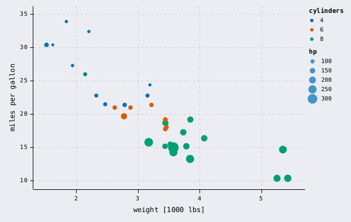
:::


Its options style the points when nothing is mapped, set the draw order and spread points that overlap:


```{=html}
<dl class="options"><div class="option-card"><dt><code>:size</code><span class="option-default">Default: <code>6</code> (theme)</span></dt><dd><div class="option-example"><code>(chart/scatter {:size 10})</code></div><div class="option-text">The point size in pixels; a mapped <code>:size</code> wins.<ul><li><a href="reference.types.html#non-negative-number">non-negative number</a></li></ul></div></dd></div><div class="option-card"><dt><code>:color</code><span class="option-default">Default: <code>[0 114 178 180]</code> (theme)</span></dt><dd><div class="option-example"><code>(chart/scatter {:color :steelblue})</code></div><div class="option-text">The colour of the points (in a 3D cloud, of every mark); a mapped <code>:color</code> wins.<ul><li><code>:none</code> – Draws nothing.</li><li><a href="reference.types.html#solid-colour">solid colour</a> – Any other colour, e.g. <code>:black</code>.</li></ul></div></dd></div><div class="option-card"><dt><code>:stroke-color</code><span class="option-default">Default: <code>:none</code> (theme)</span></dt><dd><div class="option-example"><code>(chart/scatter {:stroke-color :black})</code></div><div class="option-text">The colour of each point's outline.<ul><li><code>:none</code> – No outline.</li><li><a href="reference.types.html#solid-colour">solid colour</a> – Any other colour, e.g. <code>:black</code>.</li></ul></div></dd></div><div class="option-card"><dt><code>:stroke-width</code><span class="option-default">Default: <code>1</code> (theme)</span></dt><dd><div class="option-example"><code>(chart/scatter {:stroke-color :black, :stroke-width 2})</code></div><div class="option-text">The width of the outline in pixels; <code>0</code> draws no outline.<ul><li><a href="reference.types.html#non-negative-number">non-negative number</a></li></ul></div></dd></div><div class="option-card"><dt><code>:shape</code><span class="option-default">Default: <code>\O</code> (theme)</span></dt><dd><div class="option-example"><code>(chart/scatter {:shape \s})</code></div><div class="option-text">The shape of every point; a mapped <code>:shape</code> wins.<ul><li><a href="reference.types.html#point-shape">point shape</a></li></ul></div></dd></div><div class="option-card"><dt><code>:alpha</code><span class="option-default">Default: The colours' own alpha.</span></dt><dd><div class="option-example"><code>(chart/scatter {:alpha 0.5})</code></div><div class="option-text">The opacity of every point and its legend key; the outline keeps its own.<ul><li><a href="reference.types.html#fraction">fraction</a></li></ul></div></dd></div><div class="option-card"><dt><code>:padding</code><span class="option-default">Default: <code>0.05</code> on every side.</span></dt><dd><div class="option-example"><code>(chart/scatter {:padding {:x [0 0]}})</code></div><div class="option-text">Room around the data on x and y, as fractions of the data span.<ul><li><span>map of <code>:x</code> or <code>:y</code> to padding</span></li></ul></div></dd></div><div class="option-card"><dt><code>:descending</code><span class="option-default">Default: <code>false</code></span></dt><dd><div class="option-example"><code>(chart/scatter {:mapping {:order :y}, :descending true})</code></div><div class="option-text">Whether the points follow a mapped <code>:order</code> from its highest value down.<ul><li><code>false</code> – Higher <code>:order</code> values are drawn later, on top.</li><li><code>true</code> – Lower <code>:order</code> values are drawn later, on top.</li></ul></div></dd></div><div class="option-card"><dt><code>:jitter</code><span class="option-default">Default: No jitter.</span></dt><dd><div class="option-example"><code>(chart/scatter {:jitter [0.1 0.1]})</code></div><div class="option-text">Random offsets that spread overlapping points: <code>[dx dy]</code> moves each point by up to ±dx and ±dy in the axis scale's units (log units on a <code>:log</code> axis).<ul><li><span>pair of non-negative numbers</span></li></ul></div></dd></div><div class="option-card"><dt><code>:rng</code><span class="option-default">Default: An unseeded generator, so each build jitters differently.</span></dt><dd><div class="option-example"><code>(chart/scatter {:jitter [0.1 0.1], :rng (r/rng :mersenne 7)})</code></div><div class="option-text">The random generator of the jitter. A seeded one gives the same jitter on every build.<ul><li><a href="reference.types.html#random-generator">random generator</a></li></ul></div></dd></div></dl>
```


::: {.sourceClojure}
```clojure
(plot/render-image (plot/arrange [{:data mtcars
                                   :mapping {:x :cyl :y :gear}
                                   :charts [(chart/scatter {:size 10 :shape \S :color [200 80 40 150]})]
                                   :labels {:title "overplotted"}}
                                  {:data mtcars
                                   :mapping {:x :cyl :y :gear}
                                   :charts [(chart/scatter {:size 10 :shape \S :color [200 80 40 150]
                                                           :stroke-color :black :stroke-width 0.5
                                                           :jitter [0.3 0.2] :rng (r/rng :mersenne 7)})]
                                   :labels {:title ":jitter [0.3 0.2]"}}]
                                 {:columns 2})
                   {:width 900 :height 330})
```
:::


::: {.clay-image}
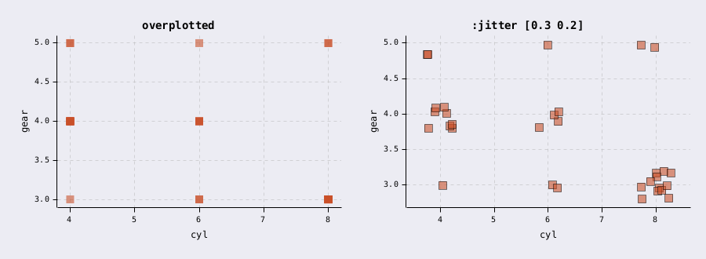
:::


The most powerful cars drawn over the others (ascending) or under them (descending); no padding on x:


::: {.sourceClojure}
```clojure
(plot/render-image (plot/arrange [{:data mtcars
                                   :mapping {:x :wt :y :mpg :color :hp :order :hp}
                                   :charts [(chart/scatter {:size 26 :stroke-color :white})]
                                   :labels {:title ":order :hp, ascending (default)"}
                                   :legend false}
                                  {:data mtcars
                                   :mapping {:x :wt :y :mpg :color :hp :order :hp}
                                   :charts [(chart/scatter {:size 26 :stroke-color :white :descending true
                                                           :padding {:x [0 0] :y [0.05 0.05]}})]
                                   :labels {:title ":descending true, :padding x 0"}}]
                                 {:columns 2 :widths [1 1.2]})
                   {:width 1000 :height 360})
```
:::


::: {.clay-image}
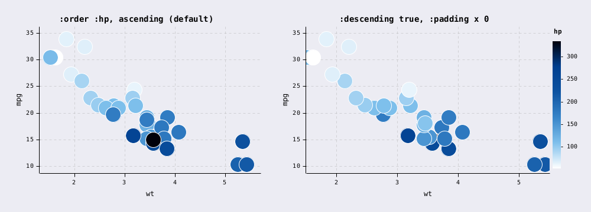
:::


Half-transparent bubbles keep the ones beneath visible; the white outline stays opaque:


::: {.sourceClojure}
```clojure
(plot/render-image {:data mtcars
                    :mapping {:x :wt :y :mpg :color (levels/categorical :cyl) :size :hp}
                    :charts [(chart/scatter {:alpha 0.45 :stroke-color :white :stroke-width 1})]
                    :scales {:color {:title "cylinders"} :size {:range [8 30]}}
                    :labels {:title ":alpha 0.45" :x "weight [1000 lbs]" :y "miles per gallon"}}
                   {:width 600 :height 380})
```
:::


::: {.clay-image}
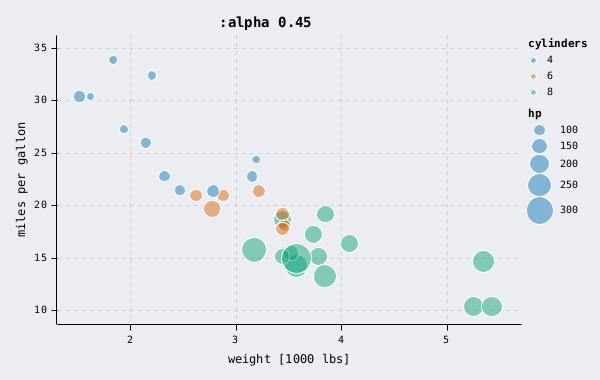
:::


## Line charts

`chart/line` joins each group's points into a line, ordered by x. Use it for values that change along x, such as
a time series; it can also fill the area below, stack groups, or vary colour and width along its length. (The
dataset's dates are text: the mapping parses them.)


```{=html}
<div class="shared"><div class="shared-title">Shared options<span class="shared-hint"> – groups of options other charts take too</span></div><ul><li><a href="reference.shared_options.html#line-style">Line style</a> – <code>:color</code> <code>:line-width</code> <code>:dash</code></li><li><a href="reference.shared_options.html#fill-patterns">Fill patterns</a> – <code>:pattern</code> <code>:pattern-color</code></li><li><a href="reference.shared_options.html#common-options">Common options</a> – <code>:data</code> <code>:mapping</code> <code>:legend</code></li><li><a href="reference.shared_options.html#named-theme-styles">Named theme styles</a> – <code>:theme-style</code></li><li><a href="reference.shared_options.html#curves">Curves</a> – <code>:interpolator</code> <code>:interpolator-params</code> <code>:curve</code> <code>:sample-step</code></li></ul></div>
```


```{=html}
<div class="mapping"><div class="mapping-title">Mapping<span class="mapping-hint"> – the row values the chart reads, under <code>:mapping</code></span></div><ul><li><code>:x</code> <span class="required">required</span> – The x of each point.</li><li><code>:y</code> <span class="required">required</span> – The y of each point.</li><li><code>:color</code> – Colours the line: per group (ordinal), or along the line (linear or binned).</li><li><code>:size</code> – Sets the line width: per group, or per point with <code>:trail</code>.</li><li><code>:dash</code> – Splits the rows into groups, each line with its own dash style.</li><li><code>:pattern</code> – Splits the rows into groups, each area with its own fill pattern.</li><li><code>:group</code> – Splits the rows into groups that look the same, each its own line.</li></ul></div>
```


::: {.sourceClojure}
```clojure
(plot/render-image {:data stocks
                    :mapping {:x #(java.time.LocalDate/parse (:date %)) :y :price :color :symbol}
                    :charts [(chart/line)]
                    :labels {:x "date" :y "price [USD]"}}
                   {:width 700 :height 380})
```
:::


::: {.clay-image}
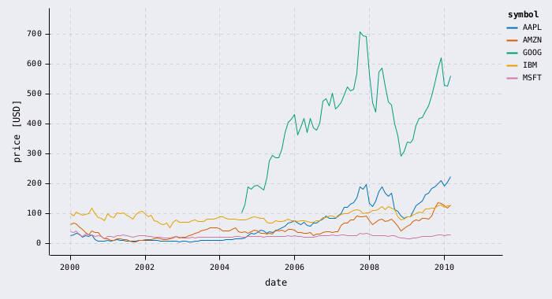
:::


### Style

These options decide how the line and the area below it look, including a trail whose width follows a mapped
`:size`:


```{=html}
<dl class="options"><div class="option-card"><dt><code>:fill</code><span class="option-default">Default: <code>:none</code> (theme)</span></dt><dd><div class="option-example"><code>(chart/line {:fill :color})</code></div><div class="option-text">Fills the area between the line and y = 0.<ul><li><code>:none</code> – No area.</li><li><code>:color</code> – The line colour, faded by <code>:alpha</code>.</li><li><a href="reference.types.html#solid-colour">solid colour</a> – Any other colour, e.g. <code>:black</code>.</li></ul></div></dd></div><div class="option-card"><dt><code>:alpha</code><span class="option-default">Default: <code>0.6</code> (theme)</span></dt><dd><div class="option-example"><code>(chart/line {:fill :color, :alpha 0.3})</code></div><div class="option-text">How opaque the area is with <code>:fill :color</code> and in stacked areas; it multiplies the line colour's alpha.<ul><li><a href="reference.types.html#fraction">fraction</a></li></ul></div></dd></div><div class="option-card"><dt><code>:fill-gradient</code><span class="option-default">Default: No gradient; <code>:fill</code> colours the areas.</span></dt><dd><div class="option-example"><code>(chart/line {:fill-gradient :mpl/viridis})</code></div><div class="option-text">A gradient that colours the areas instead of <code>:fill</code>.<ul><li><a href="reference.types.html#gradient">gradient</a></li></ul></div></dd></div><div class="option-card"><dt><code>:fill-gradient-axis</code><span class="option-default">Default: <code>:x</code>.</span></dt><dd><div class="option-example"><code>(chart/line {:fill-gradient :mpl/viridis, :fill-gradient-axis :y})</code></div><div class="option-text">The axis the gradient runs along, across its scale's range; it needs <code>:fill-gradient</code>.<ul><li><code>:x</code> – Colours change with x.</li><li><code>:y</code> – Colours change with y.</li></ul></div></dd></div><div class="option-card"><dt><code>:stroke-alpha-factor</code><span class="option-default">Default: No fading.</span></dt><dd><div class="option-example"><code>(chart/line {:stroke-alpha-factor 0.5})</code></div><div class="option-text">Multiplies the stroke opacity of unstacked lines; legend keys stay opaque.<ul><li><a href="reference.types.html#fraction">fraction</a></li></ul></div></dd></div><div class="option-card"><dt><code>:trail</code><span class="option-default">Default: <code>false</code></span></dt><dd><div class="option-example"><code>(chart/line {:mapping {:size :y}, :trail true})</code></div><div class="option-text">Whether the line becomes a filled trail whose width follows a numeric mapped <code>:size</code>.<ul><li><code>false</code> – A plain stroked line.</li><li><code>true</code> – The width changes at every point.</li></ul></div></dd></div></dl>
```


::: {.sourceClojure}
```clojure
(def wave (for [t (range 40)] {:t t :v (+ 1.5 (m/sin (* 0.25 t))) :w (+ 1 (mod t 10))}))
```
:::


```{=html}
<div class="data-table"><table class="table table-hover table-responsive clay-table"><thead><tr><th>t</th><th>v</th><th>w</th></tr></thead><tbody><tr><td>0</td><td>1.5</td><td>1</td></tr><tr><td>1</td><td>1.747403959254523</td><td>2</td></tr><tr><td>2</td><td>1.979425538604203</td><td>3</td></tr><tr><td>3</td><td>2.181638760023334</td><td>4</td></tr><tr><td>4</td><td>2.3414709848078967</td><td>5</td></tr><tr><td>5</td><td>2.448984619355586</td><td>6</td></tr><tr><td>6</td><td>2.4974949866040546</td><td>7</td></tr><tr><td>7</td><td>2.483985946873937</td><td>8</td></tr><tr><td>8</td><td>2.409297426825682</td><td>9</td></tr><tr><td>9</td><td>2.278073196887921</td><td>10</td></tr><tr><td>10</td><td>2.0984721441039564</td><td>1</td></tr><tr><td>11</td><td>1.8816609920523317</td><td>2</td></tr><tr><td>12</td><td>1.6411200080598671</td><td>3</td></tr><tr><td>13</td><td>1.3918048654698916</td><td>4</td></tr><tr><td>14</td><td>1.14921677231038</td><td>5</td></tr><tr><td>15</td><td>0.9284386812576563</td><td>6</td></tr><tr><td>16</td><td>0.7431975046920718</td><td>7</td></tr><tr><td>17</td><td>0.6050106417714165</td><td>8</td></tr><tr><td>18</td><td>0.522469882334903</td><td>9</td></tr><tr><td>19</td><td>0.500707211024622</td><td>10</td></tr><tr><td>20</td><td>0.5410757253368615</td><td>1</td></tr><tr><td>21</td><td>0.641065506573408</td><td>2</td></tr><tr><td>22</td><td>0.7944596744296081</td><td>3</td></tr><tr><td>23</td><td>0.9917209225007416</td><td>4</td></tr><tr><td>24</td><td>1.2205845018010741</td><td>5</td></tr><tr><td>25</td><td>1.4668207834524432</td><td>6</td></tr><tr><td>26</td><td>1.7151199880878156</td><td>7</td></tr><tr><td>27</td><td>1.9500440737806177</td><td>8</td></tr><tr><td>28</td><td>2.156986598718789</td><td>9</td></tr><tr><td>29</td><td>2.3230808790115054</td><td>10</td></tr><tr><td>30</td><td>2.437999976774739</td><td>1</td></tr><tr><td>31</td><td>2.4945987791111763</td><td>2</td></tr><tr><td>32</td><td>2.489358246623382</td><td>3</td></tr><tr><td>33</td><td>2.4226042102393404</td><td>4</td></tr><tr><td>34</td><td>2.2984871126234903</td><td>5</td></tr><tr><td>35</td><td>2.1247239537541924</td><td>6</td></tr><tr><td>36</td><td>1.9121184852417565</td><td>7</td></tr><tr><td>37</td><td>1.6738894853804336</td><td>8</td></tr><tr><td>38</td><td>1.4248488795381906</td><td>9</td></tr><tr><td>39</td><td>1.1804808063777263</td><td>10</td></tr></tbody></table></div>
```


::: {.sourceClojure}
```clojure
(plot/render-image (plot/arrange [{:data wave :mapping {:x :t :y :v}
                                   :charts [(chart/line {:fill :color :alpha 0.3})]
                                   :labels {:title ":fill :color"}}
                                  {:data wave :mapping {:x :t :y :v}
                                   :charts [(chart/line {:fill-gradient :mpl/viridis :fill-gradient-axis :y})]
                                   :labels {:title ":fill-gradient"}}
                                  {:data wave :mapping {:x :t :y :v :size :w}
                                   :charts [(chart/line {:trail true})]
                                   :labels {:title ":trail true"}
                                   :legend false}]
                                 {:columns 3})
                   {:width 1000 :height 300})
```
:::


::: {.clay-image}
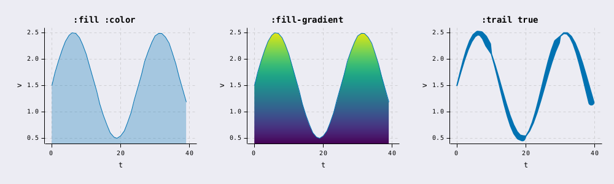
:::


A gradient along x, and faded strokes where lines overlap:


::: {.sourceClojure}
```clojure
(plot/render-image (plot/arrange [{:data wave :mapping {:x :t :y :v}
                                   :charts [(chart/line {:fill-gradient :mpl/viridis :fill-gradient-axis :x})]
                                   :labels {:title ":fill-gradient-axis :x"}}
                                  {:data stocks
                                   :mapping {:x #(java.time.LocalDate/parse (:date %)) :y :price :color :symbol}
                                   :charts [(chart/line {:line-width 3 :stroke-alpha-factor 0.4})]
                                   :labels {:title ":stroke-alpha-factor 0.4"}}]
                                 {:columns 2 :widths [1 1.4]})
                   {:width 1000 :height 300})
```
:::


::: {.clay-image}
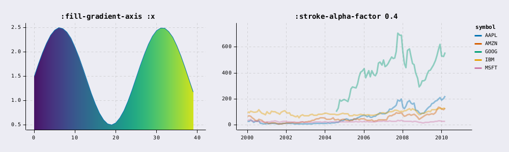
:::


`:fill :color` keeps the line colour's own opacity: a dimmed line (alpha 60 of 255) fills dimmed too, here beside
the same line at full opacity:


::: {.sourceClojure}
```clojure
(plot/render-image (plot/arrange [{:data wave :mapping {:x :t :y :v}
                                   :charts [(chart/line {:color [200 80 40] :fill :color :alpha 0.5})]
                                   :labels {:title "opaque colour, :alpha 0.5"}}
                                  {:data wave :mapping {:x :t :y :v}
                                   :charts [(chart/line {:color [200 80 40 60] :fill :color :alpha 0.5})]
                                   :labels {:title "colour alpha 60, :alpha 0.5"}}]
                                 {:columns 2})
                   {:width 1000 :height 300})
```
:::


::: {.clay-image}
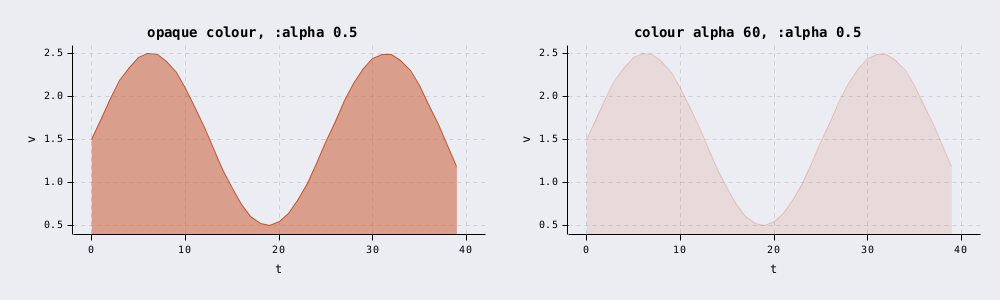
:::


### Path

These options decide how the points become a path: their order, what happens at a missing y and how groups
combine (the Layering and position chapter shows `:stack` and the streamgraphs):


```{=html}
<dl class="options"><div class="option-card"><dt><code>:bridge</code><span class="option-default">Default: <code>{:alpha-factor 0.3}</code> (theme)</span></dt><dd><div class="option-text">The style of the segments that bridge gaps with <code>:gaps :bridge</code>.</div></dd></div><div class="option-card"><dt><code>:bridge :alpha-factor</code><span class="option-default">Default: <code>0.3</code> (theme); passing <code>:bridge</code> replaces the theme's map entirely.</span></dt><dd><div class="option-example"><code>(chart/line {:gaps :bridge, :bridge {:alpha-factor 0.5}})</code></div><div class="option-text">The bridge's opacity, as a fraction of the line's alpha.<ul><li><a href="reference.types.html#fraction">fraction</a></li></ul></div></dd></div><div class="option-card"><dt><code>:bridge :line-width</code><span class="option-default">Default: The line's width.</span></dt><dd><div class="option-example"><code>(chart/line {:gaps :bridge, :bridge {:alpha-factor 0.3, :line-width 3}})</code></div><div class="option-text">The bridge's line width in pixels.<ul><li><a href="reference.types.html#non-negative-number">non-negative number</a></li></ul></div></dd></div><div class="option-card"><dt><code>:bridge :dash</code><span class="option-default">Default: The line's dash.</span></dt><dd><div class="option-example"><code>(chart/line {:gaps :bridge, :bridge {:alpha-factor 0.3, :dash :dotted}})</code></div><div class="option-text">The bridge's dash style.<ul><li><a href="reference.types.html#dash">dash</a></li></ul></div></dd></div><div class="option-card"><dt><code>:order</code><span class="option-default">Default: <code>:x</code></span></dt><dd><div class="option-example"><code>(chart/line {:order :data})</code></div><div class="option-text">The order the points are joined in.<ul><li><code>:x</code> – By x (numbers or dates), ties in data order.</li><li><code>:data</code> – In data order.</li></ul></div></dd></div><div class="option-card"><dt><code>:gaps</code><span class="option-default">Default: <code>:break</code>; stacked lines reject <code>:gaps</code> (they interpolate across missing values).</span></dt><dd><div class="option-example"><code>(chart/line {:gaps :bridge})</code></div><div class="option-text">How the line handles an invalid y.<ul><li><code>:break</code> – Leaves empty space.</li><li><code>:bridge</code> – Joins its neighbours with a straight segment in the <code>:bridge</code> style.</li></ul></div></dd></div><div class="option-card"><dt><code>:position</code><span class="option-default">Default: <code>:overlay</code></span></dt><dd><div class="option-example"><code>(chart/line {:position :stack})</code></div><div class="option-text">How groups combine.<ul><li><code>:overlay</code> – Each line on its own.</li><li><code>:normalize</code> – Stacked as shares: at each x the groups sum to 1.</li><li><code>:silhouette</code> – A streamgraph centred on y = 0.</li><li><code>:stack</code> – Stacked on top of each other.</li><li><code>:wiggle</code> – A streamgraph whose layers slope as little as possible.</li></ul></div></dd></div><div class="option-card"><dt><code>:padding</code><span class="option-default">Default: <code>0.05</code> on every side; y <code>[0 0.05]</code> with <code>:stack</code> or <code>:normalize</code> and no negative values.</span></dt><dd><div class="option-example"><code>(chart/line {:padding {:x [0 0]}})</code></div><div class="option-text">Room around the data on x and y, as fractions of the data span.<ul><li><span>map of <code>:x</code> or <code>:y</code> to padding</span></li></ul></div></dd></div></dl>
```


::: {.sourceClojure}
```clojure
(def spiral (for [t (range 0 12 0.25)] {:x (* t (m/cos t)) :y (* t (m/sin t)) :v (when-not (< 5 t 6) t)}))
```
:::


```{=html}
<div class="data-table"><table class="table table-hover table-responsive clay-table"><thead><tr><th>x</th><th>y</th><th>v</th></tr></thead><tbody><tr><td>0.0</td><td>0.0</td><td>0</td></tr><tr><td>0.24222810542766118</td><td>0.061850989813630734</td><td>0.25</td></tr><tr><td>0.4387912809451864</td><td>0.2397127693021015</td><td>0.5</td></tr><tr><td>0.5487666516553656</td><td>0.5112290700175006</td><td>0.75</td></tr><tr><td>0.5403023058681398</td><td>0.8414709848078965</td><td>1.0</td></tr><tr><td>0.3941529529940858</td><td>1.1862307741944829</td><td>1.25</td></tr><tr><td>0.10610580250155435</td><td>1.4962424799060816</td><td>1.5</td></tr><tr><td>-0.31193059738661116</td><td>1.7219754070293896</td><td>1.75</td></tr><tr><td>-0.8322936730942848</td><td>1.8185948536513634</td><td>2.0</td></tr><tr><td>-1.4133906511261631</td><td>1.7506646929978227</td><td>2.25</td></tr><tr><td>-2.002859038867334</td><td>1.496180360259891</td><td>2.5</td></tr><tr><td>-2.541831541239275</td><td>1.0495677281439122</td><td>2.75</td></tr><tr><td>-2.9699774898013365</td><td>0.4233600241796016</td><td>3.0</td></tr><tr><td>-3.2309214472617755</td><td>-0.3516341872228522</td><td>3.25</td></tr><tr><td>-3.277598405517787</td><td>-1.2277412969136694</td><td>3.5</td></tr><tr><td>-3.077097590023353</td><td>-2.143354945283789</td><td>3.75</td></tr><tr><td>-2.6145744834544478</td><td>-3.027209981231713</td><td>4.0</td></tr><tr><td>-1.8958718321336194</td><td>-3.80370477247148</td><td>4.25</td></tr><tr><td>-0.9485810974385086</td><td>-4.3988855294929365</td><td>4.5</td></tr><tr><td>0.17861022621788863</td><td>-4.746640747633045</td><td>4.75</td></tr><tr><td>1.4183109273161312</td><td>-4.794621373315692</td><td>5.0</td></tr><tr><td>2.688448755519664</td><td>-4.509406090489608</td><td></td></tr><tr><td>3.89768375860193</td><td>-3.8804717906371557</td><td></td></tr><tr><td>4.9518563986787445</td><td>-2.922604695620736</td><td></td></tr><tr><td>5.761021719902196</td><td>-1.6764929891935552</td><td>6.0</td></tr><tr><td>6.246558863903121</td><td>-0.2073701034222301</td><td>6.25</td></tr><tr><td>6.347819567232152</td><td>1.398279922570801</td><td>6.5</td></tr><tr><td>6.027792826651267</td><td>3.037797498019169</td><td>6.75</td></tr><tr><td>5.277315780403132</td><td>4.598906191031523</td><td>7.0</td></tr><tr><td>4.117450256343037</td><td>5.967336372833415</td><td>7.25</td></tr><tr><td>2.5997648837626937</td><td>7.034999825810542</td><td>7.5</td></tr><tr><td>0.8044062684492105</td><td>7.708140538111615</td><td>7.75</td></tr><tr><td>-1.1640002704689083</td><td>7.914865972987054</td><td>8.0</td></tr><tr><td>-3.1824204839808297</td><td>7.611484734474557</td><td>8.25</td></tr><tr><td>-5.117101172821001</td><td>6.787140457299667</td><td>8.5</td></tr><tr><td>-6.832399731550305</td><td>5.466334595349184</td><td>8.75</td></tr><tr><td>-8.200172356962092</td><td>3.7090663671758093</td><td>9.0</td></tr><tr><td>-9.109077854572744</td><td>1.6084777397690104</td><td>9.25</td></tr><tr><td>-9.473135483865596</td><td>-0.7139356443871884</td><td>9.5</td></tr><tr><td>-9.238903088785435</td><td>-3.115312137817168</td><td>9.75</td></tr><tr><td>-8.390715290764524</td><td>-5.440211108893697</td><td>10.0</td></tr><tr><td>-6.953536967356914</td><td>-7.530658911649153</td><td>10.25</td></tr><tr><td>-4.993137743957921</td><td>-9.236805479702536</td><td>10.5</td></tr><tr><td>-2.6134692925310725</td><td>-10.427477080147295</td><td>10.75</td></tr><tr><td>0.04868267786855864</td><td>-10.999892272057739</td><td>11.0</td></tr><tr><td>2.831508563307237</td><td>-10.887839972001691</td><td>11.25</td></tr><tr><td>5.5580047256595675</td><td>-10.067700008916928</td><td>11.5</td></tr><tr><td>8.047226241006753</td><td>-8.561813465969248</td><td>11.75</td></tr></tbody></table></div>
```


::: {.sourceClojure}
```clojure
(plot/render-image (plot/arrange [{:data spiral :mapping {:x :x :y :y}
                                   :charts [(chart/line)]
                                   :labels {:title ":order :x (default)"}}
                                  {:data spiral :mapping {:x :x :y :y}
                                   :charts [(chart/line {:order :data})]
                                   :labels {:title ":order :data"}}
                                  {:data spiral :mapping {:x :x :y :v}
                                   :charts [(chart/line {:order :data :gaps :break :padding {:x [0 0] :y [0 0]}})]
                                   :labels {:title ":gaps :break, no padding"}}
                                  {:data spiral :mapping {:x :x :y :v}
                                   :charts [(chart/line {:order :data :gaps :bridge :bridge {:alpha-factor 0.5 :dash :dotted}})]
                                   :labels {:title ":gaps :bridge"}}]
                                 {:columns 2})
                   {:width 900 :height 600})
```
:::


::: {.clay-image}
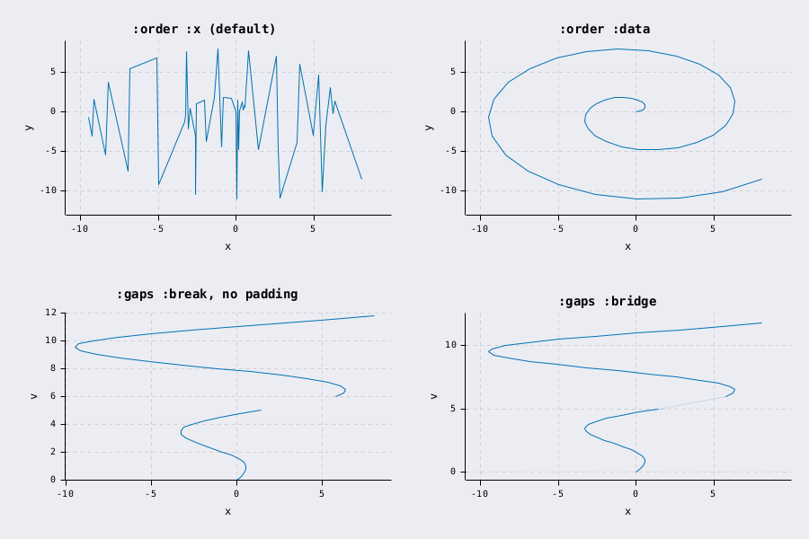
:::


The four stacked positions, side by side:


::: {.sourceClojure}
```clojure
(def streams (for [series ["a" "b" "c"] t (range 25)]
               {:series series :t t :v (+ 1.5 (m/sin (+ (* 0.3 t) (* 2 (count series)) (int (first series)))))}))
```
:::


```{=html}
<div class="data-table"><table class="table table-hover table-responsive clay-table"><thead><tr><th>series</th><th>t</th><th>v</th></tr></thead><tbody><tr><td>a</td><td>0</td><td>0.5007931658136463</td></tr><tr><td>a</td><td>1</td><td>0.5571891259213132</td></tr><tr><td>a</td><td>2</td><td>0.6978035734827992</td></tr><tr><td>a</td><td>3</td><td>0.9100758386825973</td></tr><tr><td>a</td><td>4</td><td>1.175044272270521</td></tr><tr><td>a</td><td>5</td><td>1.4690400332167286</td></tr><tr><td>a</td><td>6</td><td>1.7658013557891272</td></tr><tr><td>a</td><td>7</td><td>2.0388194348720936</td></tr><tr><td>a</td><td>8</td><td>2.263706378577581</td></tr><tr><td>a</td><td>9</td><td>2.4203737059941695</td></tr><tr><td>a</td><td>10</td><td>2.494826791358406</td></tr><tr><td>a</td><td>11</td><td>2.4804149622946956</td></tr><tr><td>a</td><td>12</td><td>2.378425584571251</td></tr><tr><td>a</td><td>13</td><td>2.1979690655501094</td></tr><tr><td>a</td><td>14</td><td>1.9551650486306003</td></tr><tr><td>a</td><td>15</td><td>1.6717024935127782</td></tr><tr><td>a</td><td>16</td><td>1.3729022660226193</td></tr><tr><td>a</td><td>17</td><td>1.0854553005796792</td></tr><tr><td>a</td><td>18</td><td>0.8350383785176917</td></tr><tr><td>a</td><td>19</td><td>0.6440204976799755</td></tr><tr><td>a</td><td>20</td><td>0.5294647164625153</td></tr><tr><td>a</td><td>21</td><td>0.5016039616255725</td></tr><tr><td>a</td><td>22</td><td>0.5629269514224042</td></tr><tr><td>a</td><td>23</td><td>0.707955885809737</td></tr><tr><td>a</td><td>24</td><td>0.9237357620113366</td></tr><tr><td>b</td><td>0</td><td>0.9936343588902412</td></tr><tr><td>b</td><td>1</td><td>1.2710830775547932</td></tr><tr><td>b</td><td>2</td><td>1.5689802631292735</td></tr><tr><td>b</td><td>3</td><td>1.8607156472389814</td></tr><tr><td>b</td><td>4</td><td>2.120229376882631</td></tr><tr><td>b</td><td>5</td><td>2.32433986348825</td></tr><tr><td>b</td><td>6</td><td>2.4548145251796623</td></tr><tr><td>b</td><td>7</td><td>2.499998449014294</td></tr><tr><td>b</td><td>8</td><td>2.455855489645069</td></tr><tr><td>b</td><td>9</td><td>2.3263288061636223</td></tr><tr><td>b</td><td>10</td><td>2.122988631442349</td></tr><tr><td>b</td><td>11</td><td>1.8639987376909781</td></tr><tr><td>b</td><td>12</td><td>1.5724939207813549</td></tr><tr><td>b</td><td>13</td><td>1.2745134378334269</td></tr><tr><td>b</td><td>14</td><td>0.9966749979282254</td></tr><tr><td>b</td><td>15</td><td>0.7637970814297974</td></tr><tr><td>b</td><td>16</td><td>0.5966819790500097</td></tr><tr><td>b</td><td>17</td><td>0.5102575851736925</td></tr><tr><td>b</td><td>18</td><td>0.5122439335122633</td></tr><tr><td>b</td><td>19</td><td>0.6024635894844816</td></tr><tr><td>b</td><td>20</td><td>0.7728574999191474</td></tr><tr><td>b</td><td>21</td><td>1.0082048842730023</td></tr><tr><td>b</td><td>22</td><td>1.2874828616253495</td></tr><tr><td>b</td><td>23</td><td>1.5857443620192933</td></tr><tr><td>b</td><td>24</td><td>1.8763465739222898</td></tr><tr><td>c</td><td>0</td><td>1.9520257871783506</td></tr><tr><td>c</td><td>1</td><td>2.1954421919799203</td></tr><tr><td>c</td><td>2</td><td>2.3767368169734757</td></tr><tr><td>c</td><td>3</td><td>2.479715153249283</td></tr><tr><td>c</td><td>4</td><td>2.4951784527231693</td></tr><tr><td>c</td><td>5</td><td>2.4217454249067294</td></tr><tr><td>c</td><td>6</td><td>2.2659756234728015</td></tr><tr><td>c</td><td>7</td><td>2.041783500861879</td></tr><tr><td>c</td><td>8</td><td>1.76919547168632</td></tr><tr><td>c</td><td>9</td><td>1.4725610127567745</td></tr><tr><td>c</td><td>10</td><td>1.178377596837469</td></tr><tr><td>c</td><td>11</td><td>0.9129237523203599</td></tr><tr><td>c</td><td>12</td><td>0.6999116805479259</td></tr><tr><td>c</td><td>13</td><td>0.5583691154881323</td></tr><tr><td>c</td><td>14</td><td>0.5009396329284678</td></tr><tr><td>c</td><td>15</td><td>0.5327532375065523</td></tr><tr><td>c</td><td>16</td><td>0.6509681146743322</td></tr><tr><td>c</td><td>17</td><td>0.8450244815280111</td></tr><tr><td>c</td><td>18</td><td>1.0975878607651728</td></tr><tr><td>c</td><td>19</td><td>1.3860975179157289</td></tr><tr><td>c</td><td>20</td><td>1.6847817445606674</td></tr><tr><td>c</td><td>21</td><td>1.9669599682904564</td></tr><tr><td>c</td><td>22</td><td>2.2074260487769513</td></tr><tr><td>c</td><td>23</td><td>2.3846998672186963</td></tr><tr><td>c</td><td>24</td><td>2.482946081380238</td></tr></tbody></table></div>
```


::: {.sourceClojure}
```clojure
(plot/render-image (plot/arrange [{:data streams :mapping {:x :t :y :v :color :series}
                                   :charts [(chart/line {:position :stack})] :labels {:title ":stack"} :legend false}
                                  {:data streams :mapping {:x :t :y :v :color :series}
                                   :charts [(chart/line {:position :normalize})] :labels {:title ":normalize"} :legend false}
                                  {:data streams :mapping {:x :t :y :v :color :series}
                                   :charts [(chart/line {:position :silhouette})] :labels {:title ":silhouette"} :legend false}
                                  {:data streams :mapping {:x :t :y :v :color :series}
                                   :charts [(chart/line {:position :wiggle})] :labels {:title ":wiggle"}}]
                                 {:columns 4 :widths [1 1 1 1.3]})
                   {:width 1000 :height 280})
```
:::


::: {.clay-image}
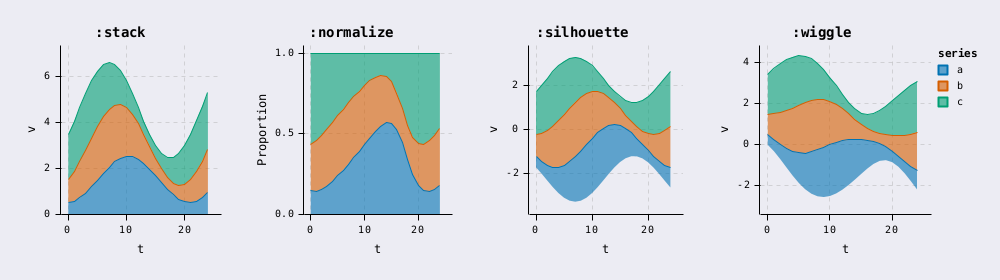
:::


### Ends

These options add arrowheads, or stop each line short of its points, e.g. before a marker:


```{=html}
<dl class="options"><div class="option-card"><dt><code>:arrow</code></dt><dd><div class="option-text">Arrowheads at the ends of each unbroken piece of a plain stroked line (no fill, gradient, colour along the line or stacking).</div></dd></div><div class="option-card"><dt><code>:arrow :end</code><span class="option-default">Default: <code>true</code></span></dt><dd><div class="option-example"><code>(chart/line {:arrow {:start true, :end false}})</code></div><div class="option-text">Whether the end gets an arrowhead.<ul><li><code>true</code> – The end gets a head.</li><li><code>false</code> – No head at the end.</li></ul></div></dd></div><div class="option-card"><dt><code>:arrow :start</code><span class="option-default">Default: <code>false</code></span></dt><dd><div class="option-example"><code>(chart/line {:arrow {:start true}})</code></div><div class="option-text">Whether the start gets an arrowhead.<ul><li><code>false</code> – No head at the start.</li><li><code>true</code> – The start gets a head.</li></ul></div></dd></div><div class="option-card"><dt><code>:arrow :size</code><span class="option-default">Default: <code>8.0</code></span></dt><dd><div class="option-example"><code>(chart/line {:arrow {:size 12}})</code></div><div class="option-text">The head's length in pixels.<ul><li><a href="reference.types.html#positive-number">positive number</a></li></ul></div></dd></div><div class="option-card"><dt><code>:arrow :angle</code><span class="option-default">Default: <code>20.0</code></span></dt><dd><div class="option-example"><code>(chart/line {:arrow {:angle 30}})</code></div><div class="option-text">The angle in degrees between each side of the head and the line.<ul><li><span>number above 0 and below 90</span></li></ul></div></dd></div><div class="option-card"><dt><code>:arrow :shape</code><span class="option-default">Default: <code>:closed</code></span></dt><dd><div class="option-example"><code>(chart/line {:arrow {:shape :open}})</code></div><div class="option-text">The head's shape.<ul><li><code>:closed</code> – A filled triangle.</li><li><code>:open</code> – Two strokes.</li></ul></div></dd></div><div class="option-card"><dt><code>:start-gap</code><span class="option-default">Default: No gap.</span></dt><dd><div class="option-example"><code>(chart/line {:start-gap 4})</code></div><div class="option-text">Shortens each unbroken piece of the line at its start, in pixels.<ul><li><a href="reference.types.html#non-negative-number">non-negative number</a></li></ul></div></dd></div><div class="option-card"><dt><code>:end-gap</code><span class="option-default">Default: No gap.</span></dt><dd><div class="option-example"><code>(chart/line {:end-gap 4})</code></div><div class="option-text">Shortens each unbroken piece of the line at its end, in pixels.<ul><li><a href="reference.types.html#non-negative-number">non-negative number</a></li></ul></div></dd></div></dl>
```


::: {.sourceClojure}
```clojure
(def path-points [{:x 0 :y 0} {:x 1 :y 2} {:x 2 :y 1} {:x 3 :y 3}])
```
:::


```{=html}
<div class="data-table"><table class="table table-hover table-responsive clay-table"><thead><tr><th>x</th><th>y</th></tr></thead><tbody><tr><td>0</td><td>0</td></tr><tr><td>1</td><td>2</td></tr><tr><td>2</td><td>1</td></tr><tr><td>3</td><td>3</td></tr></tbody></table></div>
```


::: {.sourceClojure}
```clojure
(plot/render-image (plot/arrange [{:data path-points :mapping {:x :x :y :y}
                                   :charts [(chart/line {:arrow {:end true}})]
                                   :labels {:title ":arrow {:end true}"}}
                                  {:data path-points :mapping {:x :x :y :y}
                                   :charts [(chart/scatter {:size 14})
                                            (chart/line {:arrow {:start true :end true :shape :open :size 12}
                                                         :start-gap 9 :end-gap 9})]
                                   :labels {:title "open heads, gaps 9 px"}}]
                                 {:columns 2})
                   {:width 800 :height 300})
```
:::


::: {.clay-image}
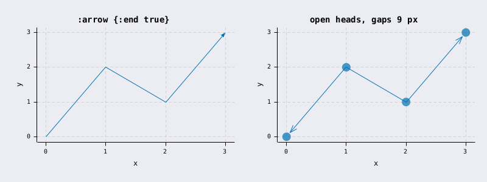
:::


## Line segments

`chart/segment` draws a straight line per row from (x, y) to (xend, yend). Use it for arrows, links between two
points or lollipop stems; the ends can be mapped or fixed for all rows.


```{=html}
<div class="shared"><div class="shared-title">Shared options<span class="shared-hint"> – groups of options other charts take too</span></div><ul><li><a href="reference.shared_options.html#line-style">Line style</a> – <code>:color</code> <code>:line-width</code> <code>:dash</code></li><li><a href="reference.shared_options.html#common-options">Common options</a> – <code>:data</code> <code>:mapping</code> <code>:legend</code></li><li><a href="reference.shared_options.html#named-theme-styles">Named theme styles</a> – <code>:theme-style</code></li></ul></div>
```


```{=html}
<div class="mapping"><div class="mapping-title">Mapping<span class="mapping-hint"> – the row values the chart reads, under <code>:mapping</code></span></div><ul><li><code>:x</code> <span class="required">required</span> – The start x of each segment.</li><li><code>:y</code> <span class="required">required</span> – The start y of each segment.</li><li><code>:xend</code> – The end x of each segment.</li><li><code>:yend</code> – The end y of each segment.</li><li><code>:end-gap</code> – The end gap of each row in pixels, e.g. the radius of the node an edge points at.</li><li><code>:color</code> – Colours each segment: per group (ordinal) or per row (linear or binned).</li><li><code>:size</code> – Sets the line width: per group (ordinal) or per row (linear).</li><li><code>:dash</code> – Splits the rows into groups, each segment with its own dash style.</li><li><code>:group</code> – Splits the rows into groups that look the same, each drawn as its own set of segments.</li></ul></div>
```


::: {.sourceClojure}
```clojure
(def moves [{:from "a" :x 1 :y 1 :x2 3 :y2 2} {:from "b" :x 2 :y 4 :x2 4 :y2 3} {:from "c" :x 3 :y 0.5 :x2 1.5 :y2 3}])
```
:::


```{=html}
<div class="data-table"><table class="table table-hover table-responsive clay-table"><thead><tr><th>from</th><th>x</th><th>y</th><th>x2</th><th>y2</th></tr></thead><tbody><tr><td>a</td><td>1</td><td>1</td><td>3</td><td>2</td></tr><tr><td>b</td><td>2</td><td>4</td><td>4</td><td>3</td></tr><tr><td>c</td><td>3</td><td>0.5</td><td>1.5</td><td>3</td></tr></tbody></table></div>
```


::: {.sourceClojure}
```clojure
(plot/render-image {:data moves
                    :mapping {:x :x :y :y :xend :x2 :yend :y2 :color :from}
                    :charts [(chart/segment {:line-width 2})]}
                   {:width 500 :height 320})
```
:::


::: {.clay-image}
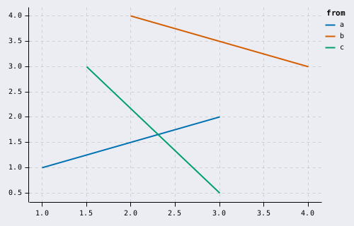
:::


Its options give fixed ends, arrowheads and gaps (on the left, `:xend 0` ends every segment at x = 0, as
lollipop stems):


```{=html}
<dl class="options"><div class="option-card"><dt><code>:xend</code><span class="option-default">Default: The mapped <code>:xend</code>, else the start x.</span></dt><dd><div class="option-example"><code>(chart/segment {:xend 3})</code></div><div class="option-text">The end x of every segment, fixed for all rows; it wins over a mapped <code>:xend</code>.<ul><li><a href="reference.types.html#position">position</a></li></ul></div></dd></div><div class="option-card"><dt><code>:yend</code><span class="option-default">Default: The mapped <code>:yend</code>, else the start y.</span></dt><dd><div class="option-example"><code>(chart/segment {:yend 3})</code></div><div class="option-text">The end y of every segment, fixed for all rows; it wins over a mapped <code>:yend</code>.<ul><li><a href="reference.types.html#position">position</a></li></ul></div></dd></div><div class="option-card"><dt><code>:padding</code><span class="option-default">Default: <code>0.05</code> on every side; none on a side a fixed <code>:xend</code> or <code>:yend</code> reaches.</span></dt><dd><div class="option-example"><code>(chart/segment {:padding {:x [0 0]}})</code></div><div class="option-text">Room around the data on x and y, as fractions of the data span.<ul><li><span>map of <code>:x</code> or <code>:y</code> to padding</span></li></ul></div></dd></div><div class="option-card"><dt><code>:arrow</code></dt><dd><div class="option-text">Arrowheads at the ends of every segment.</div></dd></div><div class="option-card"><dt><code>:arrow :end</code><span class="option-default">Default: <code>true</code></span></dt><dd><div class="option-example"><code>(chart/segment {:arrow {:start true, :end false}})</code></div><div class="option-text">Whether the end gets an arrowhead.<ul><li><code>true</code> – The end gets a head.</li><li><code>false</code> – No head at the end.</li></ul></div></dd></div><div class="option-card"><dt><code>:arrow :start</code><span class="option-default">Default: <code>false</code></span></dt><dd><div class="option-example"><code>(chart/segment {:arrow {:start true}})</code></div><div class="option-text">Whether the start gets an arrowhead.<ul><li><code>false</code> – No head at the start.</li><li><code>true</code> – The start gets a head.</li></ul></div></dd></div><div class="option-card"><dt><code>:arrow :size</code><span class="option-default">Default: <code>8.0</code></span></dt><dd><div class="option-example"><code>(chart/segment {:arrow {:size 12}})</code></div><div class="option-text">The head's length in pixels.<ul><li><a href="reference.types.html#positive-number">positive number</a></li></ul></div></dd></div><div class="option-card"><dt><code>:arrow :angle</code><span class="option-default">Default: <code>20.0</code></span></dt><dd><div class="option-example"><code>(chart/segment {:arrow {:angle 30}})</code></div><div class="option-text">The angle in degrees between each side of the head and the line.<ul><li><span>number above 0 and below 90</span></li></ul></div></dd></div><div class="option-card"><dt><code>:arrow :shape</code><span class="option-default">Default: <code>:closed</code></span></dt><dd><div class="option-example"><code>(chart/segment {:arrow {:shape :open}})</code></div><div class="option-text">The head's shape.<ul><li><code>:closed</code> – A filled triangle.</li><li><code>:open</code> – Two strokes.</li></ul></div></dd></div><div class="option-card"><dt><code>:start-gap</code><span class="option-default">Default: No gap.</span></dt><dd><div class="option-example"><code>(chart/segment {:start-gap 4})</code></div><div class="option-text">Shortens every segment at its start, in pixels.<ul><li><a href="reference.types.html#non-negative-number">non-negative number</a></li></ul></div></dd></div><div class="option-card"><dt><code>:end-gap</code><span class="option-default">Default: No gap.</span></dt><dd><div class="option-example"><code>(chart/segment {:end-gap 4})</code></div><div class="option-text">Shortens every segment at its end, in pixels; a mapped <code>:end-gap</code> wins.<ul><li><a href="reference.types.html#non-negative-number">non-negative number</a></li></ul></div></dd></div></dl>
```


::: {.sourceClojure}
```clojure
(plot/render-image (plot/arrange [{:data mtcars
                                   :mapping {:x :mpg :y :model}
                                   :charts [(chart/segment {:xend 0}) (chart/scatter)]
                                   :scales {:y {:reverse true}}
                                   :labels {:title ":xend 0"}}
                                  {:data moves
                                   :mapping {:x :x :y :y :xend :x2 :yend :y2}
                                   :charts [(chart/scatter {:size 10})
                                            (chart/segment {:arrow {:end true :size 10} :end-gap 4})]
                                   :labels {:title ":arrow, :end-gap 4"}}]
                                 {:columns 2 :widths [1.3 1]})
                   {:width 1000 :height 620})
```
:::


::: {.clay-image}
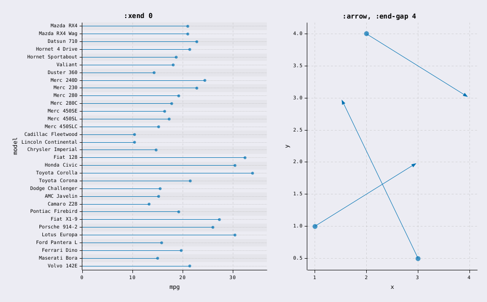
:::


::: {.sourceClojure}
```clojure
(plot/render-image (plot/arrange [{:data moves
                                   :mapping {:x :x :y :y :xend :x2}
                                   :charts [(chart/segment {:yend 4.5 :dash :dashed}) (chart/scatter)]
                                   :labels {:title ":yend 4.5 (one end for all)"}}
                                  {:data moves
                                   :mapping {:x :x :y :y :xend :x2 :yend :y2}
                                   :charts [(chart/scatter {:size 14})
                                            (chart/segment {:start-gap 10 :end-gap 10 :padding {:x [0.2 0.2] :y [0.2 0.2]}})]
                                   :labels {:title ":start-gap 10, :padding 0.2"}}]
                                 {:columns 2})
                   {:width 800 :height 320})
```
:::


::: {.clay-image}
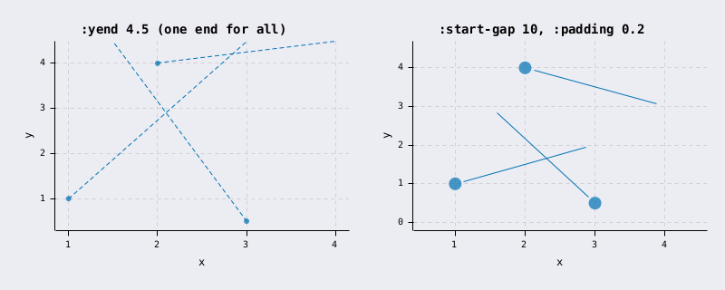
:::


## Polygons

`chart/polygon` fills one shape per group, its rows the vertices in data order. Use it for regions, outlines or
any custom shape.


```{=html}
<div class="shared"><div class="shared-title">Shared options<span class="shared-hint"> – groups of options other charts take too</span></div><ul><li><a href="reference.shared_options.html#common-options">Common options</a> – <code>:data</code> <code>:mapping</code> <code>:legend</code></li><li><a href="reference.shared_options.html#named-theme-styles">Named theme styles</a> – <code>:theme-style</code></li></ul></div>
```


```{=html}
<div class="mapping"><div class="mapping-title">Mapping<span class="mapping-hint"> – the row values the chart reads, under <code>:mapping</code></span></div><ul><li><code>:x</code> <span class="required">required</span> – The x of each vertex.</li><li><code>:y</code> <span class="required">required</span> – The y of each vertex.</li><li><code>:color</code> – Colours each polygon: one colour per group (ordinal), or by its first row's value (linear or binned).</li><li><code>:group</code> – Splits the rows into groups that look the same, each its own polygon.</li></ul></div>
```


::: {.sourceClojure}
```clojure
(def shapes (concat (for [a (range 0 360 60)]
                      {:shape "hexagon" :x (m/cos (m/radians a)) :y (m/sin (m/radians a))})
                    (for [[x y] [[1.5 -1] [3 -1] [2.25 1]]] {:shape "triangle" :x x :y y})))
```
:::


```{=html}
<div class="data-table"><table class="table table-hover table-responsive clay-table"><thead><tr><th>shape</th><th>x</th><th>y</th></tr></thead><tbody><tr><td>hexagon</td><td>1.0</td><td>0.0</td></tr><tr><td>hexagon</td><td>0.5000000000000001</td><td>0.8660254037844386</td></tr><tr><td>hexagon</td><td>-0.4999999999999998</td><td>0.8660254037844387</td></tr><tr><td>hexagon</td><td>-1.0</td><td>1.2246467991473532E-16</td></tr><tr><td>hexagon</td><td>-0.5000000000000004</td><td>-0.8660254037844384</td></tr><tr><td>hexagon</td><td>0.5000000000000001</td><td>-0.8660254037844386</td></tr><tr><td>triangle</td><td>1.5</td><td>-1</td></tr><tr><td>triangle</td><td>3</td><td>-1</td></tr><tr><td>triangle</td><td>2.25</td><td>1</td></tr></tbody></table></div>
```


::: {.sourceClojure}
```clojure
(plot/render-image {:data shapes
                    :mapping {:x :x :y :y :color :shape}
                    :charts [(chart/polygon)]}
                   {:width 500 :height 260})
```
:::


::: {.clay-image}
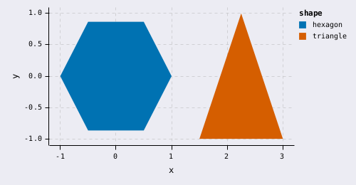
:::


Its options decide how the shapes are filled and outlined:


```{=html}
<dl class="options"><div class="option-card"><dt><code>:color</code><span class="option-default">Default: <code>[0 114 178]</code> (theme)</span></dt><dd><div class="option-example"><code>(chart/polygon {:color :steelblue})</code></div><div class="option-text">The fill colour; a mapped <code>:color</code> wins.<ul><li><code>:none</code> – Draws nothing.</li><li><a href="reference.types.html#solid-colour">solid colour</a> – Any other colour, e.g. <code>:black</code>.</li></ul></div></dd></div><div class="option-card"><dt><code>:alpha</code><span class="option-default">Default: <code>1.0</code> (theme)</span></dt><dd><div class="option-example"><code>(chart/polygon {:alpha 0.5})</code></div><div class="option-text">How opaque the fill is; it multiplies the fill colour's alpha.<ul><li><a href="reference.types.html#fraction">fraction</a></li></ul></div></dd></div><div class="option-card"><dt><code>:stroke-color</code><span class="option-default">Default: <code>:none</code> (theme)</span></dt><dd><div class="option-example"><code>(chart/polygon {:stroke-color :black})</code></div><div class="option-text">The colour of the outline.<ul><li><code>:none</code> – No outline.</li><li><code>:color</code> – The group's colour, not faded by <code>:alpha</code>.</li><li><a href="reference.types.html#solid-colour">solid colour</a> – Any other colour, e.g. <code>:black</code>.</li></ul></div></dd></div><div class="option-card"><dt><code>:stroke-width</code><span class="option-default">Default: <code>1</code> (theme)</span></dt><dd><div class="option-example"><code>(chart/polygon {:stroke-color :black, :stroke-width 2})</code></div><div class="option-text">The width of the outline in pixels; <code>0</code> draws no outline.<ul><li><a href="reference.types.html#non-negative-number">non-negative number</a></li></ul></div></dd></div><div class="option-card"><dt><code>:padding</code><span class="option-default">Default: <code>0.05</code> on every side.</span></dt><dd><div class="option-example"><code>(chart/polygon {:padding {:x [0 0]}})</code></div><div class="option-text">Room around the data on x and y, as fractions of the data span.<ul><li><span>map of <code>:x</code> or <code>:y</code> to padding</span></li></ul></div></dd></div></dl>
```


::: {.sourceClojure}
```clojure
(plot/render-image {:data shapes
                    :mapping {:x :x :y :y :color :shape}
                    :charts [(chart/polygon {:alpha 0.35 :stroke-color :color :stroke-width 2})]}
                   {:width 500 :height 260})
```
:::


::: {.clay-image}
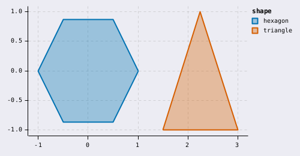
:::


With `:padding` 0 the shapes touch the panel's edges:


::: {.sourceClojure}
```clojure
(plot/render-image {:data shapes
                    :mapping {:x :x :y :y :group :shape}
                    :charts [(chart/polygon {:color [120 160 90] :stroke-color :black :padding {:x [0 0] :y [0 0]}})]}
                   {:width 500 :height 260})
```
:::


::: {.clay-image}
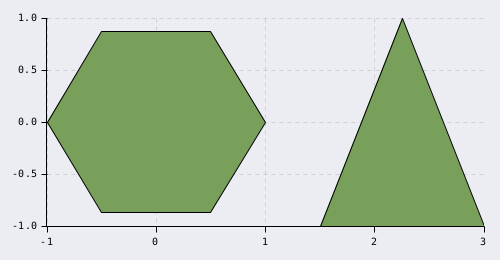
:::


## Bands

`chart/ribbon` fills a band per group between a lower and an upper bound at each x. Use it for an interval, a
range of values or an envelope around a line.


```{=html}
<div class="shared"><div class="shared-title">Shared options<span class="shared-hint"> – groups of options other charts take too</span></div><ul><li><a href="reference.shared_options.html#fill-patterns">Fill patterns</a> – <code>:pattern</code> <code>:pattern-color</code></li><li><a href="reference.shared_options.html#common-options">Common options</a> – <code>:data</code> <code>:mapping</code> <code>:legend</code></li><li><a href="reference.shared_options.html#named-theme-styles">Named theme styles</a> – <code>:theme-style</code></li><li><a href="reference.shared_options.html#curves">Curves</a> – <code>:interpolator</code> <code>:interpolator-params</code> <code>:sample-step</code></li></ul></div>
```


```{=html}
<div class="mapping"><div class="mapping-title">Mapping<span class="mapping-hint"> – the row values the chart reads, under <code>:mapping</code></span></div><ul><li><code>:x</code> <span class="required">required</span> – The x of the band's points.</li><li><code>:ymin</code> <span class="required">required</span> – The lower bound of the band.</li><li><code>:ymax</code> <span class="required">required</span> – The upper bound of the band.</li><li><code>:color</code> – Splits the rows into groups, each band with its own colour.</li><li><code>:dash</code> – Splits the rows into groups, each band's edges with their own dash style.</li><li><code>:pattern</code> – Splits the rows into groups, each band with its own fill pattern.</li><li><code>:group</code> – Splits the rows into groups that look the same, each its own band.</li></ul></div>
```


::: {.sourceClojure}
```clojure
(def bands (for [g ["low" "high"] t (range 0 25)]
             (let [c (+ (if (= g "low") 1.0 4.0) (m/sin (* 0.3 t)))
                   w (+ 0.4 (* 0.04 t))]
               {:group g :t t :lo (- c w) :mid c :hi (+ c w)})))
```
:::


```{=html}
<div class="data-table"><table class="table table-hover table-responsive clay-table"><thead><tr><th>group</th><th>t</th><th>lo</th><th>mid</th><th>hi</th></tr></thead><tbody><tr><td>low</td><td>0</td><td>0.6</td><td>1.0</td><td>1.4</td></tr><tr><td>low</td><td>1</td><td>0.8555202066613397</td><td>1.2955202066613396</td><td>1.7355202066613395</td></tr><tr><td>low</td><td>2</td><td>1.0846424733950353</td><td>1.5646424733950353</td><td>2.0446424733950352</td></tr><tr><td>low</td><td>3</td><td>1.2633269096274833</td><td>1.7833269096274833</td><td>2.3033269096274833</td></tr><tr><td>low</td><td>4</td><td>1.3720390859672262</td><td>1.9320390859672263</td><td>2.4920390859672263</td></tr><tr><td>low</td><td>5</td><td>1.3974949866040545</td><td>1.9974949866040546</td><td>2.5974949866040546</td></tr><tr><td>low</td><td>6</td><td>1.333847630878195</td><td>1.9738476308781951</td><td>2.6138476308781953</td></tr><tr><td>low</td><td>7</td><td>1.1832093666488737</td><td>1.8632093666488738</td><td>2.543209366648874</td></tr><tr><td>low</td><td>8</td><td>0.9554631805511511</td><td>1.675463180551151</td><td>2.3954631805511513</td></tr><tr><td>low</td><td>9</td><td>0.6673798802338302</td><td>1.4273798802338302</td><td>2.1873798802338302</td></tr><tr><td>low</td><td>10</td><td>0.3411200080598671</td><td>1.1411200080598671</td><td>1.9411200080598672</td></tr><tr><td>low</td><td>11</td><td>0.0022543058567516816</td><td>0.8422543058567518</td><td>1.6822543058567518</td></tr><tr><td>low</td><td>12</td><td>-0.3225204432948521</td><td>0.5574795567051479</td><td>1.437479556705148</td></tr><tr><td>low</td><td>13</td><td>-0.6077661591839738</td><td>0.31223384081602623</td><td>1.2322338408160263</td></tr><tr><td>low</td><td>14</td><td>-0.8315757724135883</td><td>0.1284242275864118</td><td>1.0884242275864118</td></tr><tr><td>low</td><td>15</td><td>-0.977530117665097</td><td>0.02246988233490299</td><td>1.022469882334903</td></tr><tr><td>low</td><td>16</td><td>-1.0361646088358407</td><td>0.0038353911641593186</td><td>1.0438353911641594</td></tr><tr><td>low</td><td>17</td><td>-1.0058146823277325</td><td>0.07418531767226755</td><td>1.1541853176722676</td></tr><tr><td>low</td><td>18</td><td>-0.8927644875559878</td><td>0.2272355124440123</td><td>1.3472355124440125</td></tr><tr><td>low</td><td>19</td><td>-0.7106855425976377</td><td>0.4493144574023624</td><td>1.6093144574023626</td></tr><tr><td>low</td><td>20</td><td>-0.47941549819892604</td><td>0.7205845018010741</td><td>1.9205845018010743</td></tr><tr><td>low</td><td>21</td><td>-0.22318609951565027</td><td>1.0168139004843497</td><td>2.2568139004843495</td></tr><tr><td>low</td><td>22</td><td>0.031541363513377885</td><td>1.311541363513378</td><td>2.591541363513378</td></tr><tr><td>low</td><td>23</td><td>0.25843976438819927</td><td>1.5784397643881993</td><td>2.8984397643881996</td></tr><tr><td>low</td><td>24</td><td>0.4336678638491529</td><td>1.7936678638491528</td><td>3.1536678638491527</td></tr><tr><td>high</td><td>0</td><td>3.6</td><td>4.0</td><td>4.4</td></tr><tr><td>high</td><td>1</td><td>3.8555202066613394</td><td>4.295520206661339</td><td>4.73552020666134</td></tr><tr><td>high</td><td>2</td><td>4.084642473395035</td><td>4.564642473395035</td><td>5.044642473395036</td></tr><tr><td>high</td><td>3</td><td>4.263326909627484</td><td>4.783326909627483</td><td>5.303326909627483</td></tr><tr><td>high</td><td>4</td><td>4.372039085967225</td><td>4.932039085967226</td><td>5.492039085967226</td></tr><tr><td>high</td><td>5</td><td>4.397494986604054</td><td>4.997494986604054</td><td>5.597494986604055</td></tr><tr><td>high</td><td>6</td><td>4.3338476308781955</td><td>4.973847630878195</td><td>5.613847630878195</td></tr><tr><td>high</td><td>7</td><td>4.183209366648874</td><td>4.863209366648873</td><td>5.543209366648873</td></tr><tr><td>high</td><td>8</td><td>3.955463180551151</td><td>4.675463180551151</td><td>5.39546318055115</td></tr><tr><td>high</td><td>9</td><td>3.66737988023383</td><td>4.42737988023383</td><td>5.18737988023383</td></tr><tr><td>high</td><td>10</td><td>3.3411200080598675</td><td>4.141120008059867</td><td>4.941120008059867</td></tr><tr><td>high</td><td>11</td><td>3.002254305856752</td><td>3.842254305856752</td><td>4.682254305856752</td></tr><tr><td>high</td><td>12</td><td>2.677479556705148</td><td>3.557479556705148</td><td>4.437479556705148</td></tr><tr><td>high</td><td>13</td><td>2.392233840816026</td><td>3.312233840816026</td><td>4.2322338408160265</td></tr><tr><td>high</td><td>14</td><td>2.168424227586412</td><td>3.128424227586412</td><td>4.088424227586412</td></tr><tr><td>high</td><td>15</td><td>2.022469882334903</td><td>3.022469882334903</td><td>4.022469882334903</td></tr><tr><td>high</td><td>16</td><td>1.9638353911641593</td><td>3.0038353911641593</td><td>4.043835391164159</td></tr><tr><td>high</td><td>17</td><td>1.9941853176722675</td><td>3.0741853176722675</td><td>4.154185317672267</td></tr><tr><td>high</td><td>18</td><td>2.1072355124440123</td><td>3.2272355124440124</td><td>4.347235512444012</td></tr><tr><td>high</td><td>19</td><td>2.2893144574023623</td><td>3.4493144574023624</td><td>4.609314457402363</td></tr><tr><td>high</td><td>20</td><td>2.520584501801074</td><td>3.720584501801074</td><td>4.920584501801074</td></tr><tr><td>high</td><td>21</td><td>2.776813900484349</td><td>4.016813900484349</td><td>5.2568139004843495</td></tr><tr><td>high</td><td>22</td><td>3.0315413635133774</td><td>4.311541363513378</td><td>5.591541363513378</td></tr><tr><td>high</td><td>23</td><td>3.258439764388199</td><td>4.578439764388199</td><td>5.8984397643882</td></tr><tr><td>high</td><td>24</td><td>3.4336678638491525</td><td>4.793667863849152</td><td>6.153667863849153</td></tr></tbody></table></div>
```


::: {.sourceClojure}
```clojure
(plot/render-image {:data bands
                    :mapping {:x :t :ymin :lo :ymax :hi :color :group}
                    :charts [(chart/ribbon) (chart/line {:mapping {:y :mid}})]}
                   {:width 600 :height 340})
```
:::


::: {.clay-image}
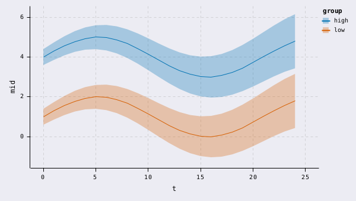
:::


Its options decide how the band's fill and edges look, or put a gradient in place of the fill:


```{=html}
<dl class="options"><div class="option-card"><dt><code>:color</code><span class="option-default">Default: <code>[0 114 178]</code> (theme)</span></dt><dd><div class="option-example"><code>(chart/ribbon {:color :steelblue})</code></div><div class="option-text">The band colour; a mapped <code>:color</code> wins.<ul><li><code>:none</code> – Draws nothing.</li><li><a href="reference.types.html#solid-colour">solid colour</a> – Any other colour, e.g. <code>:black</code>.</li></ul></div></dd></div><div class="option-card"><dt><code>:fill</code><span class="option-default">Default: <code>:color</code> (theme)</span></dt><dd><div class="option-example"><code>(chart/ribbon {:fill :none})</code></div><div class="option-text">How the band is filled.<ul><li><code>:color</code> – The band colour, faded by <code>:alpha</code>.</li><li><code>:none</code> – No fill; only the edges, when <code>:stroke-color</code> draws them.</li><li><a href="reference.types.html#solid-colour">solid colour</a> – Any other colour, e.g. <code>:black</code>.</li></ul></div></dd></div><div class="option-card"><dt><code>:alpha</code><span class="option-default">Default: <code>0.3</code> (theme)</span></dt><dd><div class="option-example"><code>(chart/ribbon {:alpha 0.5})</code></div><div class="option-text">How opaque the fill is with <code>:fill :color</code>; it multiplies the band colour's alpha.<ul><li><a href="reference.types.html#fraction">fraction</a></li></ul></div></dd></div><div class="option-card"><dt><code>:stroke-color</code><span class="option-default">Default: <code>:none</code> (theme)</span></dt><dd><div class="option-example"><code>(chart/ribbon {:stroke-color :black})</code></div><div class="option-text">The colour of both edges.<ul><li><code>:none</code> – No edges.</li><li><code>:color</code> – The band colour.</li><li><a href="reference.types.html#solid-colour">solid colour</a> – Any other colour, e.g. <code>:black</code>.</li></ul></div></dd></div><div class="option-card"><dt><code>:stroke-width</code><span class="option-default">Default: <code>1</code> (theme)</span></dt><dd><div class="option-example"><code>(chart/ribbon {:stroke-color :black, :stroke-width 2})</code></div><div class="option-text">The width of the edges in pixels; <code>0</code> draws no edges.<ul><li><a href="reference.types.html#non-negative-number">non-negative number</a></li></ul></div></dd></div><div class="option-card"><dt><code>:dash</code><span class="option-default">Default: <code>:none</code> (theme)</span></dt><dd><div class="option-example"><code>(chart/ribbon {:stroke-color :black, :dash :dashed})</code></div><div class="option-text">The dash style of the edges; a mapped <code>:dash</code> wins.<ul><li><a href="reference.types.html#dash">dash</a></li></ul></div></dd></div><div class="option-card"><dt><code>:fill-gradient</code><span class="option-default">Default: No gradient; <code>:fill</code> colours the bands.</span></dt><dd><div class="option-example"><code>(chart/ribbon {:fill-gradient :mpl/viridis})</code></div><div class="option-text">A gradient that colours the bands instead of <code>:fill</code>.<ul><li><a href="reference.types.html#gradient">gradient</a></li></ul></div></dd></div><div class="option-card"><dt><code>:fill-gradient-axis</code><span class="option-default">Default: <code>:x</code>.</span></dt><dd><div class="option-example"><code>(chart/ribbon {:fill-gradient :mpl/viridis, :fill-gradient-axis :y})</code></div><div class="option-text">The axis the gradient runs along, across its scale's range; it needs <code>:fill-gradient</code>.<ul><li><code>:x</code> – Colours change with x.</li><li><code>:y</code> – Colours change with y.</li></ul></div></dd></div><div class="option-card"><dt><code>:padding</code><span class="option-default">Default: <code>0.05</code> on every side.</span></dt><dd><div class="option-example"><code>(chart/ribbon {:padding {:x [0 0]}})</code></div><div class="option-text">Room around the data on x and y, as fractions of the data span.<ul><li><span>map of <code>:x</code> or <code>:y</code> to padding</span></li></ul></div></dd></div></dl>
```


::: {.sourceClojure}
```clojure
(def band (filter #(= "high" (:group %)) bands))
```
:::


```{=html}
<div class="data-table"><table class="table table-hover table-responsive clay-table"><thead><tr><th>group</th><th>t</th><th>lo</th><th>mid</th><th>hi</th></tr></thead><tbody><tr><td>high</td><td>0</td><td>3.6</td><td>4.0</td><td>4.4</td></tr><tr><td>high</td><td>1</td><td>3.8555202066613394</td><td>4.295520206661339</td><td>4.73552020666134</td></tr><tr><td>high</td><td>2</td><td>4.084642473395035</td><td>4.564642473395035</td><td>5.044642473395036</td></tr><tr><td>high</td><td>3</td><td>4.263326909627484</td><td>4.783326909627483</td><td>5.303326909627483</td></tr><tr><td>high</td><td>4</td><td>4.372039085967225</td><td>4.932039085967226</td><td>5.492039085967226</td></tr><tr><td>high</td><td>5</td><td>4.397494986604054</td><td>4.997494986604054</td><td>5.597494986604055</td></tr><tr><td>high</td><td>6</td><td>4.3338476308781955</td><td>4.973847630878195</td><td>5.613847630878195</td></tr><tr><td>high</td><td>7</td><td>4.183209366648874</td><td>4.863209366648873</td><td>5.543209366648873</td></tr><tr><td>high</td><td>8</td><td>3.955463180551151</td><td>4.675463180551151</td><td>5.39546318055115</td></tr><tr><td>high</td><td>9</td><td>3.66737988023383</td><td>4.42737988023383</td><td>5.18737988023383</td></tr><tr><td>high</td><td>10</td><td>3.3411200080598675</td><td>4.141120008059867</td><td>4.941120008059867</td></tr><tr><td>high</td><td>11</td><td>3.002254305856752</td><td>3.842254305856752</td><td>4.682254305856752</td></tr><tr><td>high</td><td>12</td><td>2.677479556705148</td><td>3.557479556705148</td><td>4.437479556705148</td></tr><tr><td>high</td><td>13</td><td>2.392233840816026</td><td>3.312233840816026</td><td>4.2322338408160265</td></tr><tr><td>high</td><td>14</td><td>2.168424227586412</td><td>3.128424227586412</td><td>4.088424227586412</td></tr><tr><td>high</td><td>15</td><td>2.022469882334903</td><td>3.022469882334903</td><td>4.022469882334903</td></tr><tr><td>high</td><td>16</td><td>1.9638353911641593</td><td>3.0038353911641593</td><td>4.043835391164159</td></tr><tr><td>high</td><td>17</td><td>1.9941853176722675</td><td>3.0741853176722675</td><td>4.154185317672267</td></tr><tr><td>high</td><td>18</td><td>2.1072355124440123</td><td>3.2272355124440124</td><td>4.347235512444012</td></tr><tr><td>high</td><td>19</td><td>2.2893144574023623</td><td>3.4493144574023624</td><td>4.609314457402363</td></tr><tr><td>high</td><td>20</td><td>2.520584501801074</td><td>3.720584501801074</td><td>4.920584501801074</td></tr><tr><td>high</td><td>21</td><td>2.776813900484349</td><td>4.016813900484349</td><td>5.2568139004843495</td></tr><tr><td>high</td><td>22</td><td>3.0315413635133774</td><td>4.311541363513378</td><td>5.591541363513378</td></tr><tr><td>high</td><td>23</td><td>3.258439764388199</td><td>4.578439764388199</td><td>5.8984397643882</td></tr><tr><td>high</td><td>24</td><td>3.4336678638491525</td><td>4.793667863849152</td><td>6.153667863849153</td></tr></tbody></table></div>
```


::: {.sourceClojure}
```clojure
(plot/render-image (plot/arrange [{:data band :mapping {:x :t :ymin :lo :ymax :hi}
                                   :charts [(chart/ribbon {:color [200 80 40] :alpha 0.5})]
                                   :labels {:title ":color, :alpha 0.5"}}
                                  {:data band :mapping {:x :t :ymin :lo :ymax :hi}
                                   :charts [(chart/ribbon {:fill :none :stroke-color :color :stroke-width 2 :dash :dashed})]
                                   :labels {:title ":fill :none, dashed edges"}}
                                  {:data band :mapping {:x :t :ymin :lo :ymax :hi}
                                   :charts [(chart/ribbon {:fill-gradient [:yellow :purple] :fill-gradient-axis :y})]
                                   :labels {:title ":fill-gradient along y"}}]
                                 {:columns 3})
                   {:width 1000 :height 300})
```
:::


::: {.clay-image}
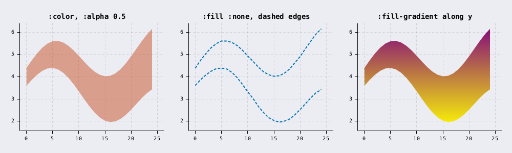
:::


A gradient along x; no padding on x, a third of the span on y:


::: {.sourceClojure}
```clojure
(plot/render-image (plot/arrange [{:data band :mapping {:x :t :ymin :lo :ymax :hi}
                                   :charts [(chart/ribbon {:fill-gradient [:yellow :purple] :fill-gradient-axis :x})]
                                   :labels {:title ":fill-gradient-axis :x"}}
                                  {:data band :mapping {:x :t :ymin :lo :ymax :hi}
                                   :charts [(chart/ribbon {:padding {:x [0 0] :y [0.33 0.33]}})]
                                   :labels {:title ":padding {:x [0 0] :y [0.33 0.33]}"}}]
                                 {:columns 2})
                   {:width 800 :height 300})
```
:::


::: {.clay-image}
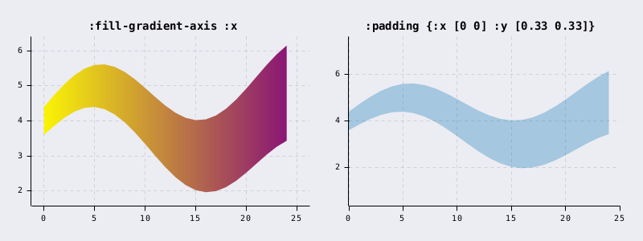
:::


## Candlestick charts

`chart/candlestick` draws a candle per row: a wick from low to high and a body from open to close, coloured by
whether the price rose or fell. Use it for prices over time. The dates here are text, so each trading day gets its
own slot, with no weekend gaps.


```{=html}
<div class="shared"><div class="shared-title">Shared options<span class="shared-hint"> – groups of options other charts take too</span></div><ul><li><a href="reference.shared_options.html#common-options">Common options</a> – <code>:data</code> <code>:mapping</code> <code>:legend</code></li><li><a href="reference.shared_options.html#named-theme-styles">Named theme styles</a> – <code>:theme-style</code></li></ul></div>
```


```{=html}
<div class="mapping"><div class="mapping-title">Mapping<span class="mapping-hint"> – the row values the chart reads, under <code>:mapping</code></span></div><ul><li><code>:x</code> <span class="required">required</span> – The x of each candle, e.g. its date.</li><li><code>:open</code> <span class="required">required</span> – The opening price.</li><li><code>:high</code> <span class="required">required</span> – The highest price.</li><li><code>:low</code> <span class="required">required</span> – The lowest price.</li><li><code>:close</code> <span class="required">required</span> – The closing price.</li></ul></div>
```


::: {.sourceClojure}
```clojure
(plot/render-image {:data ohlc
                    :mapping {:x :date :open :open :high :high :low :low :close :close}
                    :charts [(chart/candlestick)]
                    :labels {:y "VIX"}}
                   {:width 700 :height 360})
```
:::


::: {.clay-image}
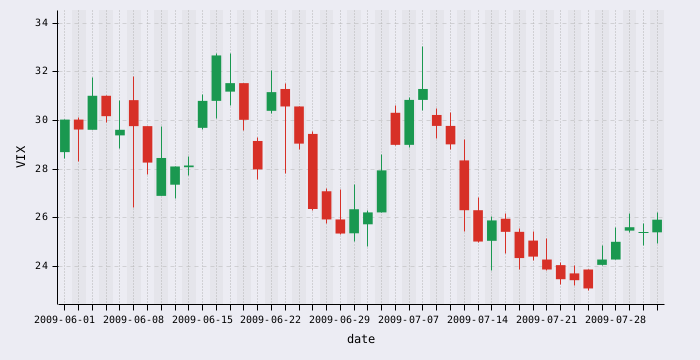
:::


Its options decide how the candles look, from their colours and patterns to the OHLC bar style:


```{=html}
<dl class="options"><div class="option-card"><dt><code>:up-color</code><span class="option-default">Default: <code>[26 152 80]</code> (theme)</span></dt><dd><div class="option-example"><code>(chart/candlestick {:up-color :seagreen})</code></div><div class="option-text">The colour of a candle that closes at or above its open.<ul><li><a href="reference.types.html#solid-colour">solid colour</a></li></ul></div></dd></div><div class="option-card"><dt><code>:down-color</code><span class="option-default">Default: <code>[215 48 39]</code> (theme)</span></dt><dd><div class="option-example"><code>(chart/candlestick {:down-color :firebrick})</code></div><div class="option-text">The colour of a candle that closes below its open.<ul><li><a href="reference.types.html#solid-colour">solid colour</a></li></ul></div></dd></div><div class="option-card"><dt><code>:width</code><span class="option-default">Default: <code>0.7</code> (theme)</span></dt><dd><div class="option-example"><code>(chart/candlestick {:width 0.5})</code></div><div class="option-text">The body width, as a fraction of the smallest step between x values (of a band's width on a categorical axis).<ul><li><a href="reference.types.html#fraction">fraction</a></li></ul></div></dd></div><div class="option-card"><dt><code>:line-width</code><span class="option-default">Default: <code>1</code> (theme)</span></dt><dd><div class="option-example"><code>(chart/candlestick {:line-width 2})</code></div><div class="option-text">The width in pixels of the wicks, or of the bars with <code>:style :ohlc</code>.<ul><li><a href="reference.types.html#non-negative-number">non-negative number</a></li></ul></div></dd></div><div class="option-card"><dt><code>:stroke-color</code><span class="option-default">Default: <code>:none</code> (theme)</span></dt><dd><div class="option-example"><code>(chart/candlestick {:stroke-color :black})</code></div><div class="option-text">The colour of each body's outline.<ul><li><code>:none</code> – No outline.</li><li><a href="reference.types.html#solid-colour">solid colour</a> – Any other colour, e.g. <code>:black</code>.</li></ul></div></dd></div><div class="option-card"><dt><code>:stroke-width</code><span class="option-default">Default: <code>1</code> (theme)</span></dt><dd><div class="option-example"><code>(chart/candlestick {:stroke-color :black, :stroke-width 2})</code></div><div class="option-text">The width of the body outline in pixels; <code>0</code> draws no outline.<ul><li><a href="reference.types.html#non-negative-number">non-negative number</a></li></ul></div></dd></div><div class="option-card"><dt><code>:up-pattern</code><span class="option-default">Default: <code>:solid</code> (theme)</span></dt><dd><div class="option-example"><code>(chart/candlestick {:up-pattern :hatch})</code></div><div class="option-text">The fill pattern drawn over the bodies of up candles.<ul><li><a href="reference.types.html#fill-pattern">fill pattern</a></li></ul></div></dd></div><div class="option-card"><dt><code>:down-pattern</code><span class="option-default">Default: <code>:solid</code> (theme)</span></dt><dd><div class="option-example"><code>(chart/candlestick {:down-pattern :dots})</code></div><div class="option-text">The fill pattern drawn over the bodies of down candles.<ul><li><a href="reference.types.html#fill-pattern">fill pattern</a></li></ul></div></dd></div><div class="option-card"><dt><code>:pattern-color</code><span class="option-default">Default: <code>:darker</code> (theme)</span></dt><dd><div class="option-example"><code>(chart/candlestick {:up-pattern :hatch, :pattern-color :black})</code></div><div class="option-text">The colour of the pattern's ink.<ul><li><code>:darker</code> – The body colour, darkened.</li><li><code>:none</code> – No pattern drawn.</li><li><a href="reference.types.html#solid-colour">solid colour</a> – Any other colour, e.g. <code>:black</code>.</li></ul></div></dd></div><div class="option-card"><dt><code>:style</code><span class="option-default">Default: <code>:candle</code></span></dt><dd><div class="option-example"><code>(chart/candlestick {:style :ohlc})</code></div><div class="option-text">How each candle is drawn.<ul><li><code>:candle</code> – A wick from low to high and a body from open to close.</li><li><code>:ohlc</code> – A bar from low to high with ticks at the open and the close.</li></ul></div></dd></div><div class="option-card"><dt><code>:padding</code><span class="option-default">Default: <code>0.05</code> on every side; x also gets half the smallest x step past the outer candles.</span></dt><dd><div class="option-example"><code>(chart/candlestick {:padding {:x [0 0]}})</code></div><div class="option-text">Room around the data on x and y, as fractions of the data span.<ul><li><span>map of <code>:x</code> or <code>:y</code> to padding</span></li></ul></div></dd></div></dl>
```


::: {.sourceClojure}
```clojure
(plot/render-image (plot/arrange [{:data ohlc :mapping {:x :date :open :open :high :high :low :low :close :close}
                                   :charts [(chart/candlestick {:up-color [33 102 172] :down-color [240 140 30]
                                                                :width 0.4 :stroke-color :black :stroke-width 1.5})]
                                   :labels {:title "colours, :width 0.4, outlined"}}
                                  {:data ohlc :mapping {:x :date :open :open :high :high :low :low :close :close}
                                   :charts [(chart/candlestick {:down-pattern :hatch :pattern-color :black})]
                                   :labels {:title ":down-pattern :hatch"}}
                                  {:data ohlc :mapping {:x :date :open :open :high :high :low :low :close :close}
                                   :charts [(chart/candlestick {:style :ohlc :line-width 2})]
                                   :labels {:title ":style :ohlc"}}]
                                 {:columns 3})
                   {:width 1000 :height 320})
```
:::


::: {.clay-image}
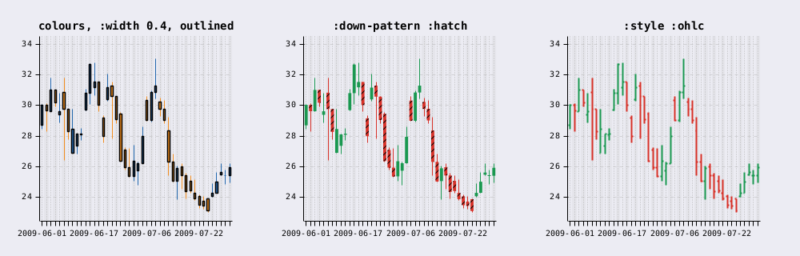
:::


Here a pattern marks the up candles, and `:padding` adds room above and below the prices:


::: {.sourceClojure}
```clojure
(plot/render-image {:data ohlc :mapping {:x :date :open :open :high :high :low :low :close :close}
                    :charts [(chart/candlestick {:up-pattern :dots :pattern-color :black :padding {:y [0.3 0.3]}})]
                    :labels {:title ":up-pattern :dots, :padding {:y [0.3 0.3]}"}}
                   {:width 700 :height 340})
```
:::


::: {.clay-image}
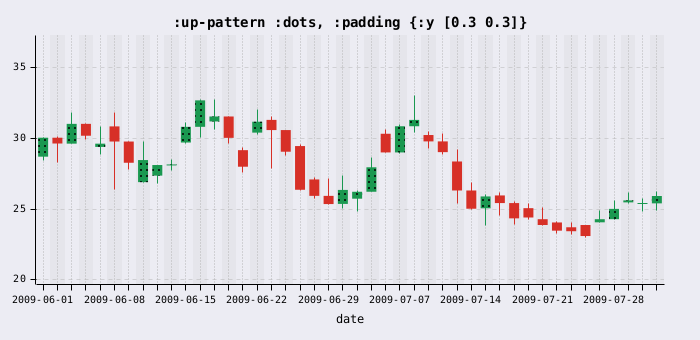
:::


```{=html}
<div style="background-color:grey;height:2px;width:100%;"></div>
```


```{=html}
<div><pre><small><small>source: notebooks/reference/charts_points_lines.clj</small></small></pre></div>
```