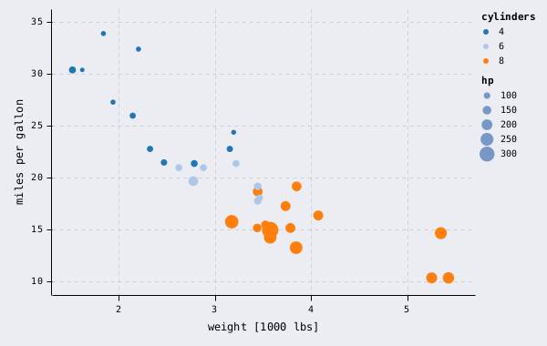
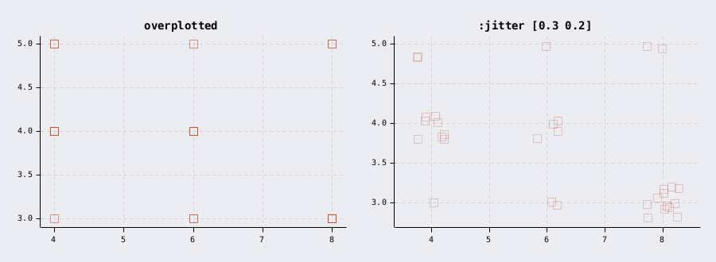
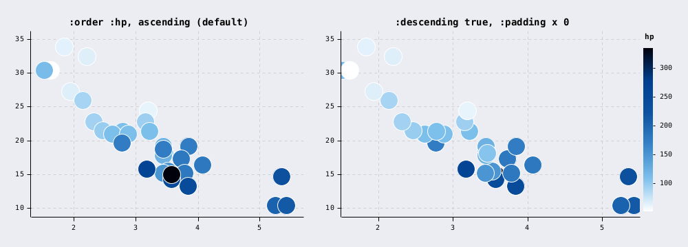
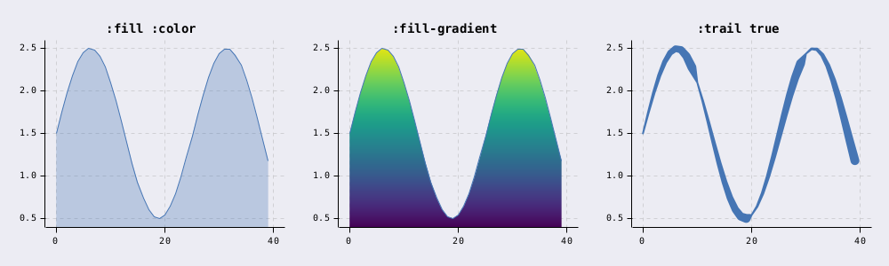
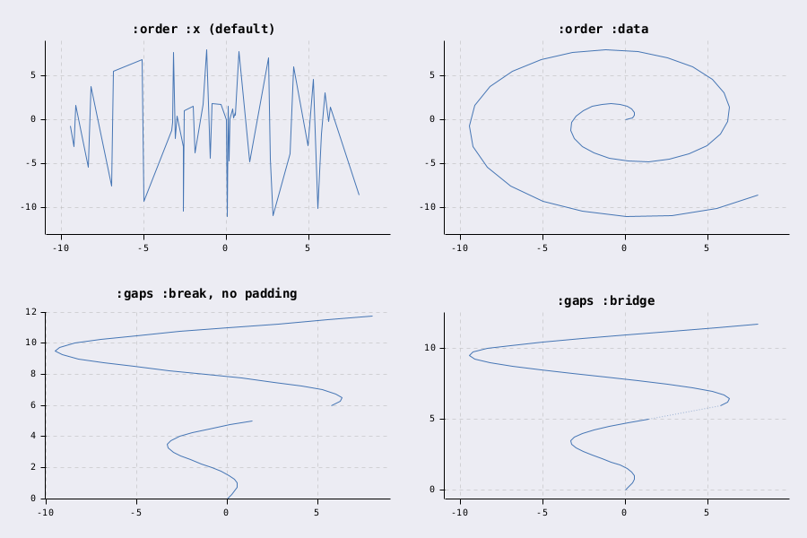
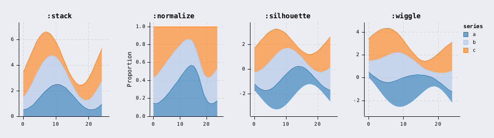
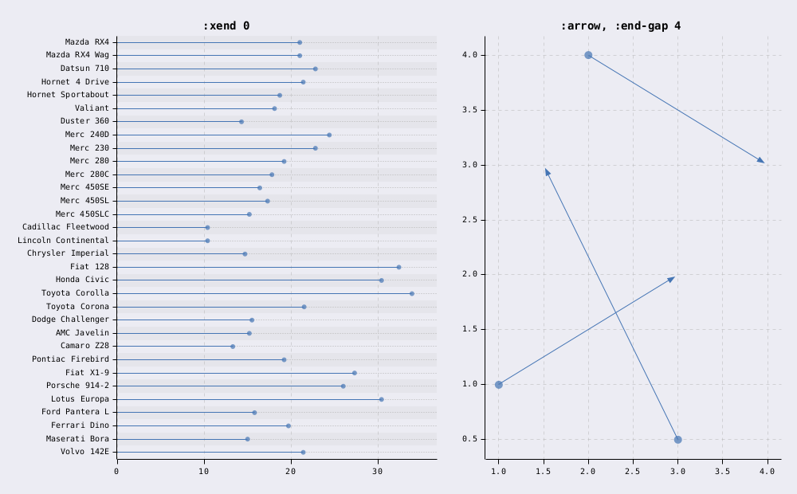
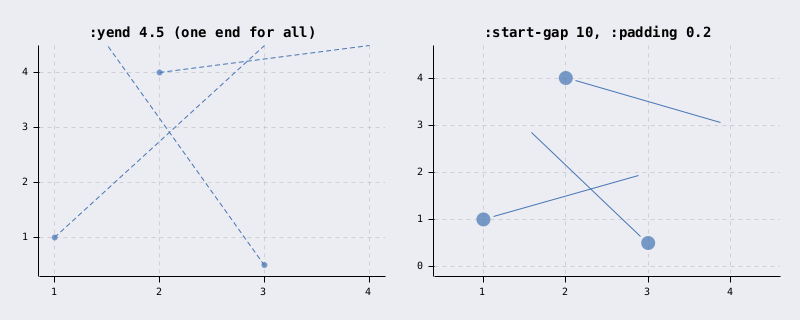
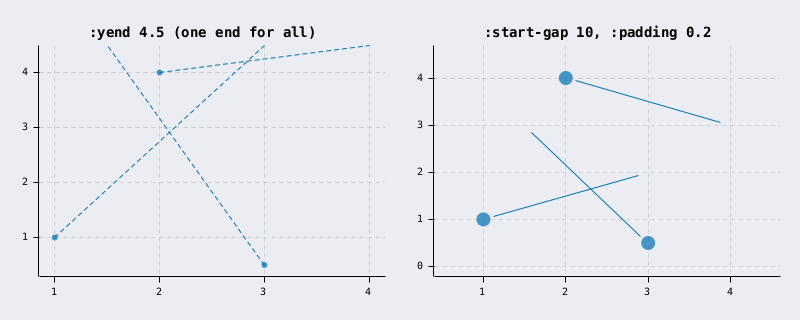
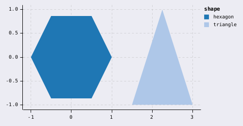

---
format:
  html:
    toc: true
    toc-location: right
    toc-depth: 4
    theme: cosmo
    include-in-header:
      text: |-
        <style>
        .data-table { width: fit-content; max-width: 100%; max-height: 15rem; overflow: auto; margin: 0 0 1rem 0; }
        .data-table .table-responsive { overflow: visible; }
        .data-table table { font-size: 0.75rem; width: auto; margin: 0; }
        .data-table th, .data-table td { padding: 0.1rem 0.45rem !important; white-space: nowrap; }
        .data-table thead th { position: sticky; top: 0; background: var(--bs-body-bg, #fff); }
        </style>
code-block-background: true

---
<style></style><style>.printedClojure .sourceCode {
  background-color: transparent;
  border-style: none;
}
</style><style>.clay-limit-image-width .clay-image {max-width: 100%}
.clay-side-by-side .sourceCode {margin: 0}
.clay-side-by-side {margin: 1em 0}
</style>
<script src="https://code.jquery.com/jquery-3.6.0.min.js" type="text/javascript"></script><script src="https://code.jquery.com/ui/1.13.1/jquery-ui.min.js" type="text/javascript"></script>

# Charts: points and paths

Marks placed at data positions: points (`scatter`), lines through them (`line`), straight pieces between two
positions (`segment`) and filled shapes (`polygon`). Each chart lists the mapping keys it reads, its own options
and the shared option groups it takes (documented once in the Shared options chapter).


::: {.sourceClojure}
```clojure
(ns reference.charts-points-paths
  (:require [fastmath.random :as r]
            [cljplot2.chart :as chart]
            [cljplot2.core :as plot]
            [cljplot2.data.levels :as levels]
            [cljplot2.describe :as describe]
            [notebook-utils :as nu]))
```
:::


Data: Motor Trend car road tests (1974), R datasets package `mtcars` (Henderson & Velleman 1981); licence: Part of R (GPL-2 | GPL-3).


::: {.sourceClojure}
```clojure
(def mtcars (nu/dataset :mtcars))
```
:::


```{=html}
<div class="data-table"><table class="table table-hover table-responsive clay-table"><thead><tr><th>model</th><th>mpg</th><th>cyl</th><th>disp</th><th>hp</th><th>drat</th><th>wt</th><th>qsec</th><th>vs</th><th>am</th><th>gear</th><th>carb</th></tr></thead><tbody><tr><td>Mazda RX4</td><td>21</td><td>6</td><td>160</td><td>110</td><td>3.9</td><td>2.62</td><td>16.46</td><td>0</td><td>1</td><td>4</td><td>4</td></tr><tr><td>Mazda RX4 Wag</td><td>21</td><td>6</td><td>160</td><td>110</td><td>3.9</td><td>2.875</td><td>17.02</td><td>0</td><td>1</td><td>4</td><td>4</td></tr><tr><td>Datsun 710</td><td>22.8</td><td>4</td><td>108</td><td>93</td><td>3.85</td><td>2.32</td><td>18.61</td><td>1</td><td>1</td><td>4</td><td>1</td></tr><tr><td>Hornet 4 Drive</td><td>21.4</td><td>6</td><td>258</td><td>110</td><td>3.08</td><td>3.215</td><td>19.44</td><td>1</td><td>0</td><td>3</td><td>1</td></tr><tr><td>Hornet Sportabout</td><td>18.7</td><td>8</td><td>360</td><td>175</td><td>3.15</td><td>3.44</td><td>17.02</td><td>0</td><td>0</td><td>3</td><td>2</td></tr><tr><td>Valiant</td><td>18.1</td><td>6</td><td>225</td><td>105</td><td>2.76</td><td>3.46</td><td>20.22</td><td>1</td><td>0</td><td>3</td><td>1</td></tr><tr><td>Duster 360</td><td>14.3</td><td>8</td><td>360</td><td>245</td><td>3.21</td><td>3.57</td><td>15.84</td><td>0</td><td>0</td><td>3</td><td>4</td></tr><tr><td>Merc 240D</td><td>24.4</td><td>4</td><td>146.7</td><td>62</td><td>3.69</td><td>3.19</td><td>20</td><td>1</td><td>0</td><td>4</td><td>2</td></tr><tr><td>Merc 230</td><td>22.8</td><td>4</td><td>140.8</td><td>95</td><td>3.92</td><td>3.15</td><td>22.9</td><td>1</td><td>0</td><td>4</td><td>2</td></tr><tr><td>Merc 280</td><td>19.2</td><td>6</td><td>167.6</td><td>123</td><td>3.92</td><td>3.44</td><td>18.3</td><td>1</td><td>0</td><td>4</td><td>4</td></tr><tr><td>Merc 280C</td><td>17.8</td><td>6</td><td>167.6</td><td>123</td><td>3.92</td><td>3.44</td><td>18.9</td><td>1</td><td>0</td><td>4</td><td>4</td></tr><tr><td>Merc 450SE</td><td>16.4</td><td>8</td><td>275.8</td><td>180</td><td>3.07</td><td>4.07</td><td>17.4</td><td>0</td><td>0</td><td>3</td><td>3</td></tr><tr><td>Merc 450SL</td><td>17.3</td><td>8</td><td>275.8</td><td>180</td><td>3.07</td><td>3.73</td><td>17.6</td><td>0</td><td>0</td><td>3</td><td>3</td></tr><tr><td>Merc 450SLC</td><td>15.2</td><td>8</td><td>275.8</td><td>180</td><td>3.07</td><td>3.78</td><td>18</td><td>0</td><td>0</td><td>3</td><td>3</td></tr><tr><td>Cadillac Fleetwood</td><td>10.4</td><td>8</td><td>472</td><td>205</td><td>2.93</td><td>5.25</td><td>17.98</td><td>0</td><td>0</td><td>3</td><td>4</td></tr><tr><td>Lincoln Continental</td><td>10.4</td><td>8</td><td>460</td><td>215</td><td>3</td><td>5.424</td><td>17.82</td><td>0</td><td>0</td><td>3</td><td>4</td></tr><tr><td>Chrysler Imperial</td><td>14.7</td><td>8</td><td>440</td><td>230</td><td>3.23</td><td>5.345</td><td>17.42</td><td>0</td><td>0</td><td>3</td><td>4</td></tr><tr><td>Fiat 128</td><td>32.4</td><td>4</td><td>78.7</td><td>66</td><td>4.08</td><td>2.2</td><td>19.47</td><td>1</td><td>1</td><td>4</td><td>1</td></tr><tr><td>Honda Civic</td><td>30.4</td><td>4</td><td>75.7</td><td>52</td><td>4.93</td><td>1.615</td><td>18.52</td><td>1</td><td>1</td><td>4</td><td>2</td></tr><tr><td>Toyota Corolla</td><td>33.9</td><td>4</td><td>71.1</td><td>65</td><td>4.22</td><td>1.835</td><td>19.9</td><td>1</td><td>1</td><td>4</td><td>1</td></tr><tr><td>Toyota Corona</td><td>21.5</td><td>4</td><td>120.1</td><td>97</td><td>3.7</td><td>2.465</td><td>20.01</td><td>1</td><td>0</td><td>3</td><td>1</td></tr><tr><td>Dodge Challenger</td><td>15.5</td><td>8</td><td>318</td><td>150</td><td>2.76</td><td>3.52</td><td>16.87</td><td>0</td><td>0</td><td>3</td><td>2</td></tr><tr><td>AMC Javelin</td><td>15.2</td><td>8</td><td>304</td><td>150</td><td>3.15</td><td>3.435</td><td>17.3</td><td>0</td><td>0</td><td>3</td><td>2</td></tr><tr><td>Camaro Z28</td><td>13.3</td><td>8</td><td>350</td><td>245</td><td>3.73</td><td>3.84</td><td>15.41</td><td>0</td><td>0</td><td>3</td><td>4</td></tr><tr><td>Pontiac Firebird</td><td>19.2</td><td>8</td><td>400</td><td>175</td><td>3.08</td><td>3.845</td><td>17.05</td><td>0</td><td>0</td><td>3</td><td>2</td></tr><tr><td>Fiat X1-9</td><td>27.3</td><td>4</td><td>79</td><td>66</td><td>4.08</td><td>1.935</td><td>18.9</td><td>1</td><td>1</td><td>4</td><td>1</td></tr><tr><td>Porsche 914-2</td><td>26</td><td>4</td><td>120.3</td><td>91</td><td>4.43</td><td>2.14</td><td>16.7</td><td>0</td><td>1</td><td>5</td><td>2</td></tr><tr><td>Lotus Europa</td><td>30.4</td><td>4</td><td>95.1</td><td>113</td><td>3.77</td><td>1.513</td><td>16.9</td><td>1</td><td>1</td><td>5</td><td>2</td></tr><tr><td>Ford Pantera L</td><td>15.8</td><td>8</td><td>351</td><td>264</td><td>4.22</td><td>3.17</td><td>14.5</td><td>0</td><td>1</td><td>5</td><td>4</td></tr><tr><td>Ferrari Dino</td><td>19.7</td><td>6</td><td>145</td><td>175</td><td>3.62</td><td>2.77</td><td>15.5</td><td>0</td><td>1</td><td>5</td><td>6</td></tr><tr><td>Maserati Bora</td><td>15</td><td>8</td><td>301</td><td>335</td><td>3.54</td><td>3.57</td><td>14.6</td><td>0</td><td>1</td><td>5</td><td>8</td></tr><tr><td>Volvo 142E</td><td>21.4</td><td>4</td><td>121</td><td>109</td><td>4.11</td><td>2.78</td><td>18.6</td><td>1</td><td>1</td><td>4</td><td>2</td></tr></tbody></table></div>
```


Data: Monthly stock prices for five companies, vega-datasets 3.3.1 `stocks.csv` (https://cdn.jsdelivr.net/npm/vega-datasets@3.3.1/data/stocks.csv); licence: none listed - see vega-datasets (cite Vega as the source).


::: {.sourceClojure}
```clojure
(def stocks (nu/dataset :stocks))
```
:::


```{=html}
<div class="data-table"><table class="table table-hover table-responsive clay-table"><thead><tr><th>symbol</th><th>date</th><th>price</th></tr></thead><tbody><tr><td>MSFT</td><td>2000-01-01</td><td>39.81</td></tr><tr><td>MSFT</td><td>2000-02-01</td><td>36.35</td></tr><tr><td>MSFT</td><td>2000-03-01</td><td>43.22</td></tr><tr><td>MSFT</td><td>2000-04-01</td><td>28.37</td></tr><tr><td>MSFT</td><td>2000-05-01</td><td>25.45</td></tr><tr><td>MSFT</td><td>2000-06-01</td><td>32.54</td></tr><tr><td>MSFT</td><td>2000-07-01</td><td>28.4</td></tr><tr><td>MSFT</td><td>2000-08-01</td><td>28.4</td></tr><tr><td>MSFT</td><td>2000-09-01</td><td>24.53</td></tr><tr><td>MSFT</td><td>2000-10-01</td><td>28.02</td></tr><tr><td>MSFT</td><td>2000-11-01</td><td>23.34</td></tr><tr><td>MSFT</td><td>2000-12-01</td><td>17.65</td></tr><tr><td>MSFT</td><td>2001-01-01</td><td>24.84</td></tr><tr><td>MSFT</td><td>2001-02-01</td><td>24</td></tr><tr><td>MSFT</td><td>2001-03-01</td><td>22.25</td></tr><tr><td>MSFT</td><td>2001-04-01</td><td>27.56</td></tr><tr><td>MSFT</td><td>2001-05-01</td><td>28.14</td></tr><tr><td>MSFT</td><td>2001-06-01</td><td>29.7</td></tr><tr><td>MSFT</td><td>2001-07-01</td><td>26.93</td></tr><tr><td>MSFT</td><td>2001-08-01</td><td>23.21</td></tr><tr><td>MSFT</td><td>2001-09-01</td><td>20.82</td></tr><tr><td>MSFT</td><td>2001-10-01</td><td>23.65</td></tr><tr><td>MSFT</td><td>2001-11-01</td><td>26.12</td></tr><tr><td>MSFT</td><td>2001-12-01</td><td>26.95</td></tr><tr><td>MSFT</td><td>2002-01-01</td><td>25.92</td></tr><tr><td>MSFT</td><td>2002-02-01</td><td>23.73</td></tr><tr><td>MSFT</td><td>2002-03-01</td><td>24.53</td></tr><tr><td>MSFT</td><td>2002-04-01</td><td>21.26</td></tr><tr><td>MSFT</td><td>2002-05-01</td><td>20.71</td></tr><tr><td>MSFT</td><td>2002-06-01</td><td>22.25</td></tr><tr><td>MSFT</td><td>2002-07-01</td><td>19.52</td></tr><tr><td>MSFT</td><td>2002-08-01</td><td>19.97</td></tr><tr><td>MSFT</td><td>2002-09-01</td><td>17.79</td></tr><tr><td>MSFT</td><td>2002-10-01</td><td>21.75</td></tr><tr><td>MSFT</td><td>2002-11-01</td><td>23.46</td></tr><tr><td>MSFT</td><td>2002-12-01</td><td>21.03</td></tr><tr><td>MSFT</td><td>2003-01-01</td><td>19.31</td></tr><tr><td>MSFT</td><td>2003-02-01</td><td>19.34</td></tr><tr><td>MSFT</td><td>2003-03-01</td><td>19.76</td></tr><tr><td>MSFT</td><td>2003-04-01</td><td>20.87</td></tr><tr><td>MSFT</td><td>2003-05-01</td><td>20.09</td></tr><tr><td>MSFT</td><td>2003-06-01</td><td>20.93</td></tr><tr><td>MSFT</td><td>2003-07-01</td><td>21.56</td></tr><tr><td>MSFT</td><td>2003-08-01</td><td>21.65</td></tr><tr><td>MSFT</td><td>2003-09-01</td><td>22.69</td></tr><tr><td>MSFT</td><td>2003-10-01</td><td>21.45</td></tr><tr><td>MSFT</td><td>2003-11-01</td><td>21.1</td></tr><tr><td>MSFT</td><td>2003-12-01</td><td>22.46</td></tr><tr><td>MSFT</td><td>2004-01-01</td><td>22.69</td></tr><tr><td>MSFT</td><td>2004-02-01</td><td>21.77</td></tr><tr><td>MSFT</td><td>2004-03-01</td><td>20.46</td></tr><tr><td>MSFT</td><td>2004-04-01</td><td>21.45</td></tr><tr><td>MSFT</td><td>2004-05-01</td><td>21.53</td></tr><tr><td>MSFT</td><td>2004-06-01</td><td>23.44</td></tr><tr><td>MSFT</td><td>2004-07-01</td><td>23.38</td></tr><tr><td>MSFT</td><td>2004-08-01</td><td>22.47</td></tr><tr><td>MSFT</td><td>2004-09-01</td><td>22.76</td></tr><tr><td>MSFT</td><td>2004-10-01</td><td>23.02</td></tr><tr><td>MSFT</td><td>2004-11-01</td><td>24.6</td></tr><tr><td>MSFT</td><td>2004-12-01</td><td>24.52</td></tr><tr><td>MSFT</td><td>2005-01-01</td><td>24.11</td></tr><tr><td>MSFT</td><td>2005-02-01</td><td>23.15</td></tr><tr><td>MSFT</td><td>2005-03-01</td><td>22.24</td></tr><tr><td>MSFT</td><td>2005-04-01</td><td>23.28</td></tr><tr><td>MSFT</td><td>2005-05-01</td><td>23.82</td></tr><tr><td>MSFT</td><td>2005-06-01</td><td>22.93</td></tr><tr><td>MSFT</td><td>2005-07-01</td><td>23.64</td></tr><tr><td>MSFT</td><td>2005-08-01</td><td>25.35</td></tr><tr><td>MSFT</td><td>2005-09-01</td><td>23.83</td></tr><tr><td>MSFT</td><td>2005-10-01</td><td>23.8</td></tr><tr><td>MSFT</td><td>2005-11-01</td><td>25.71</td></tr><tr><td>MSFT</td><td>2005-12-01</td><td>24.29</td></tr><tr><td>MSFT</td><td>2006-01-01</td><td>26.14</td></tr><tr><td>MSFT</td><td>2006-02-01</td><td>25.04</td></tr><tr><td>MSFT</td><td>2006-03-01</td><td>25.36</td></tr><tr><td>MSFT</td><td>2006-04-01</td><td>22.5</td></tr><tr><td>MSFT</td><td>2006-05-01</td><td>21.19</td></tr><tr><td>MSFT</td><td>2006-06-01</td><td>21.8</td></tr><tr><td>MSFT</td><td>2006-07-01</td><td>22.51</td></tr><tr><td>MSFT</td><td>2006-08-01</td><td>24.13</td></tr><tr><td>MSFT</td><td>2006-09-01</td><td>25.68</td></tr><tr><td>MSFT</td><td>2006-10-01</td><td>26.96</td></tr><tr><td>MSFT</td><td>2006-11-01</td><td>27.66</td></tr><tr><td>MSFT</td><td>2006-12-01</td><td>28.13</td></tr><tr><td>MSFT</td><td>2007-01-01</td><td>29.07</td></tr><tr><td>MSFT</td><td>2007-02-01</td><td>26.63</td></tr><tr><td>MSFT</td><td>2007-03-01</td><td>26.35</td></tr><tr><td>MSFT</td><td>2007-04-01</td><td>28.3</td></tr><tr><td>MSFT</td><td>2007-05-01</td><td>29.11</td></tr><tr><td>MSFT</td><td>2007-06-01</td><td>27.95</td></tr><tr><td>MSFT</td><td>2007-07-01</td><td>27.5</td></tr><tr><td>MSFT</td><td>2007-08-01</td><td>27.34</td></tr><tr><td>MSFT</td><td>2007-09-01</td><td>28.04</td></tr><tr><td>MSFT</td><td>2007-10-01</td><td>35.03</td></tr><tr><td>MSFT</td><td>2007-11-01</td><td>32.09</td></tr><tr><td>MSFT</td><td>2007-12-01</td><td>34</td></tr><tr><td>MSFT</td><td>2008-01-01</td><td>31.13</td></tr><tr><td>MSFT</td><td>2008-02-01</td><td>26.07</td></tr><tr><td>MSFT</td><td>2008-03-01</td><td>27.21</td></tr><tr><td>MSFT</td><td>2008-04-01</td><td>27.34</td></tr><tr><td>…</td><td>…</td><td>…</td></tr></tbody></table></div>
```


## scatter

A point per row at its x and y; colour, shape and size may come from the data, and `:order` sets which points
are drawn on top.

::: {.clay-table}

```{=html}
<table class="table table-hover table-responsive clay-table"><thead><tr><th>Option</th><th>Type</th><th>Default</th><th>Description</th></tr></thead><tbody><tr><td>:x (required)</td><td>a keyword, a function or a categorical marker of one</td><td></td><td>x position (data units)</td></tr><tr><td>:y (required)</td><td>a keyword, a function or a categorical marker of one</td><td></td><td>y position (data units)</td></tr><tr><td>:color</td><td>a keyword, a function or a categorical marker of one or nil</td><td></td><td>point colour per row</td></tr><tr><td>:shape</td><td>a keyword, a function or a categorical marker of one or nil</td><td></td><td>point shape per row</td></tr><tr><td>:size</td><td>a keyword, a function or a categorical marker of one or nil</td><td></td><td>point size per row</td></tr><tr><td>:order</td><td>a keyword, a function or a categorical marker of one or nil</td><td></td><td>draw order: points drawn by its values (ascending, :descending reverses it), else in data order</td></tr></tbody></table>
```

:::


::: {.sourceClojure}
```clojure
(plot/render-image {:data mtcars
                    :mapping {:x :wt :y :mpg :color (levels/categorical :cyl) :size :hp}
                    :charts [(chart/scatter)]
                    :scales {:color {:title "cylinders"} :size {:range [5 18]}}
                    :labels {:x "weight [1000 lbs]" :y "miles per gallon"}}
                   {:width 600 :height 380})
```
:::


::: {.clay-image}

:::


Its options: the point style used when nothing is mapped, the draw order of a mapped `:order`, and jitter -
random offsets separating points on a grid of values (seeded here, so the image is the same on every build):

::: {.clay-table}

```{=html}
<table class="table table-hover table-responsive clay-table"><thead><tr><th>Option</th><th>Type</th><th>Default</th><th>Description</th></tr></thead><tbody><tr><td>:size</td><td>a non-negative number</td><td>6</td><td>point size in pixels (a mapped :size wins)</td></tr><tr><td>:color</td><td>a clojure2d color or :none</td><td>[69.0 117.0 180.0 180.0]</td><td>point colour (a mapped :color wins)</td></tr><tr><td>:stroke-color</td><td>a clojure2d color or :none</td><td>:none</td><td>outline colour: a colour or :none</td></tr><tr><td>:stroke-width</td><td>a non-negative number</td><td>1</td><td>outline width in pixels</td></tr><tr><td>:shape</td><td>a shape character, keyword or shape map</td><td>\O</td><td>point shape (a mapped :shape wins)</td></tr><tr><td>:padding</td><td>map of one of :x :y to [lo hi], non-negative numbers</td><td>0.05 on every side</td><td>padding of the data span per position axis, {:x [lo hi] :y [lo hi]} fractions of the span</td></tr><tr><td>:descending</td><td>true or false or nil</td><td>false</td><td>draw the values of a mapped :order in descending order (later points on top)</td></tr><tr><td>:jitter</td><td>[a non-negative number, a non-negative number]</td><td></td><td>[dx dy] - uniform random offsets within ±dx / ±dy data units added to the positions</td></tr><tr><td>:rng</td><td>a fastmath random generator or nil</td><td>an unseeded generator (builds differ)</td><td>random number generator for jitter (seeded for reproducible plots)</td></tr></tbody></table>
```

:::


::: {.sourceClojure}
```clojure
(plot/render-image (plot/arrange [{:data mtcars
                                   :mapping {:x :cyl :y :gear}
                                   :charts [(chart/scatter {:size 10 :shape \s :color [200 80 40 150]})]
                                   :labels {:title "overplotted"}}
                                  {:data mtcars
                                   :mapping {:x :cyl :y :gear}
                                   :charts [(chart/scatter {:size 10 :shape \s :color [200 80 40 150]
                                                           :stroke-color :black :stroke-width 0.5
                                                           :jitter [0.3 0.2] :rng (r/rng :mersenne 7)})]
                                   :labels {:title ":jitter [0.3 0.2]"}}]
                                 {:columns 2})
                   {:width 900 :height 330})
```
:::


::: {.clay-image}

:::


A mapped `:order` draws points by its values, later ones on top: the most powerful cars over the others
(ascending) or under them (descending); `:padding` is the room around the data, here none on x:


::: {.sourceClojure}
```clojure
(plot/render-image (plot/arrange [{:data mtcars
                                   :mapping {:x :wt :y :mpg :color :hp :order :hp}
                                   :charts [(chart/scatter {:size 26 :stroke-color :white})]
                                   :labels {:title ":order :hp, ascending (default)"}
                                   :legend false}
                                  {:data mtcars
                                   :mapping {:x :wt :y :mpg :color :hp :order :hp}
                                   :charts [(chart/scatter {:size 26 :stroke-color :white :descending true
                                                           :padding {:x [0 0] :y [0.05 0.05]}})]
                                   :labels {:title ":descending true, :padding x 0"}}]
                                 {:columns 2 :widths [1 1.2]})
                   {:width 1000 :height 360})
```
:::


::: {.clay-image}

:::


Shared options: [Data and mapping](reference.shared_options.html#data-and-mapping) (`:data` `:mapping`); [Named theme styles](reference.shared_options.html#named-theme-styles) (`:theme-style`).


## line

A polyline per group through the rows ordered by x; it may fill the area below, stack with other groups, or
carry a colour or width along its length. (The dataset's dates are text: the mapping parses them.)

::: {.clay-table}

```{=html}
<table class="table table-hover table-responsive clay-table"><thead><tr><th>Option</th><th>Type</th><th>Default</th><th>Description</th></tr></thead><tbody><tr><td>:x (required)</td><td>a keyword, a function or a categorical marker of one</td><td></td><td>x position (data units)</td></tr><tr><td>:y (required)</td><td>a keyword, a function or a categorical marker of one</td><td></td><td>y position (data units)</td></tr><tr><td>:color</td><td>a keyword, a function or a categorical marker of one or nil</td><td></td><td>line colour: per group (ordinal) or along the line (linear or binned)</td></tr><tr><td>:size</td><td>a keyword, a function or a categorical marker of one or nil</td><td></td><td>line width: per group, or per point with :trail</td></tr><tr><td>:dash</td><td>a keyword, a function or a categorical marker of one or nil</td><td></td><td>dash style per group</td></tr><tr><td>:pattern</td><td>a keyword, a function or a categorical marker of one or nil</td><td></td><td>area fill pattern per group</td></tr><tr><td>:group</td><td>a keyword, a function or a categorical marker of one or nil</td><td></td><td>groups without a visual aesthetic, each its own line</td></tr></tbody></table>
```

:::


::: {.sourceClojure}
```clojure
(plot/render-image {:data stocks
                    :mapping {:x #(java.time.LocalDate/parse (:date %)) :y :price :color :symbol}
                    :charts [(chart/line)]
                    :labels {:x "date" :y "price [USD]"}}
                   {:width 700 :height 380})
```
:::


::: {.clay-image}

:::


### Style

The area under a line (`:fill`), its gradient, the stroke's opacity and the trail - a filled band whose width
follows a mapped `:size`:

::: {.clay-table}

```{=html}
<table class="table table-hover table-responsive clay-table"><thead><tr><th>Option</th><th>Type</th><th>Default</th><th>Description</th></tr></thead><tbody><tr><td>:fill</td><td>:color or a clojure2d color or :none</td><td>:none</td><td>area between the line and y = 0: :color (the line colour at :alpha), a colour or :none</td></tr><tr><td>:alpha</td><td>a number in [0 1]</td><td>0.6</td><td>area fill opacity of :fill :color and of stacked areas</td></tr><tr><td>:fill-gradient</td><td>a clojure2d gradient: a preset keyword, a colour list or a function</td><td></td><td>clojure2d gradient (preset, colours or function of t) colouring the areas; wins over :fill</td></tr><tr><td>:fill-gradient-axis</td><td>one of :x :y</td><td>:x</td><td>axis the :fill-gradient runs along, over that scale's range (needs :fill-gradient)</td></tr><tr><td>:stroke-alpha-factor</td><td>a number in [0 1]</td><td></td><td>multiplies the stroke colour's opacity of unstacked lines (the legend key stays opaque)</td></tr><tr><td>:trail</td><td>true or false or nil</td><td>false</td><td>draw a filled trail whose width follows a linear mapped :size at every point</td></tr></tbody></table>
```

:::


::: {.sourceClojure}
```clojure
(def wave (for [t (range 40)] {:t t :v (+ 1.5 (Math/sin (* 0.25 t))) :w (+ 1 (mod t 10))}))
```
:::


```{=html}
<div class="data-table"><table class="table table-hover table-responsive clay-table"><thead><tr><th>t</th><th>v</th><th>w</th></tr></thead><tbody><tr><td>0</td><td>1.5</td><td>1</td></tr><tr><td>1</td><td>1.747403959254523</td><td>2</td></tr><tr><td>2</td><td>1.979425538604203</td><td>3</td></tr><tr><td>3</td><td>2.181638760023334</td><td>4</td></tr><tr><td>4</td><td>2.3414709848078967</td><td>5</td></tr><tr><td>5</td><td>2.448984619355586</td><td>6</td></tr><tr><td>6</td><td>2.4974949866040546</td><td>7</td></tr><tr><td>7</td><td>2.483985946873937</td><td>8</td></tr><tr><td>8</td><td>2.409297426825682</td><td>9</td></tr><tr><td>9</td><td>2.278073196887921</td><td>10</td></tr><tr><td>10</td><td>2.0984721441039564</td><td>1</td></tr><tr><td>11</td><td>1.8816609920523317</td><td>2</td></tr><tr><td>12</td><td>1.6411200080598671</td><td>3</td></tr><tr><td>13</td><td>1.3918048654698916</td><td>4</td></tr><tr><td>14</td><td>1.14921677231038</td><td>5</td></tr><tr><td>15</td><td>0.9284386812576563</td><td>6</td></tr><tr><td>16</td><td>0.7431975046920718</td><td>7</td></tr><tr><td>17</td><td>0.6050106417714165</td><td>8</td></tr><tr><td>18</td><td>0.522469882334903</td><td>9</td></tr><tr><td>19</td><td>0.500707211024622</td><td>10</td></tr><tr><td>20</td><td>0.5410757253368615</td><td>1</td></tr><tr><td>21</td><td>0.641065506573408</td><td>2</td></tr><tr><td>22</td><td>0.7944596744296081</td><td>3</td></tr><tr><td>23</td><td>0.9917209225007416</td><td>4</td></tr><tr><td>24</td><td>1.2205845018010741</td><td>5</td></tr><tr><td>25</td><td>1.4668207834524432</td><td>6</td></tr><tr><td>26</td><td>1.7151199880878156</td><td>7</td></tr><tr><td>27</td><td>1.9500440737806177</td><td>8</td></tr><tr><td>28</td><td>2.156986598718789</td><td>9</td></tr><tr><td>29</td><td>2.3230808790115054</td><td>10</td></tr><tr><td>30</td><td>2.437999976774739</td><td>1</td></tr><tr><td>31</td><td>2.4945987791111763</td><td>2</td></tr><tr><td>32</td><td>2.489358246623382</td><td>3</td></tr><tr><td>33</td><td>2.4226042102393404</td><td>4</td></tr><tr><td>34</td><td>2.2984871126234903</td><td>5</td></tr><tr><td>35</td><td>2.1247239537541924</td><td>6</td></tr><tr><td>36</td><td>1.9121184852417565</td><td>7</td></tr><tr><td>37</td><td>1.6738894853804336</td><td>8</td></tr><tr><td>38</td><td>1.4248488795381906</td><td>9</td></tr><tr><td>39</td><td>1.1804808063777263</td><td>10</td></tr></tbody></table></div>
```


::: {.sourceClojure}
```clojure
(plot/render-image (plot/arrange [{:data wave :mapping {:x :t :y :v}
                                   :charts [(chart/line {:fill :color :alpha 0.3})]
                                   :labels {:title ":fill :color"}}
                                  {:data wave :mapping {:x :t :y :v}
                                   :charts [(chart/line {:fill-gradient :mpl/viridis :fill-gradient-axis :y})]
                                   :labels {:title ":fill-gradient"}}
                                  {:data wave :mapping {:x :t :y :v :size :w}
                                   :charts [(chart/line {:trail true})]
                                   :labels {:title ":trail true"}
                                   :legend false}]
                                 {:columns 3})
                   {:width 1000 :height 300})
```
:::


::: {.clay-image}

:::


The gradient along x instead, and `:stroke-alpha-factor` fading the strokes of overlapping lines:


::: {.sourceClojure}
```clojure
(plot/render-image (plot/arrange [{:data wave :mapping {:x :t :y :v}
                                   :charts [(chart/line {:fill-gradient :mpl/viridis :fill-gradient-axis :x})]
                                   :labels {:title ":fill-gradient-axis :x"}}
                                  {:data stocks
                                   :mapping {:x #(java.time.LocalDate/parse (:date %)) :y :price :color :symbol}
                                   :charts [(chart/line {:line-width 3 :stroke-alpha-factor 0.4})]
                                   :labels {:title ":stroke-alpha-factor 0.4"}}]
                                 {:columns 2 :widths [1 1.4]})
                   {:width 1000 :height 300})
```
:::


::: {.clay-image}

:::


### Path

How points are joined: sorted by x or in data order, what a missing value does (a break or a bridge), how
groups combine (the Layering and position chapter shows `:stack` and the streamgraphs), and the padding:

::: {.clay-table}

```{=html}
<table class="table table-hover table-responsive clay-table"><thead><tr><th>Option</th><th>Type</th><th>Default</th><th>Description</th></tr></thead><tbody><tr><td>:bridge</td><td>map</td><td>{:alpha-factor 0.3}</td><td>style of the segments bridging gaps with :gaps :bridge: :alpha-factor (a fraction of the line alpha), optional :line-width and :dash</td></tr><tr><td>:bridge :alpha-factor (required)</td><td>a number in [0 1]</td><td>0.3 in the theme's :bridge (a given :bridge replaces it whole)</td><td>bridge opacity, a fraction of the line's alpha</td></tr><tr><td>:bridge :line-width</td><td>a non-negative number</td><td>the line's width</td><td>bridge line width in pixels</td></tr><tr><td>:bridge :dash</td><td>:none, a dash style (:dashed :dot-dash :dot-dot-dash :dotted :long-dash :loose-dot :solid :two-dash) or a sequence of positive numbers or nil</td><td>the line's dash</td><td>dash style of the bridge</td></tr><tr><td>:order</td><td>one of :x :data or nil</td><td>:x</td><td>point order: :x (numeric or temporal x, ties in data order) or :data</td></tr><tr><td>:gaps</td><td>one of :break :bridge</td><td>:break (stacked lines take no :gaps)</td><td>an invalid y breaks the line: :break (empty space) or :bridge (a straight segment in the :bridge style)</td></tr><tr><td>:position</td><td>one of :normalize :overlay :silhouette :stack :wiggle</td><td>:overlay</td><td>how groups combine: :overlay, stacked :stack / :normalize, or streamgraph :silhouette / :wiggle</td></tr><tr><td>:padding</td><td>map of one of :x :y to [lo hi], non-negative numbers</td><td>0.05 on every side; y [0 0.05] when stacked without negative values</td><td>padding of the data span per position axis, {:x [lo hi] :y [lo hi]} fractions of the span</td></tr></tbody></table>
```

:::


::: {.sourceClojure}
```clojure
(def spiral (for [t (range 0 12 0.25)] {:x (* t (Math/cos t)) :y (* t (Math/sin t)) :v (when-not (< 5 t 6) t)}))
```
:::


```{=html}
<div class="data-table"><table class="table table-hover table-responsive clay-table"><thead><tr><th>x</th><th>y</th><th>v</th></tr></thead><tbody><tr><td>0.0</td><td>0.0</td><td>0</td></tr><tr><td>0.24222810542766118</td><td>0.061850989813630734</td><td>0.25</td></tr><tr><td>0.4387912809451864</td><td>0.2397127693021015</td><td>0.5</td></tr><tr><td>0.5487666516553656</td><td>0.5112290700175006</td><td>0.75</td></tr><tr><td>0.5403023058681398</td><td>0.8414709848078965</td><td>1.0</td></tr><tr><td>0.3941529529940858</td><td>1.1862307741944829</td><td>1.25</td></tr><tr><td>0.10610580250155435</td><td>1.4962424799060816</td><td>1.5</td></tr><tr><td>-0.31193059738661116</td><td>1.7219754070293896</td><td>1.75</td></tr><tr><td>-0.8322936730942848</td><td>1.8185948536513634</td><td>2.0</td></tr><tr><td>-1.4133906511261631</td><td>1.7506646929978227</td><td>2.25</td></tr><tr><td>-2.002859038867334</td><td>1.496180360259891</td><td>2.5</td></tr><tr><td>-2.541831541239275</td><td>1.0495677281439122</td><td>2.75</td></tr><tr><td>-2.9699774898013365</td><td>0.4233600241796016</td><td>3.0</td></tr><tr><td>-3.2309214472617755</td><td>-0.3516341872228522</td><td>3.25</td></tr><tr><td>-3.277598405517787</td><td>-1.2277412969136694</td><td>3.5</td></tr><tr><td>-3.077097590023353</td><td>-2.143354945283789</td><td>3.75</td></tr><tr><td>-2.6145744834544478</td><td>-3.027209981231713</td><td>4.0</td></tr><tr><td>-1.8958718321336194</td><td>-3.80370477247148</td><td>4.25</td></tr><tr><td>-0.9485810974385086</td><td>-4.3988855294929365</td><td>4.5</td></tr><tr><td>0.17861022621788863</td><td>-4.746640747633045</td><td>4.75</td></tr><tr><td>1.4183109273161312</td><td>-4.794621373315692</td><td>5.0</td></tr><tr><td>2.688448755519664</td><td>-4.509406090489608</td><td></td></tr><tr><td>3.89768375860193</td><td>-3.8804717906371557</td><td></td></tr><tr><td>4.9518563986787445</td><td>-2.922604695620736</td><td></td></tr><tr><td>5.761021719902196</td><td>-1.6764929891935552</td><td>6.0</td></tr><tr><td>6.246558863903121</td><td>-0.2073701034222301</td><td>6.25</td></tr><tr><td>6.347819567232152</td><td>1.398279922570801</td><td>6.5</td></tr><tr><td>6.027792826651267</td><td>3.037797498019169</td><td>6.75</td></tr><tr><td>5.277315780403132</td><td>4.598906191031523</td><td>7.0</td></tr><tr><td>4.117450256343037</td><td>5.967336372833415</td><td>7.25</td></tr><tr><td>2.5997648837626937</td><td>7.034999825810542</td><td>7.5</td></tr><tr><td>0.8044062684492105</td><td>7.708140538111615</td><td>7.75</td></tr><tr><td>-1.1640002704689083</td><td>7.914865972987054</td><td>8.0</td></tr><tr><td>-3.1824204839808297</td><td>7.611484734474557</td><td>8.25</td></tr><tr><td>-5.117101172821001</td><td>6.787140457299667</td><td>8.5</td></tr><tr><td>-6.832399731550305</td><td>5.466334595349184</td><td>8.75</td></tr><tr><td>-8.200172356962092</td><td>3.7090663671758093</td><td>9.0</td></tr><tr><td>-9.109077854572744</td><td>1.6084777397690104</td><td>9.25</td></tr><tr><td>-9.473135483865596</td><td>-0.7139356443871884</td><td>9.5</td></tr><tr><td>-9.238903088785435</td><td>-3.115312137817168</td><td>9.75</td></tr><tr><td>-8.390715290764524</td><td>-5.440211108893697</td><td>10.0</td></tr><tr><td>-6.953536967356914</td><td>-7.530658911649153</td><td>10.25</td></tr><tr><td>-4.993137743957921</td><td>-9.236805479702536</td><td>10.5</td></tr><tr><td>-2.6134692925310725</td><td>-10.427477080147295</td><td>10.75</td></tr><tr><td>0.04868267786855864</td><td>-10.999892272057739</td><td>11.0</td></tr><tr><td>2.831508563307237</td><td>-10.887839972001691</td><td>11.25</td></tr><tr><td>5.5580047256595675</td><td>-10.067700008916928</td><td>11.5</td></tr><tr><td>8.047226241006753</td><td>-8.561813465969248</td><td>11.75</td></tr></tbody></table></div>
```


::: {.sourceClojure}
```clojure
(plot/render-image (plot/arrange [{:data spiral :mapping {:x :x :y :y}
                                   :charts [(chart/line)]
                                   :labels {:title ":order :x (default)"}}
                                  {:data spiral :mapping {:x :x :y :y}
                                   :charts [(chart/line {:order :data})]
                                   :labels {:title ":order :data"}}
                                  {:data spiral :mapping {:x :x :y :v}
                                   :charts [(chart/line {:order :data :gaps :break :padding {:x [0 0] :y [0 0]}})]
                                   :labels {:title ":gaps :break, no padding"}}
                                  {:data spiral :mapping {:x :x :y :v}
                                   :charts [(chart/line {:order :data :gaps :bridge :bridge {:alpha-factor 0.5 :dash :dotted}})]
                                   :labels {:title ":gaps :bridge"}}]
                                 {:columns 2})
                   {:width 900 :height 600})
```
:::


::: {.clay-image}

:::


Groups combined by `:position` (`:overlay`, the default, draws each line on its own):


::: {.sourceClojure}
```clojure
(def streams (for [series ["a" "b" "c"] t (range 25)]
               {:series series :t t :v (+ 1.5 (Math/sin (+ (* 0.3 t) (* 2 (count series)) (int (first series)))))}))
```
:::


```{=html}
<div class="data-table"><table class="table table-hover table-responsive clay-table"><thead><tr><th>series</th><th>t</th><th>v</th></tr></thead><tbody><tr><td>a</td><td>0</td><td>0.5007931658136463</td></tr><tr><td>a</td><td>1</td><td>0.5571891259213132</td></tr><tr><td>a</td><td>2</td><td>0.6978035734827992</td></tr><tr><td>a</td><td>3</td><td>0.9100758386825973</td></tr><tr><td>a</td><td>4</td><td>1.175044272270521</td></tr><tr><td>a</td><td>5</td><td>1.4690400332167286</td></tr><tr><td>a</td><td>6</td><td>1.7658013557891272</td></tr><tr><td>a</td><td>7</td><td>2.0388194348720936</td></tr><tr><td>a</td><td>8</td><td>2.263706378577581</td></tr><tr><td>a</td><td>9</td><td>2.4203737059941695</td></tr><tr><td>a</td><td>10</td><td>2.494826791358406</td></tr><tr><td>a</td><td>11</td><td>2.4804149622946956</td></tr><tr><td>a</td><td>12</td><td>2.378425584571251</td></tr><tr><td>a</td><td>13</td><td>2.1979690655501094</td></tr><tr><td>a</td><td>14</td><td>1.9551650486306003</td></tr><tr><td>a</td><td>15</td><td>1.6717024935127782</td></tr><tr><td>a</td><td>16</td><td>1.3729022660226193</td></tr><tr><td>a</td><td>17</td><td>1.0854553005796792</td></tr><tr><td>a</td><td>18</td><td>0.8350383785176917</td></tr><tr><td>a</td><td>19</td><td>0.6440204976799755</td></tr><tr><td>a</td><td>20</td><td>0.5294647164625153</td></tr><tr><td>a</td><td>21</td><td>0.5016039616255725</td></tr><tr><td>a</td><td>22</td><td>0.5629269514224042</td></tr><tr><td>a</td><td>23</td><td>0.707955885809737</td></tr><tr><td>a</td><td>24</td><td>0.9237357620113366</td></tr><tr><td>b</td><td>0</td><td>0.9936343588902412</td></tr><tr><td>b</td><td>1</td><td>1.2710830775547932</td></tr><tr><td>b</td><td>2</td><td>1.5689802631292735</td></tr><tr><td>b</td><td>3</td><td>1.8607156472389814</td></tr><tr><td>b</td><td>4</td><td>2.120229376882631</td></tr><tr><td>b</td><td>5</td><td>2.32433986348825</td></tr><tr><td>b</td><td>6</td><td>2.4548145251796623</td></tr><tr><td>b</td><td>7</td><td>2.499998449014294</td></tr><tr><td>b</td><td>8</td><td>2.455855489645069</td></tr><tr><td>b</td><td>9</td><td>2.3263288061636223</td></tr><tr><td>b</td><td>10</td><td>2.122988631442349</td></tr><tr><td>b</td><td>11</td><td>1.8639987376909781</td></tr><tr><td>b</td><td>12</td><td>1.5724939207813549</td></tr><tr><td>b</td><td>13</td><td>1.2745134378334269</td></tr><tr><td>b</td><td>14</td><td>0.9966749979282254</td></tr><tr><td>b</td><td>15</td><td>0.7637970814297974</td></tr><tr><td>b</td><td>16</td><td>0.5966819790500097</td></tr><tr><td>b</td><td>17</td><td>0.5102575851736925</td></tr><tr><td>b</td><td>18</td><td>0.5122439335122633</td></tr><tr><td>b</td><td>19</td><td>0.6024635894844816</td></tr><tr><td>b</td><td>20</td><td>0.7728574999191474</td></tr><tr><td>b</td><td>21</td><td>1.0082048842730023</td></tr><tr><td>b</td><td>22</td><td>1.2874828616253495</td></tr><tr><td>b</td><td>23</td><td>1.5857443620192933</td></tr><tr><td>b</td><td>24</td><td>1.8763465739222898</td></tr><tr><td>c</td><td>0</td><td>1.9520257871783506</td></tr><tr><td>c</td><td>1</td><td>2.1954421919799203</td></tr><tr><td>c</td><td>2</td><td>2.3767368169734757</td></tr><tr><td>c</td><td>3</td><td>2.479715153249283</td></tr><tr><td>c</td><td>4</td><td>2.4951784527231693</td></tr><tr><td>c</td><td>5</td><td>2.4217454249067294</td></tr><tr><td>c</td><td>6</td><td>2.2659756234728015</td></tr><tr><td>c</td><td>7</td><td>2.041783500861879</td></tr><tr><td>c</td><td>8</td><td>1.76919547168632</td></tr><tr><td>c</td><td>9</td><td>1.4725610127567745</td></tr><tr><td>c</td><td>10</td><td>1.178377596837469</td></tr><tr><td>c</td><td>11</td><td>0.9129237523203599</td></tr><tr><td>c</td><td>12</td><td>0.6999116805479259</td></tr><tr><td>c</td><td>13</td><td>0.5583691154881323</td></tr><tr><td>c</td><td>14</td><td>0.5009396329284678</td></tr><tr><td>c</td><td>15</td><td>0.5327532375065523</td></tr><tr><td>c</td><td>16</td><td>0.6509681146743322</td></tr><tr><td>c</td><td>17</td><td>0.8450244815280111</td></tr><tr><td>c</td><td>18</td><td>1.0975878607651728</td></tr><tr><td>c</td><td>19</td><td>1.3860975179157289</td></tr><tr><td>c</td><td>20</td><td>1.6847817445606674</td></tr><tr><td>c</td><td>21</td><td>1.9669599682904564</td></tr><tr><td>c</td><td>22</td><td>2.2074260487769513</td></tr><tr><td>c</td><td>23</td><td>2.3846998672186963</td></tr><tr><td>c</td><td>24</td><td>2.482946081380238</td></tr></tbody></table></div>
```


::: {.sourceClojure}
```clojure
(plot/render-image (plot/arrange [{:data streams :mapping {:x :t :y :v :color :series}
                                   :charts [(chart/line {:position :stack})] :labels {:title ":stack"} :legend false}
                                  {:data streams :mapping {:x :t :y :v :color :series}
                                   :charts [(chart/line {:position :normalize})] :labels {:title ":normalize"} :legend false}
                                  {:data streams :mapping {:x :t :y :v :color :series}
                                   :charts [(chart/line {:position :silhouette})] :labels {:title ":silhouette"} :legend false}
                                  {:data streams :mapping {:x :t :y :v :color :series}
                                   :charts [(chart/line {:position :wiggle})] :labels {:title ":wiggle"}}]
                                 {:columns 4 :widths [1 1 1 1.3]})
                   {:width 1000 :height 280})
```
:::


::: {.clay-image}

:::


### Ends

Arrowheads at the ends of each run and gaps shortening it - e.g. to stop short of a marker:

::: {.clay-table}

```{=html}
<table class="table table-hover table-responsive clay-table"><thead><tr><th>Option</th><th>Type</th><th>Default</th><th>Description</th></tr></thead><tbody><tr><td>:arrow</td><td>map</td><td></td><td>arrowheads at the ends of every run of a plain stroked line</td></tr><tr><td>:arrow :end</td><td>true or false</td><td>true</td><td>a head at the run's end</td></tr><tr><td>:arrow :start</td><td>true or false</td><td>false</td><td>a head at the run's start</td></tr><tr><td>:arrow :size</td><td>a positive number</td><td>8.0</td><td>head length in pixels</td></tr><tr><td>:arrow :angle</td><td>number, > 0, < 90</td><td>20.0</td><td>angle in degrees between each side of the head and the line</td></tr><tr><td>:arrow :shape</td><td>one of :closed :open</td><td>:closed</td><td>:closed (a filled triangle) or :open (two strokes)</td></tr><tr><td>:start-gap</td><td>a non-negative number</td><td></td><td>shortens every run at its start, in pixels</td></tr><tr><td>:end-gap</td><td>a non-negative number</td><td></td><td>shortens every run at its end, in pixels</td></tr></tbody></table>
```

:::


::: {.sourceClojure}
```clojure
(def path-points [{:x 0 :y 0} {:x 1 :y 2} {:x 2 :y 1} {:x 3 :y 3}])
```
:::


```{=html}
<div class="data-table"><table class="table table-hover table-responsive clay-table"><thead><tr><th>x</th><th>y</th></tr></thead><tbody><tr><td>0</td><td>0</td></tr><tr><td>1</td><td>2</td></tr><tr><td>2</td><td>1</td></tr><tr><td>3</td><td>3</td></tr></tbody></table></div>
```


::: {.sourceClojure}
```clojure
(plot/render-image (plot/arrange [{:data path-points :mapping {:x :x :y :y}
                                   :charts [(chart/line {:arrow {:end true}})]
                                   :labels {:title ":arrow {:end true}"}}
                                  {:data path-points :mapping {:x :x :y :y}
                                   :charts [(chart/scatter {:size 14})
                                            (chart/line {:arrow {:start true :end true :shape :open :size 12}
                                                         :start-gap 9 :end-gap 9})]
                                   :labels {:title "open heads, gaps 9 px"}}]
                                 {:columns 2})
                   {:width 800 :height 300})
```
:::


::: {.clay-image}

:::


Shared options: [Line style](reference.shared_options.html#line-style) (`:color` `:line-width` `:dash`); [Fill patterns](reference.shared_options.html#fill-patterns) (`:pattern` `:pattern-color`); [Data and mapping](reference.shared_options.html#data-and-mapping) (`:data` `:mapping`); [Named theme styles](reference.shared_options.html#named-theme-styles) (`:theme-style`); [Curves](reference.shared_options.html#curves) (`:interpolator` `:interpolator-params` `:curve` `:sample-step`).


## segment

A straight piece per row from (x, y) to (xend, yend); the ends may be mapped or given as literals, with
arrowheads and gaps as on lines.

::: {.clay-table}

```{=html}
<table class="table table-hover table-responsive clay-table"><thead><tr><th>Option</th><th>Type</th><th>Default</th><th>Description</th></tr></thead><tbody><tr><td>:x (required)</td><td>a keyword, a function or a categorical marker of one</td><td></td><td>start x position (data units)</td></tr><tr><td>:y (required)</td><td>a keyword, a function or a categorical marker of one</td><td></td><td>start y position (data units)</td></tr><tr><td>:xend</td><td>a keyword, a function or a categorical marker of one or nil</td><td></td><td>end x position (data units)</td></tr><tr><td>:yend</td><td>a keyword, a function or a categorical marker of one or nil</td><td></td><td>end y position (data units)</td></tr><tr><td>:end-gap</td><td>a keyword, a function or a categorical marker of one or nil</td><td></td><td>end gap per row in pixels (e.g. the radius of the node an edge points at)</td></tr><tr><td>:color</td><td>a keyword, a function or a categorical marker of one or nil</td><td></td><td>segment colour: per group (ordinal) or per row (linear or binned)</td></tr><tr><td>:size</td><td>a keyword, a function or a categorical marker of one or nil</td><td></td><td>line width: per row (linear) or per group (ordinal)</td></tr><tr><td>:dash</td><td>a keyword, a function or a categorical marker of one or nil</td><td></td><td>dash style per group</td></tr><tr><td>:group</td><td>a keyword, a function or a categorical marker of one or nil</td><td></td><td>groups without a visual aesthetic (one stroke setup per group)</td></tr></tbody></table>
```

:::


::: {.sourceClojure}
```clojure
(def moves [{:from "a" :x 1 :y 1 :x2 3 :y2 2} {:from "b" :x 2 :y 4 :x2 4 :y2 3} {:from "c" :x 3 :y 0.5 :x2 1.5 :y2 3}])
```
:::


```{=html}
<div class="data-table"><table class="table table-hover table-responsive clay-table"><thead><tr><th>from</th><th>x</th><th>y</th><th>x2</th><th>y2</th></tr></thead><tbody><tr><td>a</td><td>1</td><td>1</td><td>3</td><td>2</td></tr><tr><td>b</td><td>2</td><td>4</td><td>4</td><td>3</td></tr><tr><td>c</td><td>3</td><td>0.5</td><td>1.5</td><td>3</td></tr></tbody></table></div>
```


::: {.sourceClojure}
```clojure
(plot/render-image {:data moves
                    :mapping {:x :x :y :y :xend :x2 :yend :y2 :color :from}
                    :charts [(chart/segment {:line-width 2})]}
                   {:width 500 :height 320})
```
:::


::: {.clay-image}

:::


Its options: literal ends (here every segment starts at x = 0, a lollipop stem), arrows and gaps:

::: {.clay-table}

```{=html}
<table class="table table-hover table-responsive clay-table"><thead><tr><th>Option</th><th>Type</th><th>Default</th><th>Description</th></tr></thead><tbody><tr><td>:xend</td><td>a finite number, a java.time value or a level (string / keyword) or nil</td><td>the mapped :xend, else the start x</td><td>literal end x of every segment: a number, a java.time value or a level (wins over a mapped :xend)</td></tr><tr><td>:yend</td><td>a finite number, a java.time value or a level (string / keyword) or nil</td><td>the mapped :yend, else the start y</td><td>literal end y of every segment: a number, a java.time value or a level (wins over a mapped :yend)</td></tr><tr><td>:padding</td><td>map of one of :x :y to [lo hi], non-negative numbers</td><td>0.05 on every side; 0 on a side where a literal :xend / :yend is the end of the axis extent</td><td>padding of the data span per position axis, {:x [lo hi] :y [lo hi]} fractions of the span</td></tr><tr><td>:arrow</td><td>map</td><td></td><td>arrowheads at the ends of every segment</td></tr><tr><td>:arrow :end</td><td>true or false</td><td>true</td><td>a head at the run's end</td></tr><tr><td>:arrow :start</td><td>true or false</td><td>false</td><td>a head at the run's start</td></tr><tr><td>:arrow :size</td><td>a positive number</td><td>8.0</td><td>head length in pixels</td></tr><tr><td>:arrow :angle</td><td>number, > 0, < 90</td><td>20.0</td><td>angle in degrees between each side of the head and the line</td></tr><tr><td>:arrow :shape</td><td>one of :closed :open</td><td>:closed</td><td>:closed (a filled triangle) or :open (two strokes)</td></tr><tr><td>:start-gap</td><td>a non-negative number</td><td></td><td>shortens every segment at its start, in pixels</td></tr><tr><td>:end-gap</td><td>a non-negative number</td><td></td><td>shortens every segment at its end, in pixels (a mapped :end-gap wins)</td></tr></tbody></table>
```

:::


::: {.sourceClojure}
```clojure
(plot/render-image (plot/arrange [{:data mtcars
                                   :mapping {:x :mpg :y :model}
                                   :charts [(chart/segment {:xend 0}) (chart/scatter)]
                                   :scales {:y {:reverse true}}
                                   :labels {:title ":xend 0"}}
                                  {:data moves
                                   :mapping {:x :x :y :y :xend :x2 :yend :y2}
                                   :charts [(chart/scatter {:size 10})
                                            (chart/segment {:arrow {:end true :size 10} :end-gap 4})]
                                   :labels {:title ":arrow, :end-gap 4"}}]
                                 {:columns 2 :widths [1.3 1]})
                   {:width 1000 :height 620})
```
:::


::: {.clay-image}

:::


::: {.sourceClojure}
```clojure
(plot/render-image (plot/arrange [{:data moves
                                   :mapping {:x :x :y :y :xend :x2}
                                   :charts [(chart/segment {:yend 4.5 :dash :dashed}) (chart/scatter)]
                                   :labels {:title ":yend 4.5 (one end for all)"}}
                                  {:data moves
                                   :mapping {:x :x :y :y :xend :x2 :yend :y2}
                                   :charts [(chart/scatter {:size 14})
                                            (chart/segment {:start-gap 10 :end-gap 10 :padding {:x [0.2 0.2] :y [0.2 0.2]}})]
                                   :labels {:title ":start-gap 10, :padding 0.2"}}]
                                 {:columns 2})
                   {:width 800 :height 320})
```
:::


::: {.clay-image}

:::


Shared options: [Line style](reference.shared_options.html#line-style) (`:color` `:line-width` `:dash`); [Data and mapping](reference.shared_options.html#data-and-mapping) (`:data` `:mapping`); [Named theme styles](reference.shared_options.html#named-theme-styles) (`:theme-style`).


## polygon

A filled shape per group through its rows in data order.

::: {.clay-table}

```{=html}
<table class="table table-hover table-responsive clay-table"><thead><tr><th>Option</th><th>Type</th><th>Default</th><th>Description</th></tr></thead><tbody><tr><td>:x (required)</td><td>a keyword, a function or a categorical marker of one</td><td></td><td>x position of a vertex (data units)</td></tr><tr><td>:y (required)</td><td>a keyword, a function or a categorical marker of one</td><td></td><td>y position of a vertex (data units)</td></tr><tr><td>:color</td><td>a keyword, a function or a categorical marker of one or nil</td><td></td><td>fill colour: per group (ordinal), or by the group's first row (linear or binned)</td></tr><tr><td>:group</td><td>a keyword, a function or a categorical marker of one or nil</td><td></td><td>groups without a visual aesthetic, each its own polygon</td></tr></tbody></table>
```

:::


::: {.sourceClojure}
```clojure
(def shapes (concat (for [a (range 0 360 60)]
                      {:shape "hexagon" :x (Math/cos (Math/toRadians a)) :y (Math/sin (Math/toRadians a))})
                    (for [[x y] [[1.5 -1] [3 -1] [2.25 1]]] {:shape "triangle" :x x :y y})))
```
:::


```{=html}
<div class="data-table"><table class="table table-hover table-responsive clay-table"><thead><tr><th>shape</th><th>x</th><th>y</th></tr></thead><tbody><tr><td>hexagon</td><td>1.0</td><td>0.0</td></tr><tr><td>hexagon</td><td>0.5000000000000001</td><td>0.8660254037844386</td></tr><tr><td>hexagon</td><td>-0.4999999999999998</td><td>0.8660254037844387</td></tr><tr><td>hexagon</td><td>-1.0</td><td>1.2246467991473532E-16</td></tr><tr><td>hexagon</td><td>-0.5000000000000004</td><td>-0.8660254037844384</td></tr><tr><td>hexagon</td><td>0.5000000000000001</td><td>-0.8660254037844386</td></tr><tr><td>triangle</td><td>1.5</td><td>-1</td></tr><tr><td>triangle</td><td>3</td><td>-1</td></tr><tr><td>triangle</td><td>2.25</td><td>1</td></tr></tbody></table></div>
```


::: {.sourceClojure}
```clojure
(plot/render-image {:data shapes
                    :mapping {:x :x :y :y :color :shape}
                    :charts [(chart/polygon)]}
                   {:width 500 :height 260})
```
:::


::: {.clay-image}

:::


Its options: the fill, its opacity and the outline (`:color` - the group's colour, opaque):

::: {.clay-table}

```{=html}
<table class="table table-hover table-responsive clay-table"><thead><tr><th>Option</th><th>Type</th><th>Default</th><th>Description</th></tr></thead><tbody><tr><td>:color</td><td>a clojure2d color or :none</td><td>[69.0 117.0 180.0 255.0]</td><td>fill colour (a mapped :color wins)</td></tr><tr><td>:alpha</td><td>a number in [0 1]</td><td>1.0</td><td>fill opacity</td></tr><tr><td>:stroke-color</td><td>:color or a clojure2d color or :none</td><td>:none</td><td>outline colour: a colour, :none or :color (the group colour, opaque)</td></tr><tr><td>:stroke-width</td><td>a non-negative number</td><td>1</td><td>outline width in pixels</td></tr><tr><td>:padding</td><td>map of one of :x :y to [lo hi], non-negative numbers</td><td>0.05 on every side</td><td>padding of the data span per position axis, {:x [lo hi] :y [lo hi]} fractions of the span</td></tr></tbody></table>
```

:::


::: {.sourceClojure}
```clojure
(plot/render-image {:data shapes
                    :mapping {:x :x :y :y :color :shape}
                    :charts [(chart/polygon {:alpha 0.35 :stroke-color :color :stroke-width 2})]}
                   {:width 500 :height 260})
```
:::


::: {.clay-image}

:::


Without a mapped colour every polygon takes `:color`; `:padding` 0 lets the shapes touch the panel's edges:


::: {.sourceClojure}
```clojure
(plot/render-image {:data shapes
                    :mapping {:x :x :y :y :group :shape}
                    :charts [(chart/polygon {:color [120 160 90] :stroke-color :black :padding {:x [0 0] :y [0 0]}})]}
                   {:width 500 :height 260})
```
:::


::: {.clay-image}

:::


Shared options: [Data and mapping](reference.shared_options.html#data-and-mapping) (`:data` `:mapping`); [Named theme styles](reference.shared_options.html#named-theme-styles) (`:theme-style`).


```{=html}
<div style="background-color:grey;height:2px;width:100%;"></div>
```


```{=html}
<div><pre><small><small>source: notebooks/reference/charts_points_paths.clj</small></small></pre></div>
```