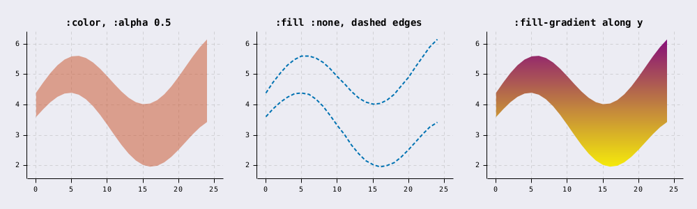
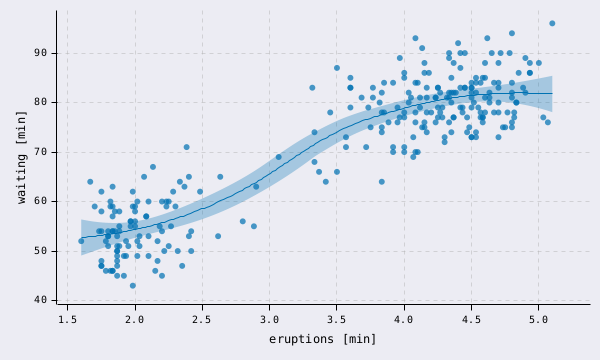
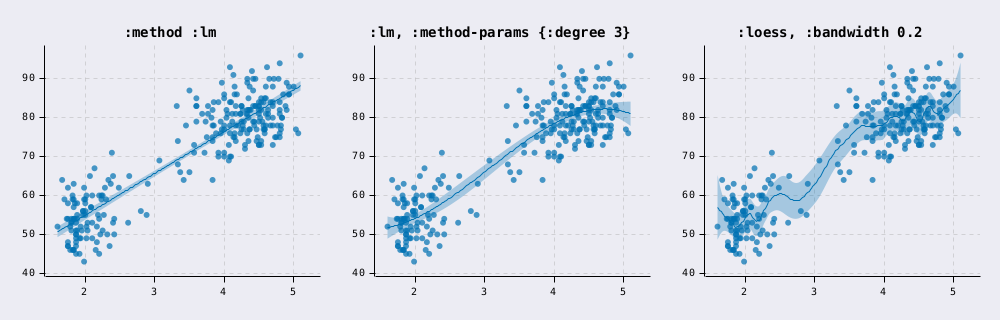
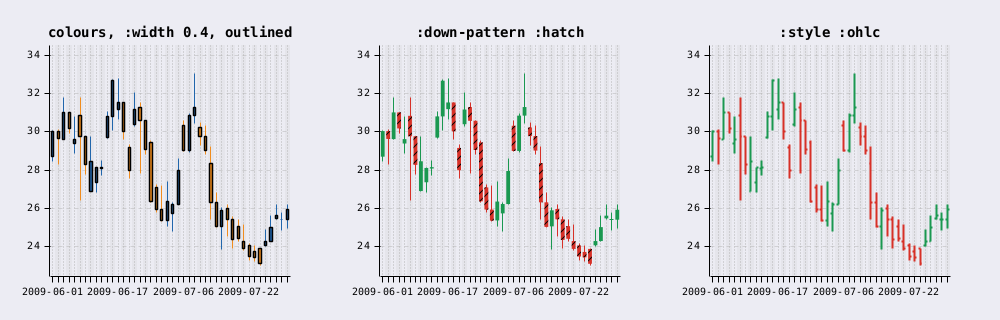
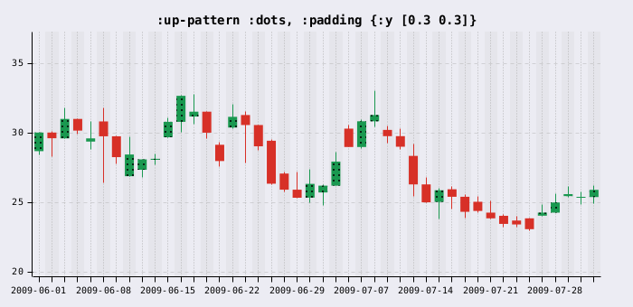

---
format:
  html:
    toc: true
    toc-location: right
    toc-depth: 4
    theme: cosmo
    include-in-header:
      text: |-
        <style>
        .data-table { width: fit-content; max-width: 100%; max-height: 15rem; overflow: auto; margin: 0 0 1rem 0; }
        .data-table .table-responsive { overflow: visible; }
        .data-table table { font-size: 0.75rem; width: auto; margin: 0; }
        .data-table th, .data-table td { padding: 0.1rem 0.45rem !important; white-space: nowrap; }
        .data-table thead th { position: sticky; top: 0; background: var(--bs-body-bg, #fff); }
        </style>
code-block-background: true

---
<style></style><style>.printedClojure .sourceCode {
  background-color: transparent;
  border-style: none;
}
</style><style>.clay-limit-image-width .clay-image {max-width: 100%}
.clay-side-by-side .sourceCode {margin: 0}
.clay-side-by-side {margin: 1em 0}
</style>
<script src="https://code.jquery.com/jquery-3.6.0.min.js" type="text/javascript"></script><script src="https://code.jquery.com/ui/1.13.1/jquery-ui.min.js" type="text/javascript"></script>

# Charts: series

Charts of values along x: a band between two bounds (`ribbon`), a fitted curve with its uncertainty band
(`smooth`) and price candles (`candlestick`). Each chart lists the mapping keys it reads, its own options and the
shared option groups it takes (documented once in the Shared options chapter).


::: {.sourceClojure}
```clojure
(ns reference.charts-series
  (:require [fastmath.core :as m]
            [fastmath.random :as r]
            [cljplot2.chart :as chart]
            [cljplot2.core :as plot]
            [cljplot2.describe :as describe]
            [notebook-utils :as nu]))
```
:::


Data: Old Faithful geyser eruptions, R datasets package `faithful` (Härdle 1991; Azzalini & Bowman 1990); licence: Part of R (GPL-2 | GPL-3).


::: {.sourceClojure}
```clojure
(def faithful (nu/dataset :faithful))
```
:::


```{=html}
<div class="data-table"><table class="table table-hover table-responsive clay-table"><thead><tr><th>eruptions</th><th>waiting</th></tr></thead><tbody><tr><td>3.6</td><td>79</td></tr><tr><td>1.8</td><td>54</td></tr><tr><td>3.333</td><td>74</td></tr><tr><td>2.283</td><td>62</td></tr><tr><td>4.533</td><td>85</td></tr><tr><td>2.883</td><td>55</td></tr><tr><td>4.7</td><td>88</td></tr><tr><td>3.6</td><td>85</td></tr><tr><td>1.95</td><td>51</td></tr><tr><td>4.35</td><td>85</td></tr><tr><td>1.833</td><td>54</td></tr><tr><td>3.917</td><td>84</td></tr><tr><td>4.2</td><td>78</td></tr><tr><td>1.75</td><td>47</td></tr><tr><td>4.7</td><td>83</td></tr><tr><td>2.167</td><td>52</td></tr><tr><td>1.75</td><td>62</td></tr><tr><td>4.8</td><td>84</td></tr><tr><td>1.6</td><td>52</td></tr><tr><td>4.25</td><td>79</td></tr><tr><td>1.8</td><td>51</td></tr><tr><td>1.75</td><td>47</td></tr><tr><td>3.45</td><td>78</td></tr><tr><td>3.067</td><td>69</td></tr><tr><td>4.533</td><td>74</td></tr><tr><td>3.6</td><td>83</td></tr><tr><td>1.967</td><td>55</td></tr><tr><td>4.083</td><td>76</td></tr><tr><td>3.85</td><td>78</td></tr><tr><td>4.433</td><td>79</td></tr><tr><td>4.3</td><td>73</td></tr><tr><td>4.467</td><td>77</td></tr><tr><td>3.367</td><td>66</td></tr><tr><td>4.033</td><td>80</td></tr><tr><td>3.833</td><td>74</td></tr><tr><td>2.017</td><td>52</td></tr><tr><td>1.867</td><td>48</td></tr><tr><td>4.833</td><td>80</td></tr><tr><td>1.833</td><td>59</td></tr><tr><td>4.783</td><td>90</td></tr><tr><td>4.35</td><td>80</td></tr><tr><td>1.883</td><td>58</td></tr><tr><td>4.567</td><td>84</td></tr><tr><td>1.75</td><td>58</td></tr><tr><td>4.533</td><td>73</td></tr><tr><td>3.317</td><td>83</td></tr><tr><td>3.833</td><td>64</td></tr><tr><td>2.1</td><td>53</td></tr><tr><td>4.633</td><td>82</td></tr><tr><td>2</td><td>59</td></tr><tr><td>4.8</td><td>75</td></tr><tr><td>4.716</td><td>90</td></tr><tr><td>1.833</td><td>54</td></tr><tr><td>4.833</td><td>80</td></tr><tr><td>1.733</td><td>54</td></tr><tr><td>4.883</td><td>83</td></tr><tr><td>3.717</td><td>71</td></tr><tr><td>1.667</td><td>64</td></tr><tr><td>4.567</td><td>77</td></tr><tr><td>4.317</td><td>81</td></tr><tr><td>2.233</td><td>59</td></tr><tr><td>4.5</td><td>84</td></tr><tr><td>1.75</td><td>48</td></tr><tr><td>4.8</td><td>82</td></tr><tr><td>1.817</td><td>60</td></tr><tr><td>4.4</td><td>92</td></tr><tr><td>4.167</td><td>78</td></tr><tr><td>4.7</td><td>78</td></tr><tr><td>2.067</td><td>65</td></tr><tr><td>4.7</td><td>73</td></tr><tr><td>4.033</td><td>82</td></tr><tr><td>1.967</td><td>56</td></tr><tr><td>4.5</td><td>79</td></tr><tr><td>4</td><td>71</td></tr><tr><td>1.983</td><td>62</td></tr><tr><td>5.067</td><td>76</td></tr><tr><td>2.017</td><td>60</td></tr><tr><td>4.567</td><td>78</td></tr><tr><td>3.883</td><td>76</td></tr><tr><td>3.6</td><td>83</td></tr><tr><td>4.133</td><td>75</td></tr><tr><td>4.333</td><td>82</td></tr><tr><td>4.1</td><td>70</td></tr><tr><td>2.633</td><td>65</td></tr><tr><td>4.067</td><td>73</td></tr><tr><td>4.933</td><td>88</td></tr><tr><td>3.95</td><td>76</td></tr><tr><td>4.517</td><td>80</td></tr><tr><td>2.167</td><td>48</td></tr><tr><td>4</td><td>86</td></tr><tr><td>2.2</td><td>60</td></tr><tr><td>4.333</td><td>90</td></tr><tr><td>1.867</td><td>50</td></tr><tr><td>4.817</td><td>78</td></tr><tr><td>1.833</td><td>63</td></tr><tr><td>4.3</td><td>72</td></tr><tr><td>4.667</td><td>84</td></tr><tr><td>3.75</td><td>75</td></tr><tr><td>1.867</td><td>51</td></tr><tr><td>4.9</td><td>82</td></tr><tr><td>…</td><td>…</td></tr></tbody></table></div>
```


Data: VIX daily open, high, low and close values, vega-datasets 3.3.1 `ohlc.json` (https://cdn.jsdelivr.net/npm/vega-datasets@3.3.1/data/ohlc.json); original: Yahoo Finance VIX Data, CBOE - VIX Historical Data; licence: none listed - see vega-datasets (cite Vega as the source).


::: {.sourceClojure}
```clojure
(def ohlc (nu/dataset :ohlc))
```
:::


```{=html}
<div class="data-table"><table class="table table-hover table-responsive clay-table"><thead><tr><th>date</th><th>open</th><th>high</th><th>low</th><th>close</th><th>signal</th><th>ret</th></tr></thead><tbody><tr><td>2009-06-01</td><td>28.7</td><td>30.05</td><td>28.45</td><td>30.04</td><td>short</td><td>-4.89396411092985</td></tr><tr><td>2009-06-02</td><td>30.04</td><td>30.13</td><td>28.3</td><td>29.63</td><td>short</td><td>-0.322580645161295</td></tr><tr><td>2009-06-03</td><td>29.62</td><td>31.79</td><td>29.62</td><td>31.02</td><td>short</td><td>3.68663594470045</td></tr><tr><td>2009-06-04</td><td>31.02</td><td>31.02</td><td>29.92</td><td>30.18</td><td>short</td><td>4.51010886469673</td></tr><tr><td>2009-06-05</td><td>29.39</td><td>30.81</td><td>28.85</td><td>29.62</td><td>short</td><td>6.08424336973478</td></tr><tr><td>2009-06-08</td><td>30.84</td><td>31.82</td><td>26.41</td><td>29.77</td><td>short</td><td>1.2539184952978</td></tr><tr><td>2009-06-09</td><td>29.77</td><td>29.77</td><td>27.79</td><td>28.27</td><td>short</td><td>-5.02431118314424</td></tr><tr><td>2009-06-10</td><td>26.9</td><td>29.74</td><td>26.9</td><td>28.46</td><td>short</td><td>-5.46623794212217</td></tr><tr><td>2009-06-11</td><td>27.36</td><td>28.11</td><td>26.81</td><td>28.11</td><td>short</td><td>-8.3743842364532</td></tr><tr><td>2009-06-12</td><td>28.08</td><td>28.5</td><td>27.73</td><td>28.15</td><td>short</td><td>-5.52763819095477</td></tr><tr><td>2009-06-15</td><td>29.7</td><td>31.09</td><td>29.64</td><td>30.81</td><td>long</td><td>3.4920634920635</td></tr><tr><td>2009-06-16</td><td>30.81</td><td>32.75</td><td>30.07</td><td>32.68</td><td>short</td><td>0.155038759689914</td></tr><tr><td>2009-06-17</td><td>31.19</td><td>32.77</td><td>30.64</td><td>31.54</td><td>short</td><td>5.82822085889571</td></tr><tr><td>2009-06-18</td><td>31.54</td><td>31.54</td><td>29.6</td><td>30.03</td><td>short</td><td>8.17610062893082</td></tr><tr><td>2009-06-19</td><td>29.16</td><td>29.32</td><td>27.56</td><td>27.99</td><td>short</td><td>8.59872611464968</td></tr><tr><td>2009-06-22</td><td>30.4</td><td>32.05</td><td>30.3</td><td>31.17</td><td>short</td><td>15.4907975460123</td></tr><tr><td>2009-06-23</td><td>31.3</td><td>31.54</td><td>27.83</td><td>30.58</td><td>short</td><td>11.7370892018779</td></tr><tr><td>2009-06-24</td><td>30.58</td><td>30.58</td><td>28.79</td><td>29.05</td><td>long</td><td>-10.4234527687296</td></tr><tr><td>2009-06-25</td><td>29.45</td><td>29.56</td><td>26.3</td><td>26.36</td><td>long</td><td>0</td></tr><tr><td>2009-06-26</td><td>27.09</td><td>27.22</td><td>25.76</td><td>25.93</td><td>long</td><td>0</td></tr><tr><td>2009-06-29</td><td>25.93</td><td>27.18</td><td>25.29</td><td>25.35</td><td>long</td><td>5.26315789473684</td></tr><tr><td>2009-06-30</td><td>25.36</td><td>27.38</td><td>25.02</td><td>26.35</td><td>long</td><td>6.73758865248228</td></tr><tr><td>2009-07-01</td><td>25.73</td><td>26.31</td><td>24.8</td><td>26.22</td><td>long</td><td>7.83645655877341</td></tr><tr><td>2009-07-02</td><td>26.22</td><td>28.62</td><td>26.22</td><td>27.95</td><td>long</td><td>2.76422764227643</td></tr><tr><td>2009-07-06</td><td>30.32</td><td>30.6</td><td>28.99</td><td>29</td><td>short</td><td>-2.14521452145214</td></tr><tr><td>2009-07-07</td><td>29</td><td>30.94</td><td>28.9</td><td>30.85</td><td>short</td><td>3.03514376996805</td></tr><tr><td>2009-07-08</td><td>30.85</td><td>33.05</td><td>30.43</td><td>31.3</td><td>short</td><td>5.68720379146919</td></tr><tr><td>2009-07-09</td><td>30.23</td><td>30.49</td><td>29.28</td><td>29.78</td><td>short</td><td>8.22784810126583</td></tr><tr><td>2009-07-10</td><td>29.78</td><td>30.34</td><td>28.82</td><td>29.02</td><td>short</td><td>8.64779874213836</td></tr><tr><td>2009-07-13</td><td>28.36</td><td>29.24</td><td>25.42</td><td>26.31</td><td>short</td><td>7.32899022801303</td></tr><tr><td>2009-07-14</td><td>26.31</td><td>26.84</td><td>24.99</td><td>25.02</td><td>short</td><td>7.30897009966778</td></tr><tr><td>2009-07-15</td><td>25.05</td><td>26.06</td><td>23.83</td><td>25.89</td><td>neutral</td><td>0</td></tr><tr><td>2009-07-16</td><td>25.96</td><td>26.18</td><td>24.51</td><td>25.42</td><td>long</td><td>-9.82758620689656</td></tr><tr><td>2009-07-17</td><td>25.42</td><td>25.55</td><td>23.88</td><td>24.34</td><td>long</td><td>-10.8433734939759</td></tr><tr><td>2009-07-20</td><td>25.06</td><td>25.42</td><td>24.26</td><td>24.4</td><td>long</td><td>-7.55711775043936</td></tr><tr><td>2009-07-21</td><td>24.28</td><td>25.14</td><td>23.81</td><td>23.87</td><td>long</td><td>-2.5089605734767</td></tr><tr><td>2009-07-22</td><td>24.05</td><td>24.14</td><td>23.24</td><td>23.47</td><td>long</td><td>0.915750915750916</td></tr><tr><td>2009-07-23</td><td>23.71</td><td>24.05</td><td>23.21</td><td>23.43</td><td>long</td><td>2.47148288973383</td></tr><tr><td>2009-07-24</td><td>23.87</td><td>23.87</td><td>23</td><td>23.09</td><td>long</td><td>4.22264875239922</td></tr><tr><td>2009-07-27</td><td>24.06</td><td>24.86</td><td>24.02</td><td>24.28</td><td>long</td><td>-0.189393939393929</td></tr><tr><td>2009-07-28</td><td>24.28</td><td>25.61</td><td>24.28</td><td>25.01</td><td>long</td><td>-4.37956204379562</td></tr><tr><td>2009-07-29</td><td>25.47</td><td>26.18</td><td>25.41</td><td>25.61</td><td>long</td><td>-4.48504983388705</td></tr><tr><td>2009-07-30</td><td>25.4</td><td>25.76</td><td>24.85</td><td>25.4</td><td>long</td><td>-1.70357751277683</td></tr><tr><td>2009-07-31</td><td>25.4</td><td>26.22</td><td>24.93</td><td>25.92</td><td>short</td><td>5.06756756756757</td></tr></tbody></table></div>
```


## ribbon

A band per group between a lower and an upper bound at each x - an interval, a range of values, an envelope.

::: {.clay-table}

```{=html}
<table class="table table-hover table-responsive clay-table"><thead><tr><th>Option</th><th>Type</th><th>Default</th><th>Description</th></tr></thead><tbody><tr><td>:x (required)</td><td>a keyword, a function or a categorical marker of one</td><td></td><td>x position (data units)</td></tr><tr><td>:ymin (required)</td><td>a keyword, a function or a categorical marker of one</td><td></td><td>lower bound of the band (data units)</td></tr><tr><td>:ymax (required)</td><td>a keyword, a function or a categorical marker of one</td><td></td><td>upper bound of the band (data units)</td></tr><tr><td>:color</td><td>a keyword, a function or a categorical marker of one or nil</td><td></td><td>band colour per group</td></tr><tr><td>:dash</td><td>a keyword, a function or a categorical marker of one or nil</td><td></td><td>edge dash style per group</td></tr><tr><td>:pattern</td><td>a keyword, a function or a categorical marker of one or nil</td><td></td><td>fill pattern per group</td></tr><tr><td>:group</td><td>a keyword, a function or a categorical marker of one or nil</td><td></td><td>groups without a visual aesthetic, each its own band</td></tr></tbody></table>
```

:::


::: {.sourceClojure}
```clojure
(def bands (for [g ["low" "high"] t (range 0 25)]
             (let [c (+ (if (= g "low") 1.0 4.0) (m/sin (* 0.3 t)))
                   w (+ 0.4 (* 0.04 t))]
               {:group g :t t :lo (- c w) :mid c :hi (+ c w)})))
```
:::


```{=html}
<div class="data-table"><table class="table table-hover table-responsive clay-table"><thead><tr><th>group</th><th>t</th><th>lo</th><th>mid</th><th>hi</th></tr></thead><tbody><tr><td>low</td><td>0</td><td>0.6</td><td>1.0</td><td>1.4</td></tr><tr><td>low</td><td>1</td><td>0.8555202066613397</td><td>1.2955202066613396</td><td>1.7355202066613395</td></tr><tr><td>low</td><td>2</td><td>1.0846424733950353</td><td>1.5646424733950353</td><td>2.0446424733950352</td></tr><tr><td>low</td><td>3</td><td>1.2633269096274833</td><td>1.7833269096274833</td><td>2.3033269096274833</td></tr><tr><td>low</td><td>4</td><td>1.3720390859672262</td><td>1.9320390859672263</td><td>2.4920390859672263</td></tr><tr><td>low</td><td>5</td><td>1.3974949866040545</td><td>1.9974949866040546</td><td>2.5974949866040546</td></tr><tr><td>low</td><td>6</td><td>1.333847630878195</td><td>1.9738476308781951</td><td>2.6138476308781953</td></tr><tr><td>low</td><td>7</td><td>1.1832093666488737</td><td>1.8632093666488738</td><td>2.543209366648874</td></tr><tr><td>low</td><td>8</td><td>0.9554631805511511</td><td>1.675463180551151</td><td>2.3954631805511513</td></tr><tr><td>low</td><td>9</td><td>0.6673798802338302</td><td>1.4273798802338302</td><td>2.1873798802338302</td></tr><tr><td>low</td><td>10</td><td>0.3411200080598671</td><td>1.1411200080598671</td><td>1.9411200080598672</td></tr><tr><td>low</td><td>11</td><td>0.0022543058567516816</td><td>0.8422543058567518</td><td>1.6822543058567518</td></tr><tr><td>low</td><td>12</td><td>-0.3225204432948521</td><td>0.5574795567051479</td><td>1.437479556705148</td></tr><tr><td>low</td><td>13</td><td>-0.6077661591839738</td><td>0.31223384081602623</td><td>1.2322338408160263</td></tr><tr><td>low</td><td>14</td><td>-0.8315757724135883</td><td>0.1284242275864118</td><td>1.0884242275864118</td></tr><tr><td>low</td><td>15</td><td>-0.977530117665097</td><td>0.02246988233490299</td><td>1.022469882334903</td></tr><tr><td>low</td><td>16</td><td>-1.0361646088358407</td><td>0.0038353911641593186</td><td>1.0438353911641594</td></tr><tr><td>low</td><td>17</td><td>-1.0058146823277325</td><td>0.07418531767226755</td><td>1.1541853176722676</td></tr><tr><td>low</td><td>18</td><td>-0.8927644875559878</td><td>0.2272355124440123</td><td>1.3472355124440125</td></tr><tr><td>low</td><td>19</td><td>-0.7106855425976377</td><td>0.4493144574023624</td><td>1.6093144574023626</td></tr><tr><td>low</td><td>20</td><td>-0.47941549819892604</td><td>0.7205845018010741</td><td>1.9205845018010743</td></tr><tr><td>low</td><td>21</td><td>-0.22318609951565027</td><td>1.0168139004843497</td><td>2.2568139004843495</td></tr><tr><td>low</td><td>22</td><td>0.031541363513377885</td><td>1.311541363513378</td><td>2.591541363513378</td></tr><tr><td>low</td><td>23</td><td>0.25843976438819927</td><td>1.5784397643881993</td><td>2.8984397643881996</td></tr><tr><td>low</td><td>24</td><td>0.4336678638491529</td><td>1.7936678638491528</td><td>3.1536678638491527</td></tr><tr><td>high</td><td>0</td><td>3.6</td><td>4.0</td><td>4.4</td></tr><tr><td>high</td><td>1</td><td>3.8555202066613394</td><td>4.295520206661339</td><td>4.73552020666134</td></tr><tr><td>high</td><td>2</td><td>4.084642473395035</td><td>4.564642473395035</td><td>5.044642473395036</td></tr><tr><td>high</td><td>3</td><td>4.263326909627484</td><td>4.783326909627483</td><td>5.303326909627483</td></tr><tr><td>high</td><td>4</td><td>4.372039085967225</td><td>4.932039085967226</td><td>5.492039085967226</td></tr><tr><td>high</td><td>5</td><td>4.397494986604054</td><td>4.997494986604054</td><td>5.597494986604055</td></tr><tr><td>high</td><td>6</td><td>4.3338476308781955</td><td>4.973847630878195</td><td>5.613847630878195</td></tr><tr><td>high</td><td>7</td><td>4.183209366648874</td><td>4.863209366648873</td><td>5.543209366648873</td></tr><tr><td>high</td><td>8</td><td>3.955463180551151</td><td>4.675463180551151</td><td>5.39546318055115</td></tr><tr><td>high</td><td>9</td><td>3.66737988023383</td><td>4.42737988023383</td><td>5.18737988023383</td></tr><tr><td>high</td><td>10</td><td>3.3411200080598675</td><td>4.141120008059867</td><td>4.941120008059867</td></tr><tr><td>high</td><td>11</td><td>3.002254305856752</td><td>3.842254305856752</td><td>4.682254305856752</td></tr><tr><td>high</td><td>12</td><td>2.677479556705148</td><td>3.557479556705148</td><td>4.437479556705148</td></tr><tr><td>high</td><td>13</td><td>2.392233840816026</td><td>3.312233840816026</td><td>4.2322338408160265</td></tr><tr><td>high</td><td>14</td><td>2.168424227586412</td><td>3.128424227586412</td><td>4.088424227586412</td></tr><tr><td>high</td><td>15</td><td>2.022469882334903</td><td>3.022469882334903</td><td>4.022469882334903</td></tr><tr><td>high</td><td>16</td><td>1.9638353911641593</td><td>3.0038353911641593</td><td>4.043835391164159</td></tr><tr><td>high</td><td>17</td><td>1.9941853176722675</td><td>3.0741853176722675</td><td>4.154185317672267</td></tr><tr><td>high</td><td>18</td><td>2.1072355124440123</td><td>3.2272355124440124</td><td>4.347235512444012</td></tr><tr><td>high</td><td>19</td><td>2.2893144574023623</td><td>3.4493144574023624</td><td>4.609314457402363</td></tr><tr><td>high</td><td>20</td><td>2.520584501801074</td><td>3.720584501801074</td><td>4.920584501801074</td></tr><tr><td>high</td><td>21</td><td>2.776813900484349</td><td>4.016813900484349</td><td>5.2568139004843495</td></tr><tr><td>high</td><td>22</td><td>3.0315413635133774</td><td>4.311541363513378</td><td>5.591541363513378</td></tr><tr><td>high</td><td>23</td><td>3.258439764388199</td><td>4.578439764388199</td><td>5.8984397643882</td></tr><tr><td>high</td><td>24</td><td>3.4336678638491525</td><td>4.793667863849152</td><td>6.153667863849153</td></tr></tbody></table></div>
```


::: {.sourceClojure}
```clojure
(plot/render-image {:data bands
                    :mapping {:x :t :ymin :lo :ymax :hi :color :group}
                    :charts [(chart/ribbon) (chart/line {:mapping {:y :mid}})]}
                   {:width 600 :height 340})
```
:::


::: {.clay-image}

:::


Its options: the band's colour and fill, its edges, and a gradient instead of a flat fill:

::: {.clay-table}

```{=html}
<table class="table table-hover table-responsive clay-table"><thead><tr><th>Option</th><th>Type</th><th>Default</th><th>Description</th></tr></thead><tbody><tr><td>:color</td><td>a clojure2d color or :none</td><td>[0 114 178]</td><td>band colour (a mapped :color wins)</td></tr><tr><td>:fill</td><td>:color or a clojure2d color or :none</td><td>:color</td><td>band fill: :color (the band colour, its own alpha times :alpha), a colour or :none</td></tr><tr><td>:alpha</td><td>a number in [0 1]</td><td>0.3</td><td>factor of the band colour's alpha filling :fill :color</td></tr><tr><td>:stroke-color</td><td>:color or a clojure2d color or :none</td><td>:none</td><td>colour of both bounds' edges: a colour, :none or :color (the band colour)</td></tr><tr><td>:stroke-width</td><td>a non-negative number</td><td>1</td><td>edge width in pixels</td></tr><tr><td>:dash</td><td>:none, a dash style (:dashed :dot-dash :dot-dot-dash :dotted :long-dash :loose-dot :solid :two-dash) or a sequence of positive numbers or nil</td><td>:none</td><td>dash style of the edges (a mapped :dash wins)</td></tr><tr><td>:fill-gradient</td><td>a clojure2d gradient: a preset keyword, a colour list or a function</td><td></td><td>clojure2d gradient (preset, colours or function of t) filling the bands; wins over :fill</td></tr><tr><td>:fill-gradient-axis</td><td>one of :x :y</td><td>:x</td><td>axis the :fill-gradient runs along, over that scale's range (needs :fill-gradient)</td></tr><tr><td>:padding</td><td>map of one of :x :y to [lo hi], non-negative numbers</td><td>0.05 on every side</td><td>padding of the data span per position axis, {:x [lo hi] :y [lo hi]} fractions of the span</td></tr></tbody></table>
```

:::


::: {.sourceClojure}
```clojure
(def band (filter #(= "high" (:group %)) bands))
```
:::


```{=html}
<div class="data-table"><table class="table table-hover table-responsive clay-table"><thead><tr><th>group</th><th>t</th><th>lo</th><th>mid</th><th>hi</th></tr></thead><tbody><tr><td>high</td><td>0</td><td>3.6</td><td>4.0</td><td>4.4</td></tr><tr><td>high</td><td>1</td><td>3.8555202066613394</td><td>4.295520206661339</td><td>4.73552020666134</td></tr><tr><td>high</td><td>2</td><td>4.084642473395035</td><td>4.564642473395035</td><td>5.044642473395036</td></tr><tr><td>high</td><td>3</td><td>4.263326909627484</td><td>4.783326909627483</td><td>5.303326909627483</td></tr><tr><td>high</td><td>4</td><td>4.372039085967225</td><td>4.932039085967226</td><td>5.492039085967226</td></tr><tr><td>high</td><td>5</td><td>4.397494986604054</td><td>4.997494986604054</td><td>5.597494986604055</td></tr><tr><td>high</td><td>6</td><td>4.3338476308781955</td><td>4.973847630878195</td><td>5.613847630878195</td></tr><tr><td>high</td><td>7</td><td>4.183209366648874</td><td>4.863209366648873</td><td>5.543209366648873</td></tr><tr><td>high</td><td>8</td><td>3.955463180551151</td><td>4.675463180551151</td><td>5.39546318055115</td></tr><tr><td>high</td><td>9</td><td>3.66737988023383</td><td>4.42737988023383</td><td>5.18737988023383</td></tr><tr><td>high</td><td>10</td><td>3.3411200080598675</td><td>4.141120008059867</td><td>4.941120008059867</td></tr><tr><td>high</td><td>11</td><td>3.002254305856752</td><td>3.842254305856752</td><td>4.682254305856752</td></tr><tr><td>high</td><td>12</td><td>2.677479556705148</td><td>3.557479556705148</td><td>4.437479556705148</td></tr><tr><td>high</td><td>13</td><td>2.392233840816026</td><td>3.312233840816026</td><td>4.2322338408160265</td></tr><tr><td>high</td><td>14</td><td>2.168424227586412</td><td>3.128424227586412</td><td>4.088424227586412</td></tr><tr><td>high</td><td>15</td><td>2.022469882334903</td><td>3.022469882334903</td><td>4.022469882334903</td></tr><tr><td>high</td><td>16</td><td>1.9638353911641593</td><td>3.0038353911641593</td><td>4.043835391164159</td></tr><tr><td>high</td><td>17</td><td>1.9941853176722675</td><td>3.0741853176722675</td><td>4.154185317672267</td></tr><tr><td>high</td><td>18</td><td>2.1072355124440123</td><td>3.2272355124440124</td><td>4.347235512444012</td></tr><tr><td>high</td><td>19</td><td>2.2893144574023623</td><td>3.4493144574023624</td><td>4.609314457402363</td></tr><tr><td>high</td><td>20</td><td>2.520584501801074</td><td>3.720584501801074</td><td>4.920584501801074</td></tr><tr><td>high</td><td>21</td><td>2.776813900484349</td><td>4.016813900484349</td><td>5.2568139004843495</td></tr><tr><td>high</td><td>22</td><td>3.0315413635133774</td><td>4.311541363513378</td><td>5.591541363513378</td></tr><tr><td>high</td><td>23</td><td>3.258439764388199</td><td>4.578439764388199</td><td>5.8984397643882</td></tr><tr><td>high</td><td>24</td><td>3.4336678638491525</td><td>4.793667863849152</td><td>6.153667863849153</td></tr></tbody></table></div>
```


::: {.sourceClojure}
```clojure
(plot/render-image (plot/arrange [{:data band :mapping {:x :t :ymin :lo :ymax :hi}
                                   :charts [(chart/ribbon {:color [200 80 40] :alpha 0.5})]
                                   :labels {:title ":color, :alpha 0.5"}}
                                  {:data band :mapping {:x :t :ymin :lo :ymax :hi}
                                   :charts [(chart/ribbon {:fill :none :stroke-color :color :stroke-width 2 :dash :dashed})]
                                   :labels {:title ":fill :none, dashed edges"}}
                                  {:data band :mapping {:x :t :ymin :lo :ymax :hi}
                                   :charts [(chart/ribbon {:fill-gradient [:yellow :purple] :fill-gradient-axis :y})]
                                   :labels {:title ":fill-gradient along y"}}]
                                 {:columns 3})
                   {:width 1000 :height 300})
```
:::


::: {.clay-image}

:::


A gradient along x instead (over the x scale's range), and the padding of the data span - none on x, a third of
the span on y:


::: {.sourceClojure}
```clojure
(plot/render-image (plot/arrange [{:data band :mapping {:x :t :ymin :lo :ymax :hi}
                                   :charts [(chart/ribbon {:fill-gradient [:yellow :purple] :fill-gradient-axis :x})]
                                   :labels {:title ":fill-gradient-axis :x"}}
                                  {:data band :mapping {:x :t :ymin :lo :ymax :hi}
                                   :charts [(chart/ribbon {:padding {:x [0 0] :y [0.33 0.33]}})]
                                   :labels {:title ":padding {:x [0 0] :y [0.33 0.33]}"}}]
                                 {:columns 2})
                   {:width 800 :height 300})
```
:::


::: {.clay-image}

:::


Shared options: [Fill patterns](reference.shared_options.html#fill-patterns) (`:pattern` `:pattern-color`); [Common options](reference.shared_options.html#common-options) (`:data` `:mapping` `:legend`); [Named theme styles](reference.shared_options.html#named-theme-styles) (`:theme-style`); [Curves](reference.shared_options.html#curves) (`:interpolator` `:interpolator-params` `:sample-step`).


## smooth

A curve fitted to the rows of each group, by default with a confidence band.

::: {.clay-table}

```{=html}
<table class="table table-hover table-responsive clay-table"><thead><tr><th>Option</th><th>Type</th><th>Default</th><th>Description</th></tr></thead><tbody><tr><td>:x (required)</td><td>a keyword, a function or a categorical marker of one</td><td></td><td>x position (data units)</td></tr><tr><td>:y (required)</td><td>a keyword, a function or a categorical marker of one</td><td></td><td>y value to fit (data units)</td></tr><tr><td>:color</td><td>a keyword, a function or a categorical marker of one or nil</td><td></td><td>curve and band colour per group</td></tr><tr><td>:dash</td><td>a keyword, a function or a categorical marker of one or nil</td><td></td><td>curve dash style per group</td></tr><tr><td>:pattern</td><td>a keyword, a function or a categorical marker of one or nil</td><td></td><td>band fill pattern per group</td></tr><tr><td>:group</td><td>a keyword, a function or a categorical marker of one or nil</td><td></td><td>groups without a visual aesthetic, each its own fit</td></tr></tbody></table>
```

:::


::: {.sourceClojure}
```clojure
(plot/render-image {:data faithful
                    :mapping {:x :eruptions :y :waiting}
                    :charts [(chart/scatter) (chart/smooth)]
                    :labels {:x "eruptions [min]" :y "waiting [min]"}}
                   {:width 600 :height 360})
```
:::


::: {.clay-image}

:::


### Fit

The fit method and its parameters, the number of points the curve is evaluated at, and whether each group's fit
spans only its own x range, and the space the fit runs in (a log axis's log10 coordinates by default):

::: {.clay-table}

```{=html}
<table class="table table-hover table-responsive clay-table"><thead><tr><th>Option</th><th>Type</th><th>Default</th><th>Description</th></tr></thead><tbody><tr><td>:method</td><td>a function (fn [xs ys] f) or one of [:akima :b-spline :barycentric :cir :cubic :cubic-smoothing :divided-difference :glm :gp :kriging :linear :lm :loess :microsphere-projection :monotone :neville :pava :pchip :polynomial :rbf :shepard :sprague :step :step-after :step-before]</td><td>:loess</td><td>fit method: :loess, :lm, :glm, :gp, another fastmath 1D interpolation method or a function (fn [xs ys] f)</td></tr><tr><td>:method-params</td><td>map of keyword to any value or nil</td><td></td><td>options of the method (e.g. loess :bandwidth and :degree, lm :degree), else its extra argument</td></tr><tr><td>:n</td><td>integer, >= 2 or nil</td><td>200</td><td>number of grid points the curve is evaluated at</td></tr><tr><td>:full-range</td><td>true or false or nil</td><td>false</td><td>fit over the plot's x :domain when given, else the x range of all groups of the panel (false - each group's x range)</td></tr><tr><td>:stat-space</td><td>one of :data :scale or nil</td><td>:scale</td><td>space of the fit: :scale (the x and y scales' coordinates - log10 on a :log axis, values it can't place left out) or :data (data units)</td></tr><tr><td>:padding</td><td>map of one of :x :y to [lo hi], non-negative numbers</td><td>0.05 on every side</td><td>padding of the data span per position axis, {:x [lo hi] :y [lo hi]} fractions of the span</td></tr></tbody></table>
```

:::


::: {.sourceClojure}
```clojure
(plot/render-image (plot/arrange [{:data faithful :mapping {:x :eruptions :y :waiting}
                                   :charts [(chart/scatter) (chart/smooth {:method :lm})]
                                   :labels {:title ":method :lm"}}
                                  {:data faithful :mapping {:x :eruptions :y :waiting}
                                   :charts [(chart/scatter) (chart/smooth {:method :lm :method-params {:degree 3}})]
                                   :labels {:title ":lm, :method-params {:degree 3}"}}
                                  {:data faithful :mapping {:x :eruptions :y :waiting}
                                   :charts [(chart/scatter) (chart/smooth {:method-params {:bandwidth 0.2}})]
                                   :labels {:title ":loess, :bandwidth 0.2"}}]
                                 {:columns 3})
                   {:width 1000 :height 320})
```
:::


::: {.clay-image}

:::


The curve sampled at only `:n 6` points (a polyline), and two groups - short and long eruptions - fitted over
their own x ranges or, with `:full-range true`, over the range of both (and the panel without padding on x):


::: {.sourceClojure}
```clojure
(plot/render-image (plot/arrange [{:data faithful :mapping {:x :eruptions :y :waiting}
                                   :charts [(chart/scatter) (chart/smooth {:n 6})]
                                   :labels {:title ":n 6"}}
                                  {:data faithful
                                   :mapping {:x :eruptions :y :waiting :color #(if (> (:eruptions %) 3) "long" "short")}
                                   :charts [(chart/scatter) (chart/smooth {:method :lm})]
                                   :labels {:title ":full-range false (default)"}
                                   :legend false}
                                  {:data faithful
                                   :mapping {:x :eruptions :y :waiting :color #(if (> (:eruptions %) 3) "long" "short")}
                                   :charts [(chart/scatter) (chart/smooth {:method :lm :full-range true :padding {:x [0 0]}})]
                                   :labels {:title ":full-range true, :padding x 0"}
                                   :legend false}]
                                 {:columns 3})
                   {:width 1000 :height 320})
```
:::


::: {.clay-image}

:::


Values growing with the logarithm of x (random, seeded), x spread evenly over three decades:


::: {.sourceClojure}
```clojure
(def log-growth (mapv (fn [^double u ^double e] {:x (m/pow 10.0 u) :y (+ (* 3.0 u) e)})
                      (m/slice-range 0.0 3.0 60)
                      (r/->seq (r/distribution :normal {:sd 0.5 :rng (r/rng :mersenne 11)}) 60)))
```
:::


```{=html}
<div class="data-table"><table class="table table-hover table-responsive clay-table"><thead><tr><th>x</th><th>y</th></tr></thead><tbody><tr><td>1.0</td><td>-0.9677067812193026</td></tr><tr><td>1.1242100350620865</td><td>-0.33959754375648343</td></tr><tr><td>1.263848202934298</td><td>0.6897060106248107</td></tr><tr><td>1.4208308325339223</td><td>0.6952309324761786</td></tr><tr><td>1.5973122800602544</td><td>0.5728674843580918</td></tr><tr><td>1.7957144943716399</td><td>0.9560000344318531</td></tr><tr><td>2.0187602546790386</td><td>1.2022561273673333</td></tr><tr><td>2.2695105366946686</td><td>1.3830363823753409</td></tr><tr><td>2.5514065200312888</td><td>1.6532649166564506</td></tr><tr><td>2.868316813342011</td><td>1.0435235873302333</td></tr><tr><td>3.2245905452963948</td><td>2.124292203254176</td></tr><tr><td>3.6251170499885332</td><td>2.3528068150638806</td></tr><tr><td>4.075392965871777</td><td>1.9975837036653</td></tr><tr><td>4.581597669054491</td><td>1.9353480308295994</td></tr><tr><td>5.1506780761681235</td><td>2.3457176251133465</td></tr><tr><td>5.790443980602486</td><td>2.8959953348461966</td></tr><tr><td>6.50967523045817</td><td>2.410660229815369</td></tr><tr><td>7.318242219076176</td><td>2.752597361066315</td></tr><tr><td>8.22724134170047</td><td>2.1109349041246492</td></tr><tr><td>9.24914727721733</td><td>3.0122211036085846</td></tr><tr><td>10.3979841848149</td><td>3.413471391783177</td></tr><tr><td>11.689518164985783</td><td>2.891164058699589</td></tr><tr><td>13.141473626117568</td><td>3.057144150244693</td></tr><tr><td>14.773776525985111</td><td>3.327300308961957</td></tr><tr><td>16.608827826277157</td><td>3.503266311770115</td></tr><tr><td>18.671810912919195</td><td>4.768358332694543</td></tr><tr><td>20.991037201085547</td><td>4.171596675308383</td></tr><tr><td>23.598334667821938</td><td>3.7155519974596007</td></tr><tr><td>26.52948464431896</td><td>5.324766852321342</td></tr><tr><td>29.824712862168912</td><td>4.060894946377007</td></tr><tr><td>33.529241492495565</td><td>5.419570168065395</td></tr><tr><td>37.69390975388364</td><td>3.6512159777560718</td></tr><tr><td>42.37587160604063</td><td>4.474888328759087</td></tr><tr><td>47.639380104013405</td><td>5.003485020410157</td></tr><tr><td>53.55666917706899</td><td>4.5101746465399195</td></tr><tr><td>60.20894493336129</td><td>5.452731526728738</td></tr><tr><td>67.68750009458535</td><td>6.491725895702693</td></tr><tr><td>76.09496685459875</td><td>6.045229081651237</td></tr><tr><td>85.54672535565676</td><td>5.43721678644992</td></tr><tr><td>96.17248711152965</td><td>5.265849631488806</td></tr><tr><td>108.11807510766077</td><td>6.680147238793859</td></tr><tr><td>121.54742500762872</td><td>6.075793172297352</td></tr><tr><td>136.64483492953258</td><td>6.8268133487209015</td></tr><tr><td>153.6174946671828</td><td>6.713290036880784</td></tr><tr><td>172.6983290659436</td><td>6.407576884843991</td></tr><tr><td>194.14919457438816</td><td>6.5934148444818925</td></tr><tr><td>218.26447283974872</td><td>8.535866041567777</td></tr><tr><td>245.37511066398167</td><td>7.230708571315785</td></tr><tr><td>275.85316176291843</td><td>7.102723222554722</td></tr><tr><td>310.1168926574779</td><td>7.641514653032799</td></tr><tr><td>348.6365227678084</td><td>6.298543696652105</td></tr><tr><td>391.94067748472213</td><td>6.702356682303348</td></tr><tr><td>440.6236427773573</td><td>7.86959747912834</td></tr><tr><td>495.353520895917</td><td>8.367502451473573</td></tr><tr><td>556.8813990945267</td><td>7.622970960702512</td></tr><tr><td>626.0516572014815</td><td>7.5460735790204865</td></tr><tr><td>703.8135554931555</td><td>7.892335611802074</td></tr><tr><td>791.2342618981319</td><td>8.932918994803277</td></tr><tr><td>889.5134973108236</td><td>8.14983759729005</td></tr><tr><td>1000.0</td><td>9.611446772440747</td></tr></tbody></table></div>
```


On a log axis the fit runs in the axis's log10 coordinates (`:stat-space :scale`, the default) - a straight line
there; `:stat-space :data` fits in data units, a line in x that the log axis bends:


::: {.sourceClojure}
```clojure
(plot/render-image (plot/arrange [{:data log-growth :mapping {:x :x :y :y} :scales {:x {:kind :log}}
                                   :charts [(chart/scatter) (chart/smooth {:method :lm :stat-space :scale})]
                                   :labels {:title ":stat-space :scale (default)"}}
                                  {:data log-growth :mapping {:x :x :y :y} :scales {:x {:kind :log}}
                                   :charts [(chart/scatter) (chart/smooth {:method :lm :stat-space :data})]
                                   :labels {:title ":stat-space :data"}}]
                                 {:columns 2})
                   {:width 900 :height 320})
```
:::


::: {.clay-image}

:::


### Band

The band around the curve: confidence or prediction, nested levels, a bootstrap (seeded here), or none, and
its fill:

::: {.clay-table}

```{=html}
<table class="table table-hover table-responsive clay-table"><thead><tr><th>Option</th><th>Type</th><th>Default</th><th>Description</th></tr></thead><tbody><tr><td>:fill</td><td>:color or a clojure2d color or :none</td><td>:color</td><td>band fill: :color (the line colour, its own alpha times :alpha), a colour or :none (no band, as :band :none)</td></tr><tr><td>:alpha</td><td>a number in [0 1]</td><td>0.3</td><td>factor of the line colour's alpha filling the band with :fill :color</td></tr><tr><td>:band</td><td>one of :confidence :prediction :bootstrap :none</td><td>:confidence for :loess, :lm, :glm and :gp, else :none</td><td>band around the curve: :confidence, :prediction (:lm), :bootstrap or :none</td></tr><tr><td>:level</td><td>a number in (0 1) or vector of a number in (0 1) (at least 1)</td><td>0.95</td><td>confidence level of the band in (0, 1), or a vector of levels (nested bands)</td></tr><tr><td>:bootstrap</td><td>map</td><td></td><td>options of the :band :bootstrap (see fastmath.interpolation/bootstrap)</td></tr><tr><td>:bootstrap :samples</td><td>a positive integer</td><td>200</td><td>number of bootstrap samples</td></tr><tr><td>:bootstrap :rng</td><td>a fastmath random generator</td><td>an unseeded generator (builds differ)</td><td>random number generator of the samples (seeded for reproducible plots)</td></tr><tr><td>:bootstrap :ci</td><td>one of :basic :bc :normal :percentile</td><td>:percentile</td><td>confidence interval kind of a band point</td></tr><tr><td>:bootstrap :estimation</td><td>keyword</td><td>:legacy</td><td>quantile estimation strategy of the interval (not used by :normal)</td></tr></tbody></table>
```

:::


::: {.sourceClojure}
```clojure
(plot/render-image (plot/arrange [{:data faithful :mapping {:x :eruptions :y :waiting}
                                   :charts [(chart/scatter) (chart/smooth {:method :lm :band :prediction})]
                                   :labels {:title ":band :prediction"}}
                                  {:data faithful :mapping {:x :eruptions :y :waiting}
                                   :charts [(chart/scatter) (chart/smooth {:level [0.5 0.95 0.999] :alpha 0.2})]
                                   :labels {:title ":level [0.5 0.95 0.999]"}}
                                  {:data faithful :mapping {:x :eruptions :y :waiting}
                                   :charts [(chart/scatter)
                                            (chart/smooth {:band :bootstrap :fill [200 80 40 90]
                                                           :bootstrap {:samples 100 :rng (r/rng :mersenne 3)}})]
                                   :labels {:title ":band :bootstrap"}}]
                                 {:columns 3})
                   {:width 1000 :height 320})
```
:::


::: {.clay-image}

:::


The confidence band (`:band :confidence`, the default of `:loess`, `:lm`, `:glm` and `:gp`) at a higher level - a
wider band, in its own fill - and no band (`:band :none`):


::: {.sourceClojure}
```clojure
(plot/render-image (plot/arrange [{:data faithful :mapping {:x :eruptions :y :waiting}
                                   :charts [(chart/scatter) (chart/smooth {:band :confidence :level 0.999 :fill [200 80 40 90]})]
                                   :labels {:title ":band :confidence, :level 0.999"}}
                                  {:data faithful :mapping {:x :eruptions :y :waiting}
                                   :charts [(chart/scatter) (chart/smooth {:band :none})]
                                   :labels {:title ":band :none"}}]
                                 {:columns 2})
                   {:width 800 :height 300})
```
:::


::: {.clay-image}

:::


Shared options: [Line style](reference.shared_options.html#line-style) (`:color` `:line-width` `:dash`); [Fill patterns](reference.shared_options.html#fill-patterns) (`:pattern` `:pattern-color`); [Common options](reference.shared_options.html#common-options) (`:data` `:mapping` `:legend`); [Named theme styles](reference.shared_options.html#named-theme-styles) (`:theme-style`).


## candlestick

A candle per row: a wick from low to high and a body from open to close, coloured by direction. The dates here
are text, so each trading day gets a band (no gaps for weekends).

::: {.clay-table}

```{=html}
<table class="table table-hover table-responsive clay-table"><thead><tr><th>Option</th><th>Type</th><th>Default</th><th>Description</th></tr></thead><tbody><tr><td>:x (required)</td><td>a keyword, a function or a categorical marker of one</td><td></td><td>x position (data units)</td></tr><tr><td>:open (required)</td><td>a keyword, a function or a categorical marker of one</td><td></td><td>opening price</td></tr><tr><td>:high (required)</td><td>a keyword, a function or a categorical marker of one</td><td></td><td>highest price</td></tr><tr><td>:low (required)</td><td>a keyword, a function or a categorical marker of one</td><td></td><td>lowest price</td></tr><tr><td>:close (required)</td><td>a keyword, a function or a categorical marker of one</td><td></td><td>closing price</td></tr></tbody></table>
```

:::


::: {.sourceClojure}
```clojure
(plot/render-image {:data ohlc
                    :mapping {:x :date :open :open :high :high :low :low :close :close}
                    :charts [(chart/candlestick)]
                    :labels {:y "VIX"}}
                   {:width 700 :height 360})
```
:::


::: {.clay-image}

:::


Its options: the up and down colours and patterns, body and wick widths, and the OHLC bar style:

::: {.clay-table}

```{=html}
<table class="table table-hover table-responsive clay-table"><thead><tr><th>Option</th><th>Type</th><th>Default</th><th>Description</th></tr></thead><tbody><tr><td>:up-color</td><td>a clojure2d color or :none</td><td>[26 152 80]</td><td>colour of a candle closing at or above its open</td></tr><tr><td>:down-color</td><td>a clojure2d color or :none</td><td>[215 48 39]</td><td>colour of a candle closing below its open</td></tr><tr><td>:width</td><td>a number in [0 1]</td><td>0.7</td><td>body width, a fraction of the smallest pixel gap between distinct x (of a band's width on a bands scale)</td></tr><tr><td>:line-width</td><td>a non-negative number</td><td>1</td><td>wick (and OHLC bar) line width in pixels</td></tr><tr><td>:stroke-color</td><td>a clojure2d color or :none</td><td>:none</td><td>body outline colour: a colour or :none</td></tr><tr><td>:stroke-width</td><td>a non-negative number</td><td>1</td><td>body outline width in pixels</td></tr><tr><td>:up-pattern</td><td>a pattern name (:back-hatch :cross :dense-dots :diagonal-cross :dots :hatch :horizontal :solid :vertical) or a pattern map</td><td>:solid</td><td>pattern drawn over the bodies of up candles</td></tr><tr><td>:down-pattern</td><td>a pattern name (:back-hatch :cross :dense-dots :diagonal-cross :dots :hatch :horizontal :solid :vertical) or a pattern map</td><td>:solid</td><td>pattern drawn over the bodies of down candles</td></tr><tr><td>:pattern-color</td><td>:darker or a clojure2d color or :none</td><td>:darker</td><td>pattern ink: a colour, :none or :darker (the darkened body colour)</td></tr><tr><td>:style</td><td>one of :candle :ohlc</td><td>:candle</td><td>:candle (wick and body) or :ohlc (a low-high bar with open and close ticks)</td></tr><tr><td>:padding</td><td>map of one of :x :y to [lo hi], non-negative numbers</td><td>0.05 on every side (the x extent also reaches half the smallest x gap beyond the data)</td><td>padding of the data span per position axis, {:x [lo hi] :y [lo hi]} fractions of the span</td></tr></tbody></table>
```

:::


::: {.sourceClojure}
```clojure
(plot/render-image (plot/arrange [{:data ohlc :mapping {:x :date :open :open :high :high :low :low :close :close}
                                   :charts [(chart/candlestick {:up-color [33 102 172] :down-color [240 140 30]
                                                                :width 0.4 :stroke-color :black :stroke-width 1.5})]
                                   :labels {:title "colours, :width 0.4, outlined"}}
                                  {:data ohlc :mapping {:x :date :open :open :high :high :low :low :close :close}
                                   :charts [(chart/candlestick {:down-pattern :hatch :pattern-color :black})]
                                   :labels {:title ":down-pattern :hatch"}}
                                  {:data ohlc :mapping {:x :date :open :open :high :high :low :low :close :close}
                                   :charts [(chart/candlestick {:style :ohlc :line-width 2})]
                                   :labels {:title ":style :ohlc"}}]
                                 {:columns 3})
                   {:width 1000 :height 320})
```
:::


::: {.clay-image}

:::


A pattern on the up candles and more room above and below the prices (`:padding`):


::: {.sourceClojure}
```clojure
(plot/render-image {:data ohlc :mapping {:x :date :open :open :high :high :low :low :close :close}
                    :charts [(chart/candlestick {:up-pattern :dots :pattern-color :black :padding {:y [0.3 0.3]}})]
                    :labels {:title ":up-pattern :dots, :padding {:y [0.3 0.3]}"}}
                   {:width 700 :height 340})
```
:::


::: {.clay-image}

:::


Shared options: [Common options](reference.shared_options.html#common-options) (`:data` `:mapping` `:legend`); [Named theme styles](reference.shared_options.html#named-theme-styles) (`:theme-style`).


```{=html}
<div style="background-color:grey;height:2px;width:100%;"></div>
```


```{=html}
<div><pre><small><small>source: notebooks/reference/charts_series.clj</small></small></pre></div>
```