---
format:
  html:
    toc: true
    toc-location: right
    toc-depth: 4
    theme: cosmo
    include-in-header:
      text: |-
        <style>
        .data-table { width: fit-content; max-width: 100%; max-height: 15rem; overflow: auto; margin: 0 0 1rem 0; }
        .data-table .table-responsive { overflow: visible; }
        .data-table table { font-size: 0.75rem; width: auto; margin: 0; }
        .data-table th, .data-table td { padding: 0.1rem 0.45rem !important; white-space: nowrap; }
        .data-table thead th { position: sticky; top: 0; background: var(--bs-body-bg, #fff); }
        .options { margin: 0.5rem 0 1rem 0; }
        .options .option-card { margin: 0 0 0.9rem 0; border: 1px solid var(--bs-border-color, #dee2e6); border-radius: 0.375rem; overflow: hidden; }
        .options dt { display: flex; flex-wrap: wrap; align-items: baseline; gap: 0.1rem 1rem; margin: 0; padding: 0.4rem 0.75rem; background: #eef2f7; border-bottom: 1px solid var(--bs-border-color, #dee2e6); font-weight: normal; }
        .options dt > code { font-weight: 700; font-size: 1rem; background: none; padding: 0; }
        .options .option-default { font-size: 0.85rem; color: var(--bs-secondary-color, #6c757d); }
        .options dd { margin: 0; padding: 0.5rem 0.75rem; }
        .options .option-example { font-size: 0.85rem; padding: 0 0 0.45rem 0; margin-bottom: 0.45rem; border-bottom: 1px dashed var(--bs-border-color, #dee2e6); }
        .options .option-example code { background: none; padding: 0; }
        .options .option-text ul { margin: 0.3rem 0 0 0; padding-left: 1.25rem; }
        .options code, .mapping code { overflow-wrap: anywhere; }
        .options .option-default code, .options .option-example code { white-space: pre-wrap; }
        .mapping { margin: 0.5rem 0 1rem 0; padding: 0.5rem 0.75rem; border: 1px solid var(--bs-border-color, #dee2e6); border-left: 0.3rem solid #2780e3; border-radius: 0.375rem; background: #f5f8fc; }
        .mapping-title { font-weight: 700; margin-bottom: 0.25rem; }
        .mapping-hint { font-weight: normal; font-size: 0.85rem; color: var(--bs-secondary-color, #6c757d); }
        .mapping ul { margin: 0; padding-left: 1.25rem; }
        .mapping .required { font-size: 0.75rem; padding: 0 0.3rem; border: 1px solid currentColor; border-radius: 0.25rem; }
        .mapping-returns { margin-top: 0.25rem; }
        .mapping code { white-space: pre-wrap; }
        .shared { margin: 0.5rem 0 1rem 0; padding: 0.5rem 0.75rem; border: 1px solid var(--bs-border-color, #dee2e6); border-left: 0.3rem solid #6c757d; border-radius: 0.375rem; background: #f6f6f6; }
        .shared-title { font-weight: 700; margin-bottom: 0.25rem; }
        .shared-hint { font-weight: normal; font-size: 0.85rem; color: var(--bs-secondary-color, #6c757d); }
        .shared ul { margin: 0; padding-left: 1.25rem; }
        .shared code { overflow-wrap: anywhere; }
        </style>
code-block-background: true

---
<style></style><style>.printedClojure .sourceCode {
  background-color: transparent;
  border-style: none;
}
</style><style>.clay-limit-image-width .clay-image {max-width: 100%}
.clay-side-by-side .sourceCode {margin: 0}
.clay-side-by-side {margin: 1em 0}
</style>
<script src="https://code.jquery.com/jquery-3.6.0.min.js" type="text/javascript"></script><script src="https://code.jquery.com/ui/1.13.1/jquery-ui.min.js" type="text/javascript"></script>

# Shares and sets

These charts draw the parts of a whole as nested rectangles (`treemap`), bands or rings (`partition`), nested
circles (`pack`) or a grid of cells (`waffle`); `venn` draws overlapping sets. Use them to compare shares, or to
count the items that sets have in common.


::: {.sourceClojure}
```clojure
(ns reference.charts-shares-sets
  (:require [cljplot2.chart :as chart]
            [cljplot2.core :as plot]
            [cljplot2.describe :as describe]
            [notebook-utils :as nu]))
```
:::


The table below holds made-up costs of the teams of three departments; the treemaps, icicles and circle packings
use it:


::: {.sourceClojure}
```clojure
(def budget [{:dept "science" :team "physics" :cost 40} {:dept "science" :team "biology" :cost 25}
             {:dept "science" :team "chemistry" :cost 18} {:dept "arts" :team "music" :cost 15}
             {:dept "arts" :team "theatre" :cost 10} {:dept "arts" :team "painting" :cost 7}
             {:dept "sport" :team "football" :cost 20} {:dept "sport" :team "tennis" :cost 8}])
```
:::


```{=html}
<div class="data-table"><table class="table table-hover table-responsive clay-table"><thead><tr><th>dept</th><th>team</th><th>cost</th></tr></thead><tbody><tr><td>science</td><td>physics</td><td>40</td></tr><tr><td>science</td><td>biology</td><td>25</td></tr><tr><td>science</td><td>chemistry</td><td>18</td></tr><tr><td>arts</td><td>music</td><td>15</td></tr><tr><td>arts</td><td>theatre</td><td>10</td></tr><tr><td>arts</td><td>painting</td><td>7</td></tr><tr><td>sport</td><td>football</td><td>20</td></tr><tr><td>sport</td><td>tennis</td><td>8</td></tr></tbody></table></div>
```


The table below holds made-up shares of an energy mix; the waffles use it:


::: {.sourceClojure}
```clojure
(def energy-mix [{:source "coal" :share 35} {:source "gas" :share 23} {:source "nuclear" :share 10}
                 {:source "hydro" :share 15} {:source "wind and solar" :share 17}])
```
:::


```{=html}
<div class="data-table"><table class="table table-hover table-responsive clay-table"><thead><tr><th>source</th><th>share</th></tr></thead><tbody><tr><td>coal</td><td>35</td></tr><tr><td>gas</td><td>23</td></tr><tr><td>nuclear</td><td>10</td></tr><tr><td>hydro</td><td>15</td></tr><tr><td>wind and solar</td><td>17</td></tr></tbody></table></div>
```


The table below holds the members of three clubs, a row per membership; the Venn diagrams use it:


::: {.sourceClojure}
```clojure
(def memberships (concat (for [i (range 12)] {:club "chess" :member (str "p" i)})
                         (for [i (range 8 14)] {:club "running" :member (str "p" i)})
                         (for [i (range 0 24 3)] {:club "choir" :member (str "p" i)})))
```
:::


```{=html}
<div class="data-table"><table class="table table-hover table-responsive clay-table"><thead><tr><th>club</th><th>member</th></tr></thead><tbody><tr><td>chess</td><td>p0</td></tr><tr><td>chess</td><td>p1</td></tr><tr><td>chess</td><td>p2</td></tr><tr><td>chess</td><td>p3</td></tr><tr><td>chess</td><td>p4</td></tr><tr><td>chess</td><td>p5</td></tr><tr><td>chess</td><td>p6</td></tr><tr><td>chess</td><td>p7</td></tr><tr><td>chess</td><td>p8</td></tr><tr><td>chess</td><td>p9</td></tr><tr><td>chess</td><td>p10</td></tr><tr><td>chess</td><td>p11</td></tr><tr><td>running</td><td>p8</td></tr><tr><td>running</td><td>p9</td></tr><tr><td>running</td><td>p10</td></tr><tr><td>running</td><td>p11</td></tr><tr><td>running</td><td>p12</td></tr><tr><td>running</td><td>p13</td></tr><tr><td>choir</td><td>p0</td></tr><tr><td>choir</td><td>p3</td></tr><tr><td>choir</td><td>p6</td></tr><tr><td>choir</td><td>p9</td></tr><tr><td>choir</td><td>p12</td></tr><tr><td>choir</td><td>p15</td></tr><tr><td>choir</td><td>p18</td></tr><tr><td>choir</td><td>p21</td></tr></tbody></table></div>
```


## Treemaps

`chart/treemap` draws each leaf of a hierarchy as a rectangle, its area by its value, nested inside the rectangle
of its group. Use it to compare the shares of many parts and their groups at once.


```{=html}
<div class="shared"><div class="shared-title">Shared options<span class="shared-hint"> – groups of options other charts take too</span></div><ul><li><a href="reference.shared_options.html#fill-patterns">Fill patterns</a> – <code>:pattern</code> <code>:pattern-color</code></li><li><a href="reference.shared_options.html#common-options">Common options</a> – <code>:data</code> <code>:mapping</code> <code>:legend</code></li><li><a href="reference.shared_options.html#named-theme-styles">Named theme styles</a> – <code>:theme-style</code></li><li><a href="reference.shared_options.html#hierarchy-labels">Hierarchy labels</a> – <code>:group-labels</code> <code>:leaf-labels</code></li></ul></div>
```


```{=html}
<div class="mapping"><div class="mapping-title">Mapping<span class="mapping-hint"> – the row values the chart reads, under <code>:mapping</code></span></div><ul><li><code>:value</code> <span class="required">required</span> – The size of each row's node, a positive finite number; the chart drops other rows.</li><li><code>:hierarchy</code> <span class="required">required</span> – The levels of the tree, outer level first; a row's path ends at its first <code>nil</code> or <code>""</code>.</li><li><code>:color</code> – Colours each leaf; rows with the same path but different colours stay separate leaves.</li></ul></div>
```


::: {.sourceClojure}
```clojure
(plot/render-image {:data budget
                    :mapping {:hierarchy [:dept :team] :value :cost}
                    :charts [(chart/treemap)]}
                   {:width 600 :height 380})
```
:::


::: {.clay-image}
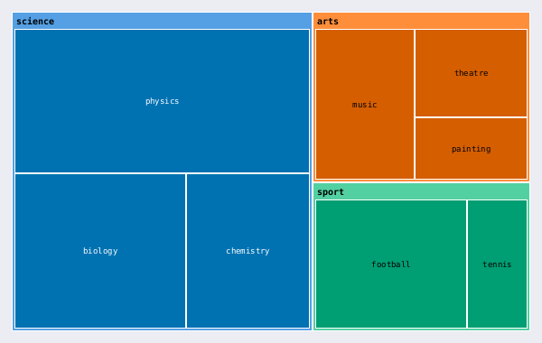
:::


These options set the room inside a group, the cell outlines, the layout and the order of siblings. The panels
below draw a wider gap with black outlines, then slices:


```{=html}
<dl class="options"><div class="option-card"><dt><code>:gap</code><span class="option-default">Default: <code>3</code> (theme)</span></dt><dd><div class="option-example"><code>(chart/treemap {:gap 8})</code></div><div class="option-text">The room inside every group around its header and children, in pixels.<ul><li><a href="reference.types.html#non-negative-number">non-negative number</a></li></ul></div></dd></div><div class="option-card"><dt><code>:stroke-color</code><span class="option-default">Default: <code>:white</code> (theme)</span></dt><dd><div class="option-example"><code>(chart/treemap {:stroke-color :black})</code></div><div class="option-text">The outline colour of the cells.<ul><li><code>:none</code> – No outline.</li><li><a href="reference.types.html#solid-colour">solid colour</a> – Any other colour, e.g. <code>:black</code>.</li></ul></div></dd></div><div class="option-card"><dt><code>:stroke-width</code><span class="option-default">Default: <code>1</code> (theme)</span></dt><dd><div class="option-example"><code>(chart/treemap {:stroke-width 3})</code></div><div class="option-text">The outline width of the cells in pixels; <code>0</code> draws no outline.<ul><li><a href="reference.types.html#non-negative-number">non-negative number</a></li></ul></div></dd></div><div class="option-card"><dt><code>:layout</code><span class="option-default">Default: <code>:squarify</code></span></dt><dd><div class="option-example"><code>(chart/treemap {:layout :slice-dice})</code></div><div class="option-text">How the chart cuts each group's rectangle into its children's cells.<ul><li><code>:squarify</code> – Cells as near to squares as the values allow.</li><li><code>:slice-dice</code> – Slices across the rectangle, turning direction at every level.</li></ul></div></dd></div><div class="option-card"><dt><code>:order</code><span class="option-default">Default: <code>:value</code> with <code>:squarify</code>, <code>:data</code> with <code>:slice-dice</code>.</span></dt><dd><div class="option-example"><code>(chart/treemap {:order :data})</code></div><div class="option-text">The order of siblings within their group's rectangle.<ul><li><code>:value</code> – Largest first.</li><li><code>:data</code> – In order of first appearance; a group's unnamed leaf comes last.</li></ul></div></dd></div></dl>
```


::: {.sourceClojure}
```clojure
(plot/render-image (plot/arrange [{:data budget
                                   :mapping {:hierarchy [:dept :team] :value :cost}
                                   :charts [(chart/treemap {:gap 8 :stroke-color :black :stroke-width 2})]
                                   :labels {:title ":gap 8, black borders"}}
                                  {:data budget
                                   :mapping {:hierarchy [:dept :team] :value :cost}
                                   :charts [(chart/treemap {:layout :slice-dice})]
                                   :labels {:title ":layout :slice-dice"}}]
                                 {:columns 2})
                   {:width 1000 :height 380})
```
:::


::: {.clay-image}
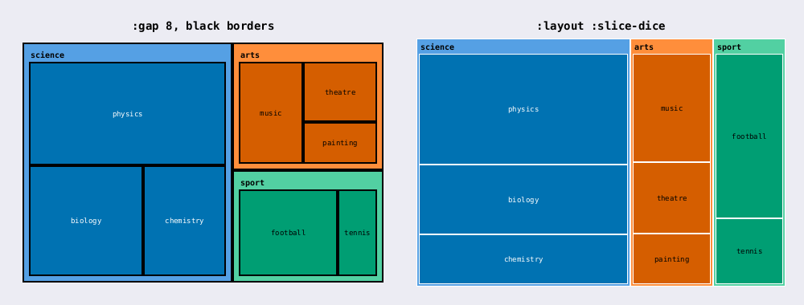
:::


The next panels swap the default orders: slices ordered by value read largest first, and squarified cells keep the
data order:


::: {.sourceClojure}
```clojure
(plot/render-image (plot/arrange [{:data budget
                                   :mapping {:hierarchy [:dept :team] :value :cost}
                                   :charts [(chart/treemap {:layout :slice-dice :order :value})]
                                   :labels {:title ":slice-dice, :order :value"}}
                                  {:data budget
                                   :mapping {:hierarchy [:dept :team] :value :cost}
                                   :charts [(chart/treemap {:order :data})]
                                   :labels {:title ":squarify, :order :data"}}]
                                 {:columns 2})
                   {:width 1000 :height 380})
```
:::


::: {.clay-image}
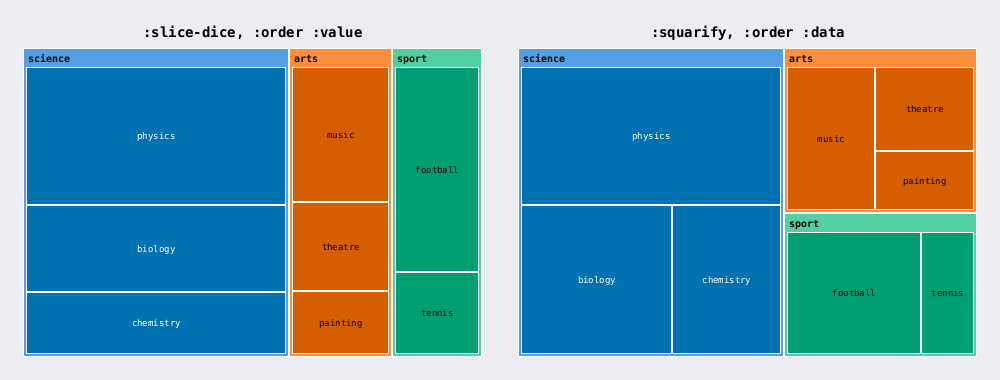
:::


## Icicles and sunbursts

`chart/partition` draws a hierarchy as an icicle: adjacent bands, one per level, each node as wide as its value. In
polar coordinates the bands become the rings of a sunburst. Use it to show the shares at every level of a tree.


```{=html}
<div class="shared"><div class="shared-title">Shared options<span class="shared-hint"> – groups of options other charts take too</span></div><ul><li><a href="reference.shared_options.html#fill-patterns">Fill patterns</a> – <code>:pattern</code> <code>:pattern-color</code></li><li><a href="reference.shared_options.html#common-options">Common options</a> – <code>:data</code> <code>:mapping</code> <code>:legend</code></li><li><a href="reference.shared_options.html#named-theme-styles">Named theme styles</a> – <code>:theme-style</code></li><li><a href="reference.shared_options.html#hierarchy-labels">Hierarchy labels</a> – <code>:group-labels</code> <code>:leaf-labels</code></li></ul></div>
```


```{=html}
<div class="mapping"><div class="mapping-title">Mapping<span class="mapping-hint"> – the row values the chart reads, under <code>:mapping</code></span></div><ul><li><code>:value</code> <span class="required">required</span> – The size of each row's node, a positive finite number; the chart drops other rows.</li><li><code>:hierarchy</code> <span class="required">required</span> – The levels of the tree, outer level first; a row's path ends at its first <code>nil</code> or <code>""</code>.</li><li><code>:color</code> – Colours each leaf; rows with the same path but different colours stay separate leaves.</li></ul></div>
```


::: {.sourceClojure}
```clojure
(plot/render-image (plot/arrange [{:data budget
                                   :mapping {:hierarchy [:dept :team] :value :cost}
                                   :charts [(chart/partition)]
                                   :labels {:title "cartesian: icicle"}}
                                  {:data budget
                                   :mapping {:hierarchy [:dept :team] :value :cost}
                                   :charts [(chart/partition)]
                                   :coord {:kind :polar}
                                   :labels {:title "polar: sunburst"}}]
                                 {:columns 2})
                   {:width 1000 :height 420})
```
:::


::: {.clay-image}
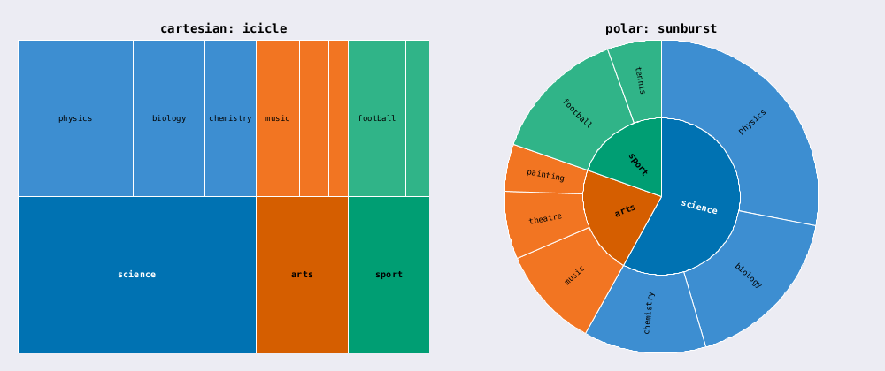
:::


These options set the cell outlines, the order of siblings, how the chart colours the nodes and whether it draws
the root. The left panel below draws the root at the centre and keeps the order of the reversed budget rows, so
sport comes first and the teams go from the cheapest up; the right one colours each node by its name:


```{=html}
<dl class="options"><div class="option-card"><dt><code>:stroke-color</code><span class="option-default">Default: <code>:white</code> (theme)</span></dt><dd><div class="option-example"><code>(chart/partition {:stroke-color :black})</code></div><div class="option-text">The outline colour of the cells.<ul><li><code>:none</code> – No outline.</li><li><a href="reference.types.html#solid-colour">solid colour</a> – Any other colour, e.g. <code>:black</code>.</li></ul></div></dd></div><div class="option-card"><dt><code>:stroke-width</code><span class="option-default">Default: <code>1</code> (theme)</span></dt><dd><div class="option-example"><code>(chart/partition {:stroke-width 3})</code></div><div class="option-text">The outline width of the cells in pixels; <code>0</code> draws no outline.<ul><li><a href="reference.types.html#non-negative-number">non-negative number</a></li></ul></div></dd></div><div class="option-card"><dt><code>:order</code><span class="option-default">Default: <code>:value</code></span></dt><dd><div class="option-example"><code>(chart/partition {:order :data})</code></div><div class="option-text">The order of siblings within their parent's span.<ul><li><code>:value</code> – Largest first.</li><li><code>:data</code> – In order of first appearance; a group's unnamed leaf comes last.</li></ul></div></dd></div><div class="option-card"><dt><code>:color-by</code><span class="option-default">Default: <code>:top</code></span></dt><dd><div class="option-example"><code>(chart/partition {:color-by :name})</code></div><div class="option-text">How the chart colours the nodes; <code>:name</code> can't go with a mapped <code>:color</code>.<ul><li><code>:top</code> – Without a mapped <code>:color</code>, each top-level node takes the next palette colour and its descendants lighter shades by depth; a mapped <code>:color</code> colours the leaves and the groups take the NA colour.</li><li><code>:name</code> – Every node takes its name's colour from the colour scale, with a legend; equal names share a colour at every depth.</li></ul></div></dd></div><div class="option-card"><dt><code>:root</code><span class="option-default">Default: <code>false</code></span></dt><dd><div class="option-example"><code>(chart/partition {:root true})</code></div><div class="option-text">Whether the chart draws the root too.<ul><li><code>false</code> – Starts at the top level.</li><li><code>true</code> – Draws the root at the bottom (the centre in polar plots), every level one up.</li></ul></div></dd></div></dl>
```


::: {.sourceClojure}
```clojure
(plot/render-image (plot/arrange [{:data (reverse budget)
                                   :mapping {:hierarchy [:dept :team] :value :cost}
                                   :charts [(chart/partition {:order :data :root true})]
                                   :coord {:kind :polar}
                                   :labels {:title ":order :data, :root true"}}
                                  {:data budget
                                   :mapping {:hierarchy [:dept :team] :value :cost}
                                   :charts [(chart/partition {:color-by :name :stroke-width 2})]
                                   :coord {:kind :polar}
                                   :labels {:title ":color-by :name"}
                                   :legend false}]
                                 {:columns 2})
                   {:width 1000 :height 460})
```
:::


::: {.clay-image}
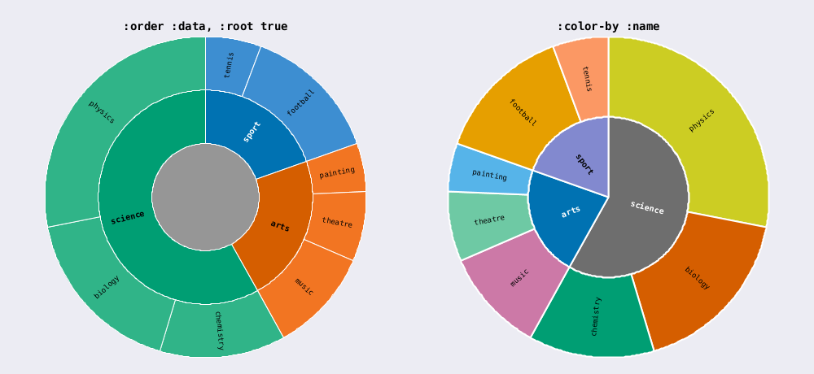
:::


The icicle below draws thick dark outlines instead of the default thin white ones:


::: {.sourceClojure}
```clojure
(plot/render-image {:data budget
                    :mapping {:hierarchy [:dept :team] :value :cost}
                    :charts [(chart/partition {:stroke-color [40 40 40] :stroke-width 3})]
                    :labels {:title ":stroke-color, :stroke-width 3"}}
                   {:width 600 :height 360})
```
:::


::: {.clay-image}
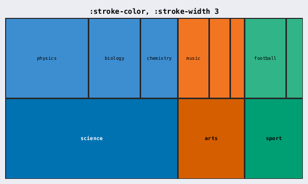
:::


## Circle packing

`chart/pack` draws each leaf of a hierarchy as a circle, its area by its value, packed inside the circle of its
group. Use it for the shares of a tree when the groups matter more than exact areas.


```{=html}
<div class="shared"><div class="shared-title">Shared options<span class="shared-hint"> – groups of options other charts take too</span></div><ul><li><a href="reference.shared_options.html#fill-patterns">Fill patterns</a> – <code>:pattern</code> <code>:pattern-color</code></li><li><a href="reference.shared_options.html#common-options">Common options</a> – <code>:data</code> <code>:mapping</code> <code>:legend</code></li><li><a href="reference.shared_options.html#named-theme-styles">Named theme styles</a> – <code>:theme-style</code></li><li><a href="reference.shared_options.html#hierarchy-labels">Hierarchy labels</a> – <code>:group-labels</code> <code>:leaf-labels</code></li></ul></div>
```


```{=html}
<div class="mapping"><div class="mapping-title">Mapping<span class="mapping-hint"> – the row values the chart reads, under <code>:mapping</code></span></div><ul><li><code>:value</code> <span class="required">required</span> – The size of each row's node, a positive finite number; the chart drops other rows.</li><li><code>:hierarchy</code> <span class="required">required</span> – The levels of the tree, outer level first; a row's path ends at its first <code>nil</code> or <code>""</code>.</li><li><code>:color</code> – Colours each leaf; rows with the same path but different colours stay separate leaves.</li></ul></div>
```


::: {.sourceClojure}
```clojure
(plot/render-image {:data budget
                    :mapping {:hierarchy [:dept :team] :value :cost}
                    :charts [(chart/pack)]}
                   {:width 500 :height 450})
```
:::


::: {.clay-image}
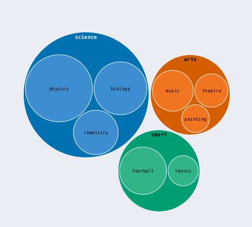
:::


These options set the room between circles, the outlines, the packing order, the root circle and the depths the
chart leaves out. The panels below draw a wider gap with the root, then leave out the group circles (depth 1):


```{=html}
<dl class="options"><div class="option-card"><dt><code>:gap</code><span class="option-default">Default: <code>3</code> (theme)</span></dt><dd><div class="option-example"><code>(chart/pack {:gap 10})</code></div><div class="option-text">The room between siblings and between a child and its parent's edge, in pixels.<ul><li><a href="reference.types.html#non-negative-number">non-negative number</a></li></ul></div></dd></div><div class="option-card"><dt><code>:stroke-color</code><span class="option-default">Default: <code>:white</code> (theme)</span></dt><dd><div class="option-example"><code>(chart/pack {:stroke-color :black})</code></div><div class="option-text">The outline colour of the circles.<ul><li><code>:none</code> – No outline.</li><li><a href="reference.types.html#solid-colour">solid colour</a> – Any other colour, e.g. <code>:black</code>.</li></ul></div></dd></div><div class="option-card"><dt><code>:stroke-width</code><span class="option-default">Default: <code>1</code> (theme)</span></dt><dd><div class="option-example"><code>(chart/pack {:stroke-width 3})</code></div><div class="option-text">The outline width of the circles in pixels; <code>0</code> draws no outline.<ul><li><a href="reference.types.html#non-negative-number">non-negative number</a></li></ul></div></dd></div><div class="option-card"><dt><code>:order</code><span class="option-default">Default: <code>:value</code></span></dt><dd><div class="option-example"><code>(chart/pack {:order :data})</code></div><div class="option-text">The order in which the chart packs siblings.<ul><li><code>:value</code> – Largest first, near the centre.</li><li><code>:data</code> – In order of first appearance; a group's unnamed leaf comes last.</li></ul></div></dd></div><div class="option-card"><dt><code>:root</code><span class="option-default">Default: <code>false</code></span></dt><dd><div class="option-example"><code>(chart/pack {:root true})</code></div><div class="option-text">Whether the chart draws the root circle too.<ul><li><code>false</code> – Starts at the top level.</li><li><code>true</code> – Draws the circle around everything.</li></ul></div></dd></div><div class="option-card"><dt><code>:hidden-levels</code><span class="option-default">Default: <code>#{}</code></span></dt><dd><div class="option-example"><code>(chart/pack {:hidden-levels #{1}})</code></div><div class="option-text">The depths the chart leaves out, counting the root as <code>0</code> and the top level as <code>1</code>; the other circles keep their places.<ul><li><span>set of (integer at least 0)</span></li></ul></div></dd></div></dl>
```


::: {.sourceClojure}
```clojure
(plot/render-image (plot/arrange [{:data budget
                                   :mapping {:hierarchy [:dept :team] :value :cost}
                                   :charts [(chart/pack {:gap 10 :root true :stroke-color :black})]
                                   :labels {:title ":gap 10, :root true"}}
                                  {:data budget
                                   :mapping {:hierarchy [:dept :team] :value :cost}
                                   :charts [(chart/pack {:hidden-levels #{1}})]
                                   :labels {:title ":hidden-levels #{1}"}}]
                                 {:columns 2})
                   {:width 1000 :height 480})
```
:::


::: {.clay-image}
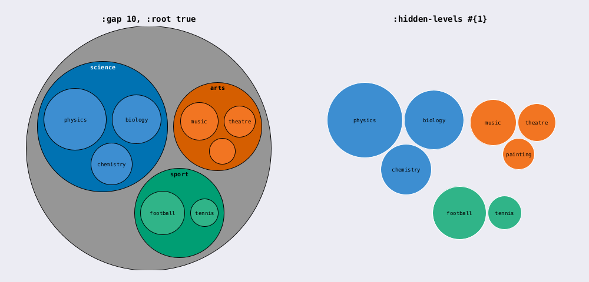
:::


The next panels pack the reversed budget rows (smallest first) by value, then in data order; the third panel draws
thick dark outlines:


::: {.sourceClojure}
```clojure
(plot/render-image (plot/arrange [{:data (reverse budget)
                                   :mapping {:hierarchy [:dept :team] :value :cost}
                                   :charts [(chart/pack {:order :value})]
                                   :labels {:title ":order :value (default)"}}
                                  {:data (reverse budget)
                                   :mapping {:hierarchy [:dept :team] :value :cost}
                                   :charts [(chart/pack {:order :data})]
                                   :labels {:title ":order :data"}}
                                  {:data budget
                                   :mapping {:hierarchy [:dept :team] :value :cost}
                                   :charts [(chart/pack {:stroke-color [40 40 40] :stroke-width 3})]
                                   :labels {:title ":stroke-width 3"}}]
                                 {:columns 3})
                   {:width 1000 :height 360})
```
:::


::: {.clay-image}
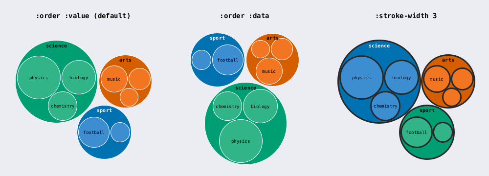
:::


## Waffle charts

`chart/waffle` draws a grid of cells, 10 by 10 by default, each category taking its share of the cells. Use it to
show a few shares as countable units.


```{=html}
<div class="shared"><div class="shared-title">Shared options<span class="shared-hint"> – groups of options other charts take too</span></div><ul><li><a href="reference.shared_options.html#fill-patterns">Fill patterns</a> – <code>:pattern</code> <code>:pattern-color</code></li><li><a href="reference.shared_options.html#common-options">Common options</a> – <code>:data</code> <code>:mapping</code> <code>:legend</code></li><li><a href="reference.shared_options.html#named-theme-styles">Named theme styles</a> – <code>:theme-style</code></li></ul></div>
```


```{=html}
<div class="mapping"><div class="mapping-title">Mapping<span class="mapping-hint"> – the row values the chart reads, under <code>:mapping</code></span></div><ul><li><code>:color</code> <span class="required">required</span> – Splits the rows into categories, each with its own colour and its share of the cells.</li><li><code>:value</code> – The weight of each row, a non-negative finite number; the chart drops other rows.</li><li><code>:pattern</code> – Splits the rows into groups, each with its own fill pattern; a category with two patterns takes two shares of the cells.</li></ul></div>
```


::: {.sourceClojure}
```clojure
(plot/render-image {:data energy-mix
                    :mapping {:color :source :value :share}
                    :charts [(chart/waffle)]}
                   {:width 500 :height 380})
```
:::


::: {.clay-image}
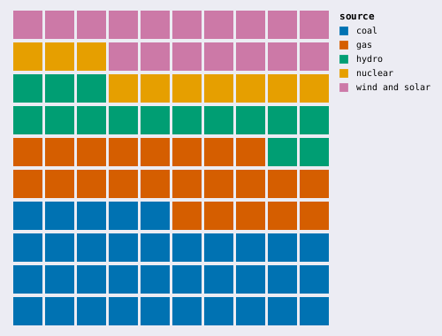
:::


These options set the cells' shape, gap and outline and the grid's size and fill order; `:unit` instead makes each
cell stand for a fixed value, so the cell count follows the values. The panels below draw circles on a 5 by 20
grid, fill by columns with white outlines and no gap, then draw one cell per 2 units, 5 columns wide:


```{=html}
<dl class="options"><div class="option-card"><dt><code>:gap</code><span class="option-default">Default: <code>0.1</code> (theme)</span></dt><dd><div class="option-example"><code>(chart/waffle {:gap 0.4})</code></div><div class="option-text">The room between cells, as a fraction of a cell.<ul><li><span>finite number at least 0 and below 1</span></li></ul></div></dd></div><div class="option-card"><dt><code>:cell-shape</code><span class="option-default">Default: <code>:square</code> (theme)</span></dt><dd><div class="option-example"><code>(chart/waffle {:cell-shape :circle})</code></div><div class="option-text">The shape of every cell.<ul><li><code>:square</code> – A square.</li><li><code>:circle</code> – A circle.</li></ul></div></dd></div><div class="option-card"><dt><code>:stroke-color</code><span class="option-default">Default: <code>:none</code> (theme)</span></dt><dd><div class="option-example"><code>(chart/waffle {:stroke-color :black})</code></div><div class="option-text">The outline colour of the cells.<ul><li><code>:none</code> – No outline.</li><li><a href="reference.types.html#solid-colour">solid colour</a> – Any other colour, e.g. <code>:black</code>.</li></ul></div></dd></div><div class="option-card"><dt><code>:stroke-width</code><span class="option-default">Default: <code>1</code> (theme)</span></dt><dd><div class="option-example"><code>(chart/waffle {:stroke-color :black, :stroke-width 3})</code></div><div class="option-text">The outline width of the cells in pixels; <code>0</code> draws no outline.<ul><li><a href="reference.types.html#non-negative-number">non-negative number</a></li></ul></div></dd></div><div class="option-card"><dt><code>:rows</code><span class="option-default">Default: <code>10</code></span></dt><dd><div class="option-example"><code>(chart/waffle {:rows 5})</code></div><div class="option-text">The number of rows of the grid; <code>:unit</code> ignores it.<ul><li><span>integer at least 1 and at most 10000</span></li></ul></div></dd></div><div class="option-card"><dt><code>:columns</code><span class="option-default">Default: <code>10</code></span></dt><dd><div class="option-example"><code>(chart/waffle {:columns 5})</code></div><div class="option-text">The number of columns of the grid.<ul><li><span>integer at least 1 and at most 10000</span></li></ul></div></dd></div><div class="option-card"><dt><code>:unit</code><span class="option-default">Default: None: the categories share the <code>:rows</code> by <code>:columns</code> grid.</span></dt><dd><div class="option-example"><code>(chart/waffle {:unit 2})</code></div><div class="option-text">The value one cell stands for: a category gets about its value divided by <code>:unit</code> cells, on a grid <code>:columns</code> wide; a unit above every value draws no cells.<ul><li><a href="reference.types.html#positive-finite-number">positive finite number</a></li></ul></div></dd></div><div class="option-card"><dt><code>:fill-order</code><span class="option-default">Default: <code>:rows</code></span></dt><dd><div class="option-example"><code>(chart/waffle {:fill-order :columns})</code></div><div class="option-text">How the chart fills the grid from the bottom-left cell.<ul><li><code>:rows</code> – Row by row, upwards.</li><li><code>:columns</code> – Column by column.</li></ul></div></dd></div></dl>
```


::: {.sourceClojure}
```clojure
(plot/render-image (plot/arrange [{:data energy-mix
                                   :mapping {:color :source :value :share}
                                   :charts [(chart/waffle {:cell-shape :circle :gap 0.2 :rows 5 :columns 20})]
                                   :labels {:title ":circle, 5 × 20"}
                                   :legend false}
                                  {:data energy-mix
                                   :mapping {:color :source :value :share}
                                   :charts [(chart/waffle {:fill-order :columns :stroke-color :white :stroke-width 2
                                                           :gap 0})]
                                   :labels {:title ":fill-order :columns"}
                                   :legend false}
                                  {:data energy-mix
                                   :mapping {:color :source :value :share}
                                   :charts [(chart/waffle {:unit 2 :columns 5})]
                                   :labels {:title ":unit 2"}}]
                                 {:columns 3 :widths [1.3 1 1.1]})
                   {:width 1000 :height 380})
```
:::


::: {.clay-image}
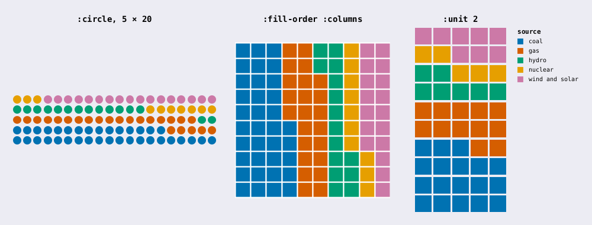
:::


## Venn diagrams

`chart/venn` draws two or three sets as overlapping circles and labels each region with the number of items it
holds; each row names an item and a set it belongs to. Use it to show how a few sets overlap.


```{=html}
<div class="shared"><div class="shared-title">Shared options<span class="shared-hint"> – groups of options other charts take too</span></div><ul><li><a href="reference.shared_options.html#common-options">Common options</a> – <code>:data</code> <code>:mapping</code> <code>:legend</code></li><li><a href="reference.shared_options.html#named-theme-styles">Named theme styles</a> – <code>:theme-style</code></li></ul></div>
```


```{=html}
<div class="mapping"><div class="mapping-title">Mapping<span class="mapping-hint"> – the row values the chart reads, under <code>:mapping</code></span></div><ul><li><code>:set</code> <span class="required">required</span> – The set a row's item belongs to.</li><li><code>:item</code> <span class="required">required</span> – The item; repeated rows count once.</li></ul></div>
```


::: {.sourceClojure}
```clojure
(plot/render-image {:data memberships
                    :mapping {:set :club :item :member}
                    :charts [(chart/venn)]}
                   {:width 500 :height 420})
```
:::


::: {.clay-image}
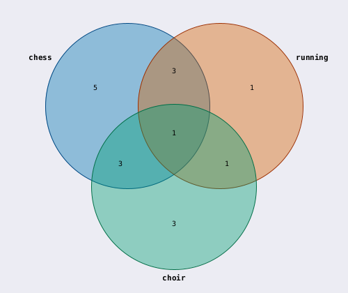
:::


These options set the fill and outline, which sets the chart shows, proportional areas of two sets, and the set and
region labels. The panels below draw two proportional sets, two equal circles, then shares as region labels:


```{=html}
<dl class="options"><div class="option-card"><dt><code>:alpha</code><span class="option-default">Default: <code>0.4</code> (theme)</span></dt><dd><div class="option-example"><code>(chart/venn {:alpha 0.8})</code></div><div class="option-text">The opacity of the circles' fill; overlaps mix their colours.<ul><li><a href="reference.types.html#fraction">fraction</a></li></ul></div></dd></div><div class="option-card"><dt><code>:stroke-color</code><span class="option-default">Default: <code>:darker</code> (theme)</span></dt><dd><div class="option-example"><code>(chart/venn {:stroke-color :black})</code></div><div class="option-text">The outline colour of the circles.<ul><li><code>:darker</code> – The set's colour, darkened.</li><li><code>:none</code> – No outline.</li><li><a href="reference.types.html#solid-colour">solid colour</a> – Any other colour, e.g. <code>:black</code>.</li></ul></div></dd></div><div class="option-card"><dt><code>:stroke-width</code><span class="option-default">Default: <code>1</code> (theme)</span></dt><dd><div class="option-example"><code>(chart/venn {:stroke-width 3})</code></div><div class="option-text">The outline width of the circles in pixels; <code>0</code> draws no outline.<ul><li><a href="reference.types.html#non-negative-number">non-negative number</a></li></ul></div></dd></div><div class="option-card"><dt><code>:sets</code><span class="option-default">Default: Every set, in order of first appearance.</span></dt><dd><div class="option-example"><code>(chart/venn {:sets ["b" "a"]})</code></div><div class="option-text">The sets the chart shows, in order: 2 or 3 different values of the mapped <code>:set</code>; a name no row belongs to is an error.<ul><li><span>vector of any values</span></li></ul></div></dd></div><div class="option-card"><dt><code>:proportional</code><span class="option-default">Default: <code>true</code></span></dt><dd><div class="option-example"><code>(chart/venn {:sets ["a" "b"], :proportional false})</code></div><div class="option-text">Whether the areas of 2 sets follow their counts; 3 sets always take equal circles.<ul><li><code>true</code> – Circle areas follow the set sizes and the overlap's area follows the items the sets share.</li><li><code>false</code> – Two equal circles.</li></ul></div></dd></div><div class="option-card"><dt><code>:set-labels</code><span class="option-default">Default: <code>true</code></span></dt><dd><div class="option-example"><code>(chart/venn {:set-labels false})</code></div><div class="option-text">Writes each set's name outside its circle.<ul><li><code>true</code> – Writes the names.</li><li><code>false</code> – No names.</li></ul></div></dd></div><div class="option-card"><dt><code>:region-labels</code><span class="option-default">Default: <code>true</code></span></dt><dd><div class="option-example"><code>(chart/venn {:region-labels false})</code></div><div class="option-text">Writes a label in every region, in the <code>:venn-count</code> text role: by default black or white by the colour under it.<ul><li><code>true</code> – The region's item count.</li><li><code>false</code> – No labels.</li><li><a href="reference.types.html#function">function</a> – A function of <code>{:sets :size :share}</code> that returns the text, <code>:share</code> of the panel's distinct items.</li></ul></div></dd></div></dl>
```


::: {.sourceClojure}
```clojure
(plot/render-image (plot/arrange [{:data memberships
                                   :mapping {:set :club :item :member}
                                   :charts [(chart/venn {:sets ["chess" "running"]})]
                                   :labels {:title "two sets, proportional"}}
                                  {:data memberships
                                   :mapping {:set :club :item :member}
                                   :charts [(chart/venn {:sets ["chess" "running"] :proportional false :alpha 0.6
                                                         :stroke-color :none})]
                                   :labels {:title ":proportional false"}}
                                  {:data memberships
                                   :mapping {:set :club :item :member}
                                   :charts [(chart/venn {:region-labels #(format "%.0f%%" (* 100.0 (double (:share %))))})]
                                   :labels {:title ":region-labels - shares"}}]
                                 {:columns 3})
                   {:width 1000 :height 380})
```
:::


::: {.clay-image}
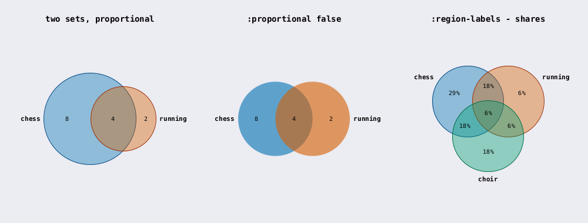
:::


The next panels leave out the set names, then draw thick outlines in the darkened set colours:


::: {.sourceClojure}
```clojure
(plot/render-image (plot/arrange [{:data memberships
                                   :mapping {:set :club :item :member}
                                   :charts [(chart/venn {:set-labels false})]
                                   :labels {:title ":set-labels false"}}
                                  {:data memberships
                                   :mapping {:set :club :item :member}
                                   :charts [(chart/venn {:stroke-width 4})]
                                   :labels {:title ":stroke-width 4"}}]
                                 {:columns 2})
                   {:width 900 :height 380})
```
:::


::: {.clay-image}
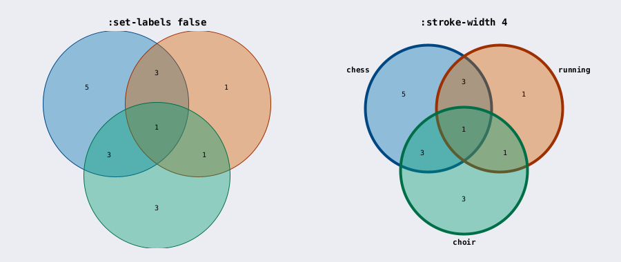
:::


A theme key sets the room between a circle and its set name. The diagram below widens it:


```{=html}
<div class="mapping"><div class="mapping-title">Theme keys<span class="mapping-hint"> – set under <code>[:theme :chart :venn]</code>, not options</span></div><ul><li><code>:label-gap</code> (default <code>4</code>) – pixels between a circle and its set name (theme only, not an option)</li></ul></div>
```


::: {.sourceClojure}
```clojure
(plot/render-image {:data memberships
                    :mapping {:set :club :item :member}
                    :charts [(chart/venn)]
                    :theme {:chart {:venn {:label-gap 16}}}}
                   {:width 500 :height 420})
```
:::


::: {.clay-image}
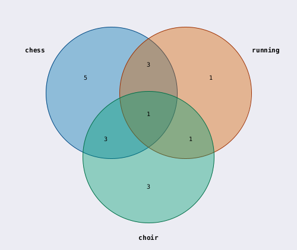
:::


```{=html}
<div style="background-color:grey;height:2px;width:100%;"></div>
```


```{=html}
<div><pre><small><small>source: notebooks/reference/charts_shares_sets.clj</small></small></pre></div>
```