---
format:
  html:
    toc: true
    toc-location: right
    toc-depth: 4
    theme: cosmo
    include-in-header:
      text: |-
        <style>
        .data-table { width: fit-content; max-width: 100%; max-height: 15rem; overflow: auto; margin: 0 0 1rem 0; }
        .data-table .table-responsive { overflow: visible; }
        .data-table table { font-size: 0.75rem; width: auto; margin: 0; }
        .data-table th, .data-table td { padding: 0.1rem 0.45rem !important; white-space: nowrap; }
        .data-table thead th { position: sticky; top: 0; background: var(--bs-body-bg, #fff); }
        </style>
code-block-background: true

---
<style></style><style>.printedClojure .sourceCode {
  background-color: transparent;
  border-style: none;
}
</style><style>.clay-limit-image-width .clay-image {max-width: 100%}
.clay-side-by-side .sourceCode {margin: 0}
.clay-side-by-side {margin: 1em 0}
</style>
<script src="https://code.jquery.com/jquery-3.6.0.min.js" type="text/javascript"></script><script src="https://code.jquery.com/ui/1.13.1/jquery-ui.min.js" type="text/javascript"></script>

# Charts: strip distributions

Strip charts showing the distribution of each level's values: summaries (`box`, `violin`) and the values
themselves (`stripplot`, `beeswarm`, `dotplot`, `rug`). Placement, width and grouping across the strip are the
[Strip options](reference.shared_options.html#strip-options) group every one of them takes. Each chart lists the
mapping keys it reads, its own options and the shared option groups it takes.


::: {.sourceClojure}
```clojure
(ns reference.charts-strip-distributions
  (:require [fastmath.random :as r]
            [cljplot2.chart :as chart]
            [cljplot2.core :as plot]
            [cljplot2.describe :as describe]
            [notebook-utils :as nu]))
```
:::


Data: Edgar Anderson's iris measurements, R datasets package `iris` (Anderson 1935; Fisher 1936); licence: Part of R (GPL-2 | GPL-3).


::: {.sourceClojure}
```clojure
(def iris (nu/dataset :iris))
```
:::


```{=html}
<div class="data-table"><table class="table table-hover table-responsive clay-table"><thead><tr><th>sepal-length</th><th>sepal-width</th><th>petal-length</th><th>petal-width</th><th>species</th></tr></thead><tbody><tr><td>5.1</td><td>3.5</td><td>1.4</td><td>0.2</td><td>setosa</td></tr><tr><td>4.9</td><td>3</td><td>1.4</td><td>0.2</td><td>setosa</td></tr><tr><td>4.7</td><td>3.2</td><td>1.3</td><td>0.2</td><td>setosa</td></tr><tr><td>4.6</td><td>3.1</td><td>1.5</td><td>0.2</td><td>setosa</td></tr><tr><td>5</td><td>3.6</td><td>1.4</td><td>0.2</td><td>setosa</td></tr><tr><td>5.4</td><td>3.9</td><td>1.7</td><td>0.4</td><td>setosa</td></tr><tr><td>4.6</td><td>3.4</td><td>1.4</td><td>0.3</td><td>setosa</td></tr><tr><td>5</td><td>3.4</td><td>1.5</td><td>0.2</td><td>setosa</td></tr><tr><td>4.4</td><td>2.9</td><td>1.4</td><td>0.2</td><td>setosa</td></tr><tr><td>4.9</td><td>3.1</td><td>1.5</td><td>0.1</td><td>setosa</td></tr><tr><td>5.4</td><td>3.7</td><td>1.5</td><td>0.2</td><td>setosa</td></tr><tr><td>4.8</td><td>3.4</td><td>1.6</td><td>0.2</td><td>setosa</td></tr><tr><td>4.8</td><td>3</td><td>1.4</td><td>0.1</td><td>setosa</td></tr><tr><td>4.3</td><td>3</td><td>1.1</td><td>0.1</td><td>setosa</td></tr><tr><td>5.8</td><td>4</td><td>1.2</td><td>0.2</td><td>setosa</td></tr><tr><td>5.7</td><td>4.4</td><td>1.5</td><td>0.4</td><td>setosa</td></tr><tr><td>5.4</td><td>3.9</td><td>1.3</td><td>0.4</td><td>setosa</td></tr><tr><td>5.1</td><td>3.5</td><td>1.4</td><td>0.3</td><td>setosa</td></tr><tr><td>5.7</td><td>3.8</td><td>1.7</td><td>0.3</td><td>setosa</td></tr><tr><td>5.1</td><td>3.8</td><td>1.5</td><td>0.3</td><td>setosa</td></tr><tr><td>5.4</td><td>3.4</td><td>1.7</td><td>0.2</td><td>setosa</td></tr><tr><td>5.1</td><td>3.7</td><td>1.5</td><td>0.4</td><td>setosa</td></tr><tr><td>4.6</td><td>3.6</td><td>1</td><td>0.2</td><td>setosa</td></tr><tr><td>5.1</td><td>3.3</td><td>1.7</td><td>0.5</td><td>setosa</td></tr><tr><td>4.8</td><td>3.4</td><td>1.9</td><td>0.2</td><td>setosa</td></tr><tr><td>5</td><td>3</td><td>1.6</td><td>0.2</td><td>setosa</td></tr><tr><td>5</td><td>3.4</td><td>1.6</td><td>0.4</td><td>setosa</td></tr><tr><td>5.2</td><td>3.5</td><td>1.5</td><td>0.2</td><td>setosa</td></tr><tr><td>5.2</td><td>3.4</td><td>1.4</td><td>0.2</td><td>setosa</td></tr><tr><td>4.7</td><td>3.2</td><td>1.6</td><td>0.2</td><td>setosa</td></tr><tr><td>4.8</td><td>3.1</td><td>1.6</td><td>0.2</td><td>setosa</td></tr><tr><td>5.4</td><td>3.4</td><td>1.5</td><td>0.4</td><td>setosa</td></tr><tr><td>5.2</td><td>4.1</td><td>1.5</td><td>0.1</td><td>setosa</td></tr><tr><td>5.5</td><td>4.2</td><td>1.4</td><td>0.2</td><td>setosa</td></tr><tr><td>4.9</td><td>3.1</td><td>1.5</td><td>0.2</td><td>setosa</td></tr><tr><td>5</td><td>3.2</td><td>1.2</td><td>0.2</td><td>setosa</td></tr><tr><td>5.5</td><td>3.5</td><td>1.3</td><td>0.2</td><td>setosa</td></tr><tr><td>4.9</td><td>3.6</td><td>1.4</td><td>0.1</td><td>setosa</td></tr><tr><td>4.4</td><td>3</td><td>1.3</td><td>0.2</td><td>setosa</td></tr><tr><td>5.1</td><td>3.4</td><td>1.5</td><td>0.2</td><td>setosa</td></tr><tr><td>5</td><td>3.5</td><td>1.3</td><td>0.3</td><td>setosa</td></tr><tr><td>4.5</td><td>2.3</td><td>1.3</td><td>0.3</td><td>setosa</td></tr><tr><td>4.4</td><td>3.2</td><td>1.3</td><td>0.2</td><td>setosa</td></tr><tr><td>5</td><td>3.5</td><td>1.6</td><td>0.6</td><td>setosa</td></tr><tr><td>5.1</td><td>3.8</td><td>1.9</td><td>0.4</td><td>setosa</td></tr><tr><td>4.8</td><td>3</td><td>1.4</td><td>0.3</td><td>setosa</td></tr><tr><td>5.1</td><td>3.8</td><td>1.6</td><td>0.2</td><td>setosa</td></tr><tr><td>4.6</td><td>3.2</td><td>1.4</td><td>0.2</td><td>setosa</td></tr><tr><td>5.3</td><td>3.7</td><td>1.5</td><td>0.2</td><td>setosa</td></tr><tr><td>5</td><td>3.3</td><td>1.4</td><td>0.2</td><td>setosa</td></tr><tr><td>7</td><td>3.2</td><td>4.7</td><td>1.4</td><td>versicolor</td></tr><tr><td>6.4</td><td>3.2</td><td>4.5</td><td>1.5</td><td>versicolor</td></tr><tr><td>6.9</td><td>3.1</td><td>4.9</td><td>1.5</td><td>versicolor</td></tr><tr><td>5.5</td><td>2.3</td><td>4</td><td>1.3</td><td>versicolor</td></tr><tr><td>6.5</td><td>2.8</td><td>4.6</td><td>1.5</td><td>versicolor</td></tr><tr><td>5.7</td><td>2.8</td><td>4.5</td><td>1.3</td><td>versicolor</td></tr><tr><td>6.3</td><td>3.3</td><td>4.7</td><td>1.6</td><td>versicolor</td></tr><tr><td>4.9</td><td>2.4</td><td>3.3</td><td>1</td><td>versicolor</td></tr><tr><td>6.6</td><td>2.9</td><td>4.6</td><td>1.3</td><td>versicolor</td></tr><tr><td>5.2</td><td>2.7</td><td>3.9</td><td>1.4</td><td>versicolor</td></tr><tr><td>5</td><td>2</td><td>3.5</td><td>1</td><td>versicolor</td></tr><tr><td>5.9</td><td>3</td><td>4.2</td><td>1.5</td><td>versicolor</td></tr><tr><td>6</td><td>2.2</td><td>4</td><td>1</td><td>versicolor</td></tr><tr><td>6.1</td><td>2.9</td><td>4.7</td><td>1.4</td><td>versicolor</td></tr><tr><td>5.6</td><td>2.9</td><td>3.6</td><td>1.3</td><td>versicolor</td></tr><tr><td>6.7</td><td>3.1</td><td>4.4</td><td>1.4</td><td>versicolor</td></tr><tr><td>5.6</td><td>3</td><td>4.5</td><td>1.5</td><td>versicolor</td></tr><tr><td>5.8</td><td>2.7</td><td>4.1</td><td>1</td><td>versicolor</td></tr><tr><td>6.2</td><td>2.2</td><td>4.5</td><td>1.5</td><td>versicolor</td></tr><tr><td>5.6</td><td>2.5</td><td>3.9</td><td>1.1</td><td>versicolor</td></tr><tr><td>5.9</td><td>3.2</td><td>4.8</td><td>1.8</td><td>versicolor</td></tr><tr><td>6.1</td><td>2.8</td><td>4</td><td>1.3</td><td>versicolor</td></tr><tr><td>6.3</td><td>2.5</td><td>4.9</td><td>1.5</td><td>versicolor</td></tr><tr><td>6.1</td><td>2.8</td><td>4.7</td><td>1.2</td><td>versicolor</td></tr><tr><td>6.4</td><td>2.9</td><td>4.3</td><td>1.3</td><td>versicolor</td></tr><tr><td>6.6</td><td>3</td><td>4.4</td><td>1.4</td><td>versicolor</td></tr><tr><td>6.8</td><td>2.8</td><td>4.8</td><td>1.4</td><td>versicolor</td></tr><tr><td>6.7</td><td>3</td><td>5</td><td>1.7</td><td>versicolor</td></tr><tr><td>6</td><td>2.9</td><td>4.5</td><td>1.5</td><td>versicolor</td></tr><tr><td>5.7</td><td>2.6</td><td>3.5</td><td>1</td><td>versicolor</td></tr><tr><td>5.5</td><td>2.4</td><td>3.8</td><td>1.1</td><td>versicolor</td></tr><tr><td>5.5</td><td>2.4</td><td>3.7</td><td>1</td><td>versicolor</td></tr><tr><td>5.8</td><td>2.7</td><td>3.9</td><td>1.2</td><td>versicolor</td></tr><tr><td>6</td><td>2.7</td><td>5.1</td><td>1.6</td><td>versicolor</td></tr><tr><td>5.4</td><td>3</td><td>4.5</td><td>1.5</td><td>versicolor</td></tr><tr><td>6</td><td>3.4</td><td>4.5</td><td>1.6</td><td>versicolor</td></tr><tr><td>6.7</td><td>3.1</td><td>4.7</td><td>1.5</td><td>versicolor</td></tr><tr><td>6.3</td><td>2.3</td><td>4.4</td><td>1.3</td><td>versicolor</td></tr><tr><td>5.6</td><td>3</td><td>4.1</td><td>1.3</td><td>versicolor</td></tr><tr><td>5.5</td><td>2.5</td><td>4</td><td>1.3</td><td>versicolor</td></tr><tr><td>5.5</td><td>2.6</td><td>4.4</td><td>1.2</td><td>versicolor</td></tr><tr><td>6.1</td><td>3</td><td>4.6</td><td>1.4</td><td>versicolor</td></tr><tr><td>5.8</td><td>2.6</td><td>4</td><td>1.2</td><td>versicolor</td></tr><tr><td>5</td><td>2.3</td><td>3.3</td><td>1</td><td>versicolor</td></tr><tr><td>5.6</td><td>2.7</td><td>4.2</td><td>1.3</td><td>versicolor</td></tr><tr><td>5.7</td><td>3</td><td>4.2</td><td>1.2</td><td>versicolor</td></tr><tr><td>5.7</td><td>2.9</td><td>4.2</td><td>1.3</td><td>versicolor</td></tr><tr><td>6.2</td><td>2.9</td><td>4.3</td><td>1.3</td><td>versicolor</td></tr><tr><td>5.1</td><td>2.5</td><td>3</td><td>1.1</td><td>versicolor</td></tr><tr><td>5.7</td><td>2.8</td><td>4.1</td><td>1.3</td><td>versicolor</td></tr><tr><td>…</td><td>…</td><td>…</td><td>…</td><td>…</td></tr></tbody></table></div>
```


Data: Motor Trend car road tests (1974), R datasets package `mtcars` (Henderson & Velleman 1981); licence: Part of R (GPL-2 | GPL-3).


::: {.sourceClojure}
```clojure
(def mtcars (nu/dataset :mtcars))
```
:::


```{=html}
<div class="data-table"><table class="table table-hover table-responsive clay-table"><thead><tr><th>model</th><th>mpg</th><th>cyl</th><th>disp</th><th>hp</th><th>drat</th><th>wt</th><th>qsec</th><th>vs</th><th>am</th><th>gear</th><th>carb</th></tr></thead><tbody><tr><td>Mazda RX4</td><td>21</td><td>6</td><td>160</td><td>110</td><td>3.9</td><td>2.62</td><td>16.46</td><td>0</td><td>1</td><td>4</td><td>4</td></tr><tr><td>Mazda RX4 Wag</td><td>21</td><td>6</td><td>160</td><td>110</td><td>3.9</td><td>2.875</td><td>17.02</td><td>0</td><td>1</td><td>4</td><td>4</td></tr><tr><td>Datsun 710</td><td>22.8</td><td>4</td><td>108</td><td>93</td><td>3.85</td><td>2.32</td><td>18.61</td><td>1</td><td>1</td><td>4</td><td>1</td></tr><tr><td>Hornet 4 Drive</td><td>21.4</td><td>6</td><td>258</td><td>110</td><td>3.08</td><td>3.215</td><td>19.44</td><td>1</td><td>0</td><td>3</td><td>1</td></tr><tr><td>Hornet Sportabout</td><td>18.7</td><td>8</td><td>360</td><td>175</td><td>3.15</td><td>3.44</td><td>17.02</td><td>0</td><td>0</td><td>3</td><td>2</td></tr><tr><td>Valiant</td><td>18.1</td><td>6</td><td>225</td><td>105</td><td>2.76</td><td>3.46</td><td>20.22</td><td>1</td><td>0</td><td>3</td><td>1</td></tr><tr><td>Duster 360</td><td>14.3</td><td>8</td><td>360</td><td>245</td><td>3.21</td><td>3.57</td><td>15.84</td><td>0</td><td>0</td><td>3</td><td>4</td></tr><tr><td>Merc 240D</td><td>24.4</td><td>4</td><td>146.7</td><td>62</td><td>3.69</td><td>3.19</td><td>20</td><td>1</td><td>0</td><td>4</td><td>2</td></tr><tr><td>Merc 230</td><td>22.8</td><td>4</td><td>140.8</td><td>95</td><td>3.92</td><td>3.15</td><td>22.9</td><td>1</td><td>0</td><td>4</td><td>2</td></tr><tr><td>Merc 280</td><td>19.2</td><td>6</td><td>167.6</td><td>123</td><td>3.92</td><td>3.44</td><td>18.3</td><td>1</td><td>0</td><td>4</td><td>4</td></tr><tr><td>Merc 280C</td><td>17.8</td><td>6</td><td>167.6</td><td>123</td><td>3.92</td><td>3.44</td><td>18.9</td><td>1</td><td>0</td><td>4</td><td>4</td></tr><tr><td>Merc 450SE</td><td>16.4</td><td>8</td><td>275.8</td><td>180</td><td>3.07</td><td>4.07</td><td>17.4</td><td>0</td><td>0</td><td>3</td><td>3</td></tr><tr><td>Merc 450SL</td><td>17.3</td><td>8</td><td>275.8</td><td>180</td><td>3.07</td><td>3.73</td><td>17.6</td><td>0</td><td>0</td><td>3</td><td>3</td></tr><tr><td>Merc 450SLC</td><td>15.2</td><td>8</td><td>275.8</td><td>180</td><td>3.07</td><td>3.78</td><td>18</td><td>0</td><td>0</td><td>3</td><td>3</td></tr><tr><td>Cadillac Fleetwood</td><td>10.4</td><td>8</td><td>472</td><td>205</td><td>2.93</td><td>5.25</td><td>17.98</td><td>0</td><td>0</td><td>3</td><td>4</td></tr><tr><td>Lincoln Continental</td><td>10.4</td><td>8</td><td>460</td><td>215</td><td>3</td><td>5.424</td><td>17.82</td><td>0</td><td>0</td><td>3</td><td>4</td></tr><tr><td>Chrysler Imperial</td><td>14.7</td><td>8</td><td>440</td><td>230</td><td>3.23</td><td>5.345</td><td>17.42</td><td>0</td><td>0</td><td>3</td><td>4</td></tr><tr><td>Fiat 128</td><td>32.4</td><td>4</td><td>78.7</td><td>66</td><td>4.08</td><td>2.2</td><td>19.47</td><td>1</td><td>1</td><td>4</td><td>1</td></tr><tr><td>Honda Civic</td><td>30.4</td><td>4</td><td>75.7</td><td>52</td><td>4.93</td><td>1.615</td><td>18.52</td><td>1</td><td>1</td><td>4</td><td>2</td></tr><tr><td>Toyota Corolla</td><td>33.9</td><td>4</td><td>71.1</td><td>65</td><td>4.22</td><td>1.835</td><td>19.9</td><td>1</td><td>1</td><td>4</td><td>1</td></tr><tr><td>Toyota Corona</td><td>21.5</td><td>4</td><td>120.1</td><td>97</td><td>3.7</td><td>2.465</td><td>20.01</td><td>1</td><td>0</td><td>3</td><td>1</td></tr><tr><td>Dodge Challenger</td><td>15.5</td><td>8</td><td>318</td><td>150</td><td>2.76</td><td>3.52</td><td>16.87</td><td>0</td><td>0</td><td>3</td><td>2</td></tr><tr><td>AMC Javelin</td><td>15.2</td><td>8</td><td>304</td><td>150</td><td>3.15</td><td>3.435</td><td>17.3</td><td>0</td><td>0</td><td>3</td><td>2</td></tr><tr><td>Camaro Z28</td><td>13.3</td><td>8</td><td>350</td><td>245</td><td>3.73</td><td>3.84</td><td>15.41</td><td>0</td><td>0</td><td>3</td><td>4</td></tr><tr><td>Pontiac Firebird</td><td>19.2</td><td>8</td><td>400</td><td>175</td><td>3.08</td><td>3.845</td><td>17.05</td><td>0</td><td>0</td><td>3</td><td>2</td></tr><tr><td>Fiat X1-9</td><td>27.3</td><td>4</td><td>79</td><td>66</td><td>4.08</td><td>1.935</td><td>18.9</td><td>1</td><td>1</td><td>4</td><td>1</td></tr><tr><td>Porsche 914-2</td><td>26</td><td>4</td><td>120.3</td><td>91</td><td>4.43</td><td>2.14</td><td>16.7</td><td>0</td><td>1</td><td>5</td><td>2</td></tr><tr><td>Lotus Europa</td><td>30.4</td><td>4</td><td>95.1</td><td>113</td><td>3.77</td><td>1.513</td><td>16.9</td><td>1</td><td>1</td><td>5</td><td>2</td></tr><tr><td>Ford Pantera L</td><td>15.8</td><td>8</td><td>351</td><td>264</td><td>4.22</td><td>3.17</td><td>14.5</td><td>0</td><td>1</td><td>5</td><td>4</td></tr><tr><td>Ferrari Dino</td><td>19.7</td><td>6</td><td>145</td><td>175</td><td>3.62</td><td>2.77</td><td>15.5</td><td>0</td><td>1</td><td>5</td><td>6</td></tr><tr><td>Maserati Bora</td><td>15</td><td>8</td><td>301</td><td>335</td><td>3.54</td><td>3.57</td><td>14.6</td><td>0</td><td>1</td><td>5</td><td>8</td></tr><tr><td>Volvo 142E</td><td>21.4</td><td>4</td><td>121</td><td>109</td><td>4.11</td><td>2.78</td><td>18.6</td><td>1</td><td>1</td><td>4</td><td>2</td></tr></tbody></table></div>
```


## box

A box per level (and group): the quartiles, the median, whiskers to the most extreme values within 1.5 IQR of
the box and the outliers past them - computed from the values ...

::: {.clay-table}

```{=html}
<table class="table table-hover table-responsive clay-table"><thead><tr><th>Option</th><th>Type</th><th>Default</th><th>Description</th></tr></thead><tbody><tr><td>:x</td><td>a keyword, a function or a categorical marker of one or nil</td><td></td><td>values (data units) on the value axis (not read with :stat :identity), or levels for vertical boxes</td></tr><tr><td>:y</td><td>a keyword, a function or a categorical marker of one or nil</td><td></td><td>levels on the categorical axis (absent - one box), or values for vertical boxes</td></tr><tr><td>:color</td><td>a keyword, a function or a categorical marker of one or nil</td><td></td><td>groups, each a box in its own fill colour</td></tr><tr><td>:pattern</td><td>a keyword, a function or a categorical marker of one or nil</td><td></td><td>groups, each a box with its own fill pattern</td></tr><tr><td>:shape</td><td>a keyword, a function or a categorical marker of one or nil</td><td></td><td>groups, each with its own outlier shape</td></tr><tr><td>:size</td><td>a keyword, a function or a categorical marker of one or nil</td><td></td><td>groups, each with its own outlier size</td></tr><tr><td>:group</td><td>a keyword, a function or a categorical marker of one or nil</td><td></td><td>groups without a visual aesthetic, each its own box</td></tr></tbody></table>
```

:::


::: {.sourceClojure}
```clojure
(plot/render-image {:data iris
                    :mapping {:x :sepal-width :y :species :color :species}
                    :charts [(chart/box)]
                    :scales {:y {:reverse true}}
                    :legend false}
                   {:width 600 :height 300})
```
:::


::: {.clay-image}
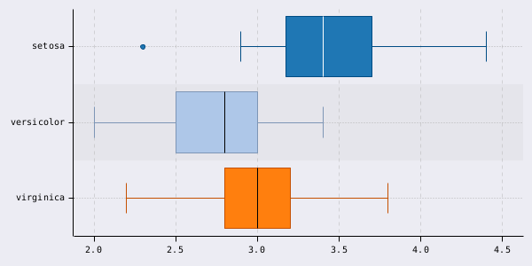
:::


... or read from rows of precomputed statistics, one row per level and group, with `:stat :identity`:

::: {.clay-table}

```{=html}
<table class="table table-hover table-responsive clay-table"><thead><tr><th>Option</th><th>Type</th><th>Default</th><th>Description</th></tr></thead><tbody><tr><td>:lower</td><td>a keyword, a function or a categorical marker of one or nil</td><td></td><td>with :stat :identity, the statistics of a level and group: the lower whisker end</td></tr><tr><td>:q1</td><td>a keyword, a function or a categorical marker of one or nil</td><td></td><td>with :stat :identity, the statistics of a level and group: the first quartile</td></tr><tr><td>:median</td><td>a keyword, a function or a categorical marker of one or nil</td><td></td><td>with :stat :identity, the statistics of a level and group: the median</td></tr><tr><td>:q3</td><td>a keyword, a function or a categorical marker of one or nil</td><td></td><td>with :stat :identity, the statistics of a level and group: the third quartile</td></tr><tr><td>:upper</td><td>a keyword, a function or a categorical marker of one or nil</td><td></td><td>with :stat :identity, the statistics of a level and group: the upper whisker end</td></tr><tr><td>:outliers</td><td>a keyword, a function or a categorical marker of one or nil</td><td></td><td>with :stat :identity, the statistics of a level and group: a collection of outlier values (optional)</td></tr><tr><td>:mean</td><td>a keyword, a function or a categorical marker of one or nil</td><td></td><td>with :stat :identity, the statistics of a level and group: the mean (needed by the :mean option)</td></tr><tr><td>:n</td><td>a keyword, a function or a categorical marker of one or nil</td><td></td><td>with :stat :identity, the statistics of a level and group: the count (needed by :varwidth and :n-label)</td></tr></tbody></table>
```

:::


::: {.sourceClojure}
```clojure
(def summaries [{:site "north" :lower 2.1 :q1 3.4 :median 4.0 :q3 4.9 :upper 6.3 :outliers [7.4 8.0] :mean 4.3 :n 40}
                {:site "south" :lower 1.0 :q1 2.2 :median 2.9 :q3 3.3 :upper 4.4 :outliers [0.2] :mean 2.8 :n 15}
                {:site "east" :lower 3.0 :q1 4.1 :median 5.2 :q3 5.8 :upper 7.0 :outliers [] :mean 5.0 :n 90}])
```
:::


```{=html}
<div class="data-table"><table class="table table-hover table-responsive clay-table"><thead><tr><th>upper</th><th>q1</th><th>q3</th><th>mean</th><th>site</th><th>n</th><th>outliers</th><th>median</th><th>lower</th></tr></thead><tbody><tr><td>6.3</td><td>3.4</td><td>4.9</td><td>4.3</td><td>north</td><td>40</td><td>[7.4 8.0]</td><td>4.0</td><td>2.1</td></tr><tr><td>4.4</td><td>2.2</td><td>3.3</td><td>2.8</td><td>south</td><td>15</td><td>[0.2]</td><td>2.9</td><td>1.0</td></tr><tr><td>7.0</td><td>4.1</td><td>5.8</td><td>5.0</td><td>east</td><td>90</td><td>[]</td><td>5.2</td><td>3.0</td></tr></tbody></table></div>
```


::: {.sourceClojure}
```clojure
(plot/render-image {:data summaries
                    :mapping {:y :site :lower :lower :q1 :q1 :median :median :q3 :q3 :upper :upper
                              :outliers :outliers :mean :mean :n :n}
                    :charts [(chart/box {:stat :identity :mean true :varwidth true})]
                    :scales {:y {:reverse true}}
                    :labels {:x "value"}}
                   {:width 600 :height 280})
```
:::


::: {.clay-image}
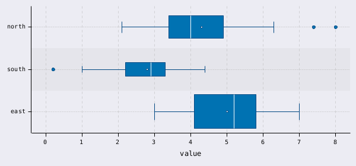
:::


Its options: the box and outlier style, the statistics, outliers on or off, the mean marker, widths by count and
the Tufte variant (whisker lines and a median point) - here on rear axle ratios, with outliers in the 4- and
8-cylinder groups:

::: {.clay-table}

```{=html}
<table class="table table-hover table-responsive clay-table"><thead><tr><th>Option</th><th>Type</th><th>Default</th><th>Description</th></tr></thead><tbody><tr><td>:color</td><td>a clojure2d color</td><td>[69 117 180]</td><td>box fill colour; the Tufte variant's median point and mean marker (a mapped :color wins)</td></tr><tr><td>:stroke-color</td><td>:darker or a clojure2d color or :none</td><td>:darker</td><td>outline colour: a colour, :none or :darker (the darkened fill); also the whiskers and outlier outlines</td></tr><tr><td>:stroke-width</td><td>a non-negative number</td><td>1</td><td>outline and whisker width in pixels (0 - no box outline)</td></tr><tr><td>:shape</td><td>a shape character, keyword or shape map</td><td>\O</td><td>outlier point shape, also the Tufte median point (a mapped :shape wins)</td></tr><tr><td>:size</td><td>a non-negative number</td><td>5</td><td>outlier point size in pixels, also the Tufte median point; the mean marker is half of it (a mapped :size wins)</td></tr><tr><td>:stat</td><td>one of :tukey :identity</td><td>:tukey</td><td>statistics: :tukey (computed from the values) or :identity (pre-aggregated, one row per level and group read through the mapping keys :lower :q1 :median :q3 :upper)</td></tr><tr><td>:outliers</td><td>true or false or nil</td><td>true</td><td>draw the outliers (and include them in the value extent)</td></tr><tr><td>:mean</td><td>true or false or nil</td><td>false</td><td>draw a mean marker (with :stat :identity it needs :mean mapped)</td></tr><tr><td>:varwidth</td><td>true or false or nil</td><td>false</td><td>box width proportional to the square root of its count, relative to the largest (with :stat :identity it needs :n mapped)</td></tr><tr><td>:variant</td><td>one of :classic :tufte or nil</td><td>:classic</td><td>drawing: :classic (box, median line, whiskers with caps) or :tufte (Tufte's quartile plot: whisker lines and a median point, no box)</td></tr><tr><td>:padding</td><td>map of one of :x :y to [lo hi], non-negative numbers</td><td>[0.05 0.05] along the value axis; with :place :bottom also :bottom-share below the data</td><td>padding of the data span per position axis, {:x [lo hi] :y [lo hi]} fractions of the span</td></tr></tbody></table>
```

:::


::: {.sourceClojure}
```clojure
(plot/render-image (plot/arrange [{:data mtcars
                                   :mapping {:x :drat :y :cyl}
                                   :charts [(chart/box {:color [230 160 60] :stroke-color :black :stroke-width 2 :shape \x :size 9
                                                        :mean true})]
                                   :scales {:y {:type :categorical :reverse true}}
                                   :labels {:title "style, :mean true"}}
                                  {:data mtcars
                                   :mapping {:x :drat :y :cyl}
                                   :charts [(chart/box {:outliers false :varwidth true})]
                                   :scales {:y {:type :categorical :reverse true}}
                                   :labels {:title ":outliers false, :varwidth"}}
                                  {:data mtcars
                                   :mapping {:x :drat :y :cyl}
                                   :charts [(chart/box {:variant :tufte})]
                                   :scales {:y {:type :categorical :reverse true}}
                                   :labels {:title ":variant :tufte"}}]
                                 {:columns 3})
                   {:width 1000 :height 300})
```
:::


::: {.clay-image}
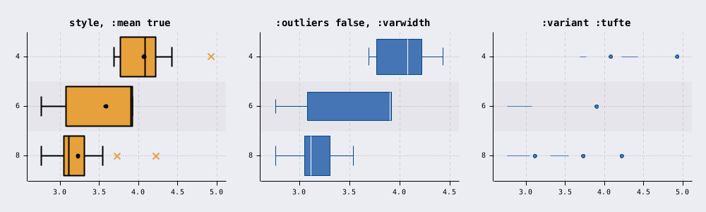
:::


`:padding` - space past the values along the value axis, fractions of their span (default 5% each side):


::: {.sourceClojure}
```clojure
(plot/render-image (plot/arrange [{:data mtcars
                                   :mapping {:x :drat :y :cyl}
                                   :charts [(chart/box)]
                                   :scales {:y {:type :categorical :reverse true}}
                                   :labels {:title "default padding"}}
                                  {:data mtcars
                                   :mapping {:x :drat :y :cyl}
                                   :charts [(chart/box {:padding {:x [0.4 0.4]}})]
                                   :scales {:y {:type :categorical :reverse true}}
                                   :labels {:title ":padding {:x [0.4 0.4]}"}}]
                                 {:columns 2})
                   {:width 900 :height 280})
```
:::


::: {.clay-image}
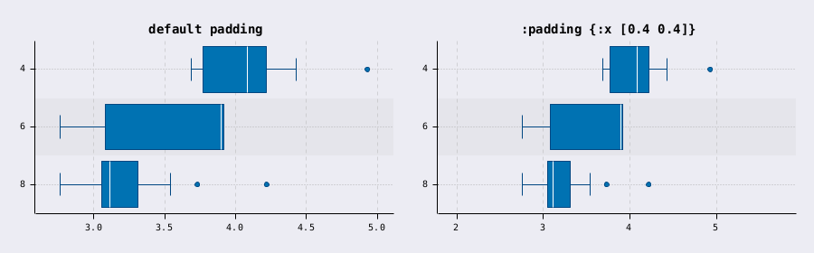
:::


Shared options: [Fill patterns](reference.shared_options.html#fill-patterns) (`:pattern` `:pattern-color`); [Common options](reference.shared_options.html#common-options) (`:data` `:mapping` `:legend`); [Named theme styles](reference.shared_options.html#named-theme-styles) (`:theme-style`); [Strip options](reference.shared_options.html#strip-options) (`:place` `:width` `:thickness` `:position` `:dodge-gap` `:bottom-share` `:n-label` `:n-format` `:level-axis`).


## violin

A mirrored kernel density per level (and group), with inner marks - a small box by default.

::: {.clay-table}

```{=html}
<table class="table table-hover table-responsive clay-table"><thead><tr><th>Option</th><th>Type</th><th>Default</th><th>Description</th></tr></thead><tbody><tr><td>:x</td><td>a keyword, a function or a categorical marker of one or nil</td><td></td><td>values (data units) on the value axis, or levels for vertical violins</td></tr><tr><td>:y</td><td>a keyword, a function or a categorical marker of one or nil</td><td></td><td>levels on the categorical axis (absent - one violin), or values for vertical violins</td></tr><tr><td>:color</td><td>a keyword, a function or a categorical marker of one or nil</td><td></td><td>groups, each a violin in its own fill colour</td></tr><tr><td>:pattern</td><td>a keyword, a function or a categorical marker of one or nil</td><td></td><td>groups, each a violin with its own fill pattern</td></tr><tr><td>:group</td><td>a keyword, a function or a categorical marker of one or nil</td><td></td><td>groups without a visual aesthetic, each its own violin</td></tr></tbody></table>
```

:::


::: {.sourceClojure}
```clojure
(plot/render-image {:data iris
                    :mapping {:x :species :y :petal-length :color :species}
                    :charts [(chart/violin)]
                    :legend false}
                   {:width 600 :height 320})
```
:::


::: {.clay-image}
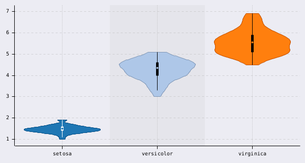
:::


Its options: the fill, outline and inner marks' colour, the density estimate (kernel, bandwidth, points, how far
past the data), how widths compare between violins and the inner marks:

::: {.clay-table}

```{=html}
<table class="table table-hover table-responsive clay-table"><thead><tr><th>Option</th><th>Type</th><th>Default</th><th>Description</th></tr></thead><tbody><tr><td>:color</td><td>a clojure2d color</td><td>[69 117 180]</td><td>violin fill colour (a mapped :color wins)</td></tr><tr><td>:stroke-color</td><td>:darker or a clojure2d color or :none</td><td>:darker</td><td>outline colour: a colour, :none or :darker (the darkened fill)</td></tr><tr><td>:stroke-width</td><td>a non-negative number</td><td>1</td><td>outline width in pixels (0 - no outline)</td></tr><tr><td>:inner-color</td><td>one of :contrast or a clojure2d color or :none</td><td>:contrast</td><td>colour of the inner marks: a colour, :contrast (black or white, whichever reads better on the fill) or :none (not drawn)</td></tr><tr><td>:kernel</td><td>keyword</td><td>:gaussian</td><td>density kernel (a fastmath kernel keyword)</td></tr><tr><td>:bandwidth</td><td>a positive number or keyword</td><td>:nrd0</td><td>kernel bandwidth in data units, or a fastmath bandwidth selector keyword</td></tr><tr><td>:n</td><td>integer, >= 2 or nil</td><td>100</td><td>number of density evaluation points per violin</td></tr><tr><td>:cut</td><td>a non-negative number or nil</td><td>0.0</td><td>how far the violin reaches past the data range, in bandwidths (0 - the data range)</td></tr><tr><td>:scale</td><td>one of :width :area :count</td><td>:width</td><td>violin widths: :width (each as wide as its slot), :area (equal areas - densities on one scale) or :count (areas proportional to the counts)</td></tr><tr><td>:varwidth</td><td>true or false or nil</td><td>false</td><td>multiply each violin's width by the square root of its count relative to the largest</td></tr><tr><td>:inner</td><td>one of :box :quartiles :rug :points :none</td><td>:box</td><td>inner marks: :box (IQR bar, whisker line, median dot), :quartiles (quartile lines across), :rug (a tick per value), :points (values on the centre line) or :none</td></tr><tr><td>:padding</td><td>map of one of :x :y to [lo hi], non-negative numbers</td><td>[0.05 0.05] along the value axis; with :place :bottom also :bottom-share below the data</td><td>padding of the data span per position axis, {:x [lo hi] :y [lo hi]} fractions of the span</td></tr></tbody></table>
```

:::


::: {.sourceClojure}
```clojure
(plot/render-image (plot/arrange [{:data iris
                                   :mapping {:x :species :y :petal-length}
                                   :charts [(chart/violin {:bandwidth 0.1 :inner :quartiles})]
                                   :labels {:title ":bandwidth 0.1, :inner :quartiles"}}
                                  {:data iris
                                   :mapping {:x :species :y :petal-length}
                                   :charts [(chart/violin {:cut 2 :inner :rug :inner-color [200 40 40]})]
                                   :labels {:title ":cut 2, :inner :rug"}}
                                  {:data mtcars
                                   :mapping {:x :cyl :y :mpg}
                                   :charts [(chart/violin {:scale :count :inner :points})]
                                   :scales {:x {:type :categorical}}
                                   :labels {:title ":scale :count, :inner :points"}}]
                                 {:columns 3})
                   {:width 1000 :height 320})
```
:::


::: {.clay-image}
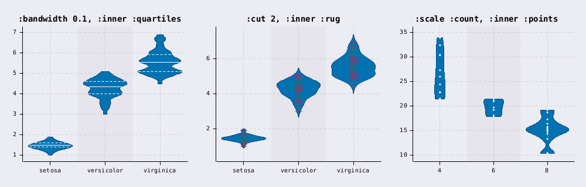
:::


The inner marks' sizes and the quartile dash are theme keys of `[:chart :violin]`, not options:

::: {.clay-table}

```{=html}
<table class="table table-hover table-responsive clay-table"><thead><tr><th>Option</th><th>Type</th><th>Default</th><th>Description</th></tr></thead><tbody><tr><td>:inner-box-width</td><td>a positive number</td><td>5.0</td><td>width in pixels of the inner box (quartile bar) of :inner :box</td></tr><tr><td>:inner-median-size</td><td>a positive number</td><td>4.0</td><td>diameter in pixels of the median dot of :inner :box</td></tr><tr><td>:inner-quartile-dash</td><td>:none, a dash style (:dashed :dot-dash :dot-dot-dash :dotted :long-dash :loose-dot :solid :two-dash) or a sequence of positive numbers</td><td>[4.0 3.0]</td><td>dash style of the quartile lines of :inner :quartiles</td></tr><tr><td>:inner-rug-width</td><td>a positive number</td><td>1.0</td><td>line width in pixels of the ticks of :inner :rug</td></tr><tr><td>:inner-point-size</td><td>a positive number</td><td>3.0</td><td>diameter in pixels of the points of :inner :points</td></tr></tbody></table>
```

:::


::: {.sourceClojure}
```clojure
(plot/render-image (plot/arrange [{:data iris
                                   :mapping {:x :species :y :petal-length}
                                   :charts [(chart/violin)]
                                   :theme {:chart {:violin {:inner-box-width 10 :inner-median-size 8}}}
                                   :labels {:title "wider inner box, bigger median"}}
                                  {:data iris
                                   :mapping {:x :species :y :petal-length}
                                   :charts [(chart/violin {:inner :quartiles})]
                                   :theme {:chart {:violin {:inner-quartile-dash [1.0 2.0]}}}
                                   :labels {:title "dotted quartiles"}}]
                                 {:columns 2})
                   {:width 800 :height 320})
```
:::


::: {.clay-image}
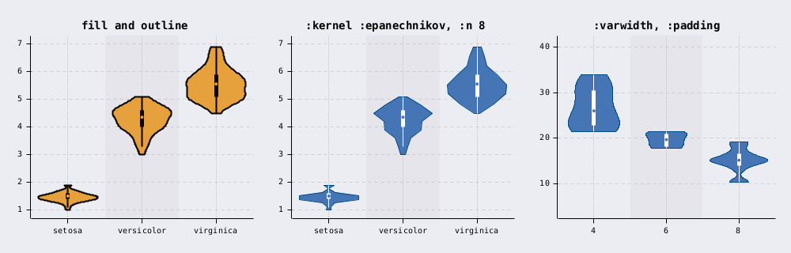
:::


The fill and outline, and the density estimate: another kernel, few evaluation points (a coarse outline),
widths by count (`:varwidth`) and the padding:


::: {.sourceClojure}
```clojure
(plot/render-image (plot/arrange [{:data iris
                                   :mapping {:x :species :y :petal-length}
                                   :charts [(chart/violin {:color [230 160 60] :stroke-color :black :stroke-width 2})]
                                   :labels {:title "fill and outline"}}
                                  {:data iris
                                   :mapping {:x :species :y :petal-length}
                                   :charts [(chart/violin {:kernel :epanechnikov :n 8})]
                                   :labels {:title ":kernel :epanechnikov, :n 8"}}
                                  {:data mtcars
                                   :mapping {:x :cyl :y :mpg}
                                   :charts [(chart/violin {:varwidth true :padding {:y [0.3 0.3]}})]
                                   :scales {:x {:type :categorical}}
                                   :labels {:title ":varwidth, :padding"}}]
                                 {:columns 3})
                   {:width 1000 :height 320})
```
:::


::: {.clay-image}

:::


Every `:scale` - violins as wide as their slots, of equal areas, or of areas by count (mtcars by gears: 15, 12
and 5 cars - the five-gear violin shrinks):


::: {.sourceClojure}
```clojure
(plot/render-image (plot/arrange [{:data mtcars
                                   :mapping {:x :gear :y :mpg}
                                   :charts [(chart/violin {:scale :width})]
                                   :scales {:x {:type :categorical}}
                                   :labels {:title ":scale :width"}}
                                  {:data mtcars
                                   :mapping {:x :gear :y :mpg}
                                   :charts [(chart/violin {:scale :area})]
                                   :scales {:x {:type :categorical}}
                                   :labels {:title ":scale :area"}}
                                  {:data mtcars
                                   :mapping {:x :gear :y :mpg}
                                   :charts [(chart/violin {:scale :count})]
                                   :scales {:x {:type :categorical}}
                                   :labels {:title ":scale :count"}}]
                                 {:columns 3})
                   {:width 1000 :height 300})
```
:::


::: {.clay-image}
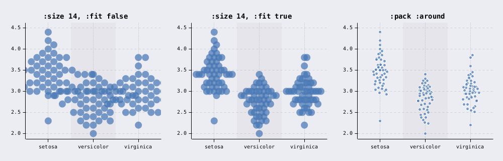
:::


Every `:inner` mark:


::: {.sourceClojure}
```clojure
(plot/render-image (plot/arrange [{:data iris :mapping {:x :species :y :petal-length}
                                   :charts [(chart/violin {:inner :box})] :labels {:title ":inner :box"}}
                                  {:data iris :mapping {:x :species :y :petal-length}
                                   :charts [(chart/violin {:inner :quartiles})] :labels {:title ":quartiles"}}
                                  {:data iris :mapping {:x :species :y :petal-length}
                                   :charts [(chart/violin {:inner :rug})] :labels {:title ":rug"}}
                                  {:data iris :mapping {:x :species :y :petal-length}
                                   :charts [(chart/violin {:inner :points})] :labels {:title ":points"}}
                                  {:data iris :mapping {:x :species :y :petal-length}
                                   :charts [(chart/violin {:inner :none})] :labels {:title ":none"}}]
                                 {:columns 5})
                   {:width 1000 :height 300})
```
:::


::: {.clay-image}
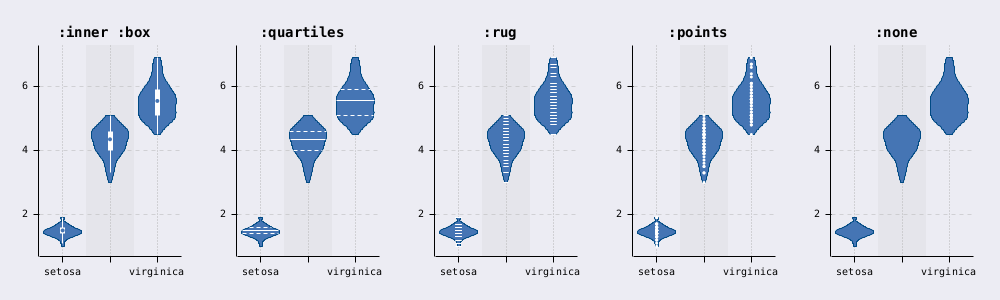
:::


Shared options: [Fill patterns](reference.shared_options.html#fill-patterns) (`:pattern` `:pattern-color`); [Common options](reference.shared_options.html#common-options) (`:data` `:mapping` `:legend`); [Named theme styles](reference.shared_options.html#named-theme-styles) (`:theme-style`); [Strip options](reference.shared_options.html#strip-options) (`:place` `:width` `:thickness` `:position` `:dodge-gap` `:bottom-share` `:n-label` `:n-format` `:level-axis`).


## stripplot

Every value as a point across its level's strip, jittered so equal values don't hide each other.

::: {.clay-table}

```{=html}
<table class="table table-hover table-responsive clay-table"><thead><tr><th>Option</th><th>Type</th><th>Default</th><th>Description</th></tr></thead><tbody><tr><td>:x</td><td>a keyword, a function or a categorical marker of one or nil</td><td></td><td>values (data units) on the value axis, or levels for vertical strips</td></tr><tr><td>:y</td><td>a keyword, a function or a categorical marker of one or nil</td><td></td><td>levels on the categorical axis (absent - one strip), or values for vertical strips</td></tr><tr><td>:color</td><td>a keyword, a function or a categorical marker of one or nil</td><td></td><td>groups, each in its own point colour</td></tr><tr><td>:shape</td><td>a keyword, a function or a categorical marker of one or nil</td><td></td><td>groups, each with its own point shape</td></tr><tr><td>:size</td><td>a keyword, a function or a categorical marker of one or nil</td><td></td><td>groups, each with its own point size</td></tr><tr><td>:group</td><td>a keyword, a function or a categorical marker of one or nil</td><td></td><td>groups without a visual aesthetic</td></tr></tbody></table>
```

:::


::: {.sourceClojure}
```clojure
(plot/render-image {:data iris
                    :mapping {:x :sepal-length :y :species :color :species}
                    :charts [(chart/stripplot {:rng (r/rng :mersenne 1)})]
                    :scales {:y {:reverse true}}
                    :legend false}
                   {:width 600 :height 280})
```
:::


::: {.clay-image}
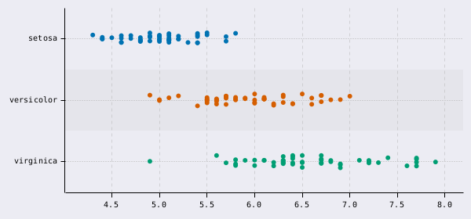
:::


Its options: the point style, the jitter spread (seeded for the same image on every build) and the padding:

::: {.clay-table}

```{=html}
<table class="table table-hover table-responsive clay-table"><thead><tr><th>Option</th><th>Type</th><th>Default</th><th>Description</th></tr></thead><tbody><tr><td>:size</td><td>a non-negative number</td><td>6</td><td>point size in pixels (a mapped :size wins)</td></tr><tr><td>:color</td><td>a clojure2d color or :none</td><td>[69 117 180 100]</td><td>point colour (a mapped :color wins)</td></tr><tr><td>:stroke-color</td><td>a clojure2d color or :none</td><td>:none</td><td>point outline colour (or :none)</td></tr><tr><td>:stroke-width</td><td>a non-negative number</td><td>1</td><td>outline width in pixels</td></tr><tr><td>:shape</td><td>a shape character, keyword or shape map</td><td>\O</td><td>point shape (a mapped :shape wins)</td></tr><tr><td>:jitter</td><td>a number in [0 1]</td><td>0.25</td><td>jitter spread across the strip, a fraction of the item's cross range (Gaussian, sd :jitter / 4, clamped to ±:jitter / 2; 0 - on the centre line)</td></tr><tr><td>:rng</td><td>a fastmath random generator or nil</td><td>a fresh unseeded generator per build (builds differ)</td><td>random number generator for jitter (seeded for reproducible plots)</td></tr><tr><td>:padding</td><td>map of one of :x :y to [lo hi], non-negative numbers</td><td>[0.05 0.05] along the value axis; with :place :bottom also :bottom-share below the data</td><td>padding of the data span per position axis, {:x [lo hi] :y [lo hi]} fractions of the span</td></tr></tbody></table>
```

:::


::: {.sourceClojure}
```clojure
(plot/render-image (plot/arrange [{:data iris
                                   :mapping {:x :sepal-length :y :species}
                                   :charts [(chart/stripplot {:jitter 0})]
                                   :scales {:y {:reverse true}}
                                   :labels {:title ":jitter 0"}}
                                  {:data iris
                                   :mapping {:x :sepal-length :y :species}
                                   :charts [(chart/stripplot {:jitter 0.8 :size 8 :shape \S :color [200 80 40 90]
                                                              :stroke-color [120 40 20] :stroke-width 1.5
                                                              :rng (r/rng :mersenne 1)})]
                                   :scales {:y {:reverse true}}
                                   :labels {:title ":jitter 0.8, outlined squares"}}
                                  {:data iris
                                   :mapping {:x :sepal-length :y :species}
                                   :charts [(chart/stripplot {:padding {:x [0.3 0.3]} :rng (r/rng :mersenne 1)})]
                                   :scales {:y {:reverse true}}
                                   :labels {:title ":padding {:x [0.3 0.3]}"}}]
                                 {:columns 3})
                   {:width 1000 :height 280})
```
:::


::: {.clay-image}
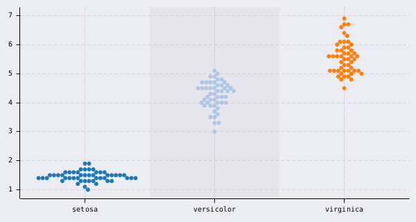
:::


Shared options: [Common options](reference.shared_options.html#common-options) (`:data` `:mapping` `:legend`); [Named theme styles](reference.shared_options.html#named-theme-styles) (`:theme-style`); [Strip options](reference.shared_options.html#strip-options) (`:place` `:width` `:thickness` `:position` `:dodge-gap` `:bottom-share` `:n-label` `:n-format` `:level-axis`).


## beeswarm

Every value as a point, packed across the strip without overlaps - the swarm's width shows the density.

::: {.clay-table}

```{=html}
<table class="table table-hover table-responsive clay-table"><thead><tr><th>Option</th><th>Type</th><th>Default</th><th>Description</th></tr></thead><tbody><tr><td>:x</td><td>a keyword, a function or a categorical marker of one or nil</td><td></td><td>values (data units) on the value axis, or levels for vertical swarms</td></tr><tr><td>:y</td><td>a keyword, a function or a categorical marker of one or nil</td><td></td><td>levels on the categorical axis (absent - one swarm), or values for vertical swarms</td></tr><tr><td>:color</td><td>a keyword, a function or a categorical marker of one or nil</td><td></td><td>groups, each in its own point colour</td></tr><tr><td>:shape</td><td>a keyword, a function or a categorical marker of one or nil</td><td></td><td>groups, each with its own point shape</td></tr><tr><td>:size</td><td>a keyword, a function or a categorical marker of one or nil</td><td></td><td>groups, each with its own point size</td></tr><tr><td>:group</td><td>a keyword, a function or a categorical marker of one or nil</td><td></td><td>groups without a visual aesthetic</td></tr></tbody></table>
```

:::


::: {.sourceClojure}
```clojure
(plot/render-image {:data iris
                    :mapping {:x :species :y :petal-length :color :species}
                    :charts [(chart/beeswarm)]
                    :legend false}
                   {:width 600 :height 320})
```
:::


::: {.clay-image}

:::


Its options: the point style (the size is also the packing diameter), squeezing a wide swarm into its slot,
the packing direction and the padding:

::: {.clay-table}

```{=html}
<table class="table table-hover table-responsive clay-table"><thead><tr><th>Option</th><th>Type</th><th>Default</th><th>Description</th></tr></thead><tbody><tr><td>:size</td><td>a non-negative number</td><td>6</td><td>point size in pixels, also the packing diameter (a mapped :size wins)</td></tr><tr><td>:color</td><td>a clojure2d color or :none</td><td>[69 117 180 180]</td><td>point colour (a mapped :color wins)</td></tr><tr><td>:stroke-color</td><td>a clojure2d color or :none</td><td>:none</td><td>point outline colour (or :none)</td></tr><tr><td>:stroke-width</td><td>a non-negative number</td><td>1</td><td>outline width in pixels</td></tr><tr><td>:shape</td><td>a shape character, keyword or shape map</td><td>\O</td><td>point shape (a mapped :shape wins)</td></tr><tr><td>:fit</td><td>true or false or nil</td><td>true</td><td>squeeze a swarm wider than its item's cross range into it (points may then overlap)</td></tr><tr><td>:pack</td><td>one of :across :around</td><td>:across</td><td>packing: :across (points move only across the value axis) or :around (in both directions - round clusters, points may leave their value a little)</td></tr><tr><td>:padding</td><td>map of one of :x :y to [lo hi], non-negative numbers</td><td>[0.05 0.05] along the value axis; with :place :bottom also :bottom-share below the data</td><td>padding of the data span per position axis, {:x [lo hi] :y [lo hi]} fractions of the span</td></tr></tbody></table>
```

:::


::: {.sourceClojure}
```clojure
(plot/render-image (plot/arrange [{:data iris
                                   :mapping {:x :species :y :sepal-width}
                                   :charts [(chart/beeswarm {:size 14 :fit false})]
                                   :labels {:title ":size 14, :fit false"}}
                                  {:data iris
                                   :mapping {:x :species :y :sepal-width}
                                   :charts [(chart/beeswarm {:size 14})]
                                   :labels {:title ":size 14, :fit true"}}
                                  {:data iris
                                   :mapping {:x :species :y :sepal-width}
                                   :charts [(chart/beeswarm {:pack :around :stroke-color :white})]
                                   :labels {:title ":pack :around"}}]
                                 {:columns 3})
                   {:width 1000 :height 320})
```
:::


::: {.clay-image}
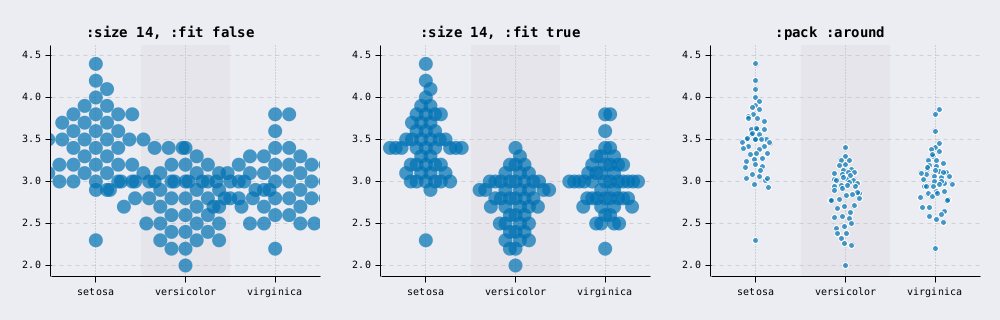
:::


The point style, the default packing (`:across` - points move only across the value axis) and the padding:


::: {.sourceClojure}
```clojure
(plot/render-image (plot/arrange [{:data iris
                                   :mapping {:x :species :y :sepal-width}
                                   :charts [(chart/beeswarm {:color [200 80 40 160] :shape \^ :stroke-color :black
                                                             :stroke-width 0.5 :pack :across})]
                                   :labels {:title "triangles, outlined, :pack :across"}}
                                  {:data iris
                                   :mapping {:x :species :y :sepal-width}
                                   :charts [(chart/beeswarm {:padding {:y [0.4 0.4]}})]
                                   :labels {:title ":padding {:y [0.4 0.4]}"}}]
                                 {:columns 2})
                   {:width 900 :height 320})
```
:::


::: {.clay-image}
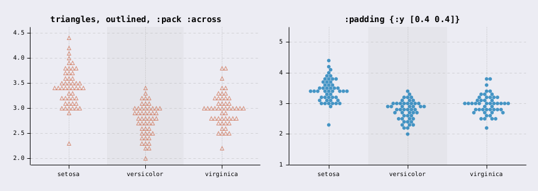
:::


Shared options: [Common options](reference.shared_options.html#common-options) (`:data` `:mapping` `:legend`); [Named theme styles](reference.shared_options.html#named-theme-styles) (`:theme-style`); [Strip options](reference.shared_options.html#strip-options) (`:place` `:width` `:thickness` `:position` `:dodge-gap` `:bottom-share` `:n-label` `:n-format` `:level-axis`).


## dotplot

Values binned along the value axis, each a dot stacked in its bin (Wilkinson's dot plot).

::: {.clay-table}

```{=html}
<table class="table table-hover table-responsive clay-table"><thead><tr><th>Option</th><th>Type</th><th>Default</th><th>Description</th></tr></thead><tbody><tr><td>:x</td><td>a keyword, a function or a categorical marker of one or nil</td><td></td><td>values (data units) on the value axis, or levels for vertical dot plots</td></tr><tr><td>:y</td><td>a keyword, a function or a categorical marker of one or nil</td><td></td><td>levels on the categorical axis (absent - one dot plot), or values for vertical dot plots</td></tr><tr><td>:color</td><td>a keyword, a function or a categorical marker of one or nil</td><td></td><td>groups, each in its own point colour</td></tr><tr><td>:shape</td><td>a keyword, a function or a categorical marker of one or nil</td><td></td><td>groups, each with its own point shape</td></tr><tr><td>:size</td><td>a keyword, a function or a categorical marker of one or nil</td><td></td><td>groups, each with its own point size</td></tr><tr><td>:group</td><td>a keyword, a function or a categorical marker of one or nil</td><td></td><td>groups without a visual aesthetic (sharing stacks unless dodged)</td></tr></tbody></table>
```

:::


::: {.sourceClojure}
```clojure
(plot/render-image {:data mtcars
                    :mapping {:x :mpg}
                    :charts [(chart/dotplot {:binwidth 1.5})]}
                   {:width 600 :height 280})
```
:::


::: {.clay-image}
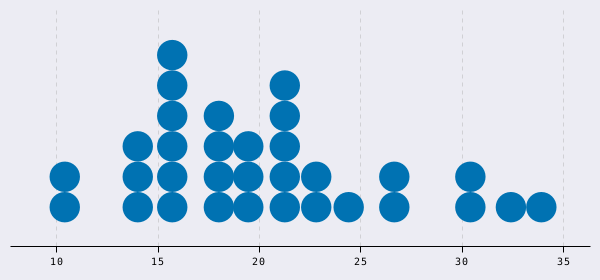
:::


Its options: the dot style, the binning (density or fixed bins from an origin), where dots sit, how they
stack and the padding:

::: {.clay-table}

```{=html}
<table class="table table-hover table-responsive clay-table"><thead><tr><th>Option</th><th>Type</th><th>Default</th><th>Description</th></tr></thead><tbody><tr><td>:size</td><td>a non-negative number</td><td>the dot diameter: the bin width in pixels, shrunk so the tallest stack fits its slot</td><td>dot size in pixels (a mapped :size wins)</td></tr><tr><td>:color</td><td>a clojure2d color or :none</td><td>[69 117 180]</td><td>point colour (a mapped :color wins)</td></tr><tr><td>:stroke-color</td><td>a clojure2d color or :none</td><td>:none</td><td>point outline colour (or :none)</td></tr><tr><td>:stroke-width</td><td>a non-negative number</td><td>1</td><td>outline width in pixels</td></tr><tr><td>:shape</td><td>a shape character, keyword or shape map</td><td>\O</td><td>point shape (a mapped :shape wins)</td></tr><tr><td>:method</td><td>one of :dot-density :histogram</td><td>:dot-density</td><td>binning: :dot-density (Wilkinson) or :histogram (fixed bins from :origin)</td></tr><tr><td>:binwidth</td><td>a finite number, a positive number</td><td>the range of all values / 30 (1 for a single distinct value)</td><td>bin width in data units</td></tr><tr><td>:origin</td><td>a finite number</td><td>the smallest value</td><td>left edge of the first fixed bin in data units (only with :method :histogram - an error otherwise)</td></tr><tr><td>:at</td><td>one of :center :value</td><td>:center</td><td>where a bin's dots sit along the value axis: :center (the bin centre) or :value (each dot at its own value - the wheat plot)</td></tr><tr><td>:stack-dir</td><td>one of :up :center</td><td>:up</td><td>stacking: :up (from the slot's low cross edge toward the next level) or :center (centred on the slot)</td></tr><tr><td>:padding</td><td>map of one of :x :y to [lo hi], non-negative numbers</td><td>[0.05 0.05] along the value axis; with :place :bottom also :bottom-share below the data</td><td>padding of the data span per position axis, {:x [lo hi] :y [lo hi]} fractions of the span</td></tr></tbody></table>
```

:::


::: {.sourceClojure}
```clojure
(plot/render-image (plot/arrange [{:data mtcars
                                   :mapping {:x :mpg}
                                   :charts [(chart/dotplot {:method :histogram :binwidth 2 :origin 10})]
                                   :labels {:title ":method :histogram"}}
                                  {:data mtcars
                                   :mapping {:x :mpg}
                                   :charts [(chart/dotplot {:binwidth 1.5 :stack-dir :center :color [200 80 40]})]
                                   :labels {:title ":stack-dir :center"}}
                                  {:data mtcars
                                   :mapping {:x :mpg}
                                   :charts [(chart/dotplot {:binwidth 1.5 :at :value})]
                                   :labels {:title ":at :value"}}]
                                 {:columns 3})
                   {:width 1000 :height 280})
```
:::


::: {.clay-image}
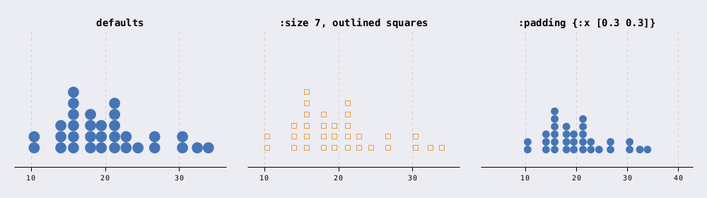
:::


A style - a fixed dot size, outlined squares - and the padding:


::: {.sourceClojure}
```clojure
(plot/render-image (plot/arrange [{:data mtcars
                                   :mapping {:x :mpg}
                                   :charts [(chart/dotplot {:binwidth 1.5 :size 7 :shape \S :color [230 160 60]
                                                            :stroke-color :black :stroke-width 1})]
                                   :labels {:title ":size 7, outlined squares"}}
                                  {:data mtcars
                                   :mapping {:x :mpg}
                                   :charts [(chart/dotplot {:binwidth 1.5 :padding {:x [0.3 0.3]}})]
                                   :labels {:title ":padding {:x [0.3 0.3]}"}}]
                                 {:columns 2})
                   {:width 800 :height 280})
```
:::


::: {.clay-image}
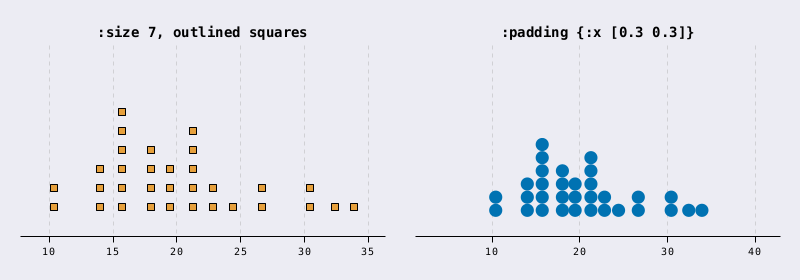
:::


Shared options: [Common options](reference.shared_options.html#common-options) (`:data` `:mapping` `:legend`); [Named theme styles](reference.shared_options.html#named-theme-styles) (`:theme-style`); [Strip options](reference.shared_options.html#strip-options) (`:place` `:width` `:thickness` `:position` `:dodge-gap` `:bottom-share` `:n-label` `:n-format` `:level-axis`).


## rug

A short line per value - along the panel's edge, or one strip per level; often beside another chart.

::: {.clay-table}

```{=html}
<table class="table table-hover table-responsive clay-table"><thead><tr><th>Option</th><th>Type</th><th>Default</th><th>Description</th></tr></thead><tbody><tr><td>:x</td><td>a keyword, a function or a categorical marker of one or nil</td><td></td><td>values (data units) on the value axis, or levels for vertical rugs</td></tr><tr><td>:y</td><td>a keyword, a function or a categorical marker of one or nil</td><td></td><td>levels on the categorical axis (absent - one rug along the panel edge), or values for vertical rugs</td></tr><tr><td>:color</td><td>a keyword, a function or a categorical marker of one or nil</td><td></td><td>groups, each in its own line colour</td></tr><tr><td>:group</td><td>a keyword, a function or a categorical marker of one or nil</td><td></td><td>groups without a visual aesthetic</td></tr></tbody></table>
```

:::


::: {.sourceClojure}
```clojure
(plot/render-image {:data iris
                    :mapping {:x :sepal-length :y :sepal-width}
                    :charts [(chart/scatter) (chart/rug {:mapping {:y nil}})]}
                   {:width 600 :height 320})
```
:::


::: {.clay-image}
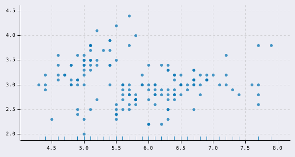
:::


Its options: the line colour and width, and the padding:

::: {.clay-table}

```{=html}
<table class="table table-hover table-responsive clay-table"><thead><tr><th>Option</th><th>Type</th><th>Default</th><th>Description</th></tr></thead><tbody><tr><td>:color</td><td>a clojure2d color or :none</td><td>[69 117 180 100]</td><td>rug line colour (a mapped :color wins)</td></tr><tr><td>:line-width</td><td>a non-negative number</td><td>1</td><td>rug line width in pixels (0 - nothing drawn)</td></tr><tr><td>:padding</td><td>map of one of :x :y to [lo hi], non-negative numbers</td><td>[0.05 0.05] along the value axis; with :place :bottom also :bottom-share below the data</td><td>padding of the data span per position axis, {:x [lo hi] :y [lo hi]} fractions of the span</td></tr></tbody></table>
```

:::


::: {.sourceClojure}
```clojure
(plot/render-image (plot/arrange [{:data iris
                                   :mapping {:x :petal-length :y :species}
                                   :charts [(chart/rug)]
                                   :scales {:y {:reverse true}}
                                   :labels {:title "defaults, a rug per level"}}
                                  {:data iris
                                   :mapping {:x :petal-length :y :species}
                                   :charts [(chart/rug {:color [200 40 40 60] :line-width 3})]
                                   :scales {:y {:reverse true}}
                                   :labels {:title ":line-width 3"}}
                                  {:data iris
                                   :mapping {:x :petal-length :y :species}
                                   :charts [(chart/rug {:padding {:x [0.3 0.3]}})]
                                   :scales {:y {:reverse true}}
                                   :labels {:title ":padding {:x [0.3 0.3]}"}}]
                                 {:columns 3})
                   {:width 1000 :height 260})
```
:::


::: {.clay-image}
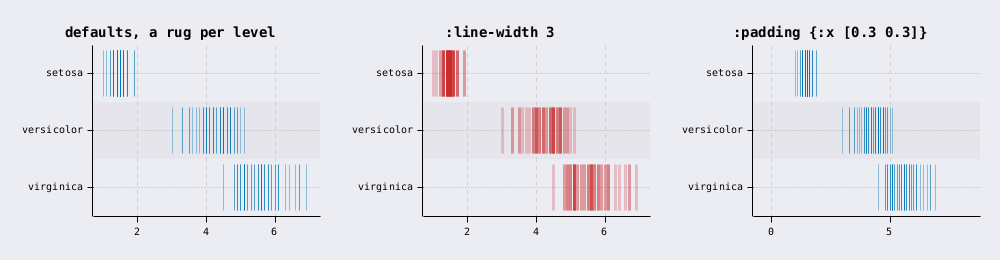
:::


Shared options: [Common options](reference.shared_options.html#common-options) (`:data` `:mapping` `:legend`); [Named theme styles](reference.shared_options.html#named-theme-styles) (`:theme-style`); [Strip options](reference.shared_options.html#strip-options) (`:place` `:width` `:thickness` `:position` `:dodge-gap` `:bottom-share` `:n-label` `:n-format` `:level-axis`).


```{=html}
<div style="background-color:grey;height:2px;width:100%;"></div>
```


```{=html}
<div><pre><small><small>source: notebooks/reference/charts_strip_distributions.clj</small></small></pre></div>
```