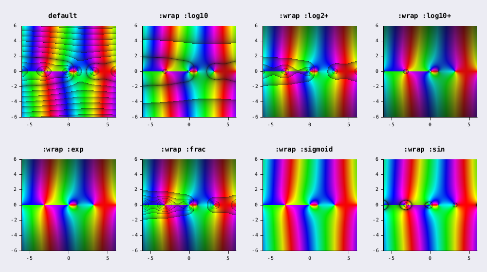
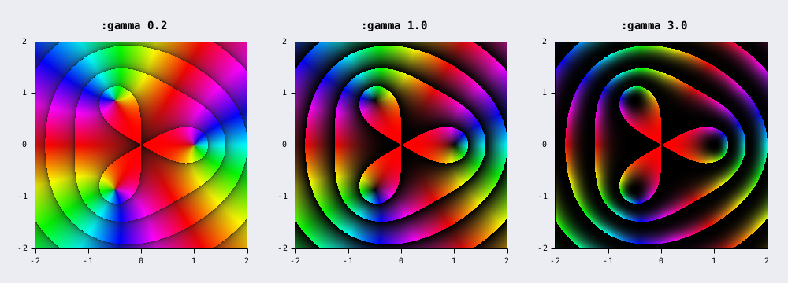
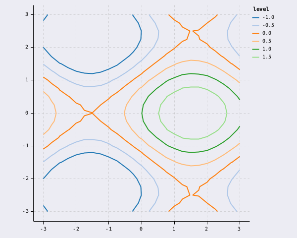
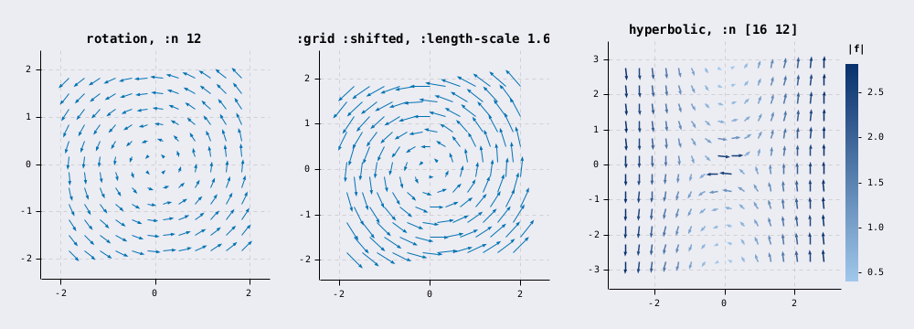
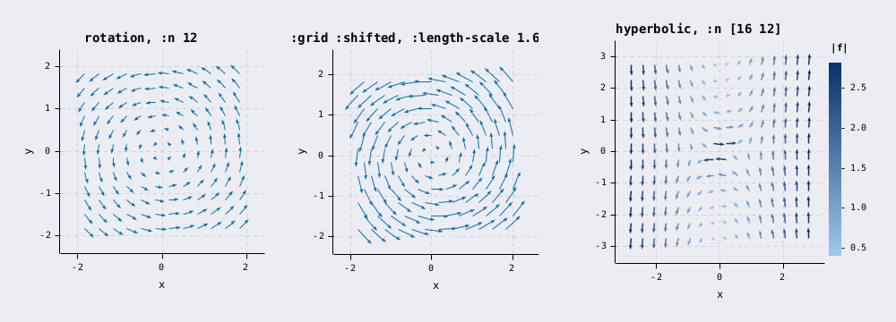
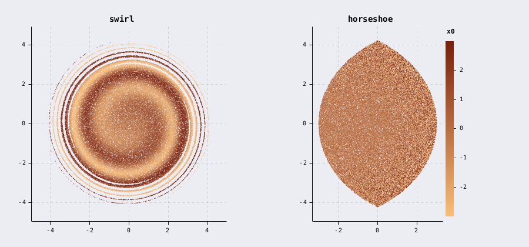

---
format:
  html:
    toc: true
    toc-location: right
    toc-depth: 4
    theme: cosmo
    include-in-header:
      text: |-
        <style>
        .data-table { width: fit-content; max-width: 100%; max-height: 15rem; overflow: auto; margin: 0 0 1rem 0; }
        .data-table .table-responsive { overflow: visible; }
        .data-table table { font-size: 0.75rem; width: auto; margin: 0; }
        .data-table th, .data-table td { padding: 0.1rem 0.45rem !important; white-space: nowrap; }
        .data-table thead th { position: sticky; top: 0; background: var(--bs-body-bg, #fff); }
        .options { margin: 0.5rem 0 1rem 0; }
        .options .option-card { margin: 0 0 0.9rem 0; border: 1px solid var(--bs-border-color, #dee2e6); border-radius: 0.375rem; overflow: hidden; }
        .options dt { display: flex; flex-wrap: wrap; align-items: baseline; gap: 0.1rem 1rem; margin: 0; padding: 0.4rem 0.75rem; background: #eef2f7; border-bottom: 1px solid var(--bs-border-color, #dee2e6); font-weight: normal; }
        .options dt > code { font-weight: 700; font-size: 1rem; background: none; padding: 0; }
        .options .option-default { font-size: 0.85rem; color: var(--bs-secondary-color, #6c757d); }
        .options dd { margin: 0; padding: 0.5rem 0.75rem; }
        .options .option-example { font-size: 0.85rem; padding: 0 0 0.45rem 0; margin-bottom: 0.45rem; border-bottom: 1px dashed var(--bs-border-color, #dee2e6); }
        .options .option-example code { background: none; padding: 0; }
        .options .option-text ul { margin: 0.3rem 0 0 0; padding-left: 1.25rem; }
        .options code, .mapping code { overflow-wrap: anywhere; }
        .options .option-default code, .options .option-example code { white-space: pre-wrap; }
        .mapping { margin: 0.5rem 0 1rem 0; padding: 0.5rem 0.75rem; border: 1px solid var(--bs-border-color, #dee2e6); border-left: 0.3rem solid #2780e3; border-radius: 0.375rem; background: #f5f8fc; }
        .mapping-title { font-weight: 700; margin-bottom: 0.25rem; }
        .mapping-hint { font-weight: normal; font-size: 0.85rem; color: var(--bs-secondary-color, #6c757d); }
        .mapping ul { margin: 0; padding-left: 1.25rem; }
        .mapping .required { font-size: 0.75rem; padding: 0 0.3rem; border: 1px solid currentColor; border-radius: 0.25rem; }
        .mapping-returns { margin-top: 0.25rem; }
        .mapping code { white-space: pre-wrap; }
        .shared { margin: 0.5rem 0 1rem 0; padding: 0.5rem 0.75rem; border: 1px solid var(--bs-border-color, #dee2e6); border-left: 0.3rem solid #6c757d; border-radius: 0.375rem; background: #f6f6f6; }
        .shared-title { font-weight: 700; margin-bottom: 0.25rem; }
        .shared-hint { font-weight: normal; font-size: 0.85rem; color: var(--bs-secondary-color, #6c757d); }
        .shared ul { margin: 0; padding-left: 1.25rem; }
        .shared code { overflow-wrap: anywhere; }
        p code, li code { white-space: pre-wrap; overflow-wrap: anywhere; }
        </style>
code-block-background: true

---
<style></style><style>.printedClojure .sourceCode {
  background-color: transparent;
  border-style: none;
}
</style><style>.clay-limit-image-width .clay-image {max-width: 100%}
.clay-side-by-side .sourceCode {margin: 0}
.clay-side-by-side {margin: 1em 0}
</style>
<script src="https://code.jquery.com/jquery-3.6.0.min.js" type="text/javascript"></script><script src="https://code.jquery.com/ui/1.13.1/jquery-ui.min.js" type="text/javascript"></script>

# Fields

These functions turn functions of the plane into something to draw: a colour per pixel of a complex function, the
level lines of a gridded field, and the rows of a vector field (arrows, traces and points mapped through it). Use
them with ordinary charts: `field`, `line`, `segment` and `scatter`.


::: {.sourceClojure}
```clojure
(ns reference.data-fields
  (:require [fastmath.complex :as cx]
            [fastmath.core :as m]
            [fastmath.fields :as f]
            [fastmath.random :as r]
            [fastmath.vector :as v]
            [cljplot2.chart :as chart]
            [cljplot2.core :as plot]
            [cljplot2.data.contour :as contour]
            [cljplot2.data.field :as field]
            [cljplot2.data.vector-field :as vf]
            [cljplot2.describe :as describe]
            [notebook-utils :as nu]))
```
:::


The grid below holds a field `sin x + cos 1.3y` over [-3 3]²: axis coordinates `:xs` and `:ys`, their counts `:nx`
and `:ny`, and `:values` row by row, x fastest; the isolines section uses it. The table below holds its axis
coordinates, the same along x and y:


::: {.sourceClojure}
```clojure
(def grid-xs (range -3.0 3.01 0.25))
```
:::


```{=html}
<div class="data-table"><table class="table table-hover table-responsive clay-table"><thead><tr><th>value</th></tr></thead><tbody><tr><td>-3.0</td></tr><tr><td>-2.75</td></tr><tr><td>-2.5</td></tr><tr><td>-2.25</td></tr><tr><td>-2.0</td></tr><tr><td>-1.75</td></tr><tr><td>-1.5</td></tr><tr><td>-1.25</td></tr><tr><td>-1.0</td></tr><tr><td>-0.75</td></tr><tr><td>-0.5</td></tr><tr><td>-0.25</td></tr><tr><td>0.0</td></tr><tr><td>0.25</td></tr><tr><td>0.5</td></tr><tr><td>0.75</td></tr><tr><td>1.0</td></tr><tr><td>1.25</td></tr><tr><td>1.5</td></tr><tr><td>1.75</td></tr><tr><td>2.0</td></tr><tr><td>2.25</td></tr><tr><td>2.5</td></tr><tr><td>2.75</td></tr><tr><td>3.0</td></tr></tbody></table></div>
```


::: {.sourceClojure}
```clojure
(def grid {:xs (double-array grid-xs) :ys (double-array grid-xs) :nx (count grid-xs) :ny (count grid-xs)
           :values (double-array (for [y grid-xs x grid-xs] (m/+ (m/sin x) (m/cos (m/* 1.3 y)))))})
```
:::


The points below form a grid of seeds over [-2 2]²; the trace and mapped point sections use them:


::: {.sourceClojure}
```clojure
(def seeds (for [x (range -2.0 2.01 0.5) y (range -2.0 2.01 0.5)] [x y]))
```
:::


```{=html}
<div class="data-table"><table class="table table-hover table-responsive clay-table"><thead><tr><th>value</th></tr></thead><tbody><tr><td>[-2.0 -2.0]</td></tr><tr><td>[-2.0 -1.5]</td></tr><tr><td>[-2.0 -1.0]</td></tr><tr><td>[-2.0 -0.5]</td></tr><tr><td>[-2.0 0.0]</td></tr><tr><td>[-2.0 0.5]</td></tr><tr><td>[-2.0 1.0]</td></tr><tr><td>[-2.0 1.5]</td></tr><tr><td>[-2.0 2.0]</td></tr><tr><td>[-1.5 -2.0]</td></tr><tr><td>[-1.5 -1.5]</td></tr><tr><td>[-1.5 -1.0]</td></tr><tr><td>[-1.5 -0.5]</td></tr><tr><td>[-1.5 0.0]</td></tr><tr><td>[-1.5 0.5]</td></tr><tr><td>[-1.5 1.0]</td></tr><tr><td>[-1.5 1.5]</td></tr><tr><td>[-1.5 2.0]</td></tr><tr><td>[-1.0 -2.0]</td></tr><tr><td>[-1.0 -1.5]</td></tr><tr><td>[-1.0 -1.0]</td></tr><tr><td>[-1.0 -0.5]</td></tr><tr><td>[-1.0 0.0]</td></tr><tr><td>[-1.0 0.5]</td></tr><tr><td>[-1.0 1.0]</td></tr><tr><td>[-1.0 1.5]</td></tr><tr><td>[-1.0 2.0]</td></tr><tr><td>[-0.5 -2.0]</td></tr><tr><td>[-0.5 -1.5]</td></tr><tr><td>[-0.5 -1.0]</td></tr><tr><td>[-0.5 -0.5]</td></tr><tr><td>[-0.5 0.0]</td></tr><tr><td>[-0.5 0.5]</td></tr><tr><td>[-0.5 1.0]</td></tr><tr><td>[-0.5 1.5]</td></tr><tr><td>[-0.5 2.0]</td></tr><tr><td>[0.0 -2.0]</td></tr><tr><td>[0.0 -1.5]</td></tr><tr><td>[0.0 -1.0]</td></tr><tr><td>[0.0 -0.5]</td></tr><tr><td>[0.0 0.0]</td></tr><tr><td>[0.0 0.5]</td></tr><tr><td>[0.0 1.0]</td></tr><tr><td>[0.0 1.5]</td></tr><tr><td>[0.0 2.0]</td></tr><tr><td>[0.5 -2.0]</td></tr><tr><td>[0.5 -1.5]</td></tr><tr><td>[0.5 -1.0]</td></tr><tr><td>[0.5 -0.5]</td></tr><tr><td>[0.5 0.0]</td></tr><tr><td>[0.5 0.5]</td></tr><tr><td>[0.5 1.0]</td></tr><tr><td>[0.5 1.5]</td></tr><tr><td>[0.5 2.0]</td></tr><tr><td>[1.0 -2.0]</td></tr><tr><td>[1.0 -1.5]</td></tr><tr><td>[1.0 -1.0]</td></tr><tr><td>[1.0 -0.5]</td></tr><tr><td>[1.0 0.0]</td></tr><tr><td>[1.0 0.5]</td></tr><tr><td>[1.0 1.0]</td></tr><tr><td>[1.0 1.5]</td></tr><tr><td>[1.0 2.0]</td></tr><tr><td>[1.5 -2.0]</td></tr><tr><td>[1.5 -1.5]</td></tr><tr><td>[1.5 -1.0]</td></tr><tr><td>[1.5 -0.5]</td></tr><tr><td>[1.5 0.0]</td></tr><tr><td>[1.5 0.5]</td></tr><tr><td>[1.5 1.0]</td></tr><tr><td>[1.5 1.5]</td></tr><tr><td>[1.5 2.0]</td></tr><tr><td>[2.0 -2.0]</td></tr><tr><td>[2.0 -1.5]</td></tr><tr><td>[2.0 -1.0]</td></tr><tr><td>[2.0 -0.5]</td></tr><tr><td>[2.0 0.0]</td></tr><tr><td>[2.0 0.5]</td></tr><tr><td>[2.0 1.0]</td></tr><tr><td>[2.0 1.5]</td></tr><tr><td>[2.0 2.0]</td></tr></tbody></table></div>
```


## Domain colouring

`field/domain-color` returns a `:pixel-color` function for `chart/field` that colours a complex function by domain
colouring: the hue is the argument of f(x + iy), the brightness its magnitude wrapped into [0 1], in a hue-first
colour space. Use it to see the zeros, poles and phase of a complex function.


```{=html}
<div class="mapping"><div class="mapping-title">Arguments<span class="mapping-hint"> – what the call takes before its options map</span></div><ul><li><code>f</code> – A complex function of <code>fastmath.complex</code> from <code>Vec2</code> to <code>Vec2</code>, e.g. <code>cx/log</code>.</li></ul><div class="mapping-returns"><strong>Returns</strong> – A <code>:pixel-color</code> function of a point <code>[x y]</code> that returns the colour of f(x + iy).</div></div>
```


These options set how the magnitude wraps and the colour space. The panels below draw log(z) / sin(z) with the
defaults, then with every other `:wrap`:


```{=html}
<dl class="options"><div class="option-card"><dt><code>:wrap</code><span class="option-default">Default: <code>:log2</code></span></dt><dd><div class="option-example"><code>(field/domain-color f {:wrap :exp})</code></div><div class="option-text">How the function wraps the magnitude of <code>f</code> into [0 1] for the brightness.<ul><li><code>:log2</code> – The fractional part of <code>log2(v + 1)</code>: bands where the magnitude plus 1 doubles.</li><li><code>:exp</code> – <code>1 - e^-v</code>: dark at zeros, bright towards poles.</li><li><code>:frac</code> – The fractional part of <code>v</code>: a band per unit of magnitude.</li><li><code>:log10</code> – The fractional part of <code>log10(v + 1)</code>: bands where the magnitude plus 1 grows tenfold.</li><li><code>:sigmoid</code> – The logistic function of <code>v</code>.</li><li><code>:sin</code> – <code>sin v</code> scaled to [0 1].</li></ul></div></dd></div><div class="option-card"><dt><code>:colorspace</code><span class="option-default">Default: <code>:HSI</code></span></dt><dd><div class="option-example"><code>(field/domain-color f {:colorspace :HCL})</code></div><div class="option-text">The hue-first colour space the function builds the colours in; <code>:HSI</code> matches the old cljplot.<ul><li><code>:HSI</code> – Hue, saturation, intensity.</li><li><code>:HCL</code> – Hue, chroma, luminance.</li><li><code>:HSB</code> – Hue, saturation, brightness.</li><li><code>:HSL</code> – Hue, saturation, lightness.</li><li><code>:HSV</code> – Hue, saturation, value.</li><li><code>:HWB</code> – Hue, whiteness, blackness.</li></ul></div></dd></div></dl>
```


::: {.sourceClojure}
```clojure
(plot/render-image (plot/arrange [{:charts [(chart/field {:pixel-color (field/domain-color (fn [z] (cx/div (cx/log z) (cx/sin z))))
                                                          :domain {:x [-6 6] :y [-6 6]}})]
                                   :labels {:title "defaults (:log2, :HSI)"}}
                                  {:charts [(chart/field {:pixel-color (field/domain-color (fn [z] (cx/div (cx/log z) (cx/sin z)))
                                                                                           {:wrap :log10})
                                                          :domain {:x [-6 6] :y [-6 6]}})]
                                   :labels {:title ":wrap :log10"}}
                                  {:charts [(chart/field {:pixel-color (field/domain-color (fn [z] (cx/div (cx/log z) (cx/sin z)))
                                                                                           {:wrap :exp})
                                                          :domain {:x [-6 6] :y [-6 6]}})]
                                   :labels {:title ":wrap :exp"}}
                                  {:charts [(chart/field {:pixel-color (field/domain-color (fn [z] (cx/div (cx/log z) (cx/sin z)))
                                                                                           {:wrap :frac})
                                                          :domain {:x [-6 6] :y [-6 6]}})]
                                   :labels {:title ":wrap :frac"}}
                                  {:charts [(chart/field {:pixel-color (field/domain-color (fn [z] (cx/div (cx/log z) (cx/sin z)))
                                                                                           {:wrap :sigmoid})
                                                          :domain {:x [-6 6] :y [-6 6]}})]
                                   :labels {:title ":wrap :sigmoid"}}
                                  {:charts [(chart/field {:pixel-color (field/domain-color (fn [z] (cx/div (cx/log z) (cx/sin z)))
                                                                                           {:wrap :sin})
                                                          :domain {:x [-6 6] :y [-6 6]}})]
                                   :labels {:title ":wrap :sin"}}]
                                 {:columns 3})
                   {:width 1000 :height 680})
```
:::


::: {.clay-image}

:::


The panels below draw z³ - 1 in each colour space; all hues meet at its three zeros:


::: {.sourceClojure}
```clojure
(plot/render-image (plot/arrange [{:charts [(chart/field {:pixel-color (field/domain-color (fn [z] (cx/sub (cx/mult z (cx/mult z z)) cx/ONE))
                                                                                           {:colorspace :HCL})
                                                          :domain {:x [-2 2] :y [-2 2]}})]
                                   :labels {:title ":colorspace :HCL"}}
                                  {:charts [(chart/field {:pixel-color (field/domain-color (fn [z] (cx/sub (cx/mult z (cx/mult z z)) cx/ONE))
                                                                                           {:colorspace :HSB})
                                                          :domain {:x [-2 2] :y [-2 2]}})]
                                   :labels {:title ":colorspace :HSB"}}
                                  {:charts [(chart/field {:pixel-color (field/domain-color (fn [z] (cx/sub (cx/mult z (cx/mult z z)) cx/ONE))
                                                                                           {:colorspace :HSI :wrap :log2})
                                                          :domain {:x [-2 2] :y [-2 2]}})]
                                   :labels {:title ":colorspace :HSI"}}
                                  {:charts [(chart/field {:pixel-color (field/domain-color (fn [z] (cx/sub (cx/mult z (cx/mult z z)) cx/ONE))
                                                                                           {:colorspace :HSL})
                                                          :domain {:x [-2 2] :y [-2 2]}})]
                                   :labels {:title ":colorspace :HSL"}}
                                  {:charts [(chart/field {:pixel-color (field/domain-color (fn [z] (cx/sub (cx/mult z (cx/mult z z)) cx/ONE))
                                                                                           {:colorspace :HSV})
                                                          :domain {:x [-2 2] :y [-2 2]}})]
                                   :labels {:title ":colorspace :HSV"}}
                                  {:charts [(chart/field {:pixel-color (field/domain-color (fn [z] (cx/sub (cx/mult z (cx/mult z z)) cx/ONE))
                                                                                           {:colorspace :HWB})
                                                          :domain {:x [-2 2] :y [-2 2]}})]
                                   :labels {:title ":colorspace :HWB"}}]
                                 {:columns 3})
                   {:width 1000 :height 680})
```
:::


::: {.clay-image}

:::


## Isolines

`contour/isolines` traces the lines of a gridded field at one level by marching squares and returns them as point
vectors, each open or closed; `chart/contour` draws them. Use it for level lines of your own.


```{=html}
<div class="mapping"><div class="mapping-title">Arguments<span class="mapping-hint"> – what the call takes</span></div><ul><li><code>grid</code> – A sampled field <code>{:xs :ys :nx :ny :values}</code>: double arrays of the axis coordinates, their counts, and a double array of the values row by row, x fastest.</li><li><code>level</code> – The contour level; a value equal to it counts as above.</li></ul><div class="mapping-returns"><strong>Returns</strong> – A vector of lines <code>{:points :closed}</code>, open lines first; empty when the field doesn't cross the level.</div></div>
```


The table below counts the points of the lines at levels 1 and 1.5: an open line that leaves the grid and a closed
ring around the field's peak:


::: {.sourceClojure}
```clojure
(nu/result-table (for [level [1.0 1.5] line (contour/isolines grid level)]
                   (assoc (update line :points count) :level level)))
```
:::


```{=html}
<div class="data-table"><table class="table table-hover table-responsive clay-table"><thead><tr><th>points</th><th>closed</th><th>level</th></tr></thead><tbody><tr><td>41</td><td>false</td><td>1.0</td></tr><tr><td>30</td><td>true</td><td>1.5</td></tr></tbody></table></div>
```


The plot below draws the lines of six levels from a row per point, with its level and line number; a closed line
repeats its first point at its end:


::: {.sourceClojure}
```clojure
(plot/render-image {:data (for [level [-1.0 -0.5 0.0 0.5 1.0 1.5]
                                [i {:keys [points closed]}] (map-indexed vector (contour/isolines grid level))
                                [x y] (cond-> points closed (conj (first points)))]
                            {:level level :line (str level "/" i) :x x :y y})
                    :mapping {:x :x :y :y :color #(str (:level %)) :group :line}
                    :charts [(chart/line {:order :data :line-width 2})]
                    :scales {:color {:title "level" :domain ["-1.0" "-0.5" "0.0" "0.5" "1.0" "1.5"]}}
                    :aspect :iso}
                   {:width 600 :height 480})
```
:::


::: {.clay-image}

:::


## Vector field arrows

`vector-field/arrows` returns the arrows of a vector field on a grid over `:domain`. Use it with `chart/segment` and
arrowheads.


```{=html}
<div class="mapping"><div class="mapping-title">Arguments<span class="mapping-hint"> – what the call takes before its options map</span></div><ul><li><code>f</code> – A vector field: a function of a point <code>[x y]</code> that returns a vector <code>[u v]</code>, e.g. a <code>fastmath.fields</code> field.</li></ul><div class="mapping-returns"><strong>Returns</strong> – A row per arrow <code>{:x :y :xend :yend :magnitude}</code>, from a grid point along the field; zero and non-finite vectors are left out.</div></div>
```


These options set the domain, the grid and the arrow length. The table below holds the arrows of a rotation on a
4 × 4 grid:


```{=html}
<dl class="options"><div class="option-card"><dt><code>:domain</code></dt><dd><div class="option-text">The domain of the arrow grid along x and y.</div></dd></div><div class="option-card"><dt><code>:domain :x</code></dt><dd><div class="option-example"><code>(vf/arrows f {:domain {:x [-2 2], :y [-1 1]}})</code></div><div class="option-text">The x domain <code>[lo hi]</code>.<ul><li><a href="reference.types.html#interval">interval</a></li></ul></div></dd></div><div class="option-card"><dt><code>:domain :y</code></dt><dd><div class="option-example"><code>(vf/arrows f {:domain {:x [-1 1], :y [-2 2]}})</code></div><div class="option-text">The y domain <code>[lo hi]</code>.<ul><li><a href="reference.types.html#interval">interval</a></li></ul></div></dd></div><div class="option-card"><dt><code>:n</code><span class="option-default">Default: <code>20</code></span></dt><dd><div class="option-example"><code>(vf/arrows f {:domain {:x [-1 1], :y [-1 1]}, :n 5})</code></div><div class="option-text">The number of grid cells per axis.<ul><li><a href="reference.types.html#positive-integer">positive integer</a> – The same count along both axes.</li><li><span>pair of positive integers</span> – The counts <code>[nx ny]</code> along x and y.</li></ul></div></dd></div><div class="option-card"><dt><code>:grid</code><span class="option-default">Default: <code>:square</code></span></dt><dd><div class="option-example"><code>(vf/arrows f {:domain {:x [-1 1], :y [-1 1]}, :grid :shifted})</code></div><div class="option-text">Where the arrows start.<ul><li><code>:square</code> – At the cell centres.</li><li><code>:shifted</code> – At the cell centres, every second row moved half a cell along x.</li></ul></div></dd></div><div class="option-card"><dt><code>:length-scale</code><span class="option-default">Default: <code>1.0</code></span></dt><dd><div class="option-example"><code>(vf/arrows f {:domain {:x [-1 1], :y [-1 1]}, :length-scale 0.5})</code></div><div class="option-text">The arrow length factor: an arrow is <code>length-scale * cell * (1 - e^-|f|)</code> long, where <code>cell</code> is the smaller cell side.<ul><li><a href="reference.types.html#positive-finite-number">positive finite number</a></li></ul></div></dd></div></dl>
```


::: {.sourceClojure}
```clojure
(nu/result-table (vf/arrows (fn [[x y]] (v/vec2 (- y) x)) {:domain {:x [-2 2] :y [-2 2]} :n 4}))
```
:::


```{=html}
<div class="data-table"><table class="table table-hover table-responsive clay-table"><thead><tr><th>x</th><th>y</th><th>xend</th><th>yend</th><th>magnitude</th></tr></thead><tbody><tr><td>-1.5</td><td>-1.5</td><td>-0.8776564068446936</td><td>-2.1223435931553065</td><td>2.1213203435596424</td></tr><tr><td>-0.5</td><td>-1.5</td><td>0.2535005691504276</td><td>-1.751166856383476</td><td>1.5811388300841898</td></tr><tr><td>0.5</td><td>-1.5</td><td>1.2535005691504275</td><td>-1.248833143616524</td><td>1.5811388300841898</td></tr><tr><td>1.5</td><td>-1.5</td><td>2.1223435931553065</td><td>-0.8776564068446936</td><td>2.1213203435596424</td></tr><tr><td>-1.5</td><td>-0.5</td><td>-1.248833143616524</td><td>-1.2535005691504275</td><td>1.5811388300841898</td></tr><tr><td>-0.5</td><td>-0.5</td><td>-0.14154543408980363</td><td>-0.8584545659101963</td><td>0.7071067811865476</td></tr><tr><td>0.5</td><td>-0.5</td><td>0.8584545659101963</td><td>-0.14154543408980363</td><td>0.7071067811865476</td></tr><tr><td>1.5</td><td>-0.5</td><td>1.751166856383476</td><td>0.2535005691504276</td><td>1.5811388300841898</td></tr><tr><td>-1.5</td><td>0.5</td><td>-1.751166856383476</td><td>-0.2535005691504276</td><td>1.5811388300841898</td></tr><tr><td>-0.5</td><td>0.5</td><td>-0.8584545659101963</td><td>0.14154543408980363</td><td>0.7071067811865476</td></tr><tr><td>0.5</td><td>0.5</td><td>0.14154543408980363</td><td>0.8584545659101963</td><td>0.7071067811865476</td></tr><tr><td>1.5</td><td>0.5</td><td>1.248833143616524</td><td>1.2535005691504275</td><td>1.5811388300841898</td></tr><tr><td>-1.5</td><td>1.5</td><td>-2.1223435931553065</td><td>0.8776564068446936</td><td>2.1213203435596424</td></tr><tr><td>-0.5</td><td>1.5</td><td>-1.2535005691504275</td><td>1.248833143616524</td><td>1.5811388300841898</td></tr><tr><td>0.5</td><td>1.5</td><td>-0.2535005691504276</td><td>1.751166856383476</td><td>1.5811388300841898</td></tr><tr><td>1.5</td><td>1.5</td><td>0.8776564068446936</td><td>2.1223435931553065</td><td>2.1213203435596424</td></tr></tbody></table></div>
```


The left panel below draws the rotation on the default square grid, the middle one on a shifted grid with longer
arrows. The right one draws a fastmath field (`fastmath.fields`) and colours the arrows by magnitude:


::: {.sourceClojure}
```clojure
(plot/render-image (plot/arrange [{:data (vf/arrows (fn [[x y]] (v/vec2 (- y) x)) {:domain {:x [-2 2] :y [-2 2]} :n 12 :grid :square})
                                   :mapping {:x :x :y :y :xend :xend :yend :yend}
                                   :charts [(chart/segment {:arrow {:end true :size 5}})]
                                   :aspect :iso
                                   :labels {:title "rotation, :n 12"}}
                                  {:data (vf/arrows (fn [[x y]] (v/vec2 (- y) x)) {:domain {:x [-2 2] :y [-2 2]} :n 12 :grid :shifted
                                                                                   :length-scale 1.6})
                                   :mapping {:x :x :y :y :xend :xend :yend :yend}
                                   :charts [(chart/segment {:arrow {:end true :size 5}})]
                                   :aspect :iso
                                   :labels {:title ":grid :shifted, :length-scale 1.6"}}
                                  {:data (vf/arrows (f/field :hyperbolic) {:domain {:x [-3 3] :y [-3 3]} :n [16 12]})
                                   :mapping {:x :x :y :y :xend :xend :yend :yend :color :magnitude}
                                   :charts [(chart/segment {:line-width 1.5 :arrow {:end true :size 5}})]
                                   :scales {:color {:title "|f|" :range [[160 200 235] [8 48 107]]}}
                                   :aspect :iso
                                   :labels {:title "hyperbolic, :n [16 12]"}}]
                                 {:columns 3 :widths [1 1 1.25]})
                   {:width 1000 :height 360})
```
:::


::: {.clay-image}

:::


## Streamlines

`vector-field/traces` returns paths that follow the field from seed points. Use it for streamlines.


```{=html}
<div class="mapping"><div class="mapping-title">Arguments<span class="mapping-hint"> – what the call takes before its options map</span></div><ul><li><code>f</code> – A vector field: a function of a point <code>[x y]</code> that returns a vector <code>[u v]</code>, e.g. a <code>fastmath.fields</code> field.</li><li><code>seeds</code> – The start points <code>[x y]</code> of the paths.</li></ul><div class="mapping-returns"><strong>Returns</strong> – Rows <code>{:id :i :x :y}</code>: the seed's index, the step (0 at the seed) and the point; a path ends before a non-finite point.</div></div>
```


These options set the number of steps and their length. The table below holds the first rows of five steps from
every seed:


```{=html}
<dl class="options"><div class="option-card"><dt><code>:steps</code><span class="option-default">Default: <code>100</code></span></dt><dd><div class="option-example"><code>(vf/traces f seeds {:steps 10})</code></div><div class="option-text">The number of steps of every trace.<ul><li><a href="reference.types.html#positive-integer">positive integer</a></li></ul></div></dd></div><div class="option-card"><dt><code>:step</code><span class="option-default">Default: <code>0.01</code></span></dt><dd><div class="option-example"><code>(vf/traces f seeds {:step 0.05})</code></div><div class="option-text">The step factor: each step moves a point <code>p</code> by <code>f(p) * (1 - e^-|f(p)|) * step</code>.<ul><li><a href="reference.types.html#positive-finite-number">positive finite number</a></li></ul></div></dd></div></dl>
```


::: {.sourceClojure}
```clojure
(nu/result-table (vf/traces (fn [[x y]] (v/vec2 (- y (* 0.3 x)) (- (- x) (* 0.3 y)))) seeds {:steps 5 :step 0.1}))
```
:::


```{=html}
<div class="data-table"><table class="table table-hover table-responsive clay-table"><thead><tr><th>id</th><th>i</th><th>x</th><th>y</th></tr></thead><tbody><tr><td>0</td><td>0</td><td>-2.0</td><td>-2.0</td></tr><tr><td>0</td><td>1</td><td>-2.1326941323675244</td><td>-1.7535680398888838</td></tr><tr><td>0</td><td>2</td><td>-2.23783439818578</td><td>-1.502577466432546</td></tr><tr><td>0</td><td>3</td><td>-2.3159735325632056</td><td>-1.2498361137385585</td></tr><tr><td>0</td><td>4</td><td>-2.367921031730463</td><td>-0.9979880121369391</td></tr><tr><td>0</td><td>5</td><td>-2.3947157177659526</td><td>-0.7494934877929759</td></tr><tr><td>1</td><td>0</td><td>-2.0</td><td>-1.5</td></tr><tr><td>1</td><td>1</td><td>-2.0833823981692356</td><td>-1.2730145827615251</td></tr><tr><td>1</td><td>2</td><td>-2.1431177721583166</td><td>-1.0457539987500601</td></tr><tr><td>1</td><td>3</td><td>-2.180058693509732</td><td>-0.820446466238815</td></tr><tr><td>1</td><td>4</td><td>-2.1952391650637066</td><td>-0.5991462142454362</td></tr><tr><td>1</td><td>5</td><td>-2.1898489537668646</td><td>-0.3837226543971938</td></tr><tr><td>2</td><td>0</td><td>-2.0</td><td>-1.0</td></tr><tr><td>2</td><td>1</td><td>-2.0361257350746444</td><td>-0.7922770233207945</td></tr><tr><td>2</td><td>2</td><td>-2.0524157501566616</td><td>-0.5881295218717029</td></tr><tr><td>2</td><td>3</td><td>-2.0499532460498493</td><td>-0.38923395340405986</td></tr><tr><td>2</td><td>4</td><td>-2.029933932100716</td><td>-0.1970925207443461</td></tr><tr><td>2</td><td>5</td><td>-1.9936434567932542</td><td>-0.013030095031090122</td></tr><tr><td>3</td><td>0</td><td>-2.0</td><td>-0.5</td></tr><tr><td>3</td><td>1</td><td>-1.9911621372514154</td><td>-0.30998595090543</td></tr><tr><td>3</td><td>2</td><td>-1.9659311982923342</td><td>-0.12699329700572823</td></tr><tr><td>3</td><td>3</td><td>-1.9255700651709877</td><td>0.047784846436363965</td></tr><tr><td>3</td><td>4</td><td>-1.8713967278872468</td><td>0.21332483551228554</td></tr><tr><td>3</td><td>5</td><td>-1.804765115202399</td><td>0.36876966802643063</td></tr><tr><td>4</td><td>0</td><td>-2.0</td><td>0.0</td></tr><tr><td>4</td><td>1</td><td>-1.9474356296263828</td><td>0.17521456791205703</td></tr><tr><td>4</td><td>2</td><td>-1.8813523051927135</td><td>0.3400972781061605</td></tr><tr><td>4</td><td>3</td><td>-1.803191878234304</td><td>0.4938531634466644</td></tr><tr><td>4</td><td>4</td><td>-1.7144052933236198</td><td>0.6358549655501019</td></tr><tr><td>4</td><td>5</td><td>-1.6164359532414818</td><td>0.7656357955896416</td></tr><tr><td>5</td><td>0</td><td>-2.0</td><td>0.5</td></tr><tr><td>5</td><td>1</td><td>-1.9027835097655688</td><td>0.663500460848816</td></tr><tr><td>5</td><td>2</td><td>-1.7944067264959316</td><td>0.8130911841913382</td></tr><tr><td>5</td><td>3</td><td>-1.6765454238867001</td><td>0.9483137187007858</td></tr><tr><td>5</td><td>4</td><td>-1.5508442490712009</td><td>1.0688850797518974</td></tr><tr><td>5</td><td>5</td><td>-1.418901140224973</td><td>1.1746862318832736</td></tr><tr><td>6</td><td>0</td><td>-2.0</td><td>1.0</td></tr><tr><td>6</td><td>1</td><td>-1.8554970597014222</td><td>1.1535343740672388</td></tr><tr><td>6</td><td>2</td><td>-1.7019530675913592</td><td>1.2890548870023075</td></tr><tr><td>6</td><td>3</td><td>-1.5413591103531576</td><td>1.4064222247974436</td></tr><tr><td>6</td><td>4</td><td>-1.3756343758559066</td><td>1.5056916332339652</td></tr><tr><td>6</td><td>5</td><td>-1.2066101501008248</td><td>1.5870967084159493</td></tr><tr><td>7</td><td>0</td><td>-2.0</td><td>1.5</td></tr><tr><td>7</td><td>1</td><td>-1.80544107093845</td><td>1.6436030190692392</td></tr><tr><td>7</td><td>2</td><td>-1.6039968150043864</td><td>1.764581941621967</td></tr><tr><td>7</td><td>3</td><td>-1.3980450417719874</td><td>1.8631313352224745</td></tr><tr><td>7</td><td>4</td><td>-1.1898473318934568</td><td>1.9396686584724363</td></tr><tr><td>7</td><td>5</td><td>-0.9815314552760281</td><td>1.9948126523849758</td></tr><tr><td>8</td><td>0</td><td>-2.0</td><td>2.0</td></tr><tr><td>8</td><td>1</td><td>-1.7535680398888838</td><td>2.1326941323675244</td></tr><tr><td>8</td><td>2</td><td>-1.502577466432546</td><td>2.23783439818578</td></tr><tr><td>8</td><td>3</td><td>-1.2498361137385585</td><td>2.3159735325632056</td></tr><tr><td>8</td><td>4</td><td>-0.9979880121369391</td><td>2.367921031730463</td></tr><tr><td>8</td><td>5</td><td>-0.7494934877929759</td><td>2.3947157177659526</td></tr><tr><td>9</td><td>0</td><td>-1.5</td><td>-2.0</td></tr><tr><td>9</td><td>1</td><td>-1.6436030190692392</td><td>-1.80544107093845</td></tr><tr><td>9</td><td>2</td><td>-1.764581941621967</td><td>-1.6039968150043864</td></tr><tr><td>9</td><td>3</td><td>-1.8631313352224745</td><td>-1.3980450417719874</td></tr><tr><td>9</td><td>4</td><td>-1.9396686584724363</td><td>-1.1898473318934568</td></tr><tr><td>9</td><td>5</td><td>-1.9948126523849758</td><td>-0.9815314552760281</td></tr><tr><td>10</td><td>0</td><td>-1.5</td><td>-1.5</td></tr><tr><td>10</td><td>1</td><td>-1.5935357110967199</td><td>-1.326290822248949</td></tr><tr><td>10</td><td>2</td><td>-1.668620867792265</td><td>-1.1500104671201195</td></tr><tr><td>10</td><td>3</td><td>-1.7257350095521262</td><td>-0.9729206607365937</td></tr><tr><td>10</td><td>4</td><td>-1.7655014088025085</td><td>-0.7966616427353375</td></tr><tr><td>10</td><td>5</td><td>-1.7886682842289645</td><td>-0.6227438594422016</td></tr><tr><td>11</td><td>0</td><td>-1.5</td><td>-1.0</td></tr><tr><td>11</td><td>1</td><td>-1.5466255938916524</td><td>-0.8474071472636826</td></tr><tr><td>11</td><td>2</td><td>-1.5788855496979317</td><td>-0.695888319644038</td></tr><tr><td>11</td><td>3</td><td>-1.5974396799628807</td><td>-0.5466311299938424</td></tr><tr><td>11</td><td>4</td><td>-1.6030231809586368</td><td>-0.4007104530917659</td></tr><tr><td>11</td><td>5</td><td>-1.5964322714758232</td><td>-0.259087135207104</td></tr><tr><td>12</td><td>0</td><td>-1.5</td><td>-0.5</td></tr><tr><td>12</td><td>1</td><td>-1.504040477476388</td><td>-0.3666642432791973</td></tr><tr><td>12</td><td>2</td><td>-1.4972651612017505</td><td>-0.2373218256213093</td></tr><tr><td>12</td><td>3</td><td>-1.4804313415060757</td><td>-0.11269478221872543</td></tr><tr><td>12</td><td>4</td><td>-1.4543218972075835</td><td>0.006592572441781838</td></tr><tr><td>12</td><td>5</td><td>-1.4197352752183228</td><td>0.12001074540533642</td></tr><tr><td>13</td><td>0</td><td>-1.5</td><td>0.0</td></tr><tr><td>13</td><td>1</td><td>-1.464399124187886</td><td>0.11866958604037994</td></tr><tr><td>13</td><td>2</td><td>-1.4206357493340693</td><td>0.23073092973188225</td></tr><tr><td>13</td><td>3</td><td>-1.3695631062430556</td><td>0.33579735673215777</td></tr><tr><td>13</td><td>4</td><td>-1.3120262093689654</td><td>0.4335708747751176</td></tr><tr><td>13</td><td>5</td><td>-1.2488546084129188</td><td>0.5238367180121096</td></tr><tr><td>14</td><td>0</td><td>-1.5</td><td>0.5</td></tr><tr><td>14</td><td>1</td><td>-1.4232309279486288</td><td>0.609092891862475</td></tr><tr><td>14</td><td>2</td><td>-1.340205224334186</td><td>0.7085016362240028</td></tr><tr><td>14</td><td>3</td><td>-1.251961942536096</td><td>0.798102979128665</td></tr><tr><td>14</td><td>4</td><td>-1.1595019743009978</td><td>0.8778671962779756</td></tr><tr><td>14</td><td>5</td><td>-1.0637817729314563</td><td>0.9478497614552628</td></tr><tr><td>15</td><td>0</td><td>-1.5</td><td>1.0</td></tr><tr><td>15</td><td>1</td><td>-1.3770779797401889</td><td>1.1017285684908782</td></tr><tr><td>15</td><td>2</td><td>-1.249622121862932</td><td>1.189783461396538</td></tr><tr><td>15</td><td>3</td><td>-1.1189824584415782</td><td>1.2643169622757968</td></tr><tr><td>15</td><td>4</td><td>-0.9864339493764905</td><td>1.3255943004649857</td></tr><tr><td>15</td><td>5</td><td>-0.8531697676818744</td><td>1.3739808908980276</td></tr><tr><td>16</td><td>0</td><td>-1.5</td><td>1.5</td></tr><tr><td>16</td><td>1</td><td>-1.326290822248949</td><td>1.5935357110967199</td></tr><tr><td>16</td><td>2</td><td>-1.1500104671201195</td><td>1.668620867792265</td></tr><tr><td>16</td><td>3</td><td>-0.9729206607365937</td><td>1.7257350095521262</td></tr><tr><td>…</td><td>…</td><td>…</td><td>…</td></tr></tbody></table></div>
```


The left and middle panels below draw streamlines of a damped rotation from the seed grid, short and long; after
400 steps the spirals stop short of the centre. The right one draws traces of a cellular flow `[sin y, sin x]` from
300 seeded random points as faint lines: the cells turn in alternate directions, and the panel cuts the traces that
leave it:


::: {.sourceClojure}
```clojure
(plot/render-image (plot/arrange [{:data (vf/traces (fn [[x y]] (v/vec2 (- y (* 0.3 x)) (- (- x) (* 0.3 y)))) seeds
                                                    {:steps 20 :step 0.05})
                                   :mapping {:x :x :y :y :group :id}
                                   :charts [(chart/line {:order :data :arrow {:end true :size 5}})]
                                   :aspect :iso
                                   :labels {:title ":steps 20, :step 0.05"}}
                                  {:data (vf/traces (fn [[x y]] (v/vec2 (- y (* 0.3 x)) (- (- x) (* 0.3 y)))) seeds
                                                    {:steps 400 :step 0.05})
                                   :mapping {:x :x :y :y :group :id :color :i}
                                   :charts [(chart/line {:order :data})]
                                   :scales {:color {:title "step" :range [[160 200 235] [8 48 107]]}}
                                   :aspect :iso
                                   :labels {:title ":steps 400"}}
                                  {:data (let [g (r/rng :mersenne 12)]
                                           (vf/traces (fn [[x y]] (v/vec2 (m/sin y) (m/sin x)))
                                                      (repeatedly 300 #(vector (r/drandom g -4 4) (r/drandom g -4 4)))
                                                      {:steps 60 :step 0.05}))
                                   :mapping {:x :x :y :y :group :id}
                                   :charts [(chart/line {:order :data :color [20 70 140 70]})]
                                   :scales {:x {:domain [-4 4] :nice false} :y {:domain [-4 4] :nice false}}
                                   :aspect :iso
                                   :labels {:title "[sin y, sin x], 300 seeds"}}]
                                 {:columns 3 :widths [1 1.2 1]})
                   {:width 1000 :height 360})
```
:::


::: {.clay-image}

:::


## Mapped points

`vector-field/mapped-points` maps seed points once through the field. Use it to draw the image of a region.


```{=html}
<div class="mapping"><div class="mapping-title">Arguments<span class="mapping-hint"> – what the call takes</span></div><ul><li><code>f</code> – A vector field: a function of a point <code>[x y]</code> that returns a vector <code>[u v]</code>, e.g. a <code>fastmath.fields</code> field.</li><li><code>seeds</code> – The points <code>[x y]</code> to map.</li></ul><div class="mapping-returns"><strong>Returns</strong> – A row per seed <code>{:x :y :x0 :y0}</code>: its image and the seed; seeds whose image isn't finite are left out.</div></div>
```


The table below maps the first 20 seeds through a sinusoidal field:


::: {.sourceClojure}
```clojure
(nu/result-table (vf/mapped-points (f/field :sinusoidal) (take 20 seeds)))
```
:::


```{=html}
<div class="data-table"><table class="table table-hover table-responsive clay-table"><thead><tr><th>x</th><th>y</th><th>x0</th><th>y0</th></tr></thead><tbody><tr><td>-0.9092974268256817</td><td>-0.9092974268256817</td><td>-2.0</td><td>-2.0</td></tr><tr><td>-0.9092974268256817</td><td>-0.9974949866040544</td><td>-2.0</td><td>-1.5</td></tr><tr><td>-0.9092974268256817</td><td>-0.8414709848078965</td><td>-2.0</td><td>-1.0</td></tr><tr><td>-0.9092974268256817</td><td>-0.479425538604203</td><td>-2.0</td><td>-0.5</td></tr><tr><td>-0.9092974268256817</td><td>0.0</td><td>-2.0</td><td>0.0</td></tr><tr><td>-0.9092974268256817</td><td>0.479425538604203</td><td>-2.0</td><td>0.5</td></tr><tr><td>-0.9092974268256817</td><td>0.8414709848078965</td><td>-2.0</td><td>1.0</td></tr><tr><td>-0.9092974268256817</td><td>0.9974949866040544</td><td>-2.0</td><td>1.5</td></tr><tr><td>-0.9092974268256817</td><td>0.9092974268256817</td><td>-2.0</td><td>2.0</td></tr><tr><td>-0.9974949866040544</td><td>-0.9092974268256817</td><td>-1.5</td><td>-2.0</td></tr><tr><td>-0.9974949866040544</td><td>-0.9974949866040544</td><td>-1.5</td><td>-1.5</td></tr><tr><td>-0.9974949866040544</td><td>-0.8414709848078965</td><td>-1.5</td><td>-1.0</td></tr><tr><td>-0.9974949866040544</td><td>-0.479425538604203</td><td>-1.5</td><td>-0.5</td></tr><tr><td>-0.9974949866040544</td><td>0.0</td><td>-1.5</td><td>0.0</td></tr><tr><td>-0.9974949866040544</td><td>0.479425538604203</td><td>-1.5</td><td>0.5</td></tr><tr><td>-0.9974949866040544</td><td>0.8414709848078965</td><td>-1.5</td><td>1.0</td></tr><tr><td>-0.9974949866040544</td><td>0.9974949866040544</td><td>-1.5</td><td>1.5</td></tr><tr><td>-0.9974949866040544</td><td>0.9092974268256817</td><td>-1.5</td><td>2.0</td></tr><tr><td>-0.8414709848078965</td><td>-0.9092974268256817</td><td>-1.0</td><td>-2.0</td></tr><tr><td>-0.8414709848078965</td><td>-0.9974949866040544</td><td>-1.0</td><td>-1.5</td></tr></tbody></table></div>
```


The plots below map 100 000 seeded random points of the square [-3 3]² through two fastmath fields and colour them
by the seed's x:


::: {.sourceClojure}
```clojure
(plot/render-image (plot/arrange [{:data (let [g (r/rng :mersenne 9)]
                                           (vf/mapped-points (f/field :swirl)
                                                             (repeatedly 100000 #(vector (r/drandom g -3 3) (r/drandom g -3 3)))))
                                   :mapping {:x :x :y :y :color :x0}
                                   :charts [(chart/scatter {:size 1})]
                                   :scales {:color {:range [[250 190 120] [120 30 10]]}}
                                   :legend false
                                   :aspect :iso
                                   :labels {:title "swirl"}}
                                  {:data (let [g (r/rng :mersenne 10)]
                                           (vf/mapped-points (f/field :horseshoe)
                                                             (repeatedly 100000 #(vector (r/drandom g -3 3) (r/drandom g -3 3)))))
                                   :mapping {:x :x :y :y :color :x0}
                                   :charts [(chart/scatter {:size 1})]
                                   :scales {:color {:title "x0" :range [[250 190 120] [120 30 10]]}}
                                   :aspect :iso
                                   :labels {:title "horseshoe"}}]
                                 {:columns 2 :widths [1 1.2]})
                   {:width 900 :height 420})
```
:::


::: {.clay-image}

:::


```{=html}
<div style="background-color:grey;height:2px;width:100%;"></div>
```


```{=html}
<div><pre><small><small>source: notebooks/reference/data_fields.clj</small></small></pre></div>
```