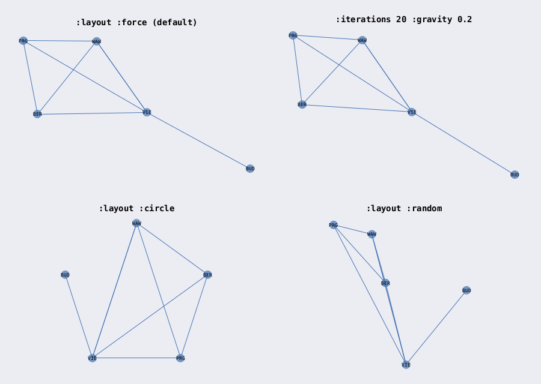
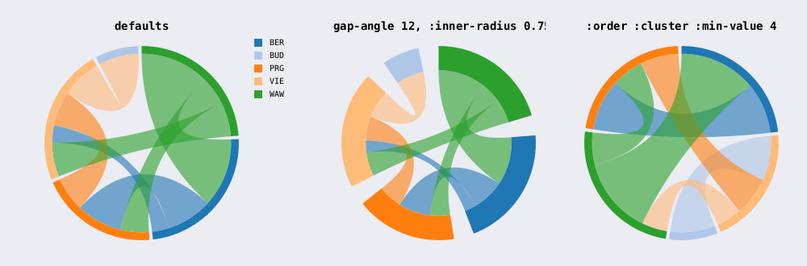
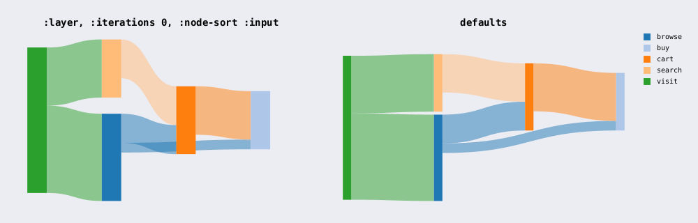
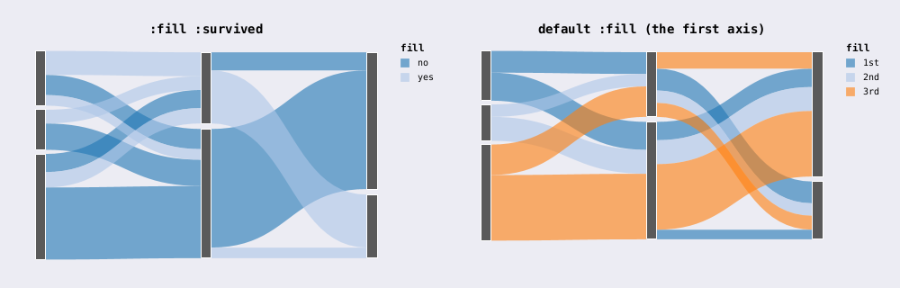
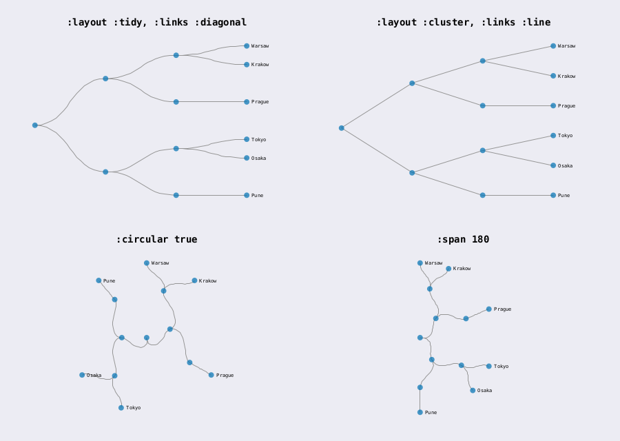
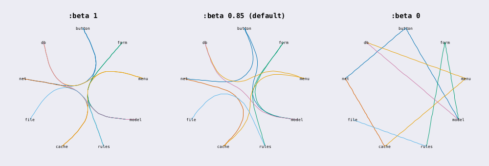
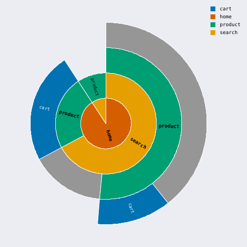

---
format:
  html:
    toc: true
    toc-location: right
    toc-depth: 4
    theme: cosmo
    include-in-header:
      text: |-
        <style>
        .data-table { width: fit-content; max-width: 100%; max-height: 15rem; overflow: auto; margin: 0 0 1rem 0; }
        .data-table .table-responsive { overflow: visible; }
        .data-table table { font-size: 0.75rem; width: auto; margin: 0; }
        .data-table th, .data-table td { padding: 0.1rem 0.45rem !important; white-space: nowrap; }
        .data-table thead th { position: sticky; top: 0; background: var(--bs-body-bg, #fff); }
        .options { margin: 0.5rem 0 1rem 0; }
        .options .option-card { margin: 0 0 0.9rem 0; border: 1px solid var(--bs-border-color, #dee2e6); border-radius: 0.375rem; overflow: hidden; }
        .options dt { display: flex; flex-wrap: wrap; align-items: baseline; gap: 0.1rem 1rem; margin: 0; padding: 0.4rem 0.75rem; background: #eef2f7; border-bottom: 1px solid var(--bs-border-color, #dee2e6); font-weight: normal; }
        .options dt > code { font-weight: 700; font-size: 1rem; background: none; padding: 0; }
        .options .option-default { font-size: 0.85rem; color: var(--bs-secondary-color, #6c757d); }
        .options dd { margin: 0; padding: 0.5rem 0.75rem; }
        .options .option-example { font-size: 0.85rem; padding: 0 0 0.45rem 0; margin-bottom: 0.45rem; border-bottom: 1px dashed var(--bs-border-color, #dee2e6); }
        .options .option-example code { background: none; padding: 0; }
        .options .option-text ul { margin: 0.3rem 0 0 0; padding-left: 1.25rem; }
        .options code, .mapping code { overflow-wrap: anywhere; }
        .options .option-default code, .options .option-example code { white-space: pre-wrap; }
        .mapping { margin: 0.5rem 0 1rem 0; padding: 0.5rem 0.75rem; border: 1px solid var(--bs-border-color, #dee2e6); border-left: 0.3rem solid #2780e3; border-radius: 0.375rem; background: #f5f8fc; }
        .mapping-title { font-weight: 700; margin-bottom: 0.25rem; }
        .mapping-hint { font-weight: normal; font-size: 0.85rem; color: var(--bs-secondary-color, #6c757d); }
        .mapping ul { margin: 0; padding-left: 1.25rem; }
        .mapping .required { font-size: 0.75rem; padding: 0 0.3rem; border: 1px solid currentColor; border-radius: 0.25rem; }
        .mapping-returns { margin-top: 0.25rem; }
        .mapping code { white-space: pre-wrap; }
        .shared { margin: 0.5rem 0 1rem 0; padding: 0.5rem 0.75rem; border: 1px solid var(--bs-border-color, #dee2e6); border-left: 0.3rem solid #6c757d; border-radius: 0.375rem; background: #f6f6f6; }
        .shared-title { font-weight: 700; margin-bottom: 0.25rem; }
        .shared-hint { font-weight: normal; font-size: 0.85rem; color: var(--bs-secondary-color, #6c757d); }
        .shared ul { margin: 0; padding-left: 1.25rem; }
        .shared code { overflow-wrap: anywhere; }
        p code, li code { white-space: pre-wrap; overflow-wrap: anywhere; }
        </style>
code-block-background: true

---
<style></style><style>.printedClojure .sourceCode {
  background-color: transparent;
  border-style: none;
}
</style><style>.clay-limit-image-width .clay-image {max-width: 100%}
.clay-side-by-side .sourceCode {margin: 0}
.clay-side-by-side {margin: 1em 0}
</style>
<script src="https://code.jquery.com/jquery-3.6.0.min.js" type="text/javascript"></script><script src="https://code.jquery.com/ui/1.13.1/jquery-ui.min.js" type="text/javascript"></script>

# Graphs and trees

These functions build graphs and trees from edges, adjacency matrices, parent links, level columns or clusterings,
and lay them out as rows: node positions, edge paths, ring sectors and bands. Use them to draw graphs and trees
with ordinary charts; the graph and tree builders call them.


::: {.sourceClojure}
```clojure
(ns reference.data-graphs-trees
  (:require [fastmath.ml.clustering :as cl]
            [fastmath.random :as r]
            [fastmath.stats :as stats]
            [cljplot2.chart :as chart]
            [cljplot2.core :as plot]
            [cljplot2.data.graph :as graph]
            [cljplot2.data.hierarchy :as hierarchy]
            [cljplot2.data.tree :as tree]
            [cljplot2.describe :as describe]
            [notebook-utils :as nu]))
```
:::


The tables below hold made-up flight counts between airports, and the airports as node rows; the graph sections
use them:


::: {.sourceClojure}
```clojure
(def flights [{:src "WAW" :dst "BER" :n 12} {:src "WAW" :dst "PRG" :n 5} {:src "BER" :dst "PRG" :n 8}
              {:src "PRG" :dst "VIE" :n 6} {:src "VIE" :dst "WAW" :n 4} {:src "BER" :dst "VIE" :n 3}
              {:src "WAW" :dst "VIE" :n 2} {:src "BUD" :dst "VIE" :n 7}])
```
:::


```{=html}
<div class="data-table"><table class="table table-hover table-responsive clay-table"><thead><tr><th>src</th><th>dst</th><th>n</th></tr></thead><tbody><tr><td>WAW</td><td>BER</td><td>12</td></tr><tr><td>WAW</td><td>PRG</td><td>5</td></tr><tr><td>BER</td><td>PRG</td><td>8</td></tr><tr><td>PRG</td><td>VIE</td><td>6</td></tr><tr><td>VIE</td><td>WAW</td><td>4</td></tr><tr><td>BER</td><td>VIE</td><td>3</td></tr><tr><td>WAW</td><td>VIE</td><td>2</td></tr><tr><td>BUD</td><td>VIE</td><td>7</td></tr></tbody></table></div>
```


::: {.sourceClojure}
```clojure
(def airports [{:code "WAW" :city "Warsaw"} {:code "BER" :city "Berlin"} {:code "PRG" :city "Prague"}
               {:code "VIE" :city "Vienna"} {:code "BUD" :city "Budapest"} {:code "KRK" :city "Krakow"}])
```
:::


```{=html}
<div class="data-table"><table class="table table-hover table-responsive clay-table"><thead><tr><th>code</th><th>city</th></tr></thead><tbody><tr><td>WAW</td><td>Warsaw</td></tr><tr><td>BER</td><td>Berlin</td></tr><tr><td>PRG</td><td>Prague</td></tr><tr><td>VIE</td><td>Vienna</td></tr><tr><td>BUD</td><td>Budapest</td></tr><tr><td>KRK</td><td>Krakow</td></tr></tbody></table></div>
```


The matrix below holds made-up counts of projects four teams share; the adjacency section uses it:


::: {.sourceClojure}
```clojure
(def shared-projects [[0 3 1 0] [3 0 2 4] [1 2 0 0] [0 4 0 0]])
```
:::


The table below holds made-up stages of a web shop with their columns; the sankey section uses it:


::: {.sourceClojure}
```clojure
(def stages [{:id "visit" :stage 0} {:id "search" :stage 1} {:id "browse" :stage 1} {:id "cart" :stage 2} {:id "buy" :stage 3}])
```
:::


```{=html}
<div class="data-table"><table class="table table-hover table-responsive clay-table"><thead><tr><th>id</th><th>stage</th></tr></thead><tbody><tr><td>visit</td><td>0</td></tr><tr><td>search</td><td>1</td></tr><tr><td>browse</td><td>1</td></tr><tr><td>cart</td><td>2</td></tr><tr><td>buy</td><td>3</td></tr></tbody></table></div>
```


The table below holds made-up passenger counts by class, sex and survival; the alluvial section uses it:


::: {.sourceClojure}
```clojure
(def passengers [{:class "1st" :sex "f" :survived "yes" :n 140} {:class "1st" :sex "m" :survived "no" :n 118}
                 {:class "2nd" :sex "f" :survived "yes" :n 80} {:class "2nd" :sex "m" :survived "no" :n 154}
                 {:class "3rd" :sex "f" :survived "no" :n 106} {:class "3rd" :sex "m" :survived "no" :n 422}
                 {:class "3rd" :sex "f" :survived "yes" :n 90} {:class "1st" :sex "m" :survived "yes" :n 62}])
```
:::


```{=html}
<div class="data-table"><table class="table table-hover table-responsive clay-table"><thead><tr><th>class</th><th>sex</th><th>survived</th><th>n</th></tr></thead><tbody><tr><td>1st</td><td>f</td><td>yes</td><td>140</td></tr><tr><td>1st</td><td>m</td><td>no</td><td>118</td></tr><tr><td>2nd</td><td>f</td><td>yes</td><td>80</td></tr><tr><td>2nd</td><td>m</td><td>no</td><td>154</td></tr><tr><td>3rd</td><td>f</td><td>no</td><td>106</td></tr><tr><td>3rd</td><td>m</td><td>no</td><td>422</td></tr><tr><td>3rd</td><td>f</td><td>yes</td><td>90</td></tr><tr><td>1st</td><td>m</td><td>yes</td><td>62</td></tr></tbody></table></div>
```


The table below holds twelve mtcars cars; the clustering sections use it:

Data: Motor Trend car road tests (1974), R datasets package `mtcars` (Henderson & Velleman 1981); licence: Part of R (GPL-2 | GPL-3).


::: {.sourceClojure}
```clojure
(def mtcars (take 12 (nu/dataset :mtcars)))
```
:::


```{=html}
<div class="data-table"><table class="table table-hover table-responsive clay-table"><thead><tr><th>model</th><th>mpg</th><th>cyl</th><th>disp</th><th>hp</th><th>drat</th><th>wt</th><th>qsec</th><th>vs</th><th>am</th><th>gear</th><th>carb</th></tr></thead><tbody><tr><td>Mazda RX4</td><td>21</td><td>6</td><td>160</td><td>110</td><td>3.9</td><td>2.62</td><td>16.46</td><td>0</td><td>1</td><td>4</td><td>4</td></tr><tr><td>Mazda RX4 Wag</td><td>21</td><td>6</td><td>160</td><td>110</td><td>3.9</td><td>2.875</td><td>17.02</td><td>0</td><td>1</td><td>4</td><td>4</td></tr><tr><td>Datsun 710</td><td>22.8</td><td>4</td><td>108</td><td>93</td><td>3.85</td><td>2.32</td><td>18.61</td><td>1</td><td>1</td><td>4</td><td>1</td></tr><tr><td>Hornet 4 Drive</td><td>21.4</td><td>6</td><td>258</td><td>110</td><td>3.08</td><td>3.215</td><td>19.44</td><td>1</td><td>0</td><td>3</td><td>1</td></tr><tr><td>Hornet Sportabout</td><td>18.7</td><td>8</td><td>360</td><td>175</td><td>3.15</td><td>3.44</td><td>17.02</td><td>0</td><td>0</td><td>3</td><td>2</td></tr><tr><td>Valiant</td><td>18.1</td><td>6</td><td>225</td><td>105</td><td>2.76</td><td>3.46</td><td>20.22</td><td>1</td><td>0</td><td>3</td><td>1</td></tr><tr><td>Duster 360</td><td>14.3</td><td>8</td><td>360</td><td>245</td><td>3.21</td><td>3.57</td><td>15.84</td><td>0</td><td>0</td><td>3</td><td>4</td></tr><tr><td>Merc 240D</td><td>24.4</td><td>4</td><td>146.7</td><td>62</td><td>3.69</td><td>3.19</td><td>20</td><td>1</td><td>0</td><td>4</td><td>2</td></tr><tr><td>Merc 230</td><td>22.8</td><td>4</td><td>140.8</td><td>95</td><td>3.92</td><td>3.15</td><td>22.9</td><td>1</td><td>0</td><td>4</td><td>2</td></tr><tr><td>Merc 280</td><td>19.2</td><td>6</td><td>167.6</td><td>123</td><td>3.92</td><td>3.44</td><td>18.3</td><td>1</td><td>0</td><td>4</td><td>4</td></tr><tr><td>Merc 280C</td><td>17.8</td><td>6</td><td>167.6</td><td>123</td><td>3.92</td><td>3.44</td><td>18.9</td><td>1</td><td>0</td><td>4</td><td>4</td></tr><tr><td>Merc 450SE</td><td>16.4</td><td>8</td><td>275.8</td><td>180</td><td>3.07</td><td>4.07</td><td>17.4</td><td>0</td><td>0</td><td>3</td><td>3</td></tr></tbody></table></div>
```


The vectors defined below hold the twelve cars standardized on four variables; the clustering sections use them:


::: {.sourceClojure}
```clojure
(def car-features (let [cols (for [k [:mpg :hp :wt :qsec]] (stats/standardize (map k mtcars)))]
                    (apply mapv vector cols)))
```
:::


The table below holds made-up offices by region and country; the level and node-link sections use it:


::: {.sourceClojure}
```clojure
(def offices [{:region "Europe" :country "Poland" :city "Warsaw"} {:region "Europe" :country "Poland" :city "Krakow"}
              {:region "Europe" :country "Czechia" :city "Prague"} {:region "Asia" :country "Japan" :city "Tokyo"}
              {:region "Asia" :country "Japan" :city "Osaka"} {:region "Asia" :country "India" :city "Pune"}])
```
:::


```{=html}
<div class="data-table"><table class="table table-hover table-responsive clay-table"><thead><tr><th>region</th><th>country</th><th>city</th></tr></thead><tbody><tr><td>Europe</td><td>Poland</td><td>Warsaw</td></tr><tr><td>Europe</td><td>Poland</td><td>Krakow</td></tr><tr><td>Europe</td><td>Czechia</td><td>Prague</td></tr><tr><td>Asia</td><td>Japan</td><td>Tokyo</td></tr><tr><td>Asia</td><td>Japan</td><td>Osaka</td></tr><tr><td>Asia</td><td>India</td><td>Pune</td></tr></tbody></table></div>
```


The table below holds a made-up company's employees with their bosses; the parent sections use it:


::: {.sourceClojure}
```clojure
(def org [{:emp 1 :boss nil :who "CEO"} {:emp 2 :boss 1 :who "CTO"} {:emp 3 :boss 1 :who "CFO"}
          {:emp 4 :boss 2 :who "dev lead"} {:emp 5 :boss 2 :who "ops lead"} {:emp 6 :boss 4 :who "developer"}])
```
:::


```{=html}
<div class="data-table"><table class="table table-hover table-responsive clay-table"><thead><tr><th>emp</th><th>boss</th><th>who</th></tr></thead><tbody><tr><td>1</td><td></td><td>CEO</td></tr><tr><td>2</td><td>1</td><td>CTO</td></tr><tr><td>3</td><td>1</td><td>CFO</td></tr><tr><td>4</td><td>2</td><td>dev lead</td></tr><tr><td>5</td><td>2</td><td>ops lead</td></tr><tr><td>6</td><td>4</td><td>developer</td></tr></tbody></table></div>
```


The tables below hold a made-up program's modules with their parents, and the modules' imports; the bundling
section uses them:


::: {.sourceClojure}
```clojure
(def modules [{:id "app"} {:id "ui" :parent "app"} {:id "core" :parent "app"} {:id "io" :parent "app"}
              {:id "button" :parent "ui"} {:id "form" :parent "ui"} {:id "menu" :parent "ui"}
              {:id "model" :parent "core"} {:id "rules" :parent "core"} {:id "cache" :parent "core"}
              {:id "file" :parent "io"} {:id "net" :parent "io"} {:id "db" :parent "io"}])
```
:::


```{=html}
<div class="data-table"><table class="table table-hover table-responsive clay-table"><thead><tr><th>id</th><th>parent</th></tr></thead><tbody><tr><td>app</td><td></td></tr><tr><td>ui</td><td>app</td></tr><tr><td>core</td><td>app</td></tr><tr><td>io</td><td>app</td></tr><tr><td>button</td><td>ui</td></tr><tr><td>form</td><td>ui</td></tr><tr><td>menu</td><td>ui</td></tr><tr><td>model</td><td>core</td></tr><tr><td>rules</td><td>core</td></tr><tr><td>cache</td><td>core</td></tr><tr><td>file</td><td>io</td></tr><tr><td>net</td><td>io</td></tr><tr><td>db</td><td>io</td></tr></tbody></table></div>
```


::: {.sourceClojure}
```clojure
(def imports [{:module "button" :uses "model"} {:module "form" :uses "rules"} {:module "form" :uses "model"}
              {:module "menu" :uses "cache"} {:module "model" :uses "db"} {:module "rules" :uses "file"}
              {:module "cache" :uses "net"} {:module "button" :uses "net"} {:module "menu" :uses "db"}])
```
:::


```{=html}
<div class="data-table"><table class="table table-hover table-responsive clay-table"><thead><tr><th>module</th><th>uses</th></tr></thead><tbody><tr><td>button</td><td>model</td></tr><tr><td>form</td><td>rules</td></tr><tr><td>form</td><td>model</td></tr><tr><td>menu</td><td>cache</td></tr><tr><td>model</td><td>db</td></tr><tr><td>rules</td><td>file</td></tr><tr><td>cache</td><td>net</td></tr><tr><td>button</td><td>net</td></tr><tr><td>menu</td><td>db</td></tr></tbody></table></div>
```


The table below holds made-up visits to a web shop, as page sequences with counts; the sequence section uses it:


::: {.sourceClojure}
```clojure
(def visits [{:path "home>search>product>end" :n 30} {:path "home>search>end" :n 12}
             {:path "home>product>cart>end" :n 18} {:path "home>search>product>cart" :n 9}
             {:path "search>product>end" :n 7}])
```
:::


```{=html}
<div class="data-table"><table class="table table-hover table-responsive clay-table"><thead><tr><th>path</th><th>n</th></tr></thead><tbody><tr><td>home>search>product>end</td><td>30</td></tr><tr><td>home>search>end</td><td>12</td></tr><tr><td>home>product>cart>end</td><td>18</td></tr><tr><td>home>search>product>cart</td><td>9</td></tr><tr><td>search>product>end</td><td>7</td></tr></tbody></table></div>
```


## Graphs

`graph/graph` builds the graph of edge rows: the nodes with their degrees, the given node rows first, and the edges
with numeric weights. Use it as the input of the graph layouts.


```{=html}
<div class="mapping"><div class="mapping-title">Arguments<span class="mapping-hint"> – what the call takes before its options map</span></div><ul><li><code>edges</code> – The edge rows, one per edge.<div>Columns:<ul><li><code>:from</code> – The source node's id; the option <code>:from</code> names another column.</li><li><code>:to</code> – The target node's id; the option <code>:to</code> names another column.</li><li><code>:value</code> – The weight, a finite number zero or greater; the option <code>:value</code> names another column. Optional: a missing weight counts as 1.</li></ul></div></li></ul><div class="mapping-returns"><strong>Returns</strong> – A graph <code>{:nodes :edges :loops :directed :dropped}</code>: the nodes with their degrees (<code>:degree</code>, <code>:in</code>, <code>:out</code>), the edges with numeric weights, self-loops under <code>:loops</code>, and the number of edges with a missing end.</div></div>
```


These options name the edge and node columns and set the direction. The table below holds the nodes of the flights
as a directed graph with the airports as node rows; Krakow has no flights, so its degree is 0:


```{=html}
<dl class="options"><div class="option-card"><dt><code>:from</code><span class="option-default">Default: <code>:from</code></span></dt><dd><div class="option-example"><code>(graph/graph edges {:from :source})</code></div><div class="option-text">The accessor of an edge row's source node id.<ul><li><a href="reference.types.html#accessor">accessor</a></li></ul></div></dd></div><div class="option-card"><dt><code>:to</code><span class="option-default">Default: <code>:to</code></span></dt><dd><div class="option-example"><code>(graph/graph edges {:to :target})</code></div><div class="option-text">The accessor of an edge row's target node id.<ul><li><a href="reference.types.html#accessor">accessor</a></li></ul></div></dd></div><div class="option-card"><dt><code>:value</code><span class="option-default">Default: <code>:value</code></span></dt><dd><div class="option-example"><code>(graph/graph edges {:value :weight})</code></div><div class="option-text">The accessor of an edge row's weight, a finite number zero or greater; a <code>nil</code> weight counts as 1.<ul><li><a href="reference.types.html#accessor">accessor</a></li></ul></div></dd></div><div class="option-card"><dt><code>:nodes</code><span class="option-default">Default: No node rows: the nodes are the edge ends, in order of first appearance.</span></dt><dd><div class="option-example"><code>(graph/graph edges {:nodes [{:id "c", :team "red"}]})</code></div><div class="option-text">Node rows, each with an id. Their nodes come first in row order and keep the rows' columns; ids found only in edges follow.<ul><li><span>sequence of maps</span></li></ul></div></dd></div><div class="option-card"><dt><code>:id</code><span class="option-default">Default: <code>:id</code></span></dt><dd><div class="option-example"><code>(graph/graph edges {:nodes [{:id "c", :code "e", :team "red"}], :id :code})</code></div><div class="option-text">The accessor of a node row's id.<ul><li><a href="reference.types.html#accessor">accessor</a></li></ul></div></dd></div><div class="option-card"><dt><code>:directed</code><span class="option-default">Default: <code>false</code></span></dt><dd><div class="option-example"><code>(graph/graph edges {:directed true})</code></div><div class="option-text">Whether the edges have a direction.<ul><li><code>false</code> – An undirected graph: <code>:in</code> and <code>:out</code> both equal the node's degree.</li><li><code>true</code> – A directed graph: a node's <code>:in</code> and <code>:out</code> count its incoming and outgoing edges.</li></ul></div></dd></div></dl>
```


::: {.sourceClojure}
```clojure
(nu/result-table (:nodes (graph/graph flights {:from :src :to :dst :value :n :nodes airports :id :code :directed true})))
```
:::


```{=html}
<div class="data-table"><table class="table table-hover table-responsive clay-table"><thead><tr><th>code</th><th>city</th><th>id</th><th>degree</th><th>in</th><th>out</th></tr></thead><tbody><tr><td>WAW</td><td>Warsaw</td><td>WAW</td><td>4</td><td>1</td><td>3</td></tr><tr><td>BER</td><td>Berlin</td><td>BER</td><td>3</td><td>1</td><td>2</td></tr><tr><td>PRG</td><td>Prague</td><td>PRG</td><td>3</td><td>2</td><td>1</td></tr><tr><td>VIE</td><td>Vienna</td><td>VIE</td><td>5</td><td>4</td><td>1</td></tr><tr><td>BUD</td><td>Budapest</td><td>BUD</td><td>1</td><td>0</td><td>1</td></tr><tr><td>KRK</td><td>Krakow</td><td>KRK</td><td>0</td><td>0</td><td>0</td></tr></tbody></table></div>
```


The next table holds the edges of the flights as an undirected graph, the weights from `:n` under `:value`:


::: {.sourceClojure}
```clojure
(nu/result-table (:edges (graph/graph flights {:from :src :to :dst :value :n :directed false})))
```
:::


```{=html}
<div class="data-table"><table class="table table-hover table-responsive clay-table"><thead><tr><th>src</th><th>dst</th><th>n</th><th>from</th><th>to</th><th>value</th></tr></thead><tbody><tr><td>WAW</td><td>BER</td><td>12</td><td>WAW</td><td>BER</td><td>12.0</td></tr><tr><td>WAW</td><td>PRG</td><td>5</td><td>WAW</td><td>PRG</td><td>5.0</td></tr><tr><td>BER</td><td>PRG</td><td>8</td><td>BER</td><td>PRG</td><td>8.0</td></tr><tr><td>PRG</td><td>VIE</td><td>6</td><td>PRG</td><td>VIE</td><td>6.0</td></tr><tr><td>VIE</td><td>WAW</td><td>4</td><td>VIE</td><td>WAW</td><td>4.0</td></tr><tr><td>BER</td><td>VIE</td><td>3</td><td>BER</td><td>VIE</td><td>3.0</td></tr><tr><td>WAW</td><td>VIE</td><td>2</td><td>WAW</td><td>VIE</td><td>2.0</td></tr><tr><td>BUD</td><td>VIE</td><td>7</td><td>BUD</td><td>VIE</td><td>7.0</td></tr></tbody></table></div>
```


Without a `:value` column every edge weighs 1:


::: {.sourceClojure}
```clojure
(nu/result-table (:edges (graph/graph flights {:from :src :to :dst})))
```
:::


```{=html}
<div class="data-table"><table class="table table-hover table-responsive clay-table"><thead><tr><th>src</th><th>dst</th><th>n</th><th>from</th><th>to</th><th>value</th></tr></thead><tbody><tr><td>WAW</td><td>BER</td><td>12</td><td>WAW</td><td>BER</td><td>1.0</td></tr><tr><td>WAW</td><td>PRG</td><td>5</td><td>WAW</td><td>PRG</td><td>1.0</td></tr><tr><td>BER</td><td>PRG</td><td>8</td><td>BER</td><td>PRG</td><td>1.0</td></tr><tr><td>PRG</td><td>VIE</td><td>6</td><td>PRG</td><td>VIE</td><td>1.0</td></tr><tr><td>VIE</td><td>WAW</td><td>4</td><td>VIE</td><td>WAW</td><td>1.0</td></tr><tr><td>BER</td><td>VIE</td><td>3</td><td>BER</td><td>VIE</td><td>1.0</td></tr><tr><td>WAW</td><td>VIE</td><td>2</td><td>WAW</td><td>VIE</td><td>1.0</td></tr><tr><td>BUD</td><td>VIE</td><td>7</td><td>BUD</td><td>VIE</td><td>1.0</td></tr></tbody></table></div>
```


## Network layouts

`graph/layout` places the nodes of a graph in the unit square and gives every edge the positions of both ends. Use
it to draw a network: segments for the edges, points for the nodes.


```{=html}
<div class="mapping"><div class="mapping-title">Arguments<span class="mapping-hint"> – what the call takes before its options map</span></div><ul><li><code>g</code> – A graph of <code>graph/graph</code>.</li></ul><div class="mapping-returns"><strong>Returns</strong> – The graph with <code>:x</code> and <code>:y</code> on its nodes and <code>:x :y :xend :yend</code> on its edges and loops, in the unit square.</div></div>
```


These options choose the placement and tune the force layout. The table below holds the placed nodes, `:x` and `:y`
added:


```{=html}
<dl class="options"><div class="option-card"><dt><code>:layout</code><span class="option-default">Default: <code>:force</code></span></dt><dd><div class="option-example"><code>(graph/layout g {:layout :circle})</code></div><div class="option-text">How the function places the nodes.<ul><li><code>:force</code> – By Fruchterman-Reingold forces: linked nodes pull together and all nodes push apart. The function lays out each connected component alone and packs the components in rows.</li><li><code>:circle</code> – On a circle, clockwise from the top in node order.</li><li><code>:random</code> – At random points.</li></ul></div></dd></div><div class="option-card"><dt><code>:iterations</code><span class="option-default">Default: <code>500</code></span></dt><dd><div class="option-example"><code>(graph/layout g {:iterations 20})</code></div><div class="option-text">The number of steps of the force layout.<ul><li><span>integer at least 0</span></li></ul></div></dd></div><div class="option-card"><dt><code>:gravity</code><span class="option-default">Default: <code>1.0</code></span></dt><dd><div class="option-example"><code>(graph/layout g {:gravity 0})</code></div><div class="option-text">The force layout's pull of the nodes towards their component's centre, in ideal edge lengths: 0 turns the pull off, a larger value draws a tighter layout.<ul><li><a href="reference.types.html#non-negative-finite-number">non-negative finite number</a></li></ul></div></dd></div><div class="option-card"><dt><code>:rng</code><span class="option-default">Default: A fresh unseeded generator on every call, so layouts differ.</span></dt><dd><div class="option-example"><code>(graph/layout g {:rng (r/rng :mersenne 7)})</code></div><div class="option-text">The fastmath random generator of the force and random layouts; the function copies it, so a seeded generator gives the same layout on every call.<ul><li><a href="reference.types.html#random-generator">random generator</a></li></ul></div></dd></div></dl>
```


::: {.sourceClojure}
```clojure
(nu/result-table (:nodes (graph/layout (graph/graph flights {:from :src :to :dst :value :n})
                                       {:rng (r/rng :mersenne 3)})))
```
:::


```{=html}
<div class="data-table"><table class="table table-hover table-responsive clay-table"><thead><tr><th>id</th><th>degree</th><th>in</th><th>out</th><th>x</th><th>y</th></tr></thead><tbody><tr><td>WAW</td><td>4</td><td>4</td><td>4</td><td>0.3234363307746476</td><td>0.7801850395367322</td></tr><tr><td>BER</td><td>3</td><td>3</td><td>3</td><td>0.06158553022006996</td><td>0.4588596042823668</td></tr><tr><td>PRG</td><td>3</td><td>3</td><td>3</td><td>0.0</td><td>0.7826090954673459</td></tr><tr><td>VIE</td><td>5</td><td>5</td><td>5</td><td>0.544727205118378</td><td>0.46653057775449486</td></tr><tr><td>BUD</td><td>1</td><td>1</td><td>1</td><td>1.0</td><td>0.21739090453265397</td></tr></tbody></table></div>
```


The panels below draw the edges as segments and the nodes as points. The first one takes the seeded force layout,
the same on every build; the second one stops after 20 iterations with a weaker pull to the centre; the last two
place the nodes on a circle and at random:


::: {.sourceClojure}
```clojure
(plot/render-image (plot/arrange (for [[title laid]
                                       [[":layout :force (default)"
                                         (graph/layout (graph/graph flights {:from :src :to :dst :value :n})
                                                       {:rng (r/rng :mersenne 3)})]
                                        [":iterations 20 :gravity 0.2"
                                         (graph/layout (graph/graph flights {:from :src :to :dst :value :n})
                                                       {:layout :force :iterations 20 :gravity 0.2 :rng (r/rng :mersenne 3)})]
                                        [":layout :circle"
                                         (graph/layout (graph/graph flights {:from :src :to :dst :value :n}) {:layout :circle})]
                                        [":layout :random"
                                         (graph/layout (graph/graph flights {:from :src :to :dst :value :n})
                                                       {:layout :random :rng (r/rng :mersenne 3)})]]]
                                   {:charts [(chart/segment {:data (:edges laid) :mapping {:x :x :y :y :xend :xend :yend :yend}})
                                             (chart/scatter {:data (:nodes laid) :mapping {:x :x :y :y} :size 14})
                                             (chart/text {:data (:nodes laid) :mapping {:x :x :y :y :label :id} :size 8})]
                                    :aspect :iso
                                    :scales {:x {:axis false} :y {:axis false}}
                                    :labels {:title title}})
                                 {:columns 2})
                   {:width 900 :height 640})
```
:::


::: {.clay-image}

:::


## Adjacency matrices

`graph/adjacency->edges` turns a square matrix of weights between named nodes into edge rows; a zero or missing
cell is no edge. Use it for graphs stored as matrices.


```{=html}
<div class="mapping"><div class="mapping-title">Arguments<span class="mapping-hint"> – what the call takes before its options map</span></div><ul><li><code>matrix</code> – A square matrix of weights, a sequence of rows: row i, column j holds the weight from node i to node j.</li><li><code>names</code> – The node names, a vector with one per row and column, in order.</li></ul><div class="mapping-returns"><strong>Returns</strong> – Edge rows <code>{:from :to :value}</code> for <code>graph/graph</code>, row by row; a zero, missing or non-finite cell is no edge.</div></div>
```


This option chooses which cells the function reads. The first table below reads the shared projects whole, each pair twice; the
second one reads only the upper triangle, each pair once:


```{=html}
<dl class="options"><div class="option-card"><dt><code>:whole-matrix</code><span class="option-default">Default: <code>true</code></span></dt><dd><div class="option-example"><code>(graph/adjacency->edges matrix names {:whole-matrix false})</code></div><div class="option-text">Whether the function reads the whole matrix.<ul><li><code>true</code> – Every cell: a pair gets an edge in each direction.</li><li><code>false</code> – Only the upper triangle and the diagonal, as for the symmetric matrix of an undirected graph.</li></ul></div></dd></div></dl>
```


::: {.sourceClojure}
```clojure
(nu/result-table (graph/adjacency->edges shared-projects ["design" "backend" "data" "ops"]))
```
:::


```{=html}
<div class="data-table"><table class="table table-hover table-responsive clay-table"><thead><tr><th>from</th><th>to</th><th>value</th></tr></thead><tbody><tr><td>design</td><td>backend</td><td>3</td></tr><tr><td>design</td><td>data</td><td>1</td></tr><tr><td>backend</td><td>design</td><td>3</td></tr><tr><td>backend</td><td>data</td><td>2</td></tr><tr><td>backend</td><td>ops</td><td>4</td></tr><tr><td>data</td><td>design</td><td>1</td></tr><tr><td>data</td><td>backend</td><td>2</td></tr><tr><td>ops</td><td>backend</td><td>4</td></tr></tbody></table></div>
```


::: {.sourceClojure}
```clojure
(nu/result-table (graph/adjacency->edges shared-projects ["design" "backend" "data" "ops"] {:whole-matrix false}))
```
:::


```{=html}
<div class="data-table"><table class="table table-hover table-responsive clay-table"><thead><tr><th>from</th><th>to</th><th>value</th></tr></thead><tbody><tr><td>design</td><td>backend</td><td>3</td></tr><tr><td>design</td><td>data</td><td>1</td></tr><tr><td>backend</td><td>data</td><td>2</td></tr><tr><td>backend</td><td>ops</td><td>4</td></tr></tbody></table></div>
```


## Arc layouts

`graph/arc-layout` lays out an arc diagram: the nodes on a line at 0, 1, ... in node order, and every edge as rows
along a semicircle between its ends. Use it to draw an arc diagram of your own.


```{=html}
<div class="mapping"><div class="mapping-title">Arguments<span class="mapping-hint"> – what the call takes before its options map</span></div><ul><li><code>g</code> – A graph of <code>graph/graph</code>.</li></ul><div class="mapping-returns"><strong>Returns</strong> – <code>{:nodes :arcs}</code>: the nodes with <code>:x</code> and <code>:y</code> on a line, and the arcs as rows <code>{:edge :from :to :value :x :y}</code> along each edge's semicircle.</div></div>
```


This option sets the node order. The table below holds the arcs: rows along each edge's semicircle, with the edge's
index under `:edge`:


```{=html}
<dl class="options"><div class="option-card"><dt><code>:order</code><span class="option-default">Default: The nodes' input order.</span></dt><dd><div class="option-example"><code>(graph/arc-layout g {:order :cluster})</code></div><div class="option-text">The order of the nodes around the ring of a chord diagram or along the line of an arc diagram.<ul><li><code>:cluster</code> – Nodes linked to the same others side by side.</li><li><span>sequence of any values</span> – Ids placed first, in this order; the other nodes follow in input order.</li></ul></div></dd></div></dl>
```


::: {.sourceClojure}
```clojure
(nu/result-table (:arcs (graph/arc-layout (graph/graph flights {:from :src :to :dst :value :n}))))
```
:::


```{=html}
<div class="data-table"><table class="table table-hover table-responsive clay-table"><thead><tr><th>edge</th><th>from</th><th>to</th><th>value</th><th>x</th><th>y</th></tr></thead><tbody><tr><td>0</td><td>WAW</td><td>BER</td><td>12.0</td><td>0.0</td><td>3.061616997868383E-17</td></tr><tr><td>0</td><td>WAW</td><td>BER</td><td>12.0</td><td>3.0458649045211894E-4</td><td>0.01744974835125054</td></tr><tr><td>0</td><td>WAW</td><td>BER</td><td>12.0</td><td>0.0012179748700879012</td><td>0.03487823687206273</td></tr><tr><td>0</td><td>WAW</td><td>BER</td><td>12.0</td><td>0.002739052315863355</td><td>0.05226423163382673</td></tr><tr><td>0</td><td>WAW</td><td>BER</td><td>12.0</td><td>0.004865965629214819</td><td>0.06958655048003273</td></tr><tr><td>0</td><td>WAW</td><td>BER</td><td>12.0</td><td>0.00759612349389599</td><td>0.08682408883346521</td></tr><tr><td>0</td><td>WAW</td><td>BER</td><td>12.0</td><td>0.010926199633097211</td><td>0.10395584540887973</td></tr><tr><td>0</td><td>WAW</td><td>BER</td><td>12.0</td><td>0.014852136862001764</td><td>0.12096094779983384</td></tr><tr><td>0</td><td>WAW</td><td>BER</td><td>12.0</td><td>0.019369152030840553</td><td>0.13781867790849958</td></tr><tr><td>0</td><td>WAW</td><td>BER</td><td>12.0</td><td>0.024471741852423234</td><td>0.15450849718747373</td></tr><tr><td>0</td><td>WAW</td><td>BER</td><td>12.0</td><td>0.03015368960704584</td><td>0.1710100716628344</td></tr><tr><td>0</td><td>WAW</td><td>BER</td><td>12.0</td><td>0.03640807271660634</td><td>0.1873032967079561</td></tr><tr><td>0</td><td>WAW</td><td>BER</td><td>12.0</td><td>0.04322727117869957</td><td>0.2033683215379001</td></tr><tr><td>0</td><td>WAW</td><td>BER</td><td>12.0</td><td>0.05060297685041648</td><td>0.21918557339453873</td></tr><tr><td>0</td><td>WAW</td><td>BER</td><td>12.0</td><td>0.05852620357053656</td><td>0.23473578139294543</td></tr><tr><td>0</td><td>WAW</td><td>BER</td><td>12.0</td><td>0.06698729810778065</td><td>0.24999999999999994</td></tr><tr><td>0</td><td>WAW</td><td>BER</td><td>12.0</td><td>0.07597595192178702</td><td>0.26495963211660245</td></tr><tr><td>0</td><td>WAW</td><td>BER</td><td>12.0</td><td>0.08548121372247913</td><td>0.2795964517353734</td></tr><tr><td>0</td><td>WAW</td><td>BER</td><td>12.0</td><td>0.09549150281252627</td><td>0.29389262614623657</td></tr><tr><td>0</td><td>WAW</td><td>BER</td><td>12.0</td><td>0.10599462319663905</td><td>0.30783073766282915</td></tr><tr><td>0</td><td>WAW</td><td>BER</td><td>12.0</td><td>0.116977778440511</td><td>0.3213938048432697</td></tr><tr><td>0</td><td>WAW</td><td>BER</td><td>12.0</td><td>0.12842758726130293</td><td>0.3345653031794291</td></tr><tr><td>0</td><td>WAW</td><td>BER</td><td>12.0</td><td>0.14033009983067446</td><td>0.3473291852294986</td></tr><tr><td>0</td><td>WAW</td><td>BER</td><td>12.0</td><td>0.15267081477050132</td><td>0.35966990016932554</td></tr><tr><td>0</td><td>WAW</td><td>BER</td><td>12.0</td><td>0.16543469682057088</td><td>0.3715724127386971</td></tr><tr><td>0</td><td>WAW</td><td>BER</td><td>12.0</td><td>0.17860619515673037</td><td>0.383022221559489</td></tr><tr><td>0</td><td>WAW</td><td>BER</td><td>12.0</td><td>0.19216926233717085</td><td>0.39400537680336095</td></tr><tr><td>0</td><td>WAW</td><td>BER</td><td>12.0</td><td>0.20610737385376343</td><td>0.4045084971874737</td></tr><tr><td>0</td><td>WAW</td><td>BER</td><td>12.0</td><td>0.2204035482646266</td><td>0.41451878627752087</td></tr><tr><td>0</td><td>WAW</td><td>BER</td><td>12.0</td><td>0.23504036788339755</td><td>0.42402404807821303</td></tr><tr><td>0</td><td>WAW</td><td>BER</td><td>12.0</td><td>0.25</td><td>0.4330127018922193</td></tr><tr><td>0</td><td>WAW</td><td>BER</td><td>12.0</td><td>0.2652642186070546</td><td>0.4414737964294635</td></tr><tr><td>0</td><td>WAW</td><td>BER</td><td>12.0</td><td>0.2808144266054613</td><td>0.4493970231495835</td></tr><tr><td>0</td><td>WAW</td><td>BER</td><td>12.0</td><td>0.2966316784620998</td><td>0.45677272882130043</td></tr><tr><td>0</td><td>WAW</td><td>BER</td><td>12.0</td><td>0.3126967032920439</td><td>0.4635919272833937</td></tr><tr><td>0</td><td>WAW</td><td>BER</td><td>12.0</td><td>0.3289899283371656</td><td>0.46984631039295416</td></tr><tr><td>0</td><td>WAW</td><td>BER</td><td>12.0</td><td>0.3454915028125263</td><td>0.47552825814757677</td></tr><tr><td>0</td><td>WAW</td><td>BER</td><td>12.0</td><td>0.36218132209150045</td><td>0.48063084796915945</td></tr><tr><td>0</td><td>WAW</td><td>BER</td><td>12.0</td><td>0.3790390522001662</td><td>0.48514786313799824</td></tr><tr><td>0</td><td>WAW</td><td>BER</td><td>12.0</td><td>0.3960441545911204</td><td>0.48907380036690284</td></tr><tr><td>0</td><td>WAW</td><td>BER</td><td>12.0</td><td>0.41317591116653485</td><td>0.492403876506104</td></tr><tr><td>0</td><td>WAW</td><td>BER</td><td>12.0</td><td>0.4304134495199673</td><td>0.4951340343707852</td></tr><tr><td>0</td><td>WAW</td><td>BER</td><td>12.0</td><td>0.4477357683661733</td><td>0.49726094768413664</td></tr><tr><td>0</td><td>WAW</td><td>BER</td><td>12.0</td><td>0.4651217631279374</td><td>0.49878202512991215</td></tr><tr><td>0</td><td>WAW</td><td>BER</td><td>12.0</td><td>0.4825502516487495</td><td>0.4996954135095479</td></tr><tr><td>0</td><td>WAW</td><td>BER</td><td>12.0</td><td>0.5</td><td>0.5</td></tr><tr><td>0</td><td>WAW</td><td>BER</td><td>12.0</td><td>0.5174497483512503</td><td>0.4996954135095479</td></tr><tr><td>0</td><td>WAW</td><td>BER</td><td>12.0</td><td>0.5348782368720627</td><td>0.4987820251299121</td></tr><tr><td>0</td><td>WAW</td><td>BER</td><td>12.0</td><td>0.5522642316338267</td><td>0.49726094768413664</td></tr><tr><td>0</td><td>WAW</td><td>BER</td><td>12.0</td><td>0.5695865504800326</td><td>0.4951340343707852</td></tr><tr><td>0</td><td>WAW</td><td>BER</td><td>12.0</td><td>0.5868240888334652</td><td>0.492403876506104</td></tr><tr><td>0</td><td>WAW</td><td>BER</td><td>12.0</td><td>0.6039558454088796</td><td>0.48907380036690284</td></tr><tr><td>0</td><td>WAW</td><td>BER</td><td>12.0</td><td>0.6209609477998338</td><td>0.48514786313799824</td></tr><tr><td>0</td><td>WAW</td><td>BER</td><td>12.0</td><td>0.6378186779084996</td><td>0.48063084796915945</td></tr><tr><td>0</td><td>WAW</td><td>BER</td><td>12.0</td><td>0.6545084971874737</td><td>0.47552825814757677</td></tr><tr><td>0</td><td>WAW</td><td>BER</td><td>12.0</td><td>0.6710100716628344</td><td>0.46984631039295416</td></tr><tr><td>0</td><td>WAW</td><td>BER</td><td>12.0</td><td>0.6873032967079561</td><td>0.4635919272833937</td></tr><tr><td>0</td><td>WAW</td><td>BER</td><td>12.0</td><td>0.7033683215379001</td><td>0.4567727288213005</td></tr><tr><td>0</td><td>WAW</td><td>BER</td><td>12.0</td><td>0.7191855733945388</td><td>0.44939702314958346</td></tr><tr><td>0</td><td>WAW</td><td>BER</td><td>12.0</td><td>0.7347357813929453</td><td>0.4414737964294635</td></tr><tr><td>0</td><td>WAW</td><td>BER</td><td>12.0</td><td>0.7499999999999999</td><td>0.43301270189221935</td></tr><tr><td>0</td><td>WAW</td><td>BER</td><td>12.0</td><td>0.7649596321166025</td><td>0.42402404807821303</td></tr><tr><td>0</td><td>WAW</td><td>BER</td><td>12.0</td><td>0.7795964517353734</td><td>0.41451878627752087</td></tr><tr><td>0</td><td>WAW</td><td>BER</td><td>12.0</td><td>0.7938926261462366</td><td>0.4045084971874737</td></tr><tr><td>0</td><td>WAW</td><td>BER</td><td>12.0</td><td>0.8078307376628291</td><td>0.39400537680336095</td></tr><tr><td>0</td><td>WAW</td><td>BER</td><td>12.0</td><td>0.8213938048432696</td><td>0.383022221559489</td></tr><tr><td>0</td><td>WAW</td><td>BER</td><td>12.0</td><td>0.834565303179429</td><td>0.37157241273869723</td></tr><tr><td>0</td><td>WAW</td><td>BER</td><td>12.0</td><td>0.8473291852294986</td><td>0.3596699001693255</td></tr><tr><td>0</td><td>WAW</td><td>BER</td><td>12.0</td><td>0.8596699001693255</td><td>0.34732918522949874</td></tr><tr><td>0</td><td>WAW</td><td>BER</td><td>12.0</td><td>0.8715724127386972</td><td>0.334565303179429</td></tr><tr><td>0</td><td>WAW</td><td>BER</td><td>12.0</td><td>0.883022221559489</td><td>0.32139380484326974</td></tr><tr><td>0</td><td>WAW</td><td>BER</td><td>12.0</td><td>0.8940053768033609</td><td>0.30783073766282915</td></tr><tr><td>0</td><td>WAW</td><td>BER</td><td>12.0</td><td>0.9045084971874737</td><td>0.29389262614623657</td></tr><tr><td>0</td><td>WAW</td><td>BER</td><td>12.0</td><td>0.9145187862775208</td><td>0.2795964517353734</td></tr><tr><td>0</td><td>WAW</td><td>BER</td><td>12.0</td><td>0.9240240480782129</td><td>0.26495963211660245</td></tr><tr><td>0</td><td>WAW</td><td>BER</td><td>12.0</td><td>0.9330127018922194</td><td>0.24999999999999994</td></tr><tr><td>0</td><td>WAW</td><td>BER</td><td>12.0</td><td>0.9414737964294635</td><td>0.23473578139294532</td></tr><tr><td>0</td><td>WAW</td><td>BER</td><td>12.0</td><td>0.9493970231495834</td><td>0.2191855733945388</td></tr><tr><td>0</td><td>WAW</td><td>BER</td><td>12.0</td><td>0.9567727288213005</td><td>0.2033683215379</td></tr><tr><td>0</td><td>WAW</td><td>BER</td><td>12.0</td><td>0.9635919272833937</td><td>0.1873032967079561</td></tr><tr><td>0</td><td>WAW</td><td>BER</td><td>12.0</td><td>0.9698463103929542</td><td>0.1710100716628344</td></tr><tr><td>0</td><td>WAW</td><td>BER</td><td>12.0</td><td>0.9755282581475768</td><td>0.15450849718747373</td></tr><tr><td>0</td><td>WAW</td><td>BER</td><td>12.0</td><td>0.9806308479691594</td><td>0.13781867790849958</td></tr><tr><td>0</td><td>WAW</td><td>BER</td><td>12.0</td><td>0.9851478631379982</td><td>0.12096094779983384</td></tr><tr><td>0</td><td>WAW</td><td>BER</td><td>12.0</td><td>0.9890738003669028</td><td>0.10395584540887962</td></tr><tr><td>0</td><td>WAW</td><td>BER</td><td>12.0</td><td>0.9924038765061041</td><td>0.08682408883346532</td></tr><tr><td>0</td><td>WAW</td><td>BER</td><td>12.0</td><td>0.9951340343707852</td><td>0.06958655048003262</td></tr><tr><td>0</td><td>WAW</td><td>BER</td><td>12.0</td><td>0.9972609476841366</td><td>0.05226423163382684</td></tr><tr><td>0</td><td>WAW</td><td>BER</td><td>12.0</td><td>0.9987820251299121</td><td>0.03487823687206273</td></tr><tr><td>0</td><td>WAW</td><td>BER</td><td>12.0</td><td>0.9996954135095479</td><td>0.01744974835125054</td></tr><tr><td>0</td><td>WAW</td><td>BER</td><td>12.0</td><td>1.0</td><td>3.061616997868383E-17</td></tr><tr><td>1</td><td>WAW</td><td>PRG</td><td>5.0</td><td>0.0</td><td>6.123233995736766E-17</td></tr><tr><td>1</td><td>WAW</td><td>PRG</td><td>5.0</td><td>6.091729809042379E-4</td><td>0.03489949670250108</td></tr><tr><td>1</td><td>WAW</td><td>PRG</td><td>5.0</td><td>0.0024359497401758023</td><td>0.06975647374412546</td></tr><tr><td>1</td><td>WAW</td><td>PRG</td><td>5.0</td><td>0.00547810463172671</td><td>0.10452846326765346</td></tr><tr><td>1</td><td>WAW</td><td>PRG</td><td>5.0</td><td>0.009731931258429638</td><td>0.13917310096006547</td></tr><tr><td>1</td><td>WAW</td><td>PRG</td><td>5.0</td><td>0.01519224698779198</td><td>0.17364817766693041</td></tr><tr><td>1</td><td>WAW</td><td>PRG</td><td>5.0</td><td>0.021852399266194422</td><td>0.20791169081775945</td></tr><tr><td>1</td><td>WAW</td><td>PRG</td><td>5.0</td><td>0.029704273724003527</td><td>0.24192189559966767</td></tr><tr><td>1</td><td>WAW</td><td>PRG</td><td>5.0</td><td>0.038738304061681106</td><td>0.27563735581699916</td></tr><tr><td>…</td><td>…</td><td>…</td><td>…</td><td>…</td><td>…</td></tr></tbody></table></div>
```


The panels below draw lines through the arc rows over the nodes. The left one keeps the input order, the middle one
puts the given ids first, and the right one puts nodes linked to the same others side by side:


::: {.sourceClojure}
```clojure
(plot/render-image (plot/arrange (for [[title laid]
                                       [["input order" (graph/arc-layout (graph/graph flights {:from :src :to :dst :value :n}))]
                                        [":order [\"VIE\" \"BUD\"]"
                                         (graph/arc-layout (graph/graph flights {:from :src :to :dst :value :n}) {:order ["VIE" "BUD"]})]
                                        [":order :cluster"
                                         (graph/arc-layout (graph/graph flights {:from :src :to :dst :value :n}) {:order :cluster})]]]
                                   {:charts [(chart/line {:data (:arcs laid) :mapping {:x :x :y :y :group :edge :size :value}
                                                          :order :data})
                                             (chart/scatter {:data (:nodes laid) :mapping {:x :x :y :y} :size 10})]
                                    :scales {:x {:ticks (vec (range 5))
                                                 :formatter (let [ids (mapv :id (:nodes laid))] #(get ids (long %) ""))}
                                             :y {:axis false}}
                                    :labels {:title title}
                                    :legend false})
                                 {:columns 3})
                   {:width 1000 :height 260})
```
:::


::: {.clay-image}

:::


## Chord layouts

`graph/chord-layout` lays out a chord diagram as polygon rows in the unit circle: a ring sector per node, its angle
by the node's flow, and a ribbon through the centre per linked pair of an undirected graph or per edge of a directed
one. Use it to draw a chord diagram of your own.


```{=html}
<div class="mapping"><div class="mapping-title">Arguments<span class="mapping-hint"> – what the call takes before its options map</span></div><ul><li><code>g</code> – A graph of <code>graph/graph</code>.</li></ul><div class="mapping-returns"><strong>Returns</strong> – <code>{:groups :arcs :ribbons :dropped}</code>: a ring sector per node with its angles in degrees, and the sectors and ribbons as polygon rows in the unit circle.</div></div>
```


These options set the node order, the ring and the smallest flow. The table below holds the ring sectors, `:start`
and `:end` in degrees clockwise from the top:


```{=html}
<dl class="options"><div class="option-card"><dt><code>:order</code><span class="option-default">Default: The nodes' input order.</span></dt><dd><div class="option-example"><code>(graph/chord-layout g {:order :cluster})</code></div><div class="option-text">The order of the nodes around the ring of a chord diagram or along the line of an arc diagram.<ul><li><code>:cluster</code> – Nodes linked to the same others side by side.</li><li><span>sequence of any values</span> – Ids placed first, in this order; the other nodes follow in input order.</li></ul></div></dd></div><div class="option-card"><dt><code>:gap-angle</code><span class="option-default">Default: <code>2.0</code></span></dt><dd><div class="option-example"><code>(graph/chord-layout g {:gap-angle 10})</code></div><div class="option-text">The gap after every ring sector, in degrees; the gaps must leave room for the sectors.<ul><li><a href="reference.types.html#non-negative-finite-number">non-negative finite number</a></li></ul></div></dd></div><div class="option-card"><dt><code>:inner-radius</code><span class="option-default">Default: <code>0.92</code></span></dt><dd><div class="option-example"><code>(graph/chord-layout g {:inner-radius 0.8})</code></div><div class="option-text">The ring's inner radius, where the ribbons end; the outer radius is 1.<ul><li><a href="reference.types.html#open-fraction">open fraction</a></li></ul></div></dd></div><div class="option-card"><dt><code>:min-value</code><span class="option-default">Default: No limit: every flow is kept.</span></dt><dd><div class="option-example"><code>(graph/chord-layout g {:min-value 2})</code></div><div class="option-text">The smallest flow kept: the function leaves out a flow whose summed weight is below it - one direction of a pair in a directed graph, both directions in an undirected one - and counts its edges in <code>:dropped</code>.<ul><li><a href="reference.types.html#non-negative-finite-number">non-negative finite number</a></li></ul></div></dd></div></dl>
```


::: {.sourceClojure}
```clojure
(nu/result-table (:groups (graph/chord-layout (graph/graph flights {:from :src :to :dst :value :n}))))
```
:::


```{=html}
<div class="data-table"><table class="table table-hover table-responsive clay-table"><thead><tr><th>id</th><th>start</th><th>end</th><th>value</th></tr></thead><tbody><tr><td>WAW</td><td>0.0</td><td>85.63829787234043</td><td>23.0</td></tr><tr><td>BER</td><td>87.63829787234043</td><td>173.27659574468086</td><td>23.0</td></tr><tr><td>PRG</td><td>175.27659574468086</td><td>246.0212765957447</td><td>19.0</td></tr><tr><td>VIE</td><td>248.02127659574467</td><td>329.936170212766</td><td>22.0</td></tr><tr><td>BUD</td><td>331.93617021276594</td><td>358.0</td><td>7.0</td></tr></tbody></table></div>
```


The panels below colour the ribbons by their `:from` end and the sectors by node; an undirected ribbon's `:from` is
its end earlier in the ring. The left one draws the default ring, the middle one wide gaps and a thin ring. The
right one draws the directed graph, a ribbon per edge coloured by its source, in clustered order and leaves out the
flows under 4:


::: {.sourceClojure}
```clojure
(plot/render-image (plot/arrange (for [[title {:keys [ribbons arcs]}]
                                       [["defaults" (graph/chord-layout (graph/graph flights {:from :src :to :dst :value :n}))]
                                        [":gap-angle 12, :inner-radius 0.75"
                                         (graph/chord-layout (graph/graph flights {:from :src :to :dst :value :n})
                                                             {:gap-angle 12 :inner-radius 0.75})]
                                        [":order :cluster :min-value 4"
                                         (graph/chord-layout (graph/graph flights {:from :src :to :dst :value :n :directed true})
                                                             {:order :cluster :min-value 4})]]]
                                   {:charts [(chart/polygon {:data ribbons :alpha 0.6 :mapping {:x :x :y :y :group :ribbon :color :from}})
                                             (chart/polygon {:data arcs :mapping {:x :x :y :y :color :group}})]
                                    :aspect :iso
                                    :scales {:x {:axis false} :y {:axis false}}
                                    :labels {:title title}
                                    :legend (= title "defaults")})
                                 {:columns 3 :widths [1.3 1 1]})
                   {:width 1000 :height 330})
```
:::


::: {.clay-image}

:::


## Sankey layouts

`graph/sankey-layout` lays out a sankey diagram as rows in the unit square: the nodes as rectangles in columns, every
edge a band as thick as its flow from its source's right side to its target's left side. Use it to draw a sankey
diagram of your own.


```{=html}
<div class="mapping"><div class="mapping-title">Arguments<span class="mapping-hint"> – what the call takes before its options map</span></div><ul><li><code>g</code> – A graph of <code>graph/graph</code> or <code>graph/alluvial-graph</code>; its edges are flows.</li></ul><div class="mapping-returns"><strong>Returns</strong> – <code>{:nodes :links :rects :bands :dropped}</code>: the nodes with their columns and rectangles, the links with their band widths, and the rectangles and bands as polygon rows in the unit square.</div></div>
```


These options set the columns, the node size and gaps, and the relaxation. The table below holds the nodes with
their columns (`:layer`) and rectangles (`:x0 :x1 :y0 :y1`):


```{=html}
<dl class="options"><div class="option-card"><dt><code>:align</code><span class="option-default">Default: <code>:justify</code></span></dt><dd><div class="option-example"><code>(graph/sankey-layout g {:align :center})</code></div><div class="option-text">Which column the function puts a node in, by the longest paths through it.<ul><li><code>:justify</code> – The node's depth (its longest path from a source); every sink moves to the last column.</li><li><code>:center</code> – The node's depth; a source moves to the column before its nearest target.</li><li><code>:left</code> – The node's depth; a sink stays where its longest path ends.</li><li><code>:right</code> – The last column minus the node's longest path to a sink.</li></ul></div></dd></div><div class="option-card"><dt><code>:layer</code><span class="option-default">Default: Columns from <code>:align</code>.</span></dt><dd><div class="option-example"><code>(graph/sankey-layout g {:layer :col})</code></div><div class="option-text">The accessor of a node row's column, an integer zero or greater; every edge must go to a later column. It wins over <code>:align</code>.<ul><li><a href="reference.types.html#accessor">accessor</a></li></ul></div></dd></div><div class="option-card"><dt><code>:node-width</code><span class="option-default">Default: <code>0.03</code></span></dt><dd><div class="option-example"><code>(graph/sankey-layout g {:node-width 0.1})</code></div><div class="option-text">The width of a node, a fraction of the unit square's width.<ul><li><a href="reference.types.html#open-fraction">open fraction</a></li></ul></div></dd></div><div class="option-card"><dt><code>:gap</code><span class="option-default">Default: <code>0.02</code></span></dt><dd><div class="option-example"><code>(graph/sankey-layout g {:gap 0.1})</code></div><div class="option-text">The least gap between the nodes of a column, a fraction of the unit square's height.<ul><li><a href="reference.types.html#non-negative-finite-number">non-negative finite number</a></li></ul></div></dd></div><div class="option-card"><dt><code>:iterations</code><span class="option-default">Default: <code>6</code></span></dt><dd><div class="option-example"><code>(graph/sankey-layout g {:iterations 0})</code></div><div class="option-text">The number of relaxation sweeps, which move the nodes towards their links' other ends; 0 keeps the nodes in their start order.<ul><li><span>integer at least 0</span></li></ul></div></dd></div><div class="option-card"><dt><code>:order</code><span class="option-default">Default: <code>:relaxed</code></span></dt><dd><div class="option-example"><code>(graph/sankey-layout g {:order :input})</code></div><div class="option-text">How the function orders the nodes of a column.<ul><li><code>:relaxed</code> – The relaxation sweeps reorder a column's nodes by their positions.</li><li><code>:input</code> – A column's nodes keep the input order.</li></ul></div></dd></div></dl>
```


::: {.sourceClojure}
```clojure
(nu/result-table (:nodes (graph/sankey-layout (graph/graph [{:from "WAW" :to "BER" :value 12} {:from "WAW" :to "PRG" :value 5}
                                                           {:from "BER" :to "PRG" :value 8} {:from "PRG" :to "VIE" :value 6}
                                                           {:from "BER" :to "VIE" :value 3} {:from "BUD" :to "VIE" :value 7}]
                                                          {:directed true}))))
```
:::


```{=html}
<div class="data-table"><table class="table table-hover table-responsive clay-table"><thead><tr><th>value</th><th>y1</th><th>layer</th><th>out</th><th>id</th><th>degree</th><th>y0</th><th>x1</th><th>x0</th><th>in</th></tr></thead><tbody><tr><td>17.0</td><td>1.0</td><td>0</td><td>2</td><td>WAW</td><td>2</td><td>0.3058333333333335</td><td>0.03</td><td>0.0</td><td>0</td></tr><tr><td>7.0</td><td>0.2858333333333335</td><td>0</td><td>1</td><td>BUD</td><td>1</td><td>1.1102230246251565E-16</td><td>0.03</td><td>0.0</td><td>0</td></tr><tr><td>12.0</td><td>0.9907741294248698</td><td>1</td><td>2</td><td>BER</td><td>3</td><td>0.5007741294248699</td><td>0.3533333333333333</td><td>0.3233333333333333</td><td>1</td></tr><tr><td>13.0</td><td>0.7422724882972507</td><td>2</td><td>1</td><td>PRG</td><td>3</td><td>0.2114391549639174</td><td>0.6766666666666666</td><td>0.6466666666666666</td><td>2</td></tr><tr><td>16.0</td><td>0.6926601606219035</td><td>3</td><td>0</td><td>VIE</td><td>3</td><td>0.039326827288570176</td><td>1.0</td><td>0.97</td><td>3</td></tr></tbody></table></div>
```


For each column alignment, the panels below draw the bands as polygons grouped by `:link`, and over them the node
rectangles grouped by `:rect`. Krakow, a dead end after Warsaw, sits in the last column with `:justify` and `:right`, and right
after Warsaw with `:left` and `:center`. Budapest starts in the first column only with `:left` and `:justify`:


::: {.sourceClojure}
```clojure
(plot/render-image (plot/arrange (for [[title {:keys [rects bands]}]
                                       [[":align :justify (default)"
                                         (graph/sankey-layout (graph/graph [{:from "WAW" :to "BER" :value 12} {:from "WAW" :to "PRG" :value 5}
                                                                            {:from "BER" :to "PRG" :value 8} {:from "PRG" :to "VIE" :value 6}
                                                                            {:from "BUD" :to "PRG" :value 7} {:from "WAW" :to "KRK" :value 4}]))]
                                        [":align :left"
                                         (graph/sankey-layout (graph/graph [{:from "WAW" :to "BER" :value 12} {:from "WAW" :to "PRG" :value 5}
                                                                            {:from "BER" :to "PRG" :value 8} {:from "PRG" :to "VIE" :value 6}
                                                                            {:from "BUD" :to "PRG" :value 7} {:from "WAW" :to "KRK" :value 4}])
                                                              {:align :left})]
                                        [":align :right"
                                         (graph/sankey-layout (graph/graph [{:from "WAW" :to "BER" :value 12} {:from "WAW" :to "PRG" :value 5}
                                                                            {:from "BER" :to "PRG" :value 8} {:from "PRG" :to "VIE" :value 6}
                                                                            {:from "BUD" :to "PRG" :value 7} {:from "WAW" :to "KRK" :value 4}])
                                                              {:align :right})]
                                        [":align :center"
                                         (graph/sankey-layout (graph/graph [{:from "WAW" :to "BER" :value 12} {:from "WAW" :to "PRG" :value 5}
                                                                            {:from "BER" :to "PRG" :value 8} {:from "PRG" :to "VIE" :value 6}
                                                                            {:from "BUD" :to "PRG" :value 7} {:from "WAW" :to "KRK" :value 4}])
                                                              {:align :center})]]]
                                   {:charts [(chart/polygon {:data bands :alpha 0.5 :mapping {:x :x :y :y :group :link :color :from}})
                                             (chart/polygon {:data rects :mapping {:x :x :y :y :group :rect :color :node}})]
                                    :scales {:x {:axis false} :y {:axis false}}
                                    :labels {:title title}
                                    :legend false})
                                 {:columns 4})
                   {:width 1000 :height 280})
```
:::


::: {.clay-image}

:::


The left panel below takes the columns from the stages' node column (`:layer :stage`) and draws wide nodes far
apart, without relaxation, in input order. The right one keeps the defaults: columns from
`:align` and six relaxation sweeps:


::: {.sourceClojure}
```clojure
(plot/render-image (plot/arrange (for [[title {:keys [rects bands]}]
                                       [[":layer, :iterations 0, :order :input"
                                         (graph/sankey-layout (graph/graph [{:from "visit" :to "search" :value 6} {:from "visit" :to "browse" :value 9}
                                                                            {:from "search" :to "cart" :value 4} {:from "browse" :to "cart" :value 3}
                                                                            {:from "cart" :to "buy" :value 5} {:from "browse" :to "buy" :value 1}]
                                                                           {:nodes stages})
                                                              {:layer :stage :node-width 0.08 :gap 0.1 :iterations 0 :order :input})]
                                        ["defaults"
                                         (graph/sankey-layout (graph/graph [{:from "visit" :to "search" :value 6} {:from "visit" :to "browse" :value 9}
                                                                            {:from "search" :to "cart" :value 4} {:from "browse" :to "cart" :value 3}
                                                                            {:from "cart" :to "buy" :value 5} {:from "browse" :to "buy" :value 1}]
                                                                           {:nodes stages}))]]]
                                   {:charts [(chart/polygon {:data bands :alpha 0.5 :mapping {:x :x :y :y :group :link :color :from}})
                                             (chart/polygon {:data rects :mapping {:x :x :y :y :group :rect :color :node}})]
                                    :scales {:x {:axis false} :y {:axis false}}
                                    :labels {:title title}
                                    :legend (= title "defaults")})
                                 {:columns 2 :widths [1 1.2]})
                   {:width 1000 :height 320})
```
:::


::: {.clay-image}

:::


## Alluvial graphs

`graph/alluvial-graph` builds the directed graph of an alluvial diagram: a node per level of every variable, a
column per variable, and, for each strand level, an edge per pair of levels of neighbouring variables, weighted by
the summed weight. Use it with `sankey-layout` and fixed columns.


```{=html}
<div class="mapping"><div class="mapping-title">Arguments<span class="mapping-hint"> – what the call takes before its options map</span></div><ul><li><code>rows</code> – Wide data, a row per observation or group of observations: rows (a sequence of maps) or columns (a map of equal-length sequences).<div>Columns:<ul><li><em>a column per variable</em> – A categorical level, read by an accessor of <code>:variables</code>.</li><li><em>a weight column</em> – The row's weight, named by the option <code>:value</code>; optional.</li></ul></div></li></ul><div class="mapping-returns"><strong>Returns</strong> – A directed graph of <code>graph/graph</code> for <code>sankey-layout</code>: a node per level of every variable, its column under <code>:layer</code>, and an edge with the summed weight per pair of levels of neighbouring variables and strand level.</div></div>
```


These options name the variables, the weight and the strand level. The table below holds the edges of the
passengers, weighted by `:n` and grouped by survival:


```{=html}
<dl class="options"><div class="option-card"><dt><code>:variables</code></dt><dd><div class="option-example"><code>(graph/alluvial-graph rows {:variables [:class :sex]})</code></div><div class="option-text">The accessors of the categorical variables, one column each, in order; at least 2.<ul><li><span>sequence of accessors</span></li></ul></div></dd></div><div class="option-card"><dt><code>:value</code><span class="option-default">Default: Every row weighs 1.</span></dt><dd><div class="option-example"><code>(graph/alluvial-graph rows {:variables [:class :sex], :value :n})</code></div><div class="option-text">The accessor of a row's weight, a finite number zero or greater; a <code>nil</code> weight counts as 1.<ul><li><a href="reference.types.html#accessor">accessor</a></li></ul></div></dd></div><div class="option-card"><dt><code>:strand-color</code><span class="option-default">Default: The first variable.</span></dt><dd><div class="option-example"><code>(graph/alluvial-graph rows {:variables [:class :sex], :strand-color :sex})</code></div><div class="option-text">The accessor of the level that groups the strands; <code>plot/alluvial</code> colours the strands by it.<ul><li><a href="reference.types.html#accessor">accessor</a></li></ul></div></dd></div></dl>
```


::: {.sourceClojure}
```clojure
(nu/result-table (:edges (graph/alluvial-graph passengers {:variables [:class :sex :survived] :value :n :strand-color :survived})))
```
:::


```{=html}
<div class="data-table"><table class="table table-hover table-responsive clay-table"><thead><tr><th>from</th><th>to</th><th>value</th><th>strand-color</th></tr></thead><tbody><tr><td>[0 "1st"]</td><td>[1 "m"]</td><td>118.0</td><td>no</td></tr><tr><td>[0 "2nd"]</td><td>[1 "m"]</td><td>154.0</td><td>no</td></tr><tr><td>[0 "3rd"]</td><td>[1 "m"]</td><td>422.0</td><td>no</td></tr><tr><td>[0 "3rd"]</td><td>[1 "f"]</td><td>106.0</td><td>no</td></tr><tr><td>[1 "m"]</td><td>[2 "no"]</td><td>694.0</td><td>no</td></tr><tr><td>[1 "f"]</td><td>[2 "no"]</td><td>106.0</td><td>no</td></tr><tr><td>[0 "1st"]</td><td>[1 "m"]</td><td>62.0</td><td>yes</td></tr><tr><td>[0 "3rd"]</td><td>[1 "f"]</td><td>90.0</td><td>yes</td></tr><tr><td>[0 "1st"]</td><td>[1 "f"]</td><td>140.0</td><td>yes</td></tr><tr><td>[0 "2nd"]</td><td>[1 "f"]</td><td>80.0</td><td>yes</td></tr><tr><td>[1 "m"]</td><td>[2 "yes"]</td><td>62.0</td><td>yes</td></tr><tr><td>[1 "f"]</td><td>[2 "yes"]</td><td>310.0</td><td>yes</td></tr></tbody></table></div>
```


The panels below lay the graphs out with `sankey-layout`, the variables as columns in input order, and colour the
strands by their strand level: by survival on the left and by class (the first variable) on the right:


::: {.sourceClojure}
```clojure
(plot/render-image (plot/arrange (for [[title {:keys [rects bands]}]
                                       [[":strand-color :survived"
                                         (graph/sankey-layout (graph/alluvial-graph passengers {:variables [:class :sex :survived] :value :n :strand-color :survived})
                                                              {:layer :layer :order :input :iterations 0})]
                                        ["default :strand-color (the first column)"
                                         (graph/sankey-layout (graph/alluvial-graph passengers {:variables [:class :sex :survived] :value :n})
                                                              {:layer :layer :order :input :iterations 0})]]]
                                   {:charts [(chart/polygon {:data bands :alpha 0.6 :mapping {:x :x :y :y :group :link :color :strand-color}})
                                             (chart/polygon {:data rects :color [90 90 90] :stroke-color :white
                                                             :mapping {:x :x :y :y :group :rect}})]
                                    :scales {:x {:axis false} :y {:axis false}}
                                    :labels {:title title}})
                                 {:columns 2})
                   {:width 1000 :height 320})
```
:::


::: {.clay-image}

:::


## Trees from clusterings

`tree/from-hclust` builds the tree of a fastmath hierarchical clustering (`fastmath.ml.clustering/hclust`): groups
with their merge heights, leaves named by the given labels. Use it to draw a dendrogram of a clustering.


```{=html}
<div class="mapping"><div class="mapping-title">Arguments<span class="mapping-hint"> – what the call takes</span></div><ul><li><code>result</code> – A fastmath <code>hclust</code> result.</li><li><code>leaf-names</code> <span class="required">optional</span> – The observations' names, one per observation. Without them the leaves are named by their indices.</li></ul><div class="mapping-returns"><strong>Returns</strong> – The root node: groups <code>{:height :children}</code> and leaves <code>{:name :index :height}</code>.</div></div>
```


The call below clusters the cars with complete linkage and returns the tree's leaves in order:


::: {.sourceClojure}
```clojure
(mapv :name (tree/leaves (tree/from-hclust (cl/hclust car-features {:method :complete}) (mapv :model mtcars))))
```
:::


::: {.printedClojure}
```clojure
["Duster 360"
 "Hornet Sportabout"
 "Merc 450SE"
 "Datsun 710"
 "Mazda RX4"
 "Mazda RX4 Wag"
 "Hornet 4 Drive"
 "Valiant"
 "Merc 280"
 "Merc 280C"
 "Merc 240D"
 "Merc 230"]

```
:::


The panels below draw the trees of every linkage method of `hclust` (`:method`) on the same cars: `:single`,
`:complete` (the default), `:average`, `:weighted`, `:centroid`, `:median`, `:ward`, `:ward-d` and the divisive
`:diana`:


::: {.sourceClojure}
```clojure
(plot/render-image (plot/arrange (for [method [:single :complete :average :weighted :centroid :median :ward :ward-d :diana]]
                                   (plot/dendrogram (tree/from-hclust (cl/hclust car-features {:method method}) (mapv :model mtcars))
                                                    {:title (str ":method " method)}))
                                 {:columns 3})
                   {:width 1000 :height 800})
```
:::


::: {.clay-image}

:::


## Trees from level columns

`tree/from-levels` builds the tree of rows grouped by level columns: a group per level path, a leaf per innermost
path with its number of rows as `:value`. Use it for hierarchies stored as columns.


```{=html}
<div class="mapping"><div class="mapping-title">Arguments<span class="mapping-hint"> – what the call takes before its options map</span></div><ul><li><code>rows</code> – The data, a level column for each accessor of <code>:hierarchy</code>: rows (a sequence of maps) or columns (a map of equal-length sequences).</li></ul><div class="mapping-returns"><strong>Returns</strong> – The root group: every node with its level value under <code>:name</code> and its number of rows under <code>:value</code>, a leaf per distinct level path.</div></div>
```


This option names the level columns. The call below returns the leaves of the offices, the countries with their
numbers of offices, in tree order; the node-link section draws the tree with the cities as a third level:


```{=html}
<dl class="options"><div class="option-card"><dt><code>:hierarchy</code><span class="option-default">Default: No levels: a root without children.</span></dt><dd><div class="option-example"><code>(tree/from-levels rows {:hierarchy [:region :country]})</code></div><div class="option-text">The accessors of the level columns, outer level first.<ul><li><span>sequence of accessors</span></li></ul></div></dd></div></dl>
```


::: {.sourceClojure}
```clojure
(mapv (juxt :name :value) (tree/leaves (tree/from-levels offices {:hierarchy [:region :country]})))
```
:::


::: {.printedClojure}
```clojure
[["Poland" 2.0] ["Czechia" 1.0] ["Japan" 2.0] ["India" 1.0]]

```
:::


## Trees from parent links

`tree/from-parents` builds the tree of rows with ids and parent ids, as d3 `stratify`: the row without a parent is
the root, and children keep the row order. Use it for hierarchies stored as parent links.


```{=html}
<div class="mapping"><div class="mapping-title">Arguments<span class="mapping-hint"> – what the call takes before its options map</span></div><ul><li><code>rows</code> – The nodes, a row each: rows (a sequence of maps) or columns (a map of equal-length sequences).<div>Columns:<ul><li><code>:id</code> – The node's id; the option <code>:id</code> names another column.</li><li><code>:parent</code> – The parent's id, <code>nil</code> for the root; the option <code>:parent</code> names another column.</li></ul></div></li></ul><div class="mapping-returns"><strong>Returns</strong> – The root node: each node is its row with <code>:id</code>, <code>:name</code> and <code>:height</code>, a group also with its <code>:children</code> in row order.</div></div>
```


These options name the id, parent and name columns. The call below returns the leaves of the company:


```{=html}
<dl class="options"><div class="option-card"><dt><code>:id</code><span class="option-default">Default: <code>:id</code></span></dt><dd><div class="option-example"><code>(tree/from-parents rows {:id :key})</code></div><div class="option-text">The accessor of a row's node id.<ul><li><a href="reference.types.html#accessor">accessor</a></li></ul></div></dd></div><div class="option-card"><dt><code>:parent</code><span class="option-default">Default: <code>:parent</code></span></dt><dd><div class="option-example"><code>(tree/from-parents rows {:parent :up})</code></div><div class="option-text">The accessor of a row's parent id; the root's is <code>nil</code>.<ul><li><a href="reference.types.html#accessor">accessor</a></li></ul></div></dd></div><div class="option-card"><dt><code>:name</code><span class="option-default">Default: The id accessor.</span></dt><dd><div class="option-example"><code>(tree/from-parents rows {:name :label})</code></div><div class="option-text">The accessor of a node's name.<ul><li><a href="reference.types.html#accessor">accessor</a></li></ul></div></dd></div></dl>
```


::: {.sourceClojure}
```clojure
(mapv :name (tree/leaves (tree/from-parents org {:id :emp :parent :boss :name :who})))
```
:::


::: {.printedClojure}
```clojure
["developer" "ops lead" "CFO"]

```
:::


## Leaves

`tree/leaves` returns the leaves under a node in order; the sections above call it on whole trees. Use it to list a
subtree's leaves.


```{=html}
<div class="mapping"><div class="mapping-title">Arguments<span class="mapping-hint"> – what the call takes</span></div><ul><li><code>node</code> – A tree node, usually the root.</li></ul><div class="mapping-returns"><strong>Returns</strong> – The leaves under the node in order; a leaf returns itself.</div></div>
```


The call below returns the leaves under the CTO:


::: {.sourceClojure}
```clojure
(mapv :name (tree/leaves (first (:children (tree/from-parents org {:id :emp :parent :boss :name :who})))))
```
:::


::: {.printedClojure}
```clojure
["developer" "ops lead"]

```
:::


## Dendrogram layouts

`tree/layout` lays out a tree as a dendrogram: the nodes at their heights, the leaves one step apart, an elbow path
per branch. Use it to draw a dendrogram of your own, cut into clusters or bent around a circle.


```{=html}
<div class="mapping"><div class="mapping-title">Arguments<span class="mapping-hint"> – what the call takes before its options map</span></div><ul><li><code>root</code> – The root of a tree of <code>tree/from-hclust</code>, <code>tree/from-levels</code> or <code>tree/from-parents</code>.</li></ul><div class="mapping-returns"><strong>Returns</strong> – <code>{:nodes :paths}</code>: the nodes with their positions and clusters, and an elbow path per branch as rows <code>{:id :x :y :cluster}</code>.</div></div>
```


These options cut the clusters and bend the layout. The table below holds the elbow paths, rows grouped by the
branch's node `:id`, with `:cluster` from a cut into 3:


```{=html}
<dl class="options"><div class="option-card"><dt><code>:k</code><span class="option-default">Default: No clusters: every <code>:cluster</code> is <code>nil</code>.</span></dt><dd><div class="option-example"><code>(tree/layout root {:k 2})</code></div><div class="option-text">The number of clusters, at most the leaf count: cutting the k - 1 highest groups leaves k subtrees, numbered 1 to k in leaf order under <code>:cluster</code>.<ul><li><a href="reference.types.html#positive-integer">positive integer</a></li></ul></div></dd></div><div class="option-card"><dt><code>:circular</code><span class="option-default">Default: <code>false</code></span></dt><dd><div class="option-example"><code>(tree/layout root {:circular true})</code></div><div class="option-text">Whether the layout is radial.<ul><li><code>false</code> – Along the axes.</li><li><code>true</code> – Radial: the breadth as the angle over <code>:span</code> degrees, the height or depth as the radius; points in [-1, 1].</li></ul></div></dd></div><div class="option-card"><dt><code>:span</code><span class="option-default">Default: <code>360.0</code></span></dt><dd><div class="option-example"><code>(tree/layout root {:circular true, :span 180})</code></div><div class="option-text">The degrees a circular layout covers, clockwise from the top.<ul><li><a href="reference.types.html#positive-finite-number">positive finite number</a></li></ul></div></dd></div></dl>
```


::: {.sourceClojure}
```clojure
(nu/result-table (:paths (tree/layout (tree/from-hclust (cl/hclust car-features) (mapv :model mtcars)) {:k 3})))
```
:::


```{=html}
<div class="data-table"><table class="table table-hover table-responsive clay-table"><thead><tr><th>id</th><th>x</th><th>y</th><th>cluster</th></tr></thead><tbody><tr><td>1</td><td>0.75</td><td>2.166665319730954</td><td></td></tr><tr><td>1</td><td>0.75</td><td>5.598048345197573</td><td></td></tr><tr><td>1</td><td>3.484375</td><td>5.598048345197573</td><td></td></tr><tr><td>2</td><td>0.0</td><td>0.0</td><td>1</td></tr><tr><td>2</td><td>0.0</td><td>2.166665319730954</td><td>1</td></tr><tr><td>2</td><td>0.75</td><td>2.166665319730954</td><td>1</td></tr><tr><td>3</td><td>1.5</td><td>1.58940265380535</td><td>1</td></tr><tr><td>3</td><td>1.5</td><td>2.166665319730954</td><td>1</td></tr><tr><td>3</td><td>0.75</td><td>2.166665319730954</td><td>1</td></tr><tr><td>4</td><td>1.0</td><td>0.0</td><td>1</td></tr><tr><td>4</td><td>1.0</td><td>1.58940265380535</td><td>1</td></tr><tr><td>4</td><td>1.5</td><td>1.58940265380535</td><td>1</td></tr><tr><td>5</td><td>2.0</td><td>0.0</td><td>1</td></tr><tr><td>5</td><td>2.0</td><td>1.58940265380535</td><td>1</td></tr><tr><td>5</td><td>1.5</td><td>1.58940265380535</td><td>1</td></tr><tr><td>6</td><td>6.21875</td><td>3.5390121923405538</td><td></td></tr><tr><td>6</td><td>6.21875</td><td>5.598048345197573</td><td></td></tr><tr><td>6</td><td>3.484375</td><td>5.598048345197573</td><td></td></tr><tr><td>7</td><td>3.75</td><td>1.6112724405634975</td><td></td></tr><tr><td>7</td><td>3.75</td><td>3.5390121923405538</td><td></td></tr><tr><td>7</td><td>6.21875</td><td>3.5390121923405538</td><td></td></tr><tr><td>8</td><td>3.0</td><td>0.0</td><td>2</td></tr><tr><td>8</td><td>3.0</td><td>1.6112724405634975</td><td>2</td></tr><tr><td>8</td><td>3.75</td><td>1.6112724405634975</td><td>2</td></tr><tr><td>9</td><td>4.5</td><td>0.6218970559554815</td><td>2</td></tr><tr><td>9</td><td>4.5</td><td>1.6112724405634975</td><td>2</td></tr><tr><td>9</td><td>3.75</td><td>1.6112724405634975</td><td>2</td></tr><tr><td>10</td><td>4.0</td><td>0.0</td><td>2</td></tr><tr><td>10</td><td>4.0</td><td>0.6218970559554815</td><td>2</td></tr><tr><td>10</td><td>4.5</td><td>0.6218970559554815</td><td>2</td></tr><tr><td>11</td><td>5.0</td><td>0.0</td><td>2</td></tr><tr><td>11</td><td>5.0</td><td>0.6218970559554815</td><td>2</td></tr><tr><td>11</td><td>4.5</td><td>0.6218970559554815</td><td>2</td></tr><tr><td>12</td><td>8.6875</td><td>2.785269900868879</td><td></td></tr><tr><td>12</td><td>8.6875</td><td>3.5390121923405538</td><td></td></tr><tr><td>12</td><td>6.21875</td><td>3.5390121923405538</td><td></td></tr><tr><td>13</td><td>6.875</td><td>1.3731383800896988</td><td>3</td></tr><tr><td>13</td><td>6.875</td><td>2.785269900868879</td><td>3</td></tr><tr><td>13</td><td>8.6875</td><td>2.785269900868879</td><td>3</td></tr><tr><td>14</td><td>6.0</td><td>0.0</td><td>3</td></tr><tr><td>14</td><td>6.0</td><td>1.3731383800896988</td><td>3</td></tr><tr><td>14</td><td>6.875</td><td>1.3731383800896988</td><td>3</td></tr><tr><td>15</td><td>7.75</td><td>1.1087815465495725</td><td>3</td></tr><tr><td>15</td><td>7.75</td><td>1.3731383800896988</td><td>3</td></tr><tr><td>15</td><td>6.875</td><td>1.3731383800896988</td><td>3</td></tr><tr><td>16</td><td>7.0</td><td>0.0</td><td>3</td></tr><tr><td>16</td><td>7.0</td><td>1.1087815465495725</td><td>3</td></tr><tr><td>16</td><td>7.75</td><td>1.1087815465495725</td><td>3</td></tr><tr><td>17</td><td>8.5</td><td>0.5661027523275094</td><td>3</td></tr><tr><td>17</td><td>8.5</td><td>1.1087815465495725</td><td>3</td></tr><tr><td>17</td><td>7.75</td><td>1.1087815465495725</td><td>3</td></tr><tr><td>18</td><td>8.0</td><td>0.0</td><td>3</td></tr><tr><td>18</td><td>8.0</td><td>0.5661027523275094</td><td>3</td></tr><tr><td>18</td><td>8.5</td><td>0.5661027523275094</td><td>3</td></tr><tr><td>19</td><td>9.0</td><td>0.0</td><td>3</td></tr><tr><td>19</td><td>9.0</td><td>0.5661027523275094</td><td>3</td></tr><tr><td>19</td><td>8.5</td><td>0.5661027523275094</td><td>3</td></tr><tr><td>20</td><td>10.5</td><td>1.711186969649643</td><td>3</td></tr><tr><td>20</td><td>10.5</td><td>2.785269900868879</td><td>3</td></tr><tr><td>20</td><td>8.6875</td><td>2.785269900868879</td><td>3</td></tr><tr><td>21</td><td>10.0</td><td>0.0</td><td>3</td></tr><tr><td>21</td><td>10.0</td><td>1.711186969649643</td><td>3</td></tr><tr><td>21</td><td>10.5</td><td>1.711186969649643</td><td>3</td></tr><tr><td>22</td><td>11.0</td><td>0.0</td><td>3</td></tr><tr><td>22</td><td>11.0</td><td>1.711186969649643</td><td>3</td></tr><tr><td>22</td><td>10.5</td><td>1.711186969649643</td><td>3</td></tr></tbody></table></div>
```


The panels below draw the paths as lines: plain, cut into 3 clusters, and circular with the cut, around the whole
circle and over 180 degrees:


::: {.sourceClojure}
```clojure
(plot/render-image (plot/arrange (for [[title {:keys [paths]} iso?]
                                       [["defaults" (tree/layout (tree/from-hclust (cl/hclust car-features) (mapv :model mtcars)) {}) false]
                                        [":k 3" (tree/layout (tree/from-hclust (cl/hclust car-features) (mapv :model mtcars)) {:k 3}) false]
                                        [":circular true" (tree/layout (tree/from-hclust (cl/hclust car-features) (mapv :model mtcars))
                                                                       {:circular true :k 3}) true]
                                        [":span 180"
                                         (tree/layout (tree/from-hclust (cl/hclust car-features) (mapv :model mtcars))
                                                      {:circular true :span 180 :k 3}) true]]]
                                   (cond-> {:charts [(chart/line {:data paths :order :data
                                                                  :mapping (cond-> {:x :x :y :y :group :id}
                                                                             (some :cluster paths) (assoc :color #(some-> (:cluster %) str)))})]
                                            :scales {:x {:axis false} :y {:axis false}}
                                            :labels {:title title}
                                            :legend false}
                                     iso? (assoc :aspect :iso)))
                                 {:columns 2})
                   {:width 900 :height 640})
```
:::


::: {.clay-image}

:::


## Node-link layouts

`tree/node-link-layout` lays out a tree as nodes and links, like d3 `tree` and `cluster`: the nodes by depth, a link
path per child. Use it to draw a node-link tree of your own.


```{=html}
<div class="mapping"><div class="mapping-title">Arguments<span class="mapping-hint"> – what the call takes before its options map</span></div><ul><li><code>root</code> – The root of a tree of <code>tree/from-hclust</code>, <code>tree/from-levels</code> or <code>tree/from-parents</code>.</li></ul><div class="mapping-returns"><strong>Returns</strong> – <code>{:nodes :links}</code>: the nodes with their depth, breadth and position, and a link path per node but the root as rows <code>{:id :x :y}</code>.</div></div>
```


These options choose the placement and the link shape, and bend the layout around a circle. The table below holds the nodes with
`:depth`, `:breadth`, `:x` and `:y`:


```{=html}
<dl class="options"><div class="option-card"><dt><code>:layout</code><span class="option-default">Default: <code>:tidy</code></span></dt><dd><div class="option-example"><code>(tree/node-link-layout root {:layout :cluster})</code></div><div class="option-text">How the function places the nodes.<ul><li><code>:tidy</code> – Every node at its depth, as d3 <code>tree</code>.</li><li><code>:cluster</code> – Every leaf at the deepest depth, a group at the mean position of its children, as d3 <code>cluster</code>.</li></ul></div></dd></div><div class="option-card"><dt><code>:links</code><span class="option-default">Default: <code>:diagonal</code></span></dt><dd><div class="option-example"><code>(tree/node-link-layout root {:links :line})</code></div><div class="option-text">The shape of the links.<ul><li><code>:diagonal</code> – Curves that leave and enter the nodes along the depth axis.</li><li><code>:line</code> – Straight lines.</li></ul></div></dd></div><div class="option-card"><dt><code>:circular</code><span class="option-default">Default: <code>false</code></span></dt><dd><div class="option-example"><code>(tree/node-link-layout root {:circular true})</code></div><div class="option-text">Whether the layout is radial.<ul><li><code>false</code> – Along the axes.</li><li><code>true</code> – Radial: the breadth as the angle over <code>:span</code> degrees, the height or depth as the radius; points in [-1, 1].</li></ul></div></dd></div><div class="option-card"><dt><code>:span</code><span class="option-default">Default: <code>360.0</code></span></dt><dd><div class="option-example"><code>(tree/node-link-layout root {:circular true, :span 180})</code></div><div class="option-text">The degrees a circular layout covers, clockwise from the top.<ul><li><a href="reference.types.html#positive-finite-number">positive finite number</a></li></ul></div></dd></div></dl>
```


::: {.sourceClojure}
```clojure
(nu/result-table (:nodes (tree/node-link-layout (tree/from-levels offices {:hierarchy [:region :country :city]}) {})))
```
:::


```{=html}
<div class="data-table"><table class="table table-hover table-responsive clay-table"><thead><tr><th>y</th><th>cluster</th><th>parent</th><th>name</th><th>value</th><th>leaf</th><th>depth-pos</th><th>depth</th><th>x</th><th>breadth</th><th>height</th><th>color</th></tr></thead><tbody><tr><td>-4.25</td><td></td><td></td><td></td><td>6.0</td><td>false</td><td>0.0</td><td>0</td><td>0.0</td><td>4.25</td><td>3.0</td><td></td></tr><tr><td>-1.75</td><td></td><td>0</td><td>Europe</td><td>3.0</td><td>false</td><td>1.0</td><td>1</td><td>1.0</td><td>1.75</td><td>2.0</td><td></td></tr><tr><td>-0.5</td><td></td><td>1</td><td>Poland</td><td>2.0</td><td>false</td><td>2.0</td><td>2</td><td>2.0</td><td>0.5</td><td>1.0</td><td></td></tr><tr><td>-0.0</td><td></td><td>2</td><td>Warsaw</td><td>1.0</td><td>true</td><td>3.0</td><td>3</td><td>3.0</td><td>0.0</td><td>0.0</td><td></td></tr><tr><td>-1.0</td><td></td><td>2</td><td>Krakow</td><td>1.0</td><td>true</td><td>3.0</td><td>3</td><td>3.0</td><td>1.0</td><td>0.0</td><td></td></tr><tr><td>-3.0</td><td></td><td>1</td><td>Czechia</td><td>1.0</td><td>false</td><td>2.0</td><td>2</td><td>2.0</td><td>3.0</td><td>1.0</td><td></td></tr><tr><td>-3.0</td><td></td><td>5</td><td>Prague</td><td>1.0</td><td>true</td><td>3.0</td><td>3</td><td>3.0</td><td>3.0</td><td>0.0</td><td></td></tr><tr><td>-6.75</td><td></td><td>0</td><td>Asia</td><td>3.0</td><td>false</td><td>1.0</td><td>1</td><td>1.0</td><td>6.75</td><td>2.0</td><td></td></tr><tr><td>-5.5</td><td></td><td>7</td><td>Japan</td><td>2.0</td><td>false</td><td>2.0</td><td>2</td><td>2.0</td><td>5.5</td><td>1.0</td><td></td></tr><tr><td>-5.0</td><td></td><td>8</td><td>Tokyo</td><td>1.0</td><td>true</td><td>3.0</td><td>3</td><td>3.0</td><td>5.0</td><td>0.0</td><td></td></tr><tr><td>-6.0</td><td></td><td>8</td><td>Osaka</td><td>1.0</td><td>true</td><td>3.0</td><td>3</td><td>3.0</td><td>6.0</td><td>0.0</td><td></td></tr><tr><td>-8.0</td><td></td><td>7</td><td>India</td><td>1.0</td><td>false</td><td>2.0</td><td>2</td><td>2.0</td><td>8.0</td><td>1.0</td><td></td></tr><tr><td>-8.0</td><td></td><td>11</td><td>Pune</td><td>1.0</td><td>true</td><td>3.0</td><td>3</td><td>3.0</td><td>8.0</td><td>0.0</td><td></td></tr></tbody></table></div>
```


The panels below draw the links as lines under the nodes: tidy with curved links, then the leaves aligned with
straight links; the last two bend a tidy, curved layout around a circle, over a full turn and over 180 degrees:


::: {.sourceClojure}
```clojure
(plot/render-image (plot/arrange (for [[title {:keys [nodes links]} iso?]
                                       [[":layout :tidy, :links :diagonal"
                                         (tree/node-link-layout (tree/from-levels offices {:hierarchy [:region :country :city]})
                                                                {:layout :tidy :links :diagonal}) false]
                                        [":layout :cluster, :links :line"
                                         (tree/node-link-layout (tree/from-levels offices {:hierarchy [:region :country :city]})
                                                                {:layout :cluster :links :line}) false]
                                        [":circular true"
                                         (tree/node-link-layout (tree/from-levels offices {:hierarchy [:region :country :city]})
                                                                {:circular true}) true]
                                        [":span 180"
                                         (tree/node-link-layout (tree/from-levels offices {:hierarchy [:region :country :city]})
                                                                {:circular true :span 180}) true]]]
                                   (cond-> {:charts [(chart/line {:data links :order :data :color [150 150 150] :mapping {:x :x :y :y :group :id}})
                                                     (chart/scatter {:data nodes :size 8 :mapping {:x :x :y :y} :padding {:x [0.1 0.25] :y [0.1 0.1]}})
                                                     (chart/text {:data (filter :leaf nodes) :size 7 :anchor [:left :middle] :offset [5 0]
                                                                  :mapping {:x :x :y :y :label #(str (:name %))}})]
                                            :scales {:x {:axis false} :y {:axis false}}
                                            :labels {:title title}}
                                     iso? (assoc :aspect :iso)))
                                 {:columns 2})
                   {:width 900 :height 640})
```
:::


::: {.clay-image}

:::


## Edge bundling

`tree/bundle-paths` routes edges between the leaves of a laid-out tree by hierarchical edge bundling: each edge is a
B-spline through the tree path between its ends. Use it to draw an edge bundle of your own.


```{=html}
<div class="mapping"><div class="mapping-title">Arguments<span class="mapping-hint"> – what the call takes before its options map</span></div><ul><li><code>edges</code> – Edge rows between leaves of the tree.<div>Columns:<ul><li><code>:from</code> – The source leaf: a <code>tree/from-parents</code> node's <code>:id</code>, else a leaf's <code>:name</code>; the option <code>:from</code> names another column.</li><li><code>:to</code> – The target leaf; the option <code>:to</code> names another column.</li></ul></div></li><li><code>laid</code> – The tree's layout of <code>tree/layout</code>, usually circular.</li></ul><div class="mapping-returns"><strong>Returns</strong> – <code>{:paths :dropped}</code>: a path per edge as rows <code>{:id :x :y}</code> with the edge's columns; the function drops and counts edges whose end isn't a leaf or that join a leaf to itself.</div></div>
```


These options name the edge ends and set the bundling strength. The table below holds the paths of the imports,
rows grouped by the edge's index `:id`:


```{=html}
<dl class="options"><div class="option-card"><dt><code>:from</code><span class="option-default">Default: <code>:from</code></span></dt><dd><div class="option-example"><code>(tree/bundle-paths edges laid {:from :source})</code></div><div class="option-text">The accessor of an edge row's source leaf key.<ul><li><a href="reference.types.html#accessor">accessor</a></li></ul></div></dd></div><div class="option-card"><dt><code>:to</code><span class="option-default">Default: <code>:to</code></span></dt><dd><div class="option-example"><code>(tree/bundle-paths edges laid {:to :target})</code></div><div class="option-text">The accessor of an edge row's target leaf key.<ul><li><a href="reference.types.html#accessor">accessor</a></li></ul></div></dd></div><div class="option-card"><dt><code>:beta</code><span class="option-default">Default: <code>0.85</code></span></dt><dd><div class="option-example"><code>(tree/bundle-paths edges laid {:beta 0.3})</code></div><div class="option-text">The bundling strength: 1 routes an edge along its tree path, 0 draws a straight line.<ul><li><a href="reference.types.html#fraction">fraction</a></li></ul></div></dd></div></dl>
```


::: {.sourceClojure}
```clojure
(nu/result-table (:paths (tree/bundle-paths imports (tree/layout (tree/from-parents modules {}) {:circular true})
                                            {:from :module :to :uses})))
```
:::


```{=html}
<div class="data-table"><table class="table table-hover table-responsive clay-table"><thead><tr><th>module</th><th>uses</th><th>id</th><th>x</th><th>y</th></tr></thead><tbody><tr><td>button</td><td>model</td><td>0</td><td>0.0</td><td>0.9999999999999999</td></tr><tr><td>button</td><td>model</td><td>0</td><td>9.949892147092956E-5</td><td>0.9998109762006268</td></tr><tr><td>button</td><td>model</td><td>0</td><td>7.959913717674365E-4</td><td>0.9984878096050144</td></tr><tr><td>button</td><td>model</td><td>0</td><td>0.0026864708797150983</td><td>0.994896357416924</td></tr><tr><td>button</td><td>model</td><td>0</td><td>0.006367930974139492</td><td>0.987902476840116</td></tr><tr><td>button</td><td>model</td><td>0</td><td>0.012437365183866195</td><td>0.9763720250783514</td></tr><tr><td>button</td><td>model</td><td>0</td><td>0.021491767037720787</td><td>0.9591708593353914</td></tr><tr><td>button</td><td>model</td><td>0</td><td>0.03412813006452884</td><td>0.9351648368149964</td></tr><tr><td>button</td><td>model</td><td>0</td><td>0.05094344779311594</td><td>0.9032198147209275</td></tr><tr><td>button</td><td>model</td><td>0</td><td>0.07215786126475851</td><td>0.8626444316523552</td></tr><tr><td>button</td><td>model</td><td>0</td><td>0.09648410157053647</td><td>0.8145184517900871</td></tr><tr><td>button</td><td>model</td><td>0</td><td>0.12225804731398054</td><td>0.7603644207103407</td></tr><tr><td>button</td><td>model</td><td>0</td><td>0.1478155770986215</td><td>0.7017048839893335</td></tr><tr><td>button</td><td>model</td><td>0</td><td>0.1714925695279901</td><td>0.6400623872032829</td></tr><tr><td>button</td><td>model</td><td>0</td><td>0.19162490320561706</td><td>0.5769594759284061</td></tr><tr><td>button</td><td>model</td><td>0</td><td>0.20654845673503322</td><td>0.5139186957409206</td></tr><tr><td>button</td><td>model</td><td>0</td><td>0.21459910871976923</td><td>0.45246259221704366</td></tr><tr><td>button</td><td>model</td><td>0</td><td>0.21470419053622572</td><td>0.3937711959480058</td></tr><tr><td>button</td><td>model</td><td>0</td><td>0.20815684465228232</td><td>0.3376544775850883</td></tr><tr><td>button</td><td>model</td><td>0</td><td>0.1968416663086886</td><td>0.2835798927945855</td></tr><tr><td>button</td><td>model</td><td>0</td><td>0.18264325074619406</td><td>0.23101489724279167</td></tr><tr><td>button</td><td>model</td><td>0</td><td>0.16744619320554818</td><td>0.1794269465960011</td></tr><tr><td>button</td><td>model</td><td>0</td><td>0.1531350889275005</td><td>0.1282834965205082</td></tr><tr><td>button</td><td>model</td><td>0</td><td>0.14159453315280046</td><td>0.0770520026826072</td></tr><tr><td>button</td><td>model</td><td>0</td><td>0.13470912112219763</td><td>0.02519992074859244</td></tr><tr><td>button</td><td>model</td><td>0</td><td>0.13405809274216288</td><td>-0.02757085289192347</td></tr><tr><td>button</td><td>model</td><td>0</td><td>0.13999926658205247</td><td>-0.08062065895605484</td></tr><tr><td>button</td><td>model</td><td>0</td><td>0.1525851058769441</td><td>-0.13307539743759755</td></tr><tr><td>button</td><td>model</td><td>0</td><td>0.17186807386191544</td><td>-0.18406096833034763</td></tr><tr><td>button</td><td>model</td><td>0</td><td>0.19790063377204406</td><td>-0.232703271628101</td></tr><tr><td>button</td><td>model</td><td>0</td><td>0.2307352488424078</td><td>-0.27812820732465365</td></tr><tr><td>button</td><td>model</td><td>0</td><td>0.2704243823080842</td><td>-0.31946167541380155</td></tr><tr><td>button</td><td>model</td><td>0</td><td>0.317020497404151</td><td>-0.3558295758893406</td></tr><tr><td>button</td><td>model</td><td>0</td><td>0.3702194477847304</td><td>-0.38659849796859497</td></tr><tr><td>button</td><td>model</td><td>0</td><td>0.42829064878012313</td><td>-0.41209778776300143</td></tr><tr><td>button</td><td>model</td><td>0</td><td>0.4891469061396743</td><td>-0.43289748060752486</td></tr><tr><td>button</td><td>model</td><td>0</td><td>0.5507010256127294</td><td>-0.4495676118371302</td></tr><tr><td>button</td><td>model</td><td>0</td><td>0.6108658129486334</td><td>-0.4626782167867822</td></tr><tr><td>button</td><td>model</td><td>0</td><td>0.6675540738967316</td><td>-0.4727993307914461</td></tr><tr><td>button</td><td>model</td><td>0</td><td>0.7186786142063694</td><td>-0.48050098918608636</td></tr><tr><td>button</td><td>model</td><td>0</td><td>0.7621522396268919</td><td>-0.4863532273056682</td></tr><tr><td>button</td><td>model</td><td>0</td><td>0.7964384988898321</td><td>-0.4908577284489144</td></tr><tr><td>button</td><td>model</td><td>0</td><td>0.8222039126554735</td><td>-0.49424276776957865</td></tr><tr><td>button</td><td>model</td><td>0</td><td>0.8406657445662875</td><td>-0.49666826838517275</td></tr><tr><td>button</td><td>model</td><td>0</td><td>0.8530412582647454</td><td>-0.4982941534132084</td></tr><tr><td>button</td><td>model</td><td>0</td><td>0.860547717393318</td><td>-0.49928034597119714</td></tr><tr><td>button</td><td>model</td><td>0</td><td>0.8644023855944769</td><td>-0.4997867691766509</td></tr><tr><td>button</td><td>model</td><td>0</td><td>0.8658225265106932</td><td>-0.4999733461470811</td></tr><tr><td>button</td><td>model</td><td>0</td><td>0.8660254037844386</td><td>-0.49999999999999967</td></tr><tr><td>form</td><td>rules</td><td>1</td><td>0.6427876096865393</td><td>0.7660444431189779</td></tr><tr><td>form</td><td>rules</td><td>1</td><td>0.6426950108863747</td><td>0.7659176416774994</td></tr><tr><td>form</td><td>rules</td><td>1</td><td>0.6420468192852233</td><td>0.76503003158715</td></tr><tr><td>form</td><td>rules</td><td>1</td><td>0.640287442082098</td><td>0.7626208041990581</td></tr><tr><td>form</td><td>rules</td><td>1</td><td>0.6368612864760119</td><td>0.757929150864353</td></tr><tr><td>form</td><td>rules</td><td>1</td><td>0.631212759665978</td><td>0.7501942629341636</td></tr><tr><td>form</td><td>rules</td><td>1</td><td>0.6227862688510095</td><td>0.7386553317596187</td></tr><tr><td>form</td><td>rules</td><td>1</td><td>0.6110262212301194</td><td>0.7225515486918472</td></tr><tr><td>form</td><td>rules</td><td>1</td><td>0.5953770240023206</td><td>0.7011221050819781</td></tr><tr><td>form</td><td>rules</td><td>1</td><td>0.5754682819669553</td><td>0.6738597951640974</td></tr><tr><td>form</td><td>rules</td><td>1</td><td>0.5516703903246816</td><td>0.641271824704119</td></tr><tr><td>form</td><td>rules</td><td>1</td><td>0.5245389418764862</td><td>0.6041190023509141</td></tr><tr><td>form</td><td>rules</td><td>1</td><td>0.49462952942335603</td><td>0.5631621367533537</td></tr><tr><td>form</td><td>rules</td><td>1</td><td>0.4624977457662782</td><td>0.5191620365603088</td></tr><tr><td>form</td><td>rules</td><td>1</td><td>0.4286991837062395</td><td>0.47287951042065074</td></tr><tr><td>form</td><td>rules</td><td>1</td><td>0.3937894360442269</td><td>0.42507536698325044</td></tr><tr><td>form</td><td>rules</td><td>1</td><td>0.35832409558122746</td><td>0.37651041489697906</td></tr><tr><td>form</td><td>rules</td><td>1</td><td>0.3229024008802478</td><td>0.32779463777694134</td></tr><tr><td>form</td><td>rules</td><td>1</td><td>0.2882981735523739</td><td>0.27893471910317613</td></tr><tr><td>form</td><td>rules</td><td>1</td><td>0.25532888097071177</td><td>0.22978651732195604</td></tr><tr><td>form</td><td>rules</td><td>1</td><td>0.22481199050836714</td><td>0.18020589087955372</td></tr><tr><td>form</td><td>rules</td><td>1</td><td>0.19756496953844582</td><td>0.13004869822224163</td></tr><tr><td>form</td><td>rules</td><td>1</td><td>0.1744052854340537</td><td>0.07917079779629238</td></tr><tr><td>form</td><td>rules</td><td>1</td><td>0.1561504055682966</td><td>0.027428048047978534</td></tr><tr><td>form</td><td>rules</td><td>1</td><td>0.14361779731428037</td><td>-0.025323692576427338</td></tr><tr><td>form</td><td>rules</td><td>1</td><td>0.1373524389207422</td><td>-0.07918051844607686</td></tr><tr><td>form</td><td>rules</td><td>1</td><td>0.13680935213894488</td><td>-0.1340463351918184</td></tr><tr><td>form</td><td>rules</td><td>1</td><td>0.14117106959578263</td><td>-0.18977700125992455</td></tr><tr><td>form</td><td>rules</td><td>1</td><td>0.1496201239181495</td><td>-0.24622837509666784</td></tr><tr><td>form</td><td>rules</td><td>1</td><td>0.16133904773293975</td><td>-0.3032563151483209</td></tr><tr><td>form</td><td>rules</td><td>1</td><td>0.17551037366704753</td><td>-0.36071667986115624</td></tr><tr><td>form</td><td>rules</td><td>1</td><td>0.19131663434736695</td><td>-0.4184653276814464</td></tr><tr><td>form</td><td>rules</td><td>1</td><td>0.20794036240079222</td><td>-0.47635811705546405</td></tr><tr><td>form</td><td>rules</td><td>1</td><td>0.224656689254382</td><td>-0.5341241049880032</td></tr><tr><td>form</td><td>rules</td><td>1</td><td>0.24111114153585286</td><td>-0.5909851427179438</td></tr><tr><td>form</td><td>rules</td><td>1</td><td>0.25704184467308594</td><td>-0.6460362800426872</td></tr><tr><td>form</td><td>rules</td><td>1</td><td>0.2721869240939623</td><td>-0.6983725667596353</td></tr><tr><td>form</td><td>rules</td><td>1</td><td>0.286284505226363</td><td>-0.7470890526661891</td></tr><tr><td>form</td><td>rules</td><td>1</td><td>0.2990727134981693</td><td>-0.7912807875597503</td></tr><tr><td>form</td><td>rules</td><td>1</td><td>0.3102896743372621</td><td>-0.8300428212377204</td></tr><tr><td>form</td><td>rules</td><td>1</td><td>0.31967351317152276</td><td>-0.8624702034975009</td></tr><tr><td>form</td><td>rules</td><td>1</td><td>0.32704964695287175</td><td>-0.887959634204026</td></tr><tr><td>form</td><td>rules</td><td>1</td><td>0.3325926587293885</td><td>-0.9071144134923614</td></tr><tr><td>form</td><td>rules</td><td>1</td><td>0.3365644230731918</td><td>-0.9208394915651056</td></tr><tr><td>form</td><td>rules</td><td>1</td><td>0.33922681455640064</td><td>-0.9300398186248574</td></tr><tr><td>form</td><td>rules</td><td>1</td><td>0.3408417077511338</td><td>-0.9356203448742149</td></tr><tr><td>form</td><td>rules</td><td>1</td><td>0.3416709772295103</td><td>-0.9384860205157769</td></tr><tr><td>form</td><td>rules</td><td>1</td><td>0.341976497563649</td><td>-0.9395417957521418</td></tr><tr><td>form</td><td>rules</td><td>1</td><td>0.3420201433256688</td><td>-0.9396926207859082</td></tr><tr><td>form</td><td>model</td><td>2</td><td>0.6427876096865393</td><td>0.7660444431189779</td></tr><tr><td>form</td><td>model</td><td>2</td><td>0.6427014074349643</td><td>0.7659230090190617</td></tr><tr><td>…</td><td>…</td><td>…</td><td>…</td><td>…</td></tr></tbody></table></div>
```


The panels below bundle the imports fully along the tree, at the default strength 0.85, and not at all:


::: {.sourceClojure}
```clojure
(plot/render-image (plot/arrange (for [[title beta] [[":beta 1" 1.0] [":beta 0.85 (default)" 0.85] [":beta 0" 0.0]]]
                                   {:charts [(chart/line {:data (:paths (tree/bundle-paths imports
                                                                                           (tree/layout (tree/from-parents modules {}) {:circular true})
                                                                                           {:from :module :to :uses :beta beta}))
                                                          :order :data :mapping {:x :x :y :y :group :id :color :module}})
                                             (chart/text {:data (filter :leaf (:nodes (tree/layout (tree/from-parents modules {}) {:circular true})))
                                                          :size 8 :mapping {:x :x :y :y :label :id}})]
                                    :aspect :iso
                                    :scales {:x {:axis false} :y {:axis false}}
                                    :labels {:title title}
                                    :legend false})
                                 {:columns 3})
                   {:width 1000 :height 340})
```
:::


::: {.clay-image}

:::


## Sequence levels

`hierarchy/sequence-levels` turns sequences, such as visited pages, into hierarchy rows: a step column per position,
identical sequences summed. Use it for a flow sunburst.


```{=html}
<div class="mapping"><div class="mapping-title">Arguments<span class="mapping-hint"> – what the call takes before its options map</span></div><ul><li><code>rows</code> – The data, each row holding one sequence: rows (a sequence of maps) or columns (a map of equal-length sequences).<div>Columns:<ul><li><code>:sequence</code> – The sequence: a string of steps joined by <code>:separator</code>, or a sequence of steps; the option <code>:sequence</code> names another column.</li><li><em>a weight column</em> – The row's weight, named by the option <code>:value</code>; optional.</li></ul></div></li></ul><div class="mapping-returns"><strong>Returns</strong> – <code>{:rows :hierarchy :dropped}</code>: a row per distinct sequence with a column per step (<code>:step-1</code> ...) and the summed <code>:value</code>, the step keys, and the number of rows without steps.</div></div>
```


These options read the sequences and their weights and handle the end marker. The first table below drops the end
marker with `:keep-end false`, the second one keeps it as a step, the default:


```{=html}
<dl class="options"><div class="option-card"><dt><code>:sequence</code><span class="option-default">Default: <code>:sequence</code></span></dt><dd><div class="option-example"><code>(hierarchy/sequence-levels rows {:sequence :path})</code></div><div class="option-text">The accessor of a row's sequence: a string the function splits at <code>:separator</code>, or a sequence of steps.<ul><li><a href="reference.types.html#accessor">accessor</a></li></ul></div></dd></div><div class="option-card"><dt><code>:value</code><span class="option-default">Default: Every row weighs 1.</span></dt><dd><div class="option-example"><code>(hierarchy/sequence-levels rows {:value :n})</code></div><div class="option-text">The accessor of a row's weight, a finite number zero or greater; a <code>nil</code> weight counts as 1. The function sums the weights of identical sequences.<ul><li><a href="reference.types.html#accessor">accessor</a></li></ul></div></dd></div><div class="option-card"><dt><code>:separator</code><span class="option-default">Default: <code>"-"</code></span></dt><dd><div class="option-example"><code>(hierarchy/sequence-levels rows {:separator "-b-"})</code></div><div class="option-text">The literal text that splits a string sequence into steps.<ul><li><span>string</span></li></ul></div></dd></div><div class="option-card"><dt><code>:end</code><span class="option-default">Default: <code>"end"</code></span></dt><dd><div class="option-example"><code>(hierarchy/sequence-levels rows {:keep-end false, :end "c"})</code></div><div class="option-text">The text of a final step that marks a sequence's end; it acts only with <code>:keep-end false</code>, which removes it. <code>nil</code> means no end marker.<ul><li><span>any value</span></li></ul></div></dd></div><div class="option-card"><dt><code>:keep-end</code><span class="option-default">Default: <code>true</code></span></dt><dd><div class="option-example"><code>(hierarchy/sequence-levels rows {:keep-end false})</code></div><div class="option-text">Whether a final end marker stays a step of its own.<ul><li><code>true</code> – The marker stays a step: a sequence ending before others continue gets a leaf of its own.</li><li><code>false</code> – The function removes the marker: a sequence ending before others continue is its group's unnamed leaf.</li></ul></div></dd></div></dl>
```


::: {.sourceClojure}
```clojure
(nu/result-table (:rows (hierarchy/sequence-levels visits {:sequence :path :value :n :separator ">" :end "end" :keep-end false})))
```
:::


```{=html}
<div class="data-table"><table class="table table-hover table-responsive clay-table"><thead><tr><th>step-1</th><th>step-2</th><th>step-3</th><th>step-4</th><th>value</th></tr></thead><tbody><tr><td>home</td><td>search</td><td>product</td><td></td><td>30.0</td></tr><tr><td>home</td><td>search</td><td></td><td></td><td>12.0</td></tr><tr><td>home</td><td>product</td><td>cart</td><td></td><td>18.0</td></tr><tr><td>home</td><td>search</td><td>product</td><td>cart</td><td>9.0</td></tr><tr><td>search</td><td>product</td><td></td><td></td><td>7.0</td></tr></tbody></table></div>
```


::: {.sourceClojure}
```clojure
(nu/result-table (:rows (hierarchy/sequence-levels visits {:sequence :path :value :n :separator ">" :end "end"})))
```
:::


```{=html}
<div class="data-table"><table class="table table-hover table-responsive clay-table"><thead><tr><th>step-1</th><th>step-2</th><th>step-3</th><th>step-4</th><th>value</th></tr></thead><tbody><tr><td>home</td><td>search</td><td>product</td><td>end</td><td>30.0</td></tr><tr><td>home</td><td>search</td><td>end</td><td></td><td>12.0</td></tr><tr><td>home</td><td>product</td><td>cart</td><td>end</td><td>18.0</td></tr><tr><td>home</td><td>search</td><td>product</td><td>cart</td><td>9.0</td></tr><tr><td>search</td><td>product</td><td>end</td><td></td><td>7.0</td></tr></tbody></table></div>
```


The plot below draws the rows as a sunburst: `chart/partition` under polar coordinates, the steps as its
hierarchy:


::: {.sourceClojure}
```clojure
(plot/render-image (let [{:keys [rows hierarchy]} (hierarchy/sequence-levels visits {:sequence :path :value :n :separator ">" :keep-end false})]
                     {:data rows
                      :mapping {:hierarchy hierarchy :value :value}
                      :charts [(chart/partition {:color-by :name})]
                      :coord {:kind :polar}})
                   {:width 500 :height 500})
```
:::


::: {.clay-image}

:::


```{=html}
<div style="background-color:grey;height:2px;width:100%;"></div>
```


```{=html}
<div><pre><small><small>source: notebooks/reference/data_graphs_trees.clj</small></small></pre></div>
```