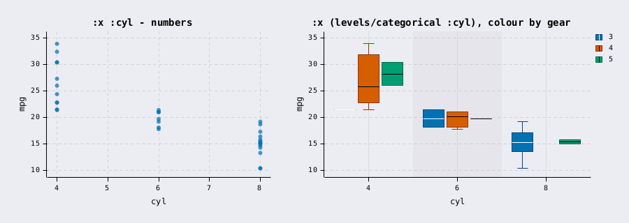
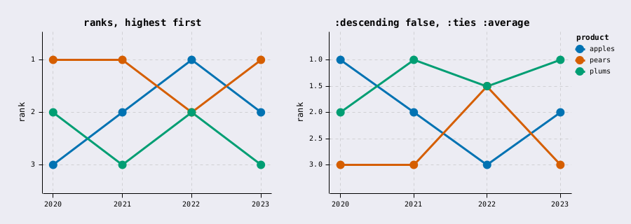
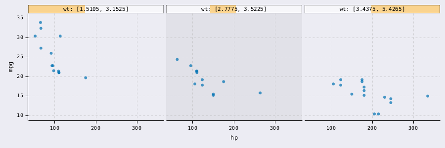

---
format:
  html:
    toc: true
    toc-location: right
    toc-depth: 4
    theme: cosmo
    include-in-header:
      text: |-
        <style>
        .data-table { width: fit-content; max-width: 100%; max-height: 15rem; overflow: auto; margin: 0 0 1rem 0; }
        .data-table .table-responsive { overflow: visible; }
        .data-table table { font-size: 0.75rem; width: auto; margin: 0; }
        .data-table th, .data-table td { padding: 0.1rem 0.45rem !important; white-space: nowrap; }
        .data-table thead th { position: sticky; top: 0; background: var(--bs-body-bg, #fff); }
        </style>
code-block-background: true

---
<style></style><style>.printedClojure .sourceCode {
  background-color: transparent;
  border-style: none;
}
</style><style>.clay-limit-image-width .clay-image {max-width: 100%}
.clay-side-by-side .sourceCode {margin: 0}
.clay-side-by-side {margin: 1em 0}
</style>
<script src="https://code.jquery.com/jquery-3.6.0.min.js" type="text/javascript"></script><script src="https://code.jquery.com/ui/1.13.1/jquery-ui.min.js" type="text/javascript"></script>

# Data functions: levels

Functions turning values into levels before plotting: numbers binned into intervals, numbers or dates read as
levels, levels ordered by a statistic, rows ranked within each x, and overlapping intervals (shingles) for
conditioning. Each returns rows, a vector of levels (`order-levels`) or a mapping marker (`categorical`) for an
ordinary plot; options are checked against the table shown.


::: {.sourceClojure}
```clojure
(ns reference.data-levels
  (:require [fastmath.stats :as stats]
            [cljplot2.chart :as chart]
            [cljplot2.core :as plot]
            [cljplot2.data.levels :as levels]
            [cljplot2.data.shingle :as shingle]
            [cljplot2.describe :as describe]
            [notebook-utils :as nu]))
```
:::


Data: Motor Trend car road tests (1974), R datasets package `mtcars` (Henderson & Velleman 1981); licence: Part of R (GPL-2 | GPL-3).


::: {.sourceClojure}
```clojure
(def mtcars (nu/dataset :mtcars))
```
:::


```{=html}
<div class="data-table"><table class="table table-hover table-responsive clay-table"><thead><tr><th>model</th><th>mpg</th><th>cyl</th><th>disp</th><th>hp</th><th>drat</th><th>wt</th><th>qsec</th><th>vs</th><th>am</th><th>gear</th><th>carb</th></tr></thead><tbody><tr><td>Mazda RX4</td><td>21</td><td>6</td><td>160</td><td>110</td><td>3.9</td><td>2.62</td><td>16.46</td><td>0</td><td>1</td><td>4</td><td>4</td></tr><tr><td>Mazda RX4 Wag</td><td>21</td><td>6</td><td>160</td><td>110</td><td>3.9</td><td>2.875</td><td>17.02</td><td>0</td><td>1</td><td>4</td><td>4</td></tr><tr><td>Datsun 710</td><td>22.8</td><td>4</td><td>108</td><td>93</td><td>3.85</td><td>2.32</td><td>18.61</td><td>1</td><td>1</td><td>4</td><td>1</td></tr><tr><td>Hornet 4 Drive</td><td>21.4</td><td>6</td><td>258</td><td>110</td><td>3.08</td><td>3.215</td><td>19.44</td><td>1</td><td>0</td><td>3</td><td>1</td></tr><tr><td>Hornet Sportabout</td><td>18.7</td><td>8</td><td>360</td><td>175</td><td>3.15</td><td>3.44</td><td>17.02</td><td>0</td><td>0</td><td>3</td><td>2</td></tr><tr><td>Valiant</td><td>18.1</td><td>6</td><td>225</td><td>105</td><td>2.76</td><td>3.46</td><td>20.22</td><td>1</td><td>0</td><td>3</td><td>1</td></tr><tr><td>Duster 360</td><td>14.3</td><td>8</td><td>360</td><td>245</td><td>3.21</td><td>3.57</td><td>15.84</td><td>0</td><td>0</td><td>3</td><td>4</td></tr><tr><td>Merc 240D</td><td>24.4</td><td>4</td><td>146.7</td><td>62</td><td>3.69</td><td>3.19</td><td>20</td><td>1</td><td>0</td><td>4</td><td>2</td></tr><tr><td>Merc 230</td><td>22.8</td><td>4</td><td>140.8</td><td>95</td><td>3.92</td><td>3.15</td><td>22.9</td><td>1</td><td>0</td><td>4</td><td>2</td></tr><tr><td>Merc 280</td><td>19.2</td><td>6</td><td>167.6</td><td>123</td><td>3.92</td><td>3.44</td><td>18.3</td><td>1</td><td>0</td><td>4</td><td>4</td></tr><tr><td>Merc 280C</td><td>17.8</td><td>6</td><td>167.6</td><td>123</td><td>3.92</td><td>3.44</td><td>18.9</td><td>1</td><td>0</td><td>4</td><td>4</td></tr><tr><td>Merc 450SE</td><td>16.4</td><td>8</td><td>275.8</td><td>180</td><td>3.07</td><td>4.07</td><td>17.4</td><td>0</td><td>0</td><td>3</td><td>3</td></tr><tr><td>Merc 450SL</td><td>17.3</td><td>8</td><td>275.8</td><td>180</td><td>3.07</td><td>3.73</td><td>17.6</td><td>0</td><td>0</td><td>3</td><td>3</td></tr><tr><td>Merc 450SLC</td><td>15.2</td><td>8</td><td>275.8</td><td>180</td><td>3.07</td><td>3.78</td><td>18</td><td>0</td><td>0</td><td>3</td><td>3</td></tr><tr><td>Cadillac Fleetwood</td><td>10.4</td><td>8</td><td>472</td><td>205</td><td>2.93</td><td>5.25</td><td>17.98</td><td>0</td><td>0</td><td>3</td><td>4</td></tr><tr><td>Lincoln Continental</td><td>10.4</td><td>8</td><td>460</td><td>215</td><td>3</td><td>5.424</td><td>17.82</td><td>0</td><td>0</td><td>3</td><td>4</td></tr><tr><td>Chrysler Imperial</td><td>14.7</td><td>8</td><td>440</td><td>230</td><td>3.23</td><td>5.345</td><td>17.42</td><td>0</td><td>0</td><td>3</td><td>4</td></tr><tr><td>Fiat 128</td><td>32.4</td><td>4</td><td>78.7</td><td>66</td><td>4.08</td><td>2.2</td><td>19.47</td><td>1</td><td>1</td><td>4</td><td>1</td></tr><tr><td>Honda Civic</td><td>30.4</td><td>4</td><td>75.7</td><td>52</td><td>4.93</td><td>1.615</td><td>18.52</td><td>1</td><td>1</td><td>4</td><td>2</td></tr><tr><td>Toyota Corolla</td><td>33.9</td><td>4</td><td>71.1</td><td>65</td><td>4.22</td><td>1.835</td><td>19.9</td><td>1</td><td>1</td><td>4</td><td>1</td></tr><tr><td>Toyota Corona</td><td>21.5</td><td>4</td><td>120.1</td><td>97</td><td>3.7</td><td>2.465</td><td>20.01</td><td>1</td><td>0</td><td>3</td><td>1</td></tr><tr><td>Dodge Challenger</td><td>15.5</td><td>8</td><td>318</td><td>150</td><td>2.76</td><td>3.52</td><td>16.87</td><td>0</td><td>0</td><td>3</td><td>2</td></tr><tr><td>AMC Javelin</td><td>15.2</td><td>8</td><td>304</td><td>150</td><td>3.15</td><td>3.435</td><td>17.3</td><td>0</td><td>0</td><td>3</td><td>2</td></tr><tr><td>Camaro Z28</td><td>13.3</td><td>8</td><td>350</td><td>245</td><td>3.73</td><td>3.84</td><td>15.41</td><td>0</td><td>0</td><td>3</td><td>4</td></tr><tr><td>Pontiac Firebird</td><td>19.2</td><td>8</td><td>400</td><td>175</td><td>3.08</td><td>3.845</td><td>17.05</td><td>0</td><td>0</td><td>3</td><td>2</td></tr><tr><td>Fiat X1-9</td><td>27.3</td><td>4</td><td>79</td><td>66</td><td>4.08</td><td>1.935</td><td>18.9</td><td>1</td><td>1</td><td>4</td><td>1</td></tr><tr><td>Porsche 914-2</td><td>26</td><td>4</td><td>120.3</td><td>91</td><td>4.43</td><td>2.14</td><td>16.7</td><td>0</td><td>1</td><td>5</td><td>2</td></tr><tr><td>Lotus Europa</td><td>30.4</td><td>4</td><td>95.1</td><td>113</td><td>3.77</td><td>1.513</td><td>16.9</td><td>1</td><td>1</td><td>5</td><td>2</td></tr><tr><td>Ford Pantera L</td><td>15.8</td><td>8</td><td>351</td><td>264</td><td>4.22</td><td>3.17</td><td>14.5</td><td>0</td><td>1</td><td>5</td><td>4</td></tr><tr><td>Ferrari Dino</td><td>19.7</td><td>6</td><td>145</td><td>175</td><td>3.62</td><td>2.77</td><td>15.5</td><td>0</td><td>1</td><td>5</td><td>6</td></tr><tr><td>Maserati Bora</td><td>15</td><td>8</td><td>301</td><td>335</td><td>3.54</td><td>3.57</td><td>14.6</td><td>0</td><td>1</td><td>5</td><td>8</td></tr><tr><td>Volvo 142E</td><td>21.4</td><td>4</td><td>121</td><td>109</td><td>4.11</td><td>2.78</td><td>18.6</td><td>1</td><td>1</td><td>4</td><td>2</td></tr></tbody></table></div>
```


Data: Edgar Anderson's iris measurements, R datasets package `iris` (Anderson 1935; Fisher 1936); licence: Part of R (GPL-2 | GPL-3).


::: {.sourceClojure}
```clojure
(def iris (nu/dataset :iris))
```
:::


```{=html}
<div class="data-table"><table class="table table-hover table-responsive clay-table"><thead><tr><th>sepal-length</th><th>sepal-width</th><th>petal-length</th><th>petal-width</th><th>species</th></tr></thead><tbody><tr><td>5.1</td><td>3.5</td><td>1.4</td><td>0.2</td><td>setosa</td></tr><tr><td>4.9</td><td>3</td><td>1.4</td><td>0.2</td><td>setosa</td></tr><tr><td>4.7</td><td>3.2</td><td>1.3</td><td>0.2</td><td>setosa</td></tr><tr><td>4.6</td><td>3.1</td><td>1.5</td><td>0.2</td><td>setosa</td></tr><tr><td>5</td><td>3.6</td><td>1.4</td><td>0.2</td><td>setosa</td></tr><tr><td>5.4</td><td>3.9</td><td>1.7</td><td>0.4</td><td>setosa</td></tr><tr><td>4.6</td><td>3.4</td><td>1.4</td><td>0.3</td><td>setosa</td></tr><tr><td>5</td><td>3.4</td><td>1.5</td><td>0.2</td><td>setosa</td></tr><tr><td>4.4</td><td>2.9</td><td>1.4</td><td>0.2</td><td>setosa</td></tr><tr><td>4.9</td><td>3.1</td><td>1.5</td><td>0.1</td><td>setosa</td></tr><tr><td>5.4</td><td>3.7</td><td>1.5</td><td>0.2</td><td>setosa</td></tr><tr><td>4.8</td><td>3.4</td><td>1.6</td><td>0.2</td><td>setosa</td></tr><tr><td>4.8</td><td>3</td><td>1.4</td><td>0.1</td><td>setosa</td></tr><tr><td>4.3</td><td>3</td><td>1.1</td><td>0.1</td><td>setosa</td></tr><tr><td>5.8</td><td>4</td><td>1.2</td><td>0.2</td><td>setosa</td></tr><tr><td>5.7</td><td>4.4</td><td>1.5</td><td>0.4</td><td>setosa</td></tr><tr><td>5.4</td><td>3.9</td><td>1.3</td><td>0.4</td><td>setosa</td></tr><tr><td>5.1</td><td>3.5</td><td>1.4</td><td>0.3</td><td>setosa</td></tr><tr><td>5.7</td><td>3.8</td><td>1.7</td><td>0.3</td><td>setosa</td></tr><tr><td>5.1</td><td>3.8</td><td>1.5</td><td>0.3</td><td>setosa</td></tr><tr><td>5.4</td><td>3.4</td><td>1.7</td><td>0.2</td><td>setosa</td></tr><tr><td>5.1</td><td>3.7</td><td>1.5</td><td>0.4</td><td>setosa</td></tr><tr><td>4.6</td><td>3.6</td><td>1</td><td>0.2</td><td>setosa</td></tr><tr><td>5.1</td><td>3.3</td><td>1.7</td><td>0.5</td><td>setosa</td></tr><tr><td>4.8</td><td>3.4</td><td>1.9</td><td>0.2</td><td>setosa</td></tr><tr><td>5</td><td>3</td><td>1.6</td><td>0.2</td><td>setosa</td></tr><tr><td>5</td><td>3.4</td><td>1.6</td><td>0.4</td><td>setosa</td></tr><tr><td>5.2</td><td>3.5</td><td>1.5</td><td>0.2</td><td>setosa</td></tr><tr><td>5.2</td><td>3.4</td><td>1.4</td><td>0.2</td><td>setosa</td></tr><tr><td>4.7</td><td>3.2</td><td>1.6</td><td>0.2</td><td>setosa</td></tr><tr><td>4.8</td><td>3.1</td><td>1.6</td><td>0.2</td><td>setosa</td></tr><tr><td>5.4</td><td>3.4</td><td>1.5</td><td>0.4</td><td>setosa</td></tr><tr><td>5.2</td><td>4.1</td><td>1.5</td><td>0.1</td><td>setosa</td></tr><tr><td>5.5</td><td>4.2</td><td>1.4</td><td>0.2</td><td>setosa</td></tr><tr><td>4.9</td><td>3.1</td><td>1.5</td><td>0.2</td><td>setosa</td></tr><tr><td>5</td><td>3.2</td><td>1.2</td><td>0.2</td><td>setosa</td></tr><tr><td>5.5</td><td>3.5</td><td>1.3</td><td>0.2</td><td>setosa</td></tr><tr><td>4.9</td><td>3.6</td><td>1.4</td><td>0.1</td><td>setosa</td></tr><tr><td>4.4</td><td>3</td><td>1.3</td><td>0.2</td><td>setosa</td></tr><tr><td>5.1</td><td>3.4</td><td>1.5</td><td>0.2</td><td>setosa</td></tr><tr><td>5</td><td>3.5</td><td>1.3</td><td>0.3</td><td>setosa</td></tr><tr><td>4.5</td><td>2.3</td><td>1.3</td><td>0.3</td><td>setosa</td></tr><tr><td>4.4</td><td>3.2</td><td>1.3</td><td>0.2</td><td>setosa</td></tr><tr><td>5</td><td>3.5</td><td>1.6</td><td>0.6</td><td>setosa</td></tr><tr><td>5.1</td><td>3.8</td><td>1.9</td><td>0.4</td><td>setosa</td></tr><tr><td>4.8</td><td>3</td><td>1.4</td><td>0.3</td><td>setosa</td></tr><tr><td>5.1</td><td>3.8</td><td>1.6</td><td>0.2</td><td>setosa</td></tr><tr><td>4.6</td><td>3.2</td><td>1.4</td><td>0.2</td><td>setosa</td></tr><tr><td>5.3</td><td>3.7</td><td>1.5</td><td>0.2</td><td>setosa</td></tr><tr><td>5</td><td>3.3</td><td>1.4</td><td>0.2</td><td>setosa</td></tr><tr><td>7</td><td>3.2</td><td>4.7</td><td>1.4</td><td>versicolor</td></tr><tr><td>6.4</td><td>3.2</td><td>4.5</td><td>1.5</td><td>versicolor</td></tr><tr><td>6.9</td><td>3.1</td><td>4.9</td><td>1.5</td><td>versicolor</td></tr><tr><td>5.5</td><td>2.3</td><td>4</td><td>1.3</td><td>versicolor</td></tr><tr><td>6.5</td><td>2.8</td><td>4.6</td><td>1.5</td><td>versicolor</td></tr><tr><td>5.7</td><td>2.8</td><td>4.5</td><td>1.3</td><td>versicolor</td></tr><tr><td>6.3</td><td>3.3</td><td>4.7</td><td>1.6</td><td>versicolor</td></tr><tr><td>4.9</td><td>2.4</td><td>3.3</td><td>1</td><td>versicolor</td></tr><tr><td>6.6</td><td>2.9</td><td>4.6</td><td>1.3</td><td>versicolor</td></tr><tr><td>5.2</td><td>2.7</td><td>3.9</td><td>1.4</td><td>versicolor</td></tr><tr><td>5</td><td>2</td><td>3.5</td><td>1</td><td>versicolor</td></tr><tr><td>5.9</td><td>3</td><td>4.2</td><td>1.5</td><td>versicolor</td></tr><tr><td>6</td><td>2.2</td><td>4</td><td>1</td><td>versicolor</td></tr><tr><td>6.1</td><td>2.9</td><td>4.7</td><td>1.4</td><td>versicolor</td></tr><tr><td>5.6</td><td>2.9</td><td>3.6</td><td>1.3</td><td>versicolor</td></tr><tr><td>6.7</td><td>3.1</td><td>4.4</td><td>1.4</td><td>versicolor</td></tr><tr><td>5.6</td><td>3</td><td>4.5</td><td>1.5</td><td>versicolor</td></tr><tr><td>5.8</td><td>2.7</td><td>4.1</td><td>1</td><td>versicolor</td></tr><tr><td>6.2</td><td>2.2</td><td>4.5</td><td>1.5</td><td>versicolor</td></tr><tr><td>5.6</td><td>2.5</td><td>3.9</td><td>1.1</td><td>versicolor</td></tr><tr><td>5.9</td><td>3.2</td><td>4.8</td><td>1.8</td><td>versicolor</td></tr><tr><td>6.1</td><td>2.8</td><td>4</td><td>1.3</td><td>versicolor</td></tr><tr><td>6.3</td><td>2.5</td><td>4.9</td><td>1.5</td><td>versicolor</td></tr><tr><td>6.1</td><td>2.8</td><td>4.7</td><td>1.2</td><td>versicolor</td></tr><tr><td>6.4</td><td>2.9</td><td>4.3</td><td>1.3</td><td>versicolor</td></tr><tr><td>6.6</td><td>3</td><td>4.4</td><td>1.4</td><td>versicolor</td></tr><tr><td>6.8</td><td>2.8</td><td>4.8</td><td>1.4</td><td>versicolor</td></tr><tr><td>6.7</td><td>3</td><td>5</td><td>1.7</td><td>versicolor</td></tr><tr><td>6</td><td>2.9</td><td>4.5</td><td>1.5</td><td>versicolor</td></tr><tr><td>5.7</td><td>2.6</td><td>3.5</td><td>1</td><td>versicolor</td></tr><tr><td>5.5</td><td>2.4</td><td>3.8</td><td>1.1</td><td>versicolor</td></tr><tr><td>5.5</td><td>2.4</td><td>3.7</td><td>1</td><td>versicolor</td></tr><tr><td>5.8</td><td>2.7</td><td>3.9</td><td>1.2</td><td>versicolor</td></tr><tr><td>6</td><td>2.7</td><td>5.1</td><td>1.6</td><td>versicolor</td></tr><tr><td>5.4</td><td>3</td><td>4.5</td><td>1.5</td><td>versicolor</td></tr><tr><td>6</td><td>3.4</td><td>4.5</td><td>1.6</td><td>versicolor</td></tr><tr><td>6.7</td><td>3.1</td><td>4.7</td><td>1.5</td><td>versicolor</td></tr><tr><td>6.3</td><td>2.3</td><td>4.4</td><td>1.3</td><td>versicolor</td></tr><tr><td>5.6</td><td>3</td><td>4.1</td><td>1.3</td><td>versicolor</td></tr><tr><td>5.5</td><td>2.5</td><td>4</td><td>1.3</td><td>versicolor</td></tr><tr><td>5.5</td><td>2.6</td><td>4.4</td><td>1.2</td><td>versicolor</td></tr><tr><td>6.1</td><td>3</td><td>4.6</td><td>1.4</td><td>versicolor</td></tr><tr><td>5.8</td><td>2.6</td><td>4</td><td>1.2</td><td>versicolor</td></tr><tr><td>5</td><td>2.3</td><td>3.3</td><td>1</td><td>versicolor</td></tr><tr><td>5.6</td><td>2.7</td><td>4.2</td><td>1.3</td><td>versicolor</td></tr><tr><td>5.7</td><td>3</td><td>4.2</td><td>1.2</td><td>versicolor</td></tr><tr><td>5.7</td><td>2.9</td><td>4.2</td><td>1.3</td><td>versicolor</td></tr><tr><td>6.2</td><td>2.9</td><td>4.3</td><td>1.3</td><td>versicolor</td></tr><tr><td>5.1</td><td>2.5</td><td>3</td><td>1.1</td><td>versicolor</td></tr><tr><td>5.7</td><td>2.8</td><td>4.1</td><td>1.3</td><td>versicolor</td></tr><tr><td>…</td><td>…</td><td>…</td><td>…</td><td>…</td></tr></tbody></table></div>
```


## levels/bin

Adds the bin of a numeric value to every row - an interval `[lo, hi)` (the last one closed), printed like R's
`cut`; a missing or non-numeric value gets no bin.

::: {.clay-table}

```{=html}
<table class="table table-hover table-responsive clay-table"><thead><tr><th>Option</th><th>Type</th><th>Default</th><th>Description</th></tr></thead><tbody><tr><td>:as (required)</td><td>the key of the bin column</td><td></td><td>the key of the bin column added to every row (required)</td></tr><tr><td>:bins</td><td>keyword or vector of a finite number (at least 2) or quantile bins {:quantiles q :estimation e}: q a positive count or a vector of increasing probabilities strictly between 0 and 1, e one of [:legacy :r1 :r2 :r3 :r4 :r5 :r6 :r7 :r8 :r9] or a positive integer</td><td>:sturges</td><td>the bins: a fastmath bin-estimation method, a bin count, a vector of increasing breaks or quantile bins {:quantiles q :estimation e}</td></tr><tr><td>:digits</td><td>a positive integer</td><td>3</td><td>the fewest significant digits of the printed bounds (more when needed to keep the printed breaks distinct)</td></tr><tr><td>:label</td><td>string or true or false or nil</td><td></td><td>the series name printed in every bin: a string, or true for the accessor's name (keyword accessors only); none when absent</td></tr></tbody></table>
```

:::


The bins of the cars' horsepower - five equal-width bins, bounds printed with 2 significant digits - as a new
column:


```{=html}
<div class="data-table"><table class="table table-hover table-responsive clay-table"><thead><tr><th>hp-bin</th><th>qsec</th><th>cyl</th><th>am</th><th>gear</th><th>disp</th><th>wt</th><th>drat</th><th>hp</th><th>mpg</th><th>vs</th><th>carb</th><th>model</th></tr></thead><tbody><tr><td>[110, 170)</td><td>16.46</td><td>6</td><td>1</td><td>4</td><td>160</td><td>2.62</td><td>3.9</td><td>110</td><td>21</td><td>0</td><td>4</td><td>Mazda RX4</td></tr><tr><td>[110, 170)</td><td>17.02</td><td>6</td><td>1</td><td>4</td><td>160</td><td>2.875</td><td>3.9</td><td>110</td><td>21</td><td>0</td><td>4</td><td>Mazda RX4 Wag</td></tr><tr><td>[52, 110)</td><td>18.61</td><td>4</td><td>1</td><td>4</td><td>108</td><td>2.32</td><td>3.85</td><td>93</td><td>22.8</td><td>1</td><td>1</td><td>Datsun 710</td></tr><tr><td>[110, 170)</td><td>19.44</td><td>6</td><td>0</td><td>3</td><td>258</td><td>3.215</td><td>3.08</td><td>110</td><td>21.4</td><td>1</td><td>1</td><td>Hornet 4 Drive</td></tr><tr><td>[170, 220)</td><td>17.02</td><td>8</td><td>0</td><td>3</td><td>360</td><td>3.44</td><td>3.15</td><td>175</td><td>18.7</td><td>0</td><td>2</td><td>Hornet Sportabout</td></tr><tr><td>[52, 110)</td><td>20.22</td><td>6</td><td>0</td><td>3</td><td>225</td><td>3.46</td><td>2.76</td><td>105</td><td>18.1</td><td>1</td><td>1</td><td>Valiant</td></tr><tr><td>[220, 280)</td><td>15.84</td><td>8</td><td>0</td><td>3</td><td>360</td><td>3.57</td><td>3.21</td><td>245</td><td>14.3</td><td>0</td><td>4</td><td>Duster 360</td></tr><tr><td>[52, 110)</td><td>20</td><td>4</td><td>0</td><td>4</td><td>146.7</td><td>3.19</td><td>3.69</td><td>62</td><td>24.4</td><td>1</td><td>2</td><td>Merc 240D</td></tr><tr><td>[52, 110)</td><td>22.9</td><td>4</td><td>0</td><td>4</td><td>140.8</td><td>3.15</td><td>3.92</td><td>95</td><td>22.8</td><td>1</td><td>2</td><td>Merc 230</td></tr><tr><td>[110, 170)</td><td>18.3</td><td>6</td><td>0</td><td>4</td><td>167.6</td><td>3.44</td><td>3.92</td><td>123</td><td>19.2</td><td>1</td><td>4</td><td>Merc 280</td></tr><tr><td>[110, 170)</td><td>18.9</td><td>6</td><td>0</td><td>4</td><td>167.6</td><td>3.44</td><td>3.92</td><td>123</td><td>17.8</td><td>1</td><td>4</td><td>Merc 280C</td></tr><tr><td>[170, 220)</td><td>17.4</td><td>8</td><td>0</td><td>3</td><td>275.8</td><td>4.07</td><td>3.07</td><td>180</td><td>16.4</td><td>0</td><td>3</td><td>Merc 450SE</td></tr><tr><td>[170, 220)</td><td>17.6</td><td>8</td><td>0</td><td>3</td><td>275.8</td><td>3.73</td><td>3.07</td><td>180</td><td>17.3</td><td>0</td><td>3</td><td>Merc 450SL</td></tr><tr><td>[170, 220)</td><td>18</td><td>8</td><td>0</td><td>3</td><td>275.8</td><td>3.78</td><td>3.07</td><td>180</td><td>15.2</td><td>0</td><td>3</td><td>Merc 450SLC</td></tr><tr><td>[170, 220)</td><td>17.98</td><td>8</td><td>0</td><td>3</td><td>472</td><td>5.25</td><td>2.93</td><td>205</td><td>10.4</td><td>0</td><td>4</td><td>Cadillac Fleetwood</td></tr><tr><td>[170, 220)</td><td>17.82</td><td>8</td><td>0</td><td>3</td><td>460</td><td>5.424</td><td>3</td><td>215</td><td>10.4</td><td>0</td><td>4</td><td>Lincoln Continental</td></tr><tr><td>[220, 280)</td><td>17.42</td><td>8</td><td>0</td><td>3</td><td>440</td><td>5.345</td><td>3.23</td><td>230</td><td>14.7</td><td>0</td><td>4</td><td>Chrysler Imperial</td></tr><tr><td>[52, 110)</td><td>19.47</td><td>4</td><td>1</td><td>4</td><td>78.7</td><td>2.2</td><td>4.08</td><td>66</td><td>32.4</td><td>1</td><td>1</td><td>Fiat 128</td></tr><tr><td>[52, 110)</td><td>18.52</td><td>4</td><td>1</td><td>4</td><td>75.7</td><td>1.615</td><td>4.93</td><td>52</td><td>30.4</td><td>1</td><td>2</td><td>Honda Civic</td></tr><tr><td>[52, 110)</td><td>19.9</td><td>4</td><td>1</td><td>4</td><td>71.1</td><td>1.835</td><td>4.22</td><td>65</td><td>33.9</td><td>1</td><td>1</td><td>Toyota Corolla</td></tr><tr><td>[52, 110)</td><td>20.01</td><td>4</td><td>0</td><td>3</td><td>120.1</td><td>2.465</td><td>3.7</td><td>97</td><td>21.5</td><td>1</td><td>1</td><td>Toyota Corona</td></tr><tr><td>[110, 170)</td><td>16.87</td><td>8</td><td>0</td><td>3</td><td>318</td><td>3.52</td><td>2.76</td><td>150</td><td>15.5</td><td>0</td><td>2</td><td>Dodge Challenger</td></tr><tr><td>[110, 170)</td><td>17.3</td><td>8</td><td>0</td><td>3</td><td>304</td><td>3.435</td><td>3.15</td><td>150</td><td>15.2</td><td>0</td><td>2</td><td>AMC Javelin</td></tr><tr><td>[220, 280)</td><td>15.41</td><td>8</td><td>0</td><td>3</td><td>350</td><td>3.84</td><td>3.73</td><td>245</td><td>13.3</td><td>0</td><td>4</td><td>Camaro Z28</td></tr><tr><td>[170, 220)</td><td>17.05</td><td>8</td><td>0</td><td>3</td><td>400</td><td>3.845</td><td>3.08</td><td>175</td><td>19.2</td><td>0</td><td>2</td><td>Pontiac Firebird</td></tr><tr><td>[52, 110)</td><td>18.9</td><td>4</td><td>1</td><td>4</td><td>79</td><td>1.935</td><td>4.08</td><td>66</td><td>27.3</td><td>1</td><td>1</td><td>Fiat X1-9</td></tr><tr><td>[52, 110)</td><td>16.7</td><td>4</td><td>1</td><td>5</td><td>120.3</td><td>2.14</td><td>4.43</td><td>91</td><td>26</td><td>0</td><td>2</td><td>Porsche 914-2</td></tr><tr><td>[110, 170)</td><td>16.9</td><td>4</td><td>1</td><td>5</td><td>95.1</td><td>1.513</td><td>3.77</td><td>113</td><td>30.4</td><td>1</td><td>2</td><td>Lotus Europa</td></tr><tr><td>[220, 280)</td><td>14.5</td><td>8</td><td>1</td><td>5</td><td>351</td><td>3.17</td><td>4.22</td><td>264</td><td>15.8</td><td>0</td><td>4</td><td>Ford Pantera L</td></tr><tr><td>[170, 220)</td><td>15.5</td><td>6</td><td>1</td><td>5</td><td>145</td><td>2.77</td><td>3.62</td><td>175</td><td>19.7</td><td>0</td><td>6</td><td>Ferrari Dino</td></tr><tr><td>[280, 340]</td><td>14.6</td><td>8</td><td>1</td><td>5</td><td>301</td><td>3.57</td><td>3.54</td><td>335</td><td>15</td><td>0</td><td>8</td><td>Maserati Bora</td></tr><tr><td>[110, 170)</td><td>18.6</td><td>4</td><td>1</td><td>4</td><td>121</td><td>2.78</td><td>4.11</td><td>109</td><td>21.4</td><td>1</td><td>2</td><td>Volvo 142E</td></tr></tbody></table></div>
```


Bins are levels: counted by a [bar](reference.charts_bars_ranges.html#bar) chart (`:stat :count`), in interval
order. Explicit breaks (left), quantile bins of equal counts (middle), and the series name printed in every bin
(right):


::: {.sourceClojure}
```clojure
(plot/render-image (plot/arrange [{:data (levels/bin mtcars :hp {:as :bin :bins [50 100 150 200 350]})
                                   :mapping {:x :bin}
                                   :charts [(chart/bar {:stat :count})]
                                   :labels {:title ":bins [50 100 150 200 350]"}}
                                  {:data (levels/bin mtcars :hp {:as :bin :bins {:quantiles 4}})
                                   :mapping {:x :bin}
                                   :charts [(chart/bar {:stat :count})]
                                   :labels {:title ":bins {:quantiles 4}"}}
                                  {:data (levels/bin mtcars :hp {:as :bin :bins :sturges :label true})
                                   :mapping {:y :bin}
                                   :charts [(chart/bar {:stat :count})]
                                   :scales {:y {:reverse true}}
                                   :labels {:title ":bins :sturges, :label true"}}]
                                 {:columns 3 :widths [1 1 1.3]})
                   {:width 1000 :height 320})
```
:::


::: {.clay-image}

:::


## levels/categorical

A mapping marker: the accessor reads its values as usual, and its dimension is declared categorical - numbers or
dates become levels (bands on a position axis, an ordinal legend for an aesthetic). It takes no options.


::: {.sourceClojure}
```clojure
(plot/render-image (plot/arrange [{:data mtcars
                                   :mapping {:x :cyl :y :mpg}
                                   :charts [(chart/scatter)]
                                   :labels {:title ":x :cyl - numbers"}}
                                  {:data mtcars
                                   :mapping {:x (levels/categorical :cyl) :y :mpg :color (levels/categorical :gear)}
                                   :charts [(chart/box)]
                                   :labels {:title ":x (levels/categorical :cyl), colour by gear"}}]
                                 {:columns 2 :widths [1 1.25]})
                   {:width 900 :height 320})
```
:::


::: {.clay-image}

:::


## levels/order-levels

The levels of a column ordered by a statistic of a value in each level - for a scale `:domain`.

::: {.clay-table}

```{=html}
<table class="table table-hover table-responsive clay-table"><thead><tr><th>Option</th><th>Type</th><th>Default</th><th>Description</th></tr></thead><tbody><tr><td>:descending</td><td>true or false</td><td>false</td><td>order the levels by the statistic descending</td></tr></tbody></table>
```

:::


Iris species by their median petal length, ascending and descending:


::: {.sourceClojure}
```clojure
(levels/order-levels iris :species :petal-length stats/median)
```
:::


::: {.printedClojure}
```clojure
["setosa" "versicolor" "virginica"]

```
:::


::: {.sourceClojure}
```clojure
(levels/order-levels iris :species :petal-length stats/median {:descending true})
```
:::


::: {.printedClojure}
```clojure
["virginica" "versicolor" "setosa"]

```
:::


The descending order as the domain of the level axis - the cars' carburettor counts, highest median mpg first:


::: {.sourceClojure}
```clojure
(plot/render-image {:data mtcars
                    :mapping {:x (levels/categorical :carb) :y :mpg}
                    :charts [(chart/box)]
                    :scales {:x {:domain (levels/order-levels mtcars :carb :mpg stats/median {:descending true})}}
                    :labels {:title "carburettors by median mpg"}}
                   {:width 600 :height 320})
```
:::


::: {.clay-image}

:::


## levels/rank-rows

Ranks the rows sharing an x by a value - rank 1 the highest by default - e.g. for a bump chart (a line through
the ranks on a reversed y domain).

::: {.clay-table}

```{=html}
<table class="table table-hover table-responsive clay-table"><thead><tr><th>Option</th><th>Type</th><th>Default</th><th>Description</th></tr></thead><tbody><tr><td>:as</td><td>the key of the rank column</td><td>:rank</td><td>the key of the rank column added to every row</td></tr><tr><td>:descending</td><td>true or false</td><td>true</td><td>rank the highest value first (rank 1)</td></tr><tr><td>:ties</td><td>one of :average :dense :first :last :max :min :random</td><td>:min</td><td>the fastmath.core/rank tie strategy (:min gives 1, 1, 3; :average gives doubles)</td></tr></tbody></table>
```

:::


::: {.sourceClojure}
```clojure
(def sales (for [[year amounts] [[2020 [5 9 7]] [2021 [8 9 4]] [2022 [9 6 6]] [2023 [7 10 5]]]
                 [product amount] (map vector ["apples" "pears" "plums"] amounts)]
             {:year year :product product :amount amount}))
```
:::


```{=html}
<div class="data-table"><table class="table table-hover table-responsive clay-table"><thead><tr><th>year</th><th>product</th><th>amount</th></tr></thead><tbody><tr><td>2020</td><td>apples</td><td>5</td></tr><tr><td>2020</td><td>pears</td><td>9</td></tr><tr><td>2020</td><td>plums</td><td>7</td></tr><tr><td>2021</td><td>apples</td><td>8</td></tr><tr><td>2021</td><td>pears</td><td>9</td></tr><tr><td>2021</td><td>plums</td><td>4</td></tr><tr><td>2022</td><td>apples</td><td>9</td></tr><tr><td>2022</td><td>pears</td><td>6</td></tr><tr><td>2022</td><td>plums</td><td>6</td></tr><tr><td>2023</td><td>apples</td><td>7</td></tr><tr><td>2023</td><td>pears</td><td>10</td></tr><tr><td>2023</td><td>plums</td><td>5</td></tr></tbody></table></div>
```


The ranks under `:place`, ties taking the lowest rank (2022: pears and plums share 2):


```{=html}
<div class="data-table"><table class="table table-hover table-responsive clay-table"><thead><tr><th>year</th><th>product</th><th>amount</th><th>place</th></tr></thead><tbody><tr><td>2020</td><td>apples</td><td>5</td><td>3</td></tr><tr><td>2020</td><td>pears</td><td>9</td><td>1</td></tr><tr><td>2020</td><td>plums</td><td>7</td><td>2</td></tr><tr><td>2021</td><td>apples</td><td>8</td><td>2</td></tr><tr><td>2021</td><td>pears</td><td>9</td><td>1</td></tr><tr><td>2021</td><td>plums</td><td>4</td><td>3</td></tr><tr><td>2022</td><td>apples</td><td>9</td><td>1</td></tr><tr><td>2022</td><td>pears</td><td>6</td><td>2</td></tr><tr><td>2022</td><td>plums</td><td>6</td><td>2</td></tr><tr><td>2023</td><td>apples</td><td>7</td><td>2</td></tr><tr><td>2023</td><td>pears</td><td>10</td><td>1</td></tr><tr><td>2023</td><td>plums</td><td>5</td><td>3</td></tr></tbody></table></div>
```


A bump chart of the ranks (left; rank 1 on top with the y scale's `:reverse true`, see
[Order and direction](reference.scales_axes_coords.html#order-and-direction)), and ranks counted from the lowest
amount with average ties (right):


::: {.sourceClojure}
```clojure
(plot/render-image (plot/arrange [{:data (levels/rank-rows sales :year :amount)
                                   :mapping {:x :year :y :rank :color :product}
                                   :charts [(chart/line {:line-width 3}) (chart/scatter {:size 12})]
                                   :scales {:y {:domain [0.7 3.3] :reverse true :ticks [1 2 3]}}
                                   :labels {:title "ranks, highest first" :y "rank"}
                                   :legend false}
                                  {:data (levels/rank-rows sales :year :amount {:descending false :ties :average})
                                   :mapping {:x :year :y :rank :color :product}
                                   :charts [(chart/line {:line-width 3}) (chart/scatter {:size 12})]
                                   :scales {:y {:domain [0.7 3.3] :reverse true :ticks [1 1.5 2 2.5 3]}}
                                   :labels {:title ":descending false, :ties :average" :y "rank"}}]
                                 {:columns 2 :widths [1 1.25]})
                   {:width 900 :height 320})
```
:::


::: {.clay-image}

:::


## shingle/shingle

Repeats every row once per interval containing its value - overlapping intervals (a lattice shingle) to
condition on a continuous variable, typically as a facet.

::: {.clay-table}

```{=html}
<table class="table table-hover table-responsive clay-table"><thead><tr><th>Option</th><th>Type</th><th>Default</th><th>Description</th></tr></thead><tbody><tr><td>:as (required)</td><td>the key of the interval column</td><td></td><td>the key of the interval column added to every repeated row (required)</td></tr><tr><td>:intervals</td><td>sequential of [a finite number, a finite number] (at least 1)</td><td>equal-count intervals from :n and :overlap</td><td>the intervals [[lo hi] ...], closed, lo <= hi</td></tr><tr><td>:n</td><td>a positive integer</td><td>6</td><td>the number of equal-count intervals (fewer when the data can't support them; ignored with :intervals)</td></tr><tr><td>:overlap</td><td>a number in [0 1)</td><td>0.5</td><td>the fraction of points shared by neighbouring equal-count intervals (ignored with :intervals)</td></tr><tr><td>:label</td><td>string or true or false or nil</td><td></td><td>the series name printed in every interval (and so in facet strips): a string, or true for the accessor's name (keyword accessors only); none when absent</td></tr></tbody></table>
```

:::


Equal-count intervals of the cars' weight - 3 of them, neighbours sharing a quarter of their points - as a facet
of mpg against horsepower ([facets](reference.data_mapping.html#facets)); the series name is printed in every
strip:


::: {.sourceClojure}
```clojure
(plot/render-image {:data (shingle/shingle mtcars :wt {:as :weight :n 3 :overlap 0.25 :label true})
                    :mapping {:x :hp :y :mpg :facet-col :weight}
                    :charts [(chart/scatter)]}
                   {:width 900 :height 300})
```
:::


::: {.clay-image}

:::


Explicit intervals instead, here overlapping by hand:


```{=html}
<div class="data-table"><table class="table table-hover table-responsive clay-table"><thead><tr><th>qsec</th><th>cyl</th><th>am</th><th>gear</th><th>disp</th><th>wt</th><th>weight</th><th>drat</th><th>hp</th><th>mpg</th><th>vs</th><th>carb</th><th>model</th></tr></thead><tbody><tr><td>16.46</td><td>6</td><td>1</td><td>4</td><td>160</td><td>2.62</td><td>[1.5, 3]</td><td>3.9</td><td>110</td><td>21</td><td>0</td><td>4</td><td>Mazda RX4</td></tr><tr><td>16.46</td><td>6</td><td>1</td><td>4</td><td>160</td><td>2.62</td><td>[2.5, 4]</td><td>3.9</td><td>110</td><td>21</td><td>0</td><td>4</td><td>Mazda RX4</td></tr><tr><td>17.02</td><td>6</td><td>1</td><td>4</td><td>160</td><td>2.875</td><td>[1.5, 3]</td><td>3.9</td><td>110</td><td>21</td><td>0</td><td>4</td><td>Mazda RX4 Wag</td></tr><tr><td>17.02</td><td>6</td><td>1</td><td>4</td><td>160</td><td>2.875</td><td>[2.5, 4]</td><td>3.9</td><td>110</td><td>21</td><td>0</td><td>4</td><td>Mazda RX4 Wag</td></tr><tr><td>18.61</td><td>4</td><td>1</td><td>4</td><td>108</td><td>2.32</td><td>[1.5, 3]</td><td>3.85</td><td>93</td><td>22.8</td><td>1</td><td>1</td><td>Datsun 710</td></tr><tr><td>19.44</td><td>6</td><td>0</td><td>3</td><td>258</td><td>3.215</td><td>[2.5, 4]</td><td>3.08</td><td>110</td><td>21.4</td><td>1</td><td>1</td><td>Hornet 4 Drive</td></tr><tr><td>17.02</td><td>8</td><td>0</td><td>3</td><td>360</td><td>3.44</td><td>[2.5, 4]</td><td>3.15</td><td>175</td><td>18.7</td><td>0</td><td>2</td><td>Hornet Sportabout</td></tr><tr><td>20.22</td><td>6</td><td>0</td><td>3</td><td>225</td><td>3.46</td><td>[2.5, 4]</td><td>2.76</td><td>105</td><td>18.1</td><td>1</td><td>1</td><td>Valiant</td></tr><tr><td>15.84</td><td>8</td><td>0</td><td>3</td><td>360</td><td>3.57</td><td>[2.5, 4]</td><td>3.21</td><td>245</td><td>14.3</td><td>0</td><td>4</td><td>Duster 360</td></tr><tr><td>15.84</td><td>8</td><td>0</td><td>3</td><td>360</td><td>3.57</td><td>[3.5, 5.5]</td><td>3.21</td><td>245</td><td>14.3</td><td>0</td><td>4</td><td>Duster 360</td></tr><tr><td>20</td><td>4</td><td>0</td><td>4</td><td>146.7</td><td>3.19</td><td>[2.5, 4]</td><td>3.69</td><td>62</td><td>24.4</td><td>1</td><td>2</td><td>Merc 240D</td></tr><tr><td>22.9</td><td>4</td><td>0</td><td>4</td><td>140.8</td><td>3.15</td><td>[2.5, 4]</td><td>3.92</td><td>95</td><td>22.8</td><td>1</td><td>2</td><td>Merc 230</td></tr><tr><td>18.3</td><td>6</td><td>0</td><td>4</td><td>167.6</td><td>3.44</td><td>[2.5, 4]</td><td>3.92</td><td>123</td><td>19.2</td><td>1</td><td>4</td><td>Merc 280</td></tr><tr><td>18.9</td><td>6</td><td>0</td><td>4</td><td>167.6</td><td>3.44</td><td>[2.5, 4]</td><td>3.92</td><td>123</td><td>17.8</td><td>1</td><td>4</td><td>Merc 280C</td></tr><tr><td>17.4</td><td>8</td><td>0</td><td>3</td><td>275.8</td><td>4.07</td><td>[3.5, 5.5]</td><td>3.07</td><td>180</td><td>16.4</td><td>0</td><td>3</td><td>Merc 450SE</td></tr><tr><td>17.6</td><td>8</td><td>0</td><td>3</td><td>275.8</td><td>3.73</td><td>[2.5, 4]</td><td>3.07</td><td>180</td><td>17.3</td><td>0</td><td>3</td><td>Merc 450SL</td></tr><tr><td>17.6</td><td>8</td><td>0</td><td>3</td><td>275.8</td><td>3.73</td><td>[3.5, 5.5]</td><td>3.07</td><td>180</td><td>17.3</td><td>0</td><td>3</td><td>Merc 450SL</td></tr><tr><td>18</td><td>8</td><td>0</td><td>3</td><td>275.8</td><td>3.78</td><td>[2.5, 4]</td><td>3.07</td><td>180</td><td>15.2</td><td>0</td><td>3</td><td>Merc 450SLC</td></tr><tr><td>18</td><td>8</td><td>0</td><td>3</td><td>275.8</td><td>3.78</td><td>[3.5, 5.5]</td><td>3.07</td><td>180</td><td>15.2</td><td>0</td><td>3</td><td>Merc 450SLC</td></tr><tr><td>17.98</td><td>8</td><td>0</td><td>3</td><td>472</td><td>5.25</td><td>[3.5, 5.5]</td><td>2.93</td><td>205</td><td>10.4</td><td>0</td><td>4</td><td>Cadillac Fleetwood</td></tr><tr><td>17.82</td><td>8</td><td>0</td><td>3</td><td>460</td><td>5.424</td><td>[3.5, 5.5]</td><td>3</td><td>215</td><td>10.4</td><td>0</td><td>4</td><td>Lincoln Continental</td></tr><tr><td>17.42</td><td>8</td><td>0</td><td>3</td><td>440</td><td>5.345</td><td>[3.5, 5.5]</td><td>3.23</td><td>230</td><td>14.7</td><td>0</td><td>4</td><td>Chrysler Imperial</td></tr><tr><td>19.47</td><td>4</td><td>1</td><td>4</td><td>78.7</td><td>2.2</td><td>[1.5, 3]</td><td>4.08</td><td>66</td><td>32.4</td><td>1</td><td>1</td><td>Fiat 128</td></tr><tr><td>18.52</td><td>4</td><td>1</td><td>4</td><td>75.7</td><td>1.615</td><td>[1.5, 3]</td><td>4.93</td><td>52</td><td>30.4</td><td>1</td><td>2</td><td>Honda Civic</td></tr><tr><td>19.9</td><td>4</td><td>1</td><td>4</td><td>71.1</td><td>1.835</td><td>[1.5, 3]</td><td>4.22</td><td>65</td><td>33.9</td><td>1</td><td>1</td><td>Toyota Corolla</td></tr><tr><td>20.01</td><td>4</td><td>0</td><td>3</td><td>120.1</td><td>2.465</td><td>[1.5, 3]</td><td>3.7</td><td>97</td><td>21.5</td><td>1</td><td>1</td><td>Toyota Corona</td></tr><tr><td>16.87</td><td>8</td><td>0</td><td>3</td><td>318</td><td>3.52</td><td>[2.5, 4]</td><td>2.76</td><td>150</td><td>15.5</td><td>0</td><td>2</td><td>Dodge Challenger</td></tr><tr><td>16.87</td><td>8</td><td>0</td><td>3</td><td>318</td><td>3.52</td><td>[3.5, 5.5]</td><td>2.76</td><td>150</td><td>15.5</td><td>0</td><td>2</td><td>Dodge Challenger</td></tr><tr><td>17.3</td><td>8</td><td>0</td><td>3</td><td>304</td><td>3.435</td><td>[2.5, 4]</td><td>3.15</td><td>150</td><td>15.2</td><td>0</td><td>2</td><td>AMC Javelin</td></tr><tr><td>15.41</td><td>8</td><td>0</td><td>3</td><td>350</td><td>3.84</td><td>[2.5, 4]</td><td>3.73</td><td>245</td><td>13.3</td><td>0</td><td>4</td><td>Camaro Z28</td></tr><tr><td>15.41</td><td>8</td><td>0</td><td>3</td><td>350</td><td>3.84</td><td>[3.5, 5.5]</td><td>3.73</td><td>245</td><td>13.3</td><td>0</td><td>4</td><td>Camaro Z28</td></tr><tr><td>17.05</td><td>8</td><td>0</td><td>3</td><td>400</td><td>3.845</td><td>[2.5, 4]</td><td>3.08</td><td>175</td><td>19.2</td><td>0</td><td>2</td><td>Pontiac Firebird</td></tr><tr><td>17.05</td><td>8</td><td>0</td><td>3</td><td>400</td><td>3.845</td><td>[3.5, 5.5]</td><td>3.08</td><td>175</td><td>19.2</td><td>0</td><td>2</td><td>Pontiac Firebird</td></tr><tr><td>18.9</td><td>4</td><td>1</td><td>4</td><td>79</td><td>1.935</td><td>[1.5, 3]</td><td>4.08</td><td>66</td><td>27.3</td><td>1</td><td>1</td><td>Fiat X1-9</td></tr><tr><td>16.7</td><td>4</td><td>1</td><td>5</td><td>120.3</td><td>2.14</td><td>[1.5, 3]</td><td>4.43</td><td>91</td><td>26</td><td>0</td><td>2</td><td>Porsche 914-2</td></tr><tr><td>16.9</td><td>4</td><td>1</td><td>5</td><td>95.1</td><td>1.513</td><td>[1.5, 3]</td><td>3.77</td><td>113</td><td>30.4</td><td>1</td><td>2</td><td>Lotus Europa</td></tr><tr><td>14.5</td><td>8</td><td>1</td><td>5</td><td>351</td><td>3.17</td><td>[2.5, 4]</td><td>4.22</td><td>264</td><td>15.8</td><td>0</td><td>4</td><td>Ford Pantera L</td></tr><tr><td>15.5</td><td>6</td><td>1</td><td>5</td><td>145</td><td>2.77</td><td>[1.5, 3]</td><td>3.62</td><td>175</td><td>19.7</td><td>0</td><td>6</td><td>Ferrari Dino</td></tr><tr><td>15.5</td><td>6</td><td>1</td><td>5</td><td>145</td><td>2.77</td><td>[2.5, 4]</td><td>3.62</td><td>175</td><td>19.7</td><td>0</td><td>6</td><td>Ferrari Dino</td></tr><tr><td>14.6</td><td>8</td><td>1</td><td>5</td><td>301</td><td>3.57</td><td>[2.5, 4]</td><td>3.54</td><td>335</td><td>15</td><td>0</td><td>8</td><td>Maserati Bora</td></tr><tr><td>14.6</td><td>8</td><td>1</td><td>5</td><td>301</td><td>3.57</td><td>[3.5, 5.5]</td><td>3.54</td><td>335</td><td>15</td><td>0</td><td>8</td><td>Maserati Bora</td></tr><tr><td>18.6</td><td>4</td><td>1</td><td>4</td><td>121</td><td>2.78</td><td>[1.5, 3]</td><td>4.11</td><td>109</td><td>21.4</td><td>1</td><td>2</td><td>Volvo 142E</td></tr><tr><td>18.6</td><td>4</td><td>1</td><td>4</td><td>121</td><td>2.78</td><td>[2.5, 4]</td><td>4.11</td><td>109</td><td>21.4</td><td>1</td><td>2</td><td>Volvo 142E</td></tr></tbody></table></div>
```


```{=html}
<div style="background-color:grey;height:2px;width:100%;"></div>
```


```{=html}
<div><pre><small><small>source: notebooks/reference/data_levels.clj</small></small></pre></div>
```