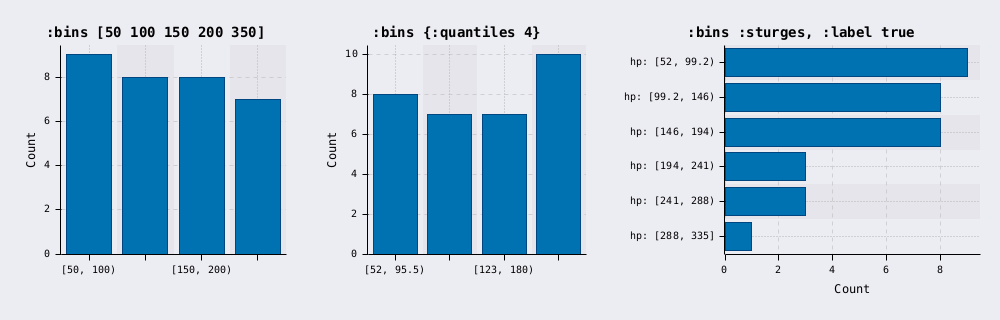
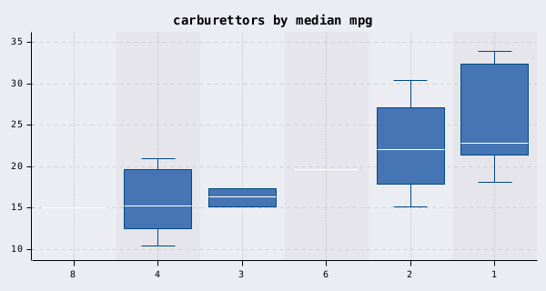

---
format:
  html:
    toc: true
    toc-location: right
    toc-depth: 4
    theme: cosmo
    include-in-header:
      text: |-
        <style>
        .data-table { width: fit-content; max-width: 100%; max-height: 15rem; overflow: auto; margin: 0 0 1rem 0; }
        .data-table .table-responsive { overflow: visible; }
        .data-table table { font-size: 0.75rem; width: auto; margin: 0; }
        .data-table th, .data-table td { padding: 0.1rem 0.45rem !important; white-space: nowrap; }
        .data-table thead th { position: sticky; top: 0; background: var(--bs-body-bg, #fff); }
        .options { margin: 0.5rem 0 1rem 0; }
        .options .option-card { margin: 0 0 0.9rem 0; border: 1px solid var(--bs-border-color, #dee2e6); border-radius: 0.375rem; overflow: hidden; }
        .options dt { display: flex; flex-wrap: wrap; align-items: baseline; gap: 0.1rem 1rem; margin: 0; padding: 0.4rem 0.75rem; background: #eef2f7; border-bottom: 1px solid var(--bs-border-color, #dee2e6); font-weight: normal; }
        .options dt > code { font-weight: 700; font-size: 1rem; background: none; padding: 0; }
        .options .option-default { font-size: 0.85rem; color: var(--bs-secondary-color, #6c757d); }
        .options dd { margin: 0; padding: 0.5rem 0.75rem; }
        .options .option-example { font-size: 0.85rem; padding: 0 0 0.45rem 0; margin-bottom: 0.45rem; border-bottom: 1px dashed var(--bs-border-color, #dee2e6); }
        .options .option-example code { background: none; padding: 0; }
        .options .option-text ul { margin: 0.3rem 0 0 0; padding-left: 1.25rem; }
        .options code, .mapping code { overflow-wrap: anywhere; }
        .options .option-default code, .options .option-example code { white-space: pre-wrap; }
        .mapping { margin: 0.5rem 0 1rem 0; padding: 0.5rem 0.75rem; border: 1px solid var(--bs-border-color, #dee2e6); border-left: 0.3rem solid #2780e3; border-radius: 0.375rem; background: #f5f8fc; }
        .mapping-title { font-weight: 700; margin-bottom: 0.25rem; }
        .mapping-hint { font-weight: normal; font-size: 0.85rem; color: var(--bs-secondary-color, #6c757d); }
        .mapping ul { margin: 0; padding-left: 1.25rem; }
        .mapping .required { font-size: 0.75rem; padding: 0 0.3rem; border: 1px solid currentColor; border-radius: 0.25rem; }
        .mapping-returns { margin-top: 0.25rem; }
        .mapping code { white-space: pre-wrap; }
        .shared { margin: 0.5rem 0 1rem 0; padding: 0.5rem 0.75rem; border: 1px solid var(--bs-border-color, #dee2e6); border-left: 0.3rem solid #6c757d; border-radius: 0.375rem; background: #f6f6f6; }
        .shared-title { font-weight: 700; margin-bottom: 0.25rem; }
        .shared-hint { font-weight: normal; font-size: 0.85rem; color: var(--bs-secondary-color, #6c757d); }
        .shared ul { margin: 0; padding-left: 1.25rem; }
        .shared code { overflow-wrap: anywhere; }
        p code, li code { white-space: pre-wrap; overflow-wrap: anywhere; }
        </style>
code-block-background: true

---
<style></style><style>.printedClojure .sourceCode {
  background-color: transparent;
  border-style: none;
}
</style><style>.clay-limit-image-width .clay-image {max-width: 100%}
.clay-side-by-side .sourceCode {margin: 0}
.clay-side-by-side {margin: 1em 0}
</style>
<script src="https://code.jquery.com/jquery-3.6.0.min.js" type="text/javascript"></script><script src="https://code.jquery.com/ui/1.13.1/jquery-ui.min.js" type="text/javascript"></script>

# Levels

These functions turn values into levels before plotting: they bin numbers into intervals, read numbers or dates as
levels, order levels by a statistic, rank rows within each x and cut overlapping intervals (shingles). Use them to
prepare categorical data for an ordinary plot. Most return rows; `order-levels` returns a vector of levels and
`categorical` a mapping marker.


::: {.sourceClojure}
```clojure
(ns reference.data-levels
  (:require [fastmath.stats :as stats]
            [cljplot2.chart :as chart]
            [cljplot2.core :as plot]
            [cljplot2.data.levels :as levels]
            [cljplot2.data.shingle :as shingle]
            [cljplot2.describe :as describe]
            [notebook-utils :as nu]))
```
:::


The tables below hold the mtcars cars and the iris flowers; the sections use them:

Data: Motor Trend car road tests (1974), R datasets package `mtcars` (Henderson & Velleman 1981); licence: Part of R (GPL-2 | GPL-3).


::: {.sourceClojure}
```clojure
(def mtcars (nu/dataset :mtcars))
```
:::


```{=html}
<div class="data-table"><table class="table table-hover table-responsive clay-table"><thead><tr><th>model</th><th>mpg</th><th>cyl</th><th>disp</th><th>hp</th><th>drat</th><th>wt</th><th>qsec</th><th>vs</th><th>am</th><th>gear</th><th>carb</th></tr></thead><tbody><tr><td>Mazda RX4</td><td>21</td><td>6</td><td>160</td><td>110</td><td>3.9</td><td>2.62</td><td>16.46</td><td>0</td><td>1</td><td>4</td><td>4</td></tr><tr><td>Mazda RX4 Wag</td><td>21</td><td>6</td><td>160</td><td>110</td><td>3.9</td><td>2.875</td><td>17.02</td><td>0</td><td>1</td><td>4</td><td>4</td></tr><tr><td>Datsun 710</td><td>22.8</td><td>4</td><td>108</td><td>93</td><td>3.85</td><td>2.32</td><td>18.61</td><td>1</td><td>1</td><td>4</td><td>1</td></tr><tr><td>Hornet 4 Drive</td><td>21.4</td><td>6</td><td>258</td><td>110</td><td>3.08</td><td>3.215</td><td>19.44</td><td>1</td><td>0</td><td>3</td><td>1</td></tr><tr><td>Hornet Sportabout</td><td>18.7</td><td>8</td><td>360</td><td>175</td><td>3.15</td><td>3.44</td><td>17.02</td><td>0</td><td>0</td><td>3</td><td>2</td></tr><tr><td>Valiant</td><td>18.1</td><td>6</td><td>225</td><td>105</td><td>2.76</td><td>3.46</td><td>20.22</td><td>1</td><td>0</td><td>3</td><td>1</td></tr><tr><td>Duster 360</td><td>14.3</td><td>8</td><td>360</td><td>245</td><td>3.21</td><td>3.57</td><td>15.84</td><td>0</td><td>0</td><td>3</td><td>4</td></tr><tr><td>Merc 240D</td><td>24.4</td><td>4</td><td>146.7</td><td>62</td><td>3.69</td><td>3.19</td><td>20</td><td>1</td><td>0</td><td>4</td><td>2</td></tr><tr><td>Merc 230</td><td>22.8</td><td>4</td><td>140.8</td><td>95</td><td>3.92</td><td>3.15</td><td>22.9</td><td>1</td><td>0</td><td>4</td><td>2</td></tr><tr><td>Merc 280</td><td>19.2</td><td>6</td><td>167.6</td><td>123</td><td>3.92</td><td>3.44</td><td>18.3</td><td>1</td><td>0</td><td>4</td><td>4</td></tr><tr><td>Merc 280C</td><td>17.8</td><td>6</td><td>167.6</td><td>123</td><td>3.92</td><td>3.44</td><td>18.9</td><td>1</td><td>0</td><td>4</td><td>4</td></tr><tr><td>Merc 450SE</td><td>16.4</td><td>8</td><td>275.8</td><td>180</td><td>3.07</td><td>4.07</td><td>17.4</td><td>0</td><td>0</td><td>3</td><td>3</td></tr><tr><td>Merc 450SL</td><td>17.3</td><td>8</td><td>275.8</td><td>180</td><td>3.07</td><td>3.73</td><td>17.6</td><td>0</td><td>0</td><td>3</td><td>3</td></tr><tr><td>Merc 450SLC</td><td>15.2</td><td>8</td><td>275.8</td><td>180</td><td>3.07</td><td>3.78</td><td>18</td><td>0</td><td>0</td><td>3</td><td>3</td></tr><tr><td>Cadillac Fleetwood</td><td>10.4</td><td>8</td><td>472</td><td>205</td><td>2.93</td><td>5.25</td><td>17.98</td><td>0</td><td>0</td><td>3</td><td>4</td></tr><tr><td>Lincoln Continental</td><td>10.4</td><td>8</td><td>460</td><td>215</td><td>3</td><td>5.424</td><td>17.82</td><td>0</td><td>0</td><td>3</td><td>4</td></tr><tr><td>Chrysler Imperial</td><td>14.7</td><td>8</td><td>440</td><td>230</td><td>3.23</td><td>5.345</td><td>17.42</td><td>0</td><td>0</td><td>3</td><td>4</td></tr><tr><td>Fiat 128</td><td>32.4</td><td>4</td><td>78.7</td><td>66</td><td>4.08</td><td>2.2</td><td>19.47</td><td>1</td><td>1</td><td>4</td><td>1</td></tr><tr><td>Honda Civic</td><td>30.4</td><td>4</td><td>75.7</td><td>52</td><td>4.93</td><td>1.615</td><td>18.52</td><td>1</td><td>1</td><td>4</td><td>2</td></tr><tr><td>Toyota Corolla</td><td>33.9</td><td>4</td><td>71.1</td><td>65</td><td>4.22</td><td>1.835</td><td>19.9</td><td>1</td><td>1</td><td>4</td><td>1</td></tr><tr><td>Toyota Corona</td><td>21.5</td><td>4</td><td>120.1</td><td>97</td><td>3.7</td><td>2.465</td><td>20.01</td><td>1</td><td>0</td><td>3</td><td>1</td></tr><tr><td>Dodge Challenger</td><td>15.5</td><td>8</td><td>318</td><td>150</td><td>2.76</td><td>3.52</td><td>16.87</td><td>0</td><td>0</td><td>3</td><td>2</td></tr><tr><td>AMC Javelin</td><td>15.2</td><td>8</td><td>304</td><td>150</td><td>3.15</td><td>3.435</td><td>17.3</td><td>0</td><td>0</td><td>3</td><td>2</td></tr><tr><td>Camaro Z28</td><td>13.3</td><td>8</td><td>350</td><td>245</td><td>3.73</td><td>3.84</td><td>15.41</td><td>0</td><td>0</td><td>3</td><td>4</td></tr><tr><td>Pontiac Firebird</td><td>19.2</td><td>8</td><td>400</td><td>175</td><td>3.08</td><td>3.845</td><td>17.05</td><td>0</td><td>0</td><td>3</td><td>2</td></tr><tr><td>Fiat X1-9</td><td>27.3</td><td>4</td><td>79</td><td>66</td><td>4.08</td><td>1.935</td><td>18.9</td><td>1</td><td>1</td><td>4</td><td>1</td></tr><tr><td>Porsche 914-2</td><td>26</td><td>4</td><td>120.3</td><td>91</td><td>4.43</td><td>2.14</td><td>16.7</td><td>0</td><td>1</td><td>5</td><td>2</td></tr><tr><td>Lotus Europa</td><td>30.4</td><td>4</td><td>95.1</td><td>113</td><td>3.77</td><td>1.513</td><td>16.9</td><td>1</td><td>1</td><td>5</td><td>2</td></tr><tr><td>Ford Pantera L</td><td>15.8</td><td>8</td><td>351</td><td>264</td><td>4.22</td><td>3.17</td><td>14.5</td><td>0</td><td>1</td><td>5</td><td>4</td></tr><tr><td>Ferrari Dino</td><td>19.7</td><td>6</td><td>145</td><td>175</td><td>3.62</td><td>2.77</td><td>15.5</td><td>0</td><td>1</td><td>5</td><td>6</td></tr><tr><td>Maserati Bora</td><td>15</td><td>8</td><td>301</td><td>335</td><td>3.54</td><td>3.57</td><td>14.6</td><td>0</td><td>1</td><td>5</td><td>8</td></tr><tr><td>Volvo 142E</td><td>21.4</td><td>4</td><td>121</td><td>109</td><td>4.11</td><td>2.78</td><td>18.6</td><td>1</td><td>1</td><td>4</td><td>2</td></tr></tbody></table></div>
```


Data: Edgar Anderson's iris measurements, R datasets package `iris` (Anderson 1935; Fisher 1936); licence: Part of R (GPL-2 | GPL-3).


::: {.sourceClojure}
```clojure
(def iris (nu/dataset :iris))
```
:::


```{=html}
<div class="data-table"><table class="table table-hover table-responsive clay-table"><thead><tr><th>sepal-length</th><th>sepal-width</th><th>petal-length</th><th>petal-width</th><th>species</th></tr></thead><tbody><tr><td>5.1</td><td>3.5</td><td>1.4</td><td>0.2</td><td>setosa</td></tr><tr><td>4.9</td><td>3</td><td>1.4</td><td>0.2</td><td>setosa</td></tr><tr><td>4.7</td><td>3.2</td><td>1.3</td><td>0.2</td><td>setosa</td></tr><tr><td>4.6</td><td>3.1</td><td>1.5</td><td>0.2</td><td>setosa</td></tr><tr><td>5</td><td>3.6</td><td>1.4</td><td>0.2</td><td>setosa</td></tr><tr><td>5.4</td><td>3.9</td><td>1.7</td><td>0.4</td><td>setosa</td></tr><tr><td>4.6</td><td>3.4</td><td>1.4</td><td>0.3</td><td>setosa</td></tr><tr><td>5</td><td>3.4</td><td>1.5</td><td>0.2</td><td>setosa</td></tr><tr><td>4.4</td><td>2.9</td><td>1.4</td><td>0.2</td><td>setosa</td></tr><tr><td>4.9</td><td>3.1</td><td>1.5</td><td>0.1</td><td>setosa</td></tr><tr><td>5.4</td><td>3.7</td><td>1.5</td><td>0.2</td><td>setosa</td></tr><tr><td>4.8</td><td>3.4</td><td>1.6</td><td>0.2</td><td>setosa</td></tr><tr><td>4.8</td><td>3</td><td>1.4</td><td>0.1</td><td>setosa</td></tr><tr><td>4.3</td><td>3</td><td>1.1</td><td>0.1</td><td>setosa</td></tr><tr><td>5.8</td><td>4</td><td>1.2</td><td>0.2</td><td>setosa</td></tr><tr><td>5.7</td><td>4.4</td><td>1.5</td><td>0.4</td><td>setosa</td></tr><tr><td>5.4</td><td>3.9</td><td>1.3</td><td>0.4</td><td>setosa</td></tr><tr><td>5.1</td><td>3.5</td><td>1.4</td><td>0.3</td><td>setosa</td></tr><tr><td>5.7</td><td>3.8</td><td>1.7</td><td>0.3</td><td>setosa</td></tr><tr><td>5.1</td><td>3.8</td><td>1.5</td><td>0.3</td><td>setosa</td></tr><tr><td>5.4</td><td>3.4</td><td>1.7</td><td>0.2</td><td>setosa</td></tr><tr><td>5.1</td><td>3.7</td><td>1.5</td><td>0.4</td><td>setosa</td></tr><tr><td>4.6</td><td>3.6</td><td>1</td><td>0.2</td><td>setosa</td></tr><tr><td>5.1</td><td>3.3</td><td>1.7</td><td>0.5</td><td>setosa</td></tr><tr><td>4.8</td><td>3.4</td><td>1.9</td><td>0.2</td><td>setosa</td></tr><tr><td>5</td><td>3</td><td>1.6</td><td>0.2</td><td>setosa</td></tr><tr><td>5</td><td>3.4</td><td>1.6</td><td>0.4</td><td>setosa</td></tr><tr><td>5.2</td><td>3.5</td><td>1.5</td><td>0.2</td><td>setosa</td></tr><tr><td>5.2</td><td>3.4</td><td>1.4</td><td>0.2</td><td>setosa</td></tr><tr><td>4.7</td><td>3.2</td><td>1.6</td><td>0.2</td><td>setosa</td></tr><tr><td>4.8</td><td>3.1</td><td>1.6</td><td>0.2</td><td>setosa</td></tr><tr><td>5.4</td><td>3.4</td><td>1.5</td><td>0.4</td><td>setosa</td></tr><tr><td>5.2</td><td>4.1</td><td>1.5</td><td>0.1</td><td>setosa</td></tr><tr><td>5.5</td><td>4.2</td><td>1.4</td><td>0.2</td><td>setosa</td></tr><tr><td>4.9</td><td>3.1</td><td>1.5</td><td>0.2</td><td>setosa</td></tr><tr><td>5</td><td>3.2</td><td>1.2</td><td>0.2</td><td>setosa</td></tr><tr><td>5.5</td><td>3.5</td><td>1.3</td><td>0.2</td><td>setosa</td></tr><tr><td>4.9</td><td>3.6</td><td>1.4</td><td>0.1</td><td>setosa</td></tr><tr><td>4.4</td><td>3</td><td>1.3</td><td>0.2</td><td>setosa</td></tr><tr><td>5.1</td><td>3.4</td><td>1.5</td><td>0.2</td><td>setosa</td></tr><tr><td>5</td><td>3.5</td><td>1.3</td><td>0.3</td><td>setosa</td></tr><tr><td>4.5</td><td>2.3</td><td>1.3</td><td>0.3</td><td>setosa</td></tr><tr><td>4.4</td><td>3.2</td><td>1.3</td><td>0.2</td><td>setosa</td></tr><tr><td>5</td><td>3.5</td><td>1.6</td><td>0.6</td><td>setosa</td></tr><tr><td>5.1</td><td>3.8</td><td>1.9</td><td>0.4</td><td>setosa</td></tr><tr><td>4.8</td><td>3</td><td>1.4</td><td>0.3</td><td>setosa</td></tr><tr><td>5.1</td><td>3.8</td><td>1.6</td><td>0.2</td><td>setosa</td></tr><tr><td>4.6</td><td>3.2</td><td>1.4</td><td>0.2</td><td>setosa</td></tr><tr><td>5.3</td><td>3.7</td><td>1.5</td><td>0.2</td><td>setosa</td></tr><tr><td>5</td><td>3.3</td><td>1.4</td><td>0.2</td><td>setosa</td></tr><tr><td>7</td><td>3.2</td><td>4.7</td><td>1.4</td><td>versicolor</td></tr><tr><td>6.4</td><td>3.2</td><td>4.5</td><td>1.5</td><td>versicolor</td></tr><tr><td>6.9</td><td>3.1</td><td>4.9</td><td>1.5</td><td>versicolor</td></tr><tr><td>5.5</td><td>2.3</td><td>4</td><td>1.3</td><td>versicolor</td></tr><tr><td>6.5</td><td>2.8</td><td>4.6</td><td>1.5</td><td>versicolor</td></tr><tr><td>5.7</td><td>2.8</td><td>4.5</td><td>1.3</td><td>versicolor</td></tr><tr><td>6.3</td><td>3.3</td><td>4.7</td><td>1.6</td><td>versicolor</td></tr><tr><td>4.9</td><td>2.4</td><td>3.3</td><td>1</td><td>versicolor</td></tr><tr><td>6.6</td><td>2.9</td><td>4.6</td><td>1.3</td><td>versicolor</td></tr><tr><td>5.2</td><td>2.7</td><td>3.9</td><td>1.4</td><td>versicolor</td></tr><tr><td>5</td><td>2</td><td>3.5</td><td>1</td><td>versicolor</td></tr><tr><td>5.9</td><td>3</td><td>4.2</td><td>1.5</td><td>versicolor</td></tr><tr><td>6</td><td>2.2</td><td>4</td><td>1</td><td>versicolor</td></tr><tr><td>6.1</td><td>2.9</td><td>4.7</td><td>1.4</td><td>versicolor</td></tr><tr><td>5.6</td><td>2.9</td><td>3.6</td><td>1.3</td><td>versicolor</td></tr><tr><td>6.7</td><td>3.1</td><td>4.4</td><td>1.4</td><td>versicolor</td></tr><tr><td>5.6</td><td>3</td><td>4.5</td><td>1.5</td><td>versicolor</td></tr><tr><td>5.8</td><td>2.7</td><td>4.1</td><td>1</td><td>versicolor</td></tr><tr><td>6.2</td><td>2.2</td><td>4.5</td><td>1.5</td><td>versicolor</td></tr><tr><td>5.6</td><td>2.5</td><td>3.9</td><td>1.1</td><td>versicolor</td></tr><tr><td>5.9</td><td>3.2</td><td>4.8</td><td>1.8</td><td>versicolor</td></tr><tr><td>6.1</td><td>2.8</td><td>4</td><td>1.3</td><td>versicolor</td></tr><tr><td>6.3</td><td>2.5</td><td>4.9</td><td>1.5</td><td>versicolor</td></tr><tr><td>6.1</td><td>2.8</td><td>4.7</td><td>1.2</td><td>versicolor</td></tr><tr><td>6.4</td><td>2.9</td><td>4.3</td><td>1.3</td><td>versicolor</td></tr><tr><td>6.6</td><td>3</td><td>4.4</td><td>1.4</td><td>versicolor</td></tr><tr><td>6.8</td><td>2.8</td><td>4.8</td><td>1.4</td><td>versicolor</td></tr><tr><td>6.7</td><td>3</td><td>5</td><td>1.7</td><td>versicolor</td></tr><tr><td>6</td><td>2.9</td><td>4.5</td><td>1.5</td><td>versicolor</td></tr><tr><td>5.7</td><td>2.6</td><td>3.5</td><td>1</td><td>versicolor</td></tr><tr><td>5.5</td><td>2.4</td><td>3.8</td><td>1.1</td><td>versicolor</td></tr><tr><td>5.5</td><td>2.4</td><td>3.7</td><td>1</td><td>versicolor</td></tr><tr><td>5.8</td><td>2.7</td><td>3.9</td><td>1.2</td><td>versicolor</td></tr><tr><td>6</td><td>2.7</td><td>5.1</td><td>1.6</td><td>versicolor</td></tr><tr><td>5.4</td><td>3</td><td>4.5</td><td>1.5</td><td>versicolor</td></tr><tr><td>6</td><td>3.4</td><td>4.5</td><td>1.6</td><td>versicolor</td></tr><tr><td>6.7</td><td>3.1</td><td>4.7</td><td>1.5</td><td>versicolor</td></tr><tr><td>6.3</td><td>2.3</td><td>4.4</td><td>1.3</td><td>versicolor</td></tr><tr><td>5.6</td><td>3</td><td>4.1</td><td>1.3</td><td>versicolor</td></tr><tr><td>5.5</td><td>2.5</td><td>4</td><td>1.3</td><td>versicolor</td></tr><tr><td>5.5</td><td>2.6</td><td>4.4</td><td>1.2</td><td>versicolor</td></tr><tr><td>6.1</td><td>3</td><td>4.6</td><td>1.4</td><td>versicolor</td></tr><tr><td>5.8</td><td>2.6</td><td>4</td><td>1.2</td><td>versicolor</td></tr><tr><td>5</td><td>2.3</td><td>3.3</td><td>1</td><td>versicolor</td></tr><tr><td>5.6</td><td>2.7</td><td>4.2</td><td>1.3</td><td>versicolor</td></tr><tr><td>5.7</td><td>3</td><td>4.2</td><td>1.2</td><td>versicolor</td></tr><tr><td>5.7</td><td>2.9</td><td>4.2</td><td>1.3</td><td>versicolor</td></tr><tr><td>6.2</td><td>2.9</td><td>4.3</td><td>1.3</td><td>versicolor</td></tr><tr><td>5.1</td><td>2.5</td><td>3</td><td>1.1</td><td>versicolor</td></tr><tr><td>5.7</td><td>2.8</td><td>4.1</td><td>1.3</td><td>versicolor</td></tr><tr><td>…</td><td>…</td><td>…</td><td>…</td><td>…</td></tr></tbody></table></div>
```


The table below holds made-up yearly sales of three products; the ranking section uses it:


::: {.sourceClojure}
```clojure
(def sales (for [[year amounts] [[2020 [5 9 7]] [2021 [8 9 4]] [2022 [9 6 6]] [2023 [7 10 5]]]
                 [product amount] (map vector ["apples" "pears" "plums"] amounts)]
             {:year year :product product :amount amount}))
```
:::


```{=html}
<div class="data-table"><table class="table table-hover table-responsive clay-table"><thead><tr><th>year</th><th>product</th><th>amount</th></tr></thead><tbody><tr><td>2020</td><td>apples</td><td>5</td></tr><tr><td>2020</td><td>pears</td><td>9</td></tr><tr><td>2020</td><td>plums</td><td>7</td></tr><tr><td>2021</td><td>apples</td><td>8</td></tr><tr><td>2021</td><td>pears</td><td>9</td></tr><tr><td>2021</td><td>plums</td><td>4</td></tr><tr><td>2022</td><td>apples</td><td>9</td></tr><tr><td>2022</td><td>pears</td><td>6</td></tr><tr><td>2022</td><td>plums</td><td>6</td></tr><tr><td>2023</td><td>apples</td><td>7</td></tr><tr><td>2023</td><td>pears</td><td>10</td></tr><tr><td>2023</td><td>plums</td><td>5</td></tr></tbody></table></div>
```


## Binning

`levels/bin` adds the bin of a numeric value to every row: an interval `[lo, hi)`, the last one closed, printed as
R's `cut` prints it. A missing or non-numeric value gets no bin. Use it to count or colour by ranges of a number.


```{=html}
<div class="mapping"><div class="mapping-title">Arguments<span class="mapping-hint"> – what the call takes before its options map</span></div><ul><li><code>rows</code> – The data: rows (maps) or columns (a map of equal-length sequences).</li><li><code>value</code> – The accessor of a row's numeric value, e.g. <code>:hp</code>.</li></ul><div class="mapping-returns"><strong>Returns</strong> – Every row with its bin under <code>:as</code>: an interval <code>[lo, hi)</code>, the last one closed. A missing, non-numeric or non-finite value, or one outside explicit breaks, gets a <code>nil</code> bin.</div></div>
```


These options name the bin column, choose the bins and set how their bounds print. The table below adds five
equal-width bins of the cars' horsepower, their bounds printed with 2 significant digits:


```{=html}
<dl class="options"><div class="option-card"><dt><code>:as</code></dt><dd><div class="option-example"><code>(levels/bin rows :x {:as :bin})</code></div><div class="option-text">The key of the bin column the function adds to every row.<ul><li><span>the key of the bin column</span></li></ul></div></dd></div><div class="option-card"><dt><code>:bins</code><span class="option-default">Default: <code>:sturges</code></span></dt><dd><div class="option-example"><code>(levels/bin rows :x {:as :bin, :bins 4})</code></div><div class="option-text">How the function cuts the finite values into bins.<ul><li><code>:sturges</code> – <code>ceil(log2(n)) + 1</code> bins; suits roughly normal samples but gives too few bins for large ones.</li><li><code>:sqrt</code> – <code>ceil(sqrt(n))</code> bins.</li><li><code>:rice</code> – <code>ceil(2 * cbrt(n))</code> bins.</li><li><code>:doane</code> – Sturges' rule corrected for skewed samples.</li><li><code>:scott</code> – Bins of width <code>3.5 * sd / cbrt(n)</code>, <code>sd</code> the standard deviation; suits roughly normal samples.</li><li><code>:freedman-diaconis</code> – Bins of width <code>2 * IQR / cbrt(n)</code>, <code>IQR</code> the interquartile range; robust to outliers.</li><li class="option-other">Other fastmath methods: one more rule of thumb and two that pick the bin count by minimising an estimated error. <code>:terrell-scott</code>, <code>:cross-validation</code>, <code>:shimazaki-shinomoto</code></li><li><a href="reference.types.html#breaks">breaks</a> – The bin edges; a value outside them gets a <code>nil</code> bin.</li><li><a href="reference.types.html#quantile-bins">quantile bins</a> – Bins with edges at quantiles of the values.</li><li><a href="reference.types.html#positive-integer">positive integer</a> – That many equal-width bins over the values' range.</li></ul></div></dd></div><div class="option-card"><dt><code>:digits</code><span class="option-default">Default: <code>3</code></span></dt><dd><div class="option-example"><code>(levels/bin rows :x {:as :bin, :digits 1})</code></div><div class="option-text">The fewest significant digits of the printed bounds; the function prints more when fewer would make two breaks look the same.<ul><li><a href="reference.types.html#positive-integer">positive integer</a></li></ul></div></dd></div><div class="option-card"><dt><code>:label</code><span class="option-default">Default: No series name.</span></dt><dd><div class="option-example"><code>(levels/bin rows :x {:as :bin, :label true})</code></div><div class="option-text">The series name printed in every bin.<ul><li><code>true</code> – The accessor's name, e.g. <code>x</code> for <code>:x</code>; only for a keyword accessor.</li><li><code>false</code> – No series name.</li><li><span>string</span> – This name.</li></ul></div></dd></div></dl>
```


::: {.sourceClojure}
```clojure
(nu/result-table (levels/bin mtcars :hp {:as :hp-bin :bins 5 :digits 2}))
```
:::


```{=html}
<div class="data-table"><table class="table table-hover table-responsive clay-table"><thead><tr><th>hp-bin</th><th>qsec</th><th>cyl</th><th>am</th><th>gear</th><th>disp</th><th>wt</th><th>drat</th><th>hp</th><th>mpg</th><th>vs</th><th>carb</th><th>model</th></tr></thead><tbody><tr><td>[110, 170)</td><td>16.46</td><td>6</td><td>1</td><td>4</td><td>160</td><td>2.62</td><td>3.9</td><td>110</td><td>21</td><td>0</td><td>4</td><td>Mazda RX4</td></tr><tr><td>[110, 170)</td><td>17.02</td><td>6</td><td>1</td><td>4</td><td>160</td><td>2.875</td><td>3.9</td><td>110</td><td>21</td><td>0</td><td>4</td><td>Mazda RX4 Wag</td></tr><tr><td>[52, 110)</td><td>18.61</td><td>4</td><td>1</td><td>4</td><td>108</td><td>2.32</td><td>3.85</td><td>93</td><td>22.8</td><td>1</td><td>1</td><td>Datsun 710</td></tr><tr><td>[110, 170)</td><td>19.44</td><td>6</td><td>0</td><td>3</td><td>258</td><td>3.215</td><td>3.08</td><td>110</td><td>21.4</td><td>1</td><td>1</td><td>Hornet 4 Drive</td></tr><tr><td>[170, 220)</td><td>17.02</td><td>8</td><td>0</td><td>3</td><td>360</td><td>3.44</td><td>3.15</td><td>175</td><td>18.7</td><td>0</td><td>2</td><td>Hornet Sportabout</td></tr><tr><td>[52, 110)</td><td>20.22</td><td>6</td><td>0</td><td>3</td><td>225</td><td>3.46</td><td>2.76</td><td>105</td><td>18.1</td><td>1</td><td>1</td><td>Valiant</td></tr><tr><td>[220, 280)</td><td>15.84</td><td>8</td><td>0</td><td>3</td><td>360</td><td>3.57</td><td>3.21</td><td>245</td><td>14.3</td><td>0</td><td>4</td><td>Duster 360</td></tr><tr><td>[52, 110)</td><td>20</td><td>4</td><td>0</td><td>4</td><td>146.7</td><td>3.19</td><td>3.69</td><td>62</td><td>24.4</td><td>1</td><td>2</td><td>Merc 240D</td></tr><tr><td>[52, 110)</td><td>22.9</td><td>4</td><td>0</td><td>4</td><td>140.8</td><td>3.15</td><td>3.92</td><td>95</td><td>22.8</td><td>1</td><td>2</td><td>Merc 230</td></tr><tr><td>[110, 170)</td><td>18.3</td><td>6</td><td>0</td><td>4</td><td>167.6</td><td>3.44</td><td>3.92</td><td>123</td><td>19.2</td><td>1</td><td>4</td><td>Merc 280</td></tr><tr><td>[110, 170)</td><td>18.9</td><td>6</td><td>0</td><td>4</td><td>167.6</td><td>3.44</td><td>3.92</td><td>123</td><td>17.8</td><td>1</td><td>4</td><td>Merc 280C</td></tr><tr><td>[170, 220)</td><td>17.4</td><td>8</td><td>0</td><td>3</td><td>275.8</td><td>4.07</td><td>3.07</td><td>180</td><td>16.4</td><td>0</td><td>3</td><td>Merc 450SE</td></tr><tr><td>[170, 220)</td><td>17.6</td><td>8</td><td>0</td><td>3</td><td>275.8</td><td>3.73</td><td>3.07</td><td>180</td><td>17.3</td><td>0</td><td>3</td><td>Merc 450SL</td></tr><tr><td>[170, 220)</td><td>18</td><td>8</td><td>0</td><td>3</td><td>275.8</td><td>3.78</td><td>3.07</td><td>180</td><td>15.2</td><td>0</td><td>3</td><td>Merc 450SLC</td></tr><tr><td>[170, 220)</td><td>17.98</td><td>8</td><td>0</td><td>3</td><td>472</td><td>5.25</td><td>2.93</td><td>205</td><td>10.4</td><td>0</td><td>4</td><td>Cadillac Fleetwood</td></tr><tr><td>[170, 220)</td><td>17.82</td><td>8</td><td>0</td><td>3</td><td>460</td><td>5.424</td><td>3</td><td>215</td><td>10.4</td><td>0</td><td>4</td><td>Lincoln Continental</td></tr><tr><td>[220, 280)</td><td>17.42</td><td>8</td><td>0</td><td>3</td><td>440</td><td>5.345</td><td>3.23</td><td>230</td><td>14.7</td><td>0</td><td>4</td><td>Chrysler Imperial</td></tr><tr><td>[52, 110)</td><td>19.47</td><td>4</td><td>1</td><td>4</td><td>78.7</td><td>2.2</td><td>4.08</td><td>66</td><td>32.4</td><td>1</td><td>1</td><td>Fiat 128</td></tr><tr><td>[52, 110)</td><td>18.52</td><td>4</td><td>1</td><td>4</td><td>75.7</td><td>1.615</td><td>4.93</td><td>52</td><td>30.4</td><td>1</td><td>2</td><td>Honda Civic</td></tr><tr><td>[52, 110)</td><td>19.9</td><td>4</td><td>1</td><td>4</td><td>71.1</td><td>1.835</td><td>4.22</td><td>65</td><td>33.9</td><td>1</td><td>1</td><td>Toyota Corolla</td></tr><tr><td>[52, 110)</td><td>20.01</td><td>4</td><td>0</td><td>3</td><td>120.1</td><td>2.465</td><td>3.7</td><td>97</td><td>21.5</td><td>1</td><td>1</td><td>Toyota Corona</td></tr><tr><td>[110, 170)</td><td>16.87</td><td>8</td><td>0</td><td>3</td><td>318</td><td>3.52</td><td>2.76</td><td>150</td><td>15.5</td><td>0</td><td>2</td><td>Dodge Challenger</td></tr><tr><td>[110, 170)</td><td>17.3</td><td>8</td><td>0</td><td>3</td><td>304</td><td>3.435</td><td>3.15</td><td>150</td><td>15.2</td><td>0</td><td>2</td><td>AMC Javelin</td></tr><tr><td>[220, 280)</td><td>15.41</td><td>8</td><td>0</td><td>3</td><td>350</td><td>3.84</td><td>3.73</td><td>245</td><td>13.3</td><td>0</td><td>4</td><td>Camaro Z28</td></tr><tr><td>[170, 220)</td><td>17.05</td><td>8</td><td>0</td><td>3</td><td>400</td><td>3.845</td><td>3.08</td><td>175</td><td>19.2</td><td>0</td><td>2</td><td>Pontiac Firebird</td></tr><tr><td>[52, 110)</td><td>18.9</td><td>4</td><td>1</td><td>4</td><td>79</td><td>1.935</td><td>4.08</td><td>66</td><td>27.3</td><td>1</td><td>1</td><td>Fiat X1-9</td></tr><tr><td>[52, 110)</td><td>16.7</td><td>4</td><td>1</td><td>5</td><td>120.3</td><td>2.14</td><td>4.43</td><td>91</td><td>26</td><td>0</td><td>2</td><td>Porsche 914-2</td></tr><tr><td>[110, 170)</td><td>16.9</td><td>4</td><td>1</td><td>5</td><td>95.1</td><td>1.513</td><td>3.77</td><td>113</td><td>30.4</td><td>1</td><td>2</td><td>Lotus Europa</td></tr><tr><td>[220, 280)</td><td>14.5</td><td>8</td><td>1</td><td>5</td><td>351</td><td>3.17</td><td>4.22</td><td>264</td><td>15.8</td><td>0</td><td>4</td><td>Ford Pantera L</td></tr><tr><td>[170, 220)</td><td>15.5</td><td>6</td><td>1</td><td>5</td><td>145</td><td>2.77</td><td>3.62</td><td>175</td><td>19.7</td><td>0</td><td>6</td><td>Ferrari Dino</td></tr><tr><td>[280, 340]</td><td>14.6</td><td>8</td><td>1</td><td>5</td><td>301</td><td>3.57</td><td>3.54</td><td>335</td><td>15</td><td>0</td><td>8</td><td>Maserati Bora</td></tr><tr><td>[110, 170)</td><td>18.6</td><td>4</td><td>1</td><td>4</td><td>121</td><td>2.78</td><td>4.11</td><td>109</td><td>21.4</td><td>1</td><td>2</td><td>Volvo 142E</td></tr></tbody></table></div>
```


Bins are levels, so a [bar](reference.charts_bars.html#bar-charts) chart with `:stat :count` counts them in
interval order. The left panel below cuts at explicit breaks, the middle one into quantile bins of about equal counts; the
right one prints the series name in every bin:


::: {.sourceClojure}
```clojure
(plot/render-image (plot/arrange [{:data (levels/bin mtcars :hp {:as :bin :bins [50 100 150 200 350]})
                                   :mapping {:x :bin}
                                   :charts [(chart/bar {:stat :count})]
                                   :labels {:title ":bins [50 100 150 200 350]"}}
                                  {:data (levels/bin mtcars :hp {:as :bin :bins {:quantiles 4}})
                                   :mapping {:x :bin}
                                   :charts [(chart/bar {:stat :count})]
                                   :labels {:title ":bins {:quantiles 4}"}}
                                  {:data (levels/bin mtcars :hp {:as :bin :bins :sturges :label true})
                                   :mapping {:y :bin}
                                   :charts [(chart/bar {:stat :count})]
                                   :scales {:y {:reverse true}}
                                   :labels {:title ":bins :sturges, :label true"}}]
                                 {:columns 3 :widths [1 1 1.3]})
                   {:width 1000 :height 320})
```
:::


::: {.clay-image}

:::


## Categorical mapping

`levels/categorical` wraps an accessor as a mapping marker: the accessor reads its values as usual, and the mapping
treats its dimension as categorical. Use it to show numbers or dates as levels: bands on a position axis, an ordinal
legend for an aesthetic.


```{=html}
<div class="mapping"><div class="mapping-title">Arguments<span class="mapping-hint"> – what the call takes</span></div><ul><li><code>wrapped-accessor</code> – The accessor whose values the mapping treats as levels, e.g. <code>:cyl</code>.</li></ul><div class="mapping-returns"><strong>Returns</strong> – A mapping marker: an accessor that reads the same values and makes its dimension categorical.</div></div>
```


The left panel below maps the cylinder counts as numbers, the right one as levels:


::: {.sourceClojure}
```clojure
(plot/render-image (plot/arrange [{:data mtcars
                                   :mapping {:x :cyl :y :mpg}
                                   :charts [(chart/scatter)]
                                   :labels {:title ":x :cyl - numbers"}}
                                  {:data mtcars
                                   :mapping {:x (levels/categorical :cyl) :y :mpg :color (levels/categorical :gear)}
                                   :charts [(chart/box)]
                                   :labels {:title ":x (levels/categorical :cyl), colour by gear"}}]
                                 {:columns 2 :widths [1 1.25]})
                   {:width 900 :height 320})
```
:::


::: {.clay-image}

:::


## Level order

`levels/order-levels` returns the levels of a column ordered by a statistic of a value in each level. Use it as a
scale `:domain` to sort a level axis or a legend.


```{=html}
<div class="mapping"><div class="mapping-title">Arguments<span class="mapping-hint"> – what the call takes before its options map</span></div><ul><li><code>rows</code> – The data: rows (maps) or columns (a map of equal-length sequences).</li><li><code>level</code> – The accessor of a row's level.</li><li><code>value</code> – The accessor of the value the statistic scores; a level's finite values are scored.</li><li><code>stat</code> – A function of a non-empty sequence of numbers that returns a number, e.g. <code>stats/median</code> or <code>count</code>.</li></ul><div class="mapping-returns"><strong>Returns</strong> – The levels ordered by their statistic; ties keep first-appearance order, and levels without a finite statistic follow. The <code>nil</code> level is left out.</div></div>
```


This option sets the direction. The calls below order the iris species by their median petal length, ascending,
then descending:


```{=html}
<dl class="options"><div class="option-card"><dt><code>:descending</code><span class="option-default">Default: <code>false</code></span></dt><dd><div class="option-example"><code>(levels/order-levels rows :level :value stats/mean {:descending true})</code></div><div class="option-text">Whether the largest statistic comes first.<ul><li><code>false</code> – The level of the smallest statistic first.</li><li><code>true</code> – The level of the largest statistic first.</li></ul></div></dd></div></dl>
```


::: {.sourceClojure}
```clojure
(levels/order-levels iris :species :petal-length stats/median)
```
:::


::: {.printedClojure}
```clojure
["setosa" "versicolor" "virginica"]

```
:::


::: {.sourceClojure}
```clojure
(levels/order-levels iris :species :petal-length stats/median {:descending true})
```
:::


::: {.printedClojure}
```clojure
["virginica" "versicolor" "setosa"]

```
:::


The plot below takes the descending order as the domain of its level axis, so the carburettor count with the
highest median mpg comes first:


::: {.sourceClojure}
```clojure
(plot/render-image {:data mtcars
                    :mapping {:x (levels/categorical :carb) :y :mpg}
                    :charts [(chart/box)]
                    :scales {:x {:domain (levels/order-levels mtcars :carb :mpg stats/median {:descending true})}}
                    :labels {:title "carburettors by median mpg"}}
                   {:width 600 :height 320})
```
:::


::: {.clay-image}

:::


## Ranks

`levels/rank-rows` ranks the rows sharing an x by a value; by default the highest value ranks 1. Use it for a bump
chart: a line through the ranks on a reversed y axis.


```{=html}
<div class="mapping"><div class="mapping-title">Arguments<span class="mapping-hint"> – what the call takes before its options map</span></div><ul><li><code>rows</code> – The data: rows (maps) or columns (a map of equal-length sequences).</li><li><code>x</code> – The accessor of a row's x: the function ranks the rows sharing an x together.</li><li><code>value</code> – The accessor of the ranked value.</li></ul><div class="mapping-returns"><strong>Returns</strong> – Every row with its rank under <code>:as</code>, 1 the first; a row without a finite value or a valid x gets <code>nil</code>.</div></div>
```


These options name the rank column and set the direction and the ties. The table below ranks the sales per year
under `:place`; a tie takes the lowest rank, so pears and plums share rank 2 in 2022:


```{=html}
<dl class="options"><div class="option-card"><dt><code>:as</code><span class="option-default">Default: <code>:rank</code></span></dt><dd><div class="option-example"><code>(levels/rank-rows rows :x :value {:as :place})</code></div><div class="option-text">The key of the rank column the function adds to every row.<ul><li><span>the key of the rank column</span></li></ul></div></dd></div><div class="option-card"><dt><code>:descending</code><span class="option-default">Default: <code>true</code></span></dt><dd><div class="option-example"><code>(levels/rank-rows rows :x :value {:descending false})</code></div><div class="option-text">Whether the highest value gets rank 1.<ul><li><code>true</code> – The highest value ranks 1.</li><li><code>false</code> – The lowest value ranks 1.</li></ul></div></dd></div><div class="option-card"><dt><code>:ties</code><span class="option-default">Default: <code>:min</code></span></dt><dd><div class="option-example"><code>(levels/rank-rows rows :x :value {:ties :average})</code></div><div class="option-text">How the function ranks equal values, by <code>fastmath.core/rank</code>.<ul><li><code>:min</code> – The lowest rank of the tie for each: 1, 1, 3.</li><li><code>:average</code> – The mean rank of the tie, a double: 1.5, 1.5, 3.</li><li><code>:dense</code> – The lowest rank, without gaps after a tie: 1, 1, 2.</li><li><code>:first</code> – Consecutive ranks in row order: 1, 2, 3.</li><li><code>:last</code> – Consecutive ranks in reverse row order: 2, 1, 3.</li><li><code>:max</code> – The highest rank of the tie for each: 2, 2, 3.</li><li><code>:random</code> – Consecutive ranks in random order.</li></ul></div></dd></div></dl>
```


::: {.sourceClojure}
```clojure
(nu/result-table (levels/rank-rows sales :year :amount {:as :place :ties :min}))
```
:::


```{=html}
<div class="data-table"><table class="table table-hover table-responsive clay-table"><thead><tr><th>year</th><th>product</th><th>amount</th><th>place</th></tr></thead><tbody><tr><td>2020</td><td>apples</td><td>5</td><td>3</td></tr><tr><td>2020</td><td>pears</td><td>9</td><td>1</td></tr><tr><td>2020</td><td>plums</td><td>7</td><td>2</td></tr><tr><td>2021</td><td>apples</td><td>8</td><td>2</td></tr><tr><td>2021</td><td>pears</td><td>9</td><td>1</td></tr><tr><td>2021</td><td>plums</td><td>4</td><td>3</td></tr><tr><td>2022</td><td>apples</td><td>9</td><td>1</td></tr><tr><td>2022</td><td>pears</td><td>6</td><td>2</td></tr><tr><td>2022</td><td>plums</td><td>6</td><td>2</td></tr><tr><td>2023</td><td>apples</td><td>7</td><td>2</td></tr><tr><td>2023</td><td>pears</td><td>10</td><td>1</td></tr><tr><td>2023</td><td>plums</td><td>5</td><td>3</td></tr></tbody></table></div>
```


The left panel below draws a bump chart of the ranks, rank 1 on top through the y scale's `:reverse true` (see
[Order and direction](reference.scales_axes_coords.html#order-and-direction)). The right one counts the ranks
from the lowest amount and averages the ties:


::: {.sourceClojure}
```clojure
(plot/render-image (plot/arrange [{:data (levels/rank-rows sales :year :amount)
                                   :mapping {:x :year :y :rank :color :product}
                                   :charts [(chart/line {:line-width 3}) (chart/scatter {:size 12})]
                                   :scales {:y {:domain [0.7 3.3] :reverse true :ticks [1 2 3]}}
                                   :labels {:title "ranks, highest first" :y "rank"}
                                   :legend false}
                                  {:data (levels/rank-rows sales :year :amount {:descending false :ties :average})
                                   :mapping {:x :year :y :rank :color :product}
                                   :charts [(chart/line {:line-width 3}) (chart/scatter {:size 12})]
                                   :scales {:y {:domain [0.7 3.3] :reverse true :ticks [1 1.5 2 2.5 3]}}
                                   :labels {:title ":descending false, :ties :average" :y "rank"}}]
                                 {:columns 2 :widths [1 1.25]})
                   {:width 900 :height 320})
```
:::


::: {.clay-image}

:::


## Shingles

`shingle/shingle` cuts a numeric column into overlapping intervals, a lattice shingle, and repeats every row once per
interval holding its value. Use it to condition a plot on a continuous variable, usually as a facet.


```{=html}
<div class="mapping"><div class="mapping-title">Arguments<span class="mapping-hint"> – what the call takes before its options map</span></div><ul><li><code>rows</code> – The data: rows (maps) or columns (a map of equal-length sequences).</li><li><code>value</code> – The accessor of a row's numeric value, e.g. <code>:wt</code>.</li></ul><div class="mapping-returns"><strong>Returns</strong> – The rows repeated once per interval holding their value, the interval under <code>:as</code>; the function leaves out rows whose value is missing, not finite or in no interval.</div></div>
```


These options name the interval column, choose the intervals and set the series name. The plot below cuts the
cars' weight into 3 equal-count intervals, neighbours sharing a quarter of their points, and facets mpg against
horsepower by them ([facets](reference.data_mapping.html#facets)); every strip prints the series name:


```{=html}
<dl class="options"><div class="option-card"><dt><code>:as</code></dt><dd><div class="option-example"><code>(shingle/shingle rows :x {:as :interval})</code></div><div class="option-text">The key of the interval column the function adds to every repeated row.<ul><li><span>the key of the interval column</span></li></ul></div></dd></div><div class="option-card"><dt><code>:intervals</code><span class="option-default">Default: Equal-count intervals from <code>:n</code> and <code>:overlap</code>.</span></dt><dd><div class="option-example"><code>(shingle/shingle rows :x {:as :interval, :intervals [[-1 0] [0 1]]})</code></div><div class="option-text">The intervals, each <code>[lo hi]</code> closed with <code>lo</code> at most <code>hi</code>; a row goes into every interval holding its value.<ul><li><span>sequence of (pair of finite numbers)</span></li></ul></div></dd></div><div class="option-card"><dt><code>:n</code><span class="option-default">Default: <code>6</code></span></dt><dd><div class="option-example"><code>(shingle/shingle rows :x {:as :interval, :n 3})</code></div><div class="option-text">The number of equal-count intervals; the function makes fewer when the data can't support them. <code>:intervals</code> overrides it.<ul><li><a href="reference.types.html#positive-integer">positive integer</a></li></ul></div></dd></div><div class="option-card"><dt><code>:overlap</code><span class="option-default">Default: <code>0.5</code></span></dt><dd><div class="option-example"><code>(shingle/shingle rows :x {:as :interval, :overlap 0.1})</code></div><div class="option-text">The share of points neighbouring equal-count intervals have in common. <code>:intervals</code> overrides it.<ul><li><a href="reference.types.html#overlap-fraction">overlap fraction</a></li></ul></div></dd></div><div class="option-card"><dt><code>:label</code><span class="option-default">Default: No series name.</span></dt><dd><div class="option-example"><code>(shingle/shingle rows :x {:as :interval, :label true})</code></div><div class="option-text">The series name printed in every interval, and so in facet strips.<ul><li><code>true</code> – The accessor's name, e.g. <code>x</code> for <code>:x</code>; only for a keyword accessor.</li><li><code>false</code> – No series name.</li><li><span>string</span> – This name.</li></ul></div></dd></div></dl>
```


::: {.sourceClojure}
```clojure
(plot/render-image {:data (shingle/shingle mtcars :wt {:as :weight :n 3 :overlap 0.25 :label true})
                    :mapping {:x :hp :y :mpg :facet-col :weight}
                    :charts [(chart/scatter)]}
                   {:width 900 :height 300})
```
:::


::: {.clay-image}

:::


The table below takes explicit intervals instead; neighbours overlap by 0.5:


::: {.sourceClojure}
```clojure
(nu/result-table (shingle/shingle mtcars :wt {:as :weight :intervals [[1.5 3.0] [2.5 4.0] [3.5 5.5]]}))
```
:::


```{=html}
<div class="data-table"><table class="table table-hover table-responsive clay-table"><thead><tr><th>qsec</th><th>cyl</th><th>am</th><th>gear</th><th>disp</th><th>wt</th><th>weight</th><th>drat</th><th>hp</th><th>mpg</th><th>vs</th><th>carb</th><th>model</th></tr></thead><tbody><tr><td>16.46</td><td>6</td><td>1</td><td>4</td><td>160</td><td>2.62</td><td>[1.5, 3]</td><td>3.9</td><td>110</td><td>21</td><td>0</td><td>4</td><td>Mazda RX4</td></tr><tr><td>16.46</td><td>6</td><td>1</td><td>4</td><td>160</td><td>2.62</td><td>[2.5, 4]</td><td>3.9</td><td>110</td><td>21</td><td>0</td><td>4</td><td>Mazda RX4</td></tr><tr><td>17.02</td><td>6</td><td>1</td><td>4</td><td>160</td><td>2.875</td><td>[1.5, 3]</td><td>3.9</td><td>110</td><td>21</td><td>0</td><td>4</td><td>Mazda RX4 Wag</td></tr><tr><td>17.02</td><td>6</td><td>1</td><td>4</td><td>160</td><td>2.875</td><td>[2.5, 4]</td><td>3.9</td><td>110</td><td>21</td><td>0</td><td>4</td><td>Mazda RX4 Wag</td></tr><tr><td>18.61</td><td>4</td><td>1</td><td>4</td><td>108</td><td>2.32</td><td>[1.5, 3]</td><td>3.85</td><td>93</td><td>22.8</td><td>1</td><td>1</td><td>Datsun 710</td></tr><tr><td>19.44</td><td>6</td><td>0</td><td>3</td><td>258</td><td>3.215</td><td>[2.5, 4]</td><td>3.08</td><td>110</td><td>21.4</td><td>1</td><td>1</td><td>Hornet 4 Drive</td></tr><tr><td>17.02</td><td>8</td><td>0</td><td>3</td><td>360</td><td>3.44</td><td>[2.5, 4]</td><td>3.15</td><td>175</td><td>18.7</td><td>0</td><td>2</td><td>Hornet Sportabout</td></tr><tr><td>20.22</td><td>6</td><td>0</td><td>3</td><td>225</td><td>3.46</td><td>[2.5, 4]</td><td>2.76</td><td>105</td><td>18.1</td><td>1</td><td>1</td><td>Valiant</td></tr><tr><td>15.84</td><td>8</td><td>0</td><td>3</td><td>360</td><td>3.57</td><td>[2.5, 4]</td><td>3.21</td><td>245</td><td>14.3</td><td>0</td><td>4</td><td>Duster 360</td></tr><tr><td>15.84</td><td>8</td><td>0</td><td>3</td><td>360</td><td>3.57</td><td>[3.5, 5.5]</td><td>3.21</td><td>245</td><td>14.3</td><td>0</td><td>4</td><td>Duster 360</td></tr><tr><td>20</td><td>4</td><td>0</td><td>4</td><td>146.7</td><td>3.19</td><td>[2.5, 4]</td><td>3.69</td><td>62</td><td>24.4</td><td>1</td><td>2</td><td>Merc 240D</td></tr><tr><td>22.9</td><td>4</td><td>0</td><td>4</td><td>140.8</td><td>3.15</td><td>[2.5, 4]</td><td>3.92</td><td>95</td><td>22.8</td><td>1</td><td>2</td><td>Merc 230</td></tr><tr><td>18.3</td><td>6</td><td>0</td><td>4</td><td>167.6</td><td>3.44</td><td>[2.5, 4]</td><td>3.92</td><td>123</td><td>19.2</td><td>1</td><td>4</td><td>Merc 280</td></tr><tr><td>18.9</td><td>6</td><td>0</td><td>4</td><td>167.6</td><td>3.44</td><td>[2.5, 4]</td><td>3.92</td><td>123</td><td>17.8</td><td>1</td><td>4</td><td>Merc 280C</td></tr><tr><td>17.4</td><td>8</td><td>0</td><td>3</td><td>275.8</td><td>4.07</td><td>[3.5, 5.5]</td><td>3.07</td><td>180</td><td>16.4</td><td>0</td><td>3</td><td>Merc 450SE</td></tr><tr><td>17.6</td><td>8</td><td>0</td><td>3</td><td>275.8</td><td>3.73</td><td>[2.5, 4]</td><td>3.07</td><td>180</td><td>17.3</td><td>0</td><td>3</td><td>Merc 450SL</td></tr><tr><td>17.6</td><td>8</td><td>0</td><td>3</td><td>275.8</td><td>3.73</td><td>[3.5, 5.5]</td><td>3.07</td><td>180</td><td>17.3</td><td>0</td><td>3</td><td>Merc 450SL</td></tr><tr><td>18</td><td>8</td><td>0</td><td>3</td><td>275.8</td><td>3.78</td><td>[2.5, 4]</td><td>3.07</td><td>180</td><td>15.2</td><td>0</td><td>3</td><td>Merc 450SLC</td></tr><tr><td>18</td><td>8</td><td>0</td><td>3</td><td>275.8</td><td>3.78</td><td>[3.5, 5.5]</td><td>3.07</td><td>180</td><td>15.2</td><td>0</td><td>3</td><td>Merc 450SLC</td></tr><tr><td>17.98</td><td>8</td><td>0</td><td>3</td><td>472</td><td>5.25</td><td>[3.5, 5.5]</td><td>2.93</td><td>205</td><td>10.4</td><td>0</td><td>4</td><td>Cadillac Fleetwood</td></tr><tr><td>17.82</td><td>8</td><td>0</td><td>3</td><td>460</td><td>5.424</td><td>[3.5, 5.5]</td><td>3</td><td>215</td><td>10.4</td><td>0</td><td>4</td><td>Lincoln Continental</td></tr><tr><td>17.42</td><td>8</td><td>0</td><td>3</td><td>440</td><td>5.345</td><td>[3.5, 5.5]</td><td>3.23</td><td>230</td><td>14.7</td><td>0</td><td>4</td><td>Chrysler Imperial</td></tr><tr><td>19.47</td><td>4</td><td>1</td><td>4</td><td>78.7</td><td>2.2</td><td>[1.5, 3]</td><td>4.08</td><td>66</td><td>32.4</td><td>1</td><td>1</td><td>Fiat 128</td></tr><tr><td>18.52</td><td>4</td><td>1</td><td>4</td><td>75.7</td><td>1.615</td><td>[1.5, 3]</td><td>4.93</td><td>52</td><td>30.4</td><td>1</td><td>2</td><td>Honda Civic</td></tr><tr><td>19.9</td><td>4</td><td>1</td><td>4</td><td>71.1</td><td>1.835</td><td>[1.5, 3]</td><td>4.22</td><td>65</td><td>33.9</td><td>1</td><td>1</td><td>Toyota Corolla</td></tr><tr><td>20.01</td><td>4</td><td>0</td><td>3</td><td>120.1</td><td>2.465</td><td>[1.5, 3]</td><td>3.7</td><td>97</td><td>21.5</td><td>1</td><td>1</td><td>Toyota Corona</td></tr><tr><td>16.87</td><td>8</td><td>0</td><td>3</td><td>318</td><td>3.52</td><td>[2.5, 4]</td><td>2.76</td><td>150</td><td>15.5</td><td>0</td><td>2</td><td>Dodge Challenger</td></tr><tr><td>16.87</td><td>8</td><td>0</td><td>3</td><td>318</td><td>3.52</td><td>[3.5, 5.5]</td><td>2.76</td><td>150</td><td>15.5</td><td>0</td><td>2</td><td>Dodge Challenger</td></tr><tr><td>17.3</td><td>8</td><td>0</td><td>3</td><td>304</td><td>3.435</td><td>[2.5, 4]</td><td>3.15</td><td>150</td><td>15.2</td><td>0</td><td>2</td><td>AMC Javelin</td></tr><tr><td>15.41</td><td>8</td><td>0</td><td>3</td><td>350</td><td>3.84</td><td>[2.5, 4]</td><td>3.73</td><td>245</td><td>13.3</td><td>0</td><td>4</td><td>Camaro Z28</td></tr><tr><td>15.41</td><td>8</td><td>0</td><td>3</td><td>350</td><td>3.84</td><td>[3.5, 5.5]</td><td>3.73</td><td>245</td><td>13.3</td><td>0</td><td>4</td><td>Camaro Z28</td></tr><tr><td>17.05</td><td>8</td><td>0</td><td>3</td><td>400</td><td>3.845</td><td>[2.5, 4]</td><td>3.08</td><td>175</td><td>19.2</td><td>0</td><td>2</td><td>Pontiac Firebird</td></tr><tr><td>17.05</td><td>8</td><td>0</td><td>3</td><td>400</td><td>3.845</td><td>[3.5, 5.5]</td><td>3.08</td><td>175</td><td>19.2</td><td>0</td><td>2</td><td>Pontiac Firebird</td></tr><tr><td>18.9</td><td>4</td><td>1</td><td>4</td><td>79</td><td>1.935</td><td>[1.5, 3]</td><td>4.08</td><td>66</td><td>27.3</td><td>1</td><td>1</td><td>Fiat X1-9</td></tr><tr><td>16.7</td><td>4</td><td>1</td><td>5</td><td>120.3</td><td>2.14</td><td>[1.5, 3]</td><td>4.43</td><td>91</td><td>26</td><td>0</td><td>2</td><td>Porsche 914-2</td></tr><tr><td>16.9</td><td>4</td><td>1</td><td>5</td><td>95.1</td><td>1.513</td><td>[1.5, 3]</td><td>3.77</td><td>113</td><td>30.4</td><td>1</td><td>2</td><td>Lotus Europa</td></tr><tr><td>14.5</td><td>8</td><td>1</td><td>5</td><td>351</td><td>3.17</td><td>[2.5, 4]</td><td>4.22</td><td>264</td><td>15.8</td><td>0</td><td>4</td><td>Ford Pantera L</td></tr><tr><td>15.5</td><td>6</td><td>1</td><td>5</td><td>145</td><td>2.77</td><td>[1.5, 3]</td><td>3.62</td><td>175</td><td>19.7</td><td>0</td><td>6</td><td>Ferrari Dino</td></tr><tr><td>15.5</td><td>6</td><td>1</td><td>5</td><td>145</td><td>2.77</td><td>[2.5, 4]</td><td>3.62</td><td>175</td><td>19.7</td><td>0</td><td>6</td><td>Ferrari Dino</td></tr><tr><td>14.6</td><td>8</td><td>1</td><td>5</td><td>301</td><td>3.57</td><td>[2.5, 4]</td><td>3.54</td><td>335</td><td>15</td><td>0</td><td>8</td><td>Maserati Bora</td></tr><tr><td>14.6</td><td>8</td><td>1</td><td>5</td><td>301</td><td>3.57</td><td>[3.5, 5.5]</td><td>3.54</td><td>335</td><td>15</td><td>0</td><td>8</td><td>Maserati Bora</td></tr><tr><td>18.6</td><td>4</td><td>1</td><td>4</td><td>121</td><td>2.78</td><td>[1.5, 3]</td><td>4.11</td><td>109</td><td>21.4</td><td>1</td><td>2</td><td>Volvo 142E</td></tr><tr><td>18.6</td><td>4</td><td>1</td><td>4</td><td>121</td><td>2.78</td><td>[2.5, 4]</td><td>4.11</td><td>109</td><td>21.4</td><td>1</td><td>2</td><td>Volvo 142E</td></tr></tbody></table></div>
```


```{=html}
<div style="background-color:grey;height:2px;width:100%;"></div>
```


```{=html}
<div><pre><small><small>source: notebooks/reference/data_levels.clj</small></small></pre></div>
```