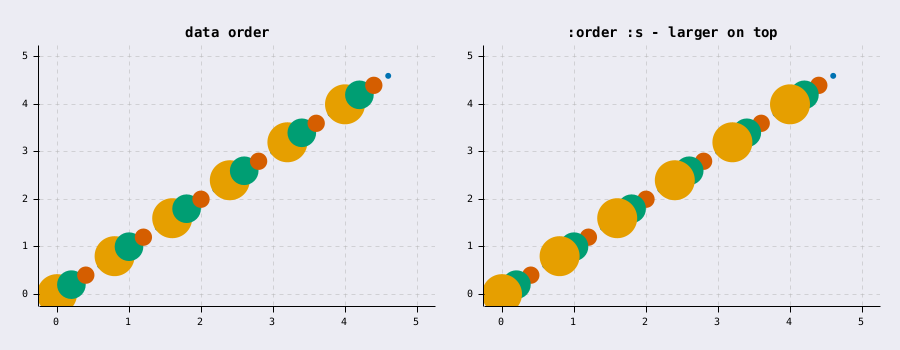
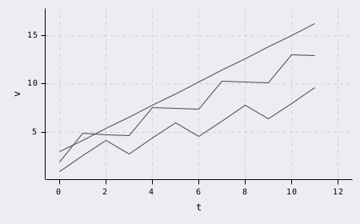
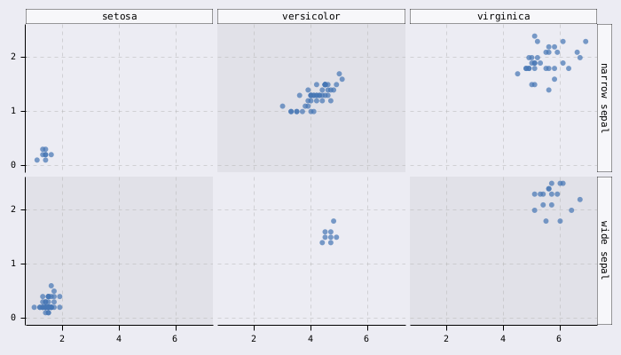

---
format:
  html: {toc: true, toc-location: right, toc-depth: 4, theme: cosmo}
code-block-background: true

---
<style></style><style>.printedClojure .sourceCode {
  background-color: transparent;
  border-style: none;
}
</style><style>.clay-limit-image-width .clay-image {max-width: 100%}
.clay-side-by-side .sourceCode {margin: 0}
.clay-side-by-side {margin: 1em 0}
</style>
<script src="https://code.jquery.com/jquery-3.6.0.min.js" type="text/javascript"></script><script src="https://code.jquery.com/ui/1.13.1/jquery-ui.min.js" type="text/javascript"></script>

# Data and mapping

Plot data is a sequence of maps (rows) or a map of equal-length sequences (columns). A mapping says which value
of a row each dimension reads: a keyword or a function of the row. The plot's mapping is merged under each
chart's own, and a chart reads only the keys it uses - its page lists them (`(describe/mapping (chart/bar))`).
The mapping is open: a chart of your own may read other keys.


::: {.sourceClojure}
```clojure
(ns reference.data-mapping
  (:require [cljplot2.chart :as chart]
            [cljplot2.core :as plot]
            [cljplot2.data.levels :as levels]
            [cljplot2.data.rows :as rows]
            [cljplot2.describe :as describe]
            [cljplot2.pipeline :as pipeline]
            [notebook-utils :as nu]))
```
:::


## Data: rows or columns

Columns become rows; both forms give the same plot. A chart may bring its own `:data` (and `:mapping`) - the
Data and mapping group every chart takes:

::: {.clay-table}

```{=html}
<table class="table table-hover table-responsive clay-table"><thead><tr><th>Option</th><th>Type</th><th>Default</th><th>Description</th></tr></thead><tbody><tr><td>:data</td><td>a sequence of rows (maps) or a map of columns (sequences) or nil</td><td>the plot's :data</td><td>the chart's own data instead of the plot's</td></tr><tr><td>:mapping</td><td>a mapping: key -> accessor (a keyword or a function of a row)</td><td></td><td>the chart's mapping, merged over the plot's mapping (a key set to nil removes it)</td></tr></tbody></table>
```

:::


::: {.sourceClojure}
```clojure
(def columns {:t (range 20) :v (map #(Math/sin (* 0.4 (double %))) (range 20))})
```
:::


::: {.clay-table}

```{=html}
<table class="table table-hover table-responsive clay-table"><thead><tr><th>t</th><th>v</th></tr></thead><tbody><tr><td>0</td><td>0.0</td></tr><tr><td>1</td><td>0.3894183423086505</td></tr><tr><td>2</td><td>0.7173560908995228</td></tr><tr><td>3</td><td>0.9320390859672264</td></tr><tr><td>4</td><td>0.9995736030415051</td></tr><tr><td>5</td><td>0.9092974268256817</td></tr><tr><td>6</td><td>0.6754631805511506</td></tr><tr><td>7</td><td>0.33498815015590466</td></tr><tr><td>8</td><td>-0.058374143427580086</td></tr><tr><td>9</td><td>-0.44252044329485246</td></tr><tr><td>10</td><td>-0.7568024953079282</td></tr><tr><td>11</td><td>-0.951602073889516</td></tr><tr><td>12</td><td>-0.9961646088358406</td></tr><tr><td>13</td><td>-0.8834546557201531</td></tr><tr><td>14</td><td>-0.6312666378723208</td></tr><tr><td>15</td><td>-0.27941549819892586</td></tr><tr><td>16</td><td>0.11654920485049364</td></tr><tr><td>17</td><td>0.49411335113860894</td></tr><tr><td>18</td><td>0.7936678638491531</td></tr><tr><td>19</td><td>0.9679196720314865</td></tr></tbody></table>
```

:::


::: {.sourceClojure}
```clojure
(plot/render-image {:data columns
                    :mapping {:x :t :y :v}
                    :charts [(chart/line)
                             (chart/scatter {:data [{:t 4 :v 1.0} {:t 12 :v -1.0}] :size 14 :color [200 50 50 120]})]}
                   {:width 500 :height 280})
```
:::


::: {.clay-image}

:::


## Position

The coordinates of a mark. Every mapping key takes an accessor: a keyword (the row's value under it), a
function of the row (computing the value - here y is a ratio of two columns), or a categorical marker of either,
`(levels/categorical acc)`, which reads numbers as levels (below).

::: {.clay-table}

```{=html}
<table class="table table-hover table-responsive clay-table"><thead><tr><th>Option</th><th>Type</th><th>Default</th><th>Description</th></tr></thead><tbody><tr><td>:x</td><td>a keyword, a function or a categorical marker of one or nil</td><td></td><td>x position (or the values of a strip chart with levels on y)</td></tr><tr><td>:y</td><td>a keyword, a function or a categorical marker of one or nil</td><td></td><td>y position (or the levels of a strip chart)</td></tr><tr><td>:z</td><td>a keyword, a function or a categorical marker of one or nil</td><td></td><td>third coordinate of 3D charts</td></tr></tbody></table>
```

:::


Data: Edgar Anderson's iris measurements, R datasets package `iris` (Anderson 1935; Fisher 1936); licence: Part of R (GPL-2 | GPL-3).


::: {.sourceClojure}
```clojure
(def iris (nu/dataset :iris))
```
:::


::: {.clay-table}

```{=html}
<table class="table table-hover table-responsive clay-table"><thead><tr><th>sepal-length</th><th>sepal-width</th><th>petal-length</th><th>petal-width</th><th>species</th></tr></thead><tbody><tr><td>5.1</td><td>3.5</td><td>1.4</td><td>0.2</td><td>setosa</td></tr><tr><td>4.9</td><td>3</td><td>1.4</td><td>0.2</td><td>setosa</td></tr><tr><td>4.7</td><td>3.2</td><td>1.3</td><td>0.2</td><td>setosa</td></tr><tr><td>4.6</td><td>3.1</td><td>1.5</td><td>0.2</td><td>setosa</td></tr><tr><td>5</td><td>3.6</td><td>1.4</td><td>0.2</td><td>setosa</td></tr><tr><td>5.4</td><td>3.9</td><td>1.7</td><td>0.4</td><td>setosa</td></tr><tr><td>4.6</td><td>3.4</td><td>1.4</td><td>0.3</td><td>setosa</td></tr><tr><td>5</td><td>3.4</td><td>1.5</td><td>0.2</td><td>setosa</td></tr><tr><td>4.4</td><td>2.9</td><td>1.4</td><td>0.2</td><td>setosa</td></tr><tr><td>4.9</td><td>3.1</td><td>1.5</td><td>0.1</td><td>setosa</td></tr><tr><td>5.4</td><td>3.7</td><td>1.5</td><td>0.2</td><td>setosa</td></tr><tr><td>4.8</td><td>3.4</td><td>1.6</td><td>0.2</td><td>setosa</td></tr><tr><td>4.8</td><td>3</td><td>1.4</td><td>0.1</td><td>setosa</td></tr><tr><td>4.3</td><td>3</td><td>1.1</td><td>0.1</td><td>setosa</td></tr><tr><td>5.8</td><td>4</td><td>1.2</td><td>0.2</td><td>setosa</td></tr><tr><td>5.7</td><td>4.4</td><td>1.5</td><td>0.4</td><td>setosa</td></tr><tr><td>5.4</td><td>3.9</td><td>1.3</td><td>0.4</td><td>setosa</td></tr><tr><td>5.1</td><td>3.5</td><td>1.4</td><td>0.3</td><td>setosa</td></tr><tr><td>5.7</td><td>3.8</td><td>1.7</td><td>0.3</td><td>setosa</td></tr><tr><td>5.1</td><td>3.8</td><td>1.5</td><td>0.3</td><td>setosa</td></tr></tbody></table>
```

:::


::: {.sourceClojure}
```clojure
(plot/render-image {:data iris
                    :mapping {:x :petal-length
                              :y #(/ (double (:petal-width %)) (double (:petal-length %)))}
                    :charts [(chart/scatter)]
                    :labels {:y "petal width / length"}}
                   {:width 500 :height 300})
```
:::


::: {.clay-image}

:::


The categorical marker: petal lengths rounded to whole numbers, read as numbers (left - a continuous axis) and
as levels (right - one band each):


::: {.sourceClojure}
```clojure
(plot/render-image (plot/arrange [{:data iris
                                   :mapping {:x #(Math/round (double (:petal-length %))) :y :sepal-length}
                                   :charts [(chart/scatter)]}
                                  {:data iris
                                   :mapping {:x (levels/categorical #(Math/round (double (:petal-length %))))
                                             :y :sepal-length}
                                   :charts [(chart/box)]}]
                                 {:columns 2})
                   {:width 800 :height 300})
```
:::


::: {.clay-image}

:::


## Intervals and segments

The other end of a mark spanning two values: a band from `:ymin` to `:ymax` (ribbons, error bars), a segment
to `:xend` / `:yend`.

::: {.clay-table}

```{=html}
<table class="table table-hover table-responsive clay-table"><thead><tr><th>Option</th><th>Type</th><th>Default</th><th>Description</th></tr></thead><tbody><tr><td>:ymin</td><td>a keyword, a function or a categorical marker of one or nil</td><td></td><td>lower end of an interval (ribbons, error bars)</td></tr><tr><td>:ymax</td><td>a keyword, a function or a categorical marker of one or nil</td><td></td><td>upper end of an interval</td></tr><tr><td>:xend</td><td>a keyword, a function or a categorical marker of one or nil</td><td></td><td>x of a segment's end</td></tr><tr><td>:yend</td><td>a keyword, a function or a categorical marker of one or nil</td><td></td><td>y of a segment's end</td></tr></tbody></table>
```

:::


::: {.sourceClojure}
```clojure
(def band (for [t (range 0 21)] {:t t :v (* 0.1 t t) :lo (- (* 0.1 t t) 3) :hi (+ (* 0.1 t t) 3)}))
```
:::


::: {.clay-table}

```{=html}
<table class="table table-hover table-responsive clay-table"><thead><tr><th>t</th><th>v</th><th>lo</th><th>hi</th></tr></thead><tbody><tr><td>0</td><td>0.0</td><td>-3.0</td><td>3.0</td></tr><tr><td>1</td><td>0.1</td><td>-2.9</td><td>3.1</td></tr><tr><td>2</td><td>0.4</td><td>-2.6</td><td>3.4</td></tr><tr><td>3</td><td>0.9000000000000001</td><td>-2.0999999999999996</td><td>3.9000000000000004</td></tr><tr><td>4</td><td>1.6</td><td>-1.4</td><td>4.6</td></tr><tr><td>5</td><td>2.5</td><td>-0.5</td><td>5.5</td></tr><tr><td>6</td><td>3.6000000000000005</td><td>0.6000000000000005</td><td>6.6000000000000005</td></tr><tr><td>7</td><td>4.9</td><td>1.9000000000000004</td><td>7.9</td></tr><tr><td>8</td><td>6.4</td><td>3.4000000000000004</td><td>9.4</td></tr><tr><td>9</td><td>8.1</td><td>5.1</td><td>11.1</td></tr><tr><td>10</td><td>10.0</td><td>7.0</td><td>13.0</td></tr><tr><td>11</td><td>12.100000000000001</td><td>9.100000000000001</td><td>15.100000000000001</td></tr><tr><td>12</td><td>14.400000000000002</td><td>11.400000000000002</td><td>17.400000000000002</td></tr><tr><td>13</td><td>16.900000000000002</td><td>13.900000000000002</td><td>19.900000000000002</td></tr><tr><td>14</td><td>19.6</td><td>16.6</td><td>22.6</td></tr><tr><td>15</td><td>22.5</td><td>19.5</td><td>25.5</td></tr><tr><td>16</td><td>25.6</td><td>22.6</td><td>28.6</td></tr><tr><td>17</td><td>28.900000000000002</td><td>25.900000000000002</td><td>31.900000000000002</td></tr><tr><td>18</td><td>32.4</td><td>29.4</td><td>35.4</td></tr><tr><td>19</td><td>36.1</td><td>33.1</td><td>39.1</td></tr></tbody></table>
```

:::


::: {.sourceClojure}
```clojure
(plot/render-image {:data band
                    :mapping {:x :t :y :v :ymin :lo :ymax :hi}
                    :charts [(chart/ribbon)
                             (chart/line)
                             (chart/segment {:data (filter #(zero? (mod (long (:t %)) 5)) band)
                                             :mapping {:xend :t :ymin nil :ymax nil}
                                             :yend 0})]}
                   {:width 500 :height 280})
```
:::


::: {.clay-image}

:::


## Prices

Opening, highest, lowest and closing values of a period - the candlestick chart.

::: {.clay-table}

```{=html}
<table class="table table-hover table-responsive clay-table"><thead><tr><th>Option</th><th>Type</th><th>Default</th><th>Description</th></tr></thead><tbody><tr><td>:open</td><td>a keyword, a function or a categorical marker of one or nil</td><td></td><td>opening value (candlesticks)</td></tr><tr><td>:high</td><td>a keyword, a function or a categorical marker of one or nil</td><td></td><td>highest value (candlesticks)</td></tr><tr><td>:low</td><td>a keyword, a function or a categorical marker of one or nil</td><td></td><td>lowest value (candlesticks)</td></tr><tr><td>:close</td><td>a keyword, a function or a categorical marker of one or nil</td><td></td><td>closing value (candlesticks)</td></tr></tbody></table>
```

:::


::: {.sourceClojure}
```clojure
(def prices (reductions (fn [{:keys [close]} d]
                          (let [open close
                                close (+ open (- (mod (* d 37) 11) 5.0))]
                            {:day d :open open :close close
                             :high (+ (max open close) (mod d 3)) :low (- (min open close) (mod d 4))}))
                        {:day 0 :open 100.0 :close 100.0 :high 101.0 :low 99.0}
                        (range 1 25)))
```
:::


::: {.clay-table}

```{=html}
<table class="table table-hover table-responsive clay-table"><thead><tr><th>day</th><th>open</th><th>close</th><th>high</th><th>low</th></tr></thead><tbody><tr><td>0</td><td>100.0</td><td>100.0</td><td>101.0</td><td>99.0</td></tr><tr><td>1</td><td>100.0</td><td>99.0</td><td>101.0</td><td>98.0</td></tr><tr><td>2</td><td>99.0</td><td>102.0</td><td>104.0</td><td>97.0</td></tr><tr><td>3</td><td>102.0</td><td>98.0</td><td>102.0</td><td>95.0</td></tr><tr><td>4</td><td>98.0</td><td>98.0</td><td>99.0</td><td>98.0</td></tr><tr><td>5</td><td>98.0</td><td>102.0</td><td>104.0</td><td>97.0</td></tr><tr><td>6</td><td>102.0</td><td>99.0</td><td>102.0</td><td>97.0</td></tr><tr><td>7</td><td>99.0</td><td>100.0</td><td>101.0</td><td>96.0</td></tr><tr><td>8</td><td>100.0</td><td>105.0</td><td>107.0</td><td>100.0</td></tr><tr><td>9</td><td>105.0</td><td>103.0</td><td>105.0</td><td>102.0</td></tr><tr><td>10</td><td>103.0</td><td>105.0</td><td>106.0</td><td>101.0</td></tr><tr><td>11</td><td>105.0</td><td>100.0</td><td>107.0</td><td>97.0</td></tr><tr><td>12</td><td>100.0</td><td>99.0</td><td>100.0</td><td>99.0</td></tr><tr><td>13</td><td>99.0</td><td>102.0</td><td>103.0</td><td>98.0</td></tr><tr><td>14</td><td>102.0</td><td>98.0</td><td>104.0</td><td>96.0</td></tr><tr><td>15</td><td>98.0</td><td>98.0</td><td>98.0</td><td>95.0</td></tr><tr><td>16</td><td>98.0</td><td>102.0</td><td>103.0</td><td>98.0</td></tr><tr><td>17</td><td>102.0</td><td>99.0</td><td>104.0</td><td>98.0</td></tr><tr><td>18</td><td>99.0</td><td>100.0</td><td>100.0</td><td>97.0</td></tr><tr><td>19</td><td>100.0</td><td>105.0</td><td>106.0</td><td>97.0</td></tr></tbody></table>
```

:::


::: {.sourceClojure}
```clojure
(plot/render-image {:data prices
                    :mapping {:x :day :open :open :high :high :low :low :close :close}
                    :charts [(chart/candlestick)]}
                   {:width 500 :height 280})
```
:::


::: {.clay-image}

:::


## Aesthetics

Values styling marks: colour, shape, size, dash, fill pattern - each through its scale and legend (Aesthetics
and legends chapter).

::: {.clay-table}

```{=html}
<table class="table table-hover table-responsive clay-table"><thead><tr><th>Option</th><th>Type</th><th>Default</th><th>Description</th></tr></thead><tbody><tr><td>:color</td><td>a keyword, a function or a categorical marker of one or nil</td><td></td><td>colour aesthetic: groups, or values on a colour scale</td></tr><tr><td>:shape</td><td>a keyword, a function or a categorical marker of one or nil</td><td></td><td>point shape aesthetic</td></tr><tr><td>:size</td><td>a keyword, a function or a categorical marker of one or nil</td><td></td><td>size aesthetic</td></tr><tr><td>:dash</td><td>a keyword, a function or a categorical marker of one or nil</td><td></td><td>line dash aesthetic</td></tr><tr><td>:pattern</td><td>a keyword, a function or a categorical marker of one or nil</td><td></td><td>fill pattern aesthetic</td></tr></tbody></table>
```

:::


::: {.sourceClojure}
```clojure
(plot/render-image {:data iris
                    :mapping {:x :sepal-length :y :sepal-width :color :species :shape :species :size :petal-width}
                    :charts [(chart/scatter)]}
                   {:width 600 :height 350})
```
:::


::: {.clay-image}

:::


## Groups and order

`:group` splits rows into groups without styling them - charts drawing one mark per group (lines, areas,
densities ...) draw each separately; any aesthetic groups too. `:order` sets the drawing order of points.

::: {.clay-table}

```{=html}
<table class="table table-hover table-responsive clay-table"><thead><tr><th>Option</th><th>Type</th><th>Default</th><th>Description</th></tr></thead><tbody><tr><td>:group</td><td>a keyword, a function or a categorical marker of one or nil</td><td></td><td>groups without a visual aesthetic</td></tr><tr><td>:order</td><td>a keyword, a function or a categorical marker of one or nil</td><td></td><td>drawing order of points</td></tr></tbody></table>
```

:::


::: {.sourceClojure}
```clojure
(def walks (for [w (range 4) t (range 12)] {:walk (when (pos? w) w) :t t :v (+ w (* t 0.3 (inc w)) (mod (* t w) 3))}))
```
:::


::: {.clay-table}

```{=html}
<table class="table table-hover table-responsive clay-table"><thead><tr><th>walk</th><th>t</th><th>v</th></tr></thead><tbody><tr><td></td><td>0</td><td>0.0</td></tr><tr><td></td><td>1</td><td>0.3</td></tr><tr><td></td><td>2</td><td>0.6</td></tr><tr><td></td><td>3</td><td>0.8999999999999999</td></tr><tr><td></td><td>4</td><td>1.2</td></tr><tr><td></td><td>5</td><td>1.5</td></tr><tr><td></td><td>6</td><td>1.7999999999999998</td></tr><tr><td></td><td>7</td><td>2.1</td></tr><tr><td></td><td>8</td><td>2.4</td></tr><tr><td></td><td>9</td><td>2.6999999999999997</td></tr><tr><td></td><td>10</td><td>3.0</td></tr><tr><td></td><td>11</td><td>3.3</td></tr><tr><td>1</td><td>0</td><td>1.0</td></tr><tr><td>1</td><td>1</td><td>2.6</td></tr><tr><td>1</td><td>2</td><td>4.2</td></tr><tr><td>1</td><td>3</td><td>2.8</td></tr><tr><td>1</td><td>4</td><td>4.4</td></tr><tr><td>1</td><td>5</td><td>6.0</td></tr><tr><td>1</td><td>6</td><td>4.6</td></tr><tr><td>1</td><td>7</td><td>6.2</td></tr></tbody></table>
```

:::


::: {.sourceClojure}
```clojure
(plot/render-image {:data walks
                    :mapping {:x :t :y :v :group :walk}
                    :charts [(chart/line {:color [70 70 70]})]}
                   {:width 450 :height 280})
```
:::


::: {.clay-image}

:::


`:order`: overlapping points listed largest first - in data order the small ones are drawn last, on top (left);
ordered by size (ascending, the default `:order-direction`) the large ones come last and cover them (right):


::: {.sourceClojure}
```clojure
(def overlapping (for [i (range 24)] {:x (* 0.2 i) :y (* 0.2 i) :s (- 3 (mod i 4))}))
```
:::


::: {.clay-table}

```{=html}
<table class="table table-hover table-responsive clay-table"><thead><tr><th>x</th><th>y</th><th>s</th></tr></thead><tbody><tr><td>0.0</td><td>0.0</td><td>3</td></tr><tr><td>0.2</td><td>0.2</td><td>2</td></tr><tr><td>0.4</td><td>0.4</td><td>1</td></tr><tr><td>0.6000000000000001</td><td>0.6000000000000001</td><td>0</td></tr><tr><td>0.8</td><td>0.8</td><td>3</td></tr><tr><td>1.0</td><td>1.0</td><td>2</td></tr><tr><td>1.2000000000000002</td><td>1.2000000000000002</td><td>1</td></tr><tr><td>1.4000000000000001</td><td>1.4000000000000001</td><td>0</td></tr><tr><td>1.6</td><td>1.6</td><td>3</td></tr><tr><td>1.8</td><td>1.8</td><td>2</td></tr><tr><td>2.0</td><td>2.0</td><td>1</td></tr><tr><td>2.2</td><td>2.2</td><td>0</td></tr><tr><td>2.4000000000000004</td><td>2.4000000000000004</td><td>3</td></tr><tr><td>2.6</td><td>2.6</td><td>2</td></tr><tr><td>2.8000000000000003</td><td>2.8000000000000003</td><td>1</td></tr><tr><td>3.0</td><td>3.0</td><td>0</td></tr><tr><td>3.2</td><td>3.2</td><td>3</td></tr><tr><td>3.4000000000000004</td><td>3.4000000000000004</td><td>2</td></tr><tr><td>3.6</td><td>3.6</td><td>1</td></tr><tr><td>3.8000000000000003</td><td>3.8000000000000003</td><td>0</td></tr></tbody></table>
```

:::


::: {.sourceClojure}
```clojure
(plot/render-image (plot/arrange [{:data overlapping
                                   :mapping {:x :x :y :y :size :s :color :s}
                                   :charts [(chart/scatter)]
                                   :scales {:size {:range [6 40]} :color {:type :categorical}}
                                   :legend false
                                   :labels {:title "data order"}}
                                  {:data overlapping
                                   :mapping {:x :x :y :y :size :s :color :s :order :s}
                                   :charts [(chart/scatter)]
                                   :scales {:size {:range [6 40]} :color {:type :categorical}}
                                   :legend false
                                   :labels {:title ":order :s - larger on top"}}]
                                 {:columns 2})
                   {:width 900 :height 350})
```
:::


::: {.clay-image}

:::


A `nil` group value forms its own NA level - the bottom line above is the walk without a number. The plot's
`:groups {:na false}` drops such rows instead:

::: {.clay-table}

```{=html}
<table class="table table-hover table-responsive clay-table"><thead><tr><th>Option</th><th>Type</th><th>Default</th><th>Description</th></tr></thead><tbody><tr><td>:groups :na</td><td>true or false or nil</td><td>true</td><td>nil aesthetic values form the NA level (false - such rows are dropped)</td></tr></tbody></table>
```

:::


::: {.sourceClojure}
```clojure
(plot/render-image {:data walks
                    :mapping {:x :t :y :v :group :walk}
                    :charts [(chart/line {:color [70 70 70]})]
                    :groups {:na false}}
                   {:width 450 :height 280})
```
:::


::: {.clay-image}

:::


## Facets

Values splitting the plot into panels: a wrap of panels (`:facet`) or a grid of columns and rows (Facets
chapter).

::: {.clay-table}

```{=html}
<table class="table table-hover table-responsive clay-table"><thead><tr><th>Option</th><th>Type</th><th>Default</th><th>Description</th></tr></thead><tbody><tr><td>:facet</td><td>a keyword, a function or a categorical marker of one or nil</td><td></td><td>wrap facets: one panel per value</td></tr><tr><td>:facet-col</td><td>a keyword, a function or a categorical marker of one or nil</td><td></td><td>grid facets: one column per value</td></tr><tr><td>:facet-row</td><td>a keyword, a function or a categorical marker of one or nil</td><td></td><td>grid facets: one row per value</td></tr></tbody></table>
```

:::


::: {.sourceClojure}
```clojure
(plot/render-image {:data iris
                    :mapping {:x :sepal-length :y :sepal-width :facet :species}
                    :charts [(chart/scatter)]}
                   {:width 700 :height 280})
```
:::


::: {.clay-image}

:::


A grid: species as columns, wide and narrow sepals as rows:


::: {.sourceClojure}
```clojure
(plot/render-image {:data iris
                    :mapping {:x :petal-length :y :petal-width :facet-col :species
                              :facet-row #(if (> (double (:sepal-width %)) 3.0) "wide sepal" "narrow sepal")}
                    :charts [(chart/scatter)]}
                   {:width 700 :height 400})
```
:::


::: {.clay-image}

:::


## Values, sets and hierarchies

Keys of particular charts: `:value` (cell values, weights, leaf sizes), `:hierarchy` (the levels of a tree,
outer first) and `:set` / `:item` (set membership of Venn diagrams).

::: {.clay-table}

```{=html}
<table class="table table-hover table-responsive clay-table"><thead><tr><th>Option</th><th>Type</th><th>Default</th><th>Description</th></tr></thead><tbody><tr><td>:value</td><td>a keyword, a function or a categorical marker of one or nil</td><td></td><td>a value: cell values, weights, sizes of hierarchy leaves</td></tr><tr><td>:set</td><td>a keyword, a function or a categorical marker of one or nil</td><td></td><td>set name of a membership row (Venn)</td></tr><tr><td>:item</td><td>a keyword, a function or a categorical marker of one or nil</td><td></td><td>item of a membership row (Venn)</td></tr><tr><td>:hierarchy</td><td>vector of a keyword, a function or a categorical marker of one (at least 1) or nil</td><td></td><td>levels of a hierarchy, root first (treemap, partition, pack)</td></tr></tbody></table>
```

:::


::: {.sourceClojure}
```clojure
(def budget [{:dept "science" :team "physics" :cost 40} {:dept "science" :team "biology" :cost 25}
             {:dept "arts" :team "music" :cost 15} {:dept "arts" :team "theatre" :cost 10}
             {:dept "sport" :team "football" :cost 20}])
```
:::


::: {.clay-table}

```{=html}
<table class="table table-hover table-responsive clay-table"><thead><tr><th>dept</th><th>team</th><th>cost</th></tr></thead><tbody><tr><td>science</td><td>physics</td><td>40</td></tr><tr><td>science</td><td>biology</td><td>25</td></tr><tr><td>arts</td><td>music</td><td>15</td></tr><tr><td>arts</td><td>theatre</td><td>10</td></tr><tr><td>sport</td><td>football</td><td>20</td></tr></tbody></table>
```

:::


::: {.sourceClojure}
```clojure
(def members (for [[set items] {"reads" ["ann" "bob" "cid" "dan"] "writes" ["bob" "dan" "eve"]}
                   item items]
               {:set set :item item}))
```
:::


::: {.clay-table}

```{=html}
<table class="table table-hover table-responsive clay-table"><thead><tr><th>set</th><th>item</th></tr></thead><tbody><tr><td>reads</td><td>ann</td></tr><tr><td>reads</td><td>bob</td></tr><tr><td>reads</td><td>cid</td></tr><tr><td>reads</td><td>dan</td></tr><tr><td>writes</td><td>bob</td></tr><tr><td>writes</td><td>dan</td></tr><tr><td>writes</td><td>eve</td></tr></tbody></table>
```

:::


::: {.sourceClojure}
```clojure
(plot/render-image (plot/arrange [{:data budget
                                   :mapping {:hierarchy [:dept :team] :value :cost}
                                   :charts [(chart/treemap)]}
                                  {:data members
                                   :mapping {:set :set :item :item}
                                   :charts [(chart/venn)]}]
                                 {:columns 2})
                   {:width 800 :height 350})
```
:::


::: {.clay-image}

:::


```{=html}
<div style="background-color:grey;height:2px;width:100%;"></div>
```


```{=html}
<div><pre><small><small>source: notebooks/reference/data_mapping.clj</small></small></pre></div>
```