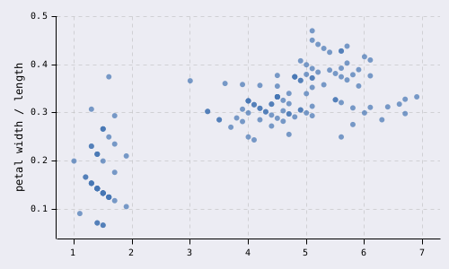
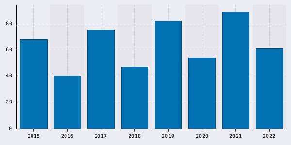
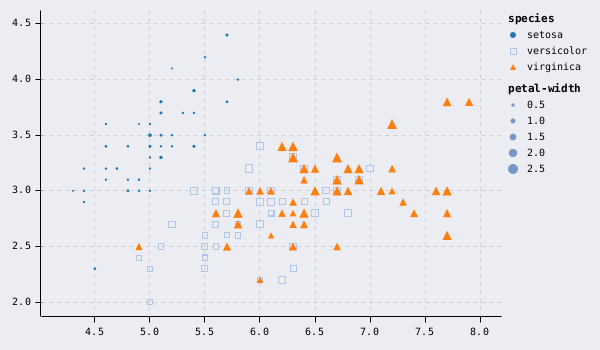
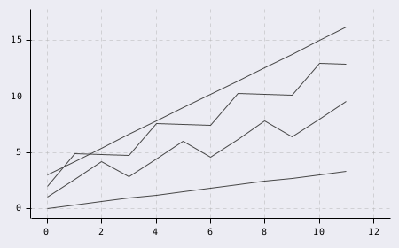
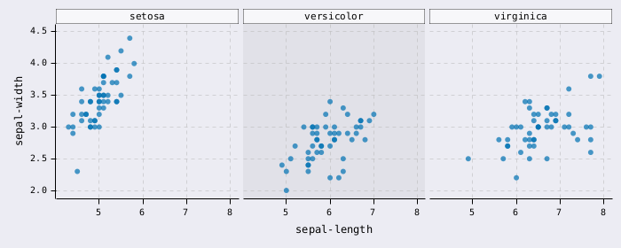
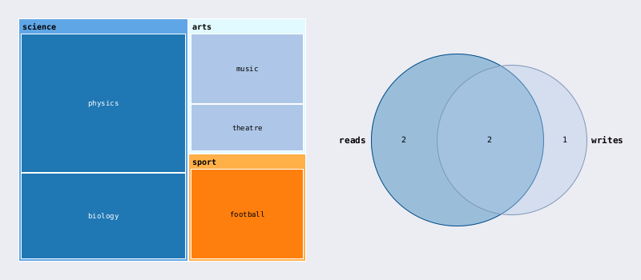

---
format:
  html:
    toc: true
    toc-location: right
    toc-depth: 4
    theme: cosmo
    include-in-header:
      text: |-
        <style>
        .data-table { width: fit-content; max-width: 100%; max-height: 15rem; overflow: auto; margin: 0 0 1rem 0; }
        .data-table .table-responsive { overflow: visible; }
        .data-table table { font-size: 0.75rem; width: auto; margin: 0; }
        .data-table th, .data-table td { padding: 0.1rem 0.45rem !important; white-space: nowrap; }
        .data-table thead th { position: sticky; top: 0; background: var(--bs-body-bg, #fff); }
        .options { margin: 0.5rem 0 1rem 0; }
        .options .option-card { margin: 0 0 0.9rem 0; border: 1px solid var(--bs-border-color, #dee2e6); border-radius: 0.375rem; overflow: hidden; }
        .options dt { display: flex; flex-wrap: wrap; align-items: baseline; gap: 0.1rem 1rem; margin: 0; padding: 0.4rem 0.75rem; background: #eef2f7; border-bottom: 1px solid var(--bs-border-color, #dee2e6); font-weight: normal; }
        .options dt > code { font-weight: 700; font-size: 1rem; background: none; padding: 0; }
        .options .option-default { font-size: 0.85rem; color: var(--bs-secondary-color, #6c757d); }
        .options dd { margin: 0; padding: 0.5rem 0.75rem; }
        .options .option-example { font-size: 0.85rem; padding: 0 0 0.45rem 0; margin-bottom: 0.45rem; border-bottom: 1px dashed var(--bs-border-color, #dee2e6); }
        .options .option-example code { background: none; padding: 0; }
        .options .option-text ul { margin: 0.3rem 0 0 0; padding-left: 1.25rem; }
        .options code, .mapping code { overflow-wrap: anywhere; }
        .options .option-default code, .options .option-example code { white-space: pre-wrap; }
        .mapping { margin: 0.5rem 0 1rem 0; padding: 0.5rem 0.75rem; border: 1px solid var(--bs-border-color, #dee2e6); border-left: 0.3rem solid #2780e3; border-radius: 0.375rem; background: #f5f8fc; }
        .mapping-title { font-weight: 700; margin-bottom: 0.25rem; }
        .mapping-hint { font-weight: normal; font-size: 0.85rem; color: var(--bs-secondary-color, #6c757d); }
        .mapping ul { margin: 0; padding-left: 1.25rem; }
        .mapping .required { font-size: 0.75rem; padding: 0 0.3rem; border: 1px solid currentColor; border-radius: 0.25rem; }
        .mapping-returns { margin-top: 0.25rem; }
        .mapping code { white-space: pre-wrap; }
        .shared { margin: 0.5rem 0 1rem 0; padding: 0.5rem 0.75rem; border: 1px solid var(--bs-border-color, #dee2e6); border-left: 0.3rem solid #6c757d; border-radius: 0.375rem; background: #f6f6f6; }
        .shared-title { font-weight: 700; margin-bottom: 0.25rem; }
        .shared-hint { font-weight: normal; font-size: 0.85rem; color: var(--bs-secondary-color, #6c757d); }
        .shared ul { margin: 0; padding-left: 1.25rem; }
        .shared code { overflow-wrap: anywhere; }
        p code, li code { white-space: pre-wrap; overflow-wrap: anywhere; }
        </style>
code-block-background: true

---
<style></style><style>.printedClojure .sourceCode {
  background-color: transparent;
  border-style: none;
}
</style><style>.clay-limit-image-width .clay-image {max-width: 100%}
.clay-side-by-side .sourceCode {margin: 0}
.clay-side-by-side {margin: 1em 0}
</style>
<script src="https://code.jquery.com/jquery-3.6.0.min.js" type="text/javascript"></script><script src="https://code.jquery.com/ui/1.13.1/jquery-ui.min.js" type="text/javascript"></script>

# Data and mapping

Plot data is a sequence of maps (rows) or a map of equal-length sequences (columns). A mapping says which value
of a row each dimension reads. The plot's mapping is merged under each chart's own, and a chart reads only the keys it uses - its page lists them (`(describe/mapping (chart/bar))`).
The mapping is open: a chart of your own may read other keys.


::: {.sourceClojure}
```clojure
(ns reference.data-mapping
  (:require [fastmath.core :as m]
            [cljplot2.chart :as chart]
            [cljplot2.core :as plot]
            [cljplot2.data.levels :as levels]
            [cljplot2.data.rows :as rows]
            [cljplot2.describe :as describe]
            [cljplot2.pipeline :as pipeline]
            [notebook-utils :as nu]))
```
:::


The table below holds a made-up wave as two columns; the first section draws it:


::: {.sourceClojure}
```clojure
(def columns {:t (range 20) :v (map #(m/sin (m/* 0.4 %)) (range 20))})
```
:::


```{=html}
<div class="data-table"><table class="table table-hover table-responsive clay-table"><thead><tr><th>t</th><th>v</th></tr></thead><tbody><tr><td>0</td><td>0.0</td></tr><tr><td>1</td><td>0.3894183423086505</td></tr><tr><td>2</td><td>0.7173560908995228</td></tr><tr><td>3</td><td>0.9320390859672264</td></tr><tr><td>4</td><td>0.9995736030415051</td></tr><tr><td>5</td><td>0.9092974268256817</td></tr><tr><td>6</td><td>0.6754631805511506</td></tr><tr><td>7</td><td>0.33498815015590466</td></tr><tr><td>8</td><td>-0.058374143427580086</td></tr><tr><td>9</td><td>-0.44252044329485246</td></tr><tr><td>10</td><td>-0.7568024953079282</td></tr><tr><td>11</td><td>-0.951602073889516</td></tr><tr><td>12</td><td>-0.9961646088358406</td></tr><tr><td>13</td><td>-0.8834546557201531</td></tr><tr><td>14</td><td>-0.6312666378723208</td></tr><tr><td>15</td><td>-0.27941549819892586</td></tr><tr><td>16</td><td>0.11654920485049364</td></tr><tr><td>17</td><td>0.49411335113860894</td></tr><tr><td>18</td><td>0.7936678638491531</td></tr><tr><td>19</td><td>0.9679196720314865</td></tr></tbody></table></div>
```


The table below holds the iris flowers; the position, aesthetic and facet sections draw them:

Data: Edgar Anderson's iris measurements, R datasets package `iris` (Anderson 1935; Fisher 1936); licence: Part of R (GPL-2 | GPL-3).


::: {.sourceClojure}
```clojure
(def iris (nu/dataset :iris))
```
:::


```{=html}
<div class="data-table"><table class="table table-hover table-responsive clay-table"><thead><tr><th>sepal-length</th><th>sepal-width</th><th>petal-length</th><th>petal-width</th><th>species</th></tr></thead><tbody><tr><td>5.1</td><td>3.5</td><td>1.4</td><td>0.2</td><td>setosa</td></tr><tr><td>4.9</td><td>3</td><td>1.4</td><td>0.2</td><td>setosa</td></tr><tr><td>4.7</td><td>3.2</td><td>1.3</td><td>0.2</td><td>setosa</td></tr><tr><td>4.6</td><td>3.1</td><td>1.5</td><td>0.2</td><td>setosa</td></tr><tr><td>5</td><td>3.6</td><td>1.4</td><td>0.2</td><td>setosa</td></tr><tr><td>5.4</td><td>3.9</td><td>1.7</td><td>0.4</td><td>setosa</td></tr><tr><td>4.6</td><td>3.4</td><td>1.4</td><td>0.3</td><td>setosa</td></tr><tr><td>5</td><td>3.4</td><td>1.5</td><td>0.2</td><td>setosa</td></tr><tr><td>4.4</td><td>2.9</td><td>1.4</td><td>0.2</td><td>setosa</td></tr><tr><td>4.9</td><td>3.1</td><td>1.5</td><td>0.1</td><td>setosa</td></tr><tr><td>5.4</td><td>3.7</td><td>1.5</td><td>0.2</td><td>setosa</td></tr><tr><td>4.8</td><td>3.4</td><td>1.6</td><td>0.2</td><td>setosa</td></tr><tr><td>4.8</td><td>3</td><td>1.4</td><td>0.1</td><td>setosa</td></tr><tr><td>4.3</td><td>3</td><td>1.1</td><td>0.1</td><td>setosa</td></tr><tr><td>5.8</td><td>4</td><td>1.2</td><td>0.2</td><td>setosa</td></tr><tr><td>5.7</td><td>4.4</td><td>1.5</td><td>0.4</td><td>setosa</td></tr><tr><td>5.4</td><td>3.9</td><td>1.3</td><td>0.4</td><td>setosa</td></tr><tr><td>5.1</td><td>3.5</td><td>1.4</td><td>0.3</td><td>setosa</td></tr><tr><td>5.7</td><td>3.8</td><td>1.7</td><td>0.3</td><td>setosa</td></tr><tr><td>5.1</td><td>3.8</td><td>1.5</td><td>0.3</td><td>setosa</td></tr><tr><td>5.4</td><td>3.4</td><td>1.7</td><td>0.2</td><td>setosa</td></tr><tr><td>5.1</td><td>3.7</td><td>1.5</td><td>0.4</td><td>setosa</td></tr><tr><td>4.6</td><td>3.6</td><td>1</td><td>0.2</td><td>setosa</td></tr><tr><td>5.1</td><td>3.3</td><td>1.7</td><td>0.5</td><td>setosa</td></tr><tr><td>4.8</td><td>3.4</td><td>1.9</td><td>0.2</td><td>setosa</td></tr><tr><td>5</td><td>3</td><td>1.6</td><td>0.2</td><td>setosa</td></tr><tr><td>5</td><td>3.4</td><td>1.6</td><td>0.4</td><td>setosa</td></tr><tr><td>5.2</td><td>3.5</td><td>1.5</td><td>0.2</td><td>setosa</td></tr><tr><td>5.2</td><td>3.4</td><td>1.4</td><td>0.2</td><td>setosa</td></tr><tr><td>4.7</td><td>3.2</td><td>1.6</td><td>0.2</td><td>setosa</td></tr><tr><td>4.8</td><td>3.1</td><td>1.6</td><td>0.2</td><td>setosa</td></tr><tr><td>5.4</td><td>3.4</td><td>1.5</td><td>0.4</td><td>setosa</td></tr><tr><td>5.2</td><td>4.1</td><td>1.5</td><td>0.1</td><td>setosa</td></tr><tr><td>5.5</td><td>4.2</td><td>1.4</td><td>0.2</td><td>setosa</td></tr><tr><td>4.9</td><td>3.1</td><td>1.5</td><td>0.2</td><td>setosa</td></tr><tr><td>5</td><td>3.2</td><td>1.2</td><td>0.2</td><td>setosa</td></tr><tr><td>5.5</td><td>3.5</td><td>1.3</td><td>0.2</td><td>setosa</td></tr><tr><td>4.9</td><td>3.6</td><td>1.4</td><td>0.1</td><td>setosa</td></tr><tr><td>4.4</td><td>3</td><td>1.3</td><td>0.2</td><td>setosa</td></tr><tr><td>5.1</td><td>3.4</td><td>1.5</td><td>0.2</td><td>setosa</td></tr><tr><td>5</td><td>3.5</td><td>1.3</td><td>0.3</td><td>setosa</td></tr><tr><td>4.5</td><td>2.3</td><td>1.3</td><td>0.3</td><td>setosa</td></tr><tr><td>4.4</td><td>3.2</td><td>1.3</td><td>0.2</td><td>setosa</td></tr><tr><td>5</td><td>3.5</td><td>1.6</td><td>0.6</td><td>setosa</td></tr><tr><td>5.1</td><td>3.8</td><td>1.9</td><td>0.4</td><td>setosa</td></tr><tr><td>4.8</td><td>3</td><td>1.4</td><td>0.3</td><td>setosa</td></tr><tr><td>5.1</td><td>3.8</td><td>1.6</td><td>0.2</td><td>setosa</td></tr><tr><td>4.6</td><td>3.2</td><td>1.4</td><td>0.2</td><td>setosa</td></tr><tr><td>5.3</td><td>3.7</td><td>1.5</td><td>0.2</td><td>setosa</td></tr><tr><td>5</td><td>3.3</td><td>1.4</td><td>0.2</td><td>setosa</td></tr><tr><td>7</td><td>3.2</td><td>4.7</td><td>1.4</td><td>versicolor</td></tr><tr><td>6.4</td><td>3.2</td><td>4.5</td><td>1.5</td><td>versicolor</td></tr><tr><td>6.9</td><td>3.1</td><td>4.9</td><td>1.5</td><td>versicolor</td></tr><tr><td>5.5</td><td>2.3</td><td>4</td><td>1.3</td><td>versicolor</td></tr><tr><td>6.5</td><td>2.8</td><td>4.6</td><td>1.5</td><td>versicolor</td></tr><tr><td>5.7</td><td>2.8</td><td>4.5</td><td>1.3</td><td>versicolor</td></tr><tr><td>6.3</td><td>3.3</td><td>4.7</td><td>1.6</td><td>versicolor</td></tr><tr><td>4.9</td><td>2.4</td><td>3.3</td><td>1</td><td>versicolor</td></tr><tr><td>6.6</td><td>2.9</td><td>4.6</td><td>1.3</td><td>versicolor</td></tr><tr><td>5.2</td><td>2.7</td><td>3.9</td><td>1.4</td><td>versicolor</td></tr><tr><td>5</td><td>2</td><td>3.5</td><td>1</td><td>versicolor</td></tr><tr><td>5.9</td><td>3</td><td>4.2</td><td>1.5</td><td>versicolor</td></tr><tr><td>6</td><td>2.2</td><td>4</td><td>1</td><td>versicolor</td></tr><tr><td>6.1</td><td>2.9</td><td>4.7</td><td>1.4</td><td>versicolor</td></tr><tr><td>5.6</td><td>2.9</td><td>3.6</td><td>1.3</td><td>versicolor</td></tr><tr><td>6.7</td><td>3.1</td><td>4.4</td><td>1.4</td><td>versicolor</td></tr><tr><td>5.6</td><td>3</td><td>4.5</td><td>1.5</td><td>versicolor</td></tr><tr><td>5.8</td><td>2.7</td><td>4.1</td><td>1</td><td>versicolor</td></tr><tr><td>6.2</td><td>2.2</td><td>4.5</td><td>1.5</td><td>versicolor</td></tr><tr><td>5.6</td><td>2.5</td><td>3.9</td><td>1.1</td><td>versicolor</td></tr><tr><td>5.9</td><td>3.2</td><td>4.8</td><td>1.8</td><td>versicolor</td></tr><tr><td>6.1</td><td>2.8</td><td>4</td><td>1.3</td><td>versicolor</td></tr><tr><td>6.3</td><td>2.5</td><td>4.9</td><td>1.5</td><td>versicolor</td></tr><tr><td>6.1</td><td>2.8</td><td>4.7</td><td>1.2</td><td>versicolor</td></tr><tr><td>6.4</td><td>2.9</td><td>4.3</td><td>1.3</td><td>versicolor</td></tr><tr><td>6.6</td><td>3</td><td>4.4</td><td>1.4</td><td>versicolor</td></tr><tr><td>6.8</td><td>2.8</td><td>4.8</td><td>1.4</td><td>versicolor</td></tr><tr><td>6.7</td><td>3</td><td>5</td><td>1.7</td><td>versicolor</td></tr><tr><td>6</td><td>2.9</td><td>4.5</td><td>1.5</td><td>versicolor</td></tr><tr><td>5.7</td><td>2.6</td><td>3.5</td><td>1</td><td>versicolor</td></tr><tr><td>5.5</td><td>2.4</td><td>3.8</td><td>1.1</td><td>versicolor</td></tr><tr><td>5.5</td><td>2.4</td><td>3.7</td><td>1</td><td>versicolor</td></tr><tr><td>5.8</td><td>2.7</td><td>3.9</td><td>1.2</td><td>versicolor</td></tr><tr><td>6</td><td>2.7</td><td>5.1</td><td>1.6</td><td>versicolor</td></tr><tr><td>5.4</td><td>3</td><td>4.5</td><td>1.5</td><td>versicolor</td></tr><tr><td>6</td><td>3.4</td><td>4.5</td><td>1.6</td><td>versicolor</td></tr><tr><td>6.7</td><td>3.1</td><td>4.7</td><td>1.5</td><td>versicolor</td></tr><tr><td>6.3</td><td>2.3</td><td>4.4</td><td>1.3</td><td>versicolor</td></tr><tr><td>5.6</td><td>3</td><td>4.1</td><td>1.3</td><td>versicolor</td></tr><tr><td>5.5</td><td>2.5</td><td>4</td><td>1.3</td><td>versicolor</td></tr><tr><td>5.5</td><td>2.6</td><td>4.4</td><td>1.2</td><td>versicolor</td></tr><tr><td>6.1</td><td>3</td><td>4.6</td><td>1.4</td><td>versicolor</td></tr><tr><td>5.8</td><td>2.6</td><td>4</td><td>1.2</td><td>versicolor</td></tr><tr><td>5</td><td>2.3</td><td>3.3</td><td>1</td><td>versicolor</td></tr><tr><td>5.6</td><td>2.7</td><td>4.2</td><td>1.3</td><td>versicolor</td></tr><tr><td>5.7</td><td>3</td><td>4.2</td><td>1.2</td><td>versicolor</td></tr><tr><td>5.7</td><td>2.9</td><td>4.2</td><td>1.3</td><td>versicolor</td></tr><tr><td>6.2</td><td>2.9</td><td>4.3</td><td>1.3</td><td>versicolor</td></tr><tr><td>5.1</td><td>2.5</td><td>3</td><td>1.1</td><td>versicolor</td></tr><tr><td>5.7</td><td>2.8</td><td>4.1</td><td>1.3</td><td>versicolor</td></tr><tr><td>…</td><td>…</td><td>…</td><td>…</td><td>…</td></tr></tbody></table></div>
```


The table below holds made-up yearly visitor counts, the years as `java.time.Year` values; the position section
draws them as levels:


::: {.sourceClojure}
```clojure
(def yearly (for [y (range 2015 2023)] {:year (java.time.Year/of y) :visitors (+ 40 (* 7 (mod (* y 5) 9)))}))
```
:::


```{=html}
<div class="data-table"><table class="table table-hover table-responsive clay-table"><thead><tr><th>year</th><th>visitors</th></tr></thead><tbody><tr><td>2015</td><td>68</td></tr><tr><td>2016</td><td>40</td></tr><tr><td>2017</td><td>75</td></tr><tr><td>2018</td><td>47</td></tr><tr><td>2019</td><td>82</td></tr><tr><td>2020</td><td>54</td></tr><tr><td>2021</td><td>89</td></tr><tr><td>2022</td><td>61</td></tr></tbody></table></div>
```


The table below holds a made-up curve with a band around it; the interval section draws it:


::: {.sourceClojure}
```clojure
(def band (for [t (range 0 21)] {:t t :v (* 0.1 t t) :lo (- (* 0.1 t t) 3) :hi (+ (* 0.1 t t) 3)}))
```
:::


```{=html}
<div class="data-table"><table class="table table-hover table-responsive clay-table"><thead><tr><th>t</th><th>v</th><th>lo</th><th>hi</th></tr></thead><tbody><tr><td>0</td><td>0.0</td><td>-3.0</td><td>3.0</td></tr><tr><td>1</td><td>0.1</td><td>-2.9</td><td>3.1</td></tr><tr><td>2</td><td>0.4</td><td>-2.6</td><td>3.4</td></tr><tr><td>3</td><td>0.9000000000000001</td><td>-2.0999999999999996</td><td>3.9000000000000004</td></tr><tr><td>4</td><td>1.6</td><td>-1.4</td><td>4.6</td></tr><tr><td>5</td><td>2.5</td><td>-0.5</td><td>5.5</td></tr><tr><td>6</td><td>3.6000000000000005</td><td>0.6000000000000005</td><td>6.6000000000000005</td></tr><tr><td>7</td><td>4.9</td><td>1.9000000000000004</td><td>7.9</td></tr><tr><td>8</td><td>6.4</td><td>3.4000000000000004</td><td>9.4</td></tr><tr><td>9</td><td>8.1</td><td>5.1</td><td>11.1</td></tr><tr><td>10</td><td>10.0</td><td>7.0</td><td>13.0</td></tr><tr><td>11</td><td>12.100000000000001</td><td>9.100000000000001</td><td>15.100000000000001</td></tr><tr><td>12</td><td>14.400000000000002</td><td>11.400000000000002</td><td>17.400000000000002</td></tr><tr><td>13</td><td>16.900000000000002</td><td>13.900000000000002</td><td>19.900000000000002</td></tr><tr><td>14</td><td>19.6</td><td>16.6</td><td>22.6</td></tr><tr><td>15</td><td>22.5</td><td>19.5</td><td>25.5</td></tr><tr><td>16</td><td>25.6</td><td>22.6</td><td>28.6</td></tr><tr><td>17</td><td>28.900000000000002</td><td>25.900000000000002</td><td>31.900000000000002</td></tr><tr><td>18</td><td>32.4</td><td>29.4</td><td>35.4</td></tr><tr><td>19</td><td>36.1</td><td>33.1</td><td>39.1</td></tr><tr><td>20</td><td>40.0</td><td>37.0</td><td>43.0</td></tr></tbody></table></div>
```


The table below holds made-up daily prices; the price section draws them:


::: {.sourceClojure}
```clojure
(def prices (reductions (fn [{:keys [close]} d]
                          (let [open close
                                close (+ open (- (mod (* d 37) 11) 5.0))]
                            {:day d :open open :close close
                             :high (+ (max open close) (mod d 3)) :low (- (min open close) (mod d 4))}))
                        {:day 0 :open 100.0 :close 100.0 :high 101.0 :low 99.0}
                        (range 1 25)))
```
:::


```{=html}
<div class="data-table"><table class="table table-hover table-responsive clay-table"><thead><tr><th>day</th><th>open</th><th>close</th><th>high</th><th>low</th></tr></thead><tbody><tr><td>0</td><td>100.0</td><td>100.0</td><td>101.0</td><td>99.0</td></tr><tr><td>1</td><td>100.0</td><td>99.0</td><td>101.0</td><td>98.0</td></tr><tr><td>2</td><td>99.0</td><td>102.0</td><td>104.0</td><td>97.0</td></tr><tr><td>3</td><td>102.0</td><td>98.0</td><td>102.0</td><td>95.0</td></tr><tr><td>4</td><td>98.0</td><td>98.0</td><td>99.0</td><td>98.0</td></tr><tr><td>5</td><td>98.0</td><td>102.0</td><td>104.0</td><td>97.0</td></tr><tr><td>6</td><td>102.0</td><td>99.0</td><td>102.0</td><td>97.0</td></tr><tr><td>7</td><td>99.0</td><td>100.0</td><td>101.0</td><td>96.0</td></tr><tr><td>8</td><td>100.0</td><td>105.0</td><td>107.0</td><td>100.0</td></tr><tr><td>9</td><td>105.0</td><td>103.0</td><td>105.0</td><td>102.0</td></tr><tr><td>10</td><td>103.0</td><td>105.0</td><td>106.0</td><td>101.0</td></tr><tr><td>11</td><td>105.0</td><td>100.0</td><td>107.0</td><td>97.0</td></tr><tr><td>12</td><td>100.0</td><td>99.0</td><td>100.0</td><td>99.0</td></tr><tr><td>13</td><td>99.0</td><td>102.0</td><td>103.0</td><td>98.0</td></tr><tr><td>14</td><td>102.0</td><td>98.0</td><td>104.0</td><td>96.0</td></tr><tr><td>15</td><td>98.0</td><td>98.0</td><td>98.0</td><td>95.0</td></tr><tr><td>16</td><td>98.0</td><td>102.0</td><td>103.0</td><td>98.0</td></tr><tr><td>17</td><td>102.0</td><td>99.0</td><td>104.0</td><td>98.0</td></tr><tr><td>18</td><td>99.0</td><td>100.0</td><td>100.0</td><td>97.0</td></tr><tr><td>19</td><td>100.0</td><td>105.0</td><td>106.0</td><td>97.0</td></tr><tr><td>20</td><td>105.0</td><td>103.0</td><td>107.0</td><td>103.0</td></tr><tr><td>21</td><td>103.0</td><td>105.0</td><td>105.0</td><td>102.0</td></tr><tr><td>22</td><td>105.0</td><td>100.0</td><td>106.0</td><td>98.0</td></tr><tr><td>23</td><td>100.0</td><td>99.0</td><td>102.0</td><td>96.0</td></tr><tr><td>24</td><td>99.0</td><td>102.0</td><td>102.0</td><td>99.0</td></tr></tbody></table></div>
```


The tables below hold four made-up walks, one without a number, and overlapping points of four sizes; the group
and order section draws them:


::: {.sourceClojure}
```clojure
(def walks (for [w (range 4) t (range 12)] {:walk (when (pos? w) w) :t t :v (+ w (* t 0.3 (inc w)) (mod (* t w) 3))}))
```
:::


```{=html}
<div class="data-table"><table class="table table-hover table-responsive clay-table"><thead><tr><th>walk</th><th>t</th><th>v</th></tr></thead><tbody><tr><td></td><td>0</td><td>0.0</td></tr><tr><td></td><td>1</td><td>0.3</td></tr><tr><td></td><td>2</td><td>0.6</td></tr><tr><td></td><td>3</td><td>0.8999999999999999</td></tr><tr><td></td><td>4</td><td>1.2</td></tr><tr><td></td><td>5</td><td>1.5</td></tr><tr><td></td><td>6</td><td>1.7999999999999998</td></tr><tr><td></td><td>7</td><td>2.1</td></tr><tr><td></td><td>8</td><td>2.4</td></tr><tr><td></td><td>9</td><td>2.6999999999999997</td></tr><tr><td></td><td>10</td><td>3.0</td></tr><tr><td></td><td>11</td><td>3.3</td></tr><tr><td>1</td><td>0</td><td>1.0</td></tr><tr><td>1</td><td>1</td><td>2.6</td></tr><tr><td>1</td><td>2</td><td>4.2</td></tr><tr><td>1</td><td>3</td><td>2.8</td></tr><tr><td>1</td><td>4</td><td>4.4</td></tr><tr><td>1</td><td>5</td><td>6.0</td></tr><tr><td>1</td><td>6</td><td>4.6</td></tr><tr><td>1</td><td>7</td><td>6.2</td></tr><tr><td>1</td><td>8</td><td>7.8</td></tr><tr><td>1</td><td>9</td><td>6.3999999999999995</td></tr><tr><td>1</td><td>10</td><td>8.0</td></tr><tr><td>1</td><td>11</td><td>9.6</td></tr><tr><td>2</td><td>0</td><td>2.0</td></tr><tr><td>2</td><td>1</td><td>4.9</td></tr><tr><td>2</td><td>2</td><td>4.8</td></tr><tr><td>2</td><td>3</td><td>4.699999999999999</td></tr><tr><td>2</td><td>4</td><td>7.6</td></tr><tr><td>2</td><td>5</td><td>7.5</td></tr><tr><td>2</td><td>6</td><td>7.3999999999999995</td></tr><tr><td>2</td><td>7</td><td>10.3</td></tr><tr><td>2</td><td>8</td><td>10.2</td></tr><tr><td>2</td><td>9</td><td>10.1</td></tr><tr><td>2</td><td>10</td><td>13.0</td></tr><tr><td>2</td><td>11</td><td>12.899999999999999</td></tr><tr><td>3</td><td>0</td><td>3.0</td></tr><tr><td>3</td><td>1</td><td>4.2</td></tr><tr><td>3</td><td>2</td><td>5.4</td></tr><tr><td>3</td><td>3</td><td>6.6</td></tr><tr><td>3</td><td>4</td><td>7.8</td></tr><tr><td>3</td><td>5</td><td>9.0</td></tr><tr><td>3</td><td>6</td><td>10.2</td></tr><tr><td>3</td><td>7</td><td>11.4</td></tr><tr><td>3</td><td>8</td><td>12.6</td></tr><tr><td>3</td><td>9</td><td>13.799999999999999</td></tr><tr><td>3</td><td>10</td><td>15.0</td></tr><tr><td>3</td><td>11</td><td>16.2</td></tr></tbody></table></div>
```


::: {.sourceClojure}
```clojure
(def overlapping (for [i (range 24)] {:x (* 0.2 i) :y (* 0.2 i) :s (- 3 (mod i 4))}))
```
:::


```{=html}
<div class="data-table"><table class="table table-hover table-responsive clay-table"><thead><tr><th>x</th><th>y</th><th>s</th></tr></thead><tbody><tr><td>0.0</td><td>0.0</td><td>3</td></tr><tr><td>0.2</td><td>0.2</td><td>2</td></tr><tr><td>0.4</td><td>0.4</td><td>1</td></tr><tr><td>0.6000000000000001</td><td>0.6000000000000001</td><td>0</td></tr><tr><td>0.8</td><td>0.8</td><td>3</td></tr><tr><td>1.0</td><td>1.0</td><td>2</td></tr><tr><td>1.2000000000000002</td><td>1.2000000000000002</td><td>1</td></tr><tr><td>1.4000000000000001</td><td>1.4000000000000001</td><td>0</td></tr><tr><td>1.6</td><td>1.6</td><td>3</td></tr><tr><td>1.8</td><td>1.8</td><td>2</td></tr><tr><td>2.0</td><td>2.0</td><td>1</td></tr><tr><td>2.2</td><td>2.2</td><td>0</td></tr><tr><td>2.4000000000000004</td><td>2.4000000000000004</td><td>3</td></tr><tr><td>2.6</td><td>2.6</td><td>2</td></tr><tr><td>2.8000000000000003</td><td>2.8000000000000003</td><td>1</td></tr><tr><td>3.0</td><td>3.0</td><td>0</td></tr><tr><td>3.2</td><td>3.2</td><td>3</td></tr><tr><td>3.4000000000000004</td><td>3.4000000000000004</td><td>2</td></tr><tr><td>3.6</td><td>3.6</td><td>1</td></tr><tr><td>3.8000000000000003</td><td>3.8000000000000003</td><td>0</td></tr><tr><td>4.0</td><td>4.0</td><td>3</td></tr><tr><td>4.2</td><td>4.2</td><td>2</td></tr><tr><td>4.4</td><td>4.4</td><td>1</td></tr><tr><td>4.6000000000000005</td><td>4.6000000000000005</td><td>0</td></tr></tbody></table></div>
```


The tables below hold a made-up budget of departments and teams and made-up set memberships; the last section
draws them:


::: {.sourceClojure}
```clojure
(def budget [{:dept "science" :team "physics" :cost 40} {:dept "science" :team "biology" :cost 25}
             {:dept "arts" :team "music" :cost 15} {:dept "arts" :team "theatre" :cost 10}
             {:dept "sport" :team "football" :cost 20}])
```
:::


```{=html}
<div class="data-table"><table class="table table-hover table-responsive clay-table"><thead><tr><th>dept</th><th>team</th><th>cost</th></tr></thead><tbody><tr><td>science</td><td>physics</td><td>40</td></tr><tr><td>science</td><td>biology</td><td>25</td></tr><tr><td>arts</td><td>music</td><td>15</td></tr><tr><td>arts</td><td>theatre</td><td>10</td></tr><tr><td>sport</td><td>football</td><td>20</td></tr></tbody></table></div>
```


::: {.sourceClojure}
```clojure
(def members (for [[set items] {"reads" ["ann" "bob" "cid" "dan"] "writes" ["bob" "dan" "eve"]}
                   item items]
               {:set set :item item}))
```
:::


```{=html}
<div class="data-table"><table class="table table-hover table-responsive clay-table"><thead><tr><th>set</th><th>item</th></tr></thead><tbody><tr><td>reads</td><td>ann</td></tr><tr><td>reads</td><td>bob</td></tr><tr><td>reads</td><td>cid</td></tr><tr><td>reads</td><td>dan</td></tr><tr><td>writes</td><td>bob</td></tr><tr><td>writes</td><td>dan</td></tr><tr><td>writes</td><td>eve</td></tr></tbody></table></div>
```


## Data: rows or columns

The plot's `:data` holds the rows the charts read. Columns become rows, so both forms draw the same plot. A chart
may bring its own `:data` and `:mapping`, the [Common options](reference.shared_options.html#common-options) every
chart takes:


```{=html}
<dl class="options"><div class="option-card"><dt><code>:data</code><span class="option-default">Default: None: each chart brings its own <code>:data</code>.</span></dt><dd><div class="option-example"><code>{:data [{:x 1, :y 2} {:x 2, :y 3} {:x 3, :y 1}]}</code></div><div class="option-text">The rows or columns the charts read; a chart's own <code>:data</code> wins over it.<ul><li><a href="reference.types.html#data">data</a></li></ul></div></dd></div></dl>
```


The plot below draws the wave's columns and two points from the scatter chart's own rows:


::: {.sourceClojure}
```clojure
(plot/render-image {:data columns
                    :mapping {:x :t :y :v}
                    :charts [(chart/line)
                             (chart/scatter {:data [{:t 4 :v 1.0} {:t 12 :v -1.0}] :size 14 :color [200 50 50 120]})]}
                   {:width 500 :height 280})
```
:::


::: {.clay-image}

:::


## Position

These keys place a mark. Every mapping key takes an accessor: a keyword (the row's value under it), a function of
the row that computes the value, or either wrapped in `(levels/categorical acc)`, which reads numbers or dates as
levels. The plot below computes y as a ratio of two columns:


```{=html}
<div class="mapping"><div class="mapping-title">Mapping<span class="mapping-hint"> – the row values charts read, under <code>:mapping</code></span></div><ul><li><code>:x</code> – The x position, or the values of a strip chart with its levels on y.</li><li><code>:y</code> – The y position, or the values of a strip chart with its levels on x.</li><li><code>:z</code> – The third coordinate of 3D charts.</li></ul></div>
```


::: {.sourceClojure}
```clojure
(plot/render-image {:data iris
                    :mapping {:x :petal-length
                              :y #(/ (double (:petal-width %)) (double (:petal-length %)))}
                    :charts [(chart/scatter)]
                    :labels {:y "petal width / length"}}
                   {:width 500 :height 300})
```
:::


::: {.clay-image}

:::


The plots below round petal lengths to whole numbers and read them as numbers (left, a continuous axis) and as
levels (right, one band each):


::: {.sourceClojure}
```clojure
(plot/render-image (plot/arrange [{:data iris
                                   :mapping {:x #(m/round (:petal-length %)) :y :sepal-length}
                                   :charts [(chart/scatter)]}
                                  {:data iris
                                   :mapping {:x (levels/categorical #(m/round (:petal-length %)))
                                             :y :sepal-length}
                                   :charts [(chart/box)]}]
                                 {:columns 2})
                   {:width 800 :height 300})
```
:::


::: {.clay-image}

:::


The plot below reads dates as levels: one bar per year, labelled by the year. Without `levels/categorical` the
`Year` values would sit on a time axis:


::: {.sourceClojure}
```clojure
(plot/render-image {:data yearly
                    :mapping {:x (levels/categorical :year) :y :visitors}
                    :charts [(chart/bar)]}
                   {:width 600 :height 300})
```
:::


::: {.clay-image}

:::


## Intervals and segments

These keys give the other end of a mark spanning two values: a band from `:ymin` to `:ymax`, a segment to `:xend`
and `:yend`. The plot below draws a band from `:lo` to `:hi` around the curve and, from every fifth point, a
segment down to 0 - a constant end set by the [segment](reference.charts_points_lines.html#line-segments) option
`:yend 0`, not a mapping:


```{=html}
<div class="mapping"><div class="mapping-title">Mapping<span class="mapping-hint"> – the row values charts read, under <code>:mapping</code></span></div><ul><li><code>:ymin</code> – The lower end of an interval (ribbons, error bars).</li><li><code>:ymax</code> – The upper end of an interval.</li><li><code>:xend</code> – The x of a segment's end.</li><li><code>:yend</code> – The y of a segment's end.</li></ul></div>
```


::: {.sourceClojure}
```clojure
(plot/render-image {:data band
                    :mapping {:x :t :y :v :ymin :lo :ymax :hi}
                    :charts [(chart/ribbon)
                             (chart/line)
                             (chart/segment {:data (filter #(zero? (mod (long (:t %)) 5)) band)
                                             :mapping {:xend :t :ymin nil :ymax nil}
                                             :yend 0})]}
                   {:width 500 :height 280})
```
:::


::: {.clay-image}

:::


## Prices

These keys give the four prices of a period, which the candlestick chart draws:


```{=html}
<div class="mapping"><div class="mapping-title">Mapping<span class="mapping-hint"> – the row values charts read, under <code>:mapping</code></span></div><ul><li><code>:open</code> – The opening value of a period (candlesticks).</li><li><code>:high</code> – The highest value of a period (candlesticks).</li><li><code>:low</code> – The lowest value of a period (candlesticks).</li><li><code>:close</code> – The closing value of a period (candlesticks).</li></ul></div>
```


::: {.sourceClojure}
```clojure
(plot/render-image {:data prices
                    :mapping {:x :day :open :open :high :high :low :low :close :close}
                    :charts [(chart/candlestick)]}
                   {:width 500 :height 280})
```
:::


::: {.clay-image}

:::


## Aesthetics

These keys style marks by their values, each through its scale and legend
([Aesthetics and legends](reference.aesthetics_legends.html)). The plot below maps colour and shape to the species
and size to the petal width:


```{=html}
<div class="mapping"><div class="mapping-title">Mapping<span class="mapping-hint"> – the row values charts read, under <code>:mapping</code></span></div><ul><li><code>:color</code> – The colour: levels group the rows, numbers and dates sit on a gradient.</li><li><code>:shape</code> – The point shape; its levels group the rows.</li><li><code>:size</code> – The mark size: levels group the rows, numbers sit on a size range.</li><li><code>:dash</code> – The line dash; its levels group the rows.</li><li><code>:pattern</code> – The fill pattern; its levels group the rows.</li></ul></div>
```


::: {.sourceClojure}
```clojure
(plot/render-image {:data iris
                    :mapping {:x :sepal-length :y :sepal-width :color :species :shape :species :size :petal-width}
                    :charts [(chart/scatter)]}
                   {:width 600 :height 350})
```
:::


::: {.clay-image}

:::


## Groups and order

These keys group rows and order points. Charts that draw one mark per group (lines, areas, densities ...) draw
each group separately; an aesthetic mapped to levels groups the rows too. The plot below draws a line per walk:


```{=html}
<div class="mapping"><div class="mapping-title">Mapping<span class="mapping-hint"> – the row values charts read, under <code>:mapping</code></span></div><ul><li><code>:group</code> – Groups of rows drawn as separate marks in one style, e.g. a line per group.</li><li><code>:order</code> – The order the scatter chart draws its points in, lowest value first, so higher values lie on top.</li></ul></div>
```


::: {.sourceClojure}
```clojure
(plot/render-image {:data walks
                    :mapping {:x :t :y :v :group :walk}
                    :charts [(chart/line {:color [70 70 70]})]}
                   {:width 450 :height 280})
```
:::


::: {.clay-image}

:::


The points below repeat a run from largest to smallest. In data order each run's small ones are drawn last, on top
(left); ordered by size (ascending, the scatter option `:descending false`, the default) the large ones come last
and cover them (right):


::: {.sourceClojure}
```clojure
(plot/render-image (plot/arrange [{:data overlapping
                                   :mapping {:x :x :y :y :size :s :color :s}
                                   :charts [(chart/scatter)]
                                   :scales {:size {:range [6 40]} :color {:type :categorical}}
                                   :legend false
                                   :labels {:title "data order"}}
                                  {:data overlapping
                                   :mapping {:x :x :y :y :size :s :color :s :order :s}
                                   :charts [(chart/scatter)]
                                   :scales {:size {:range [6 40]} :color {:type :categorical}}
                                   :legend false
                                   :labels {:title ":order :s - larger on top"}}]
                                 {:columns 2})
                   {:width 900 :height 350})
```
:::


::: {.clay-image}

:::


The plot's `:groups` key sets what happens to rows whose group value is `nil`; the bottom line of the walks above is
the walk without a number. The plot below drops such rows:


```{=html}
<dl class="options"><div class="option-card"><dt><code>:groups :na</code><span class="option-default">Default: <code>true</code></span></dt><dd><div class="option-example"><code>{:groups {:na false}}</code></div><div class="option-text">Whether rows with a <code>nil</code> aesthetic or <code>:group</code> value form their own NA level.<ul><li><code>true</code> – An NA level in the <code>[:palette :na]</code> colour, listed last in the legend.</li><li><code>false</code> – The rows are dropped.</li></ul></div></dd></div></dl>
```


::: {.sourceClojure}
```clojure
(plot/render-image {:data walks
                    :mapping {:x :t :y :v :group :walk}
                    :charts [(chart/line {:color [70 70 70]})]
                    :groups {:na false}}
                   {:width 450 :height 280})
```
:::


::: {.clay-image}

:::


## Facets

These keys split the plot into panels: a wrap of panels or a grid of columns and rows
([Facets and arrange](reference.facets_arrange.html)). The plot below draws a panel per species:


```{=html}
<div class="mapping"><div class="mapping-title">Mapping<span class="mapping-hint"> – the row values charts read, under <code>:mapping</code></span></div><ul><li><code>:facet</code> – A panel per value, wrapped into rows (wrap facets).</li><li><code>:facet-col</code> – A grid column of panels per value.</li><li><code>:facet-row</code> – A grid row of panels per value.</li></ul></div>
```


::: {.sourceClojure}
```clojure
(plot/render-image {:data iris
                    :mapping {:x :sepal-length :y :sepal-width :facet :species}
                    :charts [(chart/scatter)]}
                   {:width 700 :height 280})
```
:::


::: {.clay-image}

:::


The plot below draws a grid: species as columns, wide and narrow sepals as rows:


::: {.sourceClojure}
```clojure
(plot/render-image {:data iris
                    :mapping {:x :petal-length :y :petal-width :facet-col :species
                              :facet-row #(if (> (double (:sepal-width %)) 3.0) "wide sepal" "narrow sepal")}
                    :charts [(chart/scatter)]}
                   {:width 700 :height 400})
```
:::


::: {.clay-image}

:::


## Values, sets and hierarchies

These keys belong to particular charts. The plot below draws the budget as a treemap and the memberships as a Venn
diagram:


```{=html}
<div class="mapping"><div class="mapping-title">Mapping<span class="mapping-hint"> – the row values charts read, under <code>:mapping</code></span></div><ul><li><code>:value</code> – A value the chart reads: a cell's value, a weight, a hierarchy leaf's size.</li><li><code>:set</code> – The set name of a membership row (Venn diagrams).</li><li><code>:item</code> – The item of a membership row (Venn diagrams).</li><li><code>:hierarchy</code> – The levels of a hierarchy, root first (treemap, partition, pack).</li></ul></div>
```


::: {.sourceClojure}
```clojure
(plot/render-image (plot/arrange [{:data budget
                                   :mapping {:hierarchy [:dept :team] :value :cost}
                                   :charts [(chart/treemap)]}
                                  {:data members
                                   :mapping {:set :set :item :item}
                                   :charts [(chart/venn)]}]
                                 {:columns 2})
                   {:width 800 :height 350})
```
:::


::: {.clay-image}

:::


```{=html}
<div style="background-color:grey;height:2px;width:100%;"></div>
```


```{=html}
<div><pre><small><small>source: notebooks/reference/data_mapping.clj</small></small></pre></div>
```