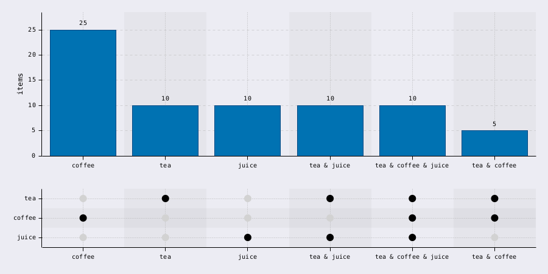
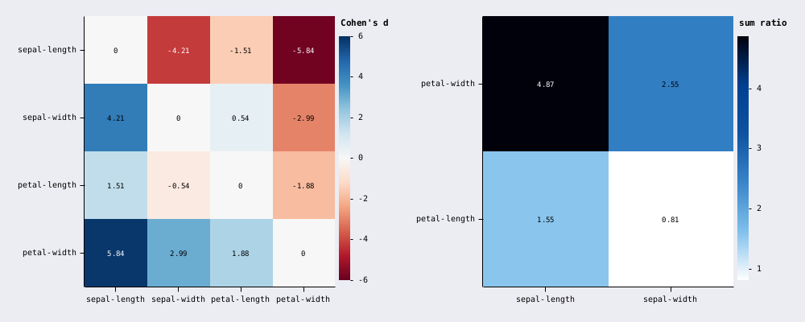

---
format:
  html:
    toc: true
    toc-location: right
    toc-depth: 4
    theme: cosmo
    include-in-header:
      text: |-
        <style>
        .data-table { width: fit-content; max-width: 100%; max-height: 15rem; overflow: auto; margin: 0 0 1rem 0; }
        .data-table .table-responsive { overflow: visible; }
        .data-table table { font-size: 0.75rem; width: auto; margin: 0; }
        .data-table th, .data-table td { padding: 0.1rem 0.45rem !important; white-space: nowrap; }
        .data-table thead th { position: sticky; top: 0; background: var(--bs-body-bg, #fff); }
        .options { margin: 0.5rem 0 1rem 0; }
        .options .option-card { margin: 0 0 0.9rem 0; border: 1px solid var(--bs-border-color, #dee2e6); border-radius: 0.375rem; overflow: hidden; }
        .options dt { display: flex; flex-wrap: wrap; align-items: baseline; gap: 0.1rem 1rem; margin: 0; padding: 0.4rem 0.75rem; background: #eef2f7; border-bottom: 1px solid var(--bs-border-color, #dee2e6); font-weight: normal; }
        .options dt > code { font-weight: 700; font-size: 1rem; background: none; padding: 0; }
        .options .option-default { font-size: 0.85rem; color: var(--bs-secondary-color, #6c757d); }
        .options dd { margin: 0; padding: 0.5rem 0.75rem; }
        .options .option-example { font-size: 0.85rem; padding: 0 0 0.45rem 0; margin-bottom: 0.45rem; border-bottom: 1px dashed var(--bs-border-color, #dee2e6); }
        .options .option-example code { background: none; padding: 0; }
        .options .option-text ul { margin: 0.3rem 0 0 0; padding-left: 1.25rem; }
        .options code, .mapping code { overflow-wrap: anywhere; }
        .options .option-default code, .options .option-example code { white-space: pre-wrap; }
        .mapping { margin: 0.5rem 0 1rem 0; padding: 0.5rem 0.75rem; border: 1px solid var(--bs-border-color, #dee2e6); border-left: 0.3rem solid #2780e3; border-radius: 0.375rem; background: #f5f8fc; }
        .mapping-title { font-weight: 700; margin-bottom: 0.25rem; }
        .mapping-hint { font-weight: normal; font-size: 0.85rem; color: var(--bs-secondary-color, #6c757d); }
        .mapping ul { margin: 0; padding-left: 1.25rem; }
        .mapping .required { font-size: 0.75rem; padding: 0 0.3rem; border: 1px solid currentColor; border-radius: 0.25rem; }
        .mapping-returns { margin-top: 0.25rem; }
        .mapping code { white-space: pre-wrap; }
        .shared { margin: 0.5rem 0 1rem 0; padding: 0.5rem 0.75rem; border: 1px solid var(--bs-border-color, #dee2e6); border-left: 0.3rem solid #6c757d; border-radius: 0.375rem; background: #f6f6f6; }
        .shared-title { font-weight: 700; margin-bottom: 0.25rem; }
        .shared-hint { font-weight: normal; font-size: 0.85rem; color: var(--bs-secondary-color, #6c757d); }
        .shared ul { margin: 0; padding-left: 1.25rem; }
        .shared code { overflow-wrap: anywhere; }
        p code, li code { white-space: pre-wrap; overflow-wrap: anywhere; }
        </style>
code-block-background: true

---
<style></style><style>.printedClojure .sourceCode {
  background-color: transparent;
  border-style: none;
}
</style><style>.clay-limit-image-width .clay-image {max-width: 100%}
.clay-side-by-side .sourceCode {margin: 0}
.clay-side-by-side {margin: 1em 0}
</style>
<script src="https://code.jquery.com/jquery-3.6.0.min.js" type="text/javascript"></script><script src="https://code.jquery.com/ui/1.13.1/jquery-ui.min.js" type="text/javascript"></script>

# Sets and series

These functions turn set memberships, time series and variable pairs into rows: the bars and dot matrix of an
UpSet plot, lag pairs, autocorrelations, the folded bands of a horizon chart and the matrix of a pairwise
statistic. Use them to draw these plots with ordinary charts. The [series builders](reference.builders_series.html)
`plot/acf` and `plot/horizon` draw autocorrelations and horizons directly; `chart/pairwise` draws one statistic per
panel.


::: {.sourceClojure}
```clojure
(ns reference.data-sets-series
  (:require [fastmath.core :as m]
            [fastmath.random :as r]
            [cljplot2.chart :as chart]
            [cljplot2.core :as plot]
            [cljplot2.data.pairwise :as pairwise]
            [cljplot2.data.series :as series]
            [cljplot2.data.sets :as sets]
            [cljplot2.describe :as describe]
            [notebook-utils :as nu]))
```
:::


The table below holds made-up set memberships, a row per item and set it belongs to (an item may be in several);
the UpSet sections use it:


::: {.sourceClojure}
```clojure
(def members (concat (for [i (range 40)] {:set "coffee" :item i})
                     (for [i (range 25 60)] {:set "tea" :item i})
                     (for [i (range 30 45)] {:set "juice" :item i})
                     (for [i (range 55 70)] {:set "juice" :item i})))
```
:::


```{=html}
<div class="data-table"><table class="table table-hover table-responsive clay-table"><thead><tr><th>set</th><th>item</th></tr></thead><tbody><tr><td>coffee</td><td>0</td></tr><tr><td>coffee</td><td>1</td></tr><tr><td>coffee</td><td>2</td></tr><tr><td>coffee</td><td>3</td></tr><tr><td>coffee</td><td>4</td></tr><tr><td>coffee</td><td>5</td></tr><tr><td>coffee</td><td>6</td></tr><tr><td>coffee</td><td>7</td></tr><tr><td>coffee</td><td>8</td></tr><tr><td>coffee</td><td>9</td></tr><tr><td>coffee</td><td>10</td></tr><tr><td>coffee</td><td>11</td></tr><tr><td>coffee</td><td>12</td></tr><tr><td>coffee</td><td>13</td></tr><tr><td>coffee</td><td>14</td></tr><tr><td>coffee</td><td>15</td></tr><tr><td>coffee</td><td>16</td></tr><tr><td>coffee</td><td>17</td></tr><tr><td>coffee</td><td>18</td></tr><tr><td>coffee</td><td>19</td></tr><tr><td>coffee</td><td>20</td></tr><tr><td>coffee</td><td>21</td></tr><tr><td>coffee</td><td>22</td></tr><tr><td>coffee</td><td>23</td></tr><tr><td>coffee</td><td>24</td></tr><tr><td>coffee</td><td>25</td></tr><tr><td>coffee</td><td>26</td></tr><tr><td>coffee</td><td>27</td></tr><tr><td>coffee</td><td>28</td></tr><tr><td>coffee</td><td>29</td></tr><tr><td>coffee</td><td>30</td></tr><tr><td>coffee</td><td>31</td></tr><tr><td>coffee</td><td>32</td></tr><tr><td>coffee</td><td>33</td></tr><tr><td>coffee</td><td>34</td></tr><tr><td>coffee</td><td>35</td></tr><tr><td>coffee</td><td>36</td></tr><tr><td>coffee</td><td>37</td></tr><tr><td>coffee</td><td>38</td></tr><tr><td>coffee</td><td>39</td></tr><tr><td>tea</td><td>25</td></tr><tr><td>tea</td><td>26</td></tr><tr><td>tea</td><td>27</td></tr><tr><td>tea</td><td>28</td></tr><tr><td>tea</td><td>29</td></tr><tr><td>tea</td><td>30</td></tr><tr><td>tea</td><td>31</td></tr><tr><td>tea</td><td>32</td></tr><tr><td>tea</td><td>33</td></tr><tr><td>tea</td><td>34</td></tr><tr><td>tea</td><td>35</td></tr><tr><td>tea</td><td>36</td></tr><tr><td>tea</td><td>37</td></tr><tr><td>tea</td><td>38</td></tr><tr><td>tea</td><td>39</td></tr><tr><td>tea</td><td>40</td></tr><tr><td>tea</td><td>41</td></tr><tr><td>tea</td><td>42</td></tr><tr><td>tea</td><td>43</td></tr><tr><td>tea</td><td>44</td></tr><tr><td>tea</td><td>45</td></tr><tr><td>tea</td><td>46</td></tr><tr><td>tea</td><td>47</td></tr><tr><td>tea</td><td>48</td></tr><tr><td>tea</td><td>49</td></tr><tr><td>tea</td><td>50</td></tr><tr><td>tea</td><td>51</td></tr><tr><td>tea</td><td>52</td></tr><tr><td>tea</td><td>53</td></tr><tr><td>tea</td><td>54</td></tr><tr><td>tea</td><td>55</td></tr><tr><td>tea</td><td>56</td></tr><tr><td>tea</td><td>57</td></tr><tr><td>tea</td><td>58</td></tr><tr><td>tea</td><td>59</td></tr><tr><td>juice</td><td>30</td></tr><tr><td>juice</td><td>31</td></tr><tr><td>juice</td><td>32</td></tr><tr><td>juice</td><td>33</td></tr><tr><td>juice</td><td>34</td></tr><tr><td>juice</td><td>35</td></tr><tr><td>juice</td><td>36</td></tr><tr><td>juice</td><td>37</td></tr><tr><td>juice</td><td>38</td></tr><tr><td>juice</td><td>39</td></tr><tr><td>juice</td><td>40</td></tr><tr><td>juice</td><td>41</td></tr><tr><td>juice</td><td>42</td></tr><tr><td>juice</td><td>43</td></tr><tr><td>juice</td><td>44</td></tr><tr><td>juice</td><td>55</td></tr><tr><td>juice</td><td>56</td></tr><tr><td>juice</td><td>57</td></tr><tr><td>juice</td><td>58</td></tr><tr><td>juice</td><td>59</td></tr><tr><td>juice</td><td>60</td></tr><tr><td>juice</td><td>61</td></tr><tr><td>juice</td><td>62</td></tr><tr><td>juice</td><td>63</td></tr><tr><td>juice</td><td>64</td></tr><tr><td>…</td><td>…</td></tr></tbody></table></div>
```


The values below form an autoregressive series: fastmath `r/ar` draws 200 values with coefficient 0.6 over a weekly
sine plus seeded white noise. The lag and autocorrelation sections use them:


::: {.sourceClojure}
```clojure
(def weekly (vec (take 200 (r/ar 0.6 (map (fn [t e] (+ (* 2.0 (m/sin (* m/TWO_PI (/ (double t) 7.0)))) (double e)))
                                           (range) (r/white-noise (r/rng :mersenne 8) 1.0))))))
```
:::


```{=html}
<div class="data-table"><table class="table table-hover table-responsive clay-table"><thead><tr><th>value</th></tr></thead><tbody><tr><td>1.4695303373637327</td></tr><tr><td>3.7937692943647656</td></tr><tr><td>2.4013952834270835</td></tr><tr><td>-1.261504316599897</td></tr><tr><td>-4.03772534292625</td></tr><tr><td>-2.309647723994776</td></tr><tr><td>-0.0942748434952343</td></tr><tr><td>2.352348185115162</td></tr><tr><td>1.483553983061273</td></tr><tr><td>-0.44745742427932933</td></tr><tr><td>-0.15922210131239506</td></tr><tr><td>-2.3941380185956604</td></tr><tr><td>0.09868919741240556</td></tr><tr><td>3.024195320500766</td></tr><tr><td>4.805666195745328</td></tr><tr><td>4.5272384195306055</td></tr><tr><td>1.1865693687053867</td></tr><tr><td>-0.7701774085208245</td></tr><tr><td>-2.6060679864758804</td></tr><tr><td>-1.929009126160534</td></tr><tr><td>0.434230490757167</td></tr><tr><td>2.433417614970744</td></tr><tr><td>1.2470710572055763</td></tr><tr><td>-0.35936629788175345</td></tr><tr><td>-1.3695978080065405</td></tr><tr><td>-2.096800426513368</td></tr><tr><td>-1.0778261669502014</td></tr><tr><td>0.6053934958999472</td></tr><tr><td>2.5911894419648216</td></tr><tr><td>2.682180349490924</td></tr><tr><td>0.17349745220848933</td></tr><tr><td>-0.5693070693372042</td></tr><tr><td>-1.7620184480470467</td></tr><tr><td>-0.782715055453843</td></tr><tr><td>1.502901529541258</td></tr><tr><td>2.546266188414661</td></tr><tr><td>2.1329135956098964</td></tr><tr><td>1.9428523318336546</td></tr><tr><td>-0.08196961280058535</td></tr><tr><td>-2.241391331571816</td></tr><tr><td>-2.6503317649800606</td></tr><tr><td>-1.1314281887124207</td></tr><tr><td>0.6523587785261217</td></tr><tr><td>3.0030470253120143</td></tr><tr><td>0.5081624459762246</td></tr><tr><td>-1.670157893927876</td></tr><tr><td>-1.762818398820877</td></tr><tr><td>-0.4696182773595039</td></tr><tr><td>0.9017373651333499</td></tr><tr><td>2.416493612303356</td></tr><tr><td>3.883250273715099</td></tr><tr><td>1.0359337481237936</td></tr><tr><td>-2.4667692826948504</td></tr><tr><td>-2.7816041458153675</td></tr><tr><td>-1.1957381990211724</td></tr><tr><td>0.42457303630004883</td></tr><tr><td>1.8720989783515307</td></tr><tr><td>1.628968443305892</td></tr><tr><td>1.2317244274995969</td></tr><tr><td>-0.8870245032146717</td></tr><tr><td>-3.4663278688038393</td></tr><tr><td>-1.8364355656670792</td></tr><tr><td>0.6921610701041505</td></tr><tr><td>0.06335080526871695</td></tr><tr><td>0.6785326068490192</td></tr><tr><td>-1.3955921256415116</td></tr><tr><td>-3.5002146804475562</td></tr><tr><td>-2.631476090063159</td></tr><tr><td>-1.073095703812805</td></tr><tr><td>-0.9516003743149682</td></tr><tr><td>2.579022975711122</td></tr><tr><td>3.6079196479426985</td></tr><tr><td>0.7507207324775327</td></tr><tr><td>-2.500506492866095</td></tr><tr><td>-3.5611141903197003</td></tr><tr><td>-0.6602279233620318</td></tr><tr><td>1.0055699292783984</td></tr><tr><td>4.4082735070393175</td></tr><tr><td>5.2466328062783685</td></tr><tr><td>1.5099790544061578</td></tr><tr><td>-2.242422602149419</td></tr><tr><td>-3.181338300930388</td></tr><tr><td>-2.5020416957104183</td></tr><tr><td>-0.06047379640043293</td></tr><tr><td>0.9847821511311047</td></tr><tr><td>0.8712826716599518</td></tr><tr><td>-0.9828824041729943</td></tr><tr><td>-2.929507540470157</td></tr><tr><td>-5.0560587068500515</td></tr><tr><td>-3.4927080397333765</td></tr><tr><td>-0.5314267214026165</td></tr><tr><td>0.7573658898115421</td></tr><tr><td>-0.1761585508269814</td></tr><tr><td>-0.9555652149242746</td></tr><tr><td>-3.085782095909218</td></tr><tr><td>-2.514463298996155</td></tr><tr><td>-1.155813322630999</td></tr><tr><td>1.804528608093851</td></tr><tr><td>2.255268321247743</td></tr><tr><td>0.9597454496792562</td></tr><tr><td>…</td></tr></tbody></table></div>
```


The table below holds made-up temperature anomalies of two cities; the horizon sections use it:


::: {.sourceClojure}
```clojure
(def temperatures (for [city ["Oslo" "Rome"] day (range 60)]
                    {:city city :day day
                     :anomaly (* (if (= city "Oslo") 4.0 2.5) (m/sin (+ (* 0.12 day) (if (= city "Oslo") 0.0 1.5))))}))
```
:::


```{=html}
<div class="data-table"><table class="table table-hover table-responsive clay-table"><thead><tr><th>city</th><th>day</th><th>anomaly</th></tr></thead><tbody><tr><td>Oslo</td><td>0</td><td>0.0</td></tr><tr><td>Oslo</td><td>1</td><td>0.47884882915567745</td></tr><tr><td>Oslo</td><td>2</td><td>0.9508105057085383</td></tr><tr><td>Oslo</td><td>3</td><td>1.4090969331003598</td></tr><tr><td>Oslo</td><td>4</td><td>1.8471167021659316</td></tr><tr><td>Oslo</td><td>5</td><td>2.2585698935801415</td></tr><tr><td>Oslo</td><td>6</td><td>2.6375386878858924</td></tr><tr><td>Oslo</td><td>7</td><td>2.978572479883437</td></tr><tr><td>Oslo</td><td>8</td><td>3.276766273203993</td></tr><tr><td>Oslo</td><td>9</td><td>3.52783122753979</td></tr><tr><td>Oslo</td><td>10</td><td>3.728156343868905</td></tr><tr><td>Oslo</td><td>11</td><td>3.874860400473061</td></tr><tr><td>Oslo</td><td>12</td><td>3.9658333927667457</td></tr><tr><td>Oslo</td><td>13</td><td>3.999766880919865</td></tr><tr><td>Oslo</td><td>14</td><td>3.976172808792304</td></tr><tr><td>Oslo</td><td>15</td><td>3.895390523512781</td></tr><tr><td>Oslo</td><td>16</td><td>3.7585818947412997</td></tr><tr><td>Oslo</td><td>17</td><td>3.5677146038135183</td></tr><tr><td>Oslo</td><td>18</td><td>3.3255338431147323</td></tr><tr><td>Oslo</td><td>19</td><td>3.035522832723688</td></tr><tr><td>Oslo</td><td>20</td><td>2.701852722204604</td></tr><tr><td>Oslo</td><td>21</td><td>2.3293225980963275</td></tr><tr><td>Oslo</td><td>22</td><td>1.9232904599545946</td></tr><tr><td>Oslo</td><td>23</td><td>1.4895961577002228</td></tr><tr><td>Oslo</td><td>24</td><td>1.0344773986444433</td></tr><tr><td>Oslo</td><td>25</td><td>0.5644800322394689</td></tr><tr><td>Oslo</td><td>26</td><td>0.08636390290438384</td></tr><tr><td>Oslo</td><td>27</td><td>-0.392994374980433</td></tr><tr><td>Oslo</td><td>28</td><td>-0.8667003215495185</td></tr><tr><td>Oslo</td><td>29</td><td>-1.3279407528829363</td></tr><tr><td>Oslo</td><td>30</td><td>-1.7700817731794083</td></tr><tr><td>Oslo</td><td>31</td><td>-2.1867641882771474</td></tr><tr><td>Oslo</td><td>32</td><td>-2.5719949682156353</td></tr><tr><td>Oslo</td><td>33</td><td>-2.920233443357198</td></tr><tr><td>Oslo</td><td>34</td><td>-3.226470994332962</td></tr><tr><td>Oslo</td><td>35</td><td>-3.4863030896543528</td></tr><tr><td>Oslo</td><td>36</td><td>-3.6959926348927516</td></tr><tr><td>Oslo</td><td>37</td><td>-3.852523722293266</td></tr><tr><td>Oslo</td><td>38</td><td>-3.953645007756522</td></tr><tr><td>Oslo</td><td>39</td><td>-3.997902091309136</td></tr><tr><td>Oslo</td><td>40</td><td>-3.9846584353433627</td></tr><tr><td>Oslo</td><td>41</td><td>-3.914104519764554</td></tr><tr><td>Oslo</td><td>42</td><td>-3.7872551023704357</td></tr><tr><td>Oslo</td><td>43</td><td>-3.6059346238654193</td></tr><tr><td>Oslo</td><td>44</td><td>-3.372750967425669</td></tr><tr><td>Oslo</td><td>45</td><td>-3.091057950223951</td></tr><tr><td>Oslo</td><td>46</td><td>-2.7649070863885084</td></tr><tr><td>Oslo</td><td>47</td><td>-2.398989315176175</td></tr><tr><td>Oslo</td><td>48</td><td>-1.9985675324676098</td></tr><tr><td>Oslo</td><td>49</td><td>-1.5694008959658154</td></tr><tr><td>Oslo</td><td>50</td><td>-1.1176619927957034</td></tr><tr><td>Oslo</td><td>51</td><td>-0.6498480608606167</td></tr><tr><td>Oslo</td><td>52</td><td>-0.17268754083491472</td></tr><tr><td>Oslo</td><td>53</td><td>0.3069566971700721</td></tr><tr><td>Oslo</td><td>54</td><td>0.7821860604021735</td></tr><tr><td>Oslo</td><td>55</td><td>1.2461654540535114</td></tr><tr><td>Oslo</td><td>56</td><td>1.6922215885719873</td></tr><tr><td>Oslo</td><td>57</td><td>2.113938959771723</td></tr><tr><td>Oslo</td><td>58</td><td>2.5052521212866234</td></tr><tr><td>Oslo</td><td>59</td><td>2.8605329222374314</td></tr><tr><td>Rome</td><td>0</td><td>2.493737466510136</td></tr><tr><td>Rome</td><td>1</td><td>2.49697435867631</td></tr><tr><td>Rome</td><td>2</td><td>2.464297947088884</td></tr><tr><td>Rome</td><td>3</td><td>2.3961782076972855</td></tr><tr><td>Rome</td><td>4</td><td>2.2935948882045247</td></tr><tr><td>Rome</td><td>5</td><td>2.1580234166221843</td></tr><tr><td>Rome</td><td>6</td><td>1.991413680590217</td></tr><tr><td>Rome</td><td>7</td><td>1.7961619826728157</td></tr><tr><td>Rome</td><td>8</td><td>1.5750765749897306</td></tr><tr><td>Rome</td><td>9</td><td>1.3313372688890528</td></tr><tr><td>Rome</td><td>10</td><td>1.0684497005845746</td></tr><tr><td>Rome</td><td>11</td><td>0.7901949105426345</td></tr><tr><td>Rome</td><td>12</td><td>0.5005749618044263</td></tr><tr><td>Rome</td><td>13</td><td>0.2037553794006728</td></tr><tr><td>Rome</td><td>14</td><td>-0.09599476126308734</td></tr><tr><td>Rome</td><td>15</td><td>-0.39436423535812054</td></tr><tr><td>Rome</td><td>16</td><td>-0.6870616758078101</td></tr><tr><td>Rome</td><td>17</td><td>-0.9698772948543257</td></tr><tr><td>Rome</td><td>18</td><td>-1.2387434322921123</td></tr><tr><td>Rome</td><td>19</td><td>-1.4897930595194098</td></tr><tr><td>Rome</td><td>20</td><td>-1.7194153979599345</td></tr><tr><td>Rome</td><td>21</td><td>-1.9243078519100596</td></tr><tr><td>Rome</td><td>22</td><td>-2.1015235088754864</td></tr><tr><td>Rome</td><td>23</td><td>-2.248513524212944</td></tr><tr><td>Rome</td><td>24</td><td>-2.3631637804701584</td></tr><tr><td>Rome</td><td>25</td><td>-2.4438252941627425</td></tr><tr><td>Rome</td><td>26</td><td>-2.4893379326556135</td></tr><tr><td>Rome</td><td>27</td><td>-2.4990471000354635</td></tr><tr><td>Rome</td><td>28</td><td>-2.4728131519859247</td></tr><tr><td>Rome</td><td>29</td><td>-2.411013404253826</td></tr><tr><td>Rome</td><td>30</td><td>-2.3145367058193314</td></tr><tr><td>Rome</td><td>31</td><td>-2.184770654822556</td></tr><tr><td>Rome</td><td>32</td><td>-2.0235816411165484</td></tr><tr><td>Rome</td><td>33</td><td>-1.8332880024891414</td></tr><tr><td>Rome</td><td>34</td><td>-1.6166266806404586</td></tr><tr><td>Rome</td><td>35</td><td>-1.376713856494094</td></tr><tr><td>Rome</td><td>36</td><td>-1.117000131013575</td></tr><tr><td>Rome</td><td>37</td><td>-0.8412208961462626</td></tr><tr><td>Rome</td><td>38</td><td>-0.5533426096958989</td></tr><tr><td>Rome</td><td>39</td><td>-0.25750574683774463</td></tr><tr><td>…</td><td>…</td><td>…</td></tr></tbody></table></div>
```


The table below holds the iris flowers; the statistic matrix section uses it:

Data: Edgar Anderson's iris measurements, R datasets package `iris` (Anderson 1935; Fisher 1936); licence: Part of R (GPL-2 | GPL-3).


::: {.sourceClojure}
```clojure
(def iris (nu/dataset :iris))
```
:::


```{=html}
<div class="data-table"><table class="table table-hover table-responsive clay-table"><thead><tr><th>sepal-length</th><th>sepal-width</th><th>petal-length</th><th>petal-width</th><th>species</th></tr></thead><tbody><tr><td>5.1</td><td>3.5</td><td>1.4</td><td>0.2</td><td>setosa</td></tr><tr><td>4.9</td><td>3</td><td>1.4</td><td>0.2</td><td>setosa</td></tr><tr><td>4.7</td><td>3.2</td><td>1.3</td><td>0.2</td><td>setosa</td></tr><tr><td>4.6</td><td>3.1</td><td>1.5</td><td>0.2</td><td>setosa</td></tr><tr><td>5</td><td>3.6</td><td>1.4</td><td>0.2</td><td>setosa</td></tr><tr><td>5.4</td><td>3.9</td><td>1.7</td><td>0.4</td><td>setosa</td></tr><tr><td>4.6</td><td>3.4</td><td>1.4</td><td>0.3</td><td>setosa</td></tr><tr><td>5</td><td>3.4</td><td>1.5</td><td>0.2</td><td>setosa</td></tr><tr><td>4.4</td><td>2.9</td><td>1.4</td><td>0.2</td><td>setosa</td></tr><tr><td>4.9</td><td>3.1</td><td>1.5</td><td>0.1</td><td>setosa</td></tr><tr><td>5.4</td><td>3.7</td><td>1.5</td><td>0.2</td><td>setosa</td></tr><tr><td>4.8</td><td>3.4</td><td>1.6</td><td>0.2</td><td>setosa</td></tr><tr><td>4.8</td><td>3</td><td>1.4</td><td>0.1</td><td>setosa</td></tr><tr><td>4.3</td><td>3</td><td>1.1</td><td>0.1</td><td>setosa</td></tr><tr><td>5.8</td><td>4</td><td>1.2</td><td>0.2</td><td>setosa</td></tr><tr><td>5.7</td><td>4.4</td><td>1.5</td><td>0.4</td><td>setosa</td></tr><tr><td>5.4</td><td>3.9</td><td>1.3</td><td>0.4</td><td>setosa</td></tr><tr><td>5.1</td><td>3.5</td><td>1.4</td><td>0.3</td><td>setosa</td></tr><tr><td>5.7</td><td>3.8</td><td>1.7</td><td>0.3</td><td>setosa</td></tr><tr><td>5.1</td><td>3.8</td><td>1.5</td><td>0.3</td><td>setosa</td></tr><tr><td>5.4</td><td>3.4</td><td>1.7</td><td>0.2</td><td>setosa</td></tr><tr><td>5.1</td><td>3.7</td><td>1.5</td><td>0.4</td><td>setosa</td></tr><tr><td>4.6</td><td>3.6</td><td>1</td><td>0.2</td><td>setosa</td></tr><tr><td>5.1</td><td>3.3</td><td>1.7</td><td>0.5</td><td>setosa</td></tr><tr><td>4.8</td><td>3.4</td><td>1.9</td><td>0.2</td><td>setosa</td></tr><tr><td>5</td><td>3</td><td>1.6</td><td>0.2</td><td>setosa</td></tr><tr><td>5</td><td>3.4</td><td>1.6</td><td>0.4</td><td>setosa</td></tr><tr><td>5.2</td><td>3.5</td><td>1.5</td><td>0.2</td><td>setosa</td></tr><tr><td>5.2</td><td>3.4</td><td>1.4</td><td>0.2</td><td>setosa</td></tr><tr><td>4.7</td><td>3.2</td><td>1.6</td><td>0.2</td><td>setosa</td></tr><tr><td>4.8</td><td>3.1</td><td>1.6</td><td>0.2</td><td>setosa</td></tr><tr><td>5.4</td><td>3.4</td><td>1.5</td><td>0.4</td><td>setosa</td></tr><tr><td>5.2</td><td>4.1</td><td>1.5</td><td>0.1</td><td>setosa</td></tr><tr><td>5.5</td><td>4.2</td><td>1.4</td><td>0.2</td><td>setosa</td></tr><tr><td>4.9</td><td>3.1</td><td>1.5</td><td>0.2</td><td>setosa</td></tr><tr><td>5</td><td>3.2</td><td>1.2</td><td>0.2</td><td>setosa</td></tr><tr><td>5.5</td><td>3.5</td><td>1.3</td><td>0.2</td><td>setosa</td></tr><tr><td>4.9</td><td>3.6</td><td>1.4</td><td>0.1</td><td>setosa</td></tr><tr><td>4.4</td><td>3</td><td>1.3</td><td>0.2</td><td>setosa</td></tr><tr><td>5.1</td><td>3.4</td><td>1.5</td><td>0.2</td><td>setosa</td></tr><tr><td>5</td><td>3.5</td><td>1.3</td><td>0.3</td><td>setosa</td></tr><tr><td>4.5</td><td>2.3</td><td>1.3</td><td>0.3</td><td>setosa</td></tr><tr><td>4.4</td><td>3.2</td><td>1.3</td><td>0.2</td><td>setosa</td></tr><tr><td>5</td><td>3.5</td><td>1.6</td><td>0.6</td><td>setosa</td></tr><tr><td>5.1</td><td>3.8</td><td>1.9</td><td>0.4</td><td>setosa</td></tr><tr><td>4.8</td><td>3</td><td>1.4</td><td>0.3</td><td>setosa</td></tr><tr><td>5.1</td><td>3.8</td><td>1.6</td><td>0.2</td><td>setosa</td></tr><tr><td>4.6</td><td>3.2</td><td>1.4</td><td>0.2</td><td>setosa</td></tr><tr><td>5.3</td><td>3.7</td><td>1.5</td><td>0.2</td><td>setosa</td></tr><tr><td>5</td><td>3.3</td><td>1.4</td><td>0.2</td><td>setosa</td></tr><tr><td>7</td><td>3.2</td><td>4.7</td><td>1.4</td><td>versicolor</td></tr><tr><td>6.4</td><td>3.2</td><td>4.5</td><td>1.5</td><td>versicolor</td></tr><tr><td>6.9</td><td>3.1</td><td>4.9</td><td>1.5</td><td>versicolor</td></tr><tr><td>5.5</td><td>2.3</td><td>4</td><td>1.3</td><td>versicolor</td></tr><tr><td>6.5</td><td>2.8</td><td>4.6</td><td>1.5</td><td>versicolor</td></tr><tr><td>5.7</td><td>2.8</td><td>4.5</td><td>1.3</td><td>versicolor</td></tr><tr><td>6.3</td><td>3.3</td><td>4.7</td><td>1.6</td><td>versicolor</td></tr><tr><td>4.9</td><td>2.4</td><td>3.3</td><td>1</td><td>versicolor</td></tr><tr><td>6.6</td><td>2.9</td><td>4.6</td><td>1.3</td><td>versicolor</td></tr><tr><td>5.2</td><td>2.7</td><td>3.9</td><td>1.4</td><td>versicolor</td></tr><tr><td>5</td><td>2</td><td>3.5</td><td>1</td><td>versicolor</td></tr><tr><td>5.9</td><td>3</td><td>4.2</td><td>1.5</td><td>versicolor</td></tr><tr><td>6</td><td>2.2</td><td>4</td><td>1</td><td>versicolor</td></tr><tr><td>6.1</td><td>2.9</td><td>4.7</td><td>1.4</td><td>versicolor</td></tr><tr><td>5.6</td><td>2.9</td><td>3.6</td><td>1.3</td><td>versicolor</td></tr><tr><td>6.7</td><td>3.1</td><td>4.4</td><td>1.4</td><td>versicolor</td></tr><tr><td>5.6</td><td>3</td><td>4.5</td><td>1.5</td><td>versicolor</td></tr><tr><td>5.8</td><td>2.7</td><td>4.1</td><td>1</td><td>versicolor</td></tr><tr><td>6.2</td><td>2.2</td><td>4.5</td><td>1.5</td><td>versicolor</td></tr><tr><td>5.6</td><td>2.5</td><td>3.9</td><td>1.1</td><td>versicolor</td></tr><tr><td>5.9</td><td>3.2</td><td>4.8</td><td>1.8</td><td>versicolor</td></tr><tr><td>6.1</td><td>2.8</td><td>4</td><td>1.3</td><td>versicolor</td></tr><tr><td>6.3</td><td>2.5</td><td>4.9</td><td>1.5</td><td>versicolor</td></tr><tr><td>6.1</td><td>2.8</td><td>4.7</td><td>1.2</td><td>versicolor</td></tr><tr><td>6.4</td><td>2.9</td><td>4.3</td><td>1.3</td><td>versicolor</td></tr><tr><td>6.6</td><td>3</td><td>4.4</td><td>1.4</td><td>versicolor</td></tr><tr><td>6.8</td><td>2.8</td><td>4.8</td><td>1.4</td><td>versicolor</td></tr><tr><td>6.7</td><td>3</td><td>5</td><td>1.7</td><td>versicolor</td></tr><tr><td>6</td><td>2.9</td><td>4.5</td><td>1.5</td><td>versicolor</td></tr><tr><td>5.7</td><td>2.6</td><td>3.5</td><td>1</td><td>versicolor</td></tr><tr><td>5.5</td><td>2.4</td><td>3.8</td><td>1.1</td><td>versicolor</td></tr><tr><td>5.5</td><td>2.4</td><td>3.7</td><td>1</td><td>versicolor</td></tr><tr><td>5.8</td><td>2.7</td><td>3.9</td><td>1.2</td><td>versicolor</td></tr><tr><td>6</td><td>2.7</td><td>5.1</td><td>1.6</td><td>versicolor</td></tr><tr><td>5.4</td><td>3</td><td>4.5</td><td>1.5</td><td>versicolor</td></tr><tr><td>6</td><td>3.4</td><td>4.5</td><td>1.6</td><td>versicolor</td></tr><tr><td>6.7</td><td>3.1</td><td>4.7</td><td>1.5</td><td>versicolor</td></tr><tr><td>6.3</td><td>2.3</td><td>4.4</td><td>1.3</td><td>versicolor</td></tr><tr><td>5.6</td><td>3</td><td>4.1</td><td>1.3</td><td>versicolor</td></tr><tr><td>5.5</td><td>2.5</td><td>4</td><td>1.3</td><td>versicolor</td></tr><tr><td>5.5</td><td>2.6</td><td>4.4</td><td>1.2</td><td>versicolor</td></tr><tr><td>6.1</td><td>3</td><td>4.6</td><td>1.4</td><td>versicolor</td></tr><tr><td>5.8</td><td>2.6</td><td>4</td><td>1.2</td><td>versicolor</td></tr><tr><td>5</td><td>2.3</td><td>3.3</td><td>1</td><td>versicolor</td></tr><tr><td>5.6</td><td>2.7</td><td>4.2</td><td>1.3</td><td>versicolor</td></tr><tr><td>5.7</td><td>3</td><td>4.2</td><td>1.2</td><td>versicolor</td></tr><tr><td>5.7</td><td>2.9</td><td>4.2</td><td>1.3</td><td>versicolor</td></tr><tr><td>6.2</td><td>2.9</td><td>4.3</td><td>1.3</td><td>versicolor</td></tr><tr><td>5.1</td><td>2.5</td><td>3</td><td>1.1</td><td>versicolor</td></tr><tr><td>5.7</td><td>2.8</td><td>4.1</td><td>1.3</td><td>versicolor</td></tr><tr><td>…</td><td>…</td><td>…</td><td>…</td><td>…</td></tr></tbody></table></div>
```


## UpSet bars

`sets/upset-rows` returns the bars of an UpSet plot: every combination of sets that holds items of its own, with its
sets, size and degree, the largest first. Use it with `chart/bar`, a bar per combination.


```{=html}
<div class="mapping"><div class="mapping-title">Arguments<span class="mapping-hint"> – what the call takes</span></div><ul><li><code>rows</code> – Set memberships, a row per item and set it belongs to: rows (a sequence of maps) or columns (a map of equal-length sequences); repeated rows count once.</li><li><code>mapping</code> – The accessors of the rows' set and item.<div>Keys:<ul><li><code>:set</code> – The accessor of a row's set.</li><li><code>:item</code> – The accessor of a row's item.</li></ul></div></li><li><code>sets</code> <span class="required">optional</span> – The chosen sets in order; rows of other sets are left out. Without it every set, in order of first appearance.</li></ul><div class="mapping-returns"><strong>Returns</strong> – A bar per combination of sets that holds items of its own, <code>{:combination :sets :size :degree}</code>, the largest first.</div></div>
```


The table below holds the bars:


::: {.sourceClojure}
```clojure
(nu/result-table (sets/upset-rows members {:set :set :item :item}))
```
:::


```{=html}
<div class="data-table"><table class="table table-hover table-responsive clay-table"><thead><tr><th>combination</th><th>sets</th><th>size</th><th>degree</th></tr></thead><tbody><tr><td>coffee</td><td>["coffee"]</td><td>25</td><td>1</td></tr><tr><td>tea</td><td>["tea"]</td><td>10</td><td>1</td></tr><tr><td>juice</td><td>["juice"]</td><td>10</td><td>1</td></tr><tr><td>tea & juice</td><td>["tea" "juice"]</td><td>10</td><td>2</td></tr><tr><td>coffee & tea & juice</td><td>["coffee" "tea" "juice"]</td><td>10</td><td>3</td></tr><tr><td>coffee & tea</td><td>["coffee" "tea"]</td><td>5</td><td>2</td></tr></tbody></table></div>
```


## UpSet membership

`sets/membership-rows` returns the dot matrix under the bars: a row per combination and set, `:member` true where the
set is in the combination. Use it with `chart/scatter` under the bars.


```{=html}
<div class="mapping"><div class="mapping-title">Arguments<span class="mapping-hint"> – what the call takes</span></div><ul><li><code>rows</code> – Set memberships, a row per item and set it belongs to: rows (a sequence of maps) or columns (a map of equal-length sequences); repeated rows count once.</li><li><code>mapping</code> – The accessors of the rows' set and item.<div>Keys:<ul><li><code>:set</code> – The accessor of a row's set.</li><li><code>:item</code> – The accessor of a row's item.</li></ul></div></li><li><code>sets</code> <span class="required">optional</span> – The chosen sets in order; rows of other sets are left out. Without it every set, in order of first appearance.</li></ul><div class="mapping-returns"><strong>Returns</strong> – A row <code>{:combination :set :member}</code> per combination of <code>upset-rows</code> and chosen set; <code>:member</code> tells whether the set is in the combination.</div></div>
```


The table below holds the matrix:


::: {.sourceClojure}
```clojure
(nu/result-table (sets/membership-rows members {:set :set :item :item}))
```
:::


```{=html}
<div class="data-table"><table class="table table-hover table-responsive clay-table"><thead><tr><th>combination</th><th>set</th><th>member</th></tr></thead><tbody><tr><td>coffee</td><td>coffee</td><td>true</td></tr><tr><td>coffee</td><td>tea</td><td>false</td></tr><tr><td>coffee</td><td>juice</td><td>false</td></tr><tr><td>tea</td><td>coffee</td><td>false</td></tr><tr><td>tea</td><td>tea</td><td>true</td></tr><tr><td>tea</td><td>juice</td><td>false</td></tr><tr><td>juice</td><td>coffee</td><td>false</td></tr><tr><td>juice</td><td>tea</td><td>false</td></tr><tr><td>juice</td><td>juice</td><td>true</td></tr><tr><td>tea & juice</td><td>coffee</td><td>false</td></tr><tr><td>tea & juice</td><td>tea</td><td>true</td></tr><tr><td>tea & juice</td><td>juice</td><td>true</td></tr><tr><td>coffee & tea & juice</td><td>coffee</td><td>true</td></tr><tr><td>coffee & tea & juice</td><td>tea</td><td>true</td></tr><tr><td>coffee & tea & juice</td><td>juice</td><td>true</td></tr><tr><td>coffee & tea</td><td>coffee</td><td>true</td></tr><tr><td>coffee & tea</td><td>tea</td><td>true</td></tr><tr><td>coffee & tea</td><td>juice</td><td>false</td></tr></tbody></table></div>
```


The plot below stacks both parts into an UpSet plot: the bars, then the members' dots over grey dots in every cell.
It chooses the sets and puts tea first:


::: {.sourceClojure}
```clojure
(plot/render-image (plot/arrange [{:data (sets/upset-rows members {:set :set :item :item} ["tea" "coffee" "juice"])
                                   :mapping {:x :combination :y :size}
                                   :charts [(chart/bar {:value-label true})]
                                   :labels {:x nil :y "items"}}
                                  {:data (sets/membership-rows members {:set :set :item :item} ["tea" "coffee" "juice"])
                                   :mapping {:x :combination :y :set}
                                   :charts [(chart/scatter {:size 12 :color [210 210 210]})
                                            (chart/scatter {:data (filter :member (sets/membership-rows members {:set :set :item :item}
                                                                                                         ["tea" "coffee" "juice"]))
                                                            :size 12 :color :black})]
                                   :scales {:y {:reverse true}}
                                   :labels {:x nil :y nil}}]
                                 {:columns 1 :heights [2 1]})
                   {:width 900 :height 450})
```
:::


::: {.clay-image}

:::


## Lag pairs

`series/lag-rows` pairs every value `y(t)` with `y(t + k)`. Use it for a lag plot, which shows the correlation at lag
k.


```{=html}
<div class="mapping"><div class="mapping-title">Arguments<span class="mapping-hint"> – what the call takes</span></div><ul><li><code>values</code> – The series, a sequence of values.</li><li><code>k</code> – The lag, a positive integer.</li></ul><div class="mapping-returns"><strong>Returns</strong> – <code>n - k</code> rows <code>{:t :x :y}</code> for n values: the value at t under <code>:x</code>, the value at t + k under <code>:y</code>; none when k is n or more.</div></div>
```


The table below pairs the values at lag 7; the plots below show the weekly cycle, strong at lag 7 and negative at lag
3:


::: {.sourceClojure}
```clojure
(nu/result-table (series/lag-rows weekly 7))
```
:::


```{=html}
<div class="data-table"><table class="table table-hover table-responsive clay-table"><thead><tr><th>t</th><th>x</th><th>y</th></tr></thead><tbody><tr><td>0</td><td>1.4695303373637327</td><td>2.352348185115162</td></tr><tr><td>1</td><td>3.7937692943647656</td><td>1.483553983061273</td></tr><tr><td>2</td><td>2.4013952834270835</td><td>-0.44745742427932933</td></tr><tr><td>3</td><td>-1.261504316599897</td><td>-0.15922210131239506</td></tr><tr><td>4</td><td>-4.03772534292625</td><td>-2.3941380185956604</td></tr><tr><td>5</td><td>-2.309647723994776</td><td>0.09868919741240556</td></tr><tr><td>6</td><td>-0.0942748434952343</td><td>3.024195320500766</td></tr><tr><td>7</td><td>2.352348185115162</td><td>4.805666195745328</td></tr><tr><td>8</td><td>1.483553983061273</td><td>4.5272384195306055</td></tr><tr><td>9</td><td>-0.44745742427932933</td><td>1.1865693687053867</td></tr><tr><td>10</td><td>-0.15922210131239506</td><td>-0.7701774085208245</td></tr><tr><td>11</td><td>-2.3941380185956604</td><td>-2.6060679864758804</td></tr><tr><td>12</td><td>0.09868919741240556</td><td>-1.929009126160534</td></tr><tr><td>13</td><td>3.024195320500766</td><td>0.434230490757167</td></tr><tr><td>14</td><td>4.805666195745328</td><td>2.433417614970744</td></tr><tr><td>15</td><td>4.5272384195306055</td><td>1.2470710572055763</td></tr><tr><td>16</td><td>1.1865693687053867</td><td>-0.35936629788175345</td></tr><tr><td>17</td><td>-0.7701774085208245</td><td>-1.3695978080065405</td></tr><tr><td>18</td><td>-2.6060679864758804</td><td>-2.096800426513368</td></tr><tr><td>19</td><td>-1.929009126160534</td><td>-1.0778261669502014</td></tr><tr><td>20</td><td>0.434230490757167</td><td>0.6053934958999472</td></tr><tr><td>21</td><td>2.433417614970744</td><td>2.5911894419648216</td></tr><tr><td>22</td><td>1.2470710572055763</td><td>2.682180349490924</td></tr><tr><td>23</td><td>-0.35936629788175345</td><td>0.17349745220848933</td></tr><tr><td>24</td><td>-1.3695978080065405</td><td>-0.5693070693372042</td></tr><tr><td>25</td><td>-2.096800426513368</td><td>-1.7620184480470467</td></tr><tr><td>26</td><td>-1.0778261669502014</td><td>-0.782715055453843</td></tr><tr><td>27</td><td>0.6053934958999472</td><td>1.502901529541258</td></tr><tr><td>28</td><td>2.5911894419648216</td><td>2.546266188414661</td></tr><tr><td>29</td><td>2.682180349490924</td><td>2.1329135956098964</td></tr><tr><td>30</td><td>0.17349745220848933</td><td>1.9428523318336546</td></tr><tr><td>31</td><td>-0.5693070693372042</td><td>-0.08196961280058535</td></tr><tr><td>32</td><td>-1.7620184480470467</td><td>-2.241391331571816</td></tr><tr><td>33</td><td>-0.782715055453843</td><td>-2.6503317649800606</td></tr><tr><td>34</td><td>1.502901529541258</td><td>-1.1314281887124207</td></tr><tr><td>35</td><td>2.546266188414661</td><td>0.6523587785261217</td></tr><tr><td>36</td><td>2.1329135956098964</td><td>3.0030470253120143</td></tr><tr><td>37</td><td>1.9428523318336546</td><td>0.5081624459762246</td></tr><tr><td>38</td><td>-0.08196961280058535</td><td>-1.670157893927876</td></tr><tr><td>39</td><td>-2.241391331571816</td><td>-1.762818398820877</td></tr><tr><td>40</td><td>-2.6503317649800606</td><td>-0.4696182773595039</td></tr><tr><td>41</td><td>-1.1314281887124207</td><td>0.9017373651333499</td></tr><tr><td>42</td><td>0.6523587785261217</td><td>2.416493612303356</td></tr><tr><td>43</td><td>3.0030470253120143</td><td>3.883250273715099</td></tr><tr><td>44</td><td>0.5081624459762246</td><td>1.0359337481237936</td></tr><tr><td>45</td><td>-1.670157893927876</td><td>-2.4667692826948504</td></tr><tr><td>46</td><td>-1.762818398820877</td><td>-2.7816041458153675</td></tr><tr><td>47</td><td>-0.4696182773595039</td><td>-1.1957381990211724</td></tr><tr><td>48</td><td>0.9017373651333499</td><td>0.42457303630004883</td></tr><tr><td>49</td><td>2.416493612303356</td><td>1.8720989783515307</td></tr><tr><td>50</td><td>3.883250273715099</td><td>1.628968443305892</td></tr><tr><td>51</td><td>1.0359337481237936</td><td>1.2317244274995969</td></tr><tr><td>52</td><td>-2.4667692826948504</td><td>-0.8870245032146717</td></tr><tr><td>53</td><td>-2.7816041458153675</td><td>-3.4663278688038393</td></tr><tr><td>54</td><td>-1.1957381990211724</td><td>-1.8364355656670792</td></tr><tr><td>55</td><td>0.42457303630004883</td><td>0.6921610701041505</td></tr><tr><td>56</td><td>1.8720989783515307</td><td>0.06335080526871695</td></tr><tr><td>57</td><td>1.628968443305892</td><td>0.6785326068490192</td></tr><tr><td>58</td><td>1.2317244274995969</td><td>-1.3955921256415116</td></tr><tr><td>59</td><td>-0.8870245032146717</td><td>-3.5002146804475562</td></tr><tr><td>60</td><td>-3.4663278688038393</td><td>-2.631476090063159</td></tr><tr><td>61</td><td>-1.8364355656670792</td><td>-1.073095703812805</td></tr><tr><td>62</td><td>0.6921610701041505</td><td>-0.9516003743149682</td></tr><tr><td>63</td><td>0.06335080526871695</td><td>2.579022975711122</td></tr><tr><td>64</td><td>0.6785326068490192</td><td>3.6079196479426985</td></tr><tr><td>65</td><td>-1.3955921256415116</td><td>0.7507207324775327</td></tr><tr><td>66</td><td>-3.5002146804475562</td><td>-2.500506492866095</td></tr><tr><td>67</td><td>-2.631476090063159</td><td>-3.5611141903197003</td></tr><tr><td>68</td><td>-1.073095703812805</td><td>-0.6602279233620318</td></tr><tr><td>69</td><td>-0.9516003743149682</td><td>1.0055699292783984</td></tr><tr><td>70</td><td>2.579022975711122</td><td>4.4082735070393175</td></tr><tr><td>71</td><td>3.6079196479426985</td><td>5.2466328062783685</td></tr><tr><td>72</td><td>0.7507207324775327</td><td>1.5099790544061578</td></tr><tr><td>73</td><td>-2.500506492866095</td><td>-2.242422602149419</td></tr><tr><td>74</td><td>-3.5611141903197003</td><td>-3.181338300930388</td></tr><tr><td>75</td><td>-0.6602279233620318</td><td>-2.5020416957104183</td></tr><tr><td>76</td><td>1.0055699292783984</td><td>-0.06047379640043293</td></tr><tr><td>77</td><td>4.4082735070393175</td><td>0.9847821511311047</td></tr><tr><td>78</td><td>5.2466328062783685</td><td>0.8712826716599518</td></tr><tr><td>79</td><td>1.5099790544061578</td><td>-0.9828824041729943</td></tr><tr><td>80</td><td>-2.242422602149419</td><td>-2.929507540470157</td></tr><tr><td>81</td><td>-3.181338300930388</td><td>-5.0560587068500515</td></tr><tr><td>82</td><td>-2.5020416957104183</td><td>-3.4927080397333765</td></tr><tr><td>83</td><td>-0.06047379640043293</td><td>-0.5314267214026165</td></tr><tr><td>84</td><td>0.9847821511311047</td><td>0.7573658898115421</td></tr><tr><td>85</td><td>0.8712826716599518</td><td>-0.1761585508269814</td></tr><tr><td>86</td><td>-0.9828824041729943</td><td>-0.9555652149242746</td></tr><tr><td>87</td><td>-2.929507540470157</td><td>-3.085782095909218</td></tr><tr><td>88</td><td>-5.0560587068500515</td><td>-2.514463298996155</td></tr><tr><td>89</td><td>-3.4927080397333765</td><td>-1.155813322630999</td></tr><tr><td>90</td><td>-0.5314267214026165</td><td>1.804528608093851</td></tr><tr><td>91</td><td>0.7573658898115421</td><td>2.255268321247743</td></tr><tr><td>92</td><td>-0.1761585508269814</td><td>0.9597454496792562</td></tr><tr><td>93</td><td>-0.9555652149242746</td><td>-0.5718480318343854</td></tr><tr><td>94</td><td>-3.085782095909218</td><td>-3.966034829737947</td></tr><tr><td>95</td><td>-2.514463298996155</td><td>-2.754148550186165</td></tr><tr><td>96</td><td>-1.155813322630999</td><td>-3.439080717694422</td></tr><tr><td>97</td><td>1.804528608093851</td><td>-0.7374941389811622</td></tr><tr><td>98</td><td>2.255268321247743</td><td>0.5990756954718726</td></tr><tr><td>99</td><td>0.9597454496792562</td><td>0.9528677892206775</td></tr><tr><td>…</td><td>…</td><td>…</td></tr></tbody></table></div>
```


::: {.sourceClojure}
```clojure
(plot/render-image (plot/arrange [{:data (series/lag-rows weekly 3)
                                   :mapping {:x :x :y :y}
                                   :charts [(chart/scatter {:size 5})]
                                   :labels {:title "lag 3" :x "y(t)" :y "y(t+3)"}}
                                  {:data (series/lag-rows weekly 7)
                                   :mapping {:x :x :y :y}
                                   :charts [(chart/scatter {:size 5})]
                                   :labels {:title "lag 7" :x "y(t)" :y "y(t+7)"}}]
                                 {:columns 2})
                   {:width 800 :height 380})
```
:::


::: {.clay-image}

:::


## Autocorrelation

`series/acf-rows` returns the autocorrelation function of a series: a row per lag with its value, the
significance band and whether the value lies outside it. Use it to draw a correlogram of your own.


```{=html}
<div class="mapping"><div class="mapping-title">Arguments<span class="mapping-hint"> – what the call takes before its options map</span></div><ul><li><code>values</code> – The series, a sequence of numbers.</li></ul><div class="mapping-returns"><strong>Returns</strong> – A row per lag <code>{:lag :value :lo :hi :significant}</code>: the autocorrelation (partial with <code>:partial</code>, from lag 1), the significance band and whether the value lies outside it.</div></div>
```


These options set the lags, the band's confidence level and the partial autocorrelation. The table below holds
lags 0 to 10:


```{=html}
<dl class="options"><div class="option-card"><dt><code>:lags</code><span class="option-default">Default: <code>floor(10 log10 n)</code>, at most n - 1, as R <code>acf</code>.</span></dt><dd><div class="option-example"><code>(series/acf-rows values {:lags 5})</code></div><div class="option-text">The largest lag, from 1 to n - 1 for n values.<ul><li><a href="reference.types.html#positive-integer">positive integer</a></li></ul></div></dd></div><div class="option-card"><dt><code>:level</code><span class="option-default">Default: <code>0.95</code></span></dt><dd><div class="option-example"><code>(series/acf-rows values {:level 0.8})</code></div><div class="option-text">The confidence level of the significance band: 0.95 gives a 95% band.<ul><li><a href="reference.types.html#open-fraction">open fraction</a></li></ul></div></dd></div><div class="option-card"><dt><code>:partial</code><span class="option-default">Default: <code>false</code></span></dt><dd><div class="option-example"><code>(series/acf-rows values {:partial true})</code></div><div class="option-text">Whether the function computes the partial autocorrelation.<ul><li><code>false</code> – The autocorrelation: lags from 0, a band widening with the lag.</li><li><code>true</code> – The partial autocorrelation: lags from 1, a band of constant width.</li></ul></div></dd></div></dl>
```


::: {.sourceClojure}
```clojure
(nu/result-table (series/acf-rows weekly {:lags 10}))
```
:::


```{=html}
<div class="data-table"><table class="table table-hover table-responsive clay-table"><thead><tr><th>lag</th><th>value</th><th>lo</th><th>hi</th><th>significant</th></tr></thead><tbody><tr><td>0</td><td>1.0</td><td>-0.13859038243496777</td><td>0.13859038243496777</td><td>false</td></tr><tr><td>1</td><td>0.613798406729208</td><td>-0.18352093062615174</td><td>0.18352093062615174</td><td>true</td></tr><tr><td>2</td><td>-0.03860835544259042</td><td>-0.18367687105176822</td><td>0.18367687105176822</td><td>false</td></tr><tr><td>3</td><td>-0.5125128000388975</td><td>-0.20935025352341957</td><td>0.20935025352341957</td><td>true</td></tr><tr><td>4</td><td>-0.5123127501992347</td><td>-0.23218524657883102</td><td>0.23218524657883102</td><td>true</td></tr><tr><td>5</td><td>-0.07307915047959221</td><td>-0.23262661977494464</td><td>0.23262661977494464</td><td>false</td></tr><tr><td>6</td><td>0.45497352676667446</td><td>-0.24913249275491195</td><td>0.24913249275491195</td><td>true</td></tr><tr><td>7</td><td>0.6719254671465706</td><td>-0.28179880143186165</td><td>0.28179880143186165</td><td>true</td></tr><tr><td>8</td><td>0.4097001105164687</td><td>-0.2930164051949182</td><td>0.2930164051949182</td><td>true</td></tr><tr><td>9</td><td>-0.14302792673090048</td><td>-0.29435431112284044</td><td>0.29435431112284044</td><td>false</td></tr><tr><td>10</td><td>-0.5759697824503263</td><td>-0.31525888043495076</td><td>0.31525888043495076</td><td>true</td></tr></tbody></table></div>
```


The plots below draw the rows by hand: segments to 0, the band as a ribbon, the significant lags in red. The left
panel draws the autocorrelation up to lag 21 with the default 95% band, the right one the partial autocorrelation
with a 99% band:


::: {.sourceClojure}
```clojure
(plot/render-image (plot/arrange [{:data (series/acf-rows weekly {:lags 21 :level 0.95})
                                   :mapping {:x :lag :y :value :ymin :lo :ymax :hi}
                                   :charts [(chart/ribbon {:color [0 114 178] :alpha 0.15})
                                            (chart/segment {:yend 0 :line-width 2})
                                            (chart/scatter {:mapping {:color #(if (:significant %) "yes" "no")}})]
                                   :scales {:color {:domain ["no" "yes"] :range [[90 90 90] [200 40 40]]
                                                    :title "significant"}}
                                   :labels {:title "ACF, 95% band"}
                                   :legend false}
                                  {:data (series/acf-rows weekly {:lags 21 :level 0.99 :partial true})
                                   :mapping {:x :lag :y :value :ymin :lo :ymax :hi}
                                   :charts [(chart/ribbon {:color [0 114 178] :alpha 0.15})
                                            (chart/segment {:yend 0 :line-width 2})
                                            (chart/scatter {:mapping {:color #(if (:significant %) "yes" "no")}})]
                                   :scales {:color {:domain ["no" "yes"] :range [[90 90 90] [200 40 40]]
                                                    :title "significant"}}
                                   :labels {:title "PACF, :level 0.99"}}]
                                 {:columns 2 :widths [1 1.3]})
                   {:width 1000 :height 340})
```
:::


::: {.clay-image}

:::


## Horizon bands

`series/horizon-rows` returns the bands of a horizon chart: it folds the values into `:bands` bands of one height and
mirrors negative values upward as negative band numbers. Use it to draw a horizon chart of your own.


```{=html}
<div class="mapping"><div class="mapping-title">Arguments<span class="mapping-hint"> – what the call takes before its options map</span></div><ul><li><code>rows</code> – The series points, a row each: rows (a sequence of maps) or columns (a map of equal-length sequences).<div>Columns:<ul><li><code>:x</code> – The x value, a number; the option <code>:x</code> names another key.</li><li><code>:y</code> – The y value, a finite number or <code>nil</code>, which breaks the bands; the option <code>:y</code> names another key.</li><li><em>a series key</em> – The row's series, named by the option <code>:series</code>; optional.</li></ul></div></li></ul><div class="mapping-returns"><strong>Returns</strong> – <code>{:rows :band-height}</code>: rows <code>{:x :y :band}</code> of the folded bands, with <code>:series</code> when the option names one, and the height of one band.</div></div>
```


These options name the row keys, set the bands and resample the curve. The table below holds two bands per sign for
each city; the function adds a point where the curve crosses a band edge:


```{=html}
<dl class="options"><div class="option-card"><dt><code>:x</code><span class="option-default">Default: <code>:x</code></span></dt><dd><div class="option-example"><code>(series/horizon-rows rows {:x :t})</code></div><div class="option-text">The row key of the numeric x values.<ul><li><span>keyword</span> – A keyword key of the rows, e.g. <code>:t</code>.</li><li><span>string</span> – A string key of the rows, e.g. <code>t</code> of rows read from CSV with string keys.</li></ul></div></dd></div><div class="option-card"><dt><code>:y</code><span class="option-default">Default: <code>:y</code></span></dt><dd><div class="option-example"><code>(series/horizon-rows rows {:y :v})</code></div><div class="option-text">The row key of the y values, finite numbers; a <code>nil</code> value breaks the bands.<ul><li><span>keyword</span> – A keyword key of the rows, e.g. <code>:t</code>.</li><li><span>string</span> – A string key of the rows, e.g. <code>t</code> of rows read from CSV with string keys.</li></ul></div></dd></div><div class="option-card"><dt><code>:series</code><span class="option-default">Default: One series.</span></dt><dd><div class="option-example"><code>(series/horizon-rows rows {:series :s})</code></div><div class="option-text">The row key of the series: a horizon per value, in order of first appearance.<ul><li><span>keyword</span> – A keyword key of the rows, e.g. <code>:t</code>.</li><li><span>string</span> – A string key of the rows, e.g. <code>t</code> of rows read from CSV with string keys.</li></ul></div></dd></div><div class="option-card"><dt><code>:bands</code><span class="option-default">Default: <code>2</code></span></dt><dd><div class="option-example"><code>(series/horizon-rows rows {:bands 3})</code></div><div class="option-text">The number of bands the function folds each sign of the values into.<ul><li><a href="reference.types.html#positive-integer">positive integer</a></li></ul></div></dd></div><div class="option-card"><dt><code>:band-height</code><span class="option-default">Default: The largest absolute y of all series divided by <code>:bands</code>; 1 when that is 0.</span></dt><dd><div class="option-example"><code>(series/horizon-rows rows {:band-height 0.2})</code></div><div class="option-text">The height of one band, in y units.<ul><li><a href="reference.types.html#positive-finite-number">positive finite number</a></li></ul></div></dd></div><div class="option-card"><dt><code>:interpolator</code><span class="option-default">Default: None: straight segments.</span></dt><dd><div class="option-example"><code>(series/horizon-rows rows {:interpolator :cubic})</code></div><div class="option-text">The interpolator the function fits through every run of valid points and resamples before folding, so all bands follow one curve.<ul><li><a href="reference.types.html#interpolator">interpolator</a></li></ul></div></dd></div><div class="option-card"><dt><code>:steps-per-gap</code><span class="option-default">Default: <code>10</code></span></dt><dd><div class="option-example"><code>(series/horizon-rows rows {:interpolator :cubic, :steps-per-gap 3})</code></div><div class="option-text">The number of resampled points per gap between consecutive x, with <code>:interpolator</code>.<ul><li><a href="reference.types.html#positive-integer">positive integer</a></li></ul></div></dd></div></dl>
```


::: {.sourceClojure}
```clojure
(nu/result-table (:rows (series/horizon-rows temperatures {:x :day :y :anomaly :series :city :bands 2})))
```
:::


```{=html}
<div class="data-table"><table class="table table-hover table-responsive clay-table"><thead><tr><th>x</th><th>y</th><th>band</th><th>series</th></tr></thead><tbody><tr><td>0.0</td><td>0.0</td><td>1</td><td>Oslo</td></tr><tr><td>1.0</td><td>0.47884882915567745</td><td>1</td><td>Oslo</td></tr><tr><td>2.0</td><td>0.9508105057085383</td><td>1</td><td>Oslo</td></tr><tr><td>3.0</td><td>1.4090969331003598</td><td>1</td><td>Oslo</td></tr><tr><td>4.0</td><td>1.8471167021659316</td><td>1</td><td>Oslo</td></tr><tr><td>4.371285826630546</td><td>1.9998834404599326</td><td>1</td><td>Oslo</td></tr><tr><td>5.0</td><td>1.9998834404599326</td><td>1</td><td>Oslo</td></tr><tr><td>6.0</td><td>1.9998834404599326</td><td>1</td><td>Oslo</td></tr><tr><td>7.0</td><td>1.9998834404599326</td><td>1</td><td>Oslo</td></tr><tr><td>8.0</td><td>1.9998834404599326</td><td>1</td><td>Oslo</td></tr><tr><td>9.0</td><td>1.9998834404599326</td><td>1</td><td>Oslo</td></tr><tr><td>10.0</td><td>1.9998834404599326</td><td>1</td><td>Oslo</td></tr><tr><td>11.0</td><td>1.9998834404599326</td><td>1</td><td>Oslo</td></tr><tr><td>12.0</td><td>1.9998834404599326</td><td>1</td><td>Oslo</td></tr><tr><td>13.0</td><td>1.9998834404599326</td><td>1</td><td>Oslo</td></tr><tr><td>14.0</td><td>1.9998834404599326</td><td>1</td><td>Oslo</td></tr><tr><td>15.0</td><td>1.9998834404599326</td><td>1</td><td>Oslo</td></tr><tr><td>16.0</td><td>1.9998834404599326</td><td>1</td><td>Oslo</td></tr><tr><td>17.0</td><td>1.9998834404599326</td><td>1</td><td>Oslo</td></tr><tr><td>18.0</td><td>1.9998834404599326</td><td>1</td><td>Oslo</td></tr><tr><td>19.0</td><td>1.9998834404599326</td><td>1</td><td>Oslo</td></tr><tr><td>20.0</td><td>1.9998834404599326</td><td>1</td><td>Oslo</td></tr><tr><td>21.0</td><td>1.9998834404599326</td><td>1</td><td>Oslo</td></tr><tr><td>21.811362270839258</td><td>1.9998834404599326</td><td>1</td><td>Oslo</td></tr><tr><td>22.0</td><td>1.9232904599545946</td><td>1</td><td>Oslo</td></tr><tr><td>23.0</td><td>1.4895961577002228</td><td>1</td><td>Oslo</td></tr><tr><td>24.0</td><td>1.0344773986444433</td><td>1</td><td>Oslo</td></tr><tr><td>25.0</td><td>0.5644800322394689</td><td>1</td><td>Oslo</td></tr><tr><td>26.0</td><td>0.08636390290438384</td><td>1</td><td>Oslo</td></tr><tr><td>26.18016566499168</td><td>0.0</td><td>1</td><td>Oslo</td></tr><tr><td>27.0</td><td>0.0</td><td>1</td><td>Oslo</td></tr><tr><td>28.0</td><td>0.0</td><td>1</td><td>Oslo</td></tr><tr><td>29.0</td><td>0.0</td><td>1</td><td>Oslo</td></tr><tr><td>30.0</td><td>0.0</td><td>1</td><td>Oslo</td></tr><tr><td>30.55150315673058</td><td>0.0</td><td>1</td><td>Oslo</td></tr><tr><td>31.0</td><td>0.0</td><td>1</td><td>Oslo</td></tr><tr><td>32.0</td><td>0.0</td><td>1</td><td>Oslo</td></tr><tr><td>33.0</td><td>0.0</td><td>1</td><td>Oslo</td></tr><tr><td>34.0</td><td>0.0</td><td>1</td><td>Oslo</td></tr><tr><td>35.0</td><td>0.0</td><td>1</td><td>Oslo</td></tr><tr><td>36.0</td><td>0.0</td><td>1</td><td>Oslo</td></tr><tr><td>37.0</td><td>0.0</td><td>1</td><td>Oslo</td></tr><tr><td>38.0</td><td>0.0</td><td>1</td><td>Oslo</td></tr><tr><td>39.0</td><td>0.0</td><td>1</td><td>Oslo</td></tr><tr><td>40.0</td><td>0.0</td><td>1</td><td>Oslo</td></tr><tr><td>41.0</td><td>0.0</td><td>1</td><td>Oslo</td></tr><tr><td>42.0</td><td>0.0</td><td>1</td><td>Oslo</td></tr><tr><td>43.0</td><td>0.0</td><td>1</td><td>Oslo</td></tr><tr><td>44.0</td><td>0.0</td><td>1</td><td>Oslo</td></tr><tr><td>45.0</td><td>0.0</td><td>1</td><td>Oslo</td></tr><tr><td>46.0</td><td>0.0</td><td>1</td><td>Oslo</td></tr><tr><td>47.0</td><td>0.0</td><td>1</td><td>Oslo</td></tr><tr><td>47.99671369528545</td><td>0.0</td><td>1</td><td>Oslo</td></tr><tr><td>48.0</td><td>0.0</td><td>1</td><td>Oslo</td></tr><tr><td>49.0</td><td>0.0</td><td>1</td><td>Oslo</td></tr><tr><td>50.0</td><td>0.0</td><td>1</td><td>Oslo</td></tr><tr><td>51.0</td><td>0.0</td><td>1</td><td>Oslo</td></tr><tr><td>52.0</td><td>0.0</td><td>1</td><td>Oslo</td></tr><tr><td>52.36003255569833</td><td>0.0</td><td>1</td><td>Oslo</td></tr><tr><td>53.0</td><td>0.3069566971700721</td><td>1</td><td>Oslo</td></tr><tr><td>54.0</td><td>0.7821860604021735</td><td>1</td><td>Oslo</td></tr><tr><td>55.0</td><td>1.2461654540535114</td><td>1</td><td>Oslo</td></tr><tr><td>56.0</td><td>1.6922215885719873</td><td>1</td><td>Oslo</td></tr><tr><td>56.72954512405473</td><td>1.9998834404599326</td><td>1</td><td>Oslo</td></tr><tr><td>57.0</td><td>1.9998834404599326</td><td>1</td><td>Oslo</td></tr><tr><td>58.0</td><td>1.9998834404599326</td><td>1</td><td>Oslo</td></tr><tr><td>59.0</td><td>1.9998834404599326</td><td>1</td><td>Oslo</td></tr><tr><td>0.0</td><td>0.0</td><td>2</td><td>Oslo</td></tr><tr><td>1.0</td><td>0.0</td><td>2</td><td>Oslo</td></tr><tr><td>2.0</td><td>0.0</td><td>2</td><td>Oslo</td></tr><tr><td>3.0</td><td>0.0</td><td>2</td><td>Oslo</td></tr><tr><td>4.0</td><td>0.0</td><td>2</td><td>Oslo</td></tr><tr><td>4.371285826630546</td><td>0.0</td><td>2</td><td>Oslo</td></tr><tr><td>5.0</td><td>0.2586864531202089</td><td>2</td><td>Oslo</td></tr><tr><td>6.0</td><td>0.6376552474259598</td><td>2</td><td>Oslo</td></tr><tr><td>7.0</td><td>0.9786890394235046</td><td>2</td><td>Oslo</td></tr><tr><td>8.0</td><td>1.2768828327440604</td><td>2</td><td>Oslo</td></tr><tr><td>9.0</td><td>1.5279477870798575</td><td>2</td><td>Oslo</td></tr><tr><td>10.0</td><td>1.7282729034089725</td><td>2</td><td>Oslo</td></tr><tr><td>11.0</td><td>1.8749769600131283</td><td>2</td><td>Oslo</td></tr><tr><td>12.0</td><td>1.9659499523068131</td><td>2</td><td>Oslo</td></tr><tr><td>13.0</td><td>1.9998834404599326</td><td>2</td><td>Oslo</td></tr><tr><td>14.0</td><td>1.9762893683323712</td><td>2</td><td>Oslo</td></tr><tr><td>15.0</td><td>1.8955070830528484</td><td>2</td><td>Oslo</td></tr><tr><td>16.0</td><td>1.758698454281367</td><td>2</td><td>Oslo</td></tr><tr><td>17.0</td><td>1.5678311633535857</td><td>2</td><td>Oslo</td></tr><tr><td>18.0</td><td>1.3256504026547997</td><td>2</td><td>Oslo</td></tr><tr><td>19.0</td><td>1.0356393922637555</td><td>2</td><td>Oslo</td></tr><tr><td>20.0</td><td>0.7019692817446712</td><td>2</td><td>Oslo</td></tr><tr><td>21.0</td><td>0.32943915763639486</td><td>2</td><td>Oslo</td></tr><tr><td>21.811362270839258</td><td>0.0</td><td>2</td><td>Oslo</td></tr><tr><td>22.0</td><td>0.0</td><td>2</td><td>Oslo</td></tr><tr><td>23.0</td><td>0.0</td><td>2</td><td>Oslo</td></tr><tr><td>24.0</td><td>0.0</td><td>2</td><td>Oslo</td></tr><tr><td>25.0</td><td>0.0</td><td>2</td><td>Oslo</td></tr><tr><td>26.0</td><td>0.0</td><td>2</td><td>Oslo</td></tr><tr><td>26.18016566499168</td><td>0.0</td><td>2</td><td>Oslo</td></tr><tr><td>27.0</td><td>0.0</td><td>2</td><td>Oslo</td></tr><tr><td>28.0</td><td>0.0</td><td>2</td><td>Oslo</td></tr><tr><td>29.0</td><td>0.0</td><td>2</td><td>Oslo</td></tr><tr><td>…</td><td>…</td><td>…</td><td>…</td></tr></tbody></table></div>
```


The plots below draw the bands as filled lines. The left panel takes the default band height; the right one draws
three bands of height 1 on a monotone curve, resampled 4 points per gap. `horizon-bands` orders the colour domain:


::: {.sourceClojure}
```clojure
(plot/render-image (plot/arrange [{:data (:rows (series/horizon-rows temperatures {:x :day :y :anomaly :series :city}))
                                   :mapping {:x :x :y :y :color :band :facet :series}
                                   :charts [(chart/line {:fill :color :alpha 1.0 :line-width 0})]
                                   :scales {:color {:kind :ordinal :domain (series/horizon-bands 2)
                                                    :range [[158 202 225] [8 69 148] [252 174 145] [165 15 21]]}}
                                   :facets {:columns 1}
                                   :labels {:title "2 bands" :y nil}
                                   :legend false}
                                  {:data (:rows (series/horizon-rows temperatures {:x :day :y :anomaly :series :city :bands 3
                                                                                   :band-height 1.0 :interpolator :monotone
                                                                                   :steps-per-gap 4}))
                                   :mapping {:x :x :y :y :color :band :facet :series}
                                   :charts [(chart/line {:fill :color :alpha 1.0 :line-width 0})]
                                   :scales {:color {:kind :ordinal :domain (series/horizon-bands 3)
                                                    :range [[198 219 239] [107 174 214] [8 81 156]
                                                            [252 187 161] [251 106 74] [165 15 21]]}}
                                   :facets {:columns 1}
                                   :labels {:title "3 bands of height 1, :monotone" :y nil}}]
                                 {:columns 2 :widths [1 1.2]})
                   {:width 1000 :height 360})
```
:::


::: {.clay-image}

:::


## Horizon band labels

`series/horizon-bands` returns the band labels of a horizon of n bands in drawing order: the positive bands
first, then the mirrored negative ones. Use it as the colour domain, as above.


```{=html}
<div class="mapping"><div class="mapping-title">Arguments<span class="mapping-hint"> – what the call takes</span></div><ul><li><code>n</code> – The number of bands per sign.</li></ul><div class="mapping-returns"><strong>Returns</strong> – The band labels in drawing order, <code>[1 .. n -1 .. -n]</code>: the positive bands, then the mirrored negative ones.</div></div>
```


The call below returns the labels of 3 bands per sign:


::: {.sourceClojure}
```clojure
(series/horizon-bands 3)
```
:::


::: {.printedClojure}
```clojure
[1 2 3 -1 -2 -3]

```
:::


## Statistic matrices

`pairwise/matrix-rows` computes a statistic for every pair of variables, a row per cell: the statistic of the x
variable's sample against the y variable's. Use it for a matrix of correlations, distances or effect sizes drawn as
tiles.


```{=html}
<div class="mapping"><div class="mapping-title">Arguments<span class="mapping-hint"> – what the call takes before its options map</span></div><ul><li><code>rows</code> – The data: rows (a sequence of maps) or columns (a map of equal-length sequences), a numeric column per variable of <code>:variables</code>, or of <code>:x-variables</code> and <code>:y-variables</code>.</li></ul><div class="mapping-returns"><strong>Returns</strong> – A row per cell <code>{:x :y :value :n :statistic}</code>: the statistic of the x sample against the y sample, <code>nil</code> when it can't be computed, and the sample size.</div></div>
```


The table below lists the built-in statistics by family. `:symmetry` tells how a value changes when the samples
swap: `:symmetric` keeps it, `:antisymmetric` negates it, `:reciprocal` inverts it, `:complementary` turns it into
`1 - v`, and `:asymmetric` changes it otherwise. The `:samples` column says how a statistic reads the data: paired
statistics take the rows where both values are present; independent-sample ones, which compare two groups, take each
variable's own values. For a `:signed` statistic zero is the neutral value, and a shaded `pairwise` chart centres its
colours on it:


```{=html}
<div class="data-table"><table class="table table-hover table-responsive clay-table"><thead><tr><th>family</th><th>method</th><th>label</th><th>symmetry</th><th>samples</th><th>signed</th><th>description</th></tr></thead><tbody><tr><td>:error</td><td>:mae</td><td>MAE</td><td>:symmetric</td><td>:paired</td><td>false</td><td>mean absolute error</td></tr><tr><td>:error</td><td>:mape</td><td>MAPE</td><td>:asymmetric</td><td>:paired</td><td>false</td><td>mean absolute percentage error, relative to xs</td></tr><tr><td>:error</td><td>:me</td><td>ME</td><td>:antisymmetric</td><td>:paired</td><td>true</td><td>mean error, mean of xs - ys</td></tr><tr><td>:error</td><td>:mse</td><td>MSE</td><td>:symmetric</td><td>:paired</td><td>false</td><td>mean squared error</td></tr><tr><td>:error</td><td>:r2</td><td>R²</td><td>:asymmetric</td><td>:paired</td><td>false</td><td>coefficient of determination of ys predicting xs</td></tr><tr><td>:error</td><td>:rmse</td><td>RMSE</td><td>:symmetric</td><td>:paired</td><td>false</td><td>root mean squared error</td></tr><tr><td>:association</td><td>:covariance</td><td>Cov</td><td>:symmetric</td><td>:paired</td><td>true</td><td>sample covariance</td></tr><tr><td>:association</td><td>:kendall</td><td>Kendall</td><td>:symmetric</td><td>:paired</td><td>true</td><td>Kendall rank correlation (tau)</td></tr><tr><td>:association</td><td>:pearson</td><td>Pearson</td><td>:symmetric</td><td>:paired</td><td>true</td><td>Pearson correlation</td></tr><tr><td>:association</td><td>:spearman</td><td>Spearman</td><td>:symmetric</td><td>:paired</td><td>true</td><td>Spearman rank correlation</td></tr><tr><td>:effect-size</td><td>:ameasure</td><td>A</td><td>:complementary</td><td>:independent</td><td>false</td><td>Vargha-Delaney A, P(x > y) (ties count half)</td></tr><tr><td>:effect-size</td><td>:cliffs-delta</td><td>Cliff's δ</td><td>:antisymmetric</td><td>:independent</td><td>true</td><td>P(x > y) - P(x < y), non-parametric</td></tr><tr><td>:effect-size</td><td>:cohens-d</td><td>Cohen's d</td><td>:antisymmetric</td><td>:independent</td><td>true</td><td>standardised mean difference over the pooled standard deviation</td></tr><tr><td>:effect-size</td><td>:glass-delta</td><td>Glass's Δ</td><td>:asymmetric</td><td>:independent</td><td>true</td><td>mean difference over the standard deviation of ys</td></tr><tr><td>:effect-size</td><td>:hedges-g</td><td>Hedges' g</td><td>:antisymmetric</td><td>:independent</td><td>true</td><td>Cohen's d corrected for small-sample bias</td></tr><tr><td>:effect-size</td><td>:means-ratio</td><td>Means ratio</td><td>:reciprocal</td><td>:independent</td><td>false</td><td>mean of xs over mean of ys</td></tr><tr><td>:distance</td><td>:canberra</td><td>Canberra</td><td>:symmetric</td><td>:paired</td><td>false</td><td>Canberra distance</td></tr><tr><td>:distance</td><td>:chebyshev</td><td>Chebyshev</td><td>:symmetric</td><td>:paired</td><td>false</td><td>Chebyshev distance</td></tr><tr><td>:distance</td><td>:cosine</td><td>Cosine</td><td>:symmetric</td><td>:paired</td><td>true</td><td>cosine similarity</td></tr><tr><td>:distance</td><td>:euclidean</td><td>Euclidean</td><td>:symmetric</td><td>:paired</td><td>false</td><td>Euclidean distance</td></tr><tr><td>:distance</td><td>:manhattan</td><td>Manhattan</td><td>:symmetric</td><td>:paired</td><td>false</td><td>Manhattan distance</td></tr></tbody></table></div>
```


These options choose the variables, the statistic and the cells. The table below holds the lower triangle of a
symmetric statistic with the diagonal, as `plot/pairs` lays it out:


```{=html}
<dl class="options"><div class="option-card"><dt><code>:variables</code><span class="option-default">Default: None: give <code>:x-variables</code> and <code>:y-variables</code> instead.</span></dt><dd><div class="option-example"><code>(pairwise/matrix-rows rows {:variables [:a :b :c]})</code></div><div class="option-text">The distinct variables of a square matrix, both its x and its y, in matrix order; at least 2.<ul><li><span>sequence of keywords, distinct variables</span></li></ul></div></dd></div><div class="option-card"><dt><code>:x-variables</code><span class="option-default">Default: None: give <code>:variables</code> instead.</span></dt><dd><div class="option-example"><code>(pairwise/matrix-rows rows {:y-variables [:b :c], :x-variables [:a]})</code></div><div class="option-text">The x variables of a rectangular matrix, given with <code>:y-variables</code>; a variable may be in both lists.<ul><li><span>sequence of keywords</span></li></ul></div></dd></div><div class="option-card"><dt><code>:y-variables</code><span class="option-default">Default: None: give <code>:variables</code> instead.</span></dt><dd><div class="option-example"><code>(pairwise/matrix-rows rows {:x-variables [:a], :y-variables [:b :c]})</code></div><div class="option-text">The y variables of a rectangular matrix, given with <code>:x-variables</code>.<ul><li><span>sequence of keywords</span></li></ul></div></dd></div><div class="option-card"><dt><code>:method</code><span class="option-default">Default: <code>:pearson</code></span></dt><dd><div class="option-example"><code>(pairwise/matrix-rows rows {:variables [:a :b :c], :method :spearman})</code></div><div class="option-text">Which statistic the function computes, of the x sample against the y sample.<ul><li><code>:pearson</code> – Pearson correlation.</li><li><code>:ameasure</code> – Vargha-Delaney A, P(x > y) (ties count half).</li><li><code>:canberra</code> – Canberra distance.</li><li><code>:chebyshev</code> – Chebyshev distance.</li><li><code>:cliffs-delta</code> – P(x > y) - P(x < y), non-parametric.</li><li><code>:cohens-d</code> – Standardised mean difference over the pooled standard deviation.</li><li><code>:cosine</code> – Cosine similarity.</li><li><code>:covariance</code> – Sample covariance.</li><li><code>:euclidean</code> – Euclidean distance.</li><li><code>:glass-delta</code> – Mean difference over the standard deviation of ys.</li><li><code>:hedges-g</code> – Cohen's d corrected for small-sample bias.</li><li><code>:kendall</code> – Kendall rank correlation (tau).</li><li><code>:mae</code> – Mean absolute error.</li><li><code>:manhattan</code> – Manhattan distance.</li><li><code>:mape</code> – Mean absolute percentage error, relative to xs.</li><li><code>:me</code> – Mean error, mean of xs - ys.</li><li><code>:means-ratio</code> – Mean of xs over mean of ys.</li><li><code>:mse</code> – Mean squared error.</li><li><code>:r2</code> – Coefficient of determination of ys predicting xs.</li><li><code>:rmse</code> – Root mean squared error.</li><li><code>:spearman</code> – Spearman rank correlation.</li><li><a href="reference.types.html#function">function</a> – A function of the two samples <code>(f xs ys)</code> that returns a number.</li></ul></div></dd></div><div class="option-card"><dt><code>:label</code><span class="option-default">Default: The statistic's label, e.g. <code>Pearson</code>; <code>value</code> for a function.</span></dt><dd><div class="option-example"><code>(pairwise/matrix-rows rows {:variables [:a :b :c], :label "r"})</code></div><div class="option-text">The statistic's name under <code>:statistic</code> in every row.<ul><li><span>string</span></li></ul></div></dd></div><div class="option-card"><dt><code>:self-pairs</code><span class="option-default">Default: <code>false</code></span></dt><dd><div class="option-example"><code>(pairwise/matrix-rows rows {:variables [:a :b :c], :self-pairs true})</code></div><div class="option-text">Whether a square matrix has the cells of a variable with itself.<ul><li><code>false</code> – No diagonal cells.</li><li><code>true</code> – The diagonal cells too.</li></ul></div></dd></div><div class="option-card"><dt><code>:triangle</code><span class="option-default">Default: <code>:full</code></span></dt><dd><div class="option-example"><code>(pairwise/matrix-rows rows {:variables [:a :b :c], :triangle :lower})</code></div><div class="option-text">Which cells of a square matrix the function returns; <code>:lower</code> and <code>:upper</code> need a symmetric statistic.<ul><li><code>:full</code> – Every cell.</li><li><code>:lower</code> – The cells with y after x in variable order.</li><li><code>:upper</code> – The cells with y before x in variable order.</li></ul></div></dd></div></dl>
```


::: {.sourceClojure}
```clojure
(nu/result-table (pairwise/matrix-rows iris {:variables [:sepal-length :sepal-width :petal-length :petal-width]
                                             :method :spearman :triangle :lower :self-pairs true}))
```
:::


```{=html}
<div class="data-table"><table class="table table-hover table-responsive clay-table"><thead><tr><th>x</th><th>y</th><th>value</th><th>n</th><th>statistic</th></tr></thead><tbody><tr><td>:sepal-length</td><td>:sepal-length</td><td>1.0</td><td>150</td><td>Spearman</td></tr><tr><td>:sepal-length</td><td>:sepal-width</td><td>-0.1667776582832349</td><td>150</td><td>Spearman</td></tr><tr><td>:sepal-width</td><td>:sepal-width</td><td>1.0</td><td>150</td><td>Spearman</td></tr><tr><td>:sepal-length</td><td>:petal-length</td><td>0.8818981264349859</td><td>150</td><td>Spearman</td></tr><tr><td>:sepal-width</td><td>:petal-length</td><td>-0.30963508601557765</td><td>150</td><td>Spearman</td></tr><tr><td>:petal-length</td><td>:petal-length</td><td>1.0</td><td>150</td><td>Spearman</td></tr><tr><td>:sepal-length</td><td>:petal-width</td><td>0.8342887759080054</td><td>150</td><td>Spearman</td></tr><tr><td>:sepal-width</td><td>:petal-width</td><td>-0.28903174866058395</td><td>150</td><td>Spearman</td></tr><tr><td>:petal-length</td><td>:petal-width</td><td>0.9376668235763418</td><td>150</td><td>Spearman</td></tr><tr><td>:petal-width</td><td>:petal-width</td><td>1.0</td><td>150</td><td>Spearman</td></tr></tbody></table></div>
```


The table below holds the upper triangle of the mean squared error of two variables, a single row:


::: {.sourceClojure}
```clojure
(nu/result-table (pairwise/matrix-rows iris {:variables [:sepal-length :petal-length] :method :mse :triangle :upper}))
```
:::


```{=html}
<div class="data-table"><table class="table table-hover table-responsive clay-table"><thead><tr><th>x</th><th>y</th><th>value</th><th>n</th><th>statistic</th></tr></thead><tbody><tr><td>:petal-length</td><td>:sepal-length</td><td>5.593600000000002</td><td>150</td><td>MSE</td></tr></tbody></table></div>
```


[`chart/tile`](reference.charts_bins_fields.html#heatmaps) draws a standalone matrix, a tile per row, and its
`:value-label` writes the values; [`plot/arrange`](reference.facets_arrange.html#arrange) puts two side by side
below. Tiles order the
categories as they first appear and y grows upward, so the scales give both axes the variable order, the first
variable on top as in `plot/pairs`. The left panel holds Cohen's d of every ordered pair with the diagonal, a signed
statistic on a diverging palette centred on 0. The right one holds a rectangular matrix of sepal against petal
measurements with a function of your own and its label:


::: {.sourceClojure}
```clojure
(plot/render-image (plot/arrange [{:data (pairwise/matrix-rows iris {:variables [:sepal-length :sepal-width :petal-length :petal-width]
                                                                     :method :cohens-d :self-pairs true})
                                   :mapping {:x (comp name :x) :y (comp name :y) :color :value}
                                   :charts [(chart/tile {:value-label true})]
                                   :scales {:x {:domain ["sepal-length" "sepal-width" "petal-length" "petal-width"]}
                                            :y {:domain ["petal-width" "petal-length" "sepal-width" "sepal-length"]}
                                            :color {:range :RColorBrewer/RdBu :domain [-6 6] :title "Cohen's d"}}}
                                  {:data (pairwise/matrix-rows iris {:x-variables [:sepal-length :sepal-width]
                                                                     :y-variables [:petal-length :petal-width]
                                                                     :method (fn [xs ys] (/ (reduce + xs) (reduce + ys)))
                                                                     :label "sum ratio"})
                                   :mapping {:x (comp name :x) :y (comp name :y) :color :value}
                                   :charts [(chart/tile {:value-label true})]
                                   :scales {:color {:title "sum ratio"}}}]
                                 {:columns 2})
                   {:width 1000 :height 400})
```
:::


::: {.clay-image}

:::


```{=html}
<div style="background-color:grey;height:2px;width:100%;"></div>
```


```{=html}
<div><pre><small><small>source: notebooks/reference/data_sets_series.clj</small></small></pre></div>
```