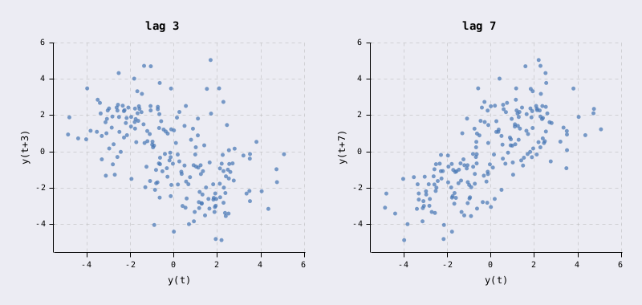
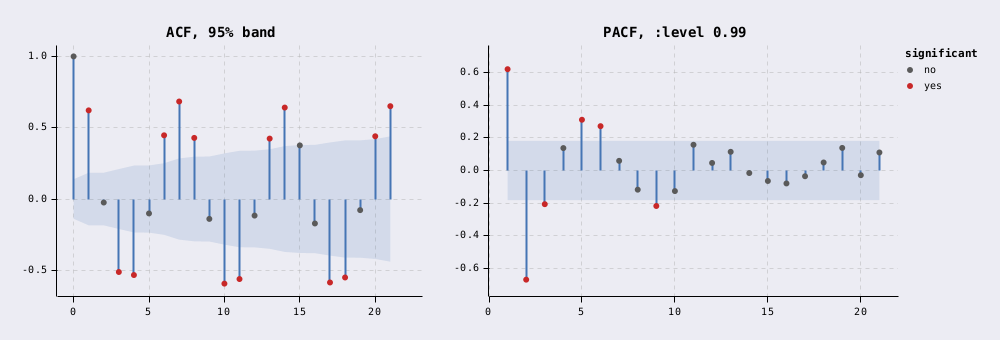
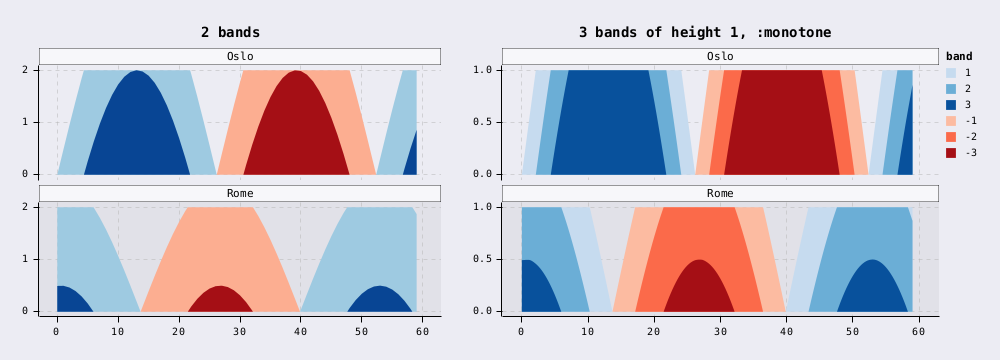

---
format:
  html:
    toc: true
    toc-location: right
    toc-depth: 4
    theme: cosmo
    include-in-header:
      text: |-
        <style>
        .data-table { width: fit-content; max-width: 100%; max-height: 15rem; overflow: auto; margin: 0 0 1rem 0; }
        .data-table .table-responsive { overflow: visible; }
        .data-table table { font-size: 0.75rem; width: auto; margin: 0; }
        .data-table th, .data-table td { padding: 0.1rem 0.45rem !important; white-space: nowrap; }
        .data-table thead th { position: sticky; top: 0; background: var(--bs-body-bg, #fff); }
        </style>
code-block-background: true

---
<style></style><style>.printedClojure .sourceCode {
  background-color: transparent;
  border-style: none;
}
</style><style>.clay-limit-image-width .clay-image {max-width: 100%}
.clay-side-by-side .sourceCode {margin: 0}
.clay-side-by-side {margin: 1em 0}
</style>
<script src="https://code.jquery.com/jquery-3.6.0.min.js" type="text/javascript"></script><script src="https://code.jquery.com/ui/1.13.1/jquery-ui.min.js" type="text/javascript"></script>

# Data functions: sets and series

Functions turning set memberships and time series into rows for ordinary plots: the bars and dot matrix of an
UpSet plot, lag pairs, autocorrelation rows, the folded bands of a horizon chart and the matrix of a pairwise
statistic. The builders `plot/acf` and `plot/horizon` (Builders: series) draw autocorrelations and horizons
directly, `chart/pairwise` one statistic per panel.


::: {.sourceClojure}
```clojure
(ns reference.data-sets-series
  (:require [fastmath.core :as m]
            [fastmath.random :as r]
            [cljplot2.chart :as chart]
            [cljplot2.core :as plot]
            [cljplot2.data.pairwise :as pairwise]
            [cljplot2.data.series :as series]
            [cljplot2.data.sets :as sets]
            [cljplot2.describe :as describe]
            [notebook-utils :as nu]))
```
:::


Set memberships: one row per item and set it belongs to (an item may be in several).


::: {.sourceClojure}
```clojure
(def members (concat (for [i (range 40)] {:set "coffee" :item i})
                     (for [i (range 25 60)] {:set "tea" :item i})
                     (for [i (range 30 45)] {:set "juice" :item i})
                     (for [i (range 55 70)] {:set "juice" :item i})))
```
:::


```{=html}
<div class="data-table"><table class="table table-hover table-responsive clay-table"><thead><tr><th>set</th><th>item</th></tr></thead><tbody><tr><td>coffee</td><td>0</td></tr><tr><td>coffee</td><td>1</td></tr><tr><td>coffee</td><td>2</td></tr><tr><td>coffee</td><td>3</td></tr><tr><td>coffee</td><td>4</td></tr><tr><td>coffee</td><td>5</td></tr><tr><td>coffee</td><td>6</td></tr><tr><td>coffee</td><td>7</td></tr><tr><td>coffee</td><td>8</td></tr><tr><td>coffee</td><td>9</td></tr><tr><td>coffee</td><td>10</td></tr><tr><td>coffee</td><td>11</td></tr><tr><td>coffee</td><td>12</td></tr><tr><td>coffee</td><td>13</td></tr><tr><td>coffee</td><td>14</td></tr><tr><td>coffee</td><td>15</td></tr><tr><td>coffee</td><td>16</td></tr><tr><td>coffee</td><td>17</td></tr><tr><td>coffee</td><td>18</td></tr><tr><td>coffee</td><td>19</td></tr><tr><td>coffee</td><td>20</td></tr><tr><td>coffee</td><td>21</td></tr><tr><td>coffee</td><td>22</td></tr><tr><td>coffee</td><td>23</td></tr><tr><td>coffee</td><td>24</td></tr><tr><td>coffee</td><td>25</td></tr><tr><td>coffee</td><td>26</td></tr><tr><td>coffee</td><td>27</td></tr><tr><td>coffee</td><td>28</td></tr><tr><td>coffee</td><td>29</td></tr><tr><td>coffee</td><td>30</td></tr><tr><td>coffee</td><td>31</td></tr><tr><td>coffee</td><td>32</td></tr><tr><td>coffee</td><td>33</td></tr><tr><td>coffee</td><td>34</td></tr><tr><td>coffee</td><td>35</td></tr><tr><td>coffee</td><td>36</td></tr><tr><td>coffee</td><td>37</td></tr><tr><td>coffee</td><td>38</td></tr><tr><td>coffee</td><td>39</td></tr><tr><td>tea</td><td>25</td></tr><tr><td>tea</td><td>26</td></tr><tr><td>tea</td><td>27</td></tr><tr><td>tea</td><td>28</td></tr><tr><td>tea</td><td>29</td></tr><tr><td>tea</td><td>30</td></tr><tr><td>tea</td><td>31</td></tr><tr><td>tea</td><td>32</td></tr><tr><td>tea</td><td>33</td></tr><tr><td>tea</td><td>34</td></tr><tr><td>tea</td><td>35</td></tr><tr><td>tea</td><td>36</td></tr><tr><td>tea</td><td>37</td></tr><tr><td>tea</td><td>38</td></tr><tr><td>tea</td><td>39</td></tr><tr><td>tea</td><td>40</td></tr><tr><td>tea</td><td>41</td></tr><tr><td>tea</td><td>42</td></tr><tr><td>tea</td><td>43</td></tr><tr><td>tea</td><td>44</td></tr><tr><td>tea</td><td>45</td></tr><tr><td>tea</td><td>46</td></tr><tr><td>tea</td><td>47</td></tr><tr><td>tea</td><td>48</td></tr><tr><td>tea</td><td>49</td></tr><tr><td>tea</td><td>50</td></tr><tr><td>tea</td><td>51</td></tr><tr><td>tea</td><td>52</td></tr><tr><td>tea</td><td>53</td></tr><tr><td>tea</td><td>54</td></tr><tr><td>tea</td><td>55</td></tr><tr><td>tea</td><td>56</td></tr><tr><td>tea</td><td>57</td></tr><tr><td>tea</td><td>58</td></tr><tr><td>tea</td><td>59</td></tr><tr><td>juice</td><td>30</td></tr><tr><td>juice</td><td>31</td></tr><tr><td>juice</td><td>32</td></tr><tr><td>juice</td><td>33</td></tr><tr><td>juice</td><td>34</td></tr><tr><td>juice</td><td>35</td></tr><tr><td>juice</td><td>36</td></tr><tr><td>juice</td><td>37</td></tr><tr><td>juice</td><td>38</td></tr><tr><td>juice</td><td>39</td></tr><tr><td>juice</td><td>40</td></tr><tr><td>juice</td><td>41</td></tr><tr><td>juice</td><td>42</td></tr><tr><td>juice</td><td>43</td></tr><tr><td>juice</td><td>44</td></tr><tr><td>juice</td><td>55</td></tr><tr><td>juice</td><td>56</td></tr><tr><td>juice</td><td>57</td></tr><tr><td>juice</td><td>58</td></tr><tr><td>juice</td><td>59</td></tr><tr><td>juice</td><td>60</td></tr><tr><td>juice</td><td>61</td></tr><tr><td>juice</td><td>62</td></tr><tr><td>juice</td><td>63</td></tr><tr><td>juice</td><td>64</td></tr><tr><td>…</td><td>…</td></tr></tbody></table></div>
```


A seeded autoregressive series with a weekly bump:


::: {.sourceClojure}
```clojure
(def weekly (let [g (r/rng :mersenne 8)]
              (vec (reductions (fn [y t] (+ (* 0.6 (double y)) (* 2.0 (m/sin (* m/TWO_PI (/ (double t) 7.0))))
                                            (r/grandom g)))
                               0.0 (range 1 200)))))
```
:::


```{=html}
<div class="data-table"><table class="table table-hover table-responsive clay-table"><thead><tr><th>t</th><th>y</th></tr></thead><tbody><tr><td>0</td><td>0.0</td></tr><tr><td>1</td><td>0.13977307440775744</td></tr><tr><td>2</td><td>2.7905276303712556</td></tr><tr><td>3</td><td>1.182076374268736</td></tr><tr><td>4</td><td>1.8857619600375348</td></tr><tr><td>5</td><td>0.17450253670221405</td></tr><tr><td>6</td><td>-2.2114471052072315</td></tr><tr><td>7</td><td>-3.044028051154591</td></tr><tr><td>8</td><td>-0.14976638399572134</td></tr><tr><td>9</td><td>1.587846819931787</td></tr><tr><td>10</td><td>2.2795328370428445</td></tr><tr><td>11</td><td>-0.2956701822523501</td></tr><tr><td>12</td><td>-2.5970802695960344</td></tr><tr><td>13</td><td>-1.0628029490748316</td></tr><tr><td>14</td><td>-1.3726235623170633</td></tr><tr><td>15</td><td>2.2752608361156237</td></tr><tr><td>16</td><td>4.716331163150285</td></tr><tr><td>17</td><td>4.738859355206512</td></tr><tr><td>18</td><td>2.7516193587370803</td></tr><tr><td>19</td><td>-0.96089041389926</td></tr><tr><td>20</td><td>-1.672460418656026</td></tr><tr><td>21</td><td>-1.5837748276209425</td></tr><tr><td>22</td><td>0.248029734088489</td></tr><tr><td>23</td><td>2.1266466663341697</td></tr><tr><td>24</td><td>2.3667789741884153</td></tr><tr><td>25</td><td>-0.5284470837340532</td></tr><tr><td>26</td><td>-2.5067655285740633</td></tr><tr><td>27</td><td>-2.27184448699434</td></tr><tr><td>28</td><td>-1.0744854689699892</td></tr><tr><td>29</td><td>1.0992257725118908</td></tr><tr><td>30</td><td>2.297817519004787</td></tr><tr><td>31</td><td>2.524555509699196</td></tr><tr><td>32</td><td>0.9066650336613162</td></tr><tr><td>33</td><td>-1.973900083417808</td></tr><tr><td>34</td><td>-1.4715527312854013</td></tr><tr><td>35</td><td>-0.7397028802799019</td></tr><tr><td>36</td><td>1.3943372501425042</td></tr><tr><td>37</td><td>3.195325772326656</td></tr><tr><td>38</td><td>2.4796323879573707</td></tr><tr><td>39</td><td>0.3573983588652897</td></tr><tr><td>40</td><td>-0.20454515634164205</td></tr><tr><td>41</td><td>-0.9842152462781779</td></tr><tr><td>42</td><td>-1.2190757467223128</td></tr><tr><td>43</td><td>-0.473279449134298</td></tr><tr><td>44</td><td>0.5609960602226269</td></tr><tr><td>45</td><td>0.5857249817586214</td></tr><tr><td>46</td><td>1.2275317907812817</td></tr><tr><td>47</td><td>-1.6392350408707481</td></tr><tr><td>48</td><td>-2.5724035266084746</td></tr><tr><td>49</td><td>-0.7405028134931776</td></tr><tr><td>50</td><td>1.7074340387731763</td></tr><tr><td>51</td><td>2.594161614240549</td></tr><tr><td>52</td><td>2.3498598156391473</td></tr><tr><td>53</td><td>2.107735039246341</td></tr><tr><td>54</td><td>-1.1114637386859947</td></tr><tr><td>55</td><td>-3.3690149153531386</td></tr><tr><td>56</td><td>-1.7592885604742825</td></tr><tr><td>57</td><td>0.9813141171195396</td></tr><tr><td>58</td><td>2.116997285412064</td></tr><tr><td>59</td><td>1.8054651816902145</td></tr><tr><td>60</td><td>-0.14654679116113023</td></tr><tr><td>61</td><td>-0.9156730593091467</td></tr><tr><td>62</td><td>-1.789270135872337</td></tr><tr><td>63</td><td>-2.4440122834623805</td></tr><tr><td>64</td><td>0.3406167504738572</td></tr><tr><td>65</td><td>2.3845853192163005</td></tr><tr><td>66</td><td>-0.0032829913925178644</td></tr><tr><td>67</td><td>-1.0969826276179542</td></tr><tr><td>68</td><td>-3.5429896124502265</td></tr><tr><td>69</td><td>-4.4024603131052045</td></tr><tr><td>70</td><td>-1.6091605047216901</td></tr><tr><td>71</td><td>1.1039566123281377</td></tr><tr><td>72</td><td>0.7408238747971894</td></tr><tr><td>73</td><td>2.512389179049876</td></tr><tr><td>74</td><td>1.8324044134757314</td></tr><tr><td>75</td><td>-1.3966767543311789</td></tr><tr><td>76</td><td>-3.4027521255237416</td></tr><tr><td>77</td><td>-2.5387986049782447</td></tr><tr><td>78</td><td>1.5168243927789171</td></tr><tr><td>79</td><td>2.697994178390557</td></tr><tr><td>80</td><td>4.341639710378089</td></tr><tr><td>81</td><td>3.471117571811411</td></tr><tr><td>82</td><td>-0.6374184324025643</td></tr><tr><td>83</td><td>-3.144668234807061</td></tr><tr><td>84</td><td>-2.1590227155889243</td></tr><tr><td>85</td><td>-0.3249893795694875</td></tr><tr><td>86</td><td>1.6319504527117272</td></tr><tr><td>87</td><td>0.9181483544698612</td></tr><tr><td>88</td><td>-0.9042325628070139</td></tr><tr><td>89</td><td>-3.1302798909817056</td></tr><tr><td>90</td><td>-3.831753173127805</td></tr><tr><td>91</td><td>-4.033743121508569</td></tr><tr><td>92</td><td>-1.3156557235924389</td></tr><tr><td>93</td><td>1.160997527709536</td></tr><tr><td>94</td><td>0.69073209315031</td></tr><tr><td>95</td><td>-1.9516737852939403</td></tr><tr><td>96</td><td>-3.1029627017329986</td></tr><tr><td>97</td><td>-3.9880277285668617</td></tr><tr><td>98</td><td>-1.4921477136546932</td></tr><tr><td>99</td><td>1.0212389935099315</td></tr><tr><td>…</td><td>…</td></tr></tbody></table></div>
```


## sets/upset-rows

The bars of an UpSet plot: every combination of sets that holds items exclusively - its sets, size and degree -
by size descending. The mapping names the set and item keys; a third argument chooses (and orders) the sets.


```{=html}
<div class="data-table"><table class="table table-hover table-responsive clay-table"><thead><tr><th>combination</th><th>sets</th><th>size</th><th>degree</th></tr></thead><tbody><tr><td>coffee</td><td>["coffee"]</td><td>25</td><td>1</td></tr><tr><td>tea</td><td>["tea"]</td><td>10</td><td>1</td></tr><tr><td>juice</td><td>["juice"]</td><td>10</td><td>1</td></tr><tr><td>tea & juice</td><td>["tea" "juice"]</td><td>10</td><td>2</td></tr><tr><td>coffee & tea & juice</td><td>["coffee" "tea" "juice"]</td><td>10</td><td>3</td></tr><tr><td>coffee & tea</td><td>["coffee" "tea"]</td><td>5</td><td>2</td></tr></tbody></table></div>
```


## sets/membership-rows

The dot matrix under the bars: a row per combination and set, `:member?` true where the set is in the combination.


```{=html}
<div class="data-table"><table class="table table-hover table-responsive clay-table"><thead><tr><th>combination</th><th>set</th><th>member?</th></tr></thead><tbody><tr><td>coffee</td><td>coffee</td><td>true</td></tr><tr><td>coffee</td><td>tea</td><td>false</td></tr><tr><td>coffee</td><td>juice</td><td>false</td></tr><tr><td>tea</td><td>coffee</td><td>false</td></tr><tr><td>tea</td><td>tea</td><td>true</td></tr><tr><td>tea</td><td>juice</td><td>false</td></tr><tr><td>juice</td><td>coffee</td><td>false</td></tr><tr><td>juice</td><td>tea</td><td>false</td></tr><tr><td>juice</td><td>juice</td><td>true</td></tr><tr><td>tea & juice</td><td>coffee</td><td>false</td></tr><tr><td>tea & juice</td><td>tea</td><td>true</td></tr><tr><td>tea & juice</td><td>juice</td><td>true</td></tr><tr><td>coffee & tea & juice</td><td>coffee</td><td>true</td></tr><tr><td>coffee & tea & juice</td><td>tea</td><td>true</td></tr><tr><td>coffee & tea & juice</td><td>juice</td><td>true</td></tr><tr><td>coffee & tea</td><td>coffee</td><td>true</td></tr><tr><td>coffee & tea</td><td>tea</td><td>true</td></tr><tr><td>coffee & tea</td><td>juice</td><td>false</td></tr></tbody></table></div>
```


Together, an UpSet plot of two stacked plots - the bars, then the dots of the members over grey dots of every
cell - here with the sets chosen and ordered (tea first):


::: {.sourceClojure}
```clojure
(plot/render-image (plot/arrange [{:data (sets/upset-rows members {:set :set :item :item} ["tea" "coffee" "juice"])
                                   :mapping {:x :combination :y :size}
                                   :charts [(chart/bar {:value-label true})]
                                   :labels {:x nil :y "items"}}
                                  {:data (sets/membership-rows members {:set :set :item :item} ["tea" "coffee" "juice"])
                                   :mapping {:x :combination :y :set}
                                   :charts [(chart/scatter {:size 12 :color [210 210 210]})
                                            (chart/scatter {:data (filter :member? (sets/membership-rows members {:set :set :item :item}
                                                                                                         ["tea" "coffee" "juice"]))
                                                            :size 12 :color :black})]
                                   :scales {:y {:reverse true}}
                                   :labels {:x nil :y nil}}]
                                 {:columns 1 :heights [2 1]})
                   {:width 900 :height 450})
```
:::


::: {.clay-image}

:::


## series/lag-rows

Pairs every value `y(t)` with `y(t + k)` - a lag plot shows the correlation at lag k (here the weekly cycle:
strong at 7, negative at 3):


```{=html}
<div class="data-table"><table class="table table-hover table-responsive clay-table"><thead><tr><th>t</th><th>x</th><th>y</th></tr></thead><tbody><tr><td>0</td><td>0.0</td><td>-3.044028051154591</td></tr><tr><td>1</td><td>0.13977307440775744</td><td>-0.14976638399572134</td></tr><tr><td>2</td><td>2.7905276303712556</td><td>1.587846819931787</td></tr><tr><td>3</td><td>1.182076374268736</td><td>2.2795328370428445</td></tr><tr><td>4</td><td>1.8857619600375348</td><td>-0.2956701822523501</td></tr><tr><td>5</td><td>0.17450253670221405</td><td>-2.5970802695960344</td></tr><tr><td>6</td><td>-2.2114471052072315</td><td>-1.0628029490748316</td></tr><tr><td>7</td><td>-3.044028051154591</td><td>-1.3726235623170633</td></tr><tr><td>8</td><td>-0.14976638399572134</td><td>2.2752608361156237</td></tr><tr><td>9</td><td>1.587846819931787</td><td>4.716331163150285</td></tr><tr><td>10</td><td>2.2795328370428445</td><td>4.738859355206512</td></tr><tr><td>11</td><td>-0.2956701822523501</td><td>2.7516193587370803</td></tr><tr><td>12</td><td>-2.5970802695960344</td><td>-0.96089041389926</td></tr><tr><td>13</td><td>-1.0628029490748316</td><td>-1.672460418656026</td></tr><tr><td>14</td><td>-1.3726235623170633</td><td>-1.5837748276209425</td></tr><tr><td>15</td><td>2.2752608361156237</td><td>0.248029734088489</td></tr><tr><td>16</td><td>4.716331163150285</td><td>2.1266466663341697</td></tr><tr><td>17</td><td>4.738859355206512</td><td>2.3667789741884153</td></tr><tr><td>18</td><td>2.7516193587370803</td><td>-0.5284470837340532</td></tr><tr><td>19</td><td>-0.96089041389926</td><td>-2.5067655285740633</td></tr><tr><td>20</td><td>-1.672460418656026</td><td>-2.27184448699434</td></tr><tr><td>21</td><td>-1.5837748276209425</td><td>-1.0744854689699892</td></tr><tr><td>22</td><td>0.248029734088489</td><td>1.0992257725118908</td></tr><tr><td>23</td><td>2.1266466663341697</td><td>2.297817519004787</td></tr><tr><td>24</td><td>2.3667789741884153</td><td>2.524555509699196</td></tr><tr><td>25</td><td>-0.5284470837340532</td><td>0.9066650336613162</td></tr><tr><td>26</td><td>-2.5067655285740633</td><td>-1.973900083417808</td></tr><tr><td>27</td><td>-2.27184448699434</td><td>-1.4715527312854013</td></tr><tr><td>28</td><td>-1.0744854689699892</td><td>-0.7397028802799019</td></tr><tr><td>29</td><td>1.0992257725118908</td><td>1.3943372501425042</td></tr><tr><td>30</td><td>2.297817519004787</td><td>3.195325772326656</td></tr><tr><td>31</td><td>2.524555509699196</td><td>2.4796323879573707</td></tr><tr><td>32</td><td>0.9066650336613162</td><td>0.3573983588652897</td></tr><tr><td>33</td><td>-1.973900083417808</td><td>-0.20454515634164205</td></tr><tr><td>34</td><td>-1.4715527312854013</td><td>-0.9842152462781779</td></tr><tr><td>35</td><td>-0.7397028802799019</td><td>-1.2190757467223128</td></tr><tr><td>36</td><td>1.3943372501425042</td><td>-0.473279449134298</td></tr><tr><td>37</td><td>3.195325772326656</td><td>0.5609960602226269</td></tr><tr><td>38</td><td>2.4796323879573707</td><td>0.5857249817586214</td></tr><tr><td>39</td><td>0.3573983588652897</td><td>1.2275317907812817</td></tr><tr><td>40</td><td>-0.20454515634164205</td><td>-1.6392350408707481</td></tr><tr><td>41</td><td>-0.9842152462781779</td><td>-2.5724035266084746</td></tr><tr><td>42</td><td>-1.2190757467223128</td><td>-0.7405028134931776</td></tr><tr><td>43</td><td>-0.473279449134298</td><td>1.7074340387731763</td></tr><tr><td>44</td><td>0.5609960602226269</td><td>2.594161614240549</td></tr><tr><td>45</td><td>0.5857249817586214</td><td>2.3498598156391473</td></tr><tr><td>46</td><td>1.2275317907812817</td><td>2.107735039246341</td></tr><tr><td>47</td><td>-1.6392350408707481</td><td>-1.1114637386859947</td></tr><tr><td>48</td><td>-2.5724035266084746</td><td>-3.3690149153531386</td></tr><tr><td>49</td><td>-0.7405028134931776</td><td>-1.7592885604742825</td></tr><tr><td>50</td><td>1.7074340387731763</td><td>0.9813141171195396</td></tr><tr><td>51</td><td>2.594161614240549</td><td>2.116997285412064</td></tr><tr><td>52</td><td>2.3498598156391473</td><td>1.8054651816902145</td></tr><tr><td>53</td><td>2.107735039246341</td><td>-0.14654679116113023</td></tr><tr><td>54</td><td>-1.1114637386859947</td><td>-0.9156730593091467</td></tr><tr><td>55</td><td>-3.3690149153531386</td><td>-1.789270135872337</td></tr><tr><td>56</td><td>-1.7592885604742825</td><td>-2.4440122834623805</td></tr><tr><td>57</td><td>0.9813141171195396</td><td>0.3406167504738572</td></tr><tr><td>58</td><td>2.116997285412064</td><td>2.3845853192163005</td></tr><tr><td>59</td><td>1.8054651816902145</td><td>-0.0032829913925178644</td></tr><tr><td>60</td><td>-0.14654679116113023</td><td>-1.0969826276179542</td></tr><tr><td>61</td><td>-0.9156730593091467</td><td>-3.5429896124502265</td></tr><tr><td>62</td><td>-1.789270135872337</td><td>-4.4024603131052045</td></tr><tr><td>63</td><td>-2.4440122834623805</td><td>-1.6091605047216901</td></tr><tr><td>64</td><td>0.3406167504738572</td><td>1.1039566123281377</td></tr><tr><td>65</td><td>2.3845853192163005</td><td>0.7408238747971894</td></tr><tr><td>66</td><td>-0.0032829913925178644</td><td>2.512389179049876</td></tr><tr><td>67</td><td>-1.0969826276179542</td><td>1.8324044134757314</td></tr><tr><td>68</td><td>-3.5429896124502265</td><td>-1.3966767543311789</td></tr><tr><td>69</td><td>-4.4024603131052045</td><td>-3.4027521255237416</td></tr><tr><td>70</td><td>-1.6091605047216901</td><td>-2.5387986049782447</td></tr><tr><td>71</td><td>1.1039566123281377</td><td>1.5168243927789171</td></tr><tr><td>72</td><td>0.7408238747971894</td><td>2.697994178390557</td></tr><tr><td>73</td><td>2.512389179049876</td><td>4.341639710378089</td></tr><tr><td>74</td><td>1.8324044134757314</td><td>3.471117571811411</td></tr><tr><td>75</td><td>-1.3966767543311789</td><td>-0.6374184324025643</td></tr><tr><td>76</td><td>-3.4027521255237416</td><td>-3.144668234807061</td></tr><tr><td>77</td><td>-2.5387986049782447</td><td>-2.1590227155889243</td></tr><tr><td>78</td><td>1.5168243927789171</td><td>-0.3249893795694875</td></tr><tr><td>79</td><td>2.697994178390557</td><td>1.6319504527117272</td></tr><tr><td>80</td><td>4.341639710378089</td><td>0.9181483544698612</td></tr><tr><td>81</td><td>3.471117571811411</td><td>-0.9042325628070139</td></tr><tr><td>82</td><td>-0.6374184324025643</td><td>-3.1302798909817056</td></tr><tr><td>83</td><td>-3.144668234807061</td><td>-3.831753173127805</td></tr><tr><td>84</td><td>-2.1590227155889243</td><td>-4.033743121508569</td></tr><tr><td>85</td><td>-0.3249893795694875</td><td>-1.3156557235924389</td></tr><tr><td>86</td><td>1.6319504527117272</td><td>1.160997527709536</td></tr><tr><td>87</td><td>0.9181483544698612</td><td>0.69073209315031</td></tr><tr><td>88</td><td>-0.9042325628070139</td><td>-1.9516737852939403</td></tr><tr><td>89</td><td>-3.1302798909817056</td><td>-3.1029627017329986</td></tr><tr><td>90</td><td>-3.831753173127805</td><td>-3.9880277285668617</td></tr><tr><td>91</td><td>-4.033743121508569</td><td>-1.4921477136546932</td></tr><tr><td>92</td><td>-1.3156557235924389</td><td>1.0212389935099315</td></tr><tr><td>93</td><td>1.160997527709536</td><td>3.4969528572060113</td></tr><tr><td>94</td><td>0.69073209315031</td><td>2.1886345245865</td></tr><tr><td>95</td><td>-1.9516737852939403</td><td>-0.8157697847877093</td></tr><tr><td>96</td><td>-3.1029627017329986</td><td>-2.7192455186430973</td></tr><tr><td>97</td><td>-3.9880277285668617</td><td>-4.868280462395595</td></tr><tr><td>98</td><td>-1.4921477136546932</td><td>-1.731832964844711</td></tr><tr><td>99</td><td>1.0212389935099315</td><td>-1.2620284015534728</td></tr><tr><td>…</td><td>…</td><td>…</td></tr></tbody></table></div>
```


::: {.sourceClojure}
```clojure
(plot/render-image (plot/arrange [{:data (series/lag-rows weekly 3)
                                   :mapping {:x :x :y :y}
                                   :charts [(chart/scatter {:size 5})]
                                   :labels {:title "lag 3" :x "y(t)" :y "y(t+3)"}}
                                  {:data (series/lag-rows weekly 7)
                                   :mapping {:x :x :y :y}
                                   :charts [(chart/scatter {:size 5})]
                                   :labels {:title "lag 7" :x "y(t)" :y "y(t+7)"}}]
                                 {:columns 2})
                   {:width 800 :height 380})
```
:::


::: {.clay-image}

:::


## series/acf-rows

The autocorrelation function: a row per lag with its value, the significance band and whether the value is
outside it; `:partial true` - the partial autocorrelation.

::: {.clay-table}

```{=html}
<table class="table table-hover table-responsive clay-table"><thead><tr><th>Option</th><th>Type</th><th>Default</th><th>Description</th></tr></thead><tbody><tr><td>:lags</td><td>a positive integer or nil</td><td>floor(10 log10 n), at most n - 1 (R acf)</td><td>the largest lag, from 1 to n - 1 for n values</td></tr><tr><td>:level</td><td>a number in (0 1) or nil</td><td>0.95</td><td>confidence level of the band (0.95 - a 95% band)</td></tr><tr><td>:partial</td><td>true or false or nil</td><td>false</td><td>the partial autocorrelation (lags from 1, a constant band) instead of the autocorrelation</td></tr></tbody></table>
```

:::


```{=html}
<div class="data-table"><table class="table table-hover table-responsive clay-table"><thead><tr><th>lag</th><th>value</th><th>lo</th><th>hi</th><th>significant?</th></tr></thead><tbody><tr><td>0</td><td>1.0</td><td>-0.13859038243496777</td><td>0.13859038243496777</td><td>false</td></tr><tr><td>1</td><td>0.6215962877171711</td><td>-0.1845264138478444</td><td>0.1845264138478444</td><td>true</td></tr><tr><td>2</td><td>-0.0245812762532376</td><td>-0.18458929818755346</td><td>0.18458929818755346</td><td>false</td></tr><tr><td>3</td><td>-0.5117536249216397</td><td>-0.2100801599517992</td><td>0.2100801599517992</td><td>true</td></tr><tr><td>4</td><td>-0.5330153237806908</td><td>-0.23462195777800635</td><td>0.23462195777800635</td><td>true</td></tr><tr><td>5</td><td>-0.10108379768907899</td><td>-0.23545696168192612</td><td>0.23545696168192612</td><td>false</td></tr><tr><td>6</td><td>0.44682475423704965</td><td>-0.25121613012862887</td><td>0.25121613012862887</td><td>true</td></tr><tr><td>7</td><td>0.6837820669513154</td><td>-0.2847289743030383</td><td>0.2847289743030383</td><td>true</td></tr><tr><td>8</td><td>0.4286047930660557</td><td>-0.2968626418517464</td><td>0.2968626418517464</td><td>true</td></tr><tr><td>9</td><td>-0.13943006698959823</td><td>-0.29811782282562116</td><td>0.29811782282562116</td><td>false</td></tr><tr><td>10</td><td>-0.5932087660505585</td><td>-0.3199878135302573</td><td>0.3199878135302573</td><td>true</td></tr></tbody></table></div>
```


Drawn by hand from the rows - segments to 0, the band as a ribbon, significant lags in red: the autocorrelation
up to lag 21 at the default 95% band (left) and the partial one with a 99% band (right):


::: {.sourceClojure}
```clojure
(plot/render-image (plot/arrange [{:data (series/acf-rows weekly {:lags 21 :level 0.95})
                                   :mapping {:x :lag :y :value :ymin :lo :ymax :hi}
                                   :charts [(chart/ribbon {:color [69 117 180] :alpha 0.15})
                                            (chart/segment {:yend 0 :line-width 2})
                                            (chart/scatter {:mapping {:color #(if (:significant? %) "yes" "no")}})]
                                   :scales {:color {:domain ["no" "yes"] :range [[90 90 90] [200 40 40]]
                                                    :title "significant"}}
                                   :labels {:title "ACF, 95% band"}
                                   :legend false}
                                  {:data (series/acf-rows weekly {:lags 21 :level 0.99 :partial true})
                                   :mapping {:x :lag :y :value :ymin :lo :ymax :hi}
                                   :charts [(chart/ribbon {:color [69 117 180] :alpha 0.15})
                                            (chart/segment {:yend 0 :line-width 2})
                                            (chart/scatter {:mapping {:color #(if (:significant? %) "yes" "no")}})]
                                   :scales {:color {:domain ["no" "yes"] :range [[90 90 90] [200 40 40]]
                                                    :title "significant"}}
                                   :labels {:title "PACF, :level 0.99"}}]
                                 {:columns 2 :widths [1 1.3]})
                   {:width 1000 :height 340})
```
:::


::: {.clay-image}

:::


## series/horizon-rows

The bands of a horizon chart: values folded into `:bands` bands of one height, negatives mirrored upward as
negative band numbers; returns `{:rows [...] :band-height h}`.

::: {.clay-table}

```{=html}
<table class="table table-hover table-responsive clay-table"><thead><tr><th>Option</th><th>Type</th><th>Default</th><th>Description</th></tr></thead><tbody><tr><td>:x</td><td>keyword or string</td><td>:x</td><td>row key of the x values (numbers)</td></tr><tr><td>:y</td><td>keyword or string</td><td>:y</td><td>row key of the y values (finite numbers, nil breaks the bands)</td></tr><tr><td>:series</td><td>keyword or string or nil</td><td>none - one series</td><td>row key of the series, one horizon per value in first-appearance order</td></tr><tr><td>:bands</td><td>a positive integer</td><td>2</td><td>number of bands each sign of the values is folded into</td></tr><tr><td>:band-height</td><td>a positive finite number or nil</td><td>the largest |y| of all series / :bands (1 when it is 0)</td><td>height of one band in y units</td></tr><tr><td>:interpolator</td><td>a fastmath 1D interpolation method keyword or a function (fn [xs ys & params] f) or nil</td><td>none - straight segments</td><td>a curve the valid points of every run are resampled on before folding</td></tr><tr><td>:steps-per-gap</td><td>a positive integer</td><td>10</td><td>resampled points per gap between consecutive x (with :interpolator)</td></tr></tbody></table>
```

:::


::: {.sourceClojure}
```clojure
(def temperatures (for [city ["Oslo" "Rome"] day (range 60)]
                    {:city city :day day
                     :anomaly (* (if (= city "Oslo") 4.0 2.5) (m/sin (+ (* 0.12 day) (if (= city "Oslo") 0.0 1.5))))}))
```
:::


```{=html}
<div class="data-table"><table class="table table-hover table-responsive clay-table"><thead><tr><th>city</th><th>day</th><th>anomaly</th></tr></thead><tbody><tr><td>Oslo</td><td>0</td><td>0.0</td></tr><tr><td>Oslo</td><td>1</td><td>0.47884882915567745</td></tr><tr><td>Oslo</td><td>2</td><td>0.9508105057085383</td></tr><tr><td>Oslo</td><td>3</td><td>1.4090969331003598</td></tr><tr><td>Oslo</td><td>4</td><td>1.8471167021659316</td></tr><tr><td>Oslo</td><td>5</td><td>2.2585698935801415</td></tr><tr><td>Oslo</td><td>6</td><td>2.6375386878858924</td></tr><tr><td>Oslo</td><td>7</td><td>2.978572479883437</td></tr><tr><td>Oslo</td><td>8</td><td>3.276766273203993</td></tr><tr><td>Oslo</td><td>9</td><td>3.52783122753979</td></tr><tr><td>Oslo</td><td>10</td><td>3.728156343868905</td></tr><tr><td>Oslo</td><td>11</td><td>3.874860400473061</td></tr><tr><td>Oslo</td><td>12</td><td>3.9658333927667457</td></tr><tr><td>Oslo</td><td>13</td><td>3.999766880919865</td></tr><tr><td>Oslo</td><td>14</td><td>3.976172808792304</td></tr><tr><td>Oslo</td><td>15</td><td>3.895390523512781</td></tr><tr><td>Oslo</td><td>16</td><td>3.7585818947412997</td></tr><tr><td>Oslo</td><td>17</td><td>3.5677146038135183</td></tr><tr><td>Oslo</td><td>18</td><td>3.3255338431147323</td></tr><tr><td>Oslo</td><td>19</td><td>3.035522832723688</td></tr><tr><td>Oslo</td><td>20</td><td>2.701852722204604</td></tr><tr><td>Oslo</td><td>21</td><td>2.3293225980963275</td></tr><tr><td>Oslo</td><td>22</td><td>1.9232904599545946</td></tr><tr><td>Oslo</td><td>23</td><td>1.4895961577002228</td></tr><tr><td>Oslo</td><td>24</td><td>1.0344773986444433</td></tr><tr><td>Oslo</td><td>25</td><td>0.5644800322394689</td></tr><tr><td>Oslo</td><td>26</td><td>0.08636390290438384</td></tr><tr><td>Oslo</td><td>27</td><td>-0.392994374980433</td></tr><tr><td>Oslo</td><td>28</td><td>-0.8667003215495185</td></tr><tr><td>Oslo</td><td>29</td><td>-1.3279407528829363</td></tr><tr><td>Oslo</td><td>30</td><td>-1.7700817731794083</td></tr><tr><td>Oslo</td><td>31</td><td>-2.1867641882771474</td></tr><tr><td>Oslo</td><td>32</td><td>-2.5719949682156353</td></tr><tr><td>Oslo</td><td>33</td><td>-2.920233443357198</td></tr><tr><td>Oslo</td><td>34</td><td>-3.226470994332962</td></tr><tr><td>Oslo</td><td>35</td><td>-3.4863030896543528</td></tr><tr><td>Oslo</td><td>36</td><td>-3.6959926348927516</td></tr><tr><td>Oslo</td><td>37</td><td>-3.852523722293266</td></tr><tr><td>Oslo</td><td>38</td><td>-3.953645007756522</td></tr><tr><td>Oslo</td><td>39</td><td>-3.997902091309136</td></tr><tr><td>Oslo</td><td>40</td><td>-3.9846584353433627</td></tr><tr><td>Oslo</td><td>41</td><td>-3.914104519764554</td></tr><tr><td>Oslo</td><td>42</td><td>-3.7872551023704357</td></tr><tr><td>Oslo</td><td>43</td><td>-3.6059346238654193</td></tr><tr><td>Oslo</td><td>44</td><td>-3.372750967425669</td></tr><tr><td>Oslo</td><td>45</td><td>-3.091057950223951</td></tr><tr><td>Oslo</td><td>46</td><td>-2.7649070863885084</td></tr><tr><td>Oslo</td><td>47</td><td>-2.398989315176175</td></tr><tr><td>Oslo</td><td>48</td><td>-1.9985675324676098</td></tr><tr><td>Oslo</td><td>49</td><td>-1.5694008959658154</td></tr><tr><td>Oslo</td><td>50</td><td>-1.1176619927957034</td></tr><tr><td>Oslo</td><td>51</td><td>-0.6498480608606167</td></tr><tr><td>Oslo</td><td>52</td><td>-0.17268754083491472</td></tr><tr><td>Oslo</td><td>53</td><td>0.3069566971700721</td></tr><tr><td>Oslo</td><td>54</td><td>0.7821860604021735</td></tr><tr><td>Oslo</td><td>55</td><td>1.2461654540535114</td></tr><tr><td>Oslo</td><td>56</td><td>1.6922215885719873</td></tr><tr><td>Oslo</td><td>57</td><td>2.113938959771723</td></tr><tr><td>Oslo</td><td>58</td><td>2.5052521212866234</td></tr><tr><td>Oslo</td><td>59</td><td>2.8605329222374314</td></tr><tr><td>Rome</td><td>0</td><td>2.493737466510136</td></tr><tr><td>Rome</td><td>1</td><td>2.49697435867631</td></tr><tr><td>Rome</td><td>2</td><td>2.464297947088884</td></tr><tr><td>Rome</td><td>3</td><td>2.3961782076972855</td></tr><tr><td>Rome</td><td>4</td><td>2.2935948882045247</td></tr><tr><td>Rome</td><td>5</td><td>2.1580234166221843</td></tr><tr><td>Rome</td><td>6</td><td>1.991413680590217</td></tr><tr><td>Rome</td><td>7</td><td>1.7961619826728157</td></tr><tr><td>Rome</td><td>8</td><td>1.5750765749897306</td></tr><tr><td>Rome</td><td>9</td><td>1.3313372688890528</td></tr><tr><td>Rome</td><td>10</td><td>1.0684497005845746</td></tr><tr><td>Rome</td><td>11</td><td>0.7901949105426345</td></tr><tr><td>Rome</td><td>12</td><td>0.5005749618044263</td></tr><tr><td>Rome</td><td>13</td><td>0.2037553794006728</td></tr><tr><td>Rome</td><td>14</td><td>-0.09599476126308734</td></tr><tr><td>Rome</td><td>15</td><td>-0.39436423535812054</td></tr><tr><td>Rome</td><td>16</td><td>-0.6870616758078101</td></tr><tr><td>Rome</td><td>17</td><td>-0.9698772948543257</td></tr><tr><td>Rome</td><td>18</td><td>-1.2387434322921123</td></tr><tr><td>Rome</td><td>19</td><td>-1.4897930595194098</td></tr><tr><td>Rome</td><td>20</td><td>-1.7194153979599345</td></tr><tr><td>Rome</td><td>21</td><td>-1.9243078519100596</td></tr><tr><td>Rome</td><td>22</td><td>-2.1015235088754864</td></tr><tr><td>Rome</td><td>23</td><td>-2.248513524212944</td></tr><tr><td>Rome</td><td>24</td><td>-2.3631637804701584</td></tr><tr><td>Rome</td><td>25</td><td>-2.4438252941627425</td></tr><tr><td>Rome</td><td>26</td><td>-2.4893379326556135</td></tr><tr><td>Rome</td><td>27</td><td>-2.4990471000354635</td></tr><tr><td>Rome</td><td>28</td><td>-2.4728131519859247</td></tr><tr><td>Rome</td><td>29</td><td>-2.411013404253826</td></tr><tr><td>Rome</td><td>30</td><td>-2.3145367058193314</td></tr><tr><td>Rome</td><td>31</td><td>-2.184770654822556</td></tr><tr><td>Rome</td><td>32</td><td>-2.0235816411165484</td></tr><tr><td>Rome</td><td>33</td><td>-1.8332880024891414</td></tr><tr><td>Rome</td><td>34</td><td>-1.6166266806404586</td></tr><tr><td>Rome</td><td>35</td><td>-1.376713856494094</td></tr><tr><td>Rome</td><td>36</td><td>-1.117000131013575</td></tr><tr><td>Rome</td><td>37</td><td>-0.8412208961462626</td></tr><tr><td>Rome</td><td>38</td><td>-0.5533426096958989</td></tr><tr><td>Rome</td><td>39</td><td>-0.25750574683774463</td></tr><tr><td>…</td><td>…</td><td>…</td></tr></tbody></table></div>
```


Two bands per sign for each city (the rows of the bands, where the curve crosses a band edge points are added):


```{=html}
<div class="data-table"><table class="table table-hover table-responsive clay-table"><thead><tr><th>x</th><th>y</th><th>band</th><th>series</th></tr></thead><tbody><tr><td>0.0</td><td>0.0</td><td>1</td><td>Oslo</td></tr><tr><td>1.0</td><td>0.47884882915567745</td><td>1</td><td>Oslo</td></tr><tr><td>2.0</td><td>0.9508105057085383</td><td>1</td><td>Oslo</td></tr><tr><td>3.0</td><td>1.4090969331003598</td><td>1</td><td>Oslo</td></tr><tr><td>4.0</td><td>1.8471167021659316</td><td>1</td><td>Oslo</td></tr><tr><td>4.371285826630546</td><td>1.9998834404599326</td><td>1</td><td>Oslo</td></tr><tr><td>5.0</td><td>1.9998834404599326</td><td>1</td><td>Oslo</td></tr><tr><td>6.0</td><td>1.9998834404599326</td><td>1</td><td>Oslo</td></tr><tr><td>7.0</td><td>1.9998834404599326</td><td>1</td><td>Oslo</td></tr><tr><td>8.0</td><td>1.9998834404599326</td><td>1</td><td>Oslo</td></tr><tr><td>9.0</td><td>1.9998834404599326</td><td>1</td><td>Oslo</td></tr><tr><td>10.0</td><td>1.9998834404599326</td><td>1</td><td>Oslo</td></tr><tr><td>11.0</td><td>1.9998834404599326</td><td>1</td><td>Oslo</td></tr><tr><td>12.0</td><td>1.9998834404599326</td><td>1</td><td>Oslo</td></tr><tr><td>13.0</td><td>1.9998834404599326</td><td>1</td><td>Oslo</td></tr><tr><td>14.0</td><td>1.9998834404599326</td><td>1</td><td>Oslo</td></tr><tr><td>15.0</td><td>1.9998834404599326</td><td>1</td><td>Oslo</td></tr><tr><td>16.0</td><td>1.9998834404599326</td><td>1</td><td>Oslo</td></tr><tr><td>17.0</td><td>1.9998834404599326</td><td>1</td><td>Oslo</td></tr><tr><td>18.0</td><td>1.9998834404599326</td><td>1</td><td>Oslo</td></tr><tr><td>19.0</td><td>1.9998834404599326</td><td>1</td><td>Oslo</td></tr><tr><td>20.0</td><td>1.9998834404599326</td><td>1</td><td>Oslo</td></tr><tr><td>21.0</td><td>1.9998834404599326</td><td>1</td><td>Oslo</td></tr><tr><td>21.811362270839258</td><td>1.9998834404599326</td><td>1</td><td>Oslo</td></tr><tr><td>22.0</td><td>1.9232904599545946</td><td>1</td><td>Oslo</td></tr><tr><td>23.0</td><td>1.4895961577002228</td><td>1</td><td>Oslo</td></tr><tr><td>24.0</td><td>1.0344773986444433</td><td>1</td><td>Oslo</td></tr><tr><td>25.0</td><td>0.5644800322394689</td><td>1</td><td>Oslo</td></tr><tr><td>26.0</td><td>0.08636390290438384</td><td>1</td><td>Oslo</td></tr><tr><td>26.18016566499168</td><td>0.0</td><td>1</td><td>Oslo</td></tr><tr><td>27.0</td><td>0.0</td><td>1</td><td>Oslo</td></tr><tr><td>28.0</td><td>0.0</td><td>1</td><td>Oslo</td></tr><tr><td>29.0</td><td>0.0</td><td>1</td><td>Oslo</td></tr><tr><td>30.0</td><td>0.0</td><td>1</td><td>Oslo</td></tr><tr><td>30.55150315673058</td><td>0.0</td><td>1</td><td>Oslo</td></tr><tr><td>31.0</td><td>0.0</td><td>1</td><td>Oslo</td></tr><tr><td>32.0</td><td>0.0</td><td>1</td><td>Oslo</td></tr><tr><td>33.0</td><td>0.0</td><td>1</td><td>Oslo</td></tr><tr><td>34.0</td><td>0.0</td><td>1</td><td>Oslo</td></tr><tr><td>35.0</td><td>0.0</td><td>1</td><td>Oslo</td></tr><tr><td>36.0</td><td>0.0</td><td>1</td><td>Oslo</td></tr><tr><td>37.0</td><td>0.0</td><td>1</td><td>Oslo</td></tr><tr><td>38.0</td><td>0.0</td><td>1</td><td>Oslo</td></tr><tr><td>39.0</td><td>0.0</td><td>1</td><td>Oslo</td></tr><tr><td>40.0</td><td>0.0</td><td>1</td><td>Oslo</td></tr><tr><td>41.0</td><td>0.0</td><td>1</td><td>Oslo</td></tr><tr><td>42.0</td><td>0.0</td><td>1</td><td>Oslo</td></tr><tr><td>43.0</td><td>0.0</td><td>1</td><td>Oslo</td></tr><tr><td>44.0</td><td>0.0</td><td>1</td><td>Oslo</td></tr><tr><td>45.0</td><td>0.0</td><td>1</td><td>Oslo</td></tr><tr><td>46.0</td><td>0.0</td><td>1</td><td>Oslo</td></tr><tr><td>47.0</td><td>0.0</td><td>1</td><td>Oslo</td></tr><tr><td>47.99671369528545</td><td>0.0</td><td>1</td><td>Oslo</td></tr><tr><td>48.0</td><td>0.0</td><td>1</td><td>Oslo</td></tr><tr><td>49.0</td><td>0.0</td><td>1</td><td>Oslo</td></tr><tr><td>50.0</td><td>0.0</td><td>1</td><td>Oslo</td></tr><tr><td>51.0</td><td>0.0</td><td>1</td><td>Oslo</td></tr><tr><td>52.0</td><td>0.0</td><td>1</td><td>Oslo</td></tr><tr><td>52.36003255569833</td><td>0.0</td><td>1</td><td>Oslo</td></tr><tr><td>53.0</td><td>0.3069566971700721</td><td>1</td><td>Oslo</td></tr><tr><td>54.0</td><td>0.7821860604021735</td><td>1</td><td>Oslo</td></tr><tr><td>55.0</td><td>1.2461654540535114</td><td>1</td><td>Oslo</td></tr><tr><td>56.0</td><td>1.6922215885719873</td><td>1</td><td>Oslo</td></tr><tr><td>56.72954512405473</td><td>1.9998834404599326</td><td>1</td><td>Oslo</td></tr><tr><td>57.0</td><td>1.9998834404599326</td><td>1</td><td>Oslo</td></tr><tr><td>58.0</td><td>1.9998834404599326</td><td>1</td><td>Oslo</td></tr><tr><td>59.0</td><td>1.9998834404599326</td><td>1</td><td>Oslo</td></tr><tr><td>0.0</td><td>0.0</td><td>2</td><td>Oslo</td></tr><tr><td>1.0</td><td>0.0</td><td>2</td><td>Oslo</td></tr><tr><td>2.0</td><td>0.0</td><td>2</td><td>Oslo</td></tr><tr><td>3.0</td><td>0.0</td><td>2</td><td>Oslo</td></tr><tr><td>4.0</td><td>0.0</td><td>2</td><td>Oslo</td></tr><tr><td>4.371285826630546</td><td>0.0</td><td>2</td><td>Oslo</td></tr><tr><td>5.0</td><td>0.2586864531202089</td><td>2</td><td>Oslo</td></tr><tr><td>6.0</td><td>0.6376552474259598</td><td>2</td><td>Oslo</td></tr><tr><td>7.0</td><td>0.9786890394235046</td><td>2</td><td>Oslo</td></tr><tr><td>8.0</td><td>1.2768828327440604</td><td>2</td><td>Oslo</td></tr><tr><td>9.0</td><td>1.5279477870798575</td><td>2</td><td>Oslo</td></tr><tr><td>10.0</td><td>1.7282729034089725</td><td>2</td><td>Oslo</td></tr><tr><td>11.0</td><td>1.8749769600131283</td><td>2</td><td>Oslo</td></tr><tr><td>12.0</td><td>1.9659499523068131</td><td>2</td><td>Oslo</td></tr><tr><td>13.0</td><td>1.9998834404599326</td><td>2</td><td>Oslo</td></tr><tr><td>14.0</td><td>1.9762893683323712</td><td>2</td><td>Oslo</td></tr><tr><td>15.0</td><td>1.8955070830528484</td><td>2</td><td>Oslo</td></tr><tr><td>16.0</td><td>1.758698454281367</td><td>2</td><td>Oslo</td></tr><tr><td>17.0</td><td>1.5678311633535857</td><td>2</td><td>Oslo</td></tr><tr><td>18.0</td><td>1.3256504026547997</td><td>2</td><td>Oslo</td></tr><tr><td>19.0</td><td>1.0356393922637555</td><td>2</td><td>Oslo</td></tr><tr><td>20.0</td><td>0.7019692817446712</td><td>2</td><td>Oslo</td></tr><tr><td>21.0</td><td>0.32943915763639486</td><td>2</td><td>Oslo</td></tr><tr><td>21.811362270839258</td><td>0.0</td><td>2</td><td>Oslo</td></tr><tr><td>22.0</td><td>0.0</td><td>2</td><td>Oslo</td></tr><tr><td>23.0</td><td>0.0</td><td>2</td><td>Oslo</td></tr><tr><td>24.0</td><td>0.0</td><td>2</td><td>Oslo</td></tr><tr><td>25.0</td><td>0.0</td><td>2</td><td>Oslo</td></tr><tr><td>26.0</td><td>0.0</td><td>2</td><td>Oslo</td></tr><tr><td>26.18016566499168</td><td>0.0</td><td>2</td><td>Oslo</td></tr><tr><td>27.0</td><td>0.0</td><td>2</td><td>Oslo</td></tr><tr><td>28.0</td><td>0.0</td><td>2</td><td>Oslo</td></tr><tr><td>29.0</td><td>0.0</td><td>2</td><td>Oslo</td></tr><tr><td>…</td><td>…</td><td>…</td><td>…</td></tr></tbody></table></div>
```


The bands drawn as filled lines - default band height (left), and three bands of a fixed height 1 on a
monotone curve resampled 4 points per gap (right); `horizon-bands` orders the colour domain:


::: {.sourceClojure}
```clojure
(plot/render-image (plot/arrange [{:data (:rows (series/horizon-rows temperatures {:x :day :y :anomaly :series :city}))
                                   :mapping {:x :x :y :y :color :band :facet :series}
                                   :charts [(chart/line {:fill :color :alpha 1.0 :line-width 0})]
                                   :scales {:color {:kind :ordinal :domain (series/horizon-bands 2)
                                                    :range [[158 202 225] [8 69 148] [252 174 145] [165 15 21]]}}
                                   :facets {:columns 1}
                                   :labels {:title "2 bands" :y nil}
                                   :legend false}
                                  {:data (:rows (series/horizon-rows temperatures {:x :day :y :anomaly :series :city :bands 3
                                                                                   :band-height 1.0 :interpolator :monotone
                                                                                   :steps-per-gap 4}))
                                   :mapping {:x :x :y :y :color :band :facet :series}
                                   :charts [(chart/line {:fill :color :alpha 1.0 :line-width 0})]
                                   :scales {:color {:kind :ordinal :domain (series/horizon-bands 3)
                                                    :range [[198 219 239] [107 174 214] [8 81 156]
                                                            [252 187 161] [251 106 74] [165 15 21]]}}
                                   :facets {:columns 1}
                                   :labels {:title "3 bands of height 1, :monotone" :y nil}}]
                                 {:columns 2 :widths [1 1.2]})
                   {:width 1000 :height 360})
```
:::


::: {.clay-image}

:::


## series/horizon-bands

The band labels of a horizon of n bands in drawing order - positive bands first, then the mirrored negative
ones - the colour domain above:


::: {.sourceClojure}
```clojure
(series/horizon-bands 3)
```
:::


::: {.printedClojure}
```clojure
[1 2 3 -1 -2 -3]

```
:::


## pairwise/matrix-rows

A statistic for every pair of variables, a row per cell: the statistic of the x variable's sample against the y
variable's (`:value`, `nil` when it can't be computed) with the sample size (`:n`). The built-in statistics by
family: `:symmetry` tells how a value changes when the samples swap (`:symmetric` - unchanged, `:antisymmetric` -
negated, `:reciprocal` - inverted, `:complementary` - `1 - v`, `:asymmetric` - otherwise); `:samples` - paired
statistics take the rows where both values are present, independent-sample ones (two groups compared) each
variable's own values; `:signed?` - zero is the neutral value (a shaded `pairwise` chart centres its colours on
it):


```{=html}
<div class="data-table"><table class="table table-hover table-responsive clay-table"><thead><tr><th>family</th><th>method</th><th>label</th><th>symmetry</th><th>samples</th><th>signed?</th><th>description</th></tr></thead><tbody><tr><td>:error</td><td>:mae</td><td>MAE</td><td>:symmetric</td><td>:paired</td><td>false</td><td>mean absolute error</td></tr><tr><td>:error</td><td>:mape</td><td>MAPE</td><td>:asymmetric</td><td>:paired</td><td>false</td><td>mean absolute percentage error, relative to xs</td></tr><tr><td>:error</td><td>:me</td><td>ME</td><td>:antisymmetric</td><td>:paired</td><td>true</td><td>mean error, mean of xs - ys</td></tr><tr><td>:error</td><td>:mse</td><td>MSE</td><td>:symmetric</td><td>:paired</td><td>false</td><td>mean squared error</td></tr><tr><td>:error</td><td>:r2</td><td>R²</td><td>:asymmetric</td><td>:paired</td><td>false</td><td>coefficient of determination of ys predicting xs</td></tr><tr><td>:error</td><td>:rmse</td><td>RMSE</td><td>:symmetric</td><td>:paired</td><td>false</td><td>root mean squared error</td></tr><tr><td>:association</td><td>:covariance</td><td>Cov</td><td>:symmetric</td><td>:paired</td><td>true</td><td>sample covariance</td></tr><tr><td>:association</td><td>:kendall</td><td>Kendall</td><td>:symmetric</td><td>:paired</td><td>true</td><td>Kendall rank correlation (tau)</td></tr><tr><td>:association</td><td>:pearson</td><td>Pearson</td><td>:symmetric</td><td>:paired</td><td>true</td><td>Pearson correlation</td></tr><tr><td>:association</td><td>:spearman</td><td>Spearman</td><td>:symmetric</td><td>:paired</td><td>true</td><td>Spearman rank correlation</td></tr><tr><td>:effect-size</td><td>:ameasure</td><td>A</td><td>:complementary</td><td>:independent</td><td>false</td><td>Vargha-Delaney A, P(x > y) (ties count half)</td></tr><tr><td>:effect-size</td><td>:cliffs-delta</td><td>Cliff's δ</td><td>:antisymmetric</td><td>:independent</td><td>true</td><td>P(x > y) - P(x < y), non-parametric</td></tr><tr><td>:effect-size</td><td>:cohens-d</td><td>Cohen's d</td><td>:antisymmetric</td><td>:independent</td><td>true</td><td>standardized mean difference, pooled standard deviation</td></tr><tr><td>:effect-size</td><td>:glass-delta</td><td>Glass's Δ</td><td>:asymmetric</td><td>:independent</td><td>true</td><td>mean difference over the standard deviation of ys</td></tr><tr><td>:effect-size</td><td>:hedges-g</td><td>Hedges' g</td><td>:antisymmetric</td><td>:independent</td><td>true</td><td>Cohen's d corrected for small-sample bias</td></tr><tr><td>:effect-size</td><td>:means-ratio</td><td>Means ratio</td><td>:reciprocal</td><td>:independent</td><td>false</td><td>mean of xs over mean of ys</td></tr><tr><td>:distance</td><td>:canberra</td><td>Canberra</td><td>:symmetric</td><td>:paired</td><td>false</td><td>Canberra distance</td></tr><tr><td>:distance</td><td>:chebyshev</td><td>Chebyshev</td><td>:symmetric</td><td>:paired</td><td>false</td><td>Chebyshev distance</td></tr><tr><td>:distance</td><td>:cosine</td><td>Cosine</td><td>:symmetric</td><td>:paired</td><td>true</td><td>cosine similarity</td></tr><tr><td>:distance</td><td>:euclidean</td><td>Euclidean</td><td>:symmetric</td><td>:paired</td><td>false</td><td>Euclidean distance</td></tr><tr><td>:distance</td><td>:manhattan</td><td>Manhattan</td><td>:symmetric</td><td>:paired</td><td>false</td><td>Manhattan distance</td></tr></tbody></table></div>
```


::: {.clay-table}

```{=html}
<table class="table table-hover table-responsive clay-table"><thead><tr><th>Option</th><th>Type</th><th>Default</th><th>Description</th></tr></thead><tbody><tr><td>:variables</td><td>sequential of keyword (at least 2)</td><td></td><td>the variables of a square matrix (x and y both, distinct), in matrix order</td></tr><tr><td>:x-variables</td><td>sequential of keyword (at least 1)</td><td></td><td>the x variables of a rectangular matrix (with :y-variables)</td></tr><tr><td>:y-variables</td><td>sequential of keyword (at least 1)</td><td></td><td>the y variables of a rectangular matrix (with :x-variables)</td></tr><tr><td>:method</td><td>one of :ameasure :canberra :chebyshev :cliffs-delta :cohens-d :cosine :covariance :euclidean :glass-delta :hedges-g :kendall :mae :manhattan :mape :me :means-ratio :mse :pearson :r2 :rmse :spearman or a function</td><td>:pearson</td><td>the statistic: a key of pairwise/statistics or a function of two samples</td></tr><tr><td>:label</td><td>string or nil</td><td>the statistic's label, value for a function</td><td>the statistic's label in the rows</td></tr><tr><td>:self-pairs</td><td>true or false</td><td>false</td><td>rows of a variable with itself (square matrix)</td></tr><tr><td>:triangle</td><td>one of :full :lower :upper</td><td>:full</td><td>the cells of a square matrix: :full, :lower (y after x in variable order) or :upper; :lower and :upper need a symmetric statistic</td></tr></tbody></table>
```

:::


Data: Edgar Anderson's iris measurements, R datasets package `iris` (Anderson 1935; Fisher 1936); licence: Part of R (GPL-2 | GPL-3).


::: {.sourceClojure}
```clojure
(def iris (nu/dataset :iris))
```
:::


```{=html}
<div class="data-table"><table class="table table-hover table-responsive clay-table"><thead><tr><th>sepal-length</th><th>sepal-width</th><th>petal-length</th><th>petal-width</th><th>species</th></tr></thead><tbody><tr><td>5.1</td><td>3.5</td><td>1.4</td><td>0.2</td><td>setosa</td></tr><tr><td>4.9</td><td>3</td><td>1.4</td><td>0.2</td><td>setosa</td></tr><tr><td>4.7</td><td>3.2</td><td>1.3</td><td>0.2</td><td>setosa</td></tr><tr><td>4.6</td><td>3.1</td><td>1.5</td><td>0.2</td><td>setosa</td></tr><tr><td>5</td><td>3.6</td><td>1.4</td><td>0.2</td><td>setosa</td></tr><tr><td>5.4</td><td>3.9</td><td>1.7</td><td>0.4</td><td>setosa</td></tr><tr><td>4.6</td><td>3.4</td><td>1.4</td><td>0.3</td><td>setosa</td></tr><tr><td>5</td><td>3.4</td><td>1.5</td><td>0.2</td><td>setosa</td></tr><tr><td>4.4</td><td>2.9</td><td>1.4</td><td>0.2</td><td>setosa</td></tr><tr><td>4.9</td><td>3.1</td><td>1.5</td><td>0.1</td><td>setosa</td></tr><tr><td>5.4</td><td>3.7</td><td>1.5</td><td>0.2</td><td>setosa</td></tr><tr><td>4.8</td><td>3.4</td><td>1.6</td><td>0.2</td><td>setosa</td></tr><tr><td>4.8</td><td>3</td><td>1.4</td><td>0.1</td><td>setosa</td></tr><tr><td>4.3</td><td>3</td><td>1.1</td><td>0.1</td><td>setosa</td></tr><tr><td>5.8</td><td>4</td><td>1.2</td><td>0.2</td><td>setosa</td></tr><tr><td>5.7</td><td>4.4</td><td>1.5</td><td>0.4</td><td>setosa</td></tr><tr><td>5.4</td><td>3.9</td><td>1.3</td><td>0.4</td><td>setosa</td></tr><tr><td>5.1</td><td>3.5</td><td>1.4</td><td>0.3</td><td>setosa</td></tr><tr><td>5.7</td><td>3.8</td><td>1.7</td><td>0.3</td><td>setosa</td></tr><tr><td>5.1</td><td>3.8</td><td>1.5</td><td>0.3</td><td>setosa</td></tr><tr><td>5.4</td><td>3.4</td><td>1.7</td><td>0.2</td><td>setosa</td></tr><tr><td>5.1</td><td>3.7</td><td>1.5</td><td>0.4</td><td>setosa</td></tr><tr><td>4.6</td><td>3.6</td><td>1</td><td>0.2</td><td>setosa</td></tr><tr><td>5.1</td><td>3.3</td><td>1.7</td><td>0.5</td><td>setosa</td></tr><tr><td>4.8</td><td>3.4</td><td>1.9</td><td>0.2</td><td>setosa</td></tr><tr><td>5</td><td>3</td><td>1.6</td><td>0.2</td><td>setosa</td></tr><tr><td>5</td><td>3.4</td><td>1.6</td><td>0.4</td><td>setosa</td></tr><tr><td>5.2</td><td>3.5</td><td>1.5</td><td>0.2</td><td>setosa</td></tr><tr><td>5.2</td><td>3.4</td><td>1.4</td><td>0.2</td><td>setosa</td></tr><tr><td>4.7</td><td>3.2</td><td>1.6</td><td>0.2</td><td>setosa</td></tr><tr><td>4.8</td><td>3.1</td><td>1.6</td><td>0.2</td><td>setosa</td></tr><tr><td>5.4</td><td>3.4</td><td>1.5</td><td>0.4</td><td>setosa</td></tr><tr><td>5.2</td><td>4.1</td><td>1.5</td><td>0.1</td><td>setosa</td></tr><tr><td>5.5</td><td>4.2</td><td>1.4</td><td>0.2</td><td>setosa</td></tr><tr><td>4.9</td><td>3.1</td><td>1.5</td><td>0.2</td><td>setosa</td></tr><tr><td>5</td><td>3.2</td><td>1.2</td><td>0.2</td><td>setosa</td></tr><tr><td>5.5</td><td>3.5</td><td>1.3</td><td>0.2</td><td>setosa</td></tr><tr><td>4.9</td><td>3.6</td><td>1.4</td><td>0.1</td><td>setosa</td></tr><tr><td>4.4</td><td>3</td><td>1.3</td><td>0.2</td><td>setosa</td></tr><tr><td>5.1</td><td>3.4</td><td>1.5</td><td>0.2</td><td>setosa</td></tr><tr><td>5</td><td>3.5</td><td>1.3</td><td>0.3</td><td>setosa</td></tr><tr><td>4.5</td><td>2.3</td><td>1.3</td><td>0.3</td><td>setosa</td></tr><tr><td>4.4</td><td>3.2</td><td>1.3</td><td>0.2</td><td>setosa</td></tr><tr><td>5</td><td>3.5</td><td>1.6</td><td>0.6</td><td>setosa</td></tr><tr><td>5.1</td><td>3.8</td><td>1.9</td><td>0.4</td><td>setosa</td></tr><tr><td>4.8</td><td>3</td><td>1.4</td><td>0.3</td><td>setosa</td></tr><tr><td>5.1</td><td>3.8</td><td>1.6</td><td>0.2</td><td>setosa</td></tr><tr><td>4.6</td><td>3.2</td><td>1.4</td><td>0.2</td><td>setosa</td></tr><tr><td>5.3</td><td>3.7</td><td>1.5</td><td>0.2</td><td>setosa</td></tr><tr><td>5</td><td>3.3</td><td>1.4</td><td>0.2</td><td>setosa</td></tr><tr><td>7</td><td>3.2</td><td>4.7</td><td>1.4</td><td>versicolor</td></tr><tr><td>6.4</td><td>3.2</td><td>4.5</td><td>1.5</td><td>versicolor</td></tr><tr><td>6.9</td><td>3.1</td><td>4.9</td><td>1.5</td><td>versicolor</td></tr><tr><td>5.5</td><td>2.3</td><td>4</td><td>1.3</td><td>versicolor</td></tr><tr><td>6.5</td><td>2.8</td><td>4.6</td><td>1.5</td><td>versicolor</td></tr><tr><td>5.7</td><td>2.8</td><td>4.5</td><td>1.3</td><td>versicolor</td></tr><tr><td>6.3</td><td>3.3</td><td>4.7</td><td>1.6</td><td>versicolor</td></tr><tr><td>4.9</td><td>2.4</td><td>3.3</td><td>1</td><td>versicolor</td></tr><tr><td>6.6</td><td>2.9</td><td>4.6</td><td>1.3</td><td>versicolor</td></tr><tr><td>5.2</td><td>2.7</td><td>3.9</td><td>1.4</td><td>versicolor</td></tr><tr><td>5</td><td>2</td><td>3.5</td><td>1</td><td>versicolor</td></tr><tr><td>5.9</td><td>3</td><td>4.2</td><td>1.5</td><td>versicolor</td></tr><tr><td>6</td><td>2.2</td><td>4</td><td>1</td><td>versicolor</td></tr><tr><td>6.1</td><td>2.9</td><td>4.7</td><td>1.4</td><td>versicolor</td></tr><tr><td>5.6</td><td>2.9</td><td>3.6</td><td>1.3</td><td>versicolor</td></tr><tr><td>6.7</td><td>3.1</td><td>4.4</td><td>1.4</td><td>versicolor</td></tr><tr><td>5.6</td><td>3</td><td>4.5</td><td>1.5</td><td>versicolor</td></tr><tr><td>5.8</td><td>2.7</td><td>4.1</td><td>1</td><td>versicolor</td></tr><tr><td>6.2</td><td>2.2</td><td>4.5</td><td>1.5</td><td>versicolor</td></tr><tr><td>5.6</td><td>2.5</td><td>3.9</td><td>1.1</td><td>versicolor</td></tr><tr><td>5.9</td><td>3.2</td><td>4.8</td><td>1.8</td><td>versicolor</td></tr><tr><td>6.1</td><td>2.8</td><td>4</td><td>1.3</td><td>versicolor</td></tr><tr><td>6.3</td><td>2.5</td><td>4.9</td><td>1.5</td><td>versicolor</td></tr><tr><td>6.1</td><td>2.8</td><td>4.7</td><td>1.2</td><td>versicolor</td></tr><tr><td>6.4</td><td>2.9</td><td>4.3</td><td>1.3</td><td>versicolor</td></tr><tr><td>6.6</td><td>3</td><td>4.4</td><td>1.4</td><td>versicolor</td></tr><tr><td>6.8</td><td>2.8</td><td>4.8</td><td>1.4</td><td>versicolor</td></tr><tr><td>6.7</td><td>3</td><td>5</td><td>1.7</td><td>versicolor</td></tr><tr><td>6</td><td>2.9</td><td>4.5</td><td>1.5</td><td>versicolor</td></tr><tr><td>5.7</td><td>2.6</td><td>3.5</td><td>1</td><td>versicolor</td></tr><tr><td>5.5</td><td>2.4</td><td>3.8</td><td>1.1</td><td>versicolor</td></tr><tr><td>5.5</td><td>2.4</td><td>3.7</td><td>1</td><td>versicolor</td></tr><tr><td>5.8</td><td>2.7</td><td>3.9</td><td>1.2</td><td>versicolor</td></tr><tr><td>6</td><td>2.7</td><td>5.1</td><td>1.6</td><td>versicolor</td></tr><tr><td>5.4</td><td>3</td><td>4.5</td><td>1.5</td><td>versicolor</td></tr><tr><td>6</td><td>3.4</td><td>4.5</td><td>1.6</td><td>versicolor</td></tr><tr><td>6.7</td><td>3.1</td><td>4.7</td><td>1.5</td><td>versicolor</td></tr><tr><td>6.3</td><td>2.3</td><td>4.4</td><td>1.3</td><td>versicolor</td></tr><tr><td>5.6</td><td>3</td><td>4.1</td><td>1.3</td><td>versicolor</td></tr><tr><td>5.5</td><td>2.5</td><td>4</td><td>1.3</td><td>versicolor</td></tr><tr><td>5.5</td><td>2.6</td><td>4.4</td><td>1.2</td><td>versicolor</td></tr><tr><td>6.1</td><td>3</td><td>4.6</td><td>1.4</td><td>versicolor</td></tr><tr><td>5.8</td><td>2.6</td><td>4</td><td>1.2</td><td>versicolor</td></tr><tr><td>5</td><td>2.3</td><td>3.3</td><td>1</td><td>versicolor</td></tr><tr><td>5.6</td><td>2.7</td><td>4.2</td><td>1.3</td><td>versicolor</td></tr><tr><td>5.7</td><td>3</td><td>4.2</td><td>1.2</td><td>versicolor</td></tr><tr><td>5.7</td><td>2.9</td><td>4.2</td><td>1.3</td><td>versicolor</td></tr><tr><td>6.2</td><td>2.9</td><td>4.3</td><td>1.3</td><td>versicolor</td></tr><tr><td>5.1</td><td>2.5</td><td>3</td><td>1.1</td><td>versicolor</td></tr><tr><td>5.7</td><td>2.8</td><td>4.1</td><td>1.3</td><td>versicolor</td></tr><tr><td>…</td><td>…</td><td>…</td><td>…</td><td>…</td></tr></tbody></table></div>
```


The lower triangle of a symmetric statistic, the diagonal included (lower - the y variable after the x variable
in variable order, as the lower cells of `plot/pairs`):


```{=html}
<div class="data-table"><table class="table table-hover table-responsive clay-table"><thead><tr><th>x</th><th>y</th><th>value</th><th>n</th><th>statistic</th></tr></thead><tbody><tr><td>:sepal-length</td><td>:sepal-length</td><td>1.0</td><td>150</td><td>Spearman</td></tr><tr><td>:sepal-length</td><td>:sepal-width</td><td>-0.1667776582832349</td><td>150</td><td>Spearman</td></tr><tr><td>:sepal-width</td><td>:sepal-width</td><td>1.0</td><td>150</td><td>Spearman</td></tr><tr><td>:sepal-length</td><td>:petal-length</td><td>0.8818981264349859</td><td>150</td><td>Spearman</td></tr><tr><td>:sepal-width</td><td>:petal-length</td><td>-0.30963508601557765</td><td>150</td><td>Spearman</td></tr><tr><td>:petal-length</td><td>:petal-length</td><td>1.0</td><td>150</td><td>Spearman</td></tr><tr><td>:sepal-length</td><td>:petal-width</td><td>0.8342887759080054</td><td>150</td><td>Spearman</td></tr><tr><td>:sepal-width</td><td>:petal-width</td><td>-0.28903174866058395</td><td>150</td><td>Spearman</td></tr><tr><td>:petal-length</td><td>:petal-width</td><td>0.9376668235763418</td><td>150</td><td>Spearman</td></tr><tr><td>:petal-width</td><td>:petal-width</td><td>1.0</td><td>150</td><td>Spearman</td></tr></tbody></table></div>
```


The upper triangle of the mean squared error of two variables (one row - the pair once):


```{=html}
<div class="data-table"><table class="table table-hover table-responsive clay-table"><thead><tr><th>x</th><th>y</th><th>value</th><th>n</th><th>statistic</th></tr></thead><tbody><tr><td>:petal-length</td><td>:sepal-length</td><td>5.593600000000002</td><td>150</td><td>MSE</td></tr></tbody></table></div>
```


A standalone matrix is a [tile](reference.charts_grids_fields.html#tile) per row (`:value-label` writes the
values), two side by side through [`plot/arrange`](reference.facets_arrange.html#arrange). Tiles order the
categories as they first appear and y grows upward, so the scales give both axes the variable order - the first
variable on top, as in `plot/pairs`: Cohen's d of every ordered pair, the diagonal included (left; a signed
statistic on a diverging palette centred on 0), and a rectangular matrix of sepal against petal measurements with
a user function and its label (right):


::: {.sourceClojure}
```clojure
(plot/render-image (plot/arrange [{:data (pairwise/matrix-rows iris {:variables [:sepal-length :sepal-width :petal-length :petal-width]
                                                                     :method :cohens-d :self-pairs true})
                                   :mapping {:x (comp name :x) :y (comp name :y) :color :value}
                                   :charts [(chart/tile {:value-label true})]
                                   :scales {:x {:domain ["sepal-length" "sepal-width" "petal-length" "petal-width"]}
                                            :y {:domain ["petal-width" "petal-length" "sepal-width" "sepal-length"]}
                                            :color {:range :RColorBrewer/RdBu :domain [-6 6] :title "Cohen's d"}}}
                                  {:data (pairwise/matrix-rows iris {:x-variables [:sepal-length :sepal-width]
                                                                     :y-variables [:petal-length :petal-width]
                                                                     :method (fn [xs ys] (/ (reduce + xs) (reduce + ys)))
                                                                     :label "sum ratio"})
                                   :mapping {:x (comp name :x) :y (comp name :y) :color :value}
                                   :charts [(chart/tile {:value-label true})]
                                   :scales {:color {:title "sum ratio"}}}]
                                 {:columns 2})
                   {:width 1000 :height 400})
```
:::


::: {.clay-image}

:::


```{=html}
<div style="background-color:grey;height:2px;width:100%;"></div>
```


```{=html}
<div><pre><small><small>source: notebooks/reference/data_sets_series.clj</small></small></pre></div>
```