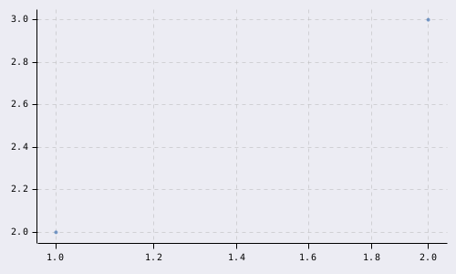

---
format:
  html:
    toc: true
    toc-location: right
    toc-depth: 4
    theme: cosmo
    include-in-header:
      text: |-
        <style>
        .data-table { width: fit-content; max-width: 100%; max-height: 15rem; overflow: auto; margin: 0 0 1rem 0; }
        .data-table .table-responsive { overflow: visible; }
        .data-table table { font-size: 0.75rem; width: auto; margin: 0; }
        .data-table th, .data-table td { padding: 0.1rem 0.45rem !important; white-space: nowrap; }
        .data-table thead th { position: sticky; top: 0; background: var(--bs-body-bg, #fff); }
        .options { margin: 0.5rem 0 1rem 0; }
        .options .option-card { margin: 0 0 0.9rem 0; border: 1px solid var(--bs-border-color, #dee2e6); border-radius: 0.375rem; overflow: hidden; }
        .options dt { display: flex; flex-wrap: wrap; align-items: baseline; gap: 0.1rem 1rem; margin: 0; padding: 0.4rem 0.75rem; background: #eef2f7; border-bottom: 1px solid var(--bs-border-color, #dee2e6); font-weight: normal; }
        .options dt > code { font-weight: 700; font-size: 1rem; background: none; padding: 0; }
        .options .option-default { font-size: 0.85rem; color: var(--bs-secondary-color, #6c757d); }
        .options dd { margin: 0; padding: 0.5rem 0.75rem; }
        .options .option-example { font-size: 0.85rem; padding: 0 0 0.45rem 0; margin-bottom: 0.45rem; border-bottom: 1px dashed var(--bs-border-color, #dee2e6); }
        .options .option-example code { background: none; padding: 0; }
        .options .option-text ul { margin: 0.3rem 0 0 0; padding-left: 1.25rem; }
        .options code, .mapping code { overflow-wrap: anywhere; }
        .mapping { margin: 0.5rem 0 1rem 0; padding: 0.5rem 0.75rem; border: 1px solid var(--bs-border-color, #dee2e6); border-left: 0.3rem solid #2780e3; border-radius: 0.375rem; background: #f5f8fc; }
        .mapping-title { font-weight: 700; margin-bottom: 0.25rem; }
        .mapping-hint { font-weight: normal; font-size: 0.85rem; color: var(--bs-secondary-color, #6c757d); }
        .mapping ul { margin: 0; padding-left: 1.25rem; }
        .mapping .required { font-size: 0.75rem; padding: 0 0.3rem; border: 1px solid currentColor; border-radius: 0.25rem; }
        .shared { margin: 0.5rem 0 1rem 0; padding: 0.5rem 0.75rem; border: 1px solid var(--bs-border-color, #dee2e6); border-left: 0.3rem solid #6c757d; border-radius: 0.375rem; background: #f6f6f6; }
        .shared-title { font-weight: 700; margin-bottom: 0.25rem; }
        .shared-hint { font-weight: normal; font-size: 0.85rem; color: var(--bs-secondary-color, #6c757d); }
        .shared ul { margin: 0; padding-left: 1.25rem; }
        .shared code { overflow-wrap: anywhere; }
        </style>
code-block-background: true

---
<style></style><style>.printedClojure .sourceCode {
  background-color: transparent;
  border-style: none;
}
</style><style>.clay-limit-image-width .clay-image {max-width: 100%}
.clay-side-by-side .sourceCode {margin: 0}
.clay-side-by-side {margin: 1em 0}
</style>
<script src="https://code.jquery.com/jquery-3.6.0.min.js" type="text/javascript"></script><script src="https://code.jquery.com/ui/1.13.1/jquery-ui.min.js" type="text/javascript"></script>

# Errors

Invalid input fails before anything is computed. `plot/build` (and `render`, `render-image`) validates in two
rounds, each throwing one `ex-info` listing all its errors:

1. the render options, the plot keys and the merged theme - and, when the plot keys hold, every chart's options
   and mapping (an invalid plot key hides the chart errors, as below);
2. when all of those hold, the rules across keys (e.g. `:flip` needs the generated grid, not `:arrange`).

Builders and data functions check their options before reading their data.


::: {.sourceClojure}
```clojure
(ns reference.errors
  (:require [cljplot2.chart :as chart]
            [cljplot2.core :as plot]))
```
:::


## Error data

`ex-data` of the error: `:key` - the first offending key, `:in` - its path, `:value` - the value, `:errors` -
every problem as `{:in path :value v :message text}`; the exception message lists the same problems as text. A
misspelled key gets a spelling suggestion.


::: {.sourceClojure}
```clojure
(def bad-plot
  {:data [{:x 1 :y 2} {:x 2 :y 3}]
   :mapping {:x :x :y :y}
   :charts [(chart/scatter {:szie 4})]
   :scales {:x {:kind :logarithmic}}})
```
:::


::: {.sourceClojure}
```clojure
(try (plot/build bad-plot)
     (catch clojure.lang.ExceptionInfo e {:message (ex-message e) :data (ex-data e)}))
```
:::


::: {.printedClojure}
```clojure
{:message
 "Invalid input: [:scales :x :kind] should be either :bands, :datetime, :interpolated, :linear, :log, :pow, :radial or :symlog, got :logarithmic",
 :data
 {:key :kind,
  :in [:scales :x :kind],
  :value :logarithmic,
  :errors
  [{:in [:scales :x :kind],
    :value :logarithmic,
    :message
    "should be either :bands, :datetime, :interpolated, :linear, :log, :pow, :radial or :symlog"}]}}

```
:::


With the scale fixed the plot keys hold, and the chart's misspelled option is reported:


::: {.sourceClojure}
```clojure
(try (plot/build (assoc-in bad-plot [:scales :x :kind] :log))
     (catch clojure.lang.ExceptionInfo e (ex-data e)))
```
:::


::: {.printedClojure}
```clojure
{:key :szie,
 :in [:charts 0 :options :szie],
 :value 4,
 :errors
 [{:in [:charts 0 :options :szie],
   :value 4,
   :message "unknown key, should be spelled :size"}]}

```
:::


Fixed:


::: {.sourceClojure}
```clojure
(plot/render-image (-> bad-plot
                       (assoc :charts [(chart/scatter {:size 4})])
                       (assoc-in [:scales :x :kind] :log))
                   {:width 500 :height 300})
```
:::


::: {.clay-image}

:::


## Builders and data functions

Options are checked against the builder's schema before its data is read:


::: {.sourceClojure}
```clojure
(try (plot/sankey [{:from "a" :to "b" :value 1}] {:node-widht 10})
     (catch clojure.lang.ExceptionInfo e (ex-data e)))
```
:::


::: {.printedClojure}
```clojure
{:key :node-widht,
 :in [:node-widht],
 :value 10,
 :errors
 [{:in [:node-widht],
   :value 10,
   :message "unknown key, should be spelled :node-width"}]}

```
:::


Checks of the data itself (missing columns, wrong shapes) throw the same kind of error, keyed by the option or
argument at fault.


## Finding the cause


* `:until` (render options) stops the build after a stage - the built plot is data to inspect.
* `:debug true` paints the layout boxes (Render chapter).


```{=html}
<div style="background-color:grey;height:2px;width:100%;"></div>
```


```{=html}
<div><pre><small><small>source: notebooks/reference/errors.clj</small></small></pre></div>
```