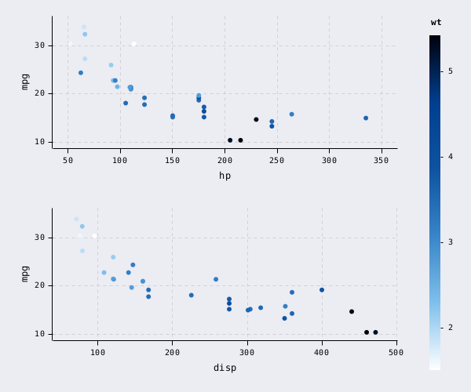
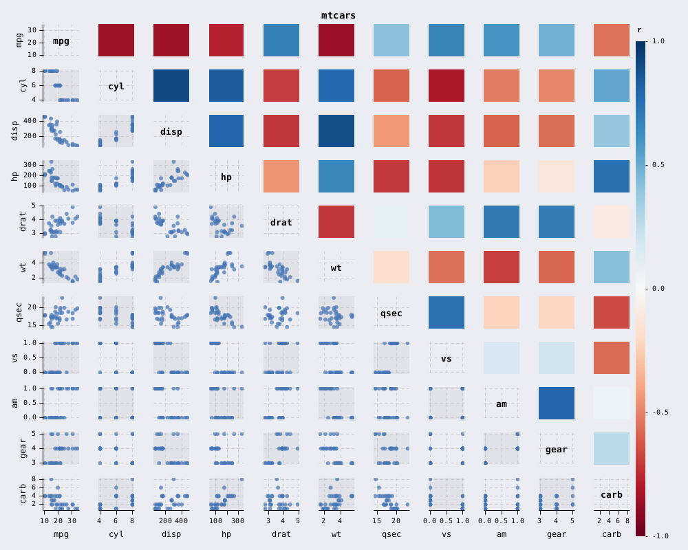
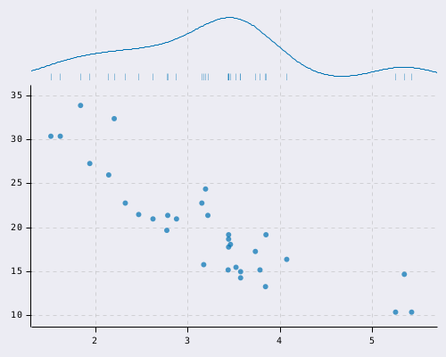
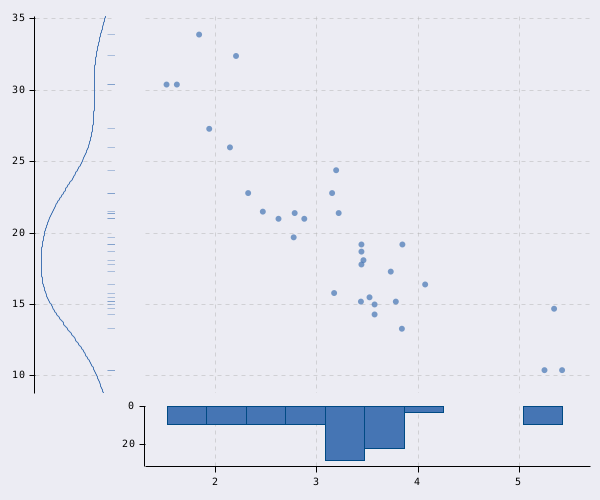
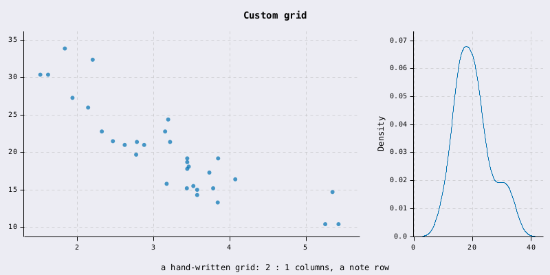

---
format:
  html:
    toc: true
    toc-location: right
    toc-depth: 4
    theme: cosmo
    include-in-header:
      text: |-
        <style>
        .data-table { width: fit-content; max-width: 100%; max-height: 15rem; overflow: auto; margin: 0 0 1rem 0; }
        .data-table .table-responsive { overflow: visible; }
        .data-table table { font-size: 0.75rem; width: auto; margin: 0; }
        .data-table th, .data-table td { padding: 0.1rem 0.45rem !important; white-space: nowrap; }
        .data-table thead th { position: sticky; top: 0; background: var(--bs-body-bg, #fff); }
        .options { margin: 0.5rem 0 1rem 0; }
        .options .option-card { margin: 0 0 0.9rem 0; border: 1px solid var(--bs-border-color, #dee2e6); border-radius: 0.375rem; overflow: hidden; }
        .options dt { display: flex; flex-wrap: wrap; align-items: baseline; gap: 0.1rem 1rem; margin: 0; padding: 0.4rem 0.75rem; background: #eef2f7; border-bottom: 1px solid var(--bs-border-color, #dee2e6); font-weight: normal; }
        .options dt > code { font-weight: 700; font-size: 1rem; background: none; padding: 0; }
        .options .option-default { font-size: 0.85rem; color: var(--bs-secondary-color, #6c757d); }
        .options dd { margin: 0; padding: 0.5rem 0.75rem; }
        .options .option-example { font-size: 0.85rem; padding: 0 0 0.45rem 0; margin-bottom: 0.45rem; border-bottom: 1px dashed var(--bs-border-color, #dee2e6); }
        .options .option-example code { background: none; padding: 0; }
        .options .option-text ul { margin: 0.3rem 0 0 0; padding-left: 1.25rem; }
        .options code, .mapping code { overflow-wrap: anywhere; }
        .options .option-default code, .options .option-example code { white-space: pre-wrap; }
        .mapping { margin: 0.5rem 0 1rem 0; padding: 0.5rem 0.75rem; border: 1px solid var(--bs-border-color, #dee2e6); border-left: 0.3rem solid #2780e3; border-radius: 0.375rem; background: #f5f8fc; }
        .mapping-title { font-weight: 700; margin-bottom: 0.25rem; }
        .mapping-hint { font-weight: normal; font-size: 0.85rem; color: var(--bs-secondary-color, #6c757d); }
        .mapping ul { margin: 0; padding-left: 1.25rem; }
        .mapping .required { font-size: 0.75rem; padding: 0 0.3rem; border: 1px solid currentColor; border-radius: 0.25rem; }
        .mapping-returns { margin-top: 0.25rem; }
        .mapping code { white-space: pre-wrap; }
        .shared { margin: 0.5rem 0 1rem 0; padding: 0.5rem 0.75rem; border: 1px solid var(--bs-border-color, #dee2e6); border-left: 0.3rem solid #6c757d; border-radius: 0.375rem; background: #f6f6f6; }
        .shared-title { font-weight: 700; margin-bottom: 0.25rem; }
        .shared-hint { font-weight: normal; font-size: 0.85rem; color: var(--bs-secondary-color, #6c757d); }
        .shared ul { margin: 0; padding-left: 1.25rem; }
        .shared code { overflow-wrap: anywhere; }
        p code, li code { white-space: pre-wrap; overflow-wrap: anywhere; }
        </style>
code-block-background: true

---
<style></style><style>.printedClojure .sourceCode {
  background-color: transparent;
  border-style: none;
}
</style><style>.clay-limit-image-width .clay-image {max-width: 100%}
.clay-side-by-side .sourceCode {margin: 0}
.clay-side-by-side {margin: 1em 0}
</style>
<script src="https://code.jquery.com/jquery-3.6.0.min.js" type="text/javascript"></script><script src="https://code.jquery.com/ui/1.13.1/jquery-ui.min.js" type="text/javascript"></script>

# Facets, multiplots and margins

One plot can split into panels by data (facets), several plots can share one image (`plot/arrange`,
`plot/pairs`, `:custom-grid`), and a panel can carry charts beside it (`:margins`).


::: {.sourceClojure}
```clojure
(ns reference.facets-arrange
  (:require [cljplot2.chart :as chart]
            [cljplot2.core :as plot]
            [cljplot2.data.facet :as facet]
            [cljplot2.describe :as describe]
            [cljplot2.layout.plot-grid :as plot-grid]
            [cljplot2.pipeline :as pipeline]
            [notebook-utils :as nu]))
```
:::


The table below holds the mtcars cars; every section draws them:

Data: Motor Trend car road tests (1974), R datasets package `mtcars` (Henderson & Velleman 1981); licence: Part of R (GPL-2 | GPL-3).


::: {.sourceClojure}
```clojure
(def mtcars (nu/dataset :mtcars))
```
:::


```{=html}
<div class="data-table"><table class="table table-hover table-responsive clay-table"><thead><tr><th>model</th><th>mpg</th><th>cyl</th><th>disp</th><th>hp</th><th>drat</th><th>wt</th><th>qsec</th><th>vs</th><th>am</th><th>gear</th><th>carb</th></tr></thead><tbody><tr><td>Mazda RX4</td><td>21</td><td>6</td><td>160</td><td>110</td><td>3.9</td><td>2.62</td><td>16.46</td><td>0</td><td>1</td><td>4</td><td>4</td></tr><tr><td>Mazda RX4 Wag</td><td>21</td><td>6</td><td>160</td><td>110</td><td>3.9</td><td>2.875</td><td>17.02</td><td>0</td><td>1</td><td>4</td><td>4</td></tr><tr><td>Datsun 710</td><td>22.8</td><td>4</td><td>108</td><td>93</td><td>3.85</td><td>2.32</td><td>18.61</td><td>1</td><td>1</td><td>4</td><td>1</td></tr><tr><td>Hornet 4 Drive</td><td>21.4</td><td>6</td><td>258</td><td>110</td><td>3.08</td><td>3.215</td><td>19.44</td><td>1</td><td>0</td><td>3</td><td>1</td></tr><tr><td>Hornet Sportabout</td><td>18.7</td><td>8</td><td>360</td><td>175</td><td>3.15</td><td>3.44</td><td>17.02</td><td>0</td><td>0</td><td>3</td><td>2</td></tr><tr><td>Valiant</td><td>18.1</td><td>6</td><td>225</td><td>105</td><td>2.76</td><td>3.46</td><td>20.22</td><td>1</td><td>0</td><td>3</td><td>1</td></tr><tr><td>Duster 360</td><td>14.3</td><td>8</td><td>360</td><td>245</td><td>3.21</td><td>3.57</td><td>15.84</td><td>0</td><td>0</td><td>3</td><td>4</td></tr><tr><td>Merc 240D</td><td>24.4</td><td>4</td><td>146.7</td><td>62</td><td>3.69</td><td>3.19</td><td>20</td><td>1</td><td>0</td><td>4</td><td>2</td></tr><tr><td>Merc 230</td><td>22.8</td><td>4</td><td>140.8</td><td>95</td><td>3.92</td><td>3.15</td><td>22.9</td><td>1</td><td>0</td><td>4</td><td>2</td></tr><tr><td>Merc 280</td><td>19.2</td><td>6</td><td>167.6</td><td>123</td><td>3.92</td><td>3.44</td><td>18.3</td><td>1</td><td>0</td><td>4</td><td>4</td></tr><tr><td>Merc 280C</td><td>17.8</td><td>6</td><td>167.6</td><td>123</td><td>3.92</td><td>3.44</td><td>18.9</td><td>1</td><td>0</td><td>4</td><td>4</td></tr><tr><td>Merc 450SE</td><td>16.4</td><td>8</td><td>275.8</td><td>180</td><td>3.07</td><td>4.07</td><td>17.4</td><td>0</td><td>0</td><td>3</td><td>3</td></tr><tr><td>Merc 450SL</td><td>17.3</td><td>8</td><td>275.8</td><td>180</td><td>3.07</td><td>3.73</td><td>17.6</td><td>0</td><td>0</td><td>3</td><td>3</td></tr><tr><td>Merc 450SLC</td><td>15.2</td><td>8</td><td>275.8</td><td>180</td><td>3.07</td><td>3.78</td><td>18</td><td>0</td><td>0</td><td>3</td><td>3</td></tr><tr><td>Cadillac Fleetwood</td><td>10.4</td><td>8</td><td>472</td><td>205</td><td>2.93</td><td>5.25</td><td>17.98</td><td>0</td><td>0</td><td>3</td><td>4</td></tr><tr><td>Lincoln Continental</td><td>10.4</td><td>8</td><td>460</td><td>215</td><td>3</td><td>5.424</td><td>17.82</td><td>0</td><td>0</td><td>3</td><td>4</td></tr><tr><td>Chrysler Imperial</td><td>14.7</td><td>8</td><td>440</td><td>230</td><td>3.23</td><td>5.345</td><td>17.42</td><td>0</td><td>0</td><td>3</td><td>4</td></tr><tr><td>Fiat 128</td><td>32.4</td><td>4</td><td>78.7</td><td>66</td><td>4.08</td><td>2.2</td><td>19.47</td><td>1</td><td>1</td><td>4</td><td>1</td></tr><tr><td>Honda Civic</td><td>30.4</td><td>4</td><td>75.7</td><td>52</td><td>4.93</td><td>1.615</td><td>18.52</td><td>1</td><td>1</td><td>4</td><td>2</td></tr><tr><td>Toyota Corolla</td><td>33.9</td><td>4</td><td>71.1</td><td>65</td><td>4.22</td><td>1.835</td><td>19.9</td><td>1</td><td>1</td><td>4</td><td>1</td></tr><tr><td>Toyota Corona</td><td>21.5</td><td>4</td><td>120.1</td><td>97</td><td>3.7</td><td>2.465</td><td>20.01</td><td>1</td><td>0</td><td>3</td><td>1</td></tr><tr><td>Dodge Challenger</td><td>15.5</td><td>8</td><td>318</td><td>150</td><td>2.76</td><td>3.52</td><td>16.87</td><td>0</td><td>0</td><td>3</td><td>2</td></tr><tr><td>AMC Javelin</td><td>15.2</td><td>8</td><td>304</td><td>150</td><td>3.15</td><td>3.435</td><td>17.3</td><td>0</td><td>0</td><td>3</td><td>2</td></tr><tr><td>Camaro Z28</td><td>13.3</td><td>8</td><td>350</td><td>245</td><td>3.73</td><td>3.84</td><td>15.41</td><td>0</td><td>0</td><td>3</td><td>4</td></tr><tr><td>Pontiac Firebird</td><td>19.2</td><td>8</td><td>400</td><td>175</td><td>3.08</td><td>3.845</td><td>17.05</td><td>0</td><td>0</td><td>3</td><td>2</td></tr><tr><td>Fiat X1-9</td><td>27.3</td><td>4</td><td>79</td><td>66</td><td>4.08</td><td>1.935</td><td>18.9</td><td>1</td><td>1</td><td>4</td><td>1</td></tr><tr><td>Porsche 914-2</td><td>26</td><td>4</td><td>120.3</td><td>91</td><td>4.43</td><td>2.14</td><td>16.7</td><td>0</td><td>1</td><td>5</td><td>2</td></tr><tr><td>Lotus Europa</td><td>30.4</td><td>4</td><td>95.1</td><td>113</td><td>3.77</td><td>1.513</td><td>16.9</td><td>1</td><td>1</td><td>5</td><td>2</td></tr><tr><td>Ford Pantera L</td><td>15.8</td><td>8</td><td>351</td><td>264</td><td>4.22</td><td>3.17</td><td>14.5</td><td>0</td><td>1</td><td>5</td><td>4</td></tr><tr><td>Ferrari Dino</td><td>19.7</td><td>6</td><td>145</td><td>175</td><td>3.62</td><td>2.77</td><td>15.5</td><td>0</td><td>1</td><td>5</td><td>6</td></tr><tr><td>Maserati Bora</td><td>15</td><td>8</td><td>301</td><td>335</td><td>3.54</td><td>3.57</td><td>14.6</td><td>0</td><td>1</td><td>5</td><td>8</td></tr><tr><td>Volvo 142E</td><td>21.4</td><td>4</td><td>121</td><td>109</td><td>4.11</td><td>2.78</td><td>18.6</td><td>1</td><td>1</td><td>4</td><td>2</td></tr></tbody></table></div>
```


## Facet shape

Mapping `:facet` wraps one panel per level into rows and columns; `:facet-col` and `:facet-row` make a grid of
them. These keys of the plot's `:facets` map shape the wrap and weight the panel columns and rows. The plot below
wraps the carburettor counts into four columns, filled from the bottom:


```{=html}
<dl class="options"><div class="option-card"><dt><code>:columns</code><span class="option-default">Default: The most square shape, from <code>:rows</code> when given.</span></dt><dd><div class="option-example"><code>{:facets {:columns 1}}</code></div><div class="option-text">The number of columns of a wrap layout.<ul><li><a href="reference.types.html#positive-integer">positive integer</a></li></ul></div></dd></div><div class="option-card"><dt><code>:rows</code><span class="option-default">Default: The most square shape, from <code>:columns</code> when given.</span></dt><dd><div class="option-example"><code>{:facets {:rows 3}}</code></div><div class="option-text">The number of rows of a wrap layout.<ul><li><a href="reference.types.html#positive-integer">positive integer</a></li></ul></div></dd></div><div class="option-card"><dt><code>:order</code><span class="option-default">Default: <code>:top-down</code></span></dt><dd><div class="option-example"><code>{:facets {:columns 2, :order :bottom-up}}</code></div><div class="option-text">The order in which a wrap layout fills its panels.<ul><li><code>:top-down</code> – The first level at the top left.</li><li><code>:bottom-up</code> – The first level at the bottom left, as lattice does.</li></ul></div></dd></div><div class="option-card"><dt><code>:widths</code><span class="option-default">Default: Equal.</span></dt><dd><div class="option-example"><code>{:facets {:widths [1 2 1]}}</code></div><div class="option-text">The relative widths of the panel columns, one per column.<ul><li><span>sequence of positive numbers</span></li></ul></div></dd></div><div class="option-card"><dt><code>:heights</code><span class="option-default">Default: Equal.</span></dt><dd><div class="option-example"><code>{:facets {:columns 1, :heights [1 2 1]}}</code></div><div class="option-text">The relative heights of the panel rows, one per row.<ul><li><span>sequence of positive numbers</span></li></ul></div></dd></div></dl>
```


::: {.sourceClojure}
```clojure
(plot/render-image {:data mtcars
                    :mapping {:x :wt :y :mpg :facet :carb}
                    :charts [(chart/scatter)]
                    :facets {:columns 4 :order :bottom-up}}
                   {:width 800 :height 400})
```
:::


::: {.clay-image}

:::


## Facet panels

These keys decide how the panels share their scales, what happens to `nil` facet values and whether the panels draw
strips. The plot below frees the x scales of a grid (per column) and widens its last column with the shape key
`:widths`:


```{=html}
<dl class="options"><div class="option-card"><dt><code>:na-panel</code><span class="option-default">Default: <code>true</code></span></dt><dd><div class="option-example"><code>{:facets {:na-panel false}}</code></div><div class="option-text">Whether <code>nil</code> facet values get a panel of their own, the last.<ul><li><code>true</code> – An NA panel.</li><li><code>false</code> – Those rows are dropped.</li></ul></div></dd></div><div class="option-card"><dt><code>:scales</code></dt><dd><div class="option-text">How the panels share their position scales, per axis.</div></dd></div><div class="option-card"><dt><code>:scales :x</code><span class="option-default">Default: <code>:same</code></span></dt><dd><div class="option-example"><code>{:facets {:scales {:x :free}}}</code></div><div class="option-text">How the panels share the x scale.<ul><li><code>:same</code> – One domain for every panel.</li><li><code>:free</code> – Each panel's own data domain; in a facet grid each column's (x) or row's (y).</li><li><code>:sliced</code> – Each panel's own centre with the span of the widest panel; in a facet grid per column (x) or row (y).</li></ul></div></dd></div><div class="option-card"><dt><code>:scales :y</code><span class="option-default">Default: <code>:same</code></span></dt><dd><div class="option-example"><code>{:facets {:scales {:y :free}}}</code></div><div class="option-text">How the panels share the y scale.<ul><li><code>:same</code> – One domain for every panel.</li><li><code>:free</code> – Each panel's own data domain; in a facet grid each column's (x) or row's (y).</li><li><code>:sliced</code> – Each panel's own centre with the span of the widest panel; in a facet grid per column (x) or row (y).</li></ul></div></dd></div><div class="option-card"><dt><code>:strips</code><span class="option-default">Default: <code>true</code></span></dt><dd><div class="option-example"><code>{:facets {:strips false}}</code></div><div class="option-text">Whether the panels draw their facet strips.<ul><li><code>true</code> – Strips drawn.</li><li><code>false</code> – No strips.</li></ul></div></dd></div></dl>
```


::: {.sourceClojure}
```clojure
(plot/render-image {:data mtcars
                    :mapping {:x :wt :y :mpg :facet-col :cyl :facet-row :am}
                    :charts [(chart/scatter)]
                    :facets {:scales {:x :free} :widths [1 1 2]}}
                   {:width 800 :height 450})
```
:::


::: {.clay-image}

:::


In the plot below `:sliced` y scales give the panels y ranges of one size at different heights:


::: {.sourceClojure}
```clojure
(plot/render-image {:data mtcars
                    :mapping {:x :wt :y :mpg :facet :cyl}
                    :charts [(chart/scatter)]
                    :facets {:scales {:y :sliced} :columns 3}}
                   {:width 800 :height 300})
```
:::


::: {.clay-image}

:::


## Facet levels

The facet levels have scales: `:scales {:facet spec}` (and `:facet-col`, `:facet-row`) order the panels and write
the strip texts. The plot below orders the gears from five down and names them:


```{=html}
<dl class="options"><div class="option-card"><dt><code>:domain</code><span class="option-default">Default: The data's levels, sorted, the NA level last.</span></dt><dd><div class="option-example"><code>{:scales {:facet {:domain [2 1]}}}</code></div><div class="option-text">The facet levels in panel order; rows of other levels are dropped, but <code>nil</code> ones keep the NA panel unless <code>:na-panel</code> is false.<ul><li><span>sequence of any values</span></li></ul></div></dd></div><div class="option-card"><dt><code>:formatter</code><span class="option-default">Default: The level as text.</span></dt><dd><div class="option-example"><code>{:scales {:facet {:formatter (fn [level] (str "walk " level))}}}</code></div><div class="option-text">A function of a level that returns its strip text; the NA level stays <code>NA</code>.<ul><li><a href="reference.types.html#function">function</a></li></ul></div></dd></div><div class="option-card"><dt><code>:order-by</code><span class="option-default">Default: The <code>:domain</code> order, else the levels sorted.</span></dt><dd><div class="option-example"><code>{:scales {:facet {:order-by (fn [rows] (- (reduce + (map :v rows))))}}}</code></div><div class="option-text">Orders the levels by a function of each level's rows, smallest first; it can't be combined with <code>:domain</code>.<ul><li><a href="reference.types.html#function">function</a></li></ul></div></dd></div><div class="option-card"><dt><code>:descending</code><span class="option-default">Default: <code>false</code></span></dt><dd><div class="option-example"><code>{:scales {:facet {:order-by (fn [rows] (reduce + (map :v rows))), :descending true}}}</code></div><div class="option-text">Whether <code>:order-by</code> puts the largest result first.<ul><li><code>false</code> – Smallest first.</li><li><code>true</code> – Largest first.</li></ul></div></dd></div></dl>
```


::: {.sourceClojure}
```clojure
(plot/render-image {:data mtcars
                    :mapping {:x :wt :y :mpg :facet :gear}
                    :charts [(chart/scatter)]
                    :scales {:facet {:domain [5 4 3] :formatter #(str % " gears")}}}
                   {:width 800 :height 300})
```
:::


::: {.clay-image}

:::


## Arrange

`plot/arrange` puts plots in a grid; use it to show several plots in one image, their panels aligned across rows
and columns.


```{=html}
<div class="shared"><div class="shared-title">Shared options<span class="shared-hint"> – groups of options other charts take too</span></div><ul><li><a href="reference.shared_options.html#multiplot-layout">Multiplot layout</a> – <code>:columns</code> <code>:rows</code> <code>:widths</code> <code>:heights</code> <code>:row-spans</code> <code>:align</code> <code>:equal-panels</code></li><li><a href="reference.shared_options.html#builder-options">Builder options</a> – <code>:title</code> <code>:theme</code></li></ul></div>
```


```{=html}
<div class="mapping"><div class="mapping-title">Arguments<span class="mapping-hint"> – what the call takes before its options map</span></div><ul><li><code>plots</code> – The plot maps of the cells, filled row by row.</li></ul><div class="mapping-returns"><strong>Returns</strong> – A plot map whose <code>:arrange</code> key holds the plots and the layout.</div></div>
```


The cards below show these groups as `plot/arrange` options:


```{=html}
<dl class="options"><div class="option-card"><dt><code>:columns</code><span class="option-default">Default: One column, or as many as <code>:rows</code> needs.</span></dt><dd><div class="option-example"><code>(plot/arrange plots {:columns 2})</code></div><div class="option-text">The number of grid columns.<ul><li><a href="reference.types.html#positive-integer">positive integer</a></li></ul></div></dd></div><div class="option-card"><dt><code>:rows</code><span class="option-default">Default: As many as the plots need in <code>:columns</code>.</span></dt><dd><div class="option-example"><code>(plot/arrange plots {:rows 1})</code></div><div class="option-text">The number of grid rows.<ul><li><a href="reference.types.html#positive-integer">positive integer</a></li></ul></div></dd></div><div class="option-card"><dt><code>:widths</code><span class="option-default">Default: Equal widths.</span></dt><dd><div class="option-example"><code>(plot/arrange plots {:columns 2, :widths [3 2]})</code></div><div class="option-text">The columns' relative widths, one per column.<ul><li><span>sequence of (positive number or :measured or [:fixed, non-negative number])</span> – Per column a weight, <code>:measured</code> - the width of its legend-only plots - or <code>[:fixed px]</code>, a width in pixels.</li></ul></div></dd></div><div class="option-card"><dt><code>:heights</code><span class="option-default">Default: Equal heights.</span></dt><dd><div class="option-example"><code>(plot/arrange plots {:heights [3 1]})</code></div><div class="option-text">The rows' relative heights, one per row.<ul><li><span>sequence of (positive number or :measured or [:fixed, non-negative number])</span> – Per row a weight, <code>:measured</code> - the height of its legend-only plots, scaled down to fit - or <code>[:fixed px]</code>, a height in pixels.</li></ul></div></dd></div><div class="option-card"><dt><code>:row-spans</code><span class="option-default">Default: Every plot spans one row.</span></dt><dd><div class="option-example"><code>(plot/arrange plots {:columns 2, :row-spans {0 2}})</code></div><div class="option-text">A map from a plot's index (not its cell's) to the number of rows the plot spans from its own row down; later plots skip the covered cells.<ul><li><span>map of integer at least 0 to positive integer</span></li></ul></div></dd></div><div class="option-card"><dt><code>:align</code><span class="option-default">Default: <code>true</code></span></dt><dd><div class="option-example"><code>(plot/arrange plots {:align false})</code></div><div class="option-text">Whether the sub-plots' panels line up in rows and columns.<ul><li><code>true</code> – Panels line up.</li><li><code>false</code> – Each sub-plot fills its cell on its own.</li></ul></div></dd></div><div class="option-card"><dt><code>:equal-panels</code><span class="option-default">Default: <code>false</code></span></dt><dd><div class="option-example"><code>(plot/arrange plots {:columns 2, :equal-panels true})</code></div><div class="option-text">Whether every aligned panel gets the same size and the gaps between panels are even; the plot builds twice.<ul><li><code>false</code> – Panels as the tracks fall.</li><li><code>true</code> – Equal panels and gaps.</li></ul></div></dd></div><div class="option-card"><dt><code>:title</code><span class="option-default">Default: No title.</span></dt><dd><div class="option-example"><code>(plot/arrange plots {:title "Friends"})</code></div><div class="option-text">The plot's title: a text or a label map.<ul><li><span>any value</span></li></ul></div></dd></div><div class="option-card"><dt><code>:theme</code><span class="option-default">Default: The default theme.</span></dt><dd><div class="option-example"><code>(plot/arrange plots {:theme {:chart {:network-node {:color :black}}}})</code></div><div class="option-text">A theme merged over the builder's own theme settings and the default theme for the built plot.<ul><li><span>any value</span></li></ul></div></dd></div></dl>
```


The plot below puts three plots in a row weighted 2 : 1 : 1, under a title:


::: {.sourceClojure}
```clojure
(plot/render-image (plot/arrange [{:data mtcars :mapping {:x :hp :y :mpg} :charts [(chart/scatter)]}
                                  {:data mtcars :mapping {:x :mpg} :charts [(chart/histogram {:bins 10})]}
                                  {:data mtcars :mapping {:x #(str (:cyl %) " cyl") :y :mpg} :charts [(chart/box)]}]
                                 {:columns 3 :widths [2 1 1] :title "mtcars"})
                   {:width 900 :height 350})
```
:::


::: {.clay-image}

:::


`plot/build` throws an error when a cell is too small for its sub-plot's axes, labels, legends and margins. The error
names the cell (`[:plot i]`, row by row; a nested cell by its whole path, outer cells first), its title (else its
mapped `:x` / `:y`), its size and the pixels it needs, under `:width` or `:height`. Below, eight plots stand side by
side in 400 pixels:


::: {.sourceClojure}
```clojure
(try (plot/build (plot/arrange (repeat 8 {:data mtcars :mapping {:x :hp :y :mpg} :charts [(chart/scatter)]})
                               {:columns 8})
                 {:width 400 :height 200})
     (catch clojure.lang.ExceptionInfo e
       {:message (ex-message e) :data (ex-data e)}))
```
:::


::: {.printedClojure}
```clojure
{:message
 "Sub-plot [:plot 0] (x :hp, y :mpg) is 39x180 px; its axes, labels, legends and margins need 79 px of width. Enlarge the image or the cell, or shrink the sub-plot's fixed parts.",
 :data
 {:key :width,
  :axis :columns,
  :available 39,
  :cause :track-space,
  :required 79,
  :errors
  [{:in nil,
    :message
    "Not enough space: the plot's fixed parts (axes, labels, legends, strips, margins, gaps) need 79 px of width, 39 px given."}],
  :subplot [:plot 0],
  :subplot-path [[:plot 0]]}}

```
:::


`plot/arrange` returns a plot whose `:arrange` map holds the plots and the options above. You can also write that
map by hand, with its plots under `:plots`:


```{=html}
<dl class="options"><div class="option-card"><dt><code>:plots</code></dt><dd><div class="option-text">The sub-plots, filling the grid row by row; <code>plot/arrange</code> takes them as its first argument.<ul><li><span>sequence of maps</span></li></ul></div></dd></div></dl>
```


The plot below shows a legend once, in its own cell: the two plots hide their legends (`:legend false`), and a
third plot draws only its legend (`:legend-only true` - no panel or axes) in a column sized to fit (`:measured`):


::: {.sourceClojure}
```clojure
(plot/render-image {:arrange {:plots [{:data mtcars :mapping {:x :hp :y :mpg :color :gear} :charts [(chart/scatter)]
                                       :scales {:color {:type :categorical}} :legend false}
                                      {:data mtcars :mapping {:x :wt :y :mpg :color :gear} :charts [(chart/scatter)]
                                       :scales {:color {:type :categorical}} :legend false}
                                      {:data mtcars :mapping {:x :wt :y :mpg :color :gear} :charts [(chart/scatter)]
                                       :scales {:color {:type :categorical}} :legend-only true}]
                              :columns 3 :widths [1 1 :measured]}}
                   {:width 900 :height 320})
```
:::


::: {.clay-image}

:::


Without `:rows`, a `:row-spans` span that reaches past the last row adds rows. The plot below puts one legend beside
two rows of plots and stretches its colour bar over both:


::: {.sourceClojure}
```clojure
(plot/render-image (plot/arrange [{:data mtcars :mapping {:x :hp :y :mpg :color :wt} :charts [(chart/scatter)] :legend false}
                                  {:data mtcars :mapping {:x :hp :y :mpg :color :wt} :charts [(chart/scatter)] :legend-only true}
                                  {:data mtcars :mapping {:x :disp :y :mpg :color :wt} :charts [(chart/scatter)] :legend false}]
                                 {:columns 2 :widths [1 :measured] :row-spans {1 2}})
                   {:width 600 :height 500})
```
:::


::: {.clay-image}

:::


## Scatter-plot matrix

`plot/pairs` draws a cell for every pair of its variables (2 to 20 numeric columns); use it to see how several
variables relate at once. By default a scatter plot fills the cells below the diagonal, the correlation as a number
those above, and a density the diagonal.


```{=html}
<div class="shared"><div class="shared-title">Shared options<span class="shared-hint"> – groups of options other charts take too</span></div><ul><li><a href="reference.shared_options.html#builder-options">Builder options</a> – <code>:title</code></li></ul></div>
```


```{=html}
<div class="mapping"><div class="mapping-title">Arguments<span class="mapping-hint"> – what the call takes before its options map</span></div><ul><li><code>rows</code> – The data: rows or columns.<div>Columns:<ul><li><em>a variable column</em> – Numbers of a variable named in <code>:variables</code> (or <code>:row-variables</code>, <code>:column-variables</code>); a row without a number there is left out of that variable's cells.</li></ul></div></li></ul><div class="mapping-returns"><strong>Returns</strong> – A plot map arranging a cell plot per pair of variables, with one legend.</div></div>
```


These options choose the variables:


```{=html}
<dl class="options"><div class="option-card"><dt><code>:variables</code><span class="option-default">Default: None: required unless <code>:row-variables</code> and <code>:column-variables</code> are given.</span></dt><dd><div class="option-example"><code>(plot/pairs rows {:variables [:a :c]})</code></div><div class="option-text">The numeric columns, in matrix order on the rows and the columns.<ul><li><span>sequence of keywords</span></li></ul></div></dd></div><div class="option-card"><dt><code>:row-variables</code><span class="option-default">Default: <code>:variables</code>.</span></dt><dd><div class="option-example"><code>(plot/pairs rows {:column-variables [:a :b], :row-variables [:c :a]})</code></div><div class="option-text">The numeric columns of the matrix rows, top to bottom (on y).<ul><li><span>sequence of keywords</span></li></ul></div></dd></div><div class="option-card"><dt><code>:column-variables</code><span class="option-default">Default: <code>:variables</code>.</span></dt><dd><div class="option-example"><code>(plot/pairs rows {:row-variables [:a :b], :column-variables [:c :a]})</code></div><div class="option-text">The numeric columns of the matrix columns, left to right (on x).<ul><li><span>sequence of keywords</span></li></ul></div></dd></div><div class="option-card"><dt><code>:mapping</code><span class="option-default">Default: None.</span></dt><dd><div class="option-example"><code>(plot/pairs rows {:variables [:a :b :c], :mapping {:color :g}})</code></div><div class="option-text">A mapping added to every cell, for grouping aesthetics such as <code>:color</code> or <code>:group</code>.<ul><li><span>mapping</span></li></ul></div></dd></div><div class="option-card"><dt><code>:variable-names</code><span class="option-default">Default: The variable's name.</span></dt><dd><div class="option-example"><code>(plot/pairs rows {:variables [:a :b :c], :diagonal :names, :variable-names {:a "alpha"}})</code></div><div class="option-text">The names shown for the variables, <code>{variable text}</code>.<ul><li><span>map of keyword to string or formula value</span></li></ul></div></dd></div></dl>
```


The plot below draws four variables; its `:upper` spells out the default, a correlation chart:


::: {.sourceClojure}
```clojure
(plot/render-image (plot/pairs mtcars {:variables [:mpg :hp :wt :qsec]
                                       :upper [(chart/correlation)]})
                   {:width 700 :height 700})
```
:::


::: {.clay-image}

:::


`:row-variables` and `:column-variables` (each defaulting to `:variables`) put other variables, or another order,
on the rows than on the columns - here 3 rows x 2 columns. Such a matrix has no triangles: every cell of two
different variables draws `:lower`, a cell whose row and column variable are the same draws `:diagonal`
(wherever it is), and `:upper` is an error.


::: {.sourceClojure}
```clojure
(plot/render-image (plot/pairs mtcars {:row-variables [:hp :wt :mpg]
                                       :column-variables [:mpg :disp]
                                       :lower [(chart/scatter) (chart/smooth {:method :lm})]
                                       :mapping {:color #(str (:cyl %) " cyl")}})
                   {:width 600 :height 700})
```
:::


::: {.clay-image}

:::


These options set what the cells draw. The plot below draws faded points below the diagonal, shaded correlations
above it and the names on it:


```{=html}
<dl class="options"><div class="option-card"><dt><code>:lower</code><span class="option-default">Default: <code>(chart/scatter)</code>.</span></dt><dd><div class="option-example"><code>(plot/pairs rows {:variables [:a :b :c], :lower (chart/line)})</code></div><div class="option-text">The charts below the diagonal of a square matrix; in a matrix that isn't square, every cell of two different variables.<ul><li><code>:none</code> – Empty cells.</li><li><span>chart</span> – One chart in every such cell, e.g. <code>(chart/scatter)</code>.</li><li><span>sequence of charts</span> – Charts layered in every such cell.</li></ul></div></dd></div><div class="option-card"><dt><code>:upper</code><span class="option-default">Default: <code>(chart/correlation {:glyph :number})</code>.</span></dt><dd><div class="option-example"><code>(plot/pairs rows {:variables [:a :b :c], :upper :none})</code></div><div class="option-text">The charts above the diagonal, in a square matrix only.<ul><li><code>:none</code> – Empty cells.</li><li><span>chart</span> – One chart in every such cell, e.g. <code>(chart/scatter)</code>.</li><li><span>sequence of charts</span> – Charts layered in every such cell.</li></ul></div></dd></div><div class="option-card"><dt><code>:diagonal</code><span class="option-default">Default: <code>(chart/density)</code>.</span></dt><dd><div class="option-example"><code>(plot/pairs rows {:variables [:a :b :c], :diagonal :names})</code></div><div class="option-text">The charts of the diagonal cells, whose row and column variable are the same; each cell has its own magnitude scale.<ul><li><code>:names</code> – The variable's name, in the text role <code>:pairs-name</code>.</li><li><code>:none</code> – Empty cells.</li><li><span>chart</span> – One chart in every such cell, e.g. <code>(chart/scatter)</code>.</li><li><span>sequence of charts</span> – Charts layered in every such cell.</li></ul></div></dd></div><div class="option-card"><dt><code>:scales</code></dt><dd><div class="option-text">The colour scale of every cell that colours, with one colour bar.</div></dd></div><div class="option-card"><dt><code>:scales :color</code><span class="option-default">Default: The computed range of the coloured statistic.</span></dt><dd><div class="option-example"><code>(plot/pairs rows {:variables [:a :b :c], :upper (chart/correlation {:glyph :shade}), :scales {:color {:range [:white :darkred]}}})</code></div><div class="option-text">The colour scale spec; its <code>:domain</code> or a binned scale's <code>:bins</code> breaks vector wins over the matrix's computed domain.<ul><li><span>aesthetic scale spec</span></li></ul></div></dd></div></dl>
```


::: {.sourceClojure}
```clojure
(plot/render-image (plot/pairs mtcars {:variables [:mpg :hp :wt]
                                       :lower (chart/scatter {:alpha 0.6})
                                       :upper (chart/correlation {:glyph :shade})
                                       :diagonal :names
                                       :scales {:color {:domain [-1 1]}}})
                   {:width 500 :height 450})
```
:::


::: {.clay-image}

:::


The plot below layers points and a linear fit below the diagonal and leaves the cells above it empty:


::: {.sourceClojure}
```clojure
(plot/render-image (plot/pairs mtcars {:variables [:mpg :hp :wt]
                                       :lower [(chart/scatter {:size 4}) (chart/smooth {:method :lm})]
                                       :upper :none
                                       :title "a scatter and a linear fit below, nothing above"})
                   {:width 600 :height 560})
```
:::


::: {.clay-image}

:::


These options set the matrix's legend column and theme; the title is a builder option:


```{=html}
<dl class="options"><div class="option-card"><dt><code>:legend-span</code><span class="option-default">Default: <code>:row</code></span></dt><dd><div class="option-example"><code>(plot/pairs rows {:variables [:a :b :c], :upper (chart/correlation {:glyph :shade}), :legend-span :matrix})</code></div><div class="option-text">The height of the legend column.<ul><li><code>:row</code> – Beside the first row, one row high.</li><li><code>:matrix</code> – Beside the whole matrix, for a legend taller than a row.</li></ul></div></dd></div><div class="option-card"><dt><code>:theme</code><span class="option-default">Default: The default theme.</span></dt><dd><div class="option-example"><code>(plot/pairs rows {:variables [:a :b :c], :theme {:plot {:background :white}}})</code></div><div class="option-text">The theme of every cell and of the matrix; a <code>[:plot :margin]</code> or <code>[:multiplot :gap]</code> you give replaces the matrix's own tight spacing.<ul><li><span>any value</span></li></ul></div></dd></div><div class="option-card"><dt><code>:title</code><span class="option-default">Default: No title.</span></dt><dd><div class="option-example"><code>(plot/pairs rows {:variables [:a :b :c], :title "Friends"})</code></div><div class="option-text">The plot's title: a text or a label map.<ul><li><span>any value</span></li></ul></div></dd></div></dl>
```


Only the outer cells have axes (x under the bottom row, y left of the left column), and every panel gets one size
(the room between rows follows each row's end tick labels), so a matrix of many variables fits a page - up to 20,
though at that count tick labels get dense: give such a matrix a large image. Its rows are low, so a legend taller
than a row goes beside the whole matrix with `:legend-span :matrix` (the default `:row` keeps it beside the first
row) - here every numeric column of mtcars, with the r colour bar of the shaded correlations as tall as the matrix.


::: {.sourceClojure}
```clojure
(plot/render-image (plot/pairs mtcars {:variables [:mpg :cyl :disp :hp :drat :wt :qsec :vs :am :gear :carb]
                                       :upper (chart/correlation {:glyph :shade})
                                       :diagonal :names
                                       :legend-span :matrix
                                       :title "mtcars"})
                   {:width 1000 :height 800})
```
:::


::: {.clay-image}

:::


## Margins

The plot's `:margins` key puts charts beside a panel, sharing its horizontal or vertical scale; margin charts read
the plot's data with `:x` mapped to the shared dimension. These keys name the sides. The plot below draws a
density and a rug above the panel:


```{=html}
<dl class="options"><div class="option-card"><dt><code>:top</code><span class="option-default">Default: None.</span></dt><dd><div class="option-example"><code>{:margins {:top (chart/density)}}</code></div><div class="option-text">Charts above the panel, sharing its horizontal scale.<ul><li><span>chart</span> – One chart, e.g. <code>(chart/density)</code>.</li><li><span>vector of charts</span> – Charts layered in the margin.</li><li><span>margin spec</span> – The charts with the margin's thickness and axis: <code>{:charts c :size px :axis bool}</code>.</li></ul></div></dd></div><div class="option-card"><dt><code>:right</code><span class="option-default">Default: None.</span></dt><dd><div class="option-example"><code>{:margins {:right (chart/density)}}</code></div><div class="option-text">Charts right of the panel, sharing its vertical scale.<ul><li><span>chart</span> – One chart, e.g. <code>(chart/density)</code>.</li><li><span>vector of charts</span> – Charts layered in the margin.</li><li><span>margin spec</span> – The charts with the margin's thickness and axis: <code>{:charts c :size px :axis bool}</code>.</li></ul></div></dd></div><div class="option-card"><dt><code>:bottom</code><span class="option-default">Default: None.</span></dt><dd><div class="option-example"><code>{:margins {:bottom (chart/density)}}</code></div><div class="option-text">Charts below the panel, above its horizontal axis, sharing its horizontal scale.<ul><li><span>chart</span> – One chart, e.g. <code>(chart/density)</code>.</li><li><span>vector of charts</span> – Charts layered in the margin.</li><li><span>margin spec</span> – The charts with the margin's thickness and axis: <code>{:charts c :size px :axis bool}</code>.</li></ul></div></dd></div><div class="option-card"><dt><code>:left</code><span class="option-default">Default: None.</span></dt><dd><div class="option-example"><code>{:margins {:left (chart/density)}}</code></div><div class="option-text">Charts left of the panel, right of its vertical axis, sharing its vertical scale.<ul><li><span>chart</span> – One chart, e.g. <code>(chart/density)</code>.</li><li><span>vector of charts</span> – Charts layered in the margin.</li><li><span>margin spec</span> – The charts with the margin's thickness and axis: <code>{:charts c :size px :axis bool}</code>.</li></ul></div></dd></div></dl>
```


::: {.sourceClojure}
```clojure
(plot/render-image {:data mtcars
                    :mapping {:x :wt :y :mpg}
                    :charts [(chart/scatter)]
                    :margins {:top [(chart/density) (chart/rug)]}}
                   {:width 500 :height 400})
```
:::


::: {.clay-image}

:::


A margin given as a map also sets its thickness and axis:


```{=html}
<dl class="options"><div class="option-card"><dt><code>:charts</code></dt><dd><div class="option-example"><code>{:margins {:right {:charts [(chart/density) (chart/rug)]}}}</code></div><div class="option-text">The margin's charts.<ul><li><span>chart</span> – One chart.</li><li><span>vector of charts</span> – Charts layered in the margin.</li></ul></div></dd></div><div class="option-card"><dt><code>:size</code><span class="option-default">Default: <code>80</code></span></dt><dd><div class="option-example"><code>{:margins {:right {:charts (chart/density), :size 40}}}</code></div><div class="option-text">The margin's thickness in pixels.<ul><li><a href="reference.types.html#positive-number">positive number</a></li></ul></div></dd></div><div class="option-card"><dt><code>:axis</code><span class="option-default">Default: <code>false</code></span></dt><dd><div class="option-example"><code>{:margins {:right {:charts (chart/density), :axis true}}}</code></div><div class="option-text">Whether histogram and density margins draw their magnitude axis.<ul><li><code>false</code> – No axis.</li><li><code>true</code> – The axis drawn.</li></ul></div></dd></div></dl>
```


The plot below draws a density above the panel and a thinner histogram with its axis on the right:


::: {.sourceClojure}
```clojure
(plot/render-image {:data mtcars
                    :mapping {:x :wt :y :mpg}
                    :charts [(chart/scatter)]
                    :margins {:top (chart/density) :right {:charts (chart/histogram {:bins 10}) :size 60 :axis true}}}
                   {:width 600 :height 500})
```
:::


::: {.clay-image}

:::


Bottom and left margins sit between the panel and its axes - the panel keeps its axes on the outer side. Their
magnitudes grow away from the panel (bars hang down, densities grow to the left). A margin's magnitude axis
stays next to its own margin panel - with a left margin too, the bottom margin's axis sits between the left margin
and the panel - and its tick labels keep a gap from the panel axis's labels:


::: {.sourceClojure}
```clojure
(plot/render-image {:data mtcars
                    :mapping {:x :wt :y :mpg}
                    :charts [(chart/scatter)]
                    :margins {:bottom {:charts (chart/histogram {:bins 10}) :size 60 :axis true}
                              :left [(chart/density) (chart/rug)]}}
                   {:width 600 :height 500})
```
:::


::: {.clay-image}

:::


With facets every panel gets its own margins, computed from that panel's rows. With shared scales the margins of
a panel column (top, bottom) or row (right, left) line up; a magnitude axis stands where the panels' axes of the
other dimension are - here at the first panel of each row:


::: {.sourceClojure}
```clojure
(plot/render-image {:data mtcars
                    :mapping {:x :wt :y :mpg :facet-col :am :facet-row :vs}
                    :charts [(chart/scatter)]
                    :margins {:top {:charts (chart/density) :size 50 :axis true}
                              :right {:charts (chart/box) :size 40}}}
                   {:width 700 :height 600})
```
:::


::: {.clay-image}

:::


With free facet scales each margin follows its own panel's scale: a margin histogram bins over its panel's own
range (5 bins per panel here), so its bars span that panel's axis:


::: {.sourceClojure}
```clojure
(plot/render-image {:data mtcars
                    :mapping {:x :wt :y :mpg :facet :cyl}
                    :facets {:scales {:x :free}}
                    :charts [(chart/scatter)]
                    :margins {:bottom {:charts (chart/histogram {:bins 5}) :size 50 :axis true}
                              :left [(chart/density) (chart/rug)]}}
                   {:width 900 :height 450})
```
:::


::: {.clay-image}

:::


## Custom grid

`:custom-grid` replaces the generated layout with a hand-written track grid (see the `cljplot2.layout.grid`
namespace doc): columns and rows of `[:fixed px]`, `[:fraction f]`, `[:measured]` or `[:flexible w]` tracks and
items placed on them - labels (`{:kind :label :text t :role r}`, the role required), or whole plots
(`{:kind :plot :plot p}`). Only `:labels {:title t}` may accompany it; plots in a regular grid are simpler with
`plot/arrange`. The plot below puts a scatter plot and a narrower density over a note row:


::: {.sourceClojure}
```clojure
(plot/render-image {:custom-grid {:columns [{:size [:flexible 2]} {:size [:flexible 1]}]
                                  :rows [{:size [:flexible 1]} {:size [:measured]}]
                                  :items [{:id :main :column 0 :row 0
                                           :content {:kind :plot
                                                     :plot {:data mtcars :mapping {:x :wt :y :mpg}
                                                            :charts [(chart/scatter)]}}}
                                          {:id :side :column 1 :row 0
                                           :content {:kind :plot
                                                     :plot {:data mtcars :mapping {:x :mpg}
                                                            :charts [(chart/density)]}}}
                                          {:id :note :column {:from 0 :to 1} :row 1
                                           :content {:kind :label :role :axis-title
                                                     :text "a hand-written grid: 2 : 1 columns, a note row"}}]}
                    :labels {:title "Custom grid"}}
                   {:width 800 :height 400})
```
:::


::: {.clay-image}

:::


```{=html}
<div style="background-color:grey;height:2px;width:100%;"></div>
```


```{=html}
<div><pre><small><small>source: notebooks/reference/facets_arrange.clj</small></small></pre></div>
```