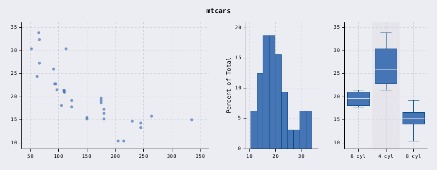

---
format:
  html: {toc: true, toc-location: right, toc-depth: 4, theme: cosmo}
code-block-background: true

---
<style></style><style>.printedClojure .sourceCode {
  background-color: transparent;
  border-style: none;
}
</style><style>.clay-limit-image-width .clay-image {max-width: 100%}
.clay-side-by-side .sourceCode {margin: 0}
.clay-side-by-side {margin: 1em 0}
</style>
<script src="https://code.jquery.com/jquery-3.6.0.min.js" type="text/javascript"></script><script src="https://code.jquery.com/ui/1.13.1/jquery-ui.min.js" type="text/javascript"></script>

# Facets, multiplots and margins

One plot can split into panels by data (facets), several plots can share one image (`:arrange`, `plot/arrange`,
`plot/pairs`, `:custom-grid`), and a panel can carry charts beside it (`:margins`).


::: {.sourceClojure}
```clojure
(ns reference.facets-arrange
  (:require [cljplot2.chart :as chart]
            [cljplot2.core :as plot]
            [cljplot2.data.facet :as facet]
            [cljplot2.describe :as describe]
            [cljplot2.layout.plot-grid :as plot-grid]
            [cljplot2.pipeline :as pipeline]
            [notebook-utils :as nu]))
```
:::


## Facets

Mapping `:facet` wraps one panel per level into rows and columns; `:facet-col` / `:facet-row` make a grid. The
plot's `:facets` map sets the layout; panels share scales unless `:scales` frees them. The level order and strip
text come from the facet scales (`:scales {:facet spec}`, Scales chapter).


::: {.sourceClojure}
```clojure
(nu/options-table (describe/options facet/facet-options))
```
:::


::: {.clay-table}

```{=html}
<table class="table table-hover table-responsive clay-table"><thead><tr><th>Option</th><th>Type</th><th>Default</th><th>Description</th></tr></thead><tbody><tr><td>:columns</td><td>a positive integer or nil</td><td>the most square shape (from :rows when given)</td><td>columns of a wrap layout</td></tr><tr><td>:rows</td><td>a positive integer or nil</td><td>the most square shape (from :columns when given)</td><td>rows of a wrap layout</td></tr><tr><td>:order</td><td>one of :top-down :bottom-up or nil</td><td>:top-down</td><td>wrap panel order: :top-down (first level at the top) or :bottom-up (lattice's)</td></tr><tr><td>:na-panel</td><td>true or false or nil</td><td>true</td><td>give nil facet values a panel of their own (false - drop those rows)</td></tr><tr><td>:scales</td><td>map</td><td></td><td>position scale relation between panels per axis</td></tr><tr><td>:scales :x</td><td>one of :free :same :sliced or nil</td><td>:same</td><td>x relation: :same (one domain), :free (each panel's data) or :sliced (each panel's centre, the widest span)</td></tr><tr><td>:scales :y</td><td>one of :free :same :sliced or nil</td><td>:same</td><td>y relation: :same (one domain), :free (each panel's data) or :sliced (each panel's centre, the widest span)</td></tr><tr><td>:strips</td><td>true or false or nil</td><td>true</td><td>draw the facet strips</td></tr><tr><td>:widths</td><td>sequential of a positive number (at least 1) or nil</td><td>equal</td><td>relative widths of the panel columns, one per column</td></tr><tr><td>:heights</td><td>sequential of a positive number (at least 1) or nil</td><td>equal</td><td>relative heights of the panel rows, one per row</td></tr></tbody></table>
```

:::


Data: Motor Trend car road tests (1974), R datasets package `mtcars` (Henderson & Velleman 1981); licence: Part of R (GPL-2 | GPL-3).


::: {.sourceClojure}
```clojure
(def mtcars (nu/dataset :mtcars))
```
:::


::: {.sourceClojure}
```clojure
(plot/render-image {:data mtcars
                    :mapping {:x :wt :y :mpg :facet-col :cyl :facet-row :am}
                    :charts [(chart/scatter)]
                    :facets {:scales {:x :free}}
                    :scales {:facet-row {:formatter #(if (= 1 %) "manual" "automatic")}}}
                   {:width 800 :height 500})
```
:::


::: {.clay-image}

:::


## Multiplots

`plot/arrange` puts plots in a grid; the panels align across rows and columns. Its options:


::: {.sourceClojure}
```clojure
(nu/options-table (describe/options #'plot/arrange))
```
:::


::: {.clay-table}

```{=html}
<table class="table table-hover table-responsive clay-table"><thead><tr><th>Option</th><th>Type</th><th>Default</th><th>Description</th><th>Group</th></tr></thead><tbody><tr><td>:columns</td><td>a positive integer or nil</td><td>one column (from :rows when given)</td><td>grid columns</td><td>Multiplot layout</td></tr><tr><td>:rows</td><td>a positive integer or nil</td><td>from the plot count and :columns</td><td>grid rows</td><td>Multiplot layout</td></tr><tr><td>:widths</td><td>sequential of a positive number or :measured or [:fixed, a non-negative number] or nil</td><td>equal</td><td>relative column weights; :measured sizes a column of legend-only plots, [:fixed px] a fixed width</td><td>Multiplot layout</td></tr><tr><td>:heights</td><td>sequential of a positive number or [:fixed, a non-negative number] or nil</td><td>equal</td><td>relative row weights; [:fixed px] a fixed height</td><td>Multiplot layout</td></tr><tr><td>:align</td><td>true or false or nil</td><td>true</td><td>align the sub-plots' panels in rows and columns</td><td>Multiplot layout</td></tr><tr><td>:equal-panels</td><td>true or false or nil</td><td>false</td><td>resize columns and rows so every aligned panel has the same size (builds twice)</td><td>Multiplot layout</td></tr><tr><td>:title</td><td>any value</td><td></td><td>plot title (a text or label options)</td><td>Builder options</td></tr><tr><td>:theme</td><td>any value</td><td></td><td>theme overrides of the built plot</td><td>Builder options</td></tr></tbody></table>
```

:::


It returns a plot with `:arrange`, which can also be written by hand:


::: {.sourceClojure}
```clojure
(nu/options-table (describe/options plot-grid/arrange-schema))
```
:::


::: {.clay-table}

```{=html}
<table class="table table-hover table-responsive clay-table"><thead><tr><th>Option</th><th>Type</th><th>Default</th><th>Description</th><th>Group</th></tr></thead><tbody><tr><td>:plots (required)</td><td>sequential of map (at least 1)</td><td></td><td>the sub-plots, filling the grid row by row</td><td>Multiplot layout</td></tr><tr><td>:columns</td><td>a positive integer or nil</td><td>one column (from :rows when given)</td><td>grid columns</td><td>Multiplot layout</td></tr><tr><td>:rows</td><td>a positive integer or nil</td><td>from the plot count and :columns</td><td>grid rows</td><td>Multiplot layout</td></tr><tr><td>:widths</td><td>sequential of a positive number or :measured or [:fixed, a non-negative number] or nil</td><td>equal</td><td>relative column weights; :measured sizes a column of legend-only plots, [:fixed px] a fixed width</td><td>Multiplot layout</td></tr><tr><td>:heights</td><td>sequential of a positive number or [:fixed, a non-negative number] or nil</td><td>equal</td><td>relative row weights; [:fixed px] a fixed height</td><td>Multiplot layout</td></tr><tr><td>:align</td><td>true or false or nil</td><td>true</td><td>align the sub-plots' panels in rows and columns</td><td>Multiplot layout</td></tr><tr><td>:equal-panels</td><td>true or false or nil</td><td>false</td><td>resize columns and rows so every aligned panel has the same size (builds twice)</td><td>Multiplot layout</td></tr></tbody></table>
```

:::


::: {.sourceClojure}
```clojure
(plot/render-image (plot/arrange [{:data mtcars :mapping {:x :hp :y :mpg} :charts [(chart/scatter)]}
                                  {:data mtcars :mapping {:x :mpg} :charts [(chart/histogram {:bins 10})]}
                                  {:data mtcars :mapping {:x #(str (:cyl %) " cyl") :y :mpg} :charts [(chart/box)]}]
                                 {:columns 3 :widths [2 1 1] :title "mtcars"})
                   {:width 900 :height 350})
```
:::


::: {.clay-image}

:::


## Scatter-plot matrix

`plot/pairs` draws a cell for every pair of `:variables` (2 to 20 numeric columns); the cells below, above and on
the diagonal take any charts (`:lower`, `:upper`, `:diagonal`).


::: {.sourceClojure}
```clojure
(nu/options-table (describe/options #'plot/pairs))
```
:::


::: {.clay-table}

```{=html}
<table class="table table-hover table-responsive clay-table"><thead><tr><th>Option</th><th>Type</th><th>Default</th><th>Description</th><th>Group</th></tr></thead><tbody><tr><td>:variables (required)</td><td>sequential of keyword (2..20)</td><td></td><td>the numeric columns, in matrix order</td><td></td></tr><tr><td>:mapping</td><td>a mapping: key -> accessor (a keyword or a function of a row) or nil</td><td></td><td>extra mapping of every cell (grouping aesthetics such as :color, :group)</td><td></td></tr><tr><td>:lower</td><td>a chart or a vector of charts or nil</td><td>(chart/scatter)</td><td>charts below the diagonal; nil - empty cells</td><td></td></tr><tr><td>:upper</td><td>a chart or a vector of charts or nil</td><td>(chart/correlation {:glyph :number})</td><td>charts above the diagonal; nil - empty cells</td><td></td></tr><tr><td>:diagonal</td><td>:names, a chart or a vector of charts or nil</td><td>(chart/density)</td><td>charts of the diagonal cells (in their own magnitude scale); :names - the variable's name; nil - empty cells</td><td></td></tr><tr><td>:labels</td><td>map of keyword to string or nil</td><td>the variable's name</td><td>display names of the variables, {variable text}</td><td></td></tr><tr><td>:theme</td><td>any value or nil</td><td></td><td>theme of every cell and of the matrix (a [:plot :margin] or [:multiplot :gap] given wins over the cells' facet-like spacing)</td><td></td></tr><tr><td>:title</td><td>any value</td><td></td><td>plot title (a text or label options)</td><td>Builder options</td></tr></tbody></table>
```

:::


::: {.sourceClojure}
```clojure
(plot/render-image (plot/pairs mtcars {:variables [:mpg :hp :wt :qsec]})
                   {:width 700 :height 700})
```
:::


::: {.clay-image}

:::


## Margins

`:margins` puts charts above (`:top`) and right of (`:right`) a single panel, sharing its horizontal / vertical
scale; margin charts read the plot's data with `:x` mapped to the shared dimension.


::: {.sourceClojure}
```clojure
(nu/options-table (describe/options pipeline/margins-schema))
```
:::


::: {.clay-table}

```{=html}
<table class="table table-hover table-responsive clay-table"><thead><tr><th>Option</th><th>Type</th><th>Default</th><th>Description</th></tr></thead><tbody><tr><td>:top</td><td>a chart, a vector of charts or {:charts c :size px :axis bool}</td><td></td><td>charts above the panel sharing its horizontal scale</td></tr><tr><td>:right</td><td>a chart, a vector of charts or {:charts c :size px :axis bool}</td><td></td><td>charts right of the panel sharing its vertical scale</td></tr></tbody></table>
```

:::


A margin given as a map:


::: {.sourceClojure}
```clojure
(nu/options-table (describe/options pipeline/margin-spec-schema))
```
:::


::: {.clay-table}

```{=html}
<table class="table table-hover table-responsive clay-table"><thead><tr><th>Option</th><th>Type</th><th>Default</th><th>Description</th></tr></thead><tbody><tr><td>:charts (required)</td><td>a chart value (see cljplot2.chart) or vector of a chart value (see cljplot2.chart) (at least 1)</td><td></td><td>a chart or a vector of charts</td></tr><tr><td>:size</td><td>a positive number</td><td>80</td><td>margin thickness in pixels</td></tr><tr><td>:axis</td><td>true or false</td><td>false</td><td>draw the magnitude axis of histogram and density margins</td></tr></tbody></table>
```

:::


::: {.sourceClojure}
```clojure
(plot/render-image {:data mtcars
                    :mapping {:x :wt :y :mpg}
                    :charts [(chart/scatter)]
                    :margins {:top (chart/density) :right {:charts (chart/histogram {:bins 10}) :size 60 :axis true}}}
                   {:width 600 :height 500})
```
:::


::: {.clay-image}

:::


## Custom grid

`:custom-grid` replaces the generated layout with a hand-written track grid (see the `cljplot2.layout.grid`
namespace doc): columns and rows of `[:fixed px]`, `[:fraction f]`, `[:measured]` or `[:flexible w]` tracks and
items placed on them; an item's content `{:kind :plot :plot p}` holds a whole plot. Only `:labels {:title t}` may
accompany it; for plots in a regular grid prefer `plot/arrange`.


```{=html}
<div style="background-color:grey;height:2px;width:100%;"></div>
```


```{=html}
<div><pre><small><small>source: notebooks/reference/facets_arrange.clj</small></small></pre></div>
```