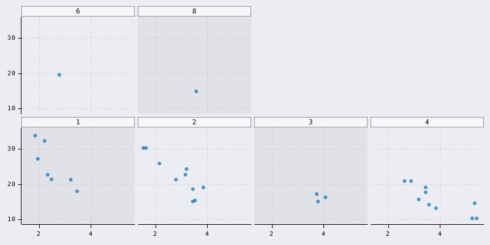
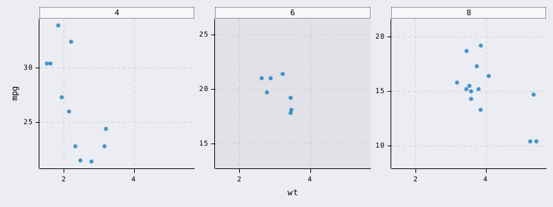
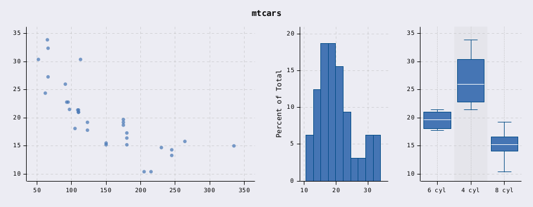
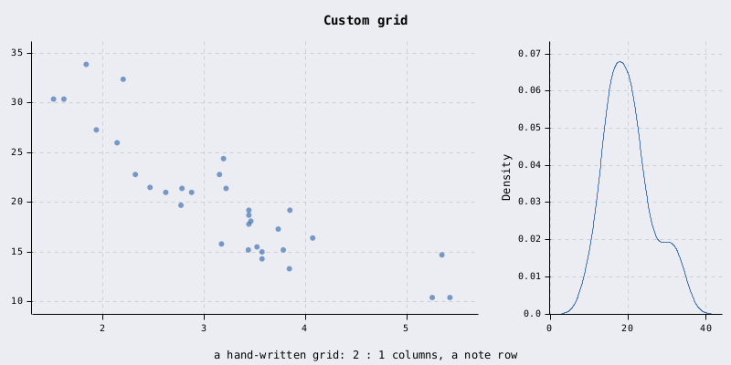
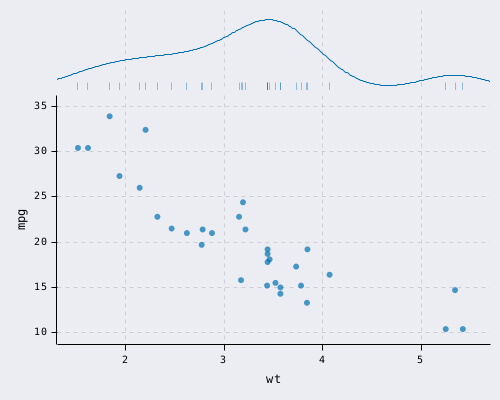
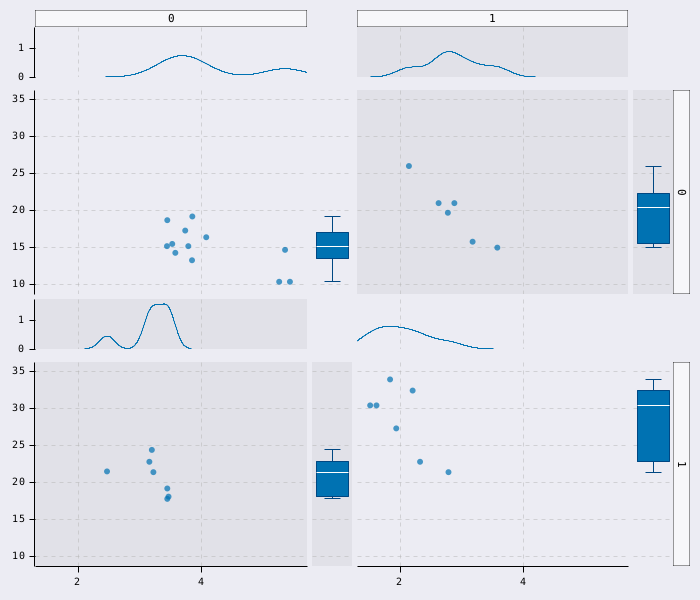

---
format:
  html:
    toc: true
    toc-location: right
    toc-depth: 4
    theme: cosmo
    include-in-header:
      text: |-
        <style>
        .data-table { width: fit-content; max-width: 100%; max-height: 15rem; overflow: auto; margin: 0 0 1rem 0; }
        .data-table .table-responsive { overflow: visible; }
        .data-table table { font-size: 0.75rem; width: auto; margin: 0; }
        .data-table th, .data-table td { padding: 0.1rem 0.45rem !important; white-space: nowrap; }
        .data-table thead th { position: sticky; top: 0; background: var(--bs-body-bg, #fff); }
        .options { margin: 0.5rem 0 1rem 0; }
        .options .option-card { margin: 0 0 0.9rem 0; border: 1px solid var(--bs-border-color, #dee2e6); border-radius: 0.375rem; overflow: hidden; }
        .options dt { display: flex; flex-wrap: wrap; align-items: baseline; gap: 0.1rem 1rem; margin: 0; padding: 0.4rem 0.75rem; background: #eef2f7; border-bottom: 1px solid var(--bs-border-color, #dee2e6); font-weight: normal; }
        .options dt > code { font-weight: 700; font-size: 1rem; background: none; padding: 0; }
        .options .option-default { font-size: 0.85rem; color: var(--bs-secondary-color, #6c757d); }
        .options dd { margin: 0; padding: 0.5rem 0.75rem; }
        .options .option-example { font-size: 0.85rem; padding: 0 0 0.45rem 0; margin-bottom: 0.45rem; border-bottom: 1px dashed var(--bs-border-color, #dee2e6); }
        .options .option-example code { background: none; padding: 0; }
        .options .option-text ul { margin: 0.3rem 0 0 0; padding-left: 1.25rem; }
        .options code, .mapping code { overflow-wrap: anywhere; }
        .options .option-default code, .options .option-example code { white-space: pre-wrap; }
        .mapping { margin: 0.5rem 0 1rem 0; padding: 0.5rem 0.75rem; border: 1px solid var(--bs-border-color, #dee2e6); border-left: 0.3rem solid #2780e3; border-radius: 0.375rem; background: #f5f8fc; }
        .mapping-title { font-weight: 700; margin-bottom: 0.25rem; }
        .mapping-hint { font-weight: normal; font-size: 0.85rem; color: var(--bs-secondary-color, #6c757d); }
        .mapping ul { margin: 0; padding-left: 1.25rem; }
        .mapping .required { font-size: 0.75rem; padding: 0 0.3rem; border: 1px solid currentColor; border-radius: 0.25rem; }
        .mapping-returns { margin-top: 0.25rem; }
        .mapping code { white-space: pre-wrap; }
        .shared { margin: 0.5rem 0 1rem 0; padding: 0.5rem 0.75rem; border: 1px solid var(--bs-border-color, #dee2e6); border-left: 0.3rem solid #6c757d; border-radius: 0.375rem; background: #f6f6f6; }
        .shared-title { font-weight: 700; margin-bottom: 0.25rem; }
        .shared-hint { font-weight: normal; font-size: 0.85rem; color: var(--bs-secondary-color, #6c757d); }
        .shared ul { margin: 0; padding-left: 1.25rem; }
        .shared code { overflow-wrap: anywhere; }
        </style>
code-block-background: true

---
<style></style><style>.printedClojure .sourceCode {
  background-color: transparent;
  border-style: none;
}
</style><style>.clay-limit-image-width .clay-image {max-width: 100%}
.clay-side-by-side .sourceCode {margin: 0}
.clay-side-by-side {margin: 1em 0}
</style>
<script src="https://code.jquery.com/jquery-3.6.0.min.js" type="text/javascript"></script><script src="https://code.jquery.com/ui/1.13.1/jquery-ui.min.js" type="text/javascript"></script>

# Facets, multiplots and margins

One plot can split into panels by data (facets), several plots can share one image (`plot/arrange`,
`plot/pairs`, `:custom-grid`), and a panel can carry charts beside it (`:margins`).


::: {.sourceClojure}
```clojure
(ns reference.facets-arrange
  (:require [cljplot2.chart :as chart]
            [cljplot2.core :as plot]
            [cljplot2.data.facet :as facet]
            [cljplot2.describe :as describe]
            [cljplot2.layout.plot-grid :as plot-grid]
            [cljplot2.pipeline :as pipeline]
            [notebook-utils :as nu]))
```
:::


Data: Motor Trend car road tests (1974), R datasets package `mtcars` (Henderson & Velleman 1981); licence: Part of R (GPL-2 | GPL-3).


::: {.sourceClojure}
```clojure
(def mtcars (nu/dataset :mtcars))
```
:::


```{=html}
<div class="data-table"><table class="table table-hover table-responsive clay-table"><thead><tr><th>model</th><th>mpg</th><th>cyl</th><th>disp</th><th>hp</th><th>drat</th><th>wt</th><th>qsec</th><th>vs</th><th>am</th><th>gear</th><th>carb</th></tr></thead><tbody><tr><td>Mazda RX4</td><td>21</td><td>6</td><td>160</td><td>110</td><td>3.9</td><td>2.62</td><td>16.46</td><td>0</td><td>1</td><td>4</td><td>4</td></tr><tr><td>Mazda RX4 Wag</td><td>21</td><td>6</td><td>160</td><td>110</td><td>3.9</td><td>2.875</td><td>17.02</td><td>0</td><td>1</td><td>4</td><td>4</td></tr><tr><td>Datsun 710</td><td>22.8</td><td>4</td><td>108</td><td>93</td><td>3.85</td><td>2.32</td><td>18.61</td><td>1</td><td>1</td><td>4</td><td>1</td></tr><tr><td>Hornet 4 Drive</td><td>21.4</td><td>6</td><td>258</td><td>110</td><td>3.08</td><td>3.215</td><td>19.44</td><td>1</td><td>0</td><td>3</td><td>1</td></tr><tr><td>Hornet Sportabout</td><td>18.7</td><td>8</td><td>360</td><td>175</td><td>3.15</td><td>3.44</td><td>17.02</td><td>0</td><td>0</td><td>3</td><td>2</td></tr><tr><td>Valiant</td><td>18.1</td><td>6</td><td>225</td><td>105</td><td>2.76</td><td>3.46</td><td>20.22</td><td>1</td><td>0</td><td>3</td><td>1</td></tr><tr><td>Duster 360</td><td>14.3</td><td>8</td><td>360</td><td>245</td><td>3.21</td><td>3.57</td><td>15.84</td><td>0</td><td>0</td><td>3</td><td>4</td></tr><tr><td>Merc 240D</td><td>24.4</td><td>4</td><td>146.7</td><td>62</td><td>3.69</td><td>3.19</td><td>20</td><td>1</td><td>0</td><td>4</td><td>2</td></tr><tr><td>Merc 230</td><td>22.8</td><td>4</td><td>140.8</td><td>95</td><td>3.92</td><td>3.15</td><td>22.9</td><td>1</td><td>0</td><td>4</td><td>2</td></tr><tr><td>Merc 280</td><td>19.2</td><td>6</td><td>167.6</td><td>123</td><td>3.92</td><td>3.44</td><td>18.3</td><td>1</td><td>0</td><td>4</td><td>4</td></tr><tr><td>Merc 280C</td><td>17.8</td><td>6</td><td>167.6</td><td>123</td><td>3.92</td><td>3.44</td><td>18.9</td><td>1</td><td>0</td><td>4</td><td>4</td></tr><tr><td>Merc 450SE</td><td>16.4</td><td>8</td><td>275.8</td><td>180</td><td>3.07</td><td>4.07</td><td>17.4</td><td>0</td><td>0</td><td>3</td><td>3</td></tr><tr><td>Merc 450SL</td><td>17.3</td><td>8</td><td>275.8</td><td>180</td><td>3.07</td><td>3.73</td><td>17.6</td><td>0</td><td>0</td><td>3</td><td>3</td></tr><tr><td>Merc 450SLC</td><td>15.2</td><td>8</td><td>275.8</td><td>180</td><td>3.07</td><td>3.78</td><td>18</td><td>0</td><td>0</td><td>3</td><td>3</td></tr><tr><td>Cadillac Fleetwood</td><td>10.4</td><td>8</td><td>472</td><td>205</td><td>2.93</td><td>5.25</td><td>17.98</td><td>0</td><td>0</td><td>3</td><td>4</td></tr><tr><td>Lincoln Continental</td><td>10.4</td><td>8</td><td>460</td><td>215</td><td>3</td><td>5.424</td><td>17.82</td><td>0</td><td>0</td><td>3</td><td>4</td></tr><tr><td>Chrysler Imperial</td><td>14.7</td><td>8</td><td>440</td><td>230</td><td>3.23</td><td>5.345</td><td>17.42</td><td>0</td><td>0</td><td>3</td><td>4</td></tr><tr><td>Fiat 128</td><td>32.4</td><td>4</td><td>78.7</td><td>66</td><td>4.08</td><td>2.2</td><td>19.47</td><td>1</td><td>1</td><td>4</td><td>1</td></tr><tr><td>Honda Civic</td><td>30.4</td><td>4</td><td>75.7</td><td>52</td><td>4.93</td><td>1.615</td><td>18.52</td><td>1</td><td>1</td><td>4</td><td>2</td></tr><tr><td>Toyota Corolla</td><td>33.9</td><td>4</td><td>71.1</td><td>65</td><td>4.22</td><td>1.835</td><td>19.9</td><td>1</td><td>1</td><td>4</td><td>1</td></tr><tr><td>Toyota Corona</td><td>21.5</td><td>4</td><td>120.1</td><td>97</td><td>3.7</td><td>2.465</td><td>20.01</td><td>1</td><td>0</td><td>3</td><td>1</td></tr><tr><td>Dodge Challenger</td><td>15.5</td><td>8</td><td>318</td><td>150</td><td>2.76</td><td>3.52</td><td>16.87</td><td>0</td><td>0</td><td>3</td><td>2</td></tr><tr><td>AMC Javelin</td><td>15.2</td><td>8</td><td>304</td><td>150</td><td>3.15</td><td>3.435</td><td>17.3</td><td>0</td><td>0</td><td>3</td><td>2</td></tr><tr><td>Camaro Z28</td><td>13.3</td><td>8</td><td>350</td><td>245</td><td>3.73</td><td>3.84</td><td>15.41</td><td>0</td><td>0</td><td>3</td><td>4</td></tr><tr><td>Pontiac Firebird</td><td>19.2</td><td>8</td><td>400</td><td>175</td><td>3.08</td><td>3.845</td><td>17.05</td><td>0</td><td>0</td><td>3</td><td>2</td></tr><tr><td>Fiat X1-9</td><td>27.3</td><td>4</td><td>79</td><td>66</td><td>4.08</td><td>1.935</td><td>18.9</td><td>1</td><td>1</td><td>4</td><td>1</td></tr><tr><td>Porsche 914-2</td><td>26</td><td>4</td><td>120.3</td><td>91</td><td>4.43</td><td>2.14</td><td>16.7</td><td>0</td><td>1</td><td>5</td><td>2</td></tr><tr><td>Lotus Europa</td><td>30.4</td><td>4</td><td>95.1</td><td>113</td><td>3.77</td><td>1.513</td><td>16.9</td><td>1</td><td>1</td><td>5</td><td>2</td></tr><tr><td>Ford Pantera L</td><td>15.8</td><td>8</td><td>351</td><td>264</td><td>4.22</td><td>3.17</td><td>14.5</td><td>0</td><td>1</td><td>5</td><td>4</td></tr><tr><td>Ferrari Dino</td><td>19.7</td><td>6</td><td>145</td><td>175</td><td>3.62</td><td>2.77</td><td>15.5</td><td>0</td><td>1</td><td>5</td><td>6</td></tr><tr><td>Maserati Bora</td><td>15</td><td>8</td><td>301</td><td>335</td><td>3.54</td><td>3.57</td><td>14.6</td><td>0</td><td>1</td><td>5</td><td>8</td></tr><tr><td>Volvo 142E</td><td>21.4</td><td>4</td><td>121</td><td>109</td><td>4.11</td><td>2.78</td><td>18.6</td><td>1</td><td>1</td><td>4</td><td>2</td></tr></tbody></table></div>
```


## Facet shape

Mapping `:facet` wraps one panel per level into rows and columns; `:facet-col` / `:facet-row` make a grid of
them. The plot's `:facets` map shapes the wrap and weights the panel columns and rows.

::: {.clay-table}

```{=html}
<table class="table table-hover table-responsive clay-table"><thead><tr><th>Option</th><th>Type</th><th>Default</th><th>Description</th></tr></thead><tbody><tr><td>:columns</td><td>a positive integer or nil</td><td>the most square shape (from :rows when given)</td><td>columns of a wrap layout</td></tr><tr><td>:rows</td><td>a positive integer or nil</td><td>the most square shape (from :columns when given)</td><td>rows of a wrap layout</td></tr><tr><td>:order</td><td>one of :top-down :bottom-up or nil</td><td>:top-down</td><td>wrap panel order: :top-down (first level at the top) or :bottom-up (lattice's)</td></tr><tr><td>:widths</td><td>sequential of a positive number (at least 1) or nil</td><td>equal</td><td>relative widths of the panel columns, one per column</td></tr><tr><td>:heights</td><td>sequential of a positive number (at least 1) or nil</td><td>equal</td><td>relative heights of the panel rows, one per row</td></tr></tbody></table>
```

:::


::: {.sourceClojure}
```clojure
(plot/render-image {:data mtcars
                    :mapping {:x :wt :y :mpg :facet :carb}
                    :charts [(chart/scatter)]
                    :facets {:columns 4 :order :bottom-up}}
                   {:width 800 :height 400})
```
:::


::: {.clay-image}

:::


## Facet panels

Panels share their position scales unless freed per axis (`:free` - each panel its data; `:sliced` - each
panel its centre, the widest span); `nil` facet values get a panel of their own; strips can go.

::: {.clay-table}

```{=html}
<table class="table table-hover table-responsive clay-table"><thead><tr><th>Option</th><th>Type</th><th>Default</th><th>Description</th></tr></thead><tbody><tr><td>:na-panel</td><td>true or false or nil</td><td>true</td><td>give nil facet values a panel of their own (false - drop those rows)</td></tr><tr><td>:scales</td><td>map</td><td></td><td>position scale relation between panels per axis</td></tr><tr><td>:scales :x</td><td>one of :free :same :sliced or nil</td><td>:same</td><td>x relation: :same (one domain), :free (each panel's data) or :sliced (each panel's centre, the widest span)</td></tr><tr><td>:scales :y</td><td>one of :free :same :sliced or nil</td><td>:same</td><td>y relation: :same (one domain), :free (each panel's data) or :sliced (each panel's centre, the widest span)</td></tr><tr><td>:strips</td><td>true or false or nil</td><td>true</td><td>draw the facet strips</td></tr></tbody></table>
```

:::


::: {.sourceClojure}
```clojure
(plot/render-image {:data mtcars
                    :mapping {:x :wt :y :mpg :facet-col :cyl :facet-row :am}
                    :charts [(chart/scatter)]
                    :facets {:scales {:x :free} :widths [1 1 2]}}
                   {:width 800 :height 450})
```
:::


::: {.clay-image}

:::


`:sliced`: every panel spans as much as the widest one, around its own data - the panels' y ranges are
comparable in size although they sit at different heights:


::: {.sourceClojure}
```clojure
(plot/render-image {:data mtcars
                    :mapping {:x :wt :y :mpg :facet :cyl}
                    :charts [(chart/scatter)]
                    :facets {:scales {:y :sliced} :columns 3}}
                   {:width 800 :height 300})
```
:::


::: {.clay-image}

:::


## Facet levels

The facet levels have scales: `:scales {:facet spec}` (and `:facet-col` / `:facet-row`) order the panels and
write the strip texts.

::: {.clay-table}

```{=html}
<table class="table table-hover table-responsive clay-table"><thead><tr><th>Option</th><th>Type</th><th>Default</th><th>Description</th></tr></thead><tbody><tr><td>:domain</td><td>sequential of any value (at least 1) or nil</td><td>the data's levels, sorted (NA last)</td><td>the facet levels in panel order (values outside are dropped)</td></tr><tr><td>:formatter</td><td>a function</td><td>(str level), "NA" for the NA level</td><td>strip text of a level, a function of the level</td></tr><tr><td>:order-by</td><td>a function or nil</td><td></td><td>levels in ascending order of a function of each level's rows (not with :domain)</td></tr><tr><td>:descending</td><td>true or false or nil</td><td>false</td><td>reverse the :order-by order (needs :order-by)</td></tr><tr><td>:type</td><td>:categorical</td><td></td><td>facets are always categorical (accepted for symmetry with other scales)</td></tr></tbody></table>
```

:::


::: {.sourceClojure}
```clojure
(plot/render-image {:data mtcars
                    :mapping {:x :wt :y :mpg :facet :gear}
                    :charts [(chart/scatter)]
                    :scales {:facet {:domain [5 4 3] :formatter #(str % " gears")}}}
                   {:width 800 :height 300})
```
:::


::: {.clay-image}

:::


## Arrange

`plot/arrange` puts plots in a grid; the panels align across rows and columns. Its options:

::: {.clay-table}

```{=html}
<table class="table table-hover table-responsive clay-table"><thead><tr><th>Option</th><th>Type</th><th>Default</th><th>Description</th><th>Group</th></tr></thead><tbody><tr><td>:columns</td><td>a positive integer or nil</td><td>One column, or as many as `:rows` needs.</td><td>The number of grid columns.</td><td>Multiplot layout</td></tr><tr><td>:rows</td><td>a positive integer or nil</td><td>As many as the plots need in `:columns`.</td><td>The number of grid rows.</td><td>Multiplot layout</td></tr><tr><td>:widths</td><td>sequential of a positive number or :measured or [:fixed, a non-negative number] or nil</td><td>Equal widths.</td><td>The columns' relative widths, one per column.</td><td>Multiplot layout</td></tr><tr><td>:heights</td><td>sequential of a positive number or :measured or [:fixed, a non-negative number] or nil</td><td>Equal heights.</td><td>The rows' relative heights, one per row.</td><td>Multiplot layout</td></tr><tr><td>:row-spans</td><td>map of integer (at least 0) to a positive integer or nil</td><td>Every plot spans one row.</td><td>A map from a plot's index (not its cell's) to the number of rows the plot spans from its own row down; later plots skip the covered cells.</td><td>Multiplot layout</td></tr><tr><td>:align</td><td>true or false or nil</td><td>true</td><td>Whether the sub-plots' panels line up in rows and columns.</td><td>Multiplot layout</td></tr><tr><td>:equal-panels</td><td>true or false or nil</td><td>false</td><td>Whether every aligned panel gets the same size and the gaps between panels are even; the plot builds twice.</td><td>Multiplot layout</td></tr><tr><td>:title</td><td>any value</td><td>No title.</td><td>The plot's title: a text or a label options map.</td><td>Builder options</td></tr><tr><td>:theme</td><td>any value</td><td>The default theme.</td><td>A theme merged over the builder's own theme settings and the default theme for the built plot.</td><td>Builder options</td></tr></tbody></table>
```

:::


::: {.sourceClojure}
```clojure
(plot/render-image (plot/arrange [{:data mtcars :mapping {:x :hp :y :mpg} :charts [(chart/scatter)]}
                                  {:data mtcars :mapping {:x :mpg} :charts [(chart/histogram {:bins 10})]}
                                  {:data mtcars :mapping {:x #(str (:cyl %) " cyl") :y :mpg} :charts [(chart/box)]}]
                                 {:columns 3 :widths [2 1 1] :title "mtcars"})
                   {:width 900 :height 350})
```
:::


::: {.clay-image}

:::


A cell too small for its sub-plot's axes, labels, legends and margins is an error naming the cell (`[:plot i]`,
row by row; a nested cell by its whole path, outer cells first), its title - else its mapped `:x` / `:y` - its
size and the pixels needed, keyed `:width` or `:height`. Eight plots side by side in 400 pixels:


::: {.sourceClojure}
```clojure
(try (plot/build (plot/arrange (repeat 8 {:data mtcars :mapping {:x :hp :y :mpg} :charts [(chart/scatter)]})
                               {:columns 8})
                 {:width 400 :height 200})
     (catch clojure.lang.ExceptionInfo e
       {:message (ex-message e) :data (ex-data e)}))
```
:::


::: {.printedClojure}
```clojure
{:message
 "Sub-plot [:plot 0] (x :hp, y :mpg) is 39x180 px; its axes, labels, legends and margins need 57 px of width. Enlarge the image or the cell, or shrink the sub-plot's fixed parts.",
 :data
 {:key :width,
  :axis :columns,
  :available 39,
  :cause :track-space,
  :required 57,
  :errors
  [{:in nil,
    :message
    "Not enough space: the plot's fixed parts (axes, labels, legends, strips, margins, gaps) need 57 px of width, 39 px given."}],
  :subplot [:plot 0],
  :subplot-path [[:plot 0]]}}

```
:::


It returns a plot whose `:arrange` key holds the plots and the layout - also written by hand. Here a legend
shown once, in its own cell: the two plots hide their legends (`:legend false`), a third plot draws only its
legend (`:legend-only true` - no panel or axes, plot keys in the intro's Legend slice) in a column sized to fit
(`:measured`):

::: {.clay-table}

```{=html}
<table class="table table-hover table-responsive clay-table"><thead><tr><th>Option</th><th>Type</th><th>Default</th><th>Description</th></tr></thead><tbody><tr><td>:plots (required)</td><td>sequential of map (at least 1)</td><td></td><td>The sub-plots, filling the grid row by row; `plot/arrange` takes them as its first argument.</td></tr><tr><td>:columns</td><td>a positive integer or nil</td><td>One column, or as many as `:rows` needs.</td><td>The number of grid columns.</td></tr><tr><td>:rows</td><td>a positive integer or nil</td><td>As many as the plots need in `:columns`.</td><td>The number of grid rows.</td></tr><tr><td>:widths</td><td>sequential of a positive number or :measured or [:fixed, a non-negative number] or nil</td><td>Equal widths.</td><td>The columns' relative widths, one per column.</td></tr><tr><td>:heights</td><td>sequential of a positive number or :measured or [:fixed, a non-negative number] or nil</td><td>Equal heights.</td><td>The rows' relative heights, one per row.</td></tr><tr><td>:row-spans</td><td>map of integer (at least 0) to a positive integer or nil</td><td>Every plot spans one row.</td><td>A map from a plot's index (not its cell's) to the number of rows the plot spans from its own row down; later plots skip the covered cells.</td></tr><tr><td>:align</td><td>true or false or nil</td><td>true</td><td>Whether the sub-plots' panels line up in rows and columns.</td></tr><tr><td>:equal-panels</td><td>true or false or nil</td><td>false</td><td>Whether every aligned panel gets the same size and the gaps between panels are even; the plot builds twice.</td></tr></tbody></table>
```

:::


::: {.sourceClojure}
```clojure
(plot/render-image {:arrange {:plots [{:data mtcars :mapping {:x :hp :y :mpg :color :gear} :charts [(chart/scatter)]
                                       :scales {:color {:type :categorical}} :legend false}
                                      {:data mtcars :mapping {:x :wt :y :mpg :color :gear} :charts [(chart/scatter)]
                                       :scales {:color {:type :categorical}} :legend false}
                                      {:data mtcars :mapping {:x :wt :y :mpg :color :gear} :charts [(chart/scatter)]
                                       :scales {:color {:type :categorical}} :legend-only true}]
                              :columns 3 :widths [1 1 :measured]}}
                   {:width 900 :height 320})
```
:::


::: {.clay-image}

:::


`:row-spans` lets a plot cover several rows from its own down (`{plot-index rows}` - keyed by the plot's index,
not its cell), and later plots skip the covered cells; without `:rows` a span reaching past the last row adds
rows. Here one legend beside two rows of plots, its colour bar stretched over both:


::: {.sourceClojure}
```clojure
(plot/render-image (plot/arrange [{:data mtcars :mapping {:x :hp :y :mpg :color :wt} :charts [(chart/scatter)] :legend false}
                                  {:data mtcars :mapping {:x :hp :y :mpg :color :wt} :charts [(chart/scatter)] :legend-only true}
                                  {:data mtcars :mapping {:x :disp :y :mpg :color :wt} :charts [(chart/scatter)] :legend false}]
                                 {:columns 2 :widths [1 :measured] :row-spans {1 2}})
                   {:width 600 :height 500})
```
:::


::: {.clay-image}

:::


## Scatter-plot matrix

`plot/pairs` draws a cell for every pair of `:variables` (2 to 20 numeric columns); the cells below, above and on
the diagonal take any charts. By default a scatter plot fills the cells below the diagonal, the correlation as a
number those above, and a density the diagonal. Its variables:

::: {.clay-table}

```{=html}
<table class="table table-hover table-responsive clay-table"><thead><tr><th>Option</th><th>Type</th><th>Default</th><th>Description</th></tr></thead><tbody><tr><td>:variables</td><td>sequential of keyword (2..20) or nil</td><td>required unless :row-variables and :column-variables are given</td><td>the numeric columns, in matrix order (rows and columns)</td></tr><tr><td>:row-variables</td><td>sequential of keyword (1..20) or nil</td><td>:variables</td><td>the numeric columns of the matrix rows, top to bottom (on y)</td></tr><tr><td>:column-variables</td><td>sequential of keyword (1..20) or nil</td><td>:variables</td><td>the numeric columns of the matrix columns, left to right (on x)</td></tr><tr><td>:mapping</td><td>a mapping: key -> accessor (a keyword or a function of a row) or nil</td><td></td><td>extra mapping of every cell (grouping aesthetics such as :color, :group)</td></tr><tr><td>:variable-names</td><td>map of keyword to a string, plot/math or plot/runs or nil</td><td>the variable's name</td><td>display names of the variables, {variable text}</td></tr></tbody></table>
```

:::


::: {.sourceClojure}
```clojure
(plot/render-image (plot/pairs mtcars {:variables [:mpg :hp :wt :qsec]
                                       :upper [(chart/correlation)]})
                   {:width 700 :height 700})
```
:::


::: {.clay-image}

:::


`:row-variables` and `:column-variables` (each defaulting to `:variables`) put other variables, or another order,
on the rows than on the columns - here 3 rows x 2 columns. Such a matrix has no triangles: every cell of two
different variables draws `:lower`, a cell whose row and column variable are the same draws `:diagonal`
(wherever it is), and `:upper` is an error.


::: {.sourceClojure}
```clojure
(plot/render-image (plot/pairs mtcars {:row-variables [:hp :wt :mpg]
                                       :column-variables [:mpg :disp]
                                       :lower [(chart/scatter) (chart/smooth {:method :lm})]
                                       :mapping {:color #(str (:cyl %) " cyl")}})
                   {:width 600 :height 700})
```
:::


::: {.clay-image}

:::


Its cells:

::: {.clay-table}

```{=html}
<table class="table table-hover table-responsive clay-table"><thead><tr><th>Option</th><th>Type</th><th>Default</th><th>Description</th></tr></thead><tbody><tr><td>:lower</td><td>:none, a chart or a vector of charts or nil or nil</td><td>(chart/scatter)</td><td>charts below the diagonal of a square matrix; off-diagonal (every cell of two different variables) in a matrix that isn't square; :none - empty cells</td></tr><tr><td>:upper</td><td>:none, a chart or a vector of charts or nil or nil</td><td>(chart/correlation {:glyph :number})</td><td>charts above the diagonal (a square matrix only); :none - empty cells</td></tr><tr><td>:diagonal</td><td>:names, :none, a chart or a vector of charts or nil or nil</td><td>(chart/density)</td><td>charts of the diagonal cells - a cell whose row and column variable are the same (in their own magnitude scale); :names - the variable's name (text role :pairs-name); :none - empty cells</td></tr><tr><td>:scales</td><td>map</td><td></td><td>the colour scale of every cell that colours (one colour bar), {:color spec}; its :domain wins over the matrix's computed one</td></tr><tr><td>:scales :color</td><td>an aesthetic scale spec</td><td></td><td>the colour scale spec</td></tr></tbody></table>
```

:::


::: {.sourceClojure}
```clojure
(plot/render-image (plot/pairs mtcars {:variables [:mpg :hp :wt]
                                       :lower (chart/scatter {:alpha 0.6})
                                       :upper (chart/correlation {:glyph :shade})
                                       :diagonal :names
                                       :scales {:color {:domain [-1 1]}}})
                   {:width 500 :height 450})
```
:::


::: {.clay-image}

:::


`:lower`, `:upper` and `:diagonal` each take a chart, a vector of charts layered in each cell, or `:none` for empty
cells:


::: {.sourceClojure}
```clojure
(plot/render-image (plot/pairs mtcars {:variables [:mpg :hp :wt]
                                       :lower [(chart/scatter {:size 4}) (chart/smooth {:method :lm})]
                                       :upper :none
                                       :title "a scatter and a linear fit below, nothing above"})
                   {:width 600 :height 560})
```
:::


::: {.clay-image}

:::


The matrix's title, legend column and theme:

::: {.clay-table}

```{=html}
<table class="table table-hover table-responsive clay-table"><thead><tr><th>Option</th><th>Type</th><th>Default</th><th>Description</th><th>Group</th></tr></thead><tbody><tr><td>:legend-span</td><td>one of :row :matrix or nil</td><td>:row</td><td>height of the legend column: :row - beside the first row, one row high; :matrix - beside the whole matrix (a legend taller than a row, e.g. of a many-variable matrix)</td><td></td></tr><tr><td>:theme</td><td>any value or nil</td><td></td><td>theme of every cell and of the matrix (a [:plot :margin] or [:multiplot :gap] given wins over the cells' facet-like spacing)</td><td></td></tr><tr><td>:title</td><td>any value</td><td>No title.</td><td>The plot's title: a text or a label options map.</td><td>Builder options</td></tr></tbody></table>
```

:::


Only the outer cells have axes (x under the bottom row, y left of the left column), and every panel gets one size
(the room between rows follows each row's end tick labels), so a matrix of many variables fits a page - up to 20,
though at that count tick labels get dense: give such a matrix a large image. Its rows are low, so a legend taller
than a row goes beside the whole matrix with `:legend-span :matrix` (the default `:row` keeps it beside the first
row) - here every numeric column of mtcars, with the r colour bar of the shaded correlations as tall as the matrix.


::: {.sourceClojure}
```clojure
(plot/render-image (plot/pairs mtcars {:variables [:mpg :cyl :disp :hp :drat :wt :qsec :vs :am :gear :carb]
                                       :upper (chart/correlation {:glyph :shade})
                                       :diagonal :names
                                       :legend-span :matrix
                                       :title "mtcars"})
                   {:width 1000 :height 800})
```
:::


::: {.clay-image}

:::


## Margins

`:margins` puts charts above (`:top`), right of (`:right`), below (`:bottom`) and left of (`:left`) a panel,
sharing its horizontal / vertical scale; margin charts read the plot's data with `:x` mapped to the shared
dimension. A margin is a chart or a vector of charts ...

::: {.clay-table}

```{=html}
<table class="table table-hover table-responsive clay-table"><thead><tr><th>Option</th><th>Type</th><th>Default</th><th>Description</th></tr></thead><tbody><tr><td>:top</td><td>a chart, a vector of charts or {:charts c :size px :axis bool}</td><td></td><td>charts above the panel sharing its horizontal scale</td></tr><tr><td>:right</td><td>a chart, a vector of charts or {:charts c :size px :axis bool}</td><td></td><td>charts right of the panel sharing its vertical scale</td></tr><tr><td>:bottom</td><td>a chart, a vector of charts or {:charts c :size px :axis bool}</td><td></td><td>charts below the panel (above its horizontal axis) sharing its horizontal scale</td></tr><tr><td>:left</td><td>a chart, a vector of charts or {:charts c :size px :axis bool}</td><td></td><td>charts left of the panel (right of its vertical axis) sharing its vertical scale</td></tr></tbody></table>
```

:::


::: {.sourceClojure}
```clojure
(plot/render-image {:data mtcars
                    :mapping {:x :wt :y :mpg}
                    :charts [(chart/scatter)]
                    :margins {:top [(chart/density) (chart/rug)]}}
                   {:width 500 :height 400})
```
:::


::: {.clay-image}

:::


... or a map giving the margin's thickness and the magnitude axis of histogram and density margins:

::: {.clay-table}

```{=html}
<table class="table table-hover table-responsive clay-table"><thead><tr><th>Option</th><th>Type</th><th>Default</th><th>Description</th></tr></thead><tbody><tr><td>:charts (required)</td><td>a chart value (see cljplot2.chart) or vector of a chart value (see cljplot2.chart) (at least 1)</td><td></td><td>a chart or a vector of charts</td></tr><tr><td>:size</td><td>a positive number</td><td>80</td><td>margin thickness in pixels</td></tr><tr><td>:axis</td><td>true or false</td><td>false</td><td>draw the magnitude axis of histogram and density margins</td></tr></tbody></table>
```

:::


::: {.sourceClojure}
```clojure
(plot/render-image {:data mtcars
                    :mapping {:x :wt :y :mpg}
                    :charts [(chart/scatter)]
                    :margins {:top (chart/density) :right {:charts (chart/histogram {:bins 10}) :size 60 :axis true}}}
                   {:width 600 :height 500})
```
:::


::: {.clay-image}

:::


Bottom and left margins sit between the panel and its axes - the panel keeps its axes on the outer side - and
their magnitudes grow away from the panel (bars hang down, densities grow to the left). A margin's magnitude axis
stays next to its own margin panel - with a left margin too, the bottom margin's axis sits between the left margin
and the panel - and its tick labels keep a gap from the panel axis's labels:


::: {.sourceClojure}
```clojure
(plot/render-image {:data mtcars
                    :mapping {:x :wt :y :mpg}
                    :charts [(chart/scatter)]
                    :margins {:bottom {:charts (chart/histogram {:bins 10}) :size 60 :axis true}
                              :left [(chart/density) (chart/rug)]}}
                   {:width 600 :height 500})
```
:::


::: {.clay-image}

:::


With facets every panel gets its own margins, computed from that panel's rows. With shared scales the margins of
a panel column (top, bottom) or row (right, left) line up; a magnitude axis stands where the panels' axes of the
other dimension are - here at the first panel of each row:


::: {.sourceClojure}
```clojure
(plot/render-image {:data mtcars
                    :mapping {:x :wt :y :mpg :facet-col :am :facet-row :vs}
                    :charts [(chart/scatter)]
                    :margins {:top {:charts (chart/density) :size 50 :axis true}
                              :right {:charts (chart/box) :size 40}}}
                   {:width 700 :height 600})
```
:::


::: {.clay-image}

:::


With free facet scales each margin follows its own panel's scale: a margin histogram bins over its panel's own
range (5 bins per panel here), so its bars span that panel's axis:


::: {.sourceClojure}
```clojure
(plot/render-image {:data mtcars
                    :mapping {:x :wt :y :mpg :facet :cyl}
                    :facets {:scales {:x :free}}
                    :charts [(chart/scatter)]
                    :margins {:bottom {:charts (chart/histogram {:bins 5}) :size 50 :axis true}
                              :left [(chart/density) (chart/rug)]}}
                   {:width 900 :height 450})
```
:::


::: {.clay-image}

:::


## Custom grid

`:custom-grid` replaces the generated layout with a hand-written track grid (see the `cljplot2.layout.grid`
namespace doc): columns and rows of `[:fixed px]`, `[:fraction f]`, `[:measured]` or `[:flexible w]` tracks and
items placed on them - labels (`{:kind :label :text t :role r}`, the role required), or whole plots
(`{:kind :plot :plot p}`). Only `:labels {:title t}` may accompany it; plots in a regular grid are simpler with
`plot/arrange`.


::: {.sourceClojure}
```clojure
(plot/render-image {:custom-grid {:columns [{:size [:flexible 2]} {:size [:flexible 1]}]
                                  :rows [{:size [:flexible 1]} {:size [:measured]}]
                                  :items [{:id :main :column 0 :row 0
                                           :content {:kind :plot
                                                     :plot {:data mtcars :mapping {:x :wt :y :mpg}
                                                            :charts [(chart/scatter)]}}}
                                          {:id :side :column 1 :row 0
                                           :content {:kind :plot
                                                     :plot {:data mtcars :mapping {:x :mpg}
                                                            :charts [(chart/density)]}}}
                                          {:id :note :column {:from 0 :to 1} :row 1
                                           :content {:kind :label :role :axis-title
                                                     :text "a hand-written grid: 2 : 1 columns, a note row"}}]}
                    :labels {:title "Custom grid"}}
                   {:width 800 :height 400})
```
:::


::: {.clay-image}

:::


```{=html}
<div style="background-color:grey;height:2px;width:100%;"></div>
```


```{=html}
<div><pre><small><small>source: notebooks/reference/facets_arrange.clj</small></small></pre></div>
```