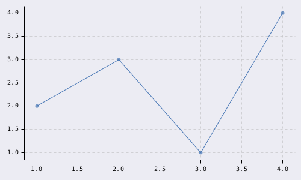
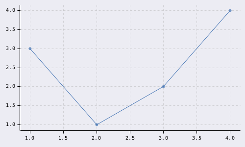
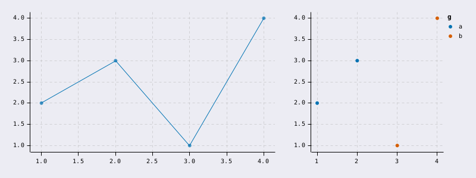
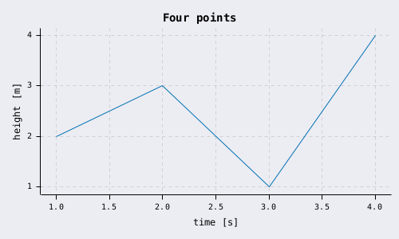
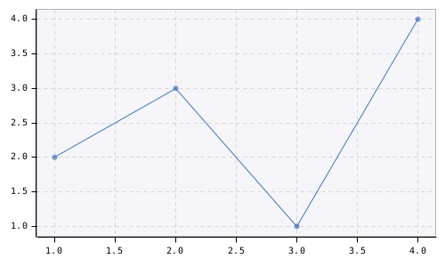

---
format:
  html:
    toc: true
    toc-location: right
    toc-depth: 4
    theme: cosmo
    include-in-header:
      text: |-
        <style>
        .data-table { width: fit-content; max-width: 100%; max-height: 15rem; overflow: auto; margin: 0 0 1rem 0; }
        .data-table .table-responsive { overflow: visible; }
        .data-table table { font-size: 0.75rem; width: auto; margin: 0; }
        .data-table th, .data-table td { padding: 0.1rem 0.45rem !important; white-space: nowrap; }
        .data-table thead th { position: sticky; top: 0; background: var(--bs-body-bg, #fff); }
        .options { margin: 0.5rem 0 1rem 0; }
        .options .option-card { margin: 0 0 0.9rem 0; border: 1px solid var(--bs-border-color, #dee2e6); border-radius: 0.375rem; overflow: hidden; }
        .options dt { display: flex; flex-wrap: wrap; align-items: baseline; gap: 0.1rem 1rem; margin: 0; padding: 0.4rem 0.75rem; background: #eef2f7; border-bottom: 1px solid var(--bs-border-color, #dee2e6); font-weight: normal; }
        .options dt > code { font-weight: 700; font-size: 1rem; background: none; padding: 0; }
        .options .option-default { font-size: 0.85rem; color: var(--bs-secondary-color, #6c757d); }
        .options dd { margin: 0; padding: 0.5rem 0.75rem; }
        .options .option-example { font-size: 0.85rem; padding: 0 0 0.45rem 0; margin-bottom: 0.45rem; border-bottom: 1px dashed var(--bs-border-color, #dee2e6); }
        .options .option-example code { background: none; padding: 0; }
        .options .option-text ul { margin: 0.3rem 0 0 0; padding-left: 1.25rem; }
        .options code, .mapping code { overflow-wrap: anywhere; }
        .options .option-default code, .options .option-example code { white-space: pre-wrap; }
        .mapping { margin: 0.5rem 0 1rem 0; padding: 0.5rem 0.75rem; border: 1px solid var(--bs-border-color, #dee2e6); border-left: 0.3rem solid #2780e3; border-radius: 0.375rem; background: #f5f8fc; }
        .mapping-title { font-weight: 700; margin-bottom: 0.25rem; }
        .mapping-hint { font-weight: normal; font-size: 0.85rem; color: var(--bs-secondary-color, #6c757d); }
        .mapping ul { margin: 0; padding-left: 1.25rem; }
        .mapping .required { font-size: 0.75rem; padding: 0 0.3rem; border: 1px solid currentColor; border-radius: 0.25rem; }
        .mapping-returns { margin-top: 0.25rem; }
        .mapping code { white-space: pre-wrap; }
        .shared { margin: 0.5rem 0 1rem 0; padding: 0.5rem 0.75rem; border: 1px solid var(--bs-border-color, #dee2e6); border-left: 0.3rem solid #6c757d; border-radius: 0.375rem; background: #f6f6f6; }
        .shared-title { font-weight: 700; margin-bottom: 0.25rem; }
        .shared-hint { font-weight: normal; font-size: 0.85rem; color: var(--bs-secondary-color, #6c757d); }
        .shared ul { margin: 0; padding-left: 1.25rem; }
        .shared code { overflow-wrap: anywhere; }
        p code, li code { white-space: pre-wrap; overflow-wrap: anywhere; }
        </style>
code-block-background: true

---
<style></style><style>.printedClojure .sourceCode {
  background-color: transparent;
  border-style: none;
}
</style><style>.clay-limit-image-width .clay-image {max-width: 100%}
.clay-side-by-side .sourceCode {margin: 0}
.clay-side-by-side {margin: 1em 0}
</style>
<script src="https://code.jquery.com/jquery-3.6.0.min.js" type="text/javascript"></script><script src="https://code.jquery.com/ui/1.13.1/jquery-ui.min.js" type="text/javascript"></script>

# Overview

The reference lists every option of cljplot2: the plot map, render options, scales, facets, labels, the theme,
every chart, builder and user-facing data function. The option cards are generated from the library's validating
schemas, so they name exactly what `plot/build` accepts. Use cases and galleries show the options at work; these
four parts say what exists.


::: {.sourceClojure}
```clojure
(ns reference.intro
  (:require [cljplot2.chart :as chart]
            [cljplot2.core :as plot]
            [cljplot2.describe :as describe]
            [cljplot2.pipeline :as pipeline]
            [notebook-utils :as nu]))
```
:::


The table below holds four made-up points in two groups; most plots of A plot is a map draw them:


::: {.sourceClojure}
```clojure
(def points [{:x 1 :y 2 :g "a"} {:x 2 :y 3 :g "a"} {:x 3 :y 1 :g "b"} {:x 4 :y 4 :g "b"}])
```
:::


```{=html}
<div class="data-table"><table class="table table-hover table-responsive clay-table"><thead><tr><th>x</th><th>y</th><th>g</th></tr></thead><tbody><tr><td>1</td><td>2</td><td>a</td></tr><tr><td>2</td><td>3</td><td>a</td></tr><tr><td>3</td><td>1</td><td>b</td></tr><tr><td>4</td><td>4</td><td>b</td></tr></tbody></table></div>
```


## How the reference is organised


* **Concepts** (this chapter and the next twelve) - rendering, data and mapping, types, aesthetics and legends, scales
  and coordinates, layering, labels and text, facets and multiplots, the theme, the shared option groups, errors
  and what the library doesn't do.

* **Charts** - the options of each chart kind, grouped by what they show:
  [points, lines and areas](reference.charts_points_lines.html), [annotations](reference.charts_annotations.html),
  [bars](reference.charts_bars.html), [distribution per level](reference.charts_per_level.html),
  [distribution of one variable](reference.charts_one_variable.html),
  [fitted and function curves](reference.charts_fitted_curves.html),
  [2D bins and fields](reference.charts_bins_fields.html), [pairwise statistics](reference.charts_pairwise.html),
  [shares and sets](reference.charts_shares_sets.html),
  [multivariate and 3D](reference.charts_multivariate_3d.html).

* **Builders** (from [Graphs](reference.builders_graphs.html)) - the functions turning rows into whole plots:
  networks, trees, series.

* **Data functions** (from [Levels](reference.data_levels.html)) - the user-facing functions preparing rows, and
  internal namespaces shown by example.


## How to read a card

Each group of cards holds related options and comes before an example that uses them - a plot or a value.


* **Header** - the option's key and its default. A nested key shows its path inside the group's map
  (`:scales :x`), `(theme)` marks a default the theme holds, and a computed default is described in words. Keys
  without a default (required keys, and maps whose own keys follow) show none.

* **Example** - for most options, a call that sets the option, or a plot map for plot keys
  (`{:scales {:x {:kind :log}}}`).

* **Text** - what the option does, then a point per value or form with its meaning. An option of one form shows
  only its [type](reference.types.html), and a long list ends with its other values on one line.

A chart's, builder's or data function's section lists the shared groups of options it takes in a box linking to
the Shared options chapter, its mapping keys in a Mapping box and its positional arguments in an Arguments box.


## A plot is a map

`plot/render-image` takes a plot map and render options and returns a `java.awt.image.BufferedImage`. The plot
keys come in groups; each has its chapter.


### Content

These keys hold the rows, how their values map to dimensions, and the charts drawing them
([Data and mapping](reference.data_mapping.html)):


```{=html}
<dl class="options"><div class="option-card"><dt><code>:data</code><span class="option-default">Default: None: each chart brings its own <code>:data</code>.</span></dt><dd><div class="option-example"><code>{:data [{:x 1, :y 2} {:x 2, :y 3} {:x 3, :y 1}]}</code></div><div class="option-text">The rows or columns the charts read; a chart's own <code>:data</code> wins over it.<ul><li><a href="reference.types.html#data">data</a></li></ul></div></dd></div><div class="option-card"><dt><code>:mapping</code><span class="option-default">Default: None: each chart brings its own <code>:mapping</code>.</span></dt><dd><div class="option-example"><code>{:mapping {:x :t, :y :v, :color :w}}</code></div><div class="option-text">The accessors of the dimensions the charts read, merged under each chart's own mapping (Data and mapping).<ul><li><span>mapping</span></li></ul></div></dd></div><div class="option-card"><dt><code>:charts</code><span class="option-default">Default: None: an empty panel.</span></dt><dd><div class="option-example"><code>{:charts [(chart/scatter)]}</code></div><div class="option-text">The charts, drawn in order: a later chart lies on top.<ul><li><span>vector of charts</span></li></ul></div></dd></div><div class="option-card"><dt><code>:groups</code></dt><dd><div class="option-text">How the rows' grouping treats missing values.</div></dd></div></dl>
```


The plot below draws the points as a line with points:


::: {.sourceClojure}
```clojure
(plot/render-image {:data points
                    :mapping {:x :x :y :y}
                    :charts [(chart/line) (chart/scatter)]}
                   {:width 500 :height 300})
```
:::


::: {.clay-image}

:::


The same rows under another mapping - `:x` and `:y` swapped - give another plot:


::: {.sourceClojure}
```clojure
(plot/render-image {:data points
                    :mapping {:x :y :y :x}
                    :charts [(chart/line) (chart/scatter)]}
                   {:width 500 :height 300})
```
:::


::: {.clay-image}

:::


### Scales

This key turns data values into positions, colours, shapes ...:


```{=html}
<dl class="options"><div class="option-card"><dt><code>:scales</code></dt><dd><div class="option-text">The scale specs by dimension: position, facet and aesthetic scales.</div></dd></div></dl>
```


The plot below fixes and reverses the y domain and names the colours and their legend:


::: {.sourceClojure}
```clojure
(plot/render-image {:data points
                    :mapping {:x :x :y :y :color :g}
                    :charts [(chart/scatter {:size 12})]
                    :scales {:y {:domain [0 5] :reverse true}
                             :color {:range [:darkorange :teal] :title "group"}}}
                   {:width 500 :height 300})
```
:::


::: {.clay-image}

:::


The `:scales` map takes a spec per dimension
([Scales, axes and coordinates](reference.scales_axes_coords.html), [Facets, multiplots and margins](reference.facets_arrange.html),
[Aesthetics and legends](reference.aesthetics_legends.html)):


```{=html}
<dl class="options"><div class="option-card"><dt><code>:scales :x</code><span class="option-default">Default: From the data.</span></dt><dd><div class="option-example"><code>{:scales {:x {:reverse true}}}</code></div><div class="option-text">The x position scale's spec (Scales, axes and coordinates).<ul><li><span>position scale spec</span></li></ul></div></dd></div><div class="option-card"><dt><code>:scales :y</code><span class="option-default">Default: From the data.</span></dt><dd><div class="option-example"><code>{:scales {:y {:reverse true}}}</code></div><div class="option-text">The y position scale's spec (Scales, axes and coordinates).<ul><li><span>position scale spec</span></li></ul></div></dd></div><div class="option-card"><dt><code>:scales :facet</code><span class="option-default">Default: The data's levels, sorted.</span></dt><dd><div class="option-example"><code>{:scales {:facet {:domain [2 1]}}}</code></div><div class="option-text">The spec of the <code>:facet</code> levels: their panel order and strip texts (Facets, multiplots and margins).<ul><li><span>facet scale spec</span></li></ul></div></dd></div><div class="option-card"><dt><code>:scales :facet-col</code><span class="option-default">Default: The data's levels, sorted.</span></dt><dd><div class="option-example"><code>{:scales {:facet-col {:domain [2 1]}}}</code></div><div class="option-text">The spec of the <code>:facet-col</code> levels: their panel order and strip texts (Facets, multiplots and margins).<ul><li><span>facet scale spec</span></li></ul></div></dd></div><div class="option-card"><dt><code>:scales :facet-row</code><span class="option-default">Default: The data's levels, sorted.</span></dt><dd><div class="option-example"><code>{:scales {:facet-row {:domain [2 1]}}}</code></div><div class="option-text">The spec of the <code>:facet-row</code> levels: their panel order and strip texts (Facets, multiplots and margins).<ul><li><span>facet scale spec</span></li></ul></div></dd></div><div class="option-card"><dt><code>:scales :color</code><span class="option-default">Default: From the data and the theme's <code>:palette</code>.</span></dt><dd><div class="option-example"><code>{:scales {:color {:range [:gold :darkred]}}}</code></div><div class="option-text">The color aesthetic scale's spec (Aesthetics and legends).<ul><li><span>aesthetic scale spec</span></li></ul></div></dd></div><div class="option-card"><dt><code>:scales :shape</code><span class="option-default">Default: From the data and the theme's <code>:palette</code>.</span></dt><dd><div class="option-example"><code>{:scales {:shape {:range [\s \A]}}}</code></div><div class="option-text">The shape aesthetic scale's spec (Aesthetics and legends).<ul><li><span>aesthetic scale spec</span></li></ul></div></dd></div><div class="option-card"><dt><code>:scales :size</code><span class="option-default">Default: From the data and the theme's <code>:palette</code>.</span></dt><dd><div class="option-example"><code>{:scales {:size {:range [1 20]}}}</code></div><div class="option-text">The size aesthetic scale's spec (Aesthetics and legends).<ul><li><span>aesthetic scale spec</span></li></ul></div></dd></div><div class="option-card"><dt><code>:scales :dash</code><span class="option-default">Default: From the data and the theme's <code>:palette</code>.</span></dt><dd><div class="option-example"><code>{:scales {:dash {:range [:dotted :solid]}}}</code></div><div class="option-text">The dash aesthetic scale's spec (Aesthetics and legends).<ul><li><span>aesthetic scale spec</span></li></ul></div></dd></div><div class="option-card"><dt><code>:scales :pattern</code><span class="option-default">Default: From the data and the theme's <code>:palette</code>.</span></dt><dd><div class="option-example"><code>{:scales {:pattern {:range [:dots :cross]}}}</code></div><div class="option-text">The pattern aesthetic scale's spec (Aesthetics and legends).<ul><li><span>aesthetic scale spec</span></li></ul></div></dd></div></dl>
```


The plot below spreads the small values with a logarithmic x scale:


::: {.sourceClojure}
```clojure
(plot/render-image {:data (for [i (range 1 30)] {:x (* i i i) :y i})
                    :mapping {:x :x :y :y}
                    :charts [(chart/scatter)]
                    :scales {:x {:kind :log :formatter :power}}}
                   {:width 500 :height 300})
```
:::


::: {.clay-image}

:::


### Coordinates

These keys set the coordinates: cartesian, flipped or with equal units, or polar
([Scales, axes and coordinates](reference.scales_axes_coords.html)):


```{=html}
<dl class="options"><div class="option-card"><dt><code>:aspect</code><span class="option-default">Default: Free: the panel takes the space it gets.</span></dt><dd><div class="option-example"><code>{:aspect :iso}</code></div><div class="option-text">The ratio of the panel's axes in data units.<ul><li><code>:iso</code> – Equal pixels per data unit on both linear axes; the panel shrinks to fit.</li></ul></div></dd></div><div class="option-card"><dt><code>:flip</code><span class="option-default">Default: <code>false</code></span></dt><dd><div class="option-example"><code>{:flip true}</code></div><div class="option-text">Whether the <code>:x</code> scale is drawn vertically and the <code>:y</code> scale horizontally; scales, labels and theme keys keep their names.<ul><li><code>false</code> – <code>:x</code> horizontal, <code>:y</code> vertical.</li><li><code>true</code> – Flipped.</li></ul></div></dd></div><div class="option-card"><dt><code>:coord</code><span class="option-default">Default: Cartesian.</span></dt><dd><div class="option-example"><code>{:coord {:kind :polar}}</code></div><div class="option-text">The coordinate system the panels map the position scales to.<ul><li><span><code>{:kind :cartesian}</code></span> – Cartesian <code>{:kind :cartesian}</code>, or a polar coord whose keys the cards below list.</li><li><span>polar coord</span> – Cartesian <code>{:kind :cartesian}</code>, or a polar coord whose keys the cards below list.</li></ul></div></dd></div></dl>
```


The plot below flips the bars horizontal, their order reversed:


::: {.sourceClojure}
```clojure
(plot/render-image {:data [{:fruit "apples" :n 3} {:fruit "pears" :n 5} {:fruit "plums" :n 2}]
                    :mapping {:x :fruit :y :n}
                    :charts [(chart/bar)]
                    :scales {:x {:reverse true}}
                    :flip true}
                   {:width 500 :height 300})
```
:::


::: {.clay-image}

:::


The same bars in polar coordinates - a rose (bars filling their band, `:width 1.0`,
[Strip options](reference.shared_options.html#strip-options)):


::: {.sourceClojure}
```clojure
(plot/render-image {:data [{:fruit "apples" :n 3} {:fruit "pears" :n 5} {:fruit "plums" :n 2}]
                    :mapping {:x :fruit :y :n :color :fruit}
                    :charts [(chart/bar {:width 1.0})]
                    :coord {:kind :polar}
                    :legend false}
                   {:width 350 :height 350})
```
:::


::: {.clay-image}

:::


### Layout

These keys split the panel by data, put several plots in a grid or charts beside the panel
([Facets, multiplots and margins](reference.facets_arrange.html)):


```{=html}
<dl class="options"><div class="option-card"><dt><code>:facets</code><span class="option-default">Default: One panel per facet level, sharing scales.</span></dt><dd><div class="option-example"><code>{:facets {:columns 1}}</code></div><div class="option-text">The facet layout: wrap shape, panel order, the NA panel, scale relations, strips and panel weights (Facets, multiplots and margins).</div></dd></div><div class="option-card"><dt><code>:custom-grid</code><span class="option-default">Default: None: the generated grid.</span></dt><dd><div class="option-text">A hand-written layout grid instead of the generated one; only <code>:labels {:title t}</code> may stand beside it.<ul><li><span>map</span> – Tracks and items of the <code>cljplot2.layout.grid</code> namespace doc (Facets, multiplots and margins).</li></ul></div></dd></div><div class="option-card"><dt><code>:arrange</code><span class="option-default">Default: None: a single plot.</span></dt><dd><div class="option-text">A multiplot: sub-plots in a grid; only <code>:labels {:title t}</code> may stand beside it (<code>plot/arrange</code> builds it).<ul><li><span>arrange map</span></li></ul></div></dd></div><div class="option-card"><dt><code>:margins</code><span class="option-default">Default: None.</span></dt><dd><div class="option-example"><code>{:margins {:top (chart/density)}}</code></div><div class="option-text">Charts beside the panel, sharing its scales (Facets, multiplots and margins).</div></dd></div></dl>
```


The plot below splits the points into a panel per group:


::: {.sourceClojure}
```clojure
(plot/render-image {:data points
                    :mapping {:x :x :y :y :facet :g}
                    :charts [(chart/line) (chart/scatter)]}
                   {:width 500 :height 300})
```
:::


::: {.clay-image}

:::


The plot below puts two plots in one image with `plot/arrange`, in two columns weighted 3 : 2:


::: {.sourceClojure}
```clojure
(plot/render-image (plot/arrange [{:data points :mapping {:x :x :y :y} :charts [(chart/line) (chart/scatter)]}
                                  {:data points :mapping {:x :x :y :y :color :g} :charts [(chart/scatter)]}]
                                 {:columns 2 :widths [3 2]})
                   {:width 800 :height 300})
```
:::


::: {.clay-image}

:::


### Titles

This key holds the titles ([Labels and text](reference.labels_text.html)):


```{=html}
<dl class="options"><div class="option-card"><dt><code>:labels</code><span class="option-default">Default: No title; the axis titles the charts suggest.</span></dt><dd><div class="option-example"><code>{:labels {:title "Walks"}}</code></div><div class="option-text">The plot title and the axis titles (Labels and text).</div></dd></div></dl>
```


The plot below names the plot and both axes:


::: {.sourceClojure}
```clojure
(plot/render-image {:data points
                    :mapping {:x :x :y :y}
                    :charts [(chart/line)]
                    :labels {:title "Four points" :x "time [s]" :y "height [m]"}}
                   {:width 500 :height 300})
```
:::


::: {.clay-image}

:::


### Legend

Mapped aesthetics draw legends; these keys hide them or draw only them
([Aesthetics and legends](reference.aesthetics_legends.html)):


```{=html}
<dl class="options"><div class="option-card"><dt><code>:legend</code><span class="option-default">Default: <code>true</code></span></dt><dd><div class="option-example"><code>{:legend false}</code></div><div class="option-text">Whether the plot draws its legends.<ul><li><code>true</code> – Every scale's legend unless its own <code>:legend</code> is false.</li><li><code>false</code> – No legends.</li></ul></div></dd></div><div class="option-card"><dt><code>:legend-only</code><span class="option-default">Default: <code>false</code></span></dt><dd><div class="option-example"><code>{:legend-only true}</code></div><div class="option-text">Whether the plot draws only its legends, e.g. as a legend cell of an arrange.<ul><li><code>false</code> – The whole plot.</li><li><code>true</code> – Legends only: no panel or axes.</li></ul></div></dd></div></dl>
```


The plot below hides the legend of its colours:


::: {.sourceClojure}
```clojure
(plot/render-image {:data points
                    :mapping {:x :x :y :y :color :g}
                    :charts [(chart/scatter {:size 12})]
                    :legend false}
                   {:width 500 :height 300})
```
:::


::: {.clay-image}

:::


### Style

The theme holds every style default; these keys override parts of it for one plot ([Theme](reference.theme.html)):


```{=html}
<dl class="options"><div class="option-card"><dt><code>:alternate-panel</code><span class="option-default">Default: <code>false</code></span></dt><dd><div class="option-example"><code>{:alternate-panel true}</code></div><div class="option-text">Whether a single panel is shaded as an odd facet panel, with the theme's <code>[:panel :alternate-fill]</code>.<ul><li><code>false</code> – Not shaded.</li><li><code>true</code> – Shaded, e.g. a checkerboard of arranged cells.</li></ul></div></dd></div><div class="option-card"><dt><code>:theme</code><span class="option-default">Default: The default theme.</span></dt><dd><div class="option-example"><code>{:theme {:plot {:background :white}}}</code></div><div class="option-text">Theme overrides, deep-merged over the default theme (Theme).<ul><li><span>any value</span></li></ul></div></dd></div></dl>
```


The plot below gives the plot a white background and the panel a light fill and a border:


::: {.sourceClojure}
```clojure
(plot/render-image {:data points
                    :mapping {:x :x :y :y}
                    :charts [(chart/line) (chart/scatter)]
                    :theme {:plot {:background :white}
                            :panel {:fill [245 245 250] :border-color [180 180 180]}}}
                   {:width 500 :height 300})
```
:::


::: {.clay-image}

:::


### Render options

This key lets a plot carry its render options ([Render](reference.render.html)):


```{=html}
<dl class="options"><div class="option-card"><dt><code>:options</code><span class="option-default">Default: None: the defaults, or the render options given to <code>build</code>.</span></dt><dd><div class="option-example"><code>{:options {:debug true}}</code></div><div class="option-text">Render options, merged under those given to <code>build</code> or <code>render-image</code> (Render).<ul><li><span>map</span> – Keys of the render options.</li></ul></div></dd></div></dl>
```


The plot below carries its own size, so `render-image` takes no options:


::: {.sourceClojure}
```clojure
(plot/render-image {:data points
                    :mapping {:x :x :y :y}
                    :charts [(chart/line)]
                    :options {:width 300 :height 200}})
```
:::


::: {.clay-image}

:::


## The pipeline

`plot/build` validates the plot first and throws an error listing the problems ([Errors](reference.errors.html)). Then the plot
passes through pure stages, each adding one key: `:split` (rows split per facet panel and group) → `:stats`
(each chart's computed data) → `:extents` → `:scale-specs` → `:grid` → `:layout` → `:finalized-scales` →
`:subplots`. `plot/render` draws the result.


## The cards as data

The cards come from `cljplot2.describe`, which you can use at the REPL too:


* `describe/options` returns the rows of a chart value, a builder or data function var, or a schema;
* `describe/mapping` returns the mapping keys a chart reads, `describe/theme-rows` the theme's rows and
  `describe/fragment-rows` a shared group's;

* `describe/api-vars` lists the user-facing data functions, `describe/chart-constructors` the charts and
  `describe/attribute-values` the built-in shapes, dashes, patterns and cells.

A row is a plain map; `:section` names its slice of the options:


::: {.sourceClojure}
```clojure
(first (describe/options pipeline/plot-schema))
```
:::


::: {.printedClojure}
```clojure
{:description
 "The rows or columns the charts read; a chart's own `:data` wins over it.",
 :path [:data],
 :key :data,
 :fragment nil,
 :default nil,
 :section :content,
 :type
 "a sequence of rows (maps) or a map of columns (sequences) or nil",
 :default-doc "None: each chart brings its own `:data`.",
 :values [],
 :example [{:x 1, :y 2} {:x 2, :y 3} {:x 3, :y 1}],
 :other-values nil,
 :required false,
 :forms [{:form :cljplot2.data.rows/data, :type "data", :meaning nil}]}

```
:::


```{=html}
<div style="background-color:grey;height:2px;width:100%;"></div>
```


```{=html}
<div><pre><small><small>source: notebooks/reference/intro.clj</small></small></pre></div>
```