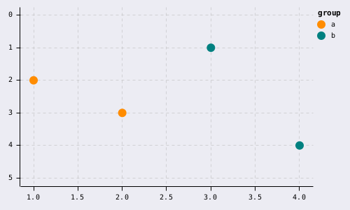
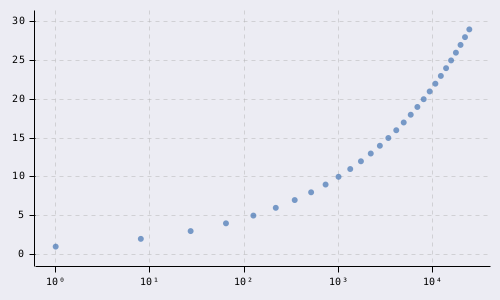
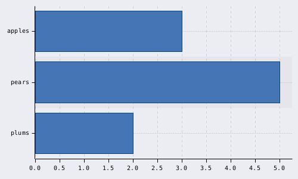
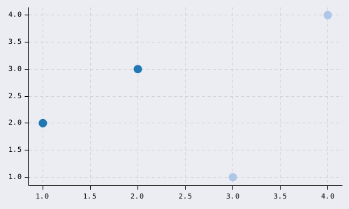
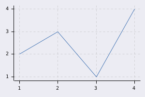

---
format:
  html: {toc: true, toc-location: right, toc-depth: 4, theme: cosmo}
code-block-background: true

---
<style></style><style>.printedClojure .sourceCode {
  background-color: transparent;
  border-style: none;
}
</style><style>.clay-limit-image-width .clay-image {max-width: 100%}
.clay-side-by-side .sourceCode {margin: 0}
.clay-side-by-side {margin: 1em 0}
</style>
<script src="https://code.jquery.com/jquery-3.6.0.min.js" type="text/javascript"></script><script src="https://code.jquery.com/ui/1.13.1/jquery-ui.min.js" type="text/javascript"></script>

# Reference

The reference lists every option of cljplot2: the plot map, render options, scales, facets, labels, the theme,
every chart, builder and user-facing data function. The tables are generated from the library's validating
schemas, so they name exactly what `plot/build` accepts. Use cases and galleries show the options at work; this
part says what exists.


::: {.sourceClojure}
```clojure
(ns reference.intro
  (:require [cljplot2.chart :as chart]
            [cljplot2.core :as plot]
            [cljplot2.describe :as describe]
            [cljplot2.pipeline :as pipeline]
            [notebook-utils :as nu]))
```
:::


## How the part is organised


* **Concepts** (this chapter and the next eleven) - rendering, data and mapping, aesthetics and legends, scales
  and coordinates, layering, labels and text, facets and multiplots, the theme, the shared option groups, errors
  and what the library doesn't do.

* **Charts**, **builders** and **data functions** - the options of each chart kind, builder and user-facing
  function, with examples (to come; until then the use cases and galleries show them).


## How to read a table

Each table is one group of related options, followed by an example using them - a chart or a value.


* **Option** - the key; a nested key is listed after its map, with its full path (`:scales :x`). `(required)`
  marks a key that must be given.

* **Type** - the values the schema accepts.
* **Default** - the value used when the key is absent (style defaults come from the theme), and / or how a
  computed default is found. Empty: absent means not set - an optional feature off, or a map whose own keys
  have the defaults.

* **Description** - what the key does.
* **Group** - shown when a table mixes keys of a shared group (data and mapping, curves, strips ...) with others;
  a group is described once, in the Shared options chapter.


## A plot is a map

`plot/render-image` takes a plot map and render options and returns a `java.awt.image.BufferedImage`. The plot
keys come in groups; each has its chapter.


### Content

The rows, how their values map to dimensions, and the charts drawing them (Data and mapping chapter).

::: {.clay-table}

```{=html}
<table class="table table-hover table-responsive clay-table"><thead><tr><th>Option</th><th>Type</th><th>Default</th><th>Description</th></tr></thead><tbody><tr><td>:data</td><td>a sequence of rows (maps) or a map of columns (sequences) or nil</td><td></td><td>rows (a sequence of maps) or columns (a map of sequences) the charts read</td></tr><tr><td>:mapping</td><td>a mapping: key -> accessor (a keyword or a function of a row) or nil</td><td></td><td>accessors of the dimensions the charts read (keywords or functions), merged under each chart's</td></tr><tr><td>:charts</td><td>vector of a chart value (see cljplot2.chart) or nil</td><td></td><td>the charts, drawn in order</td></tr><tr><td>:groups</td><td>map</td><td></td><td>grouping options</td></tr></tbody></table>
```

:::


::: {.sourceClojure}
```clojure
(def points [{:x 1 :y 2 :g "a"} {:x 2 :y 3 :g "a"} {:x 3 :y 1 :g "b"} {:x 4 :y 4 :g "b"}])
```
:::


::: {.clay-table}

```{=html}
<table class="table table-hover table-responsive clay-table"><thead><tr><th>x</th><th>y</th><th>g</th></tr></thead><tbody><tr><td>1</td><td>2</td><td>a</td></tr><tr><td>2</td><td>3</td><td>a</td></tr><tr><td>3</td><td>1</td><td>b</td></tr><tr><td>4</td><td>4</td><td>b</td></tr></tbody></table>
```

:::


::: {.sourceClojure}
```clojure
(plot/render-image {:data points
                    :mapping {:x :x :y :y}
                    :charts [(chart/line) (chart/scatter)]}
                   {:width 500 :height 300})
```
:::


::: {.clay-image}

:::


The same rows under another mapping - `:x` and `:y` swapped - give another plot:


::: {.sourceClojure}
```clojure
(plot/render-image {:data points
                    :mapping {:x :y :y :x}
                    :charts [(chart/line) (chart/scatter)]}
                   {:width 500 :height 300})
```
:::


::: {.clay-image}

:::


### Scales

How data values become positions, colours, shapes ... (Scales and Aesthetics chapters).

::: {.clay-table}

```{=html}
<table class="table table-hover table-responsive clay-table"><thead><tr><th>Option</th><th>Type</th><th>Default</th><th>Description</th></tr></thead><tbody><tr><td>:scales</td><td>map</td><td></td><td>position, facet and aesthetic scale specs</td></tr></tbody></table>
```

:::


::: {.sourceClojure}
```clojure
(plot/render-image {:data points
                    :mapping {:x :x :y :y :color :g}
                    :charts [(chart/scatter {:size 12})]
                    :scales {:y {:domain [0 5] :reverse true}
                             :color {:range [:darkorange :teal] :title "group"}}}
                   {:width 500 :height 300})
```
:::


::: {.clay-image}

:::


A logarithmic x scale spreads the small values:


::: {.sourceClojure}
```clojure
(plot/render-image {:data (for [i (range 1 30)] {:x (* i i i) :y i})
                    :mapping {:x :x :y :y}
                    :charts [(chart/scatter)]
                    :scales {:x {:kind :log :formatter :power}}}
                   {:width 500 :height 300})
```
:::


::: {.clay-image}

:::


### Coordinates

Cartesian (optionally flipped or with equal units) or polar (Scales chapter).

::: {.clay-table}

```{=html}
<table class="table table-hover table-responsive clay-table"><thead><tr><th>Option</th><th>Type</th><th>Default</th><th>Description</th></tr></thead><tbody><tr><td>:aspect</td><td>one of :iso or nil</td><td></td><td>:iso - equal pixels per data unit on x and y (linear scales)</td></tr><tr><td>:flip</td><td>true or false or nil</td><td>false</td><td>draw the :x scale vertically and :y horizontally</td></tr><tr><td>:coord</td><td>{:kind :cartesian} or a polar coord {:kind :polar ...} or nil</td><td>cartesian</td><td>coordinate system: cartesian or polar</td></tr></tbody></table>
```

:::


::: {.sourceClojure}
```clojure
(plot/render-image {:data [{:fruit "apples" :n 3} {:fruit "pears" :n 5} {:fruit "plums" :n 2}]
                    :mapping {:x :fruit :y :n}
                    :charts [(chart/bar)]
                    :scales {:x {:reverse true}}
                    :flip true}
                   {:width 500 :height 300})
```
:::


::: {.clay-image}

:::


The same bars in polar coordinates - a rose:


::: {.sourceClojure}
```clojure
(plot/render-image {:data [{:fruit "apples" :n 3} {:fruit "pears" :n 5} {:fruit "plums" :n 2}]
                    :mapping {:x :fruit :y :n :color :fruit}
                    :charts [(chart/bar {:width 1.0})]
                    :coord {:kind :polar}
                    :legend false}
                   {:width 350 :height 350})
```
:::


::: {.clay-image}

:::


### Layout

Panels split by data, several plots in a grid, charts beside the panel (Facets chapter).

::: {.clay-table}

```{=html}
<table class="table table-hover table-responsive clay-table"><thead><tr><th>Option</th><th>Type</th><th>Default</th><th>Description</th></tr></thead><tbody><tr><td>:facets</td><td>map</td><td></td><td>facet layout: wrap shape, order, NA panel, scale relations, strips, panel weights</td></tr><tr><td>:custom-grid</td><td>map or nil</td><td></td><td>a hand-written layout grid instead of the generated one (only :labels {:title t} beside it)</td></tr><tr><td>:arrange</td><td>an arrange map {:plots :columns :rows :widths :heights :align :equal-panels} or nil</td><td></td><td>a multiplot: sub-plots in a grid (only :labels {:title t} beside it)</td></tr><tr><td>:margins</td><td>map</td><td></td><td>charts beside the panel sharing its scales (marginal plots)</td></tr></tbody></table>
```

:::


::: {.sourceClojure}
```clojure
(plot/render-image {:data points
                    :mapping {:x :x :y :y :facet :g}
                    :charts [(chart/line) (chart/scatter)]}
                   {:width 500 :height 300})
```
:::


::: {.clay-image}

:::


A hand-written grid of plots and a note (`:custom-grid`, Facets chapter):


::: {.sourceClojure}
```clojure
(plot/render-image {:custom-grid {:columns [{:size [:flexible 2]} {:size [:flexible 1]}]
                                  :rows [{:size [:flexible 1]} {:size [:measured]}]
                                  :items [{:id :lines :column 0 :row 0
                                           :content {:kind :plot :plot {:data points :mapping {:x :x :y :y}
                                                                        :charts [(chart/line)]}}}
                                          {:id :bars :column 1 :row 0
                                           :content {:kind :plot :plot {:data points :mapping {:x :g :y :y}
                                                                        :charts [(chart/bar {:stat :sum})]}}}
                                          {:id :note :column {:from 0 :to 1} :row 1
                                           :content {:kind :label :role :axis-title :text "two plots, 2 : 1"}}]}}
                   {:width 600 :height 320})
```
:::


::: {.clay-image}

:::


### Titles

The plot title and the axis titles (Labels chapter).

::: {.clay-table}

```{=html}
<table class="table table-hover table-responsive clay-table"><thead><tr><th>Option</th><th>Type</th><th>Default</th><th>Description</th></tr></thead><tbody><tr><td>:labels</td><td>map</td><td></td><td>plot title and axis titles</td></tr></tbody></table>
```

:::


::: {.sourceClojure}
```clojure
(plot/render-image {:data points
                    :mapping {:x :x :y :y}
                    :charts [(chart/line)]
                    :labels {:title "Four points" :x "time [s]" :y "height [m]"}}
                   {:width 500 :height 300})
```
:::


::: {.clay-image}

:::


### Legend

Legends are drawn for mapped aesthetics; these keys hide them or draw only them (Aesthetics chapter).

::: {.clay-table}

```{=html}
<table class="table table-hover table-responsive clay-table"><thead><tr><th>Option</th><th>Type</th><th>Default</th><th>Description</th></tr></thead><tbody><tr><td>:legend</td><td>true or false or nil</td><td>true</td><td>draw the legends (false hides all)</td></tr><tr><td>:legend-only</td><td>true or false or nil</td><td>false</td><td>draw only the legends (a legend cell of an :arrange)</td></tr></tbody></table>
```

:::


::: {.sourceClojure}
```clojure
(plot/render-image {:data points
                    :mapping {:x :x :y :y :color :g}
                    :charts [(chart/scatter {:size 12})]
                    :legend false}
                   {:width 500 :height 300})
```
:::


::: {.clay-image}

:::


### Style

The theme holds every style default; a plot overrides parts of it (Theme chapter).

::: {.clay-table}

```{=html}
<table class="table table-hover table-responsive clay-table"><thead><tr><th>Option</th><th>Type</th><th>Default</th><th>Description</th></tr></thead><tbody><tr><td>:alternate-panel</td><td>true or false or nil</td><td>false</td><td>shade a single panel as an odd facet panel (theme [:panel :alternate-fill])</td></tr><tr><td>:theme</td><td>any value</td><td></td><td>theme overrides, deep-merged over the default theme</td></tr></tbody></table>
```

:::


::: {.sourceClojure}
```clojure
(plot/render-image {:data points
                    :mapping {:x :x :y :y}
                    :charts [(chart/line) (chart/scatter)]
                    :theme {:plot {:background :white}
                            :panel {:fill [245 245 250] :border-color [180 180 180]}}}
                   {:width 500 :height 300})
```
:::


::: {.clay-image}

:::


### Render options

Render options travel with the plot under `:options`; those given to `render-image` win (Render chapter).

::: {.clay-table}

```{=html}
<table class="table table-hover table-responsive clay-table"><thead><tr><th>Option</th><th>Type</th><th>Default</th><th>Description</th></tr></thead><tbody><tr><td>:options</td><td>map or nil</td><td></td><td>render options, merged under the ones given to build / render</td></tr></tbody></table>
```

:::


::: {.sourceClojure}
```clojure
(plot/render-image {:data points
                    :mapping {:x :x :y :y}
                    :charts [(chart/line)]
                    :options {:width 300 :height 200}})
```
:::


::: {.clay-image}

:::


## The pipeline

`plot/build` validates the plot first and throws an error listing the problems (Errors chapter). Then the plot
passes through pure stages, each adding one key: `:split` (rows split per facet panel and group) → `:stats`
(each chart's computed data) → `:extents` → `:scale-specs` → `:grid` → `:layout` → `:finalized-scales` →
`:subplots`. `plot/render` draws the result.


## The tables as data

The tables come from `cljplot2.describe`, usable at the REPL too: `describe/options` takes a chart value, a
builder or data function var or a schema; `describe/mapping` the mapping keys a chart reads; `describe/theme-rows`
the theme; `describe/fragment-rows` a shared group; `describe/api-vars` lists the user-facing data functions,
`describe/chart-constructors` the charts. A row is a plain map; `:section` names its table slice:


::: {.sourceClojure}
```clojure
(first (describe/options pipeline/plot-schema))
```
:::


::: {.printedClojure}
```clojure
{:description
 "rows (a sequence of maps) or columns (a map of sequences) the charts read",
 :path [:data],
 :required? false,
 :key :data,
 :fragment nil,
 :default nil,
 :section :content,
 :type
 "a sequence of rows (maps) or a map of columns (sequences) or nil",
 :default-doc nil}

```
:::


```{=html}
<div style="background-color:grey;height:2px;width:100%;"></div>
```


```{=html}
<div><pre><small><small>source: notebooks/reference/intro.clj</small></small></pre></div>
```