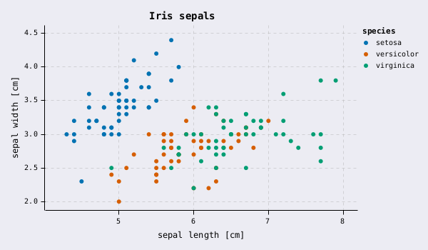
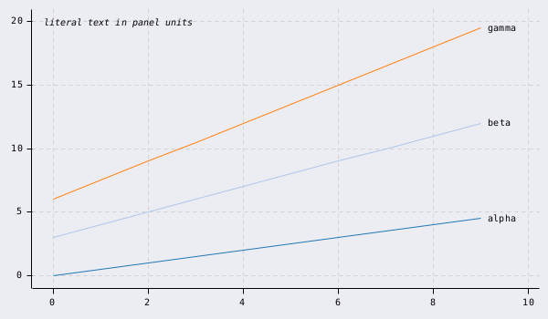
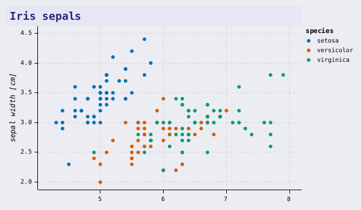
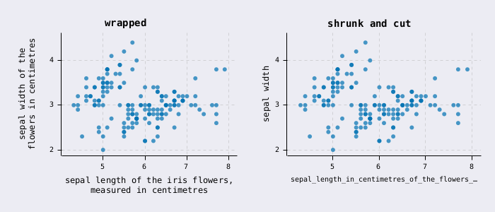

---
format:
  html:
    toc: true
    toc-location: right
    toc-depth: 4
    theme: cosmo
    include-in-header:
      text: |-
        <style>
        .data-table { width: fit-content; max-width: 100%; max-height: 15rem; overflow: auto; margin: 0 0 1rem 0; }
        .data-table .table-responsive { overflow: visible; }
        .data-table table { font-size: 0.75rem; width: auto; margin: 0; }
        .data-table th, .data-table td { padding: 0.1rem 0.45rem !important; white-space: nowrap; }
        .data-table thead th { position: sticky; top: 0; background: var(--bs-body-bg, #fff); }
        </style>
code-block-background: true

---
<style></style><style>.printedClojure .sourceCode {
  background-color: transparent;
  border-style: none;
}
</style><style>.clay-limit-image-width .clay-image {max-width: 100%}
.clay-side-by-side .sourceCode {margin: 0}
.clay-side-by-side {margin: 1em 0}
</style>
<script src="https://code.jquery.com/jquery-3.6.0.min.js" type="text/javascript"></script><script src="https://code.jquery.com/ui/1.13.1/jquery-ui.min.js" type="text/javascript"></script>

# Labels and text

A plot has a title and two axis titles (`:labels`), each a string or a label map with its own text style. Text
drawn by charts (the `text` chart, value labels, strip and legend texts) takes its style from a theme text role.


::: {.sourceClojure}
```clojure
(ns reference.labels-text
  (:require [cljplot2.chart :as chart]
            [cljplot2.content.label :as label]
            [cljplot2.core :as plot]
            [cljplot2.describe :as describe]
            [cljplot2.graphics.font :as font]
            [cljplot2.layout.plot-grid :as plot-grid]
            [notebook-utils :as nu]))
```
:::


## Plot labels

The plot title and the axis titles. Axis titles are absent unless given, except that statistical charts
(histogram, density, ecdf, qq ...) suggest one for their computed axis.

::: {.clay-table}

```{=html}
<table class="table table-hover table-responsive clay-table"><thead><tr><th>Option</th><th>Type</th><th>Default</th><th>Description</th></tr></thead><tbody><tr><td>:title</td><td>a label options map (:text, :role, :rotation, text style keys) or any value or nil</td><td></td><td>plot title above the panels (role :title)</td></tr><tr><td>:x</td><td>a label options map (:text, :role, :rotation, text style keys) or any value or nil</td><td>the first chart's suggested title (histogram, density, ecdf, qq, pp ...), else none</td><td>x axis title (role :axis-title)</td></tr><tr><td>:y</td><td>a label options map (:text, :role, :rotation, text style keys) or any value or nil</td><td>the first chart's suggested title (histogram, density, ecdf, qq, pp ...), else none</td><td>y axis title (role :axis-title, rotated 270)</td></tr></tbody></table>
```

:::


Data: Edgar Anderson's iris measurements, R datasets package `iris` (Anderson 1935; Fisher 1936); licence: Part of R (GPL-2 | GPL-3).


::: {.sourceClojure}
```clojure
(def iris (nu/dataset :iris))
```
:::


```{=html}
<div class="data-table"><table class="table table-hover table-responsive clay-table"><thead><tr><th>sepal-length</th><th>sepal-width</th><th>petal-length</th><th>petal-width</th><th>species</th></tr></thead><tbody><tr><td>5.1</td><td>3.5</td><td>1.4</td><td>0.2</td><td>setosa</td></tr><tr><td>4.9</td><td>3</td><td>1.4</td><td>0.2</td><td>setosa</td></tr><tr><td>4.7</td><td>3.2</td><td>1.3</td><td>0.2</td><td>setosa</td></tr><tr><td>4.6</td><td>3.1</td><td>1.5</td><td>0.2</td><td>setosa</td></tr><tr><td>5</td><td>3.6</td><td>1.4</td><td>0.2</td><td>setosa</td></tr><tr><td>5.4</td><td>3.9</td><td>1.7</td><td>0.4</td><td>setosa</td></tr><tr><td>4.6</td><td>3.4</td><td>1.4</td><td>0.3</td><td>setosa</td></tr><tr><td>5</td><td>3.4</td><td>1.5</td><td>0.2</td><td>setosa</td></tr><tr><td>4.4</td><td>2.9</td><td>1.4</td><td>0.2</td><td>setosa</td></tr><tr><td>4.9</td><td>3.1</td><td>1.5</td><td>0.1</td><td>setosa</td></tr><tr><td>5.4</td><td>3.7</td><td>1.5</td><td>0.2</td><td>setosa</td></tr><tr><td>4.8</td><td>3.4</td><td>1.6</td><td>0.2</td><td>setosa</td></tr><tr><td>4.8</td><td>3</td><td>1.4</td><td>0.1</td><td>setosa</td></tr><tr><td>4.3</td><td>3</td><td>1.1</td><td>0.1</td><td>setosa</td></tr><tr><td>5.8</td><td>4</td><td>1.2</td><td>0.2</td><td>setosa</td></tr><tr><td>5.7</td><td>4.4</td><td>1.5</td><td>0.4</td><td>setosa</td></tr><tr><td>5.4</td><td>3.9</td><td>1.3</td><td>0.4</td><td>setosa</td></tr><tr><td>5.1</td><td>3.5</td><td>1.4</td><td>0.3</td><td>setosa</td></tr><tr><td>5.7</td><td>3.8</td><td>1.7</td><td>0.3</td><td>setosa</td></tr><tr><td>5.1</td><td>3.8</td><td>1.5</td><td>0.3</td><td>setosa</td></tr><tr><td>5.4</td><td>3.4</td><td>1.7</td><td>0.2</td><td>setosa</td></tr><tr><td>5.1</td><td>3.7</td><td>1.5</td><td>0.4</td><td>setosa</td></tr><tr><td>4.6</td><td>3.6</td><td>1</td><td>0.2</td><td>setosa</td></tr><tr><td>5.1</td><td>3.3</td><td>1.7</td><td>0.5</td><td>setosa</td></tr><tr><td>4.8</td><td>3.4</td><td>1.9</td><td>0.2</td><td>setosa</td></tr><tr><td>5</td><td>3</td><td>1.6</td><td>0.2</td><td>setosa</td></tr><tr><td>5</td><td>3.4</td><td>1.6</td><td>0.4</td><td>setosa</td></tr><tr><td>5.2</td><td>3.5</td><td>1.5</td><td>0.2</td><td>setosa</td></tr><tr><td>5.2</td><td>3.4</td><td>1.4</td><td>0.2</td><td>setosa</td></tr><tr><td>4.7</td><td>3.2</td><td>1.6</td><td>0.2</td><td>setosa</td></tr><tr><td>4.8</td><td>3.1</td><td>1.6</td><td>0.2</td><td>setosa</td></tr><tr><td>5.4</td><td>3.4</td><td>1.5</td><td>0.4</td><td>setosa</td></tr><tr><td>5.2</td><td>4.1</td><td>1.5</td><td>0.1</td><td>setosa</td></tr><tr><td>5.5</td><td>4.2</td><td>1.4</td><td>0.2</td><td>setosa</td></tr><tr><td>4.9</td><td>3.1</td><td>1.5</td><td>0.2</td><td>setosa</td></tr><tr><td>5</td><td>3.2</td><td>1.2</td><td>0.2</td><td>setosa</td></tr><tr><td>5.5</td><td>3.5</td><td>1.3</td><td>0.2</td><td>setosa</td></tr><tr><td>4.9</td><td>3.6</td><td>1.4</td><td>0.1</td><td>setosa</td></tr><tr><td>4.4</td><td>3</td><td>1.3</td><td>0.2</td><td>setosa</td></tr><tr><td>5.1</td><td>3.4</td><td>1.5</td><td>0.2</td><td>setosa</td></tr><tr><td>5</td><td>3.5</td><td>1.3</td><td>0.3</td><td>setosa</td></tr><tr><td>4.5</td><td>2.3</td><td>1.3</td><td>0.3</td><td>setosa</td></tr><tr><td>4.4</td><td>3.2</td><td>1.3</td><td>0.2</td><td>setosa</td></tr><tr><td>5</td><td>3.5</td><td>1.6</td><td>0.6</td><td>setosa</td></tr><tr><td>5.1</td><td>3.8</td><td>1.9</td><td>0.4</td><td>setosa</td></tr><tr><td>4.8</td><td>3</td><td>1.4</td><td>0.3</td><td>setosa</td></tr><tr><td>5.1</td><td>3.8</td><td>1.6</td><td>0.2</td><td>setosa</td></tr><tr><td>4.6</td><td>3.2</td><td>1.4</td><td>0.2</td><td>setosa</td></tr><tr><td>5.3</td><td>3.7</td><td>1.5</td><td>0.2</td><td>setosa</td></tr><tr><td>5</td><td>3.3</td><td>1.4</td><td>0.2</td><td>setosa</td></tr><tr><td>7</td><td>3.2</td><td>4.7</td><td>1.4</td><td>versicolor</td></tr><tr><td>6.4</td><td>3.2</td><td>4.5</td><td>1.5</td><td>versicolor</td></tr><tr><td>6.9</td><td>3.1</td><td>4.9</td><td>1.5</td><td>versicolor</td></tr><tr><td>5.5</td><td>2.3</td><td>4</td><td>1.3</td><td>versicolor</td></tr><tr><td>6.5</td><td>2.8</td><td>4.6</td><td>1.5</td><td>versicolor</td></tr><tr><td>5.7</td><td>2.8</td><td>4.5</td><td>1.3</td><td>versicolor</td></tr><tr><td>6.3</td><td>3.3</td><td>4.7</td><td>1.6</td><td>versicolor</td></tr><tr><td>4.9</td><td>2.4</td><td>3.3</td><td>1</td><td>versicolor</td></tr><tr><td>6.6</td><td>2.9</td><td>4.6</td><td>1.3</td><td>versicolor</td></tr><tr><td>5.2</td><td>2.7</td><td>3.9</td><td>1.4</td><td>versicolor</td></tr><tr><td>5</td><td>2</td><td>3.5</td><td>1</td><td>versicolor</td></tr><tr><td>5.9</td><td>3</td><td>4.2</td><td>1.5</td><td>versicolor</td></tr><tr><td>6</td><td>2.2</td><td>4</td><td>1</td><td>versicolor</td></tr><tr><td>6.1</td><td>2.9</td><td>4.7</td><td>1.4</td><td>versicolor</td></tr><tr><td>5.6</td><td>2.9</td><td>3.6</td><td>1.3</td><td>versicolor</td></tr><tr><td>6.7</td><td>3.1</td><td>4.4</td><td>1.4</td><td>versicolor</td></tr><tr><td>5.6</td><td>3</td><td>4.5</td><td>1.5</td><td>versicolor</td></tr><tr><td>5.8</td><td>2.7</td><td>4.1</td><td>1</td><td>versicolor</td></tr><tr><td>6.2</td><td>2.2</td><td>4.5</td><td>1.5</td><td>versicolor</td></tr><tr><td>5.6</td><td>2.5</td><td>3.9</td><td>1.1</td><td>versicolor</td></tr><tr><td>5.9</td><td>3.2</td><td>4.8</td><td>1.8</td><td>versicolor</td></tr><tr><td>6.1</td><td>2.8</td><td>4</td><td>1.3</td><td>versicolor</td></tr><tr><td>6.3</td><td>2.5</td><td>4.9</td><td>1.5</td><td>versicolor</td></tr><tr><td>6.1</td><td>2.8</td><td>4.7</td><td>1.2</td><td>versicolor</td></tr><tr><td>6.4</td><td>2.9</td><td>4.3</td><td>1.3</td><td>versicolor</td></tr><tr><td>6.6</td><td>3</td><td>4.4</td><td>1.4</td><td>versicolor</td></tr><tr><td>6.8</td><td>2.8</td><td>4.8</td><td>1.4</td><td>versicolor</td></tr><tr><td>6.7</td><td>3</td><td>5</td><td>1.7</td><td>versicolor</td></tr><tr><td>6</td><td>2.9</td><td>4.5</td><td>1.5</td><td>versicolor</td></tr><tr><td>5.7</td><td>2.6</td><td>3.5</td><td>1</td><td>versicolor</td></tr><tr><td>5.5</td><td>2.4</td><td>3.8</td><td>1.1</td><td>versicolor</td></tr><tr><td>5.5</td><td>2.4</td><td>3.7</td><td>1</td><td>versicolor</td></tr><tr><td>5.8</td><td>2.7</td><td>3.9</td><td>1.2</td><td>versicolor</td></tr><tr><td>6</td><td>2.7</td><td>5.1</td><td>1.6</td><td>versicolor</td></tr><tr><td>5.4</td><td>3</td><td>4.5</td><td>1.5</td><td>versicolor</td></tr><tr><td>6</td><td>3.4</td><td>4.5</td><td>1.6</td><td>versicolor</td></tr><tr><td>6.7</td><td>3.1</td><td>4.7</td><td>1.5</td><td>versicolor</td></tr><tr><td>6.3</td><td>2.3</td><td>4.4</td><td>1.3</td><td>versicolor</td></tr><tr><td>5.6</td><td>3</td><td>4.1</td><td>1.3</td><td>versicolor</td></tr><tr><td>5.5</td><td>2.5</td><td>4</td><td>1.3</td><td>versicolor</td></tr><tr><td>5.5</td><td>2.6</td><td>4.4</td><td>1.2</td><td>versicolor</td></tr><tr><td>6.1</td><td>3</td><td>4.6</td><td>1.4</td><td>versicolor</td></tr><tr><td>5.8</td><td>2.6</td><td>4</td><td>1.2</td><td>versicolor</td></tr><tr><td>5</td><td>2.3</td><td>3.3</td><td>1</td><td>versicolor</td></tr><tr><td>5.6</td><td>2.7</td><td>4.2</td><td>1.3</td><td>versicolor</td></tr><tr><td>5.7</td><td>3</td><td>4.2</td><td>1.2</td><td>versicolor</td></tr><tr><td>5.7</td><td>2.9</td><td>4.2</td><td>1.3</td><td>versicolor</td></tr><tr><td>6.2</td><td>2.9</td><td>4.3</td><td>1.3</td><td>versicolor</td></tr><tr><td>5.1</td><td>2.5</td><td>3</td><td>1.1</td><td>versicolor</td></tr><tr><td>5.7</td><td>2.8</td><td>4.1</td><td>1.3</td><td>versicolor</td></tr><tr><td>…</td><td>…</td><td>…</td><td>…</td><td>…</td></tr></tbody></table></div>
```


::: {.sourceClojure}
```clojure
(plot/render-image {:data iris
                    :mapping {:x :sepal-length :y :sepal-width :color :species}
                    :charts [(chart/scatter)]
                    :labels {:title "Iris sepals" :x "sepal length [cm]" :y "sepal width [cm]"}}
                   {:width 600 :height 350})
```
:::


::: {.clay-image}

:::


## Label maps

A label is a string or a label map: the text, the theme text role whose style is the base (`:title` for the
title, `:axis-title` for axis titles, or a role of your theme) and a rotation. Plot labels get their role from
their place; a label in a custom grid (Facets chapter) must name one. Here the y title is horizontal and
styled as a tick label.

::: {.clay-table}

```{=html}
<table class="table table-hover table-responsive clay-table"><thead><tr><th>Option</th><th>Type</th><th>Default</th><th>Description</th></tr></thead><tbody><tr><td>:kind</td><td>:label</td><td></td><td>content kind (labels only)</td></tr><tr><td>:text</td><td>any value</td><td></td><td>the text (converted with str; \n breaks lines)</td></tr><tr><td>:role</td><td>keyword</td><td></td><td>theme text role styling the label (:title, :axis-title, ... or a role of your theme)</td></tr><tr><td>:rotation</td><td>one of 0 90 270</td><td>0</td><td>clockwise degrees (270 reads bottom to top)</td></tr></tbody></table>
```

:::


::: {.sourceClojure}
```clojure
(plot/render-image {:data iris
                    :mapping {:x :petal-length :y :petal-width}
                    :charts [(chart/scatter)]
                    :labels {:x {:text "petal length\n[cm]"}
                             :y {:text "petal\nwidth" :rotation 0 :role :tick-label}}}
                   {:width 600 :height 350})
```
:::


::: {.clay-image}

:::


## Label style

Text style keys in a label map override its role's style for this label only:

::: {.clay-table}

```{=html}
<table class="table table-hover table-responsive clay-table"><thead><tr><th>Option</th><th>Type</th><th>Default</th><th>Description</th></tr></thead><tbody><tr><td>:font</td><td>a bundled, installed or logical font name, or a java.awt.Font</td><td></td><td>font name (bundled, installed or logical) or a java.awt.Font</td></tr><tr><td>:size</td><td>a positive number</td><td></td><td>font size in points</td></tr><tr><td>:font-style</td><td>one of :bold :bold-italic :italic :plain</td><td></td><td>font style</td></tr><tr><td>:color</td><td>a clojure2d color or :contrast</td><td></td><td>text colour; :contrast - black or white by what is behind (a chart's fill under its labels, else the plot background)</td></tr><tr><td>:padding</td><td>a non-negative number</td><td></td><td>space around the text in pixels</td></tr><tr><td>:align</td><td>[h v], h one of :left :center :right, v one of :top :middle :bottom</td><td></td><td>alignment [horizontal vertical] of the text at its anchor</td></tr><tr><td>:background</td><td>a clojure2d color or :none</td><td></td><td>box colour behind the text (:none - no box)</td></tr></tbody></table>
```

:::


::: {.sourceClojure}
```clojure
(plot/render-image {:data iris
                    :mapping {:x :sepal-length :y :sepal-width :color :species}
                    :charts [(chart/scatter)]
                    :labels {:title {:text "Iris sepals" :size 18 :align [:left :middle] :color [40 40 120]
                                     :background [230 230 245] :padding 6}
                             :y {:text "sepal width [cm]" :font-style :italic}}}
                   {:width 600 :height 350})
```
:::


::: {.clay-image}

:::


## Text in the panel

The `text` chart writes literal text or a mapped `:label`; `:anchor`, `:offset` and `:rotation` place it,
`:select :last` labels the end of each group (e.g. line ends). Its full table is on the chart's page.


::: {.sourceClojure}
```clojure
(def series (for [[i g] (map-indexed vector ["alpha" "beta" "gamma"]) t (range 10)]
              {:g g :t t :v (+ (* t (inc i) 0.5) (* 3 i))}))
```
:::


```{=html}
<div class="data-table"><table class="table table-hover table-responsive clay-table"><thead><tr><th>g</th><th>t</th><th>v</th></tr></thead><tbody><tr><td>alpha</td><td>0</td><td>0.0</td></tr><tr><td>alpha</td><td>1</td><td>0.5</td></tr><tr><td>alpha</td><td>2</td><td>1.0</td></tr><tr><td>alpha</td><td>3</td><td>1.5</td></tr><tr><td>alpha</td><td>4</td><td>2.0</td></tr><tr><td>alpha</td><td>5</td><td>2.5</td></tr><tr><td>alpha</td><td>6</td><td>3.0</td></tr><tr><td>alpha</td><td>7</td><td>3.5</td></tr><tr><td>alpha</td><td>8</td><td>4.0</td></tr><tr><td>alpha</td><td>9</td><td>4.5</td></tr><tr><td>beta</td><td>0</td><td>3.0</td></tr><tr><td>beta</td><td>1</td><td>4.0</td></tr><tr><td>beta</td><td>2</td><td>5.0</td></tr><tr><td>beta</td><td>3</td><td>6.0</td></tr><tr><td>beta</td><td>4</td><td>7.0</td></tr><tr><td>beta</td><td>5</td><td>8.0</td></tr><tr><td>beta</td><td>6</td><td>9.0</td></tr><tr><td>beta</td><td>7</td><td>10.0</td></tr><tr><td>beta</td><td>8</td><td>11.0</td></tr><tr><td>beta</td><td>9</td><td>12.0</td></tr><tr><td>gamma</td><td>0</td><td>6.0</td></tr><tr><td>gamma</td><td>1</td><td>7.5</td></tr><tr><td>gamma</td><td>2</td><td>9.0</td></tr><tr><td>gamma</td><td>3</td><td>10.5</td></tr><tr><td>gamma</td><td>4</td><td>12.0</td></tr><tr><td>gamma</td><td>5</td><td>13.5</td></tr><tr><td>gamma</td><td>6</td><td>15.0</td></tr><tr><td>gamma</td><td>7</td><td>16.5</td></tr><tr><td>gamma</td><td>8</td><td>18.0</td></tr><tr><td>gamma</td><td>9</td><td>19.5</td></tr></tbody></table></div>
```


::: {.sourceClojure}
```clojure
(plot/render-image {:data series
                    :mapping {:x :t :y :v :color :g}
                    :charts [(chart/line)
                             (chart/text {:mapping {:x :t :y :v :label :g} :select :last :anchor [:left :middle]})
                             (chart/text {:x [:panel 0.02] :y [:panel 0.95] :text "literal text in panel units"
                                          :anchor [:left :middle] :font-style :italic})]
                    :legend false}
                   {:width 600 :height 350})
```
:::


::: {.clay-image}

:::


## font/resolve-font

A text style's `:font` is a family name or a `java.awt.Font`; `resolve-font` turns a name, a style (`:plain`,
`:bold`, `:italic`, `:bold-italic`) and a size in points into the `java.awt.Font` drawn. Bundled families
(`"DejaVu Sans Mono"` - the default theme's font, `"Noto Emoji"`) win over installed ones, so plots render alike on
every platform; installed and logical families (`"Serif"`, `"SansSerif"` ...) work too, an unknown name throws
`{:key :font}`. It takes no options map.


::: {.sourceClojure}
```clojure
(font/resolve-font "DejaVu Sans Mono" :bold 14)
```
:::


::: {.printedClojure}
```clojure
#object[java.awt.Font 0x3b8adb2b "java.awt.Font[family=DejaVu Sans Mono,name=DejaVu Sans Mono Bold,style=plain,size=14]"]

```
:::


::: {.sourceClojure}
```clojure
(font/resolve-font "Serif" :italic 12)
```
:::


::: {.printedClojure}
```clojure
#object[java.awt.Font 0x64126a2b "java.awt.Font[family=Serif,name=Serif,style=italic,size=12]"]

```
:::


A resolved font (here a bundled bold face) in a label, and a logical family by name for the axis titles:


::: {.sourceClojure}
```clojure
(plot/render-image {:data iris
                    :mapping {:x :sepal-length :y :sepal-width :color :species}
                    :charts [(chart/scatter)]
                    :labels {:title {:text "Iris sepals" :font (font/resolve-font "DejaVu Sans Mono" :bold 18)}
                             :x {:text "sepal length [cm]" :font "Serif"}
                             :y {:text "sepal width [cm]" :font "Serif" :font-style :italic}}}
                   {:width 600 :height 350})
```
:::


::: {.clay-image}

:::


```{=html}
<div style="background-color:grey;height:2px;width:100%;"></div>
```


```{=html}
<div><pre><small><small>source: notebooks/reference/labels_text.clj</small></small></pre></div>
```